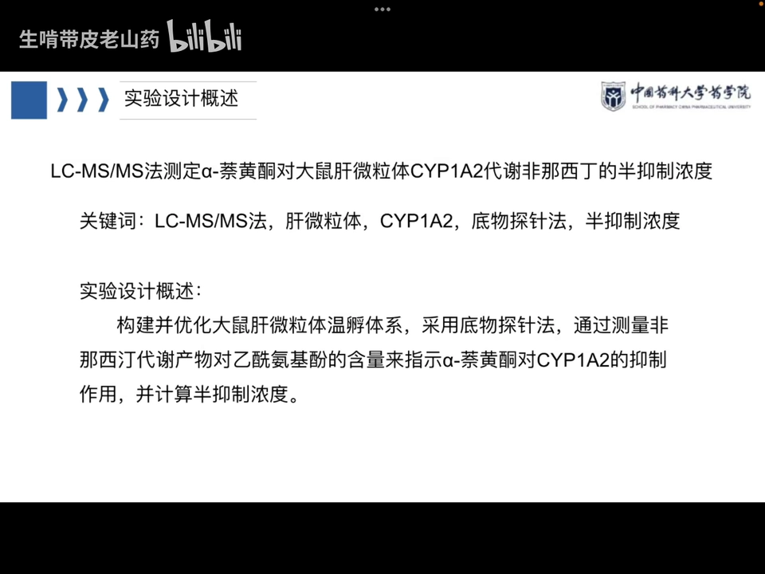
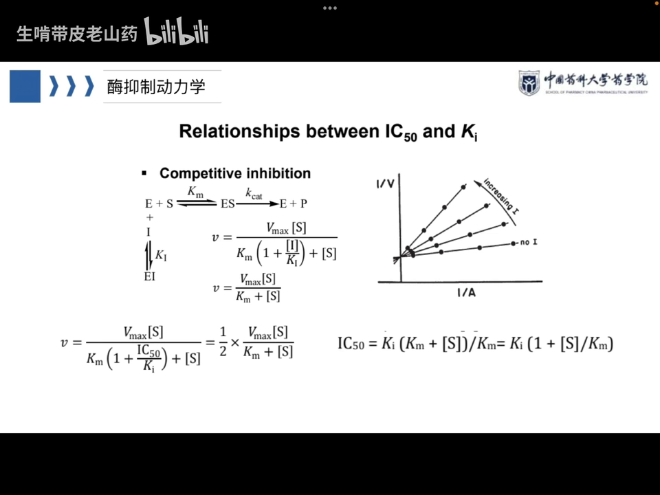
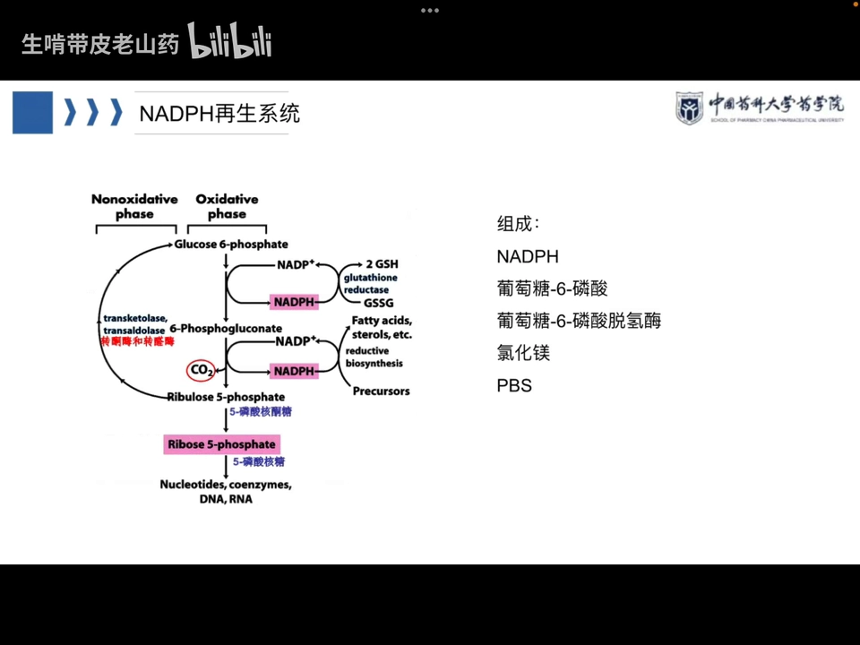
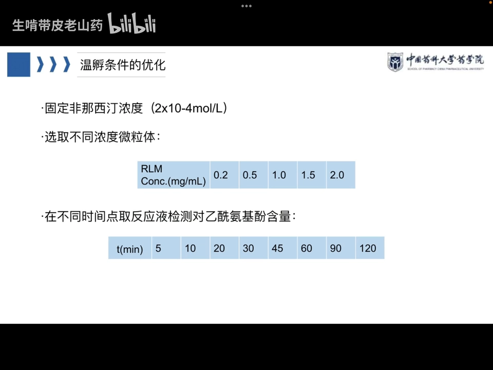
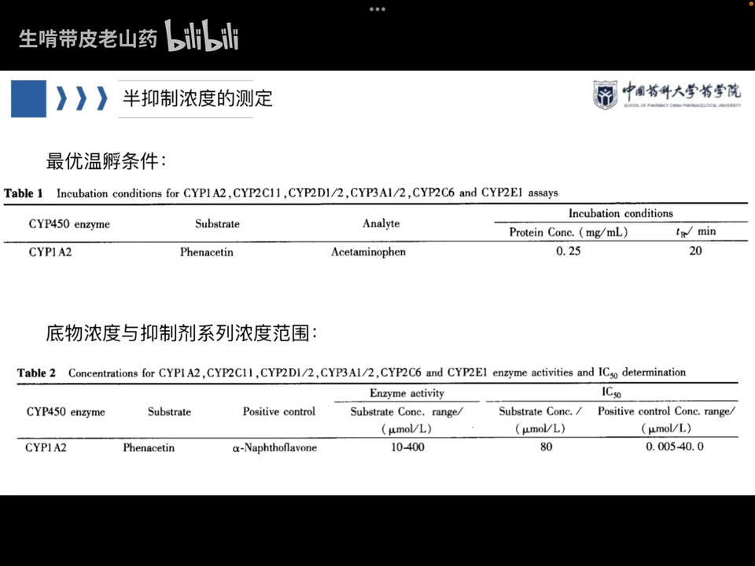
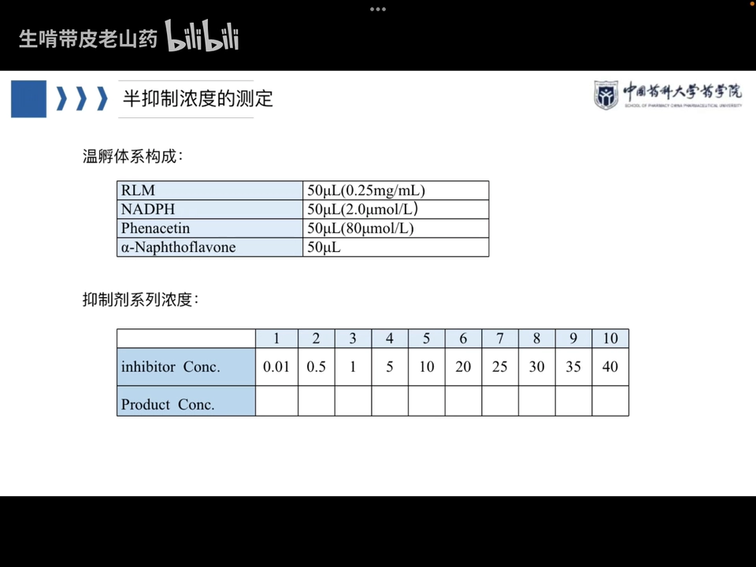
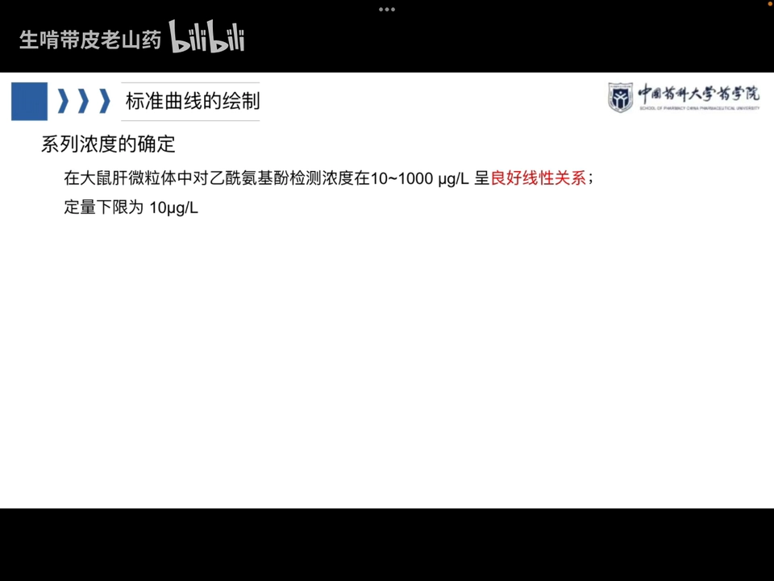
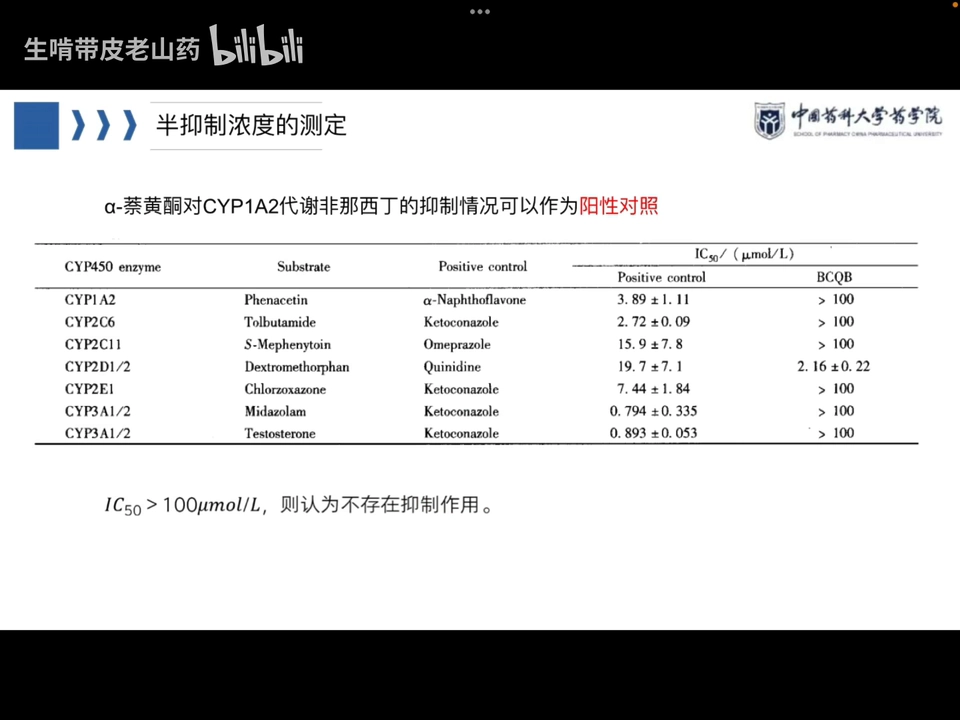
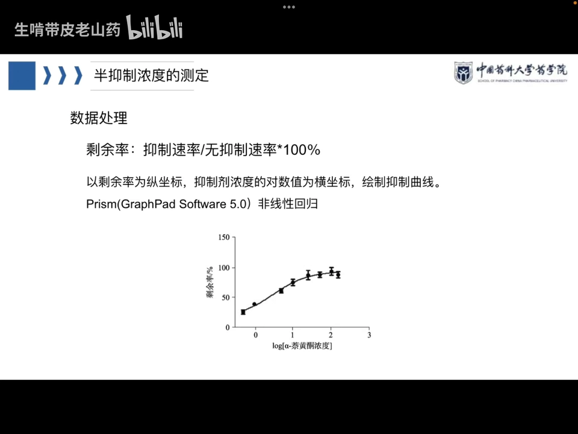
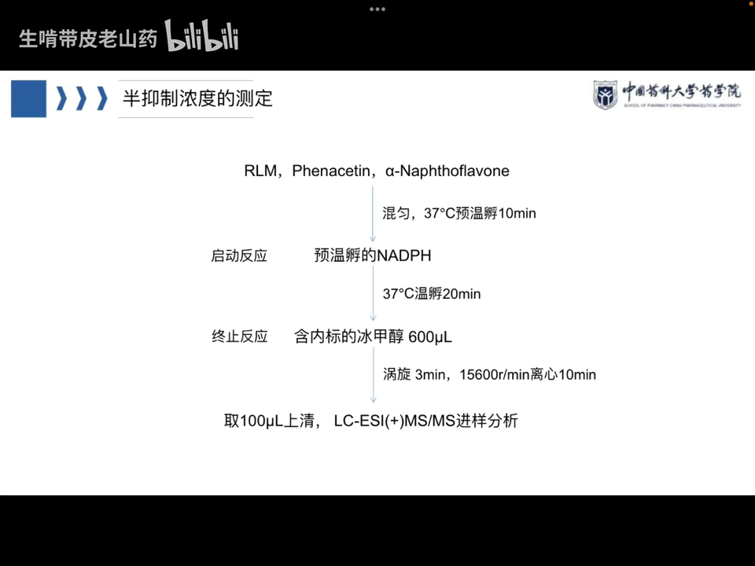

# IC50 是怎么测出来的：浓度梯度的范围、点数与非线性拟合

> 视频来源：[药代动实验设计 测定α-萘黄酮对肝微粒体CYP1A2代谢非那西丁的半抑制浓度](https://www.bilibili.com/video/BV1m24y1d7jy/)（Bilibili · 生啃带皮老山药）｜时长约 13 分钟
> 导读：这是一次研究生实验设计的汇报，讲者把「测一个 IC50」拆成了完整的工程流程：先讲 IC50 与 $K_i$ 的关系，再讲怎么把酶反应体系固定下来，然后讲浓度范围与点数怎么定，最后讲数据怎么拟合。视频里有一半篇幅是 LC-MS/MS 与肝微粒体制备的技术细节，与单细胞扰动关系较远，本文只保留与「剂量梯度设计」直接相关的部分，并在末尾把这套流程翻译到细胞实验上。IC50 在药理参数体系中的位置见本小节《小分子药物为什么必须做剂量梯度》，曲线的数学形式见《Hill 方程》。

## 本讲要解决的核心问题（SCQA）

**背景**：说一个化合物「抑制了某个靶点」，最常用的量化方式就是报一个 IC50——半抑制浓度。它出现在几乎每一篇化合物筛选、药物机制、剂量探索的文章里。

**冲突**：但 IC50 经常被当成一个「测出来的常数」来用，仿佛只要报一个数就够了。实际上它有两个容易被忽略的性质：**第一，它是曲线上 50% 那一点的横坐标，没有曲线就没有 IC50；第二，它依赖实验条件——尤其是底物浓度**，同一个抑制剂在不同底物浓度下测出的 IC50 可以差好几倍。这意味着「文献里的 IC50 = 3.89 μM」这句话，脱离条件是无法复现的。

**疑问**：那么一条可信的 IC50 曲线，实验上到底要经过哪几步？浓度范围怎么定、要布几个点、间隔怎么取、数据怎么算？

**回答（中心思想）**：**测 IC50 是一条流水线，四步缺一不可：先固定反应体系（让测到的是初速度）、再定浓度范围（覆盖从几乎无抑制到接近完全抑制）、再按对数间隔布点（通常 8–10 个）、最后用非线性回归拟合「剩余率–对数浓度」曲线读 50%。** 讲者这份设计的三个关键数字很能说明问题：抑制剂浓度范围 **0.005–40 μmol/L**、实际布点 **10 个**（0.01 一直到 40）、抑制曲线用 **Prism 非线性回归**拟合后读剩余率 50% 对应的浓度。

## 一、先把 IC50 定义清楚：它是曲线上的一个点

讲者的实验目标是：用 LC-MS/MS 测定 α-萘黄酮对大鼠肝微粒体 CYP1A2 代谢非那西丁的半抑制浓度 [【跳转到 00:00】](https://www.bilibili.com/video/BV1m24y1d7jy/?t=0)。方法上采用**底物探针法**：非那西丁是 CYP1A2 的一个特征性探针底物，**通过测量非那西丁的代谢产物也就是对乙酰氨基酚的含量，来指示 α-萘黄酮对 CYP1A2 的抑制作用** [【跳转到 00:25】](https://www.bilibili.com/video/BV1m24y1d7jy/?t=25)。

这条「测产物、不测酶」的思路值得单独强调：**你测的不是酶本身，而是酶的活性输出**。在单细胞实验里这一点是同一个道理——你测的也不是「靶点是否被结合」，而是靶点下游的某个读数（某基因的表达量、某个报告基因的强度、细胞是否死亡）。

### 1.1 IC50 与 $K_i$：为什么同一个抑制剂会有不同的 IC50

讲者先复习了酶抑制动力学 [【跳转到 01:40】](https://www.bilibili.com/video/BV1m24y1d7jy/?t=100)。抑制剂分几种类型：竞争性、非竞争性、反竞争性。以**竞争性抑制剂**为例，它通过和底物抢夺酶上的位点来发挥作用，因此会**影响底物和酶的亲和力，也就是使 $K_m$ 变大，但对 $V_{\max}$ 没有影响**。

于是有抑制时的反应速率是：

$$
v = \frac{V_{\max}[S]}{K_m\left(1 + \dfrac{[I]}{K_i}\right) + [S]}
$$

而 IC50 的定义是「效应为最大效应一半时的抑制剂浓度」。把 $[I] = \mathrm{IC}_{50}$ 代入并令 $v$ 等于无抑制时速率的一半，可以解出 [【跳转到 02:30】](https://www.bilibili.com/video/BV1m24y1d7jy/?t=150)：

$$
\mathrm{IC}_{50} = K_i\left(1 + \frac{[S]}{K_m}\right)
$$

这个式子给出了本节最重要的一条方法学结论：**IC50 不是抑制剂的固有常数，它随底物浓度 $[S]$ 变化。** $[S]$ 越大，需要越多的抑制剂才能把速率压到一半，IC50 就越大。所以：

- 报 IC50 必须同时报底物浓度、酶浓度、温孵时间等条件；
- 比较两个化合物的 IC50，必须在**同一套条件**下测；
- 只有在 $[S] \ll K_m$ 时，IC50 才近似等于 $K_i$。

讲者也交代了本实验的做法：因为对 α-萘黄酮到底属于哪类抑制剂没有事先认知，也缺少 $K_m$ 与 $K_i$ 的数据，所以作者是**直接按 IC50 的定义去算的**——计算有抑制剂存在时的反应速率与无抑制剂时反应速率的比值，当这个比值等于 50% 时，对应的抑制剂浓度就是 IC50 [【跳转到 02:55】](https://www.bilibili.com/video/BV1m24y1d7jy/?t=175)。

> **这是一个很实用的取舍**：当你只需要一个「排序用的相对指标」时，按定义直接读 50% 就够了；当你需要跨条件比较、或者要推断抑制机制时，才需要把 $K_i$ 解出来。

## 二、先固定体系：让测到的确实是「初速度」

在布浓度梯度之前，必须先保证体系本身是稳定的——否则你测到的「浓度效应」里会混进「反应时间不够」或「酶量不够」的假象。讲者的体系里有两块准备。

### 2.1 反应体系：底物、辅因子与再生系统

这个反应需要 NADPH 作为辅因子。讲者用了 **NADPH 再生系统**：由 NADP⁺、葡萄糖-6-磷酸和葡萄糖-6-磷酸脱氢酶组成，可以源源不断产生新的 NADPH 来维持一个相对稳定的浓度；氯化镁作为酶的激活剂，磷酸缓冲液则用来控制 pH [【跳转到 03:20】](https://www.bilibili.com/video/BV1m24y1d7jy/?t=200)。

**为什么要用再生系统而不是一次性加 NADPH？** 因为一次性加入的辅因子会随反应消耗而下降，反应速率就会随时间衰减——那样测到的「速率」就不再是初速度，而是一个混合了底物消耗与辅因子耗竭的平均值。**「让体系在测量窗口内保持恒定」是所有剂量-反应实验的共同前提。**

### 2.2 温孵条件优化：为什么要同时扫浓度和时间

接下来是这一步最值得学的部分：讲者固定底物（非那西丁）浓度，然后**同时扫两个维度**——不同浓度的微粒体（0.2、0.5、1.0、1.5、2.0 mg/mL）和不同时间点（5、10、20、30、45、60、90、120 分钟） [【跳转到 06:15】](https://www.bilibili.com/video/BV1m24y1d7jy/?t=375)。

以「峰面积比（代谢产物峰面积比内标峰面积）对时间」作图，每条线代表一种微粒体浓度，线上的每个点代表一个温孵时间。最终要选出**一个最合适的微粒体浓度和一个最合适的温孵时间** [【跳转到 06:40】](https://www.bilibili.com/video/BV1m24y1d7jy/?t=400)。

选择标准很有意思：**要选「上升至上的点」，并且还要选「最高点」** [【跳转到 07:30】](https://www.bilibili.com/video/BV1m24y1d7jy/?t=450)。为什么？

- 产物含量先升高、之后又慢慢降低——因为代谢分一相反应和二相反应：一相反应里非那西丁生成对乙酰氨基酚，二相反应里对乙酰氨基酚再经过结合反应，含量就下降了。
- 所以**必须赶在含量开始下降之前完成温孵**，即选上升段上的点；
- 同时又要选**含量最高**的点，因为含量最高最利于检测。

**这条原则可以原样搬到细胞实验**：任何剂量-反应实验都要先确认「在你的读数时间点上，响应还在上升或已到平台，而不是已经衰减」。如果时间点选在了响应的下降段，你测到的浓度效应会被时间效应污染。

## 三、浓度梯度怎么布：范围、点数、间隔

### 3.1 先定范围，再定点数

讲者的做法是先从文献里确定**范围**，再在范围内布**点数** [【跳转到 09:35】](https://www.bilibili.com/video/BV1m24y1d7jy/?t=575)：

- 最佳温孵条件：微粒体浓度 **0.25 mg/mL**，温孵时间 **20 分钟**；
- 底物浓度：**80 μmol/L**；
- 抑制剂浓度范围：**0.005 到 40 μmol/L**；
- 在这个范围内确定了 **10 个点**，从 0.01 一直到 40。

注意这里的**范围跨度是四个数量级**（0.005 到 40）。这不是随意取的：范围的下界要低到「几乎不抑制」，上界要高到「接近完全抑制」，否则拟合出来的曲线缺一头，50% 那一点只能靠外推。

### 3.2 具体的加样表：10 个浓度点长什么样

实际的抑制剂系列浓度是：0.01、0.5、1、5、10、20、25、30、35、40（μmol/L）。体系构成是四份各 50 μL，总量 200 μL [【跳转到 10:00】](https://www.bilibili.com/video/BV1m24y1d7jy/?t=600)。

这张表本身就能读出布点策略，值得逐段看：

- **低端很密**：0.01、0.5、1——低浓度区的点密集，因为要确定「从哪个浓度开始起效」；
- **中段跨度大**：1、5、10、20——这一段要覆盖 IC50 可能落在的位置；
- **高端在 20 之后又变密**：20、25、30、35、40——高端加密是为了确认「是否已经饱和」，也就是确认曲线右端确实走平了。

> 需要说明的是，这份设计并不是严格的对数等距布点（0.01 到 40 之间如果按半对数等距，点数分布会更均匀）。**它反映的是一个很常见的现实取舍**：范围由文献给出，点数由板位与工作量决定，于是低端和高端各加密、中段放宽。对单细胞扰动实验来说，同样的取舍问题也存在——孔位有限时，优先保证「跨过预期中点」和「两端各有落点」。

### 3.3 标准曲线：先证明「读数与含量成正比」

在测抑制剂之前，还要先做一条**标准曲线**：制备不同浓度的对乙酰氨基酚溶液，测出峰面积与浓度的关系。文献确定在 **10 到 1000 μg/L** 范围内呈良好线性关系，定量下限是 **10 μg/L**，因此在这个范围内确定了**八个点**（从 0 一直到 1000） [【跳转到 08:45】](https://www.bilibili.com/video/BV1m24y1d7jy/?t=525)。

最终回归方程是峰面积 $F$ 等于 0.00911 乘以浓度再减去 0.00136，$R$ 值达到三个九 [【跳转到 09:35】](https://www.bilibili.com/video/BV1m24y1d7jy/?t=575)。

**这一步在单细胞实验里的对应物是「读数的动态范围」**：你的测序深度、你的荧光检测窗口，能不能覆盖从「完全抑制」到「完全激活」的整个区间？如果读数在低端饱和（比如 UMI 计数为 0 就到底了）或高端饱和（比如荧光过曝），剂量-反应曲线的两端就会被压平，拟合出的参数是假的。

### 3.4 阳性对照：用已知的抑制剂证明体系有效

讲者最后交代了这个实验的真正目的：测 α-萘黄酮的 IC50，是为了把它当作**阳性对照**，用来检测另一个药物 BCQB 对 CYP450 酶系的抑制情况 [【跳转到 11:15】](https://www.bilibili.com/video/BV1m24y1d7jy/?t=675)。

做法是：选取七种 CYP450 酶，找到它们各自对应的特征性探针底物与抑制剂，测出各自的 IC50，作为「体系正常工作」的证据；再对 BCQB 做同样的实验，发现只有 CYP2D1/2D2 具有抑制作用，其他酶的 IC50 都超过 100，可以认为不存在抑制作用 [【跳转到 12:05】](https://www.bilibili.com/video/BV1m24y1d7jy/?t=725)。

这里有一条可以直接借用的判据：**IC50 大于 100 μmol/L，则认为不存在抑制作用**。它的含义是「在你的浓度范围上限都没压到一半」，也就是曲线根本没进入中段——**「没有抑制」和「测不出抑制」在数据上长得一模一样，区别只在于你有没有把浓度加到足够高。**

## 四、数据处理：剩余率与非线性拟合

最后一步是把数据变成 IC50。讲者用的指标是**剩余率**：

$$
\text{剩余率} = \frac{\text{有抑制剂存在时的反应速率}}{\text{无抑制剂存在时的反应速率}} \times 100\%
$$

它可以反映出抑制情况 [【跳转到 10:50】](https://www.bilibili.com/video/BV1m24y1d7jy/?t=650)。作图方式是：**以剩余率为纵坐标、以抑制剂浓度的对数值为横坐标**，绘制抑制曲线，再用 Prism（GraphPad）做非线性回归拟合 [【跳转到 11:15】](https://www.bilibili.com/video/BV1m24y1d7jy/?t=675)。

拟合完成后，**剩余率为 50% 时所对应的抑制剂浓度就是 IC50**。讲者还给出了完整的反应流程作为记录规范：微粒体、非那西丁、α-萘黄酮混匀后 37 ℃ 预温孵 10 分钟，加入预温孵的 NADPH 启动反应，37 ℃ 温孵 20 分钟，加入含内标的冰甲醇 600 μL 终止反应，涡旋 3 分钟、15600 r/min 离心 10 分钟，取 100 μL 上清进样分析 [【跳转到 10:25】](https://www.bilibili.com/video/BV1m24y1d7jy/?t=625)。

> **为什么必须写成这种「可复现的流水线」**：IC50 依赖底物浓度、酶浓度、温孵时间、终止方式。任何一项变了，数字就不能跨实验比较。讲者这份汇报的价值，一半在于流程本身。

## 五、把这条流水线搬到单细胞扰动实验上

这套流程的四步结构，在单细胞化学扰动里可以原样复用，只需要把「酶活性」换成「细胞读数」。

**第一步：固定体系。** 细胞实验里对应的是铺板密度、贴壁/悬浮状态、加药时的汇合度、培养基批次、加药时长。这些条件如果不固定，浓度效应里会混进「细胞密度效应」。**加药时长尤其要先做时间扫描**——对应讲者的「温孵条件优化」：先确认在你要的读数时间点上，响应还在上升或已到平台，而不是已经衰减。

**第二步：确定范围。** 下界要低到「几乎无效应」，上界要高到「接近最大效应」，同时上界不能进入非特异毒性区。这个上界可以用细胞活力（对应讲者的「阳性对照」思路）来定：如果某个浓度下大部分细胞已经死亡，那么它之后的所有表达变化都无法解释为靶点特异效应。

**第三步：布点。** 对数间隔、8–10 个点、跨过预期中点、两端各有落点。如果预期 IC50 完全未知，先做一次宽范围粗扫（例如 1 nM 到 100 μM 五个点），再在粗扫给出的中点附近加密。

**第四步：拟合。** 纵轴用「相对剩余响应」（加药组读数除以溶剂对照组读数），横轴用浓度的对数，非线性回归拟合后读 50% 对应的浓度。**用「相对剩余响应」而不是原始读数，是为了让不同批次、不同测序深度的数据可比**——这正是讲者用「剩余率」而不是直接用峰面积的原因。

> **本节边界**：溶剂（DMSO）对照与 vehicle 设计属于本系列 3.1.3 节；化合物溶解度、析出、非特异毒性的系统讨论属于本系列 3.4.5 节；单细胞层面「同一浓度下细胞间响应异质」属于 3.4.4 节。本节只讲「怎么把一个 IC50 测出来」这条实验原理与设计线索。

## 小结

- **IC50 是曲线上 50% 那一点的横坐标**，不是独立存在的常数；没有曲线就没有可靠的 IC50。
- **IC50 依赖底物浓度**：对竞争性抑制，$\mathrm{IC}_{50} = K_i(1 + [S]/K_m)$。报 IC50 必须连带报条件，跨条件比较无效。
- **先固定体系再布梯度**：用辅因子再生系统维持恒定、用「浓度 × 时间」二维扫描确定初速度窗口——**要选响应还在上升、且信号最强的那个时间点**。
- **范围要跨四个数量级、点数 8–10 个**：下界低到几乎无抑制、上界高到接近完全抑制，否则 50% 那一点只能外推。
- **布点不是均匀的**：低端确定起效点、中段覆盖中点、高端确认饱和，因此两端往往加密。
- **先做标准曲线**，确认读数与含量在动态范围内成正比，否则曲线两端会被饱和压平。
- **阳性对照证明体系有效**：IC50 大于 100 μmol/L 通常判为「无抑制作用」——但「无抑制」与「测不出抑制」在数据上不可区分，区别只在于浓度有没有加够。
- **数据处理用剩余率加对数浓度横轴做非线性回归**，读 50% 对应的浓度；用相对剩余响应而非原始读数，保证跨批次可比。

## 关键术语速查

| 术语 | 一句话解释 |
| --- | --- |
| IC50（半抑制浓度） | 使效应（或反应速率）降到最大效应一半时的抑制剂浓度 |
| $K_i$（抑制常数） | 抑制剂与酶结合的解离常数，是抑制剂本身的固有参数 |
| 竞争性抑制 | 抑制剂与底物抢夺酶活性位点，使 $K_m$ 变大、$V_{\max}$ 不变 |
| 底物探针法 | 用某酶的特征性底物及其产物含量来指示该酶的活性 |
| 剩余率 | 有抑制剂时的反应速率除以无抑制剂时的反应速率，用百分比表示 |
| 初速度 | 反应刚开始、底物与辅因子尚未明显消耗时的速率，是动力学测量的前提 |
| 阳性对照 | 用已知有效的抑制剂验证体系与流程正常工作 |
| 标准曲线 | 已知浓度标准品与检测信号之间的线性关系，用于把信号换算成含量 |
| 非线性回归 | 用模型函数（如 Hill 方程）拟合数据点，而不是先做线性变换 |
| 定量下限 | 方法能够可靠定量的最低浓度，低于它信号无法与噪声区分 |