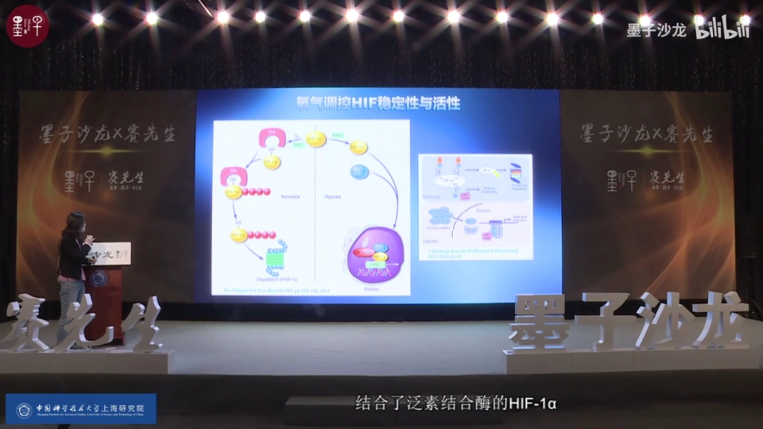
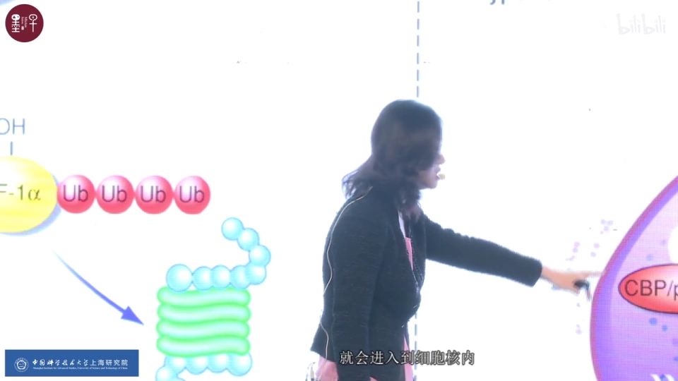
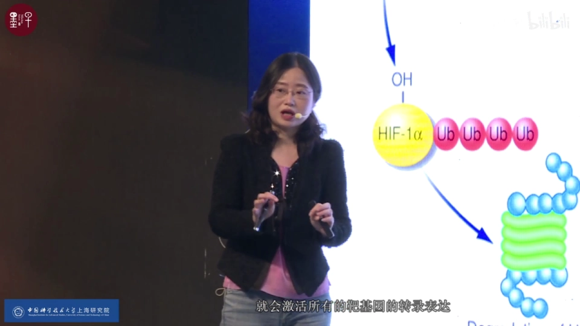
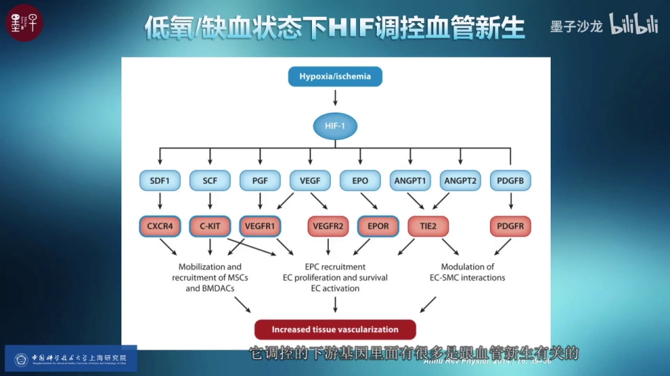
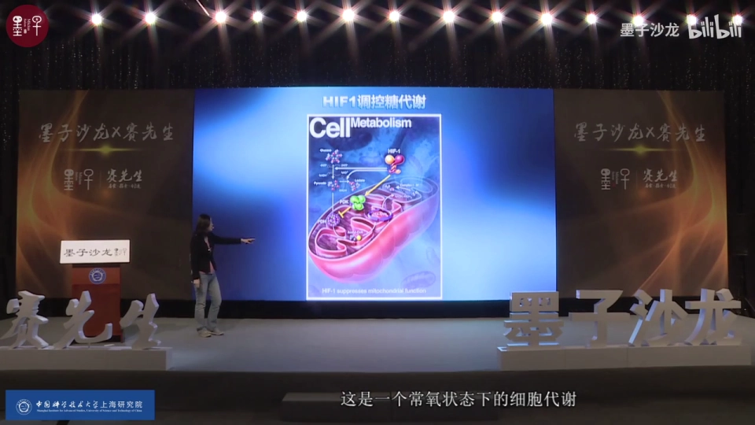
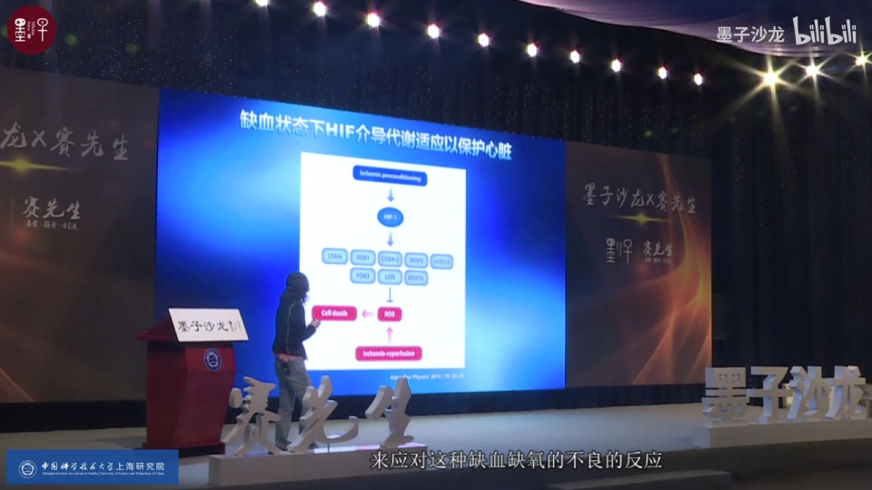
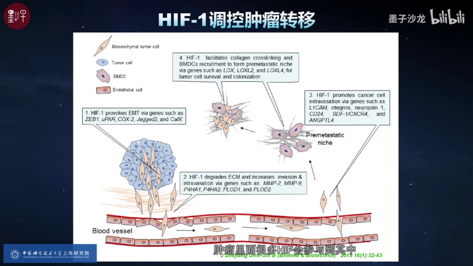
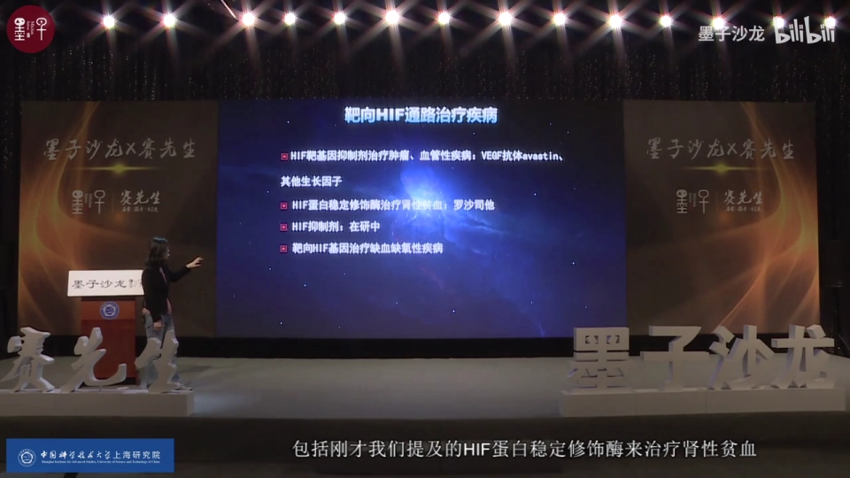

# 细胞如何感知氧气：HIF-1α 的降解开关，与氧浓度这把标尺

> 视频来源：[2019诺贝尔生理学或医学奖解读——缺氧诱导因子（HIF）的发现及基于其通路的医学研究](https://www.bilibili.com/video/BV1EE411V7jP/)（Bilibili · 墨子沙龙 · 上海交通大学医学院 王婷）｜时长约 22 分钟
> 导读：这是一场面向公众的诺奖解读，讲者把「细胞怎么知道氧气够不够」拆成了一条可以画出箭头的分子链：羟基化 → VHL → 泛素化 → 蛋白酶体。本文按「环境为什么算一种扰动 → 氧感知的开关怎么工作 → 缺氧后细胞改什么 → 这条通路怎么变成药 → 对单细胞扰动实验意味着什么」重排，并在最后补上本节关心的实验设计要点。视频后三分之一是讲者的访学经历与所在医院介绍，与本节无关，本文不收录。

## 本讲要解决的核心问题（SCQA）

**背景**：前面几节讲的扰动，要么改基因（CRISPR 敲除、RNAi 敲低），要么加化合物（小分子药物）。它们的共同点是：你往细胞里**放进了一个东西**，或者**改掉了细胞里的一个东西**。

**冲突**：但还有一类扰动，你什么也没放进去、什么也没改——你只是把细胞**挪到了另一个环境里**。把培养箱的氧气从 20% 调到 1%，细胞没有多一个基因、没有多一个分子，可它的转录程序会大面积改写。这类扰动没有「剂量」这个直观概念吗？有的，剂量就是氧分压。可它到底是怎么被细胞「读」到的？如果细胞根本不知道自己缺氧，那环境就只是背景噪声，谈不上扰动。

**疑问**：细胞靠什么分子机制感知氧浓度？为什么「氧少了」这件事能变成「一批基因被打开」这件事？

**回答（中心思想）**：**细胞感知氧气，靠的不是一个「氧受体」，而是一个以氧为底物的降解开关。** HIF-1α 这个转录因子一直在被合成，常氧下它被脯氨酸羟化酶修饰、被 VHL 识别、被泛素化送去蛋白酶体粉碎，所以浓度极低；缺氧时羟化反应因为缺底物而停下来，HIF-1α 不再被降解，积累后进入细胞核，和 HIF-1β 组成二聚体，结合到低氧反应元件（HRE）上，一次性打开数百个靶基因。**换句话说，氧浓度不是「信号分子」，而是这个开关的底物浓度——这恰好让氧成为一个连续可调、可定量、可逆的扰动变量。** 理解了这一点，才能理解为什么环境刺激实验对培养条件如此敏感：你在 20% 和 1% 之间选的每一个数字，都直接改写了这个开关的稳态位置。

## 一、先把「环境」放回扰动谱里

讲者开场给了一个坐标系：2019 年的诺贝尔生理学或医学奖颁给了三位教授——来自哈佛的 Kaelin、来自牛津的 Ratcliffe、来自约翰·霍普金斯大学的 Semenza，奖励他们「细胞如何感知和应对氧状态」的发现 [【跳转到 00:44】](https://www.bilibili.com/video/BV1EE411V7jP/?t=44)。三人的分工大致是：Semenza 在 1995 年克隆出 HIF 这个「机体感知氧的关键因子」，Kaelin 与 Ratcliffe 在 2008 年阐明了 HIF 的结合蛋白 VHL 在氧调控机制里的作用 [【跳转到 01:29】](https://www.bilibili.com/video/BV1EE411V7jP/?t=89)。

这段历史对本节的意义，不在于奖项，而在于它确认了一件事：**「氧」是一个有专门分子通路去读的变量**。它不是培养箱的一个参数，而是一个会被细胞翻译成转录程序的输入。

把三类扰动并排放，差别就很清楚：

| 扰动类型 | 你改变了什么 | 剂量是什么 | 可逆性 | 典型代表 |
| --- | --- | --- | --- | --- |
| 遗传扰动 | 基因组序列或转录水平 | 敲低效率、表达倍数 | 敲除不可逆；CRISPRi/a 可逆 | CRISPR-KO、RNAi |
| 化学扰动 | 加入外源小分子 | 浓度（nM～µM） | 洗掉即可逆 | 激酶抑制剂 |
| 环境扰动 | 细胞所处的物理/化学条件 | 氧分压、温度、pH、渗透压、血清浓度 | 换回条件即可逆 | 缺氧、血清饥饿 |

环境扰动最独特的一点是：**它不需要递送**。没有转染效率、没有脱靶、没有载体毒性——你只要把培养箱的气体比例改一下，全世界的细胞同时被扰动，而且扰动的强度是一个连续可调的物理量。这也是为什么缺氧箱（hypoxia chamber）是研究缺氧最基础也最不可替代的工具。

## 二、氧感知的核心是一个「降解开关」

### 2.1 两个亚基，只有一个受氧调控

HIF 是一个异二聚体转录因子，讲者把它拆得很干净 [【跳转到 02:12】](https://www.bilibili.com/video/BV1EE411V7jP/?t=132)：

- **HIF-1** 由 **HIF-1α** 和 **HIF-1β** 组成。HIF-1α 存在于几乎所有细胞里，**它的表达受氧状态调控**；HIF-1β 则基本是持续表达的。两者结合之后才能发挥生物学功能。
- **HIF-2** 由 **HIF-2α** 和同一个 HIF-1β 组成。HIF-2α 表达范围窄得多，仅在血管内皮细胞以及部分二型肺细胞中表达，所以它的作用不像 HIF-1α 那么重要。

这个结构安排本身就是设计上的巧妙之处：**受调控的只有一个亚基**（α），另一个亚基（β）常备不缺。于是「有没有信号」被简化成「α 亚基在不在」，调控点只有一个，逻辑极其干净。

### 2.2 常氧：合成出来就被粉碎

常氧状态下发生的事，讲者用一张图讲完了 [【跳转到 06:17】](https://www.bilibili.com/video/BV1EE411V7jP/?t=377)：

1. HIF-1α 上的**脯氨酸残基被羟基化**（图中标注的 OH 就是羟基化）。
2. 羟基化之后的 HIF-1α 会被 **VHL 蛋白**识别并结合——VHL 正是 Kaelin 与 Ratcliffe 那部分工作发现的蛋白。
3. VHL 结合上去之后，会**募集泛素连接酶**，把泛素（Ub）挂到 HIF-1α 上。
4. 挂了泛素的 HIF-1α **进入蛋白酶体**。讲者在这里打了个很好懂的比方：蛋白酶体可以简单理解为一台**粉碎机**，HIF-1α 进去之后就被粉碎、降解，也就不能发挥生物学功能了 [【跳转到 06:47】](https://www.bilibili.com/video/BV1EE411V7jP/?t=407)。

关键在于第 1 步：**羟基化反应需要氧作为底物**。所以「氧够不够」这件事，被直接翻译成了「羟化反应快不快」，再被翻译成「HIF-1α 降解得快不快」。信号传导在这里被压缩成了一个化学反应速率问题。

### 2.3 低氧：不被降解，于是进入细胞核

低氧状态下，羟化反应受到抑制，HIF-1α 不再被羟基化，也就不会被 VHL 认出来 [【跳转到 07:00】](https://www.bilibili.com/video/BV1EE411V7jP/?t=420)。它于是积累，和 HIF-1β 结合，**进入细胞核**，结合到靶基因上的 **HRE（hypoxia response element，低氧反应元件）**，激活所有靶基因的转录表达 [【跳转到 07:25】](https://www.bilibili.com/video/BV1EE411V7jP/?t=445)。

### 2.4 用一句话把这个开关写成公式

如果把 HIF-1α 看成一个「边合成边降解」的池子，它的浓度变化可以写成：

$$
\frac{d[\mathrm{HIF1\alpha}]}{dt} = k_{\mathrm{syn}} - k_{\mathrm{deg}}(p\mathrm{O}_2)\,[\mathrm{HIF1\alpha}]
$$

稳态时导数为零，于是：

$$
[\mathrm{HIF1\alpha}]^{*} = \frac{k_{\mathrm{syn}}}{k_{\mathrm{deg}}(p\mathrm{O}_2)}
$$

这个式子只说明一件事：**合成速率 $k_{\mathrm{syn}}$ 基本恒定，所以 HIF-1α 的稳态水平完全由降解速率 $k_{\mathrm{deg}}$ 决定，而降解速率是氧分压的函数。** 氧越低，$k_{\mathrm{deg}}$ 越小，稳态浓度越高。这就是为什么「氧浓度」天然是一个可以画剂量-响应曲线的扰动变量——它改变的不是某个受体的占有率，而是降解项的系数。

> 这个视角对做扰动实验的人很重要：HIF-1α 的蛋白丰度是**连续变量**，不是开关式的二元状态。所以「低氧」不是一个条件，而是一族条件，你必须报出具体数值。

## 三、缺氧之后，细胞到底改了什么

讲者给了一个很关键的量化背景：**体外研究里，20% 的氧含量表示常氧状态，1% 的氧含量表示低氧状态；但在人的机体里，组织器官的细胞环境氧含量基本上在 3% 到 5%** [【跳转到 04:12】](https://www.bilibili.com/video/BV1EE411V7jP/?t=252)。

这段话值得单独拎出来：**你在培养箱里用的「常氧」20%，其实比人体内大多数组织都要高得多。** 也就是说，常规培养的细胞一直活在一种「超常氧」环境里；把它们放回 3%～5%，严格说不是「加了一个刺激」，而是「撤掉了一个长期存在的抑制」。这正是环境扰动最容易搞错的地方——你以为的基线，可能本身就是一种扰动。

HIF-1 有数百个靶基因，所以它的下游反应不是一条线，而是好几套程序 [【跳转到 07:30】](https://www.bilibili.com/video/BV1EE411V7jP/?t=450)。

### 3.1 血管：把「送氧的路」修出来

缺血时，HIF 激活后调控的下游基因里有很多与**血管新生**有关。讲者举的例子是心肌梗死：梗死后会有一些分支血管迅速形成，HIF 在缺氧条件下激活，下游靶基因被激活，其中许多促进血管新生、造成血管的新生和重塑，从而加大心脏其他途径的供血供氧 [【跳转到 08:43】](https://www.bilibili.com/video/BV1EE411V7jP/?t=523)。

这张图是本节最值得记住的一张：**缺氧的响应不是单个基因，而是一整组配体-受体对同时上调**。SDF1 对应 CXCR4（招募 MSC 与骨髓来源细胞）、VEGF 对应 VEGFR2（内皮细胞增殖与存活）、EPO 对应 EPOR、ANGPT1/2 对应 TIE2（调节内皮-平滑肌相互作用），最后共同汇到「组织血管化增强」这一个表型上。

对单细胞实验的含义很直接：**同一刺激在不同细胞类型上打开的靶基因子集不同**。内皮细胞响应 VEGF，造血祖细胞响应 EPO，巨噬细胞响应 SDF1——所以做缺氧扰动时，如果不分细胞类型去看，差异表达结果会被细胞比例变化污染。

### 3.2 代谢：从「烧氧」改成「不烧氧」

第二条程序是代谢重编程。讲者的对比很清晰 [【跳转到 09:25】](https://www.bilibili.com/video/BV1EE411V7jP/?t=565)：

- 常氧状态下，细胞通过**线粒体呼吸的氧化磷酸化**产生能量、供给 ATP。
- 低氧状态下，HIF-1 激活后会把常氧的有氧呼吸**转化为另一条耗氧比较低的产能途径**，也就是**糖酵解**。这样可以让机体尽量少用氧，但仍然能产生能量，供给细胞存活 [【跳转到 09:40】](https://www.bilibili.com/video/BV1EE411V7jP/?t=580)。

这里有一个做扰动实验时很容易踩的坑：**代谢改变会连带改变细胞的转录组和可测量特征**。糖酵解上调意味着乳酸脱氢酶、葡萄糖转运体这类基因表达升高，这些基因在几乎任何缺氧数据集里都会出现——它们是「响应」还是「技术性伴随」，需要靠时间点和对照来区分。

### 3.3 造血与发育：HIF 是必需的，不只是应激

HIF 还调控**铁平衡和红系造血**，促进红系造血 [【跳转到 10:08】](https://www.bilibili.com/video/BV1EE411V7jP/?t=608)。这条线后来直接变成了药（见下一节）。

更硬的证据来自敲除实验。讲者提了一个问题：如果把小鼠的 HIF-1 基因敲掉，会怎样 [【跳转到 10:43】](https://www.bilibili.com/video/BV1EE411V7jP/?t=643)？

答案是：**胚胎发育直接终止**。因为没有了 HIF-1，心脏和血管系统不能正常发育，所以胚胎在发育阶段就已经终止，小鼠不能出生 [【跳转到 11:16】](https://www.bilibili.com/video/BV1EE411V7jP/?t=676)。HIF-2 的情况稍缓：敲除后有一半可能胚胎期死亡，另一半即使出生，也会因为肺发育不良——无论是肺的支气管还是相应的血管发育不良——出现先天性呼吸衰竭，出生之后死亡 [【跳转到 11:44】](https://www.bilibili.com/video/BV1EE411V7jP/?t=704)。出生之后，这条通路还参与肺损伤相关疾病，包括**肺动脉高压** [【跳转到 11:54】](https://www.bilibili.com/video/BV1EE411V7jP/?t=714)。

这个结果对「环境扰动」的理解有一个反直觉的推论：**缺氧通路不是可选的应急机制，而是发育所必需的常备程序**。所以做缺氧实验时，「抑制 HIF」本身就是一个强扰动，细胞很可能直接死给你看——这也是为什么很多缺氧研究宁可用诱导（低氧培养、羟化酶抑制剂）而不是抑制。

## 四、从生理到病理：肿瘤里的低氧，和靶向这条通路的药

### 4.1 肿瘤内部天然是一个低氧环境

讲者是血液肿瘤科医生，她把肿瘤这一侧讲得很直白 [【跳转到 13:11】](https://www.bilibili.com/video/BV1EE411V7jP/?t=791)：

- 肿瘤细胞有两个特性：**失控增长**，以及**不能遵循正常死亡的途径被清除**。
- 实体瘤长得越快，肿块越大，**肿块中间肯定是低氧环境**，它的氧供和血管结构也不太正常。
- 这样的低氧环境让肿瘤细胞激活 HIF，帮助它适应低氧；HIF 还会诱导下游很多靶基因，包括血小板衍生生长因子、胰岛素样生长因子、血管内皮生长因子等，促进肿瘤细胞不断增殖 [【跳转到 13:34】](https://www.bilibili.com/video/BV1EE411V7jP/?t=814)。
- 此外，HIF 下游的靶基因还能让肿瘤细胞获得别的特性：穿破血管、获得更好的侵袭与转移能力，从原发部位转移到其他器官去优势生长 [【跳转到 14:04】](https://www.bilibili.com/video/BV1EE411V7jP/?t=844)。

这张图把「低氧 → 转移」拆成了四个可分别验证的环节，每一环都对应具体的靶基因（EMT 相关的 ZEB1、uPAR、COX-2；降解 ECM 的 MMP2、MMP9；外渗相关的 L1CAM、integrin、CXCR4；转移前微环境的 LOX 家族）。**这是环境扰动如何产生「细胞状态改变」的一个完整范例**：同一个基因组，在不同的氧环境下表达出完全不同的行为程序。

### 4.2 一条通路，三类药

随着对 HIF 通路了解越来越深入，就可以针对这条通路以及它的下游靶基因设计化学药物、分子药物、抗体以及基因治疗 [【跳转到 14:50】](https://www.bilibili.com/video/BV1EE411V7jP/?t=890)。讲者列了三类 [【跳转到 16:03】](https://www.bilibili.com/video/BV1EE411V7jP/?t=963)：

1. **HIF 靶基因抑制剂**：针对血管调控里的 VEGF 靶基因来治疗肿瘤，以及 VEGF 的抗体药物。
2. **HIF 蛋白稳定修饰酶**（也就是抑制羟化酶、让 HIF-1α 不被降解的一类药）：用来治疗**肾性贫血**，代表药物罗沙司他，目前在中国进行临床研究。
3. **HIF 抑制剂**（在研）与**靶向 HIF 基因治疗缺血缺氧性疾病**。

这里有一个很重要的对称性：**同一条通路，往「抑制」方向做是抗肿瘤药，往「稳定」方向做是抗贫血药**。因为肿瘤要的是血管和代谢优势，而肾性贫血要的是促红细胞生成素。这也解释了讲者随后提到的一点：这类药物影响面很广，出现副反应是难免的 [【跳转到 15:29】](https://www.bilibili.com/video/BV1EE411V7jP/?t=929)——**扰动一个中心节点，代价是它同时扰动了很多下游程序**。

## 五、对单细胞扰动实验的五条设计启示

这一节的内容本身是生理学，但它对「把环境当扰动来做实验」有直接的方法学含义。以下五条是从讲者的材料里推出来的，供本节读者在设计和读论文时对照：

**第一，氧浓度必须写清楚，而且要用组织相关的数值。** 讲者给的三个数字——体外常氧 20%、体外低氧 1%、体内组织 3%～5%——说明「常氧」和「低氧」都是相对概念。写方法时只写「hypoxia」而不写百分比，等于没写剂量。

**第二，环境扰动的「基线」需要重新审视。** 如果体内真实环境是 3%～5%，那么 20% 培养的细胞其实长期处在一种非生理的高氧状态，HIF-1α 被持续降解到极低水平。在这种情况下做任何刺激实验，你观察到的响应都可能被「高氧压制」了。这也是为什么很多免疫、代谢研究开始改用生理氧浓度培养。

**第三，响应是连续量，不是二值量。** 由 $[\mathrm{HIF1\alpha}]^{*} = k_{\mathrm{syn}} / k_{\mathrm{deg}}(p\mathrm{O_2})$ 可知，氧浓度和 HIF-1α 稳态之间是单调但非线性的关系。所以做梯度（比如 20%、5%、1%、0.5%）比做「常氧 vs 低氧」两组更能看出剂量-响应形状。

**第四，时间点决定你看到哪一层响应。** HIF-1α 蛋白的稳定是分钟级的，靶基因转录是小时级的，血管重塑和代谢表型是小时到天级的。同一刺激取样太早只能看到开关，取样太晚看到的是次级效应和细胞状态漂移。

**第五，环境扰动会改变细胞比例，不只是改变表达。** 缺氧下有些细胞会死、有些会增殖、有些会改变状态。所以单细胞数据里看到的差异，必须区分「同一群细胞表达变了」和「细胞组成变了」——后者属于本系列 3.4.3 的内容，这里只需记住：**环境刺激是最容易造成细胞比例偏移的一类扰动**。

> 与相邻小节的边界：本节只讨论「环境本身作为扰动」的机制与设计要点。信号通路的一般原理见 1.2.4；未刺激对照的设置见 3.1.3；小分子药物与量效关系（IC50、Hill 系数）见 3.2.4——缺氧模拟药（如羟化酶抑制剂）虽然也走这条通路，但它的剂量学属于药物扰动那一节。

## 小结

- **环境是一种不需要递送的扰动**：没有转染效率、没有脱靶，改一个气体比例就能同时扰动所有细胞，而且强度是连续可调的物理量。
- **氧感知的本质是一个降解开关**：HIF-1α 边合成边降解，常氧下被脯氨酸羟化 → VHL 识别 → 泛素化 → 蛋白酶体粉碎；缺氧时羟化停止，HIF-1α 积累，入核与 HIF-1β 结合，结合 HRE 打开数百个靶基因。
- **氧浓度是这个开关的底物浓度**，所以 HIF-1α 稳态是氧分压的连续函数，而不是二元状态。
- **20% 不是生理常氧**：体外常氧是 20%、低氧常取 1%，而体内组织多在 3%～5%。所谓「常氧对照」本身可能是一种高氧扰动。
- **缺氧的响应分几套程序**：血管新生（VEGF/VEGFR2、SDF1/CXCR4、ANGPT/TIE2）、代谢重编程（氧化磷酸化转向糖酵解）、红系造血与铁平衡、以及发育所必需的基础功能。
- **敲除 HIF-1 是胚胎致死的**，说明这条通路不是可选的应急机制，而是常备的发育程序。
- **肿瘤内部天然低氧**，HIF 帮它同时获得增殖、血管、代谢与转移四类优势，这也是抗肿瘤药盯上这条通路的原因。
- **同一条通路可以双向成药**：抑制 HIF 靶基因治肿瘤，稳定 HIF 治肾性贫血——中心节点的扰动必然波及大量下游程序。
- **做环境扰动实验时**：报出具体氧浓度、设梯度而不只设两组、按响应层级选时间点、并区分表达变化与细胞比例变化。

## 关键术语速查

| 术语 | 一句话解释 |
| --- | --- |
| HIF（hypoxia inducible factor） | 缺氧诱导因子，由受氧调控的 α 亚基和持续表达的 β 亚基组成的异二聚体转录因子 |
| HIF-1α | 几乎所有细胞都表达、受氧浓度调控的亚基，是氧感知通路的调控点 |
| HIF-1β | 持续表达的伙伴亚基，与 α 亚基结合后才有转录活性 |
| VHL 蛋白 | 识别羟基化 HIF-1α 的 E3 泛素连接酶复合体组分，是常氧下降解 HIF-1α 的关键 |
| 脯氨酸羟化 | 以氧为底物的修饰反应，常氧下给 HIF-1α 打上「可被 VHL 识别」的标记 |
| 泛素化 | 给蛋白挂上泛素链，作为送往蛋白酶体降解的信号 |
| 蛋白酶体 | 细胞内负责降解泛素化蛋白的复合体，讲者把它比作「粉碎机」 |
| HRE（hypoxia response element） | 靶基因启动子上的低氧反应元件，HIF 二聚体结合此处激活转录 |
| 糖酵解重编程 | 缺氧下把产能方式从线粒体氧化磷酸化转向耗氧更低的糖酵解 |
| 常氧 / 低氧（体外） | 体外研究通常把 20% 氧称常氧、1% 氧称低氧；体内组织多在 3%～5% |