# 单细胞 CRISPR 筛选：gRNA 能不能被读到，取决于你选 5′ 还是 3′ 建库

> 视频来源：[单细胞 CRISPR 筛选及其在肿瘤生物学中的应用](https://www.bilibili.com/video/BV1Ze6AYmEXY/)（Bilibili · UP 主 金唯智生物科技，讲座方 Azenta 安升达）｜时长约 37 分钟
> 导读：这支讲座从常规 pooled CRISPR 筛选的流程与质控讲起，重点落在**单细胞 CRISPR 筛选的两种建库方向**——5′ 建库用一条与 sgRNA 骨架互补的引物，3′ 建库靠 capture sequence 探针并要求改造 sgRNA，最后用一篇 2023 年 *Nature* 的体内筛选工作演示这套技术怎么用。视频后 5 分钟是公司与产品介绍，本文不收录。CRISPR 敲除的分子机制见 3.2.1 节，MOI 与对照设计见 3.3.4 节，本文只讲到「够用」为止。字幕为 B 站 AI 字幕，术语按上下文订正（原文把 sgRNA 识别成「SGI」「钙蛋 RNA」、把 pooled 识别成「put 的」等）。

## 本讲要解决的核心问题（SCQA）

**背景**：常规 CRISPR 筛选（pooled screen）已经很成熟：做一个 gRNA 文库、包装成病毒、低 MOI 感染细胞、加压力筛选、最后用 NGS 数一数每条 gRNA 的丰度变化，丰度掉下去的就是「必需基因」，涨上去的就是「耐药基因」。

**冲突**：这套读法有一个硬限制——**它只能读出「细胞的死活」**。如果某个基因被敲掉之后细胞既不死也不产生可筛选的表型，gRNA 丰度就不会变化，这个基因就被漏掉了；而且 pooled 筛选拿到的是**一群细胞的平均**，无法回答「这条 gRNA 在这个细胞里具体改变了哪些基因的表达」。

**疑问**：怎么才能把「哪条 gRNA」和「这个细胞的转录组」直接对上？

**回答（中心思想）**：**单细胞 CRISPR 筛选 = scRNA-seq + gRNA 捕获，而「gRNA 怎么被捕获」是整个技术的分水岭。** 5′ 建库在逆转录体系里多加一条**与 sgRNA 骨架互补的 non-polyDT 引物**，不用改造 sgRNA 就能给它打上同一个细胞 barcode；3′ 建库则靠凝胶珠上偶联的 **capture sequence 1/2 探针**，代价是必须先在 sgRNA 的 loop 区或 3′ 端插入互补序列，并验证改造不影响编辑功能。选哪个方向，决定了你要不要动 sgRNA 这条分子。

## 一、常规 pooled 筛选：能筛出候选基因，但读不出机制

讲者先花三分之一时间把常规筛选讲清楚，因为单细胞筛选的所有设计约束都是从它继承来的。

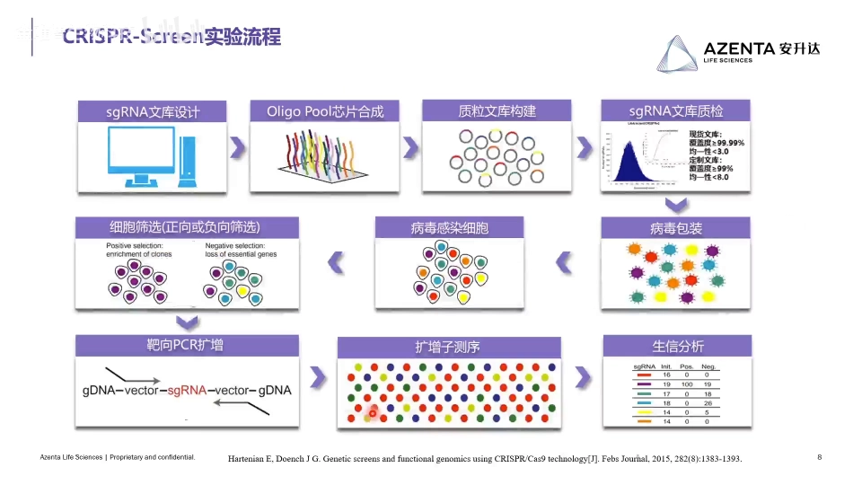

这条流程里有两个环节最容易被初学者低估。

**第一个是文库质检。** 讲者强调「高质量 gRNA 质粒文库是 CRISPR 筛选实验的基础保障」，不管自己构建还是直接购买，使用前都应该做 NGS 质检，QC 至少看两个指标 [【跳转到 7:44】](https://www.bilibili.com/video/BV1Ze6AYmEXY/?t=464)：

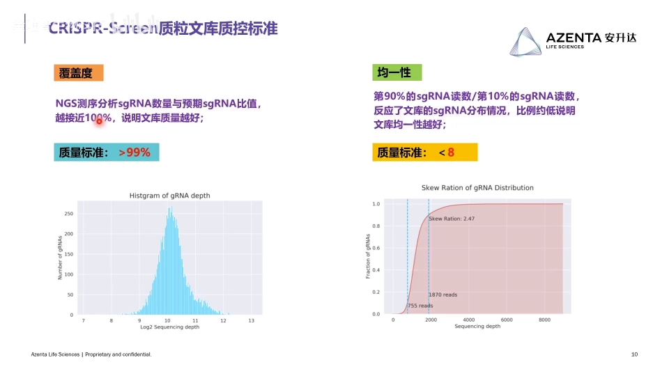

- **覆盖度**：实测 gRNA 数量与预期 gRNA 数量的比值，越接近 100% 越好，质量标准定在 **> 99%**。覆盖不全意味着有些基因根本没被筛到。
- **均一性**：用「覆盖 90% reads 所需的 gRNA 数」除以「覆盖 10% reads 所需的 gRNA 数」，这个比值越接近 1 越均匀，质量标准定在 **< 8**。文库不均一，低频 gRNA 在扩增和测序中会进一步丢失，最后表现为「假阴性」。

**第二个是单质粒还是双质粒。** 也就是 Cas9 和 sgRNA 是不是放在同一个载体上 [【跳转到 8:34】](https://www.bilibili.com/video/BV1Ze6AYmEXY/?t=514)。

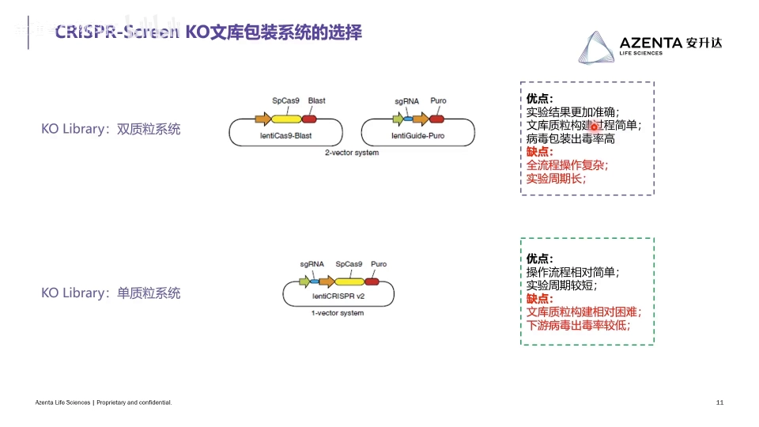

| 系统 | 优点 | 缺点 |
| --- | --- | --- |
| 双质粒（lentiCas9-Blast + lentiGuide-Puro） | 实验结果更准确；文库质粒构建简单；病毒包装出毒率高 | 全流程操作复杂；实验周期长（要先建 Cas9 稳转株，比单质粒多 4~8 周） |
| 单质粒（lentiCRISPR v2） | 操作流程相对简单；实验周期较短 | 文库质粒构建相对困难（Cas9 片段太长）；下游病毒出毒率较低 |

讲者的结论很明确：**虽然双质粒更麻烦，但出于对实验结果负责，更建议选双质粒**——因为构建稳转株的过程本身就能提前筛出 Cas9 表达量高、活性好的细胞株，后面每一次编辑才有保障。

再往后就是感染与筛选。这里有一条与后文直接相关的约束：**感染时要用低 MOI，保证每个细胞里至多进入一个病毒、只产生一个 sgRNA 扰动**，否则一个细胞里多个基因同时被扰动，后面就没法归因 [【跳转到 10:39】](https://www.bilibili.com/video/BV1Ze6AYmEXY/?t=639)。MOI 就是感染复数（病毒数与细胞数之比），不同细胞对病毒的敏感性不同，正式实验前要先做预实验。

讲者随后点出了 pooled 筛选的天花板：**有些基因的扰动不直接造成细胞死亡，处理前后 gRNA 种类没有变化，或者根本没有显著表型**，那单一的压力条件就筛不出来 [【跳转到 13:08】](https://www.bilibili.com/video/BV1Ze6AYmEXY/?t=788)。这句话是整支视频的转折点——它解释了为什么需要单细胞分辨率。

## 二、pooled、arrayed 与单细胞：三种策略的取舍

单细胞 CRISPR 筛选（scCRISPR-screen）的定义很直白：**把单细胞转录组测序和 CRISPR 文库筛选结合起来**。要理解它为什么存在，得先把它和另外两种策略摆在一起 [【跳转到 14:16】](https://www.bilibili.com/video/BV1Ze6AYmEXY/?t=856)。

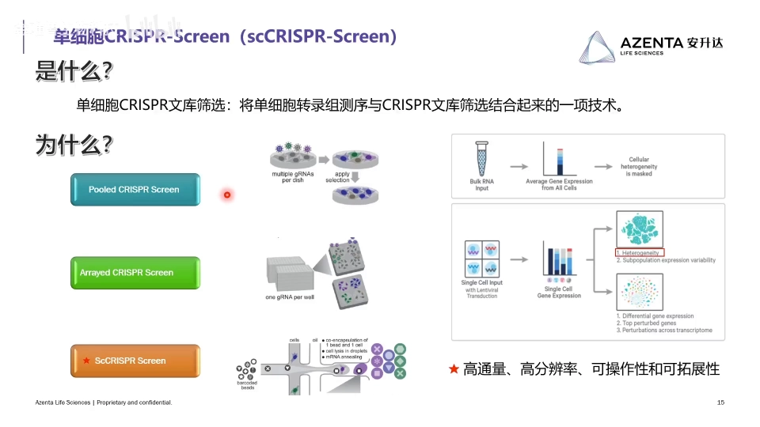

| 策略 | gRNA 与表型能否一一对应 | 通量 | 主要问题 |
| --- | --- | --- | --- |
| Pooled screen | 不能，只能看群体中 gRNA 丰度变化 | 最高 | 得到的是群体平均，只给候选基因 |
| Arrayed screen | 能，一孔一条 gRNA | 最低 | 工作量大、操作复杂，很难规模化 |
| scCRISPR-screen | 能，靠同一个细胞的 barcode 关联 | 高 | 需要专门的建库方案（本讲核心） |

讲者的总结是：单细胞筛选**结合了前两者的优点、同时弥补了不足**——在单细胞水平把 gRNA 和转录组变化一一对应，在单细胞分辨率下解析扰动造成的转录组影响，因此能充分考虑细胞异质性，做细致的功能机制研究 [【跳转到 15:31】](https://www.bilibili.com/video/BV1Ze6AYmEXY/?t=931)。

> 本节边界：pooled 与 arrayed 两种策略的系统对比属于 3.3.3 节，这里只用它来定位单细胞筛选的位置。

## 三、捕获的物理基础：一个液滴里装下一个细胞和一颗凝胶珠

要理解两种建库方向的差别，先要知道捕获发生在哪里。讲者以 10x Genomics 的 Chromium 平台为例 [【跳转到 16:08】](https://www.bilibili.com/video/BV1Ze6AYmEXY/?t=968)。

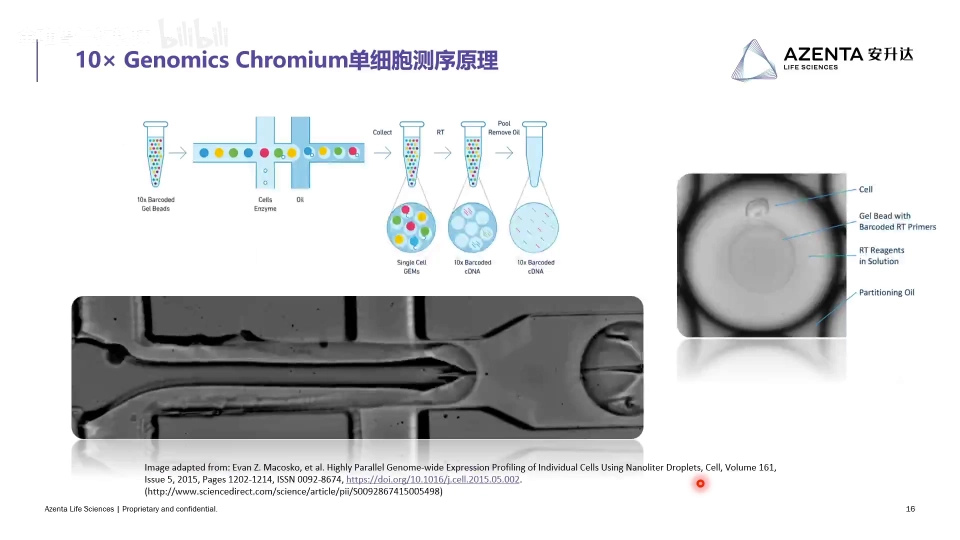

整个过程可以拆成三步：

1. **汇合**：带 barcode 的凝胶珠、细胞悬液、逆转录酶试剂在双十字通道里相遇；
2. **分割**：油性表面活性剂把它们切成成千上万甚至上百万个液滴（GEM），理想情况下每个液滴里恰好一个细胞 + 一颗凝胶珠 + 一套逆转录试剂；
3. **逆转录**：在液滴内部完成逆转录，同一个液滴里的所有转录本共享这颗凝胶珠带来的 cell barcode。

关键在凝胶珠上偶联了什么。讲者的描述是：胶珠表面「像绒毛一样的结构」就是固定序列，包括**一段 Illumina 测序引物、UMI 以及模板转换序列（TSO）**。**两种建库方向的全部差别，就在于这套固定序列里有没有「认 sgRNA 的引物」。**

## 四、5′ 建库：用一条「认 sgRNA 骨架」的引物

5′ 建库的思路是**在逆转录这一步就把 gRNA 抓下来**。讲者说，对单细胞 CRISPR 筛选实验「一般情况下我们更推荐 5′ 建库」 [【跳转到 17:40】](https://www.bilibili.com/video/BV1Ze6AYmEXY/?t=1060)。

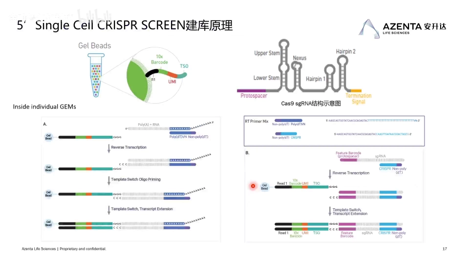

这张图上有三个要点：

1. **逆转录体系里有一对引物**：一条是常规的 **Poly-dT** 引物，负责抓 mRNA 的 polyA 尾巴；另一条叫 **non-polyDT CRISPR 引物**，它的序列**与 Cas9 sgRNA 的骨架区域互补**——注意是骨架（scaffold），不是 spacer，所以同一条引物能抓所有 sgRNA，与靶向哪个基因无关。
2. **两条引物共用同一颗凝胶珠的 barcode**：于是同一细胞来源的 mRNA 和 gRNA 被加上相同的 cell barcode，后续按 barcode 拆分数据时，gRNA 自然落回它所属的那个细胞 [【跳转到 18:15】](https://www.bilibili.com/video/BV1Ze6AYmEXY/?t=1095)。
3. **不需要改造 sgRNA**：这是 5′ 方案最大的好处——用现成的 sgRNA 文库就行，因为引物认的是 sgRNA 天然就有的骨架。

代价是：**必须用 5′ 建库的试剂盒**，而且这条 CRISPR 引物是加在逆转录体系里的，一旦体系确定，能兼容的载体类型就相对固定。

## 五、3′ 建库：给 sgRNA 插一段 capture sequence

3′ 建库的原理「和 5′ 建库类似，只不过凝胶珠上偶联的序列不同」：3′ 的凝胶珠偶联了**三种**序列——polyDT 引物（同样带 Illumina 引物、细胞 barcode、UMI），外加 **capture sequence 1** 和 **capture sequence 2** 两种特定的捕获序列 [【跳转到 19:20】](https://www.bilibili.com/video/BV1Ze6AYmEXY/?t=1160)。

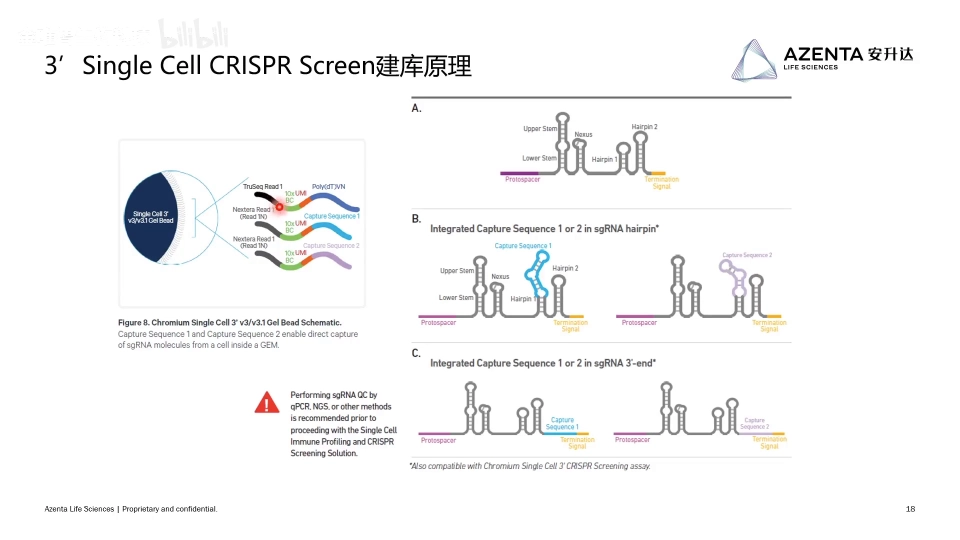

问题来了：sgRNA 天然没有 capture sequence，探针也就无从下手。所以 3′ 方案必须**先改造 sgRNA**——在它上面插入 capture sequence 1 或 2 的互补序列。插在哪里？10x 已经做过验证：**在 sgRNA 的 loop 区或者 3′ 末端插入，不影响 sgRNA 的功能** [【跳转到 20:10】](https://www.bilibili.com/video/BV1Ze6AYmEXY/?t=1210)。

讲者在这里补了一条很重要的方法论：**「是不是只能这样改造？」理论上不是**——任何自定义改造都必须先验证。验证手段是 qPCR 或 NGS，针对同一个基因编辑系统去确认「改造之后 sgRNA 的表达和功能有没有受影响」；只要不受影响，就可以用同一套单细胞 CRISPR 流程 [【跳转到 20:35】](https://www.bilibili.com/video/BV1Ze6AYmEXY/?t=1235)。

把两种方向放在一起对比：

| 维度 | 5′ 建库 | 3′ 建库 |
| --- | --- | --- |
| gRNA 怎么被抓到 | 逆转录体系中加入与 sgRNA 骨架互补的 non-polyDT 引物 | 凝胶珠偶联 capture sequence 1/2 探针，识别 sgRNA 上插入的互补序列 |
| 要不要改造 sgRNA | 不需要 | 需要，在 loop 区或 3′ 端插入 capture sequence |
| 额外的验证成本 | 无 | 需 qPCR / NGS 验证改造不影响表达与功能 |
| 试剂盒 | 5′ 单细胞试剂盒 | 3′ 单细胞试剂盒 |
| 讲者建议 | 一般情况更推荐 | 已有 3′ 平台或需要与既有 3′ 数据对齐时使用 |

> 与 3.3.1 另一篇的关系：那篇讲的是 Perturb-seq / CROP-seq 如何在**载体层面**让 gRNA 带上 polyA 尾巴；本篇讲的是**建库层面**怎么把 gRNA 抓下来。两件事是上下游关系——载体决定了 gRNA 长什么样，建库方向决定了用什么去抓它。

## 六、案例数据：25,764 个细胞，86.5% 检出 gRNA

讲者给了一个用 10x 平台做的实际案例 [【跳转到 21:50】](https://www.bilibili.com/video/BV1Ze6AYmEXY/?t=1310)。

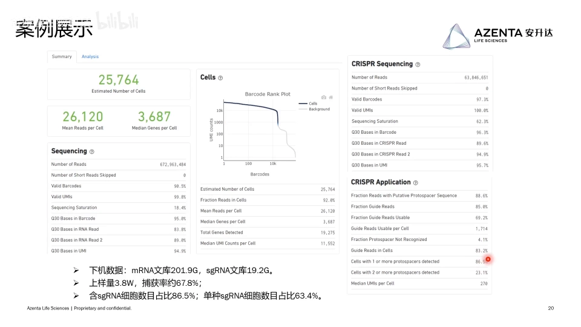

几个值得记住的数字：

| 指标 | 数值 |
| --- | --- |
| 下机数据量 | mRNA 文库 201.9 G，sgRNA 文库 19.2 G |
| 上样细胞数 / 捕获率 | 3.8 万 / 67.8% |
| 估算细胞数 | 25,764 |
| 每细胞平均 reads / 中位基因数 | 26,120 / 3,687 |
| 含 sgRNA 的细胞占比 | 86.5% |
| 其中单一 sgRNA 的细胞占比 | 63.4% |

这组数字和 3.3.1 另一篇里新格元的案例（undetermined 0.98%、multiplet 67.85%）放在一起看很有意思：**不同平台、不同建库方向的「检出率」口径不一样**。这里 86.5% 是「检出了 sgRNA」的比例，13.5% 是没检出；而「单一 sgRNA 只占 63.4%」说明剩下那部分含 sgRNA 的细胞里有相当比例是多重的——**多重感染率始终是这类实验最需要盯的指标**。

拿到数据之后能做什么分析？讲者给了一页示例 [【跳转到 22:08】](https://www.bilibili.com/video/BV1Ze6AYmEXY/?t=1328)：

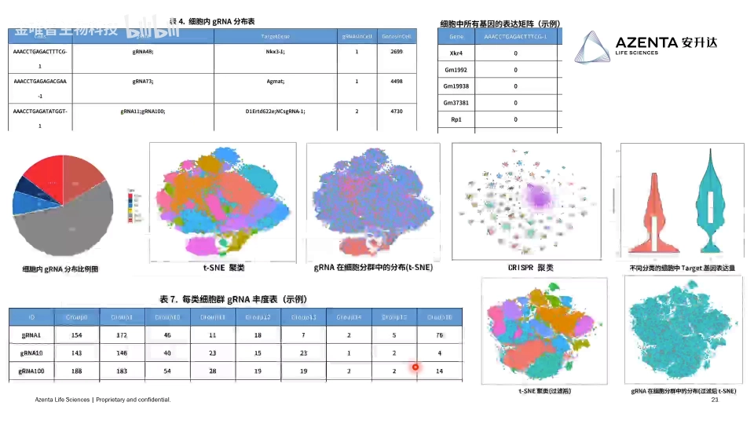

- **逐细胞层面**：一个 cell barcode 就是一个细胞，可以给出它含一种还是两种 gRNA、具体是哪条 gRNA、对应哪个靶基因；
- **群体层面**：统计细胞群中 gRNA 的分布，看某个 gRNA 是否富集在某个细胞群里；
- **扰动效应层面**：比较只受某个基因扰动的细胞与其他细胞（或与 NTC 细胞）的转录组差异，得到这个基因的调控影响。

讲者的总结是：因为转录组和 gRNA 是一一对应的，「能得到的信息其实非常丰富」 [【跳转到 23:23】](https://www.bilibili.com/video/BV1Ze6AYmEXY/?t=1403)。
## 七、为什么肿瘤研究特别需要它

讲者用一节篇幅讲了单细胞 CRISPR 筛选在肿瘤生物学中的四类应用 [【跳转到 23:53】](https://www.bilibili.com/video/BV1Ze6AYmEXY/?t=1433)：

1. **肿瘤基因功能研究**：大规模基因编辑可以鉴定与肿瘤发生发展相关的基因，这些基因既帮助理解分子机制，也为新治疗策略提供潜在靶点；而单细胞转录组数据能进一步支撑信号通路的全面分析。
2. **肿瘤异质性研究**：肿瘤组织里不同细胞在基因型和表型上存在差异，单细胞分辨率能更好地刻画这种异质性，为个性化治疗提供依据 [【跳转到 24:18】](https://www.bilibili.com/video/BV1Ze6AYmEXY/?t=1458)。
3. **肿瘤免疫治疗研究**：通过敲除免疫抑制基因、或敲入增强免疫反应的基因，来增强免疫细胞的抗肿瘤活性；也可以研究肿瘤微环境中不同细胞的功能。
4. **免疫逃逸机制**：用 CRISPR 筛选研究肿瘤细胞免疫逃逸的分子基础，揭示肿瘤免疫调控的关键因素 [【跳转到 25:25】](https://www.bilibili.com/video/BV1Ze6AYmEXY/?t=1525)。

这四类应用有一个共同点：**它们关心的都不是「细胞死不死」，而是「细胞的转录状态怎么变」**。这正是 pooled 筛选读不出、而单细胞筛选能读出的部分。

## 八、一篇 Nature：在体内筛出 T 细胞命运的调控因子

讲者用 2023 年 10 月发表在 *Nature* 上的一项工作演示完整流程，论文标题是 *Single-cell CRISPR screens in vivo map T cell fate regulomes in cancer* [【跳转到 25:43】](https://www.bilibili.com/video/BV1Ze6AYmEXY/?t=1543)。

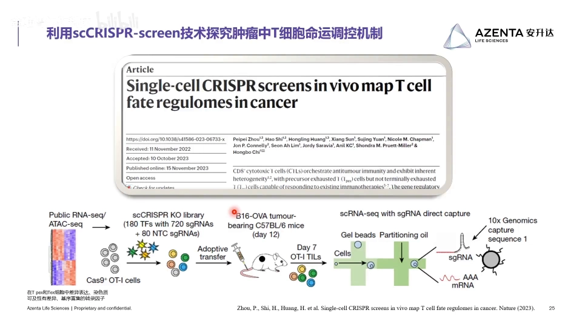

**科学问题**：肿瘤里的细胞毒性 T 细胞有固有异质性，包括耗竭 T 细胞前体和终末耗竭 T 细胞。终末耗竭 T 细胞才是肿瘤内主要的杀伤细胞，但它们会逐渐失去增殖能力，而且**对现有的免疫检查点阻断疗法不能响应**。从「前体」到「终末耗竭」这条分化路上的基因调控网络，以及两者之间的调控关系，当时还没有被解决 [【跳转到 25:43】](https://www.bilibili.com/video/BV1Ze6AYmEXY/?t=1543)。

**实验设计**（图上从左到右）：

1. **候选基因从公开数据里来**：在耗竭 T 细胞前体与耗竭 T 细胞之间找差异表达基因、染色质可及性有差异的基因、以及富集的转录因子，共筛出 **180 个转录因子**；
2. **文库规模**：每个基因设计 4 条 gRNA，共 **720 条**，再加 **80 条非靶向对照（NTC）**；
3. **体内筛选**：文库病毒感染 Cas9 稳定表达的 **OT-1 细胞**（识别卵清蛋白的转基因 CD8 T 细胞），再把这些细胞**过继转移**到 B16-OVA 荷瘤小鼠体内；
4. **读出**：第 7 天分离肿瘤浸润淋巴细胞（TIL），做单细胞 CRISPR 测序——用的是 10x 试剂盒、**3′ 建库 + capture sequence 1 直接捕获** [【跳转到 28:38】](https://www.bilibili.com/video/BV1Ze6AYmEXY/?t=1718)。

这里有一个值得注意的对照：**讲者在方法论上说「一般更推荐 5′ 建库」，而这篇文章用的是 3′ 建库**。两者并不矛盾——3′ 方案只要把 sgRNA 改造好、验证过功能，同样成立；选哪个方向往往取决于实验室已有的平台与试剂盒。

**分析路径**（图上从数据到结论）：

1. **先算单扰动细胞比例**：找出只受单一 sgRNA 扰动的细胞，比较它们相对 NTC 的细胞数目差异，初步筛出在 TIL 中被富集（正调控）或丢失（负调控）的因子 [【跳转到 28:54】](https://www.bilibili.com/video/BV1Ze6AYmEXY/?t=1734)；
2. **卡细胞数门槛**：180 个转录因子中只有 **172 个**检测到了足够数量的细胞。讲者在这里补了一条硬性经验——**每个基因至少要能捕获到 100 到 200 个细胞**，后续统计才有意义 [【跳转到 29:19】](https://www.bilibili.com/video/BV1Ze6AYmEXY/?t=1759)；
3. **算调控影响**：把每个候选基因的扰动细胞与 NTC 细胞做差异表达，得到每个转录因子对基因表达的调控谱；
4. **按相似性聚类成模块**：172 个基因被分成 **9 个协同功能模块**，这些模块与**效应功能、耗竭功能、干性功能、增殖功能**这 4 个基因程序相关 [【跳转到 30:09】](https://www.bilibili.com/video/BV1Ze6AYmEXY/?t=1809)；
5. **筛出强扰动模块**：可视化 9 个模块对 4 个基因程序的扰动强度，只有 **6 个模块**扰动效果较强，最终聚焦这 6 个；
6. **建调控网络**：在 6 个模块之间生成集中的基因调控网络，评估模块间的相互作用强度，最终锁定「让耗竭 T 细胞前体退出静息状态、并增强终末耗竭 T 细胞增殖能力」的关键转录因子 [【跳转到 31:49】](https://www.bilibili.com/video/BV1Ze6AYmEXY/?t=1909)。

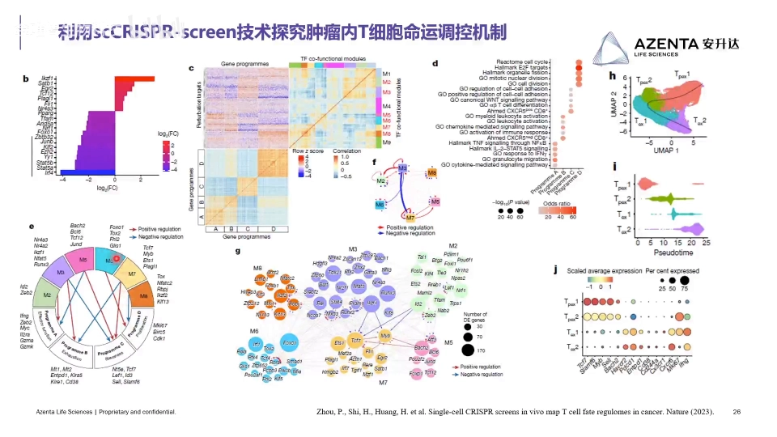

这张图把「单细胞筛选能产出什么」讲得很清楚：从一条条 gRNA 的扰动，到差异表达，到模块划分，到模块间网络，最后落到细胞状态（前体 / 中间态 / 终末耗竭）与拟时序上的位置。**这是 pooled 筛选永远给不出的分辨率。**

## 九、拓展：Cas13 与非 CRISPR 文库也能用同一套捕获逻辑

讲者最后回答了一个自然的问题：单细胞 CRISPR 筛选是不是只能用在 Cas9 敲除系统里？答案是否定的 [【跳转到 32:19】](https://www.bilibili.com/video/BV1Ze6AYmEXY/?t=1939)。

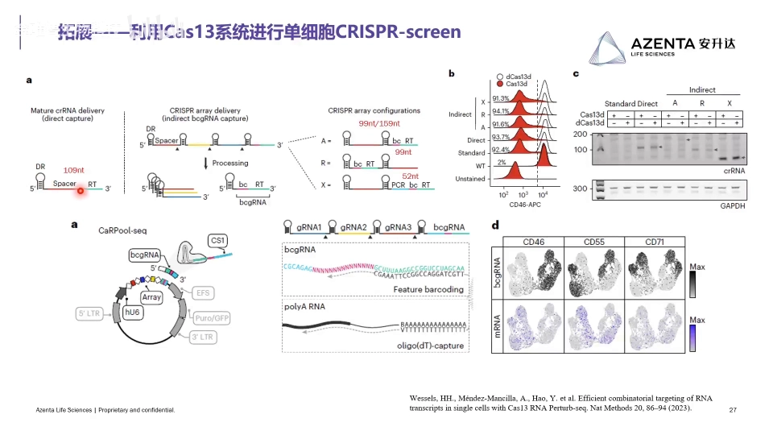

关键在于**「有没有一段所有 gRNA 共有的恒定序列」**：

- **Cas9 的 sgRNA** 有一段恒定骨架，所以 5′ 建库可以用一条与骨架互补的引物抓全部 sgRNA；
- **Cas13 的 crRNA** 只有 DR 序列加 spacer，**没有 Cas9 sgRNA 那样的恒定骨架**，所以研究者把 capture sequence 插到 crRNA 的不同位置，并先验证改造不影响 crRNA 功能 [【跳转到 20:14】](https://www.bilibili.com/video/BV1Ze6AYmEXY/?t=1214)；
- **非 CRISPR 的编辑文库**同理：只要把 capture sequence 加到样本上，就能用同一套单细胞流程筛选。

讲者反复强调的那句话在这里最有价值：**任何这类改造都要做功能和表达上的验证**。捕获效率的提升不能以牺牲编辑功能为代价——这也是判断一个「新方案」是否可信的第一道门槛。

## 小结

- **pooled 筛选读的是「细胞死活」，单细胞筛选读的是「转录组怎么变」**。前者只能给候选基因，后者能把 gRNA 与转录组在同一个细胞里对上。
- **捕获发生在液滴里**：一颗凝胶珠带来 cell barcode，同一个液滴里的 mRNA 和 gRNA 共享这个 barcode——这是整个技术成立的物理基础。
- **5′ 建库靠一条引物**：逆转录体系里加入与 sgRNA 骨架互补的 non-polyDT 引物，不用改造 sgRNA，讲者一般更推荐。
- **3′ 建库靠一段插入序列**：凝胶珠偶联 capture sequence 1/2 探针，必须先在 sgRNA 的 loop 区或 3′ 端插入互补序列，并用 qPCR / NGS 验证改造不影响功能。
- **文库质量先过关**：覆盖度 > 99%、均一性比值 < 8；单质粒省事但出毒率低，双质粒麻烦但更可靠。
- **每个基因至少要 100~200 个细胞**，否则统计没有意义——这条门槛直接决定了文库规模和测序量。
- **多重感染率是这类实验的长期痛点**：案例里含 sgRNA 的细胞占 86.5%，但单一 sgRNA 的只有 63.4%。
- **同一套逻辑可以外推**：Cas13 的 crRNA、甚至非 CRISPR 文库，只要加上可被探针识别的序列，都能进入单细胞筛选流程。

## 关键术语速查

| 术语 | 一句话解释 |
| --- | --- |
| Pooled CRISPR screen | 把整个 gRNA 文库混在一起感染细胞群，靠压力筛选和 gRNA 丰度变化找候选基因 |
| Arrayed CRISPR screen | 一条 gRNA 一个孔、分别培养，能一一对应表型但难以规模化 |
| scCRISPR-screen | 单细胞 CRISPR 筛选：把单细胞转录组测序与 CRISPR 文库筛选结合，逐细胞读出 gRNA 与转录组 |
| 5′ 建库 | 测序信息靠近转录本 5′ 端的建库方式；单细胞 CRISPR 中靠 non-polyDT CRISPR 引物在逆转录时捕获 sgRNA |
| 3′ 建库 | 测序信息靠近转录本 3′ 端的建库方式；单细胞 CRISPR 中靠凝胶珠上的 capture sequence 探针捕获改造过的 sgRNA |
| non-polyDT CRISPR 引物 | 与 Cas9 sgRNA 骨架互补的逆转录引物，让 sgRNA 与 mRNA 共用同一细胞 barcode |
| capture sequence 1 / 2 | 10x 3′ 凝胶珠上偶联的两条特定捕获序列，需在 sgRNA 上插入互补序列才能配对 |
| GEM（gel bead in emulsion） | 微流控形成的液滴，内含一颗凝胶珠、一个细胞与逆转录试剂，是单细胞捕获的反应单元 |
| 覆盖度（文库） | 实测 gRNA 数与预期 gRNA 数的比值，衡量文库是否漏掉目标基因，质量标准 > 99% |
| 均一性（文库） | 覆盖 90% reads 与 10% reads 所需 gRNA 数的比值，越接近 1 越均匀，质量标准 < 8 |
| 单质粒 / 双质粒系统 | Cas9 与 sgRNA 是否在同一载体上表达；双质粒需先建 Cas9 稳转株，周期长但结果更稳 |
| MOI | 感染复数，病毒数与细胞数之比；要压低以保证一个细胞只受一条 gRNA 扰动 |
| NTC | 非靶向对照 gRNA，不靶向任何基因，用作扰动效应的基线 |
| OT-1 细胞 | 识别卵清蛋白的转基因 CD8 T 细胞，常用于肿瘤免疫的过继转移实验 |
| TIL | 肿瘤浸润淋巴细胞，从肿瘤组织里分离出来的免疫细胞 |
| 耗竭 T 细胞前体 / 终末耗竭 T 细胞 | 肿瘤内细胞毒性 T 细胞的两种状态：前者可继续分化，后者杀伤力强但失去增殖能力、对检查点阻断不响应 |
| Cas13 | 靶向 RNA 而非 DNA 的 CRISPR 效应蛋白，其 crRNA 没有 Cas9 sgRNA 的恒定骨架，需要另行设计捕获方案 |
