# 单细胞 CRISPR 筛选的 gRNA 归属与多重感染判定

> 视频来源：[干货！CRISPR文库筛选x单细胞测序的结合应用](https://www.bilibili.com/video/BV1zm411672g/)（Bilibili · 艾迪基因 张旭 × 10x Genomics 陈志辉）｜时长约 71 分钟
> 简要导读：这是一场「实验方 + 平台方」的双人直播课。本文只取其中与**数据层**有关的部分：gRNA 为什么能和细胞 barcode 对上、归属（assignment）怎么做、一个细胞测到多条 gRNA 意味着什么、以及怎么判断这一步做得对不对。实验操作（文库扩增、慢病毒包装、MOI 滴定）只保留与归属结论直接相关的部分。

## 本讲要解决的核心问题（SCQA）

**背景**：单细胞 CRISPR 筛选（Perturb-seq / CROP-seq / 10x 5' CRISPR 筛选）里，每个细胞被测两样东西——一份转录组，一份「它被哪条 gRNA 扰动」。细胞身份由 10x 凝胶珠上的 barcode 标记，扰动身份由 gRNA 序列本身标记。

**冲突**：这两样东西在测序仪里是混在一管跑的。gRNA 在细胞里的分子数远少于 mRNA，还有裂解细胞飘出来的环境 gRNA、还有细胞被两条病毒感染的情况。于是「这条 gRNA 属于哪个细胞」不是一个读出来就有的答案，而是一个**要判的结论**。

**疑问**：拿到数据之后，凭什么说某条 gRNA 属于某个细胞？判错的代价是什么？一个细胞里数到三条 gRNA，该算三重扰动还是算污染？

**回答（中心思想）**：gRNA 的归属靠的是**和 mRNA 共享同一个 10x barcode**——同一个液滴里的 mRNA 和 sgRNA 被打上同一个细胞标签，只是各带各的 UMI。在此之上，归属是一套「计数 → 阈值 → 分类」的判定流程，最终产出 `gRNA × cell` 计数矩阵和每个细胞的 `assigned_gRNA` 注释；而**多重感染、未分配细胞、环境 gRNA 是这个流程必须显式输出的三类结果，不是可以忽略的噪声**。

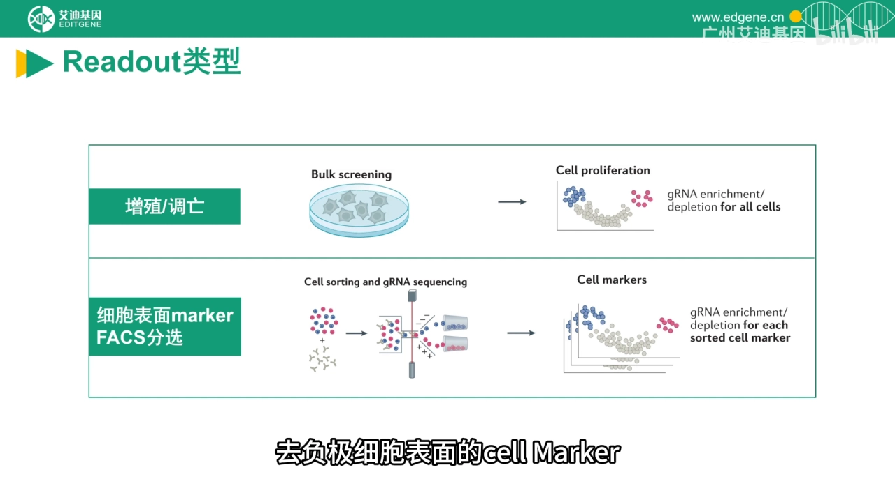

## 一、两层 barcode：细胞身份与扰动身份必须分开记

### 1.1 第一层：10x barcode 回答「这是哪个细胞」

10x 的凝胶珠（gel bead）上挂着海量 oligo，每条 oligo 的结构是：

- 一段接头序列（供后续建库扩增用）；
- **10x barcode**：16 个碱基，同一个凝胶珠上所有 oligo 的这段序列完全一样，不同凝胶珠之间互不相同，共约 360 万种；
- **UMI**：12 个碱基，随机分布，每一条 oligo 都不一样；
- **TSO**（template switch oligo）：13 个碱基，用来在反转录末端做模板转换。

一个细胞和一颗凝胶珠被油相包进同一个液滴（GEM），细胞裂解后，它的 mRNA 被凝胶珠上的 oligo 反转录成 cDNA。由于同一颗珠子的 barcode 一致、不同珠子的 barcode 不同，**barcode 就把「这条 cDNA 来自哪个液滴」记录了下来**。UMI 则负责在这条 cDNA 内部再去重：同一个基因的两条 mRNA 会拿到不同的 UMI，所以能数清「分子数」而不是「reads 数」。

[【跳转到 35:59】](https://www.bilibili.com/video/BV1zm411672g/?t=2159)

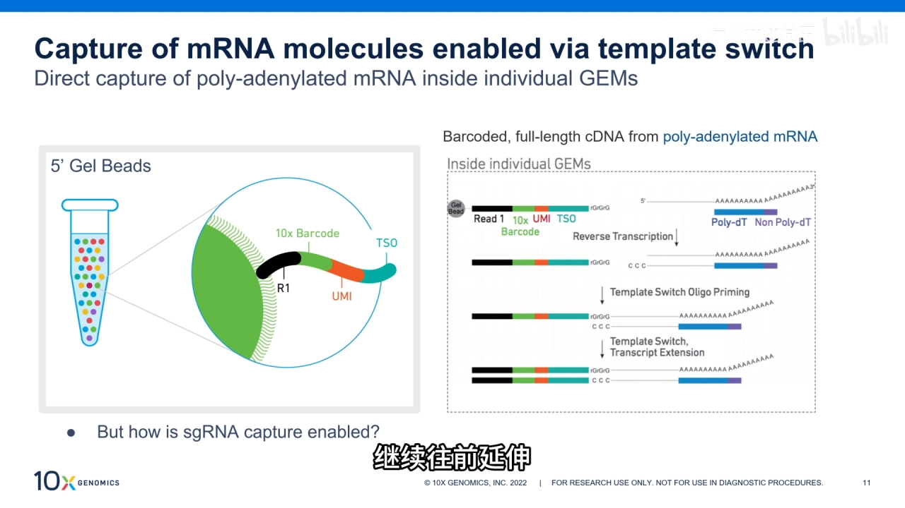

### 1.2 第二层：gRNA 序列本身回答「扰动是什么」

CRISPR 筛选里的 gRNA 有一个天然优势：它既是**扰动工具**（引导 Cas9 去切靶基因），又是**遗传条形码**（它的序列本身就指明了扰动身份）。讲者在开场就把这一点讲透了：

> 「CRISPR 筛选中的 sgRNA 既能够诱导扰动，也就是对靶基因进行敲除，它又能够作为遗传的条形码，表示或者提示细胞所受到的扰动，因为 sgRNA 在细胞当中的丰度情况，就代表了这个 sgRNA 对细胞的扰动。」

[【跳转到 05:48】](https://www.bilibili.com/video/BV1zm411672g/?t=348)

这句话是整节的支点。在 bulk 筛选里，我们只能比较「不同条件下 gRNA 的丰度变化」——某条 gRNA 变少了，说明带它的细胞死掉了。gRNA 在这里只是群体层面的一个计数。到了单细胞层面，gRNA 的角色变了：它从「群体里的一个计数」变成「单个细胞的一个属性标签」，于是才有「这个细胞被扰动的是什么」这个问题。

### 1.3 两层如何对齐：同一个 barcode，各自的 UMI

对齐的机制非常朴素：**同一个液滴里，mRNA 和 sgRNA 被同样的凝胶珠 oligo 反转录，因此共享同一个 10x barcode**。区别只在 UMI——每条 mRNA 分子一个 UMI，每条被捕获的 sgRNA 分子也一个 UMI。

于是数据层面就多出一张小表：行是 gRNA，列是细胞 barcode，格子里是 UMI 计数。这张表与 `gene × cell` 表达矩阵**共用同一套列名（barcode）**，两者可以按列直接拼接。这就是「gRNA 与细胞 barcode」这件事的全部物理基础。

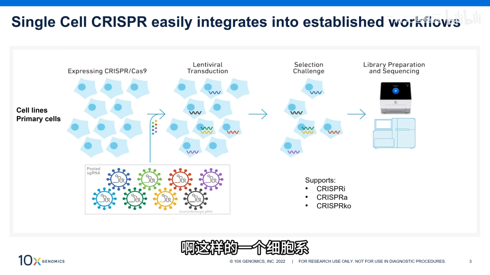

## 二、gRNA 是怎么被一起测到的

### 2.1 sgRNA 的可捕获结构：protospacer + 恒定区 + priming site

sgRNA 是一条有二级结构的 RNA：5' 端是 **protospacer**（20 nt 左右，与靶基因互补的那段，也就是「身份信息」所在），后面是各级茎环（upper stem、nexus、hairpin 1/2），末端是终止信号。真正决定「这条 gRNA 打的是哪个基因」的只有 protospacer，其余部分是所有 sgRNA 共有的骨架。

正因为骨架是共有的，就可以在骨架里找一个位置放**反转录引物结合位点**（图上的 Priming Site, Single Cell 5'）。这一步是「让 gRNA 也能被 10x 化学捕获」的关键设计。

[【跳转到 36:49】](https://www.bilibili.com/video/BV1zm411672g/?t=2209)

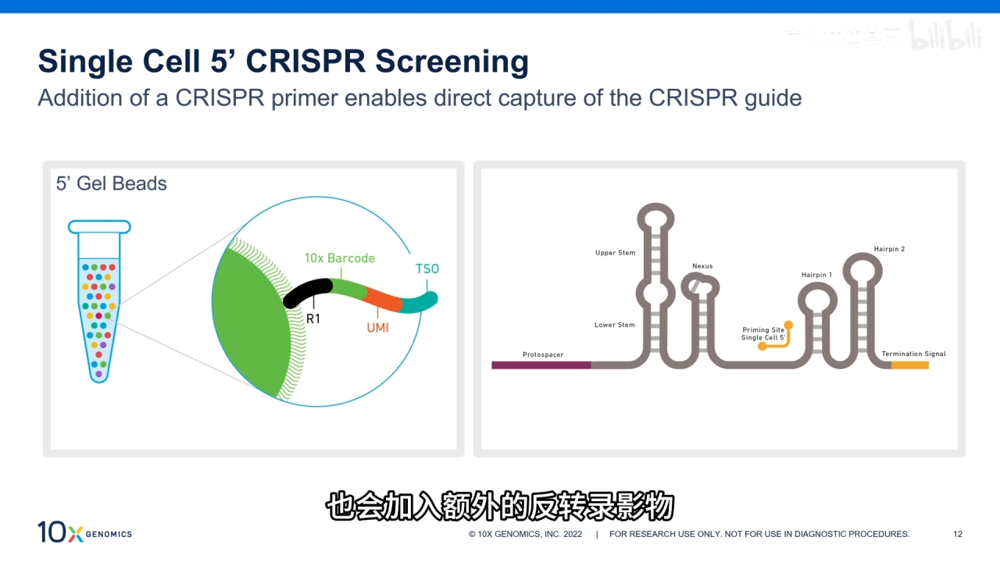

### 2.2 GEM 里的两次反转录：mRNA 用 poly(dT)，sgRNA 用 CRISPR 特异引物

在一个液滴里同时发生两件事：

1. **mRNA 的反转录**：加入的 poly(dT) 引物结合 mRNA 的 polyA 尾巴，反转录酶往 5' 方向延伸；到达末端时，反转录酶会在产物 3' 端加上三个 CCC，这三个 C 与凝胶珠 oligo 上 TSO 的 rGrGrG 互补配对，于是反转录酶「换模板」继续沿着凝胶珠 oligo 走，把 read 1、10x barcode、UMI、TSO 全部抄进 cDNA。
2. **sgRNA 的反转录**：master mix 里额外加了 CRISPR 特异的 poly(dT)VN 引物，它结合在 sgRNA 骨架的保守区上，同样反转录出 cDNA，同样在末端加 CCC、同样换模板接到凝胶珠 oligo 上。

结果是：**一条 sgRNA 的 cDNA 和一条 mRNA 的 cDNA 拥有相同的 read 1 / 10x barcode / TSO，只有 UMI 不同**。这就是「同一个细胞的 gRNA 与表达谱自动配对」的实现方式。

[【跳转到 37:14】](https://www.bilibili.com/video/BV1zm411672g/?t=2234)

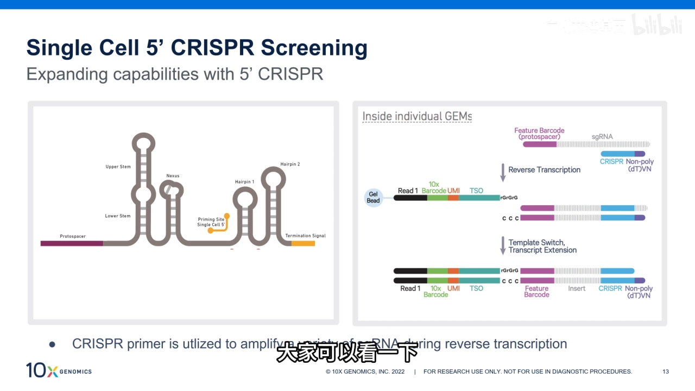

### 2.3 一份 cDNA 分两个文库：上清出 CRISPR 文库，沉淀出表达文库

反转录完成后破乳、纯化、扩增，然后按片段大小把产物分开：

- **基因表达文库**留在磁珠上（沉淀部分），后面要做酶切打断、末端加 A、加接头，再 sample index PCR；
- **CRISPR 文库**片段很短，落在上清里，直接做一次 sample index PCR 就能建库。

两个文库都带双端 index，所以可以混在同一个 lane 里测序。

[【跳转到 38:34】](https://www.bilibili.com/video/BV1zm411672g/?t=2314)

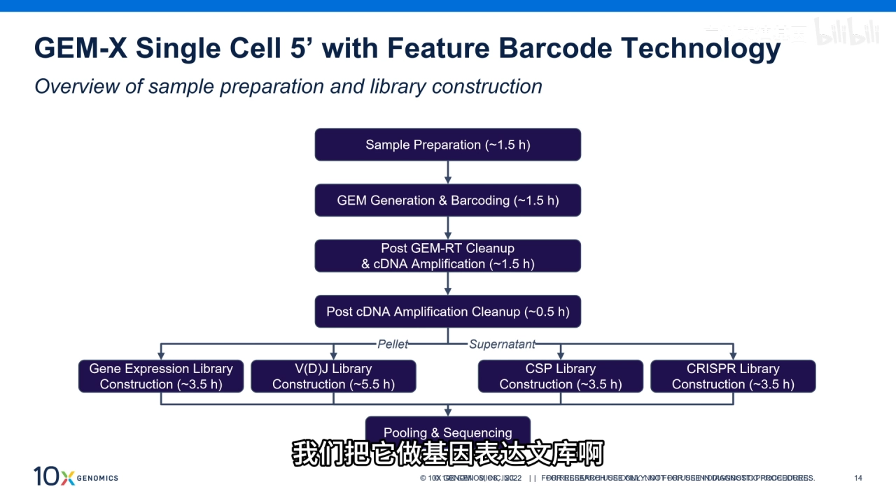

### 2.4 两个文库的结构差异与测序深度

把两个文库的接头摊开对比，能看到归属机制的全部信息都写在结构里：

- **GEX Library**：P5 – Sample Index – Read 1 – 10x Barcode – UMI – TSO – cDNA – Read 2 – Sample Index – P7；
- **CRISPR Library**：P5 – Sample Index – Read 1 – 10x Barcode – UMI – TSO – **Feature Barcode** – sgRNA – Feature Primer – Read 2 – Sample Index – P7。

差别只有中间那一段：表达文库的中间是被打断的 cDNA（也就是基因序列），CRISPR 文库的中间是 sgRNA 序列。**前面的 barcode 和 UMI 完全一致**，所以两者天然可以按 barcode 对齐。

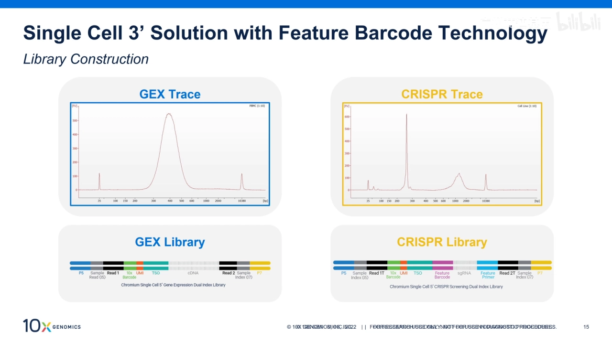

测序配置上，Read 1 固定 28 bp（装 10x barcode + UMI），Read 2 对表达文库是 90 bp，对 CRISPR 文库最短 70 bp 就够（因为 sgRNA 本身很短）。深度要求差别很大：表达文库每个细胞 20,000 条 reads，CRISPR 文库每个细胞 **5,000 条 reads**。

[【跳转到 39:05】](https://www.bilibili.com/video/BV1zm411672g/?t=2345)

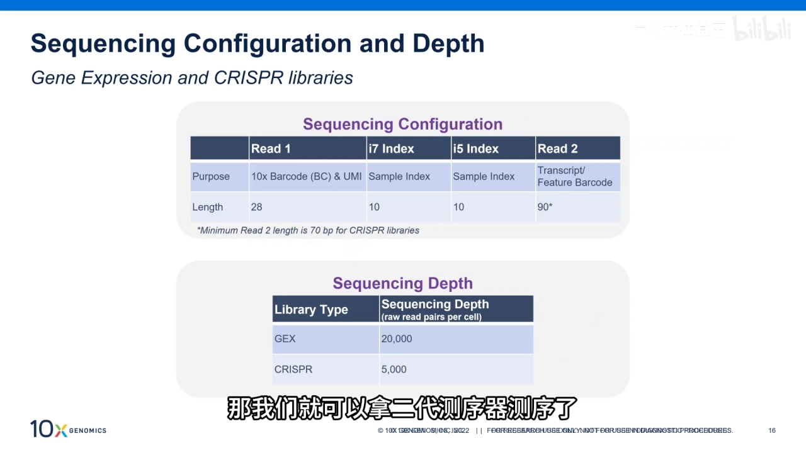

这个 5,000 条 reads 的数字值得留意：它对应的正是「数 UMI」这件事的统计下限。gRNA 在每个细胞里只有个位数到几十个分子，读数太少就数不准，读数够了才谈得上设阈值。

## 三、归属（assignment）：从 gRNA × cell 计数到 assigned_gRNA

### 3.1 第一步是计数，不是判定

拿到 CRISPR 文库的 reads 之后，第一件事是把 reads 拆成三样东西：10x barcode（哪一列）、UMI（哪个分子）、sgRNA 序列（哪一行）。把 sgRNA 序列比对回文库的 gRNA 列表，就得到一张 `gRNA × cell` 的 UMI 计数矩阵。

注意这一步只做「数」，不做「判」。矩阵里每个格子都是一个非负整数，一个细胞可能同时数到好几条 gRNA，也可能一条都数不到——这些都还是原始观测，判定发生在下一步。

### 3.2 阈值：为什么必须设，以及为什么和细胞数有关

原始 UMI 计数不能直接当结论用。原因很直接：测序错误会让某条 gRNA 在某个细胞里「凭空」出现 1 个 UMI，环境里飘着的 gRNA 也会贡献个位数计数。所以归属要设阈值：**只有 UMI 计数 ≥ N 才算这个细胞真的带这条 gRNA**。

阈值定在哪里，取决于两件事的权衡：

- 阈值太低 → 测序错误、环境 gRNA 被当成真信号，多重感染率虚高；
- 阈值太高 → 大量本来带 gRNA 的细胞被判成「没检测到」，有效细胞数骤减。

10x 的官方规划指南里有一句很关键的话，把阈值和细胞数直接绑在一起：**每个 sgRNA 最好回收到 100–200 个以上的细胞，因为 Cell Ranger 需要足够的细胞数才能设定 sgRNA 归属的 UMI 阈值，也才能做差异表达分析**。换句话说，阈值不是一个拍脑袋的常数，它是从「每条 gRNA 的 UMI 分布」里估出来的；每条 gRNA 只有十几个细胞，这个分布就估不准。

[【跳转到 41:00】](https://www.bilibili.com/video/BV1zm411672g/?t=2460)

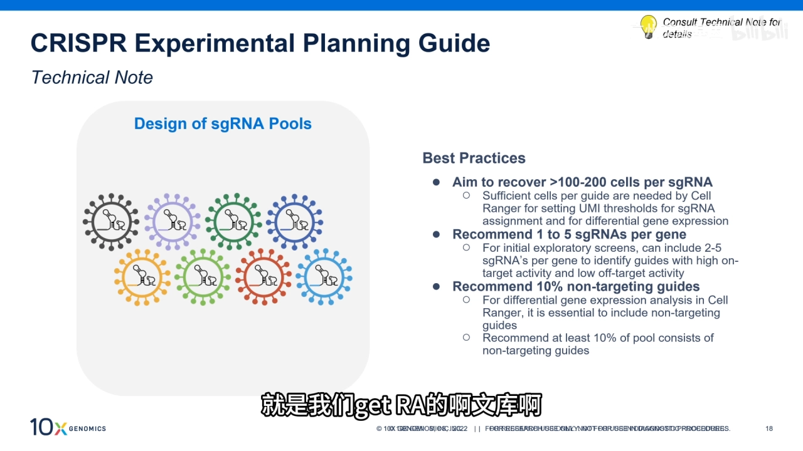

同一页指南还给了另外两条与归属直接相关的建议：

- **每个基因 1–5 条 sgRNA**：探索性筛选可以放 2–5 条，目的是挑出「靶向活性高、脱靶低」的那条；gRNA 条数越多，文库越大、成本越高（讲者提到上限一般是 5–6 条）。
- **至少 10% 的 pool 是非靶向对照（non-targeting control，NTC）**：因为 Cell Ranger 做差异表达时，必须有一个「没有扰动」的参照组。

### 3.3 四类细胞：归属的输出不是「一条 gRNA」，而是一个分类

把判定做完，每个细胞会落到四类之一。视频里用一张 UMAP 把这四类直接画了出来，图例就是归属结果：

| 类别 | 图例名 | 含义 |
| :--- | :--- | :--- |
| 单一 gRNA | `RAB1A-1` 等 | 只检测到一条 gRNA，且 UMI 过阈值——可用于下游分析 |
| 非靶向对照 | `Non_Target-1` | 带的是 NTC，作为「无扰动」参照 |
| 未分配 | `No Protospacer` | 一条 sgRNA 都没检测到（没有慢病毒感染，或没捕获到） |
| 多重感染 | `Multi Protospacers` | 检测到两条或更多 gRNA，无法确定是哪个在起作用 |

[【跳转到 46:21】](https://www.bilibili.com/video/BV1zm411672g/?t=2781)

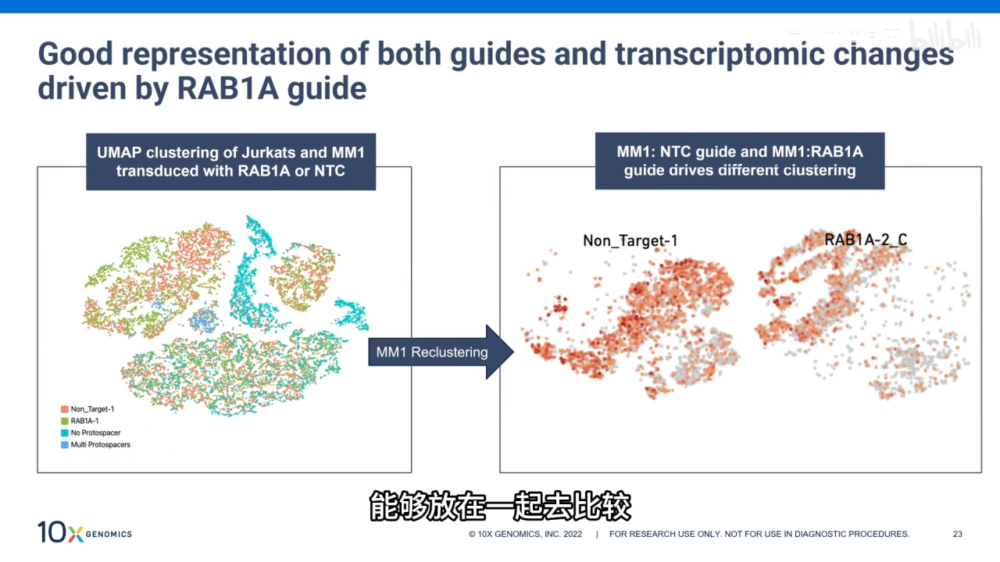

这张图还演示了一个很实用的操作：整体 UMAP 上 Jurkat 和 MM.1S 两种细胞混在一起，把 MM.1S 单独取出来重新聚类后，带 RAB1A sgRNA 的细胞和带 NTC 的细胞各自成团。**归属结果可以直接当作细胞注释的一列来用**——按 `assigned_gRNA` 分组着色、分组做差异表达，就是扰动组学最基本的下游操作。

### 3.4 一个细胞多条 gRNA：为什么通常直接判无效

多重感染的细胞不是「信息更多」，而是「信息不可用」。讲者的处理很干脆：

> 「如果你一个细胞里面检测出来两条或者多条 sgRNA，这其实对我们来说没有意义，因为我们也分不清到底是哪个在起作用，所以这个数据是无效的。」

[【跳转到 44:20】](https://www.bilibili.com/video/BV1zm411672g/?t=2660)

常见的三种处理方式是：

1. **丢弃**：最保守，直接把 `Multi Protospacers` 类细胞排除在下游分析之外；
2. **按最高 UMI 取主导 gRNA**：保留细胞，但把扰动标签设成计数最高的那条——代价是引入了「这条到底是不是真扰动」的不确定性；
3. **单独作为一类分析**：如果多重感染率很高，就先把它当成一个质量指标去查原因，而不是急着处理。

讲者的立场偏第 1 种：多重感染是「数据无效」，不是「数据要清洗」。

### 3.5 未分配细胞：不是 bug，是必须记录的一类结果

`No Protospacer` 这一类细胞，表达谱是好的，但一条 gRNA 都没数到。它可能来自三种情况：

- 细胞根本没被慢病毒感染（筛选没筛干净）；
- 感染了，但 sgRNA 表达量太低、建库时没捕获到；
- 细胞在过滤（低质量细胞、双细胞）时被删掉，剩下的 barcode 里没有 gRNA。

视频里的演示实验在 MOI 控制得当时，「几乎每个细胞都至少检测到一条 sgRNA」；但这只是控制良好的情况下的结果。**实操中未分配比例取决于 MOI、sgRNA 表达强度与测序深度**，所以它必须作为一个显式的类别被统计出来，而不是悄悄从矩阵里消失。

## 四、多重感染与假信号：源头在 MOI，事后无法补救

### 4.1 多重感染的物理来源

一个细胞里出现多条 gRNA，最直接的原因是**一个细胞被多个慢病毒颗粒感染**。文库筛选的理论基础是「一个细胞整合一条 sgRNA」，一旦整合两条以上，扰动效应就混在一起了。

所以 MOI 不是「越高越好」的参数。讲者给的操作区间是：**以 MOI ≤ 0.3（感染阳性率 20%–30%）去感染**，这样大部分细胞只整合一条 sgRNA。这个数字不是为了省钱，而是为了让「一个细胞一条 gRNA」这个前提成立。

[【跳转到 21:07】](https://www.bilibili.com/video/BV1zm411672g/?t=1267)

### 4.2 事后无法补救

Q&A 里有人问：能不能靠全基因组测序确认「单个细胞是否只转染了单个 sgRNA」？讲者的回答是：**能控制的只有源头**。

> 「你要在 0.2 到 0.3 的 MOI 效率去控制，说只有一部分细胞能够感染到一个慢病毒颗粒，从源头上去控制。不要说一开始你加很多病毒，一个细胞里面有很多个病毒颗粒感染进去，那这个就是我们的多个 sgRNA 了，这个怎么也救不了。」

[【跳转到 61:18】](https://www.bilibili.com/video/BV1zm411672g/?t=3678)

这句话对数据层的人同样重要：**归属算法只能如实报告多重感染，不能修复它**。如果多重感染率高，正确的动作是回头查 MOI 与筛选流程，而不是在阈值上做文章把多重感染「调」成单一感染。

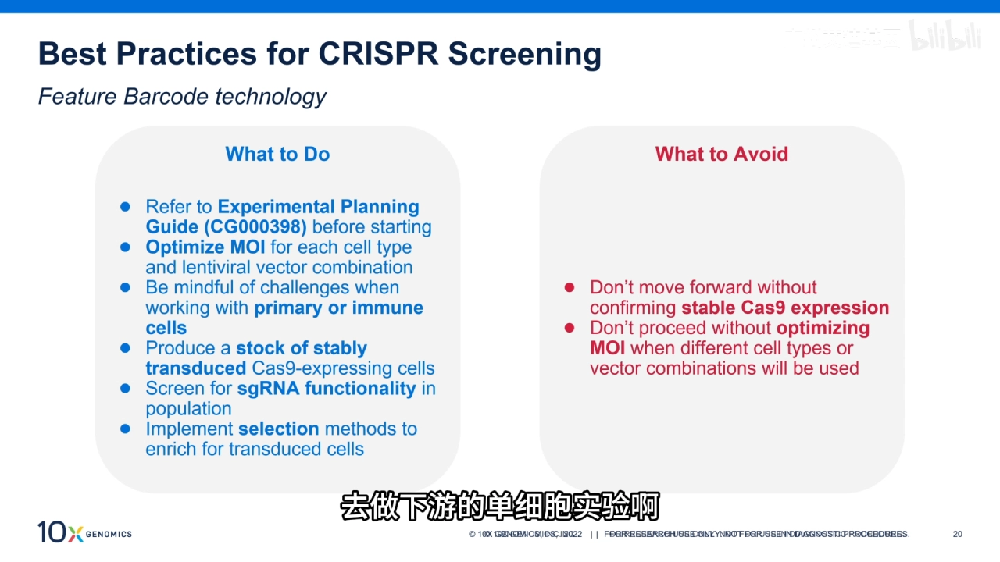

### 4.3 环境 gRNA：与 ambient RNA 同源的一类污染（延伸说明）

> 以下这一点视频没有展开，属于与「环境 RNA（ambient RNA）」同源的机制，这里只作衔接，不作为本视频的结论。

裂解细胞释放的 sgRNA 会飘进别的液滴，让「本来没被扰动的细胞」也数到少量 gRNA。它的后果和多重感染很像——**伪造出假的多重感染、稀释真实扰动效应**——但来源不同：多重感染是「一个细胞进了多个病毒」，环境 gRNA 是「一个液滴进了别人的 gRNA」。区分两者的办法是看计数分布：真感染通常有较高的 UMI，环境污染往往只有个位数。这也解释了为什么阈值不能设成 1。

## 五、怎么判断这一步做得好不好

归属做完之后，有四件事可以直接用来体检。

### 5.1 每条 gRNA 分到的细胞数是否均匀

把 `gRNA × cell` 矩阵按行求和，就得到每条 gRNA 的细胞数。理想情况下各条 gRNA 的细胞数应该在同一量级；某条 gRNA 分到 0 个细胞，说明它很可能根本没进文库（克隆丢失、文库覆盖度不足）。

视频里的 K562 小文库演示（17 条 gRNA）就展示了「好的归属」长什么样：每条 gRNA 的细胞在 UMAP 上各自成团，violin 图上每个 guide 组的表达分布也彼此分开。

[【跳转到 49:29】](https://www.bilibili.com/video/BV1zm411672g/?t=2969)

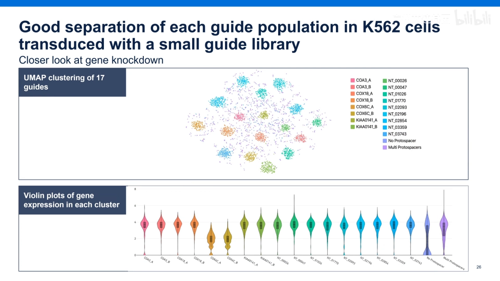

### 5.2 多重感染率是否与设计的 MOI 相符

多重感染率明显高于 MOI 预期，通常指向两个问题：MOI 实际失控，或者环境 gRNA 被当成了信号。前者查实验记录，后者查计数分布。

### 5.3 NTC 组的细胞数是否足够

NTC 是所有差异表达分析的参照。NTC 细胞太少，`Non_Target-1` 这一组的表达分布就估不准，后面每个扰动组的比较都不稳。指南建议 pool 里至少 10% 是 NTC，落到数据上就是：**NTC 分到的细胞数要能撑起一个稳定的对照分布**。

### 5.4 用敲低效率反向验证归属

最有力的验证是「归属结果能不能预测生物学」。视频里的 A375 演示把细胞按 protospacer 拆成四组，然后画 RAB1A 的表达 violin：

- `Non_Target-1` 组：RAB1A 正常表达；
- `RAB1A-2` 组（带靶向 sgRNA）：RAB1A 表达被显著压低；
- `No Protospacer` 组：和 NTC 接近；
- `Multi Protospacers` 组：介于两者之间。

[【跳转到 50:57】](https://www.bilibili.com/video/BV1zm411672g/?t=3057)

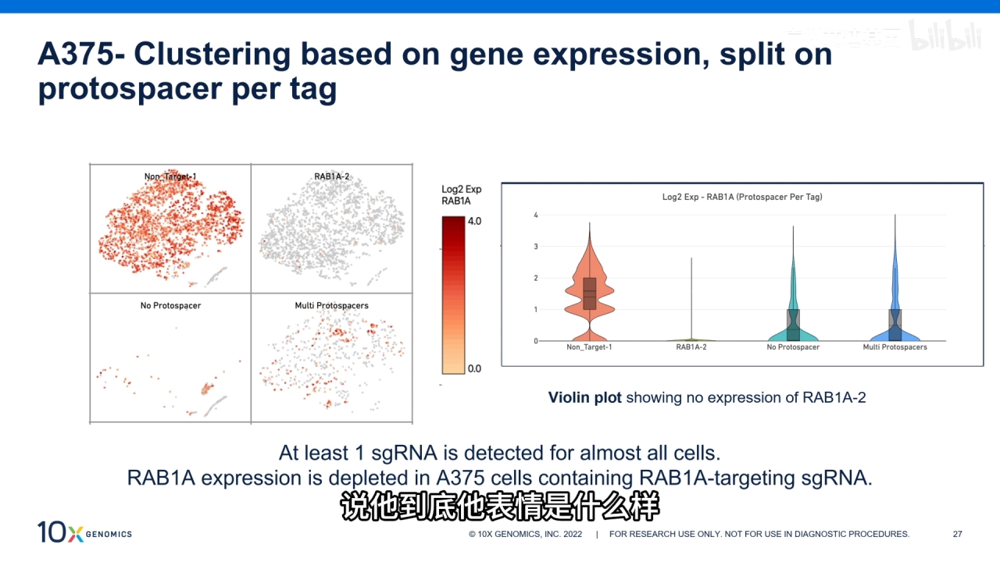

如果归属做错了（比如把 NTC 细胞误判成靶向组），这条 violin 会立刻露馅：靶向组的表达不会下降。**「归属正确的组，敲低效率就高」是这一步最直接的自检指标。**

### 5.5 扰动是否与批次混淆

同一个扰动的细胞如果全部集中在某一个 10x 通道里，那么「扰动效应」和「通道效应」就分不开了。设计上要让同一扰动的细胞分散在多个通道/批次，这一点在归属结果出来之后就能核对：按 assigned_gRNA 与通道做交叉表，看每个扰动是否覆盖多个通道。

## 六、归属之后：把 assigned_gRNA 接上下游分析

### 6.1 归属产出的两样东西

归属这一步做完，交付的其实是两样东西：

1. **`gRNA × cell` 计数矩阵**：原始 UMI 计数，供后续重新设阈值、换算法时复用；
2. **每个细胞的 `assigned_gRNA` 注释列**：一行一个 barcode，标注它属于哪条 gRNA、属于哪一类（单一 / NTC / 未分配 / 多重）。

这两样东西必须一起保存。只留注释列、丢掉原始计数矩阵，等于把阈值的选择永久焊死；只留矩阵、不留注释，下游每次分析都要重做一遍判定。

### 6.2 从「一个细胞的扰动」到「一组细胞的响应」

有了 `assigned_gRNA`，分析就变成了按组比较：把带同一条 gRNA 的细胞聚成一组，和 NTC 组做差异表达，得到「敲掉这个基因 → 哪些基因变了」。这正是单细胞筛选相对于 bulk 筛选多出来的那层信息——bulk 只能看「带这条 gRNA 的细胞变多还是变少」，单细胞能看「这些细胞内部发生了什么」。

讲者在开场用一个对比把这件事讲清楚了：bulk 筛选的 readout 是 gRNA 的富集与耗竭（反映细胞增殖或死亡），单细胞的 readout 是每个细胞的表达谱（反映转录调控）。

### 6.3 一个真实案例：从全基因组筛选到单细胞机制

视频最后用一个 SARS-CoV-2 的例子串起了整条链路（Daniloski 等，Cell 2021）：

1. 在稳定表达 Cas9、并带 ACE2 的 A549 细胞里做**全基因组 CRISPR 敲除筛选**；
2. 用 SARS-CoV-2 感染，比较感染组与对照组，找出「敲掉之后细胞反而更能活下来」的基因——这些就是病毒进入细胞所需要的宿主因子；
3. 排名靠前的基因包括 ACE2、CTSL、RAB7A、PIK3C3、ATP6AP1、VPS45、CCDC22、COMMD3 等；
4. 再用**单细胞 CRISPR 筛选**去 interrogate 这些基因的机制，发现其中 6 个基因（RAB7A、PIK3C3、NPC1、CCDC22、ATP6V、ATP6AP1）共享一套胆固醇合成相关的表达变化；
5. 实验验证：提高细胞内胆固醇，病毒感染下降。

[【跳转到 52:00】](https://www.bilibili.com/video/BV1zm411672g/?t=3120)

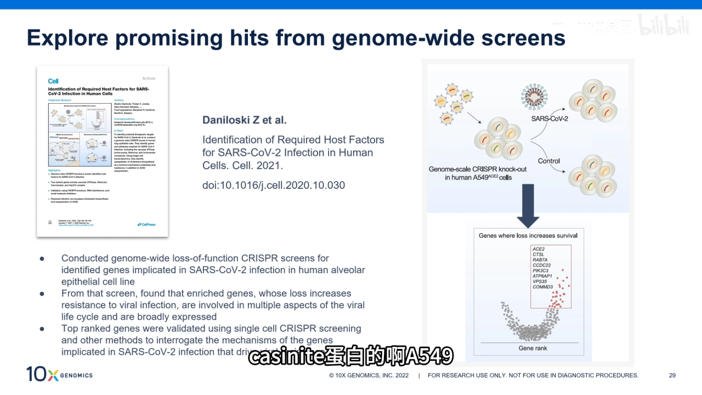

这个案例的价值在于它说明了归属这一步的位置：**它是「单细胞」这三个字成立的前提**。如果 gRNA 归属做不准，第 4 步里「带 RAB7A sgRNA 的细胞」就不是一个干净的组，后面所有关于通路的结论都站不住。

### 6.4 工具与文件（点到为止）

视频里提到的链路是 10x 官方这一条：

- 建库阶段用 **Feature Barcode** 化学（CRISPR 文库与表达文库同批建库）；
- 数据分析用 **Cell Ranger**（完成 barcode 校正、UMI 计数、sgRNA 归属与差异表达）与 **Loupe Browser**（可视化）；
- 实验设计参考官方的 **CRISPR 实验规划指南**（sgRNA 池设计、MOI、细胞数、NTC 比例）。

文献里还有专门做 gRNA 归属与统计检验的工具（如 crisper、SCEPTRE），以及各实验室自建的 Perturb-seq 流程；这些不在本视频范围内，本文不展开算法细节。需要记住的只是它们共同的输入输出：**输入是 CRISPR 文库的 reads + 表达矩阵的 barcode 列表，输出是 `gRNA × cell` 矩阵与 `assigned_gRNA` 注释**。

## 小结

- **两层 barcode 各管一件事**：10x barcode 标「哪个细胞」，gRNA 序列标「扰动是什么」；两者靠「同一个液滴共享同一个 barcode」对齐，靠 UMI 各自计数。
- **对齐是化学设计出来的**：sgRNA 骨架上有 CRISPR 特异的反转录引物位点，所以它和 mRNA 走同一条模板转换路径，最终带上同一个 barcode。
- **归属 = 计数 + 阈值 + 分类**，产出 `gRNA × cell` 矩阵和每个细胞的 `assigned_gRNA`；四类结果（单一 gRNA / NTC / 未分配 / 多重感染）都必须显式输出。
- **阈值与细胞数绑定**：每条 sgRNA 需要 100–200 个以上细胞，Cell Ranger 才能估出稳定的 UMI 阈值。
- **多重感染只能从源头控制**：MOI ≤ 0.3 是为了保证「一个细胞一条 gRNA」；事后无法用算法补救，只能如实标记为无效。
- **未分配细胞不是 bug**：它是 MOI、捕获效率、测序深度共同作用的结果，必须被统计而不是被隐藏。
- **自检四件事**：每条 gRNA 的细胞数是否均匀、多重感染率是否与 MOI 相符、NTC 细胞是否足够、靶向组的敲低效率是否显著高于对照。

## 关键术语速查

| 术语 | 一句话解释 |
| :--- | :--- |
| 细胞 barcode（10x barcode） | 凝胶珠上 16 nt 的标签，同一个液滴里所有分子共享，用来标识「这是哪个细胞」 |
| UMI | 12 nt 随机序列，标记单个核酸分子，用于去重后数「分子数」而不是「reads 数」 |
| GEM | Gel Bead in Emulsion，油包水液滴，一个液滴里通常是一个细胞加一颗凝胶珠 |
| TSO | Template Switch Oligo，反转录到末端时用于换模板、把凝胶珠 oligo 接到 cDNA 上的序列 |
| Feature Barcode | 10x 的一类附加检测化学，CRISPR 文库（sgRNA）与细胞表面蛋白都走这条路 |
| protospacer | sgRNA 上 20 nt 左右、与靶基因互补的片段，是「这条 gRNA 打哪个基因」的身份信息 |
| gRNA 归属（assignment） | 把 gRNA 的 UMI 计数判给细胞的过程：计数 → 阈值 → 分类 |
| `assigned_gRNA` | 归属的输出列，每个细胞标注它带的（或没有带的）gRNA 及类别 |
| 多重感染（multiple infection） | 一个细胞整合了两条及以上 gRNA，无法区分是哪个在起作用，通常判为无效数据 |
| NTC（non-targeting control） | 非靶向对照 sgRNA，不切任何基因，作为「无扰动」参照组，建议占 pool 的 10% 以上 |
| No Protospacer / 未分配 | 表达谱正常但没检测到任何 sgRNA 的细胞，需作为独立类别统计 |
| MOI | 感染复数，病毒颗粒与细胞的数量比；单细胞筛选通常控制在 0.3 以下以保证单条整合 |
