# Pooled Screen 设计逻辑：把上万个扰动混进一个细胞池

> 视频来源：[CRISPR文库筛选](https://www.bilibili.com/video/BV1V94y1e7fK)（Bilibili · 艾迪基因）｜时长约 31 分钟
> 导读：这支视频讲的是一家基因编辑服务公司做 **CRISPR 文库筛选（pooled screen）** 的完整设计逻辑——从文库怎么来、怎么质控、MOI 怎么定，到阳性/阴性筛选怎么读、命中怎么验证。本文按「Pooled 与 Arrayed 两种筛选形式的取舍」重新组织：视频本身几乎只讲 pooled（这正是它的价值——把 pooled 的每一个代价都摊开给你看），Arrayed 一侧作为对照形式补在需要比较的位置。

## 本讲要解决的核心问题（SCQA）

**背景**：想知道一个基因的功能，最直接的办法是把它敲掉，看细胞有什么变化。经典遗传学还要求再把它补回去（回补），变化能恢复，才算证明了这个基因与这个表型有关 [【跳转到 06:12】](https://www.bilibili.com/video/BV1V94y1e7fK/?t=372)。

**冲突**：一次只敲一个基因，一次只能回答一个问题。而人类基因组里有一万九千五百多个基因，细胞里参与同一件事的往往是一整张调控网络——靠一个个敲，永远敲不完 [【跳转到 08:41】](https://www.bilibili.com/video/BV1V94y1e7fK/?t=521)。

**疑问**：能不能一次实验就把上万个基因都扰动一遍，然后一次性读出「谁让细胞活下来、谁让细胞死掉」？

**回答（中心思想）**：能，代价是把「一个孔一个扰动」换成「一个池子上万个扰动」——这就是 **pooled screen**。它用通量换可控性：一次覆盖全基因组，但每个扰动拿到多少细胞、文库本身有没有漂移、扰动身份归属对不对，全部变成必须额外测量和质控的变量。而 **arrayed screen** 走的是相反的路：一个孔一个扰动，条件完全可控，但通量被孔数卡死。**筛选形式是实验设计的第一性选择，选错了后面所有分析都补不回来。**

## 一、先分清两种形式：扰动身份是「测出来的」还是「摆出来的」

### 1.1 一句话区别

两种筛选形式真正的差别，不在「用什么仪器读出」，而在**扰动身份与细胞身份的对应关系是推断出来的，还是已知的**：

| 维度 | Pooled screen（混合筛选） | Arrayed screen（阵列筛选） |
| :--- | :--- | :--- |
| 物理形态 | 上万个扰动混在一个细胞池里 | 一个孔 = 一个扰动，孔间物理隔离 |
| 扰动身份 | 事后**测序读出**（gRNA / barcode 归属） | 事前**由孔的坐标决定** |
| 每个扰动的细胞数 | 泊松分配，不可控 | 由你铺板决定，可控 |
| 通量上限 | 全基因组（上万基因） | 孔数（几百到几千） |
| 读出方式 | 富集/耗竭（生死、分选）+ NGS | 孔级测量：成像、荧光、存活、分泌 |
| 主要混杂来源 | 文库漂移、归属错误、细胞数不均 | 板效应、边缘效应 |

### 1.2 Pooled 的物理形态：一个细胞池 + 一份文库

视频里对这个形态的描述非常直白：把上万个 sgRNA 混合在一起，就得到一份 **sgRNA 文库**——「它不是单一的，它是一个很大的混合物」 [【跳转到 12:12】](https://www.bilibili.com/video/BV1V94y1e7fK/?t=732)。这份混合物包成慢病毒后去感染细胞，得到的是一池子细胞：**每个细胞只有一个 sgRNA，对应的每个细胞里只有一个基因被敲除**，细胞池由几万到几十万个细胞组成 [【跳转到 10:37】](https://www.bilibili.com/video/BV1V94y1e7fK/?t=637)。

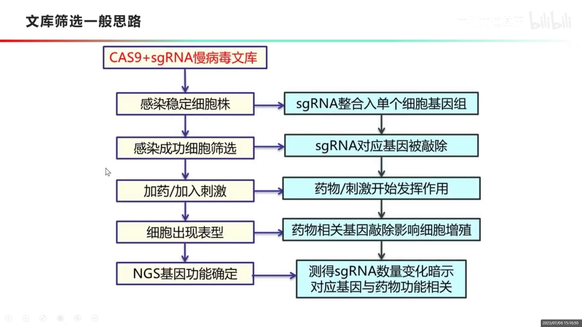

这个「敲除」是怎么发生的，决定了 pooled 能不能成立。视频把它讲成两步：sgRNA 通过碱基互补配对找到基因组上的目标位点，同时用另一段结构域结合 Cas9，把它引导到该位置切开双链 [【跳转到 02:32】](https://www.bilibili.com/video/BV1V94y1e7fK/?t=152)；切开的缺口由细胞自身的修复机制补上，而**大部分修复不是精确修复**——连的过程中可能丢几个碱基、也可能加几个碱基，从而引入移码突变、把基因敲掉 [【跳转到 03:31】](https://www.bilibili.com/video/BV1V94y1e7fK/?t=211)。

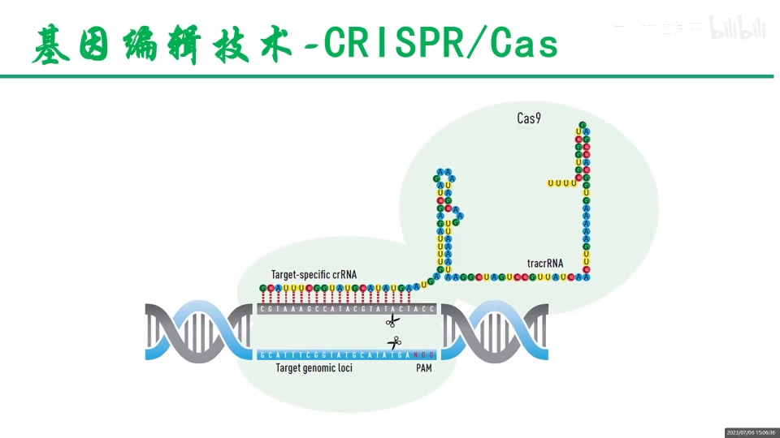

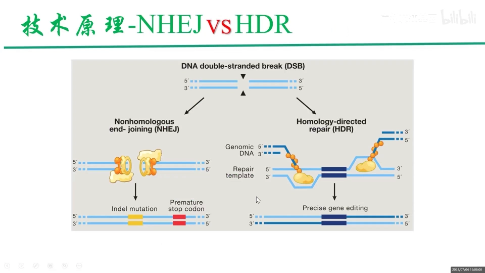

这里有个容易被跳过的前提：**pooled 的「一个细胞一个扰动」不是天然成立的，而是靠 MOI 压出来的**。视频用一个很形象的类比解释：一堆乒乓球被风吹向一排孔，孔比球大，有的孔进一个、有的进两个三个——这是随机事件，只能靠调整球与孔的比例，让**大部分**孔里只有一个球 [【跳转到 18:52】](https://www.bilibili.com/video/BV1V94y1e7fK/?t=1132)。球是病毒颗粒，孔是细胞。

### 1.3 Arrayed 的物理形态：一孔一扰动

Arrayed 把这份「随机」彻底去掉：96 孔、384 孔乃至上千孔板上，每个孔只加一种扰动（一种 sgRNA 病毒、一种 siRNA、一种化合物），孔与孔之间物理隔离。于是：

- **扰动身份由孔的坐标直接给出**，不需要测序归属，也就没有归属错误；
- **每个扰动的细胞数、时间点、剂量都由你定**，可以做剂量梯度和时间序列；
- 读出可以很丰富——高内涵成像看形态、荧光看报告基因、板读看存活与代谢。

代价同样直接：**通量被孔数卡死**，每个孔都要单独铺细胞、单独感染/转染、单独加试剂，成本随孔数线性上涨；而且孔与孔之间的位置差异（板效应、边缘效应）成了主要混杂来源。

> 注意：视频本身没有展开 arrayed 的操作细节，上面的对照是为了说明「为什么 pooled 的每一个优点都对应一个代价」。arrayed 的成像读出、板效应校正属于实验设计层面的常识性对照。

## 二、Pooled 值得做的理由：通量换可控性

### 2.1 通量：从「一次一个基因」到「一次一万九千个基因」

视频用一张幻灯片把这件事讲得很清楚：Cas9 加 1 个 sgRNA 编辑一个基因，加 2 个编辑两个基因，加多个编辑多个基因，**加上万个 sgRNA 就同时编辑上万个基因** [【跳转到 08:41】](https://www.bilibili.com/video/BV1V94y1e7fK/?t=521)。

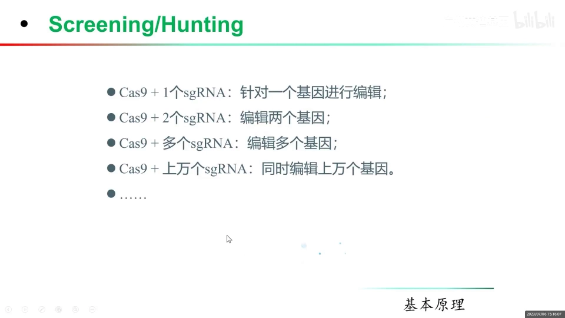

而人类基因组「乱七八糟的都加起来一万九千五百多个基因」[【跳转到 09:06】](https://www.bilibili.com/video/BV1V94y1e7fK/?t=546)——这个数字决定了全基因组文库的规模量级，也解释了为什么必须 pooled：一万九千个基因，用 arrayed 做就是一万九千个孔，物理上不现实。

### 2.2 内部对照一致：所有扰动共享同一批细胞

Pooled 还有一个常被低估的好处：**所有扰动在同一个池子里、同一批培养基、同一次传代中竞争**。视频里反复强调「细胞池」这个概念——它不是一万个独立实验，而是一个实验里的一万个参与者 [【跳转到 10:37】](https://www.bilibili.com/video/BV1V94y1e7fK/?t=637)。

这一点在比较扰动效应时很关键：arrayed 板上第 1 孔和第 384 孔的细胞状态可能已经不同（培养时间、蒸发、边缘效应），而 pooled 里所有扰动面对的是同一个环境。**代价是：环境一致了，但每个扰动分到的细胞数不一致**（见 3.1）。

### 2.3 读出被压缩成「富集 / 耗竭」

Pooled 的读出本质上是**计数变化**：处理前后，某个 sgRNA 在测序读数里变多了（enrichment，富集）还是变少了（depletion，耗竭）。视频把这一点讲成两种筛选方向 [【跳转到 14:17】](https://www.bilibili.com/video/BV1V94y1e7fK/?t=857)：

- **阳性筛选（positive screen）**：关注**存活下来**的细胞。加了药还活着，说明这个扰动带来了耐药。
- **阴性筛选（negative screen）**：关注**消失**的细胞。某个 sgRNA 在处理后消失，说明它对应的基因是细胞在这个压力下必需的。

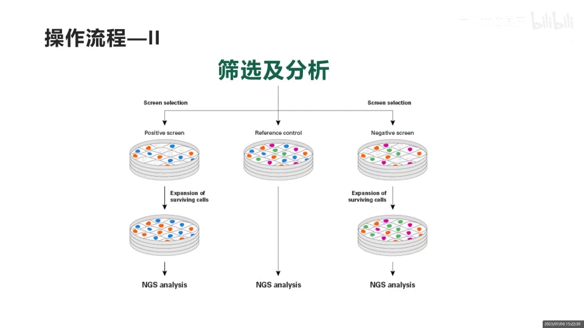

**这就是 pooled 的读出天花板**：它只能告诉你「这群细胞多了还是少了」，不能告诉你「细胞长什么样、膜电位变了没有、分泌了什么」。想要形态学表型，pooled 给不了——那正是 arrayed 的地盘。把读出拓宽到表达谱，则需要单细胞读出（Perturb-seq / CROP-seq 一类，属本系列 3.3.1 的内容）。
## 三、Pooled 的四个代价：每一个都必须被测量

### 3.1 代价一：每个扰动分到多少细胞，你说了不算

视频里最实在的一句提醒是：单个基因做 KO 时，「效率可能是 30%、20%、80%、90%，无论多少，我们都可以筛到一个单克隆」；但**同时操作上万个 sgRNA 时，效率 20% 和 90% 的差别就会很大——筛完之后拿到的细胞数量会很少** [【跳转到 15:07】](https://www.bilibili.com/video/BV1V94y1e7fK/?t=907)。

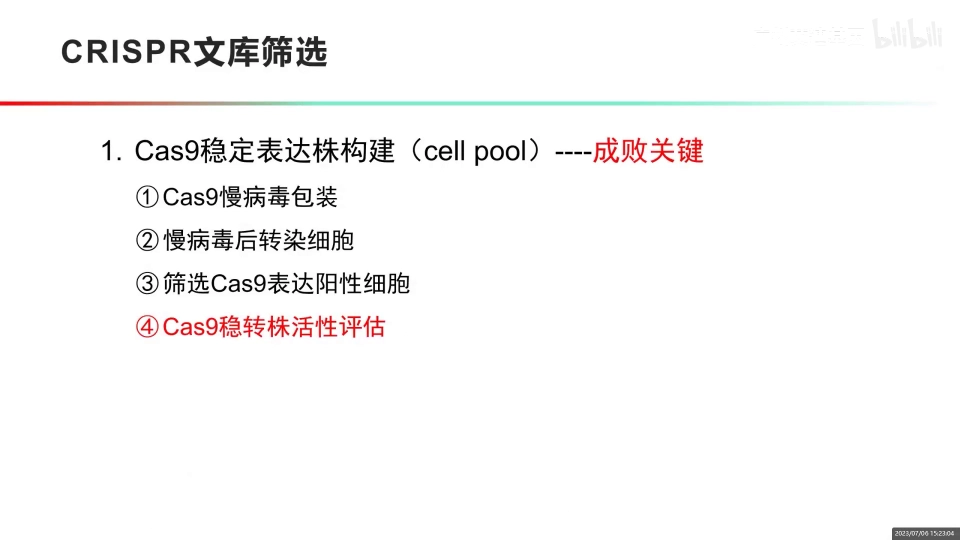

这就是 pooled 与 arrayed 最本质的差别之一：arrayed 里你可以给每个孔铺同样的细胞数；pooled 里每个 sgRNA 的细胞数是**泊松分配的结果**，天然不均。不均会直接变成统计问题——细胞少的扰动，它的效应估计噪声大，容易在富集/耗竭排序里被埋掉或误判。

### 3.2 代价二：文库本身会漂移

视频花了相当篇幅讲一个很多人忽略的环节：**文库扩增会改变文库的组成**。

「我们知道人和人之间会发生竞争，这些质粒载体在大肠杆菌里的时候，它们之间也会发生竞争。发生竞争就会有人消失、有人变得更多」[【跳转到 16:47】](https://www.bilibili.com/video/BV1V94y1e7fK/?t=1007)。由此引出两个必须量化的指标：

- **覆盖度（coverage）**：本来覆盖全基因组的两万个 sgRNA，丢了 2000 个，就只剩 90% 的基因被覆盖；
- **均一性（uniformity）**：本来希望每个载体包出的病毒颗粒一样多，但「有些载体可能 100，另一个载体只有 10」——丰度差异会一路传到筛选结果里 [【跳转到 17:37】](https://www.bilibili.com/video/BV1V94y1e7fK/?t=1057)。

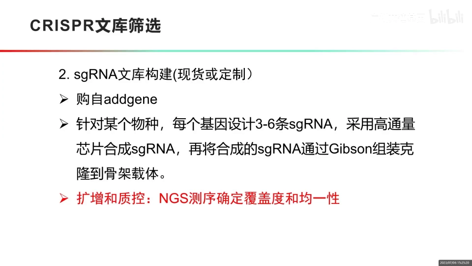

**这是 arrayed 不需要面对的问题**：arrayed 每个孔的扰动是单独加的，不存在「文库组成漂移」；它的对应问题是板效应。两种形式都有自己的一类系统性偏差，区别只在于偏差的来源不同。

### 3.3 代价三：MOI 必须压低，否则效应无法归因

视频把 MOI 定义为「一个病毒颗粒进入一个细胞的比例」，并给出一个非常具体的操作口径：对 A549 细胞，用 **MOI = 0.3** 的剂量感染 $2\times 10^{7}$ 个 A549-Cas9 细胞，相当于 $6\times 10^{6}$ 个细胞被感染，即**文库中每种 sgRNA 会被整合到超过 1000 个细胞中**；48 小时后加嘌呤霉素筛选，连续 8–10 天获得单基因突变的细胞群落 [【跳转到 19:17】](https://www.bilibili.com/video/BV1V94y1e7fK/?t=1157)。

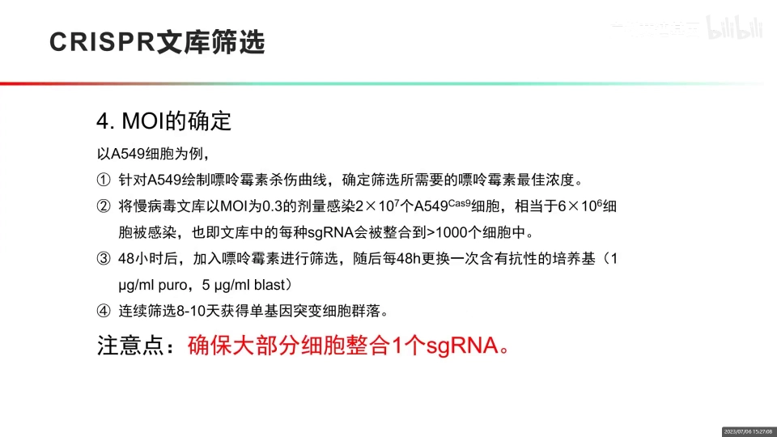

为什么必须压低？因为「如果一个 sgRNA 针对一个基因，而有 100 个 sgRNA 进了同一个细胞，这个细胞发生了什么变化，最后我们还找得出来是哪个基因导致的吗？就找不到了」[【跳转到 09:47】](https://www.bilibili.com/video/BV1V94y1e7fK/?t=587)。**多扰动进同一个细胞，等于把 pooled 的「身份可归属」这个前提直接破坏掉。**

（MOI 的计算、对照类型与重复数设计属本系列 3.3.4，这里只点出它在 pooled 里的角色：它是让「一个细胞一个扰动」这个假设成立的旋钮。）

### 3.4 代价四：扰动身份要靠测序归属

Pooled 里没有孔的坐标告诉你「这个细胞被什么扰动了」，只能事后去测：提取基因组、PCR 扩增 sgRNA 区段、建库、上机测序，然后比较处理组与对照组里每个 sgRNA 的丰度变化 [【跳转到 23:52】](https://www.bilibili.com/video/BV1V94y1e7fK/?t=1432)。

于是整条链路上多出一串误差来源：**归属错误、PCR 偏倚、测序深度不足导致的采样噪声**。arrayed 里这些都不存在——孔的位置就是扰动身份。（gRNA 与细胞 barcode 的归属机制属本系列 3.3.2。）

## 四、把代价变成可检查的指标：pooled 的五步设计清单

视频把整个流程拆成了可执行的步骤，每一步都对应一个「如果这里出错，后面补不回来」的检查点：

1. **Cas9 稳转细胞株**：包装 Cas9 慢病毒 → 转染细胞 → 筛选 Cas9 表达阳性细胞 → **Cas9 稳转株活性评估**（视频标注为「成败关键」）[【跳转到 15:07】](https://www.bilibili.com/video/BV1V94y1e7fK/?t=907)；
2. **sgRNA 文库**：现货或定制，每个基因设计 3–6 条 sgRNA，高通量芯片合成后 Gibson 组装克隆到骨架载体，**扩增后用 NGS 确定覆盖度与均一性** [【跳转到 17:12】](https://www.bilibili.com/video/BV1V94y1e7fK/?t=1032)；
3. **慢病毒包装**：文库质粒与包装辅助质粒共转染，48 小时后收上清、分装 −80 ℃；**根据 pool 的 sgRNA 数量确定包装量，确保病毒足够下游实验** [【跳转到 18:02】](https://www.bilibili.com/video/BV1V94y1e7fK/?t=1082)；
4. **MOI 确定**：先画嘌呤霉素杀伤曲线定最佳浓度，再用 MOI = 0.3 感染、48 小时后加药筛选 [【跳转到 19:17】](https://www.bilibili.com/video/BV1V94y1e7fK/?t=1157)；
5. **筛选与读出**：分成实验组与对照组，处理后提基因组、建库、NGS，比较 sgRNA 丰度差异。

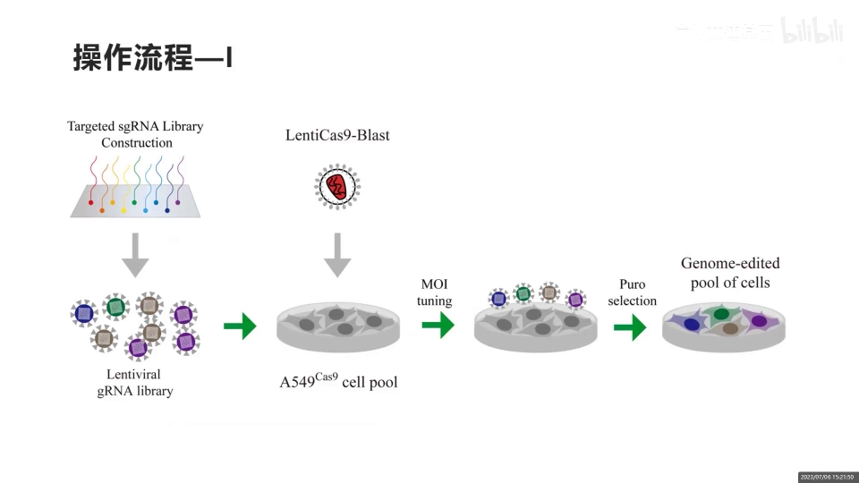

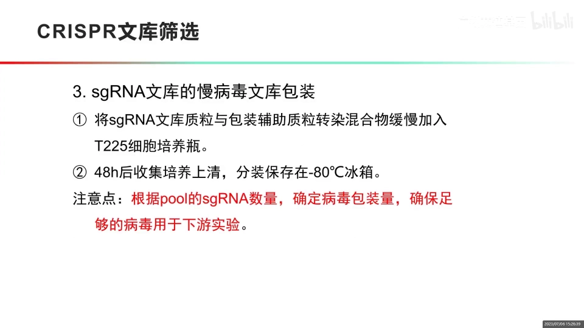

这份清单值得对照 arrayed 看一遍：arrayed 没有文库漂移、没有 MOI 调弦、没有归属测序，但它有另一份清单——每孔的转染效率、孔间一致性、板效应校正、成像参数。**两种形式的工作量都不小，只是花在不同的地方。**

## 五、两种读出方向，对应两类完全不同的生物学问题

### 5.1 阳性筛选：谁让细胞活下来

视频给了两个阳性筛选的实战例子。

**病毒受体发现**：以 A549 细胞为例，把全基因组敲除细胞库分成两份，一份做病毒侵染、一份作为对照只做常规培养；**只有受体基因被敲除的细胞才不会被病毒侵染并杀死**，因此对存活细胞测序，就能发现哪些基因的敲除能减少或消除病毒入侵能力 [【跳转到 21:22】](https://www.bilibili.com/video/BV1V94y1e7fK/?t=1282)。

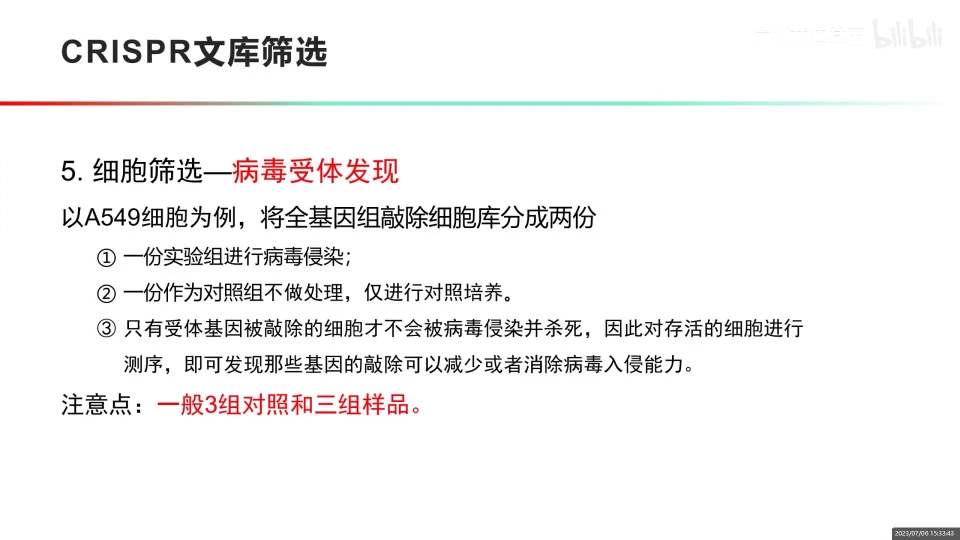

**耐药基因发现**：一份实验组加药、一份对照不加药；**只有携带某个基因突变、能让细胞抵抗药物的细胞才能存活**，那么这个基因就介导了耐药，反过来它也是药敏基因、药物响应基因 [【跳转到 23:27】](https://www.bilibili.com/video/BV1V94y1e7fK/?t=1407)。

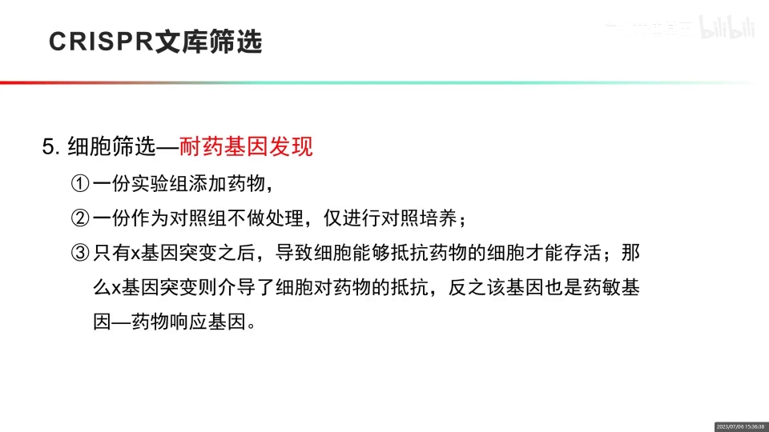

视频里还有一句容易被忽略的工程提醒：**实验组一般设三组、对照组也设三组**，「因为做一组的话，我后面是没法分析的」[【跳转到 22:12】](https://www.bilibili.com/video/BV1V94y1e7fK/?t=1332)。pooled 的重复不是可选项——sgRNA 丰度本身波动很大，没有重复就无法区分真实富集和采样噪声。

### 5.2 一个真实案例：BRAF V600E 黑色素瘤的耐药筛选

视频用一个具体的临床问题把阳性筛选讲透：某个药对携带 BRAF V600E 突变的黑色素瘤有效，但临床上有些病人用同样的药就是不好使 [【跳转到 25:49】](https://www.bilibili.com/video/BV1V94y1e7fK/?t=1549)。

做法是标准的 pooled 阳性筛选：构建细胞池、加药、观察谁活下来。**加药 14 天后**，A375 细胞文库的绝大部分细胞被杀死，只有极少数不被杀死；对照组（只加溶剂）持续生长。测序后看差异最大的、富集存活的那些细胞里哪些 sgRNA 变多，就找到了候选基因——而它们「刚好都不是 BRAF」[【跳转到 27:13】](https://www.bilibili.com/video/BV1V94y1e7fK/?t=1633)。

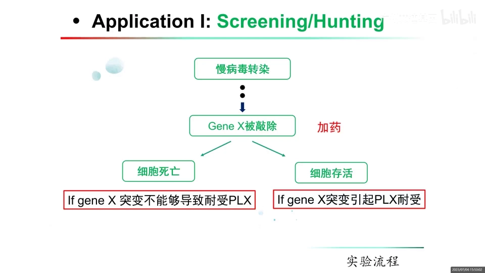

这个案例的价值在于它说明了 pooled 的**临床意义**：以前医生测到 BRAF V600E 就上这个药，现在还要看另外几个基因有没有突变——它们一变，药就不好使了 [【跳转到 27:38】](https://www.bilibili.com/video/BV1V94y1e7fK/?t=1658)。**pooled 一次实验就在全基因组范围里把「所有可能的耐药出口」列了出来**，这是 arrayed 做不到的规模。

### 5.3 阴性筛选与合成致死

阴性筛选关注的是「消失的细胞」：某个 sgRNA 在处理后不见了，说明它对应的基因是细胞在该压力下的必需基因 [【跳转到 14:42】](https://www.bilibili.com/video/BV1V94y1e7fK/?t=882)。视频把它落到**合成致死（synthetic lethality）**这个应用上：

- 正常细胞里，基因 A 被抑制没关系，因为 B 还能补偿它的功能；
- 肿瘤细胞里，A、B 中往往已经有一个突变了；此时再用药物抑制另一个，两个都失活，细胞就死了；
- 而正常细胞里两个都没突变，抑制 A 不影响存活 [【跳转到 28:47】](https://www.bilibili.com/video/BV1V94y1e7fK/?t=1727)。

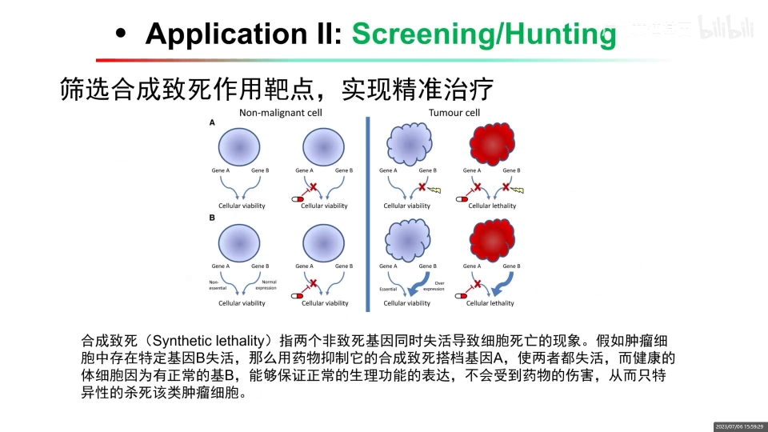

**这就是阴性筛选的典型用法**：不是找「谁让细胞活」，而是找「在特定遗传背景（肿瘤已有突变）下，谁让细胞死」——从而只杀肿瘤细胞、不伤正常细胞 [【跳转到 29:37】](https://www.bilibili.com/video/BV1V94y1e7fK/?t=1777)。

## 六、文库怎么选：先定范围，再定机制，最后定方向

视频最后给了一张很实用的决策清单，它其实是 pooled 设计的三层选择 [【跳转到 24:49】](https://www.bilibili.com/video/BV1V94y1e7fK/?t=1489)：

1. **筛选范围**：全基因组文库，还是亚文库（针对某一类基因）？原则是**优先用现货文库，尽量用最小的文库**；
2. **筛选要求（扰动机制）**：功能缺失一般选 CRISPR-KO 或 CRISPRi——**优选 KO，对于必需基因或非编码区选择 CRISPRi**；功能获得选 CRISPRa；
3. **筛选目的（读出方向）**：阳性筛选靠筛选压力让少数目的表型的细胞存活、富集关键基因；阴性筛选则要**比较不同时间点 sgRNA 的丰度**找出差异 sgRNA。

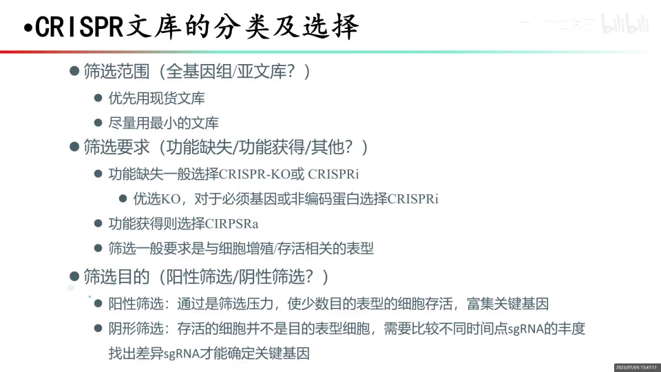

这三层里，**第一层和第三层直接受「pooled 还是 arrayed」影响**：全基因组范围只有 pooled 做得到；而阴性筛选必须靠「不同时间点的丰度比较」，这本身就要求扰动身份可测——也就是 pooled + 测序读出。若要精细表型（形态、动态、剂量响应），pooled 的读出方式给不了，只能转 arrayed。

视频也点出筛选的一般要求：**表型最好与细胞增殖/存活相关** [【跳转到 25:14】](https://www.bilibili.com/video/BV1V94y1e7fK/?t=1514)。原因很朴素——pooled 的读出是计数变化，只有「活/死/增殖快慢」才能直接翻译成计数差异；像「干扰素伽马表达水平上升」这类表型，就需要额外的分选或报告系统才能变成可测的计数。

## 七、Pooled 负责发现，Arrayed 负责确证

视频在讲完筛选流程后，紧接着讲了「往下做」这一步：客户拿到分析结果，觉得某几个基因有意思，就**回到传统的敲除、过表达或者回补实验**去验证 [【跳转到 24:17】](https://www.bilibili.com/video/BV1V94y1e7fK/?t=1457)。

这一步正是 arrayed 的用武之地，也是两种形式最标准的串联方式：

```
pooled 全基因组筛选  →  得到候选基因列表（几十到几百个）
        ↓
arrayed 逐一验证     →  一个孔一个候选基因，条件可控、可重复、可做复杂读出
        ↓
机制研究             →  敲除 + 回补，证明必要性与充分性
```

为什么必须换形式？因为 pooled 的结论建立在「sgRNA 丰度差异」上，而丰度差异可能来自：真实的生长效应、文库不均一、归属错误、细胞数太少导致的漂移。**只有把每个候选单独拿出来、在可控条件下重做一遍（正交验证，orthogonal validation），才能排除这些系统性解释。**

视频开头讲的那套「基因—功能—表型」框架在这里闭环了：证明一个基因与某个表型有关，要看**必要性**（去掉它，表型变化）和**充分性**（加回去，表型恢复）[【跳转到 06:12】](https://www.bilibili.com/video/BV1V94y1e7fK/?t=372)。pooled 筛选擅长在**必要性**方向做大规模搜索；而**回补**这种「加回去看能不能救回来」的实验，天然是 arrayed 式的单基因操作 [【跳转到 07:02】](https://www.bilibili.com/video/BV1V94y1e7fK/?t=422)。

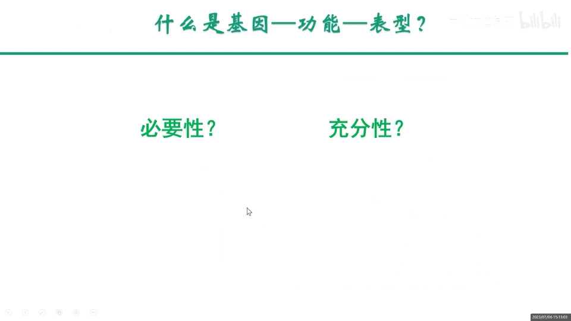

## 八、筛选形式决定了数据长什么样

这一点直接决定后面用什么分析方法（属第 5 章，这里只点到为止）：

| 筛选形式 | 主要读出 | 数据形态 | 分析的基本动作 |
| :--- | :--- | :--- | :--- |
| Pooled + NGS | sgRNA 计数 | **计数表**：sgRNA × 样本（处理组/对照组） | 归一化 → 富集/耗竭排序 → 命中基因聚合 |
| Pooled + 单细胞读出 | 表达谱 + 扰动标签 | **矩阵**：细胞 × 基因 + 扰动注释 | 按扰动分组比较表达（属 3.3.1 / 第 5 章） |
| Arrayed + 孔级读出 | 成像/荧光/存活 | **特征表**：孔 × 表型特征 | 孔间归一化 → 板效应校正 → 效应量比较 |

**pooled 的数据本质是「计数」，arrayed 的数据本质是「特征」。** 前者的分析核心是「这个 sgRNA 的读数相对对照变了几倍、显著不显著」；后者的分析核心是「这个孔的形态特征相对对照孔偏了多少」。两种数据几乎不共享分析方法——这也是为什么筛选形式必须在实验设计阶段就定下来。

## 小结

- **两种形式的真正区别**：pooled 的扰动身份是**测出来的**，arrayed 的扰动身份是**摆出来的**（孔坐标）。前者换来全基因组通量，后者换来完全可控。
- **pooled 的四个代价**：每个扰动的细胞数由泊松分配决定、文库扩增会漂移（覆盖度/均一性）、MOI 必须压低否则效应无法归因、扰动身份要靠测序归属。
- **pooled 的读出天花板**是「富集/耗竭」这种计数变化；形态、动态、剂量响应这类精细表型只能交给 arrayed。
- **MOI = 0.3 不是随便定的**：它保证「大部分细胞只整合一个 sgRNA」，同时让每种 sgRNA 覆盖到足够多的细胞（视频里是超过 1000 个）。
- **两种形式常常串联**：pooled 负责发现（全基因组、无偏），arrayed 负责确证（单基因、可控、可回补）。这是 screen → validate 的标准路径。
- **一句话收束**：通量、可控性、读出丰富度，三者只能取二。选形式就是在选你愿意放弃哪一项。

## 关键术语速查

| 术语 | 一句话解释 |
| :--- | :--- |
| Pooled screen | 上万个扰动混在一个细胞池里，靠测序读出扰动身份的筛选形式 |
| Arrayed screen | 一个孔一个扰动、孔间物理隔离的筛选形式，扰动身份由孔坐标给出 |
| sgRNA 文库 | 上万个 sgRNA 混合成的质粒/病毒混合物，是 pooled 的「扰动清单」 |
| 覆盖度（coverage） | 文库扩增后仍然保留下来的 sgRNA 占设计总数的比例 |
| 均一性（uniformity） | 文库中各个 sgRNA 丰度的均匀程度，差异过大将污染筛选结果 |
| MOI | 病毒颗粒数与细胞数的比值；pooled 中通常压到 0.3 左右 |
| 泊松分布 | 描述「随机分配」的分布，用来解释为什么低 MOI 下大部分细胞只拿到一个 sgRNA |
| 阳性筛选 | 关注处理后存活/富集的细胞，找耐药或保护性基因 |
| 阴性筛选 | 关注处理后消失的细胞，找必需基因或致死搭档 |
| 富集 / 耗竭（enrichment / depletion） | pooled 读出的两种基本结果：sgRNA 计数相对对照变多 / 变少 |
| 合成致死 | 两个非致死基因同时失活才导致细胞死亡，用于只杀肿瘤细胞的策略 |
| 正交验证（orthogonal validation） | 用另一种实验形式（通常是 arrayed 单基因操作）复核 pooled 得到的候选 |
