# MOI、对照与重复：决定扰动实验可信度的三个参数

> 视频来源：[CRISPR-Cas9 Screen全解析 从分子机制到大规模功能基因组学研究](https://www.bilibili.com/video/BV1VsFVzCEG6/)（Bilibili · 三人水泰）｜时长约 48 分钟
> 导读：这是一讲面向实验室新人的 CRISPR 筛选实操课，从质粒、转染、转导一路讲到筛选设置与结果解读。本文不重复建库化学与数据分析流程，只抽出其中真正决定实验成败的三个参数——MOI、对照、重复——以及它们之间的相互牵制。字幕为 AI 生成，术语已按上下文订正。

## 本讲要解决的核心问题（SCQA）

**背景**：CRISPR 筛选（以及以它为骨架的单细胞扰动实验）已经是很成熟的技术，文库能买、病毒能包、测序能外包，看上去流程是标准化的。

**冲突**：同样的流程，有的实验室做出来能重复、能发文章，有的做出来全是假阳性。差别往往不在技术新旧，而在几个"无聊"的参数：每个细胞到底拿到了几条 gRNA、拿什么当基线、结论在几个独立样本里成立。

**疑问**：这几个参数各自在控制什么？设错了会在数据里留下什么后果？

**回答（中心思想）**：**MOI 决定归因干不干净，对照决定效应能不能被识别，重复决定结论能推广多远。**这三件事做错，后面再漂亮的分析都是在错误的地基上盖楼。

---

## 一、MOI：一个细胞到底拿到几个扰动

### 1.1 MOI 是病毒颗粒与细胞的数量比

讲者把 MOI 放在"转导过程的关键注意点"第一条来讲，定义很朴素：**MOI（multiplicity of infection，感染复数）就是病毒颗粒数与细胞数的比例**。[【跳转到 16:43】](https://www.bilibili.com/video/BV1VsFVzCEG6/?t=1003)

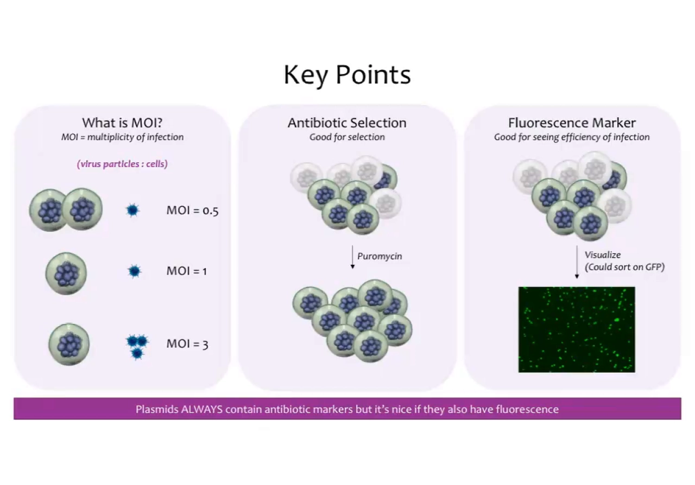

所以这个比例是可以直接算的：2 个细胞、1 个病毒，MOI 就是 0.5；1 个细胞、3 个病毒，MOI 就是 3。[【跳转到 17:33】](https://www.bilibili.com/video/BV1VsFVzCEG6/?t=1053)

讲者强调，MOI 不是查表得来的，**必须在自己的实验室里针对细胞系和病毒批次亲自摸**：不同细胞系差异很大，一般来说有效 MOI 在 1 到 20 之间，有些细胞特别难感染，需要 50 甚至 100，但大多数细胞落在这个范围。[【跳转到 17:08】](https://www.bilibili.com/video/BV1VsFVzCEG6/?t=1028)

他给的理由很实际：**MOI 是保证实验一致性的参数**——只有每次用相同的病毒量，实验才可控、批与批之间才可比。

### 1.2 为什么筛选要压到 0.3

到了筛选设置那一步，讲者给了一个具体数字：**感染时的 MOI 为 0.3**，而且明确标注为"Low MOI"。[【跳转到 22:11】](https://www.bilibili.com/video/BV1VsFVzCEG6/?t=1331)

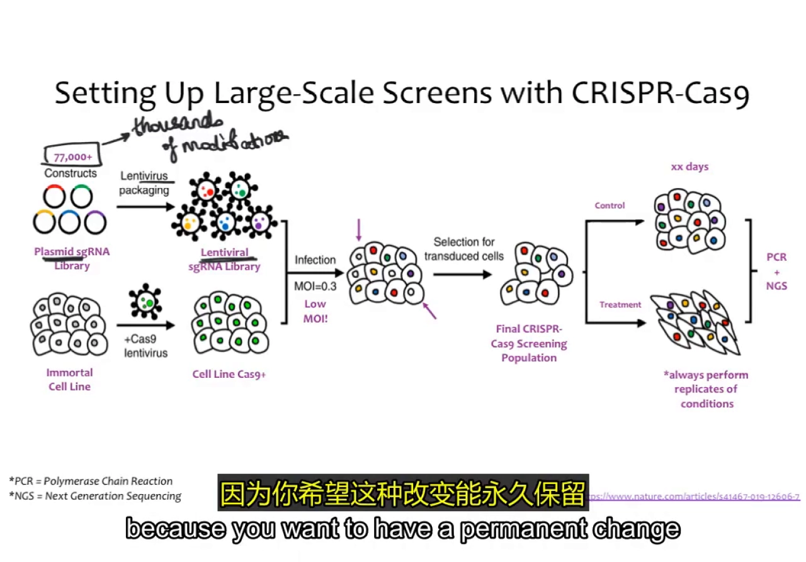

理由只有一句话，但它是整节课的地基：**这个 MOI 确保每个细胞只感染一个质粒或病毒，我们不希望单个细胞里出现两次敲除，否则会影响后续筛选。**必须确保每个细胞只有一个质粒，0.3 的 MOI 已被证明是最佳值，它既保证这一点，同时保证群体的转导效率。[【跳转到 22:36】](https://www.bilibili.com/video/BV1VsFVzCEG6/?t=1356)

这里要区分两件事：**故意把两条 gRNA 放进同一个细胞，是组合扰动实验（研究基因间的协同/冗余）；而筛选里一个细胞意外拿到两条 gRNA，是污染。**前者你还能解释，后者会让"这条 gRNA 的效应"变成"两条 gRNA 叠加的效应"，而你根本不知道另一条是谁。

### 1.3 用泊松分布理解"为什么 0.3 而不是 0.1 或 1"

视频没有展开数学，但 MOI 的直觉必须靠泊松分布才立得住。当病毒颗粒随机碰撞大量细胞时，一个细胞被 $k$ 个病毒颗粒感染的概率近似服从泊松分布：

$$
P(k) = \frac{\lambda^{k} e^{-\lambda}}{k!}, \qquad \lambda = \mathrm{MOI}
$$

其中 $\lambda$ 就是平均每个细胞分到的病毒颗粒数，也就是 MOI。三个关键量随之确定：

- **未被感染的比例**：$P(0) = e^{-\lambda}$
- **恰好一个病毒颗粒的比例**：$P(1) = \lambda e^{-\lambda}$
- **拿到两个及以上（多重感染）的比例**：$1 - P(0) - P(1)$

代入几个典型值：

| MOI $\lambda$ | 未感染 $P(0)$ | 恰好 1 个 $P(1)$ | 多重感染 $\geq 2$ |
| --- | --- | --- | --- |
| 0.1 | 90.5% | 9.0% | 0.5% |
| 0.3 | 74.1% | 22.2% | 3.7% |
| 1.0 | 36.8% | 36.8% | 26.4% |
| 3.0 | 5.0% | 14.9% | 80.1% |

读这张表要注意两件事。第一，**MOI 永远不等于"每个细胞一个病毒"**：即使 MOI=1，也有 26% 的细胞拿到两个以上，同时有 37% 的细胞一个都没拿到。第二，**压低 MOI 的代价是"有效细胞变少"**：MOI=0.3 时只有 22% 的细胞是"恰好一个 gRNA"的理想细胞，另外 74% 是空细胞，必须靠抗生素筛选（下面会讲）淘汰掉。

这就是 0.3 这个数字的来历：它在"多重感染足够少（3.7%）"和"被感染的细胞数还够用（26%）"之间取了一个折中。**MOI 不是越低越好，它是"归因干净"与"细胞数够用"之间的旋钮。**

---

## 二、对照：不同对照回答不同问题

### 2.1 第 0 天群体：筛选的基线

讲者在讲全基因组筛选实例时，把对照讲得非常具体。整个流程是：全基因组文库 → 包装病毒 → 低 MOI 感染 → 嘌呤霉素筛选 → 得到"胶质瘤干细胞 + 文库"群体 → 分成两支。[【跳转到 35:08】](https://www.bilibili.com/video/BV1VsFVzCEG6/?t=2108)

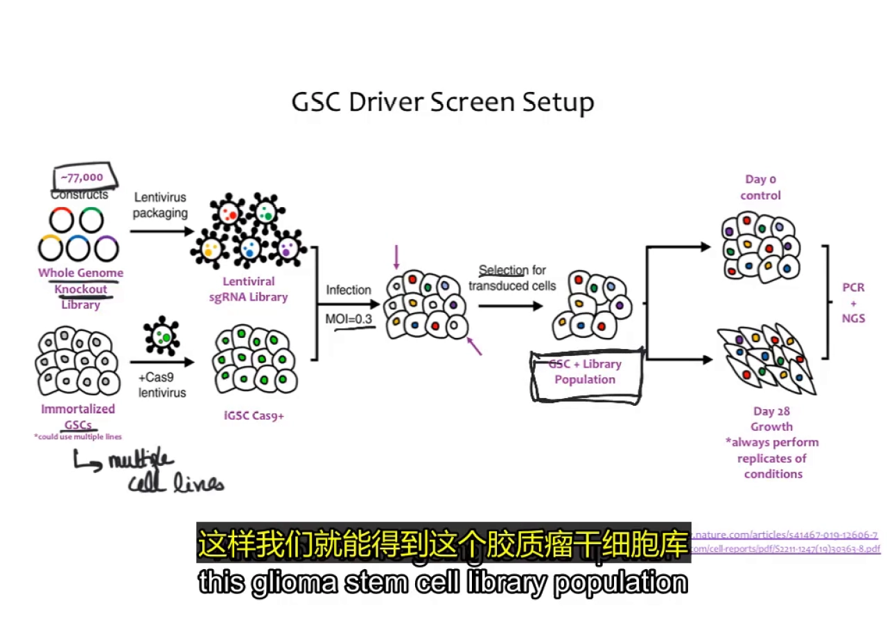

一支是 **Day 0 control**，另一支是 **Day 28 Growth**。讲者的解释是：**对照组就是第 0 天，因为我们要观察第 0 天存在哪些基因**；让细胞在培养基中生长 28 天，看这段时间里哪些细胞被淘汰、哪些被富集，从而知道哪些基因导致细胞死亡、哪些促进存活。[【跳转到 35:08】](https://www.bilibili.com/video/BV1VsFVzCEG6/?t=2108)

这个设计的关键在于：**Day 0 不是一个"没做过任何事"的样本，而是"做完了所有操作、只差时间"的样本。**感染、筛选、建库这些步骤带来的偏差，在第 0 天里同样存在，所以把它当基线，能把这些流程性偏差抵消掉。

### 2.2 溶剂对照：把"处理"从"操作"里剥出来

讲者最后用一张总结图复习整个流程时，对照的写法更明确了：文库感染、筛选之后，细胞分成 **Vehicle treatment（溶剂处理）** 和 **Sorafenib treatment（索拉非尼处理）** 两组，培养到第 7 天，再一起做 PCR 扩增和测序。[【跳转到 45:29】](https://www.bilibili.com/video/BV1VsFVzCEG6/?t=2729)

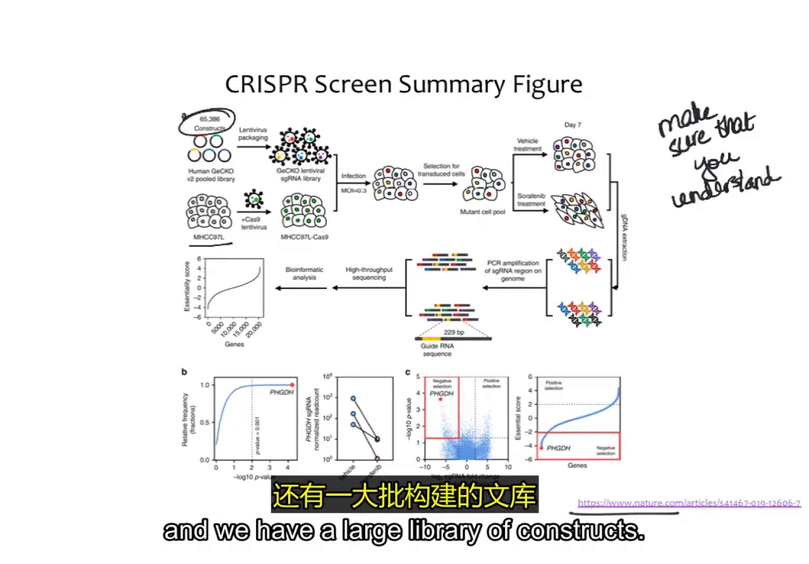

这就是**溶剂对照（vehicle control）**的作用：药物组加了索拉非尼，对照组加的是溶解药物的溶剂。两组之间唯一的差别是药物分子本身，而不是"加了一次液体"这个动作。如果只拿"没加任何东西"的细胞当对照，你分不清看到的差异是药物造成的，还是加液、换液、操作次数造成的。

把它和第 0 天对照放在一起看，就能看出**不同对照回答不同问题**：

- **第 0 天对照**回答：在没有任何选择压力时，这个文库群体的基线分布是什么？
- **溶剂对照**回答：排除药物分子之后，处理操作本身贡献了多少变化？

### 2.3 抗生素筛选不是对照，但它决定了对照有没有意义

讲者在流程里专门标注了嘌呤霉素筛选这一步：感染之后，群体里有一部分细胞（图中灰色）根本没有被病毒转导，必须用嘌呤霉素把它们筛掉，才能得到纯化的转导细胞群体。[【跳转到 23:51】](https://www.bilibili.com/video/BV1VsFVzCEG6/?t=1431)

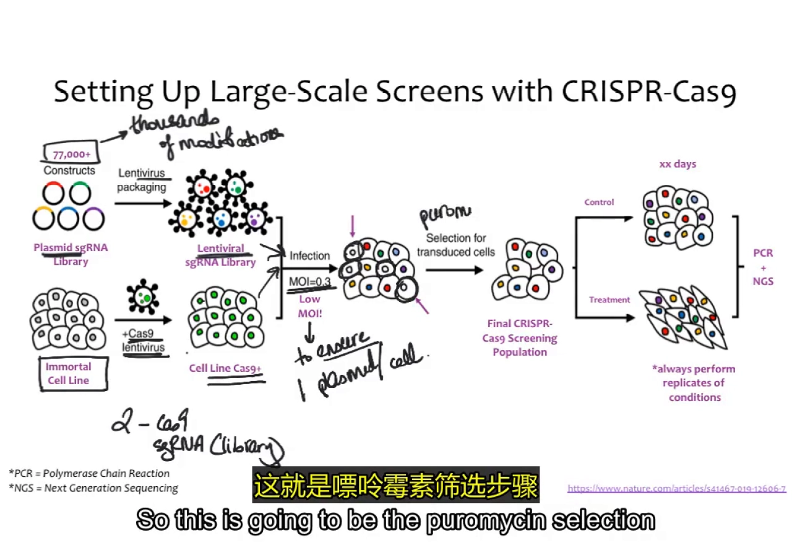

他反复强调的理由是：**每个细胞都应该含引导序列，你不希望有任何缺引导序列的细胞，因为那会再次干扰筛选结果。**而且这个筛选后的群体要**保存好**——它是包含所有引导序列的初始群体、每一个基因敲除都在里面，任何一次筛选都应该从这个"完美群体"的细胞开始。[【跳转到 26:51】](https://www.bilibili.com/video/BV1VsFVzCEG6/?t=1611)

换句话说：**对照的前提是"两组细胞来自同一个已经纯化的群体"。**如果空细胞（没有 gRNA 的细胞）混在里面，它们在处理组和对照组里的比例还不一定相同，那么你比较的就不再是"gRNA 的效应"，而是"空细胞占比的差异"。

---

## 三、重复：guide 层面的重复与样本层面的重复

### 3.1 每个基因 4 到 8 条 guide：这是第一层重复

讲者在讲文库选择时给了一个具体规格：**如果你购买文库，通常每个基因有 4 到 8 条引导序列，这是为了提供重复。**[【跳转到 26:51】](https://www.bilibili.com/video/BV1VsFVzCEG6/?t=1611)

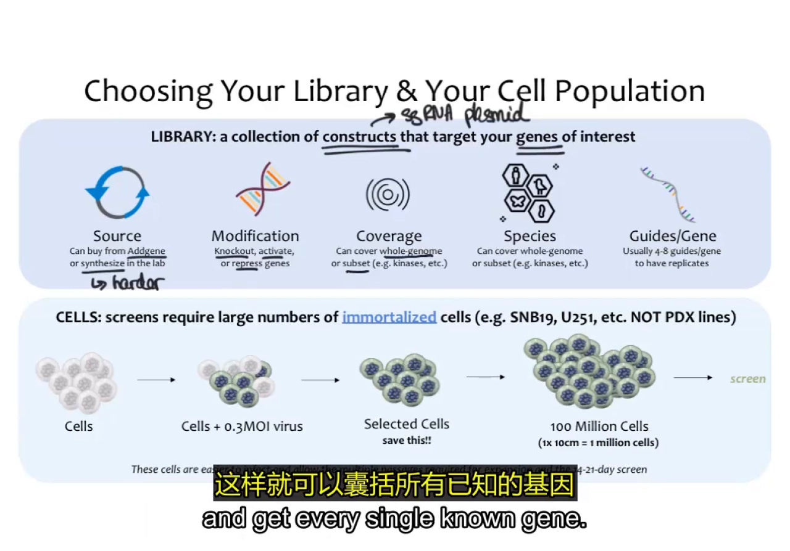

为什么不能一个基因只放一条 guide？讲者的推理很直接：如果每个基因只做一次敲除，这个敲除可能显示效应，但**效应可能不真实，可能是引导序列的伪影**——guide 可能脱靶，可能有其他问题。4 到 8 次敲除可以验证效应是否真实：**如果四条都敲除，或至少四条里有三条显示效应，就可以确认是真的。**[【跳转到 27:16】](https://www.bilibili.com/video/BV1VsFVzCEG6/?t=1636)

这一层重复针对的是**扰动工具本身的不确定性**：不同的 guide 敲同一个基因，效率不同、脱靶谱不同。如果四条 guide 都指向同一个结论，那这个结论更可能来自"基因被敲掉"，而不是"某条序列的副作用"。

### 3.2 条件重复：这是第二层重复

讲者在流程图上两次写下同一句话——**"always perform replicates of conditions"（永远要做条件重复）**，一次在通用流程图，一次在 GSC 实例图。[【跳转到 22:11】](https://www.bilibili.com/video/BV1VsFVzCEG6/?t=1331)

这一层重复针对的是**实验过程的不确定性**：同一批细胞分两管、同一方案做两次，得到的计数不会完全一样。只有独立重复的条件之间结论一致，你才能说"这个效应可重复"。

### 3.3 重复在数据里长什么样

讲者用一张真实的计数表把两层重复同时展示出来：行是"基因_guide"，列是 Day 0 Rep 1、Day 0 Rep 2、Day 28 Rep 1、Day 28 Rep 2，格子里的数字是该 guide 检出的细胞数。[【跳转到 38:16】](https://www.bilibili.com/video/BV1VsFVzCEG6/?t=2296)

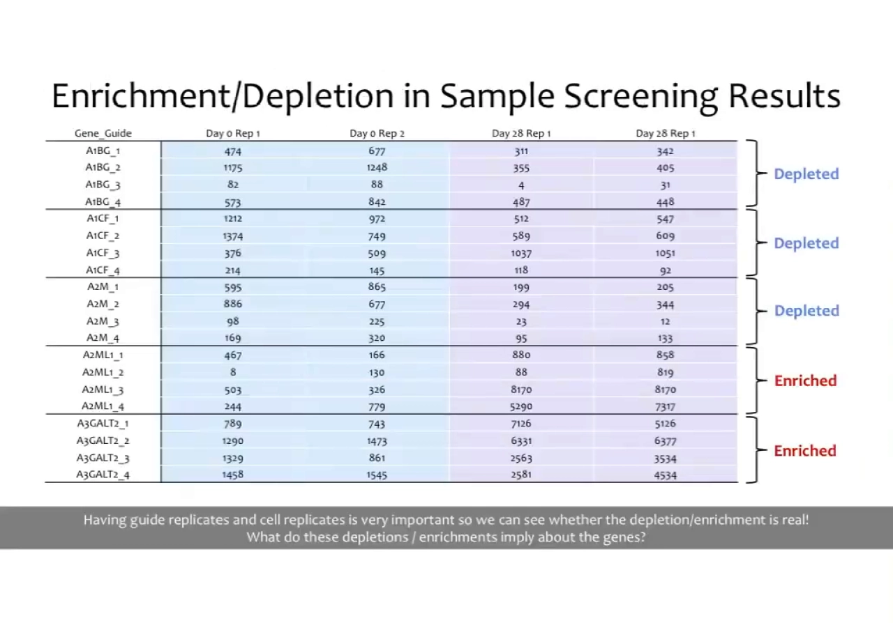

这张表底部写着一句总结：**"Having guide replicates and cell replicates is very important so we can see whether the depletion/enrichment is real!"**——同时有 guide 重复和细胞（样本）重复，才能判断富集/耗尽是不是真的。

讲者带着读者逐行看：以 A1BG 这个基因为例，四条 guide 在第 28 天都明显减少，说明这个基因被耗尽；而有的 guide 表现并不理想、整体计数很低，这时**另外三个重复可以让你看到真实效应，即使那一条并没有真正起作用**。[【跳转到 38:41】](https://www.bilibili.com/video/BV1VsFVzCEG6/?t=2321)

这段是整节课最实用的一处：**重复不是为了算误差棒，而是为了在单个测量失效时仍然能读出信号。**

### 3.4 单细胞不是重复

这节课讲的是群体水平的筛选，但它给出的逻辑可以直接搬到单细胞扰动实验上，而且那里更容易踩坑：**一个细胞测到"敲掉某基因后表达变了"，不等于这个效应被重复了一次。**同一个 gRNA 下的几百个细胞共享同一管病毒、同一批培养基、同一次建库，它们的误差是相关的。真正的重复单位是**独立转导、独立处理的样本**（不同孔、不同批次、不同供体），而不是细胞个数。

这就是为什么单细胞扰动数据最终要做 pseudobulk，把细胞聚合成样本再比较——聚合的目的不是"减少噪声"，而是把统计单位换回真正的重复。

---

## 四、代价：压低 MOI 之后，细胞数必须补回来

三个参数不是免费的。MOI 压到 0.3，意味着只有约四分之一的细胞真正被感染；再经过嘌呤霉素筛选，能用的细胞更少。所以讲者紧接着就讲细胞量：**每个条件需要一亿个细胞，这是做 CRISPR 筛选的最低要求。**[【跳转到 27:41】](https://www.bilibili.com/video/BV1VsFVzCEG6/?t=1661)

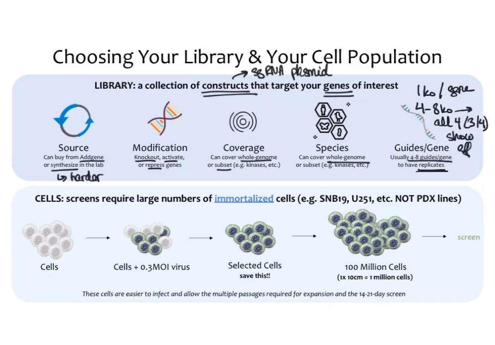

他算了一笔账：实验室常用的 10 cm 培养板只有约一百万个细胞，所以需要一百个 10 cm 培养板；筛选周期通常 14 到 21 天，这些细胞不仅要能感染、扩增到一亿，还要能撑完整个筛选过程。[【跳转到 28:31】](https://www.bilibili.com/video/BV1VsFVzCEG6/?t=1711)

**这就是 MOI 与细胞数之间的硬约束**：文库里有七万七千个构建体，每个构建体要保证足够的细胞代表数（覆盖度），而低 MOI 又把大部分细胞变成"空细胞"。两头一挤，起始细胞量就被推到了亿级。文库越大、MOI 压得越低、重复做得越多，需要的细胞就成倍上升——这也是为什么这类实验必须用可长期传代的永生化细胞系，而不能用无法长期传代的 PDX 模型。

---

## 五、参数错了，数据里会留下痕迹

讲者在解读结果时反复提醒：**你无法观察筛选内部发生了什么**，只能传代、处理、测序，直到拿到数据才知道结果，所以设置阶段必须极其严谨。[【跳转到 32:51】](https://www.bilibili.com/video/BV1VsFVzCEG6/?t=1971)

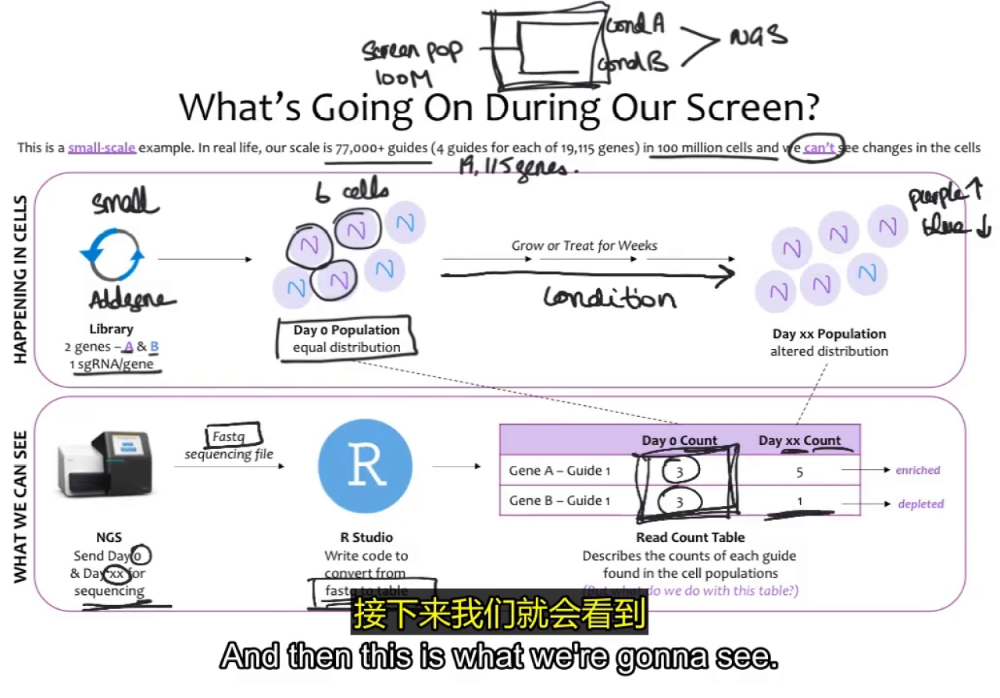

正因为看不见，参数错误不会被"发现"，只会被"继承"到下游：

- **MOI 太高** → 一部分细胞带两条 gRNA，它们的表型被记在两条 gRNA 名下，表现为"某个基因敲除后效应很弱但很杂"，或者出现无法解释的假阳性。
- **对照缺失或设错** → 差异分析里"处理 vs 对照"这个对比根本没有定义，你算出来的倍数变化里混着批次、操作、时间。
- **重复不足** → 单个 guide 的噪声被当成生物学效应；换成另一个细胞系或另一批细胞就复现不出来。

讲者给的解法是把参数和统计绑在一起：先用算法（DESeq2、edgeR、MAGeCK、BAGEL 这类）算出每个基因的变化倍数与 p 值，再筛"变化大于 2 倍且 p 值显著"，把一万七千个基因缩到几百个，然后靠通路分析进一步收敛。[【跳转到 41:49】](https://www.bilibili.com/video/BV1VsFVzCEG6/?t=2509)

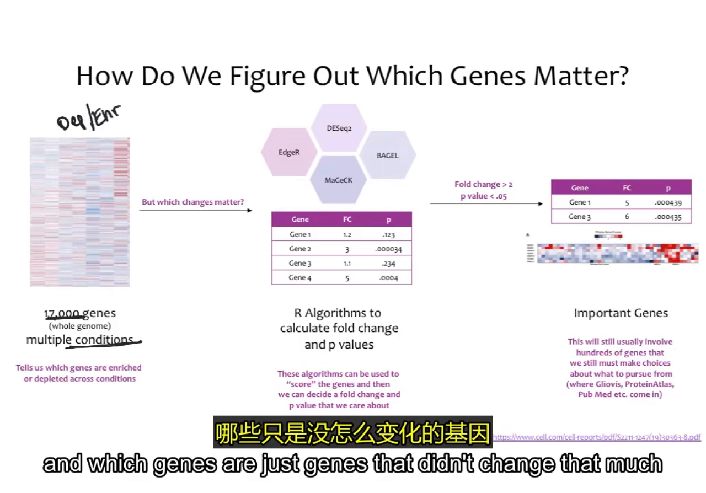

但要注意顺序：**统计只能压缩候选，不能修补设计。**如果对照和重复没设好，p 值算得再漂亮也只是把一个不可靠的差异量化了。

值得一提的是，讲者展示的那篇论文把同一套参数铺到了 **1300 个基因 × 18 种细胞系**上，比较胶质瘤干细胞、神经干细胞与非 GBM 细胞系，才看出"哪些基因特异性地影响胶质瘤干细胞而不影响其他细胞"。[【跳转到 40:40】](https://www.bilibili.com/video/BV1VsFVzCEG6/?t=2440)

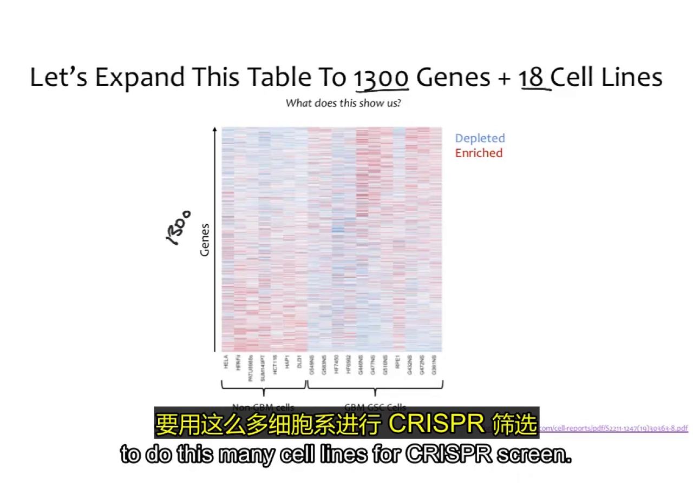

这里的"18 种细胞系"其实就是**重复放在你想推广的那一层**：如果你的结论要说"这个基因对胶质瘤干细胞普遍重要"，那重复就必须跨细胞系，而不是在同一个细胞系里多分两管。

---

## 六、把三个参数串成一条设计链

讲者最后的流程回顾把整条链压缩成了几句话：目标细胞系 + 大量构建体文库 → **低 MOI 感染** → 抗生素筛选保留载体 → 保存这个群体 → 选择特定天数（通常 7 到 28 天）做处理 → 提取 gDNA、扩增 guide 区域 → 测序 → 算法打分。[【跳转到 45:29】](https://www.bilibili.com/video/BV1VsFVzCEG6/?t=2729)

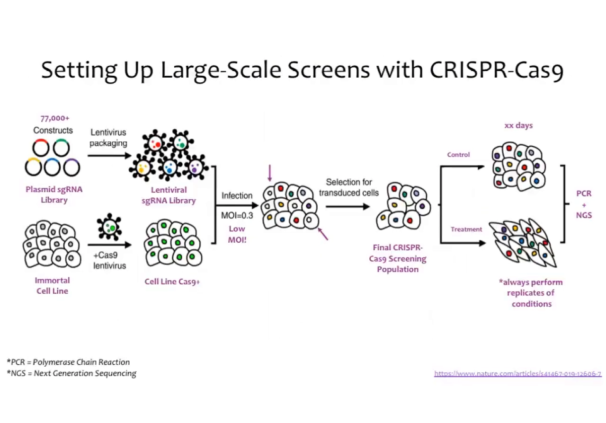

把它改写成一张"参数自检表"，就是本文想留下的东西：

| 参数 | 设错了会怎样 | 怎么判断设对了 |
| --- | --- | --- |
| MOI | 一个细胞多条 gRNA，效应无法归因 | 多重感染比例足够低；抗生素筛选后群体纯净 |
| 对照 | 效应与流程/批次混在一起，无法分离 | 第 0 天对照与溶剂对照同时存在，且来自同一纯化群体 |
| 重复 | 把 guide 伪影或单次波动当成生物学结论 | 每个基因 4 到 8 条 guide，且条件有独立重复 |

三者的相互牵制也可以一句话说清：

- **MOI 压低** → 有效细胞变少 → 要更多起始细胞、更大培养规模 → 成本上升；
- **对照变少** → 效应与批次混淆 → 再多重复也分不开；
- **重复变少** → 只能报"在这个细胞系里看到了"，不能报"这是普遍规律"。

---

## 小结

- **MOI 是病毒颗粒与细胞的比例**，它不是查表值，必须针对细胞系和病毒批次自己摸；筛选里普遍压到 0.3 这种低 MOI。
- **压低 MOI 的唯一目的是保证归因干净**：一个细胞只拿一条 gRNA，效应才能记在这条 gRNA 名下；泊松分布解释了为什么 MOI=1 仍有约 26% 的多重感染。
- **压低 MOI 的代价是有效细胞变少**，所以每个条件要一亿细胞起步，筛选周期 14 到 21 天。
- **不同对照回答不同问题**：第 0 天对照给出无选择压力下的基线分布，溶剂对照把"药物"从"操作"里剥出来，两者通常需要并存。
- **抗生素筛选不是对照，但它是所有对照成立的前提**：只有先得到纯净的文库群体，两组之间才可比。
- **重复有两层**：每个基因 4 到 8 条 guide 针对工具的不确定性，独立条件重复针对实验过程的不确定性；两者缺一，富集/耗尽都可能不真实。
- **单细胞不是重复**：同一 gRNA 下的细胞共享同一管病毒和同一批处理，真正的重复单位是独立样本，所以要聚合到样本层面再比较。
- **统计不能修补设计**：算法只能把一万七千个基因压到几百个，压不出一个本来就没设好的对照。

## 关键术语速查

| 术语 | 一句话解释 |
| --- | --- |
| MOI（multiplicity of infection） | 病毒颗粒数与细胞数的比值，决定平均每个细胞拿到几个病毒 |
| multiple infection | 一个细胞被两个及以上病毒颗粒感染，导致多条 gRNA 进入同一细胞 |
| Poisson distribution | 描述随机碰撞下"每个细胞拿到 k 个病毒颗粒"的概率分布，均值即 MOI |
| non-targeting control | 序列不与基因组匹配的对照 gRNA，用来给出系统本身的基线 |
| safe-harbor control | 靶向已知不表达位点的对照，用来检验切割动作本身的毒性 |
| positive control | 靶向已知必需基因的对照，用来验证整条流程能检出效应 |
| vehicle control | 只加溶剂不加药物的对照，用来把药物效应从操作效应里分离 |
| Day 0 control | 做完所有操作但未经历选择压力的基线样本 |
| biological replicate | 独立样本层面的重复（不同孔/批次/供体），支持"效应可重复" |
| technical replicate | 同一份样本的重复测量，只反映测量误差 |
| batch effect | 批次带来的系统性偏差，与生物学变量重合时无法校正 |
| confounding | 批次与生物学变量完全重合，导致两者无法分离 |
| pseudobulk | 把同一条件下的单细胞计数聚合成一个样本，再在样本层面做统计 |
| coverage（覆盖度） | 文库中每个构建体在细胞群体里被代表的充分程度 |