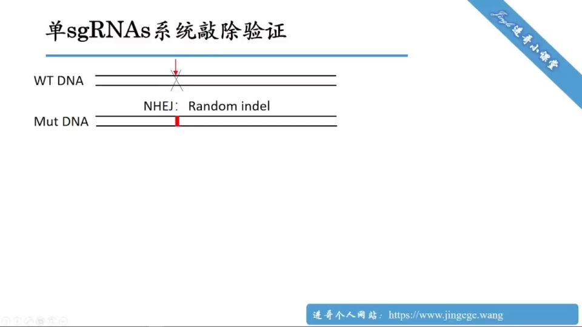
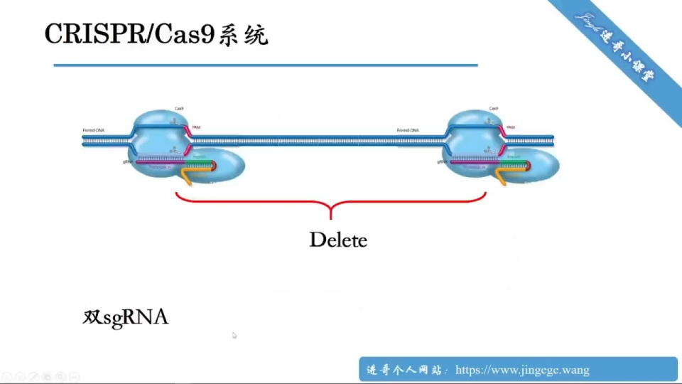
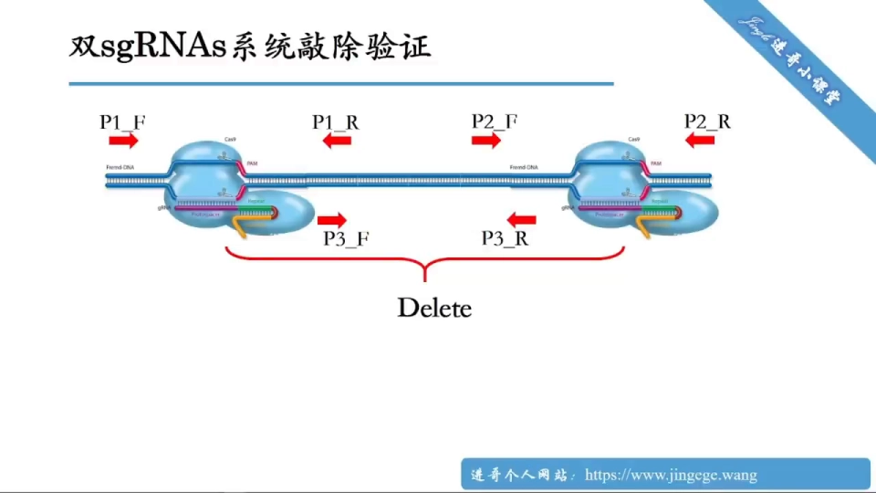
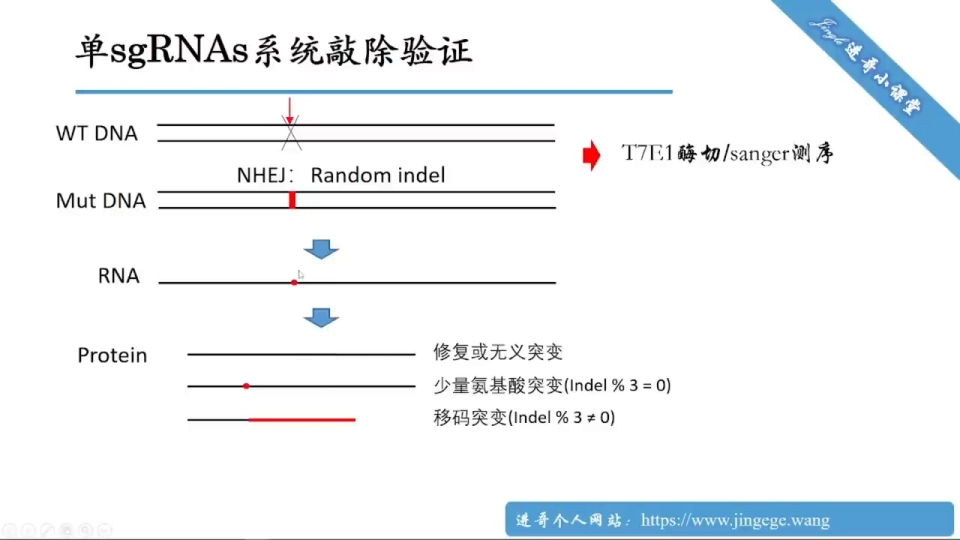
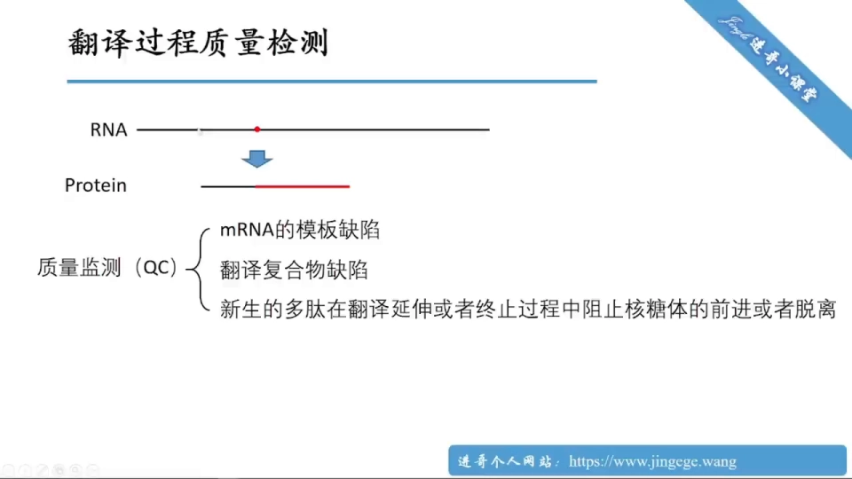
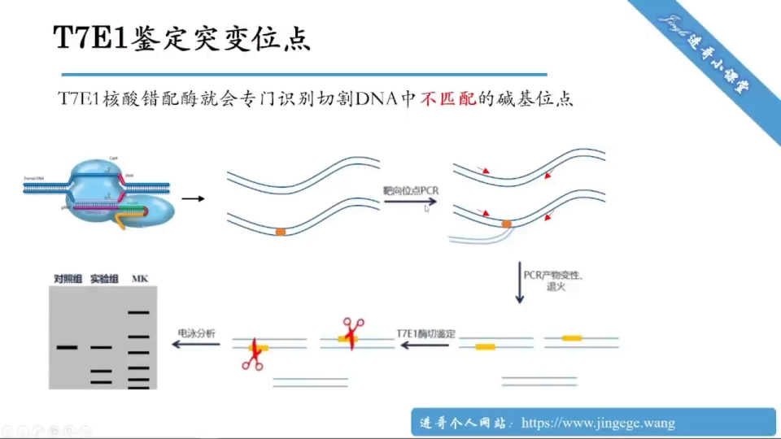
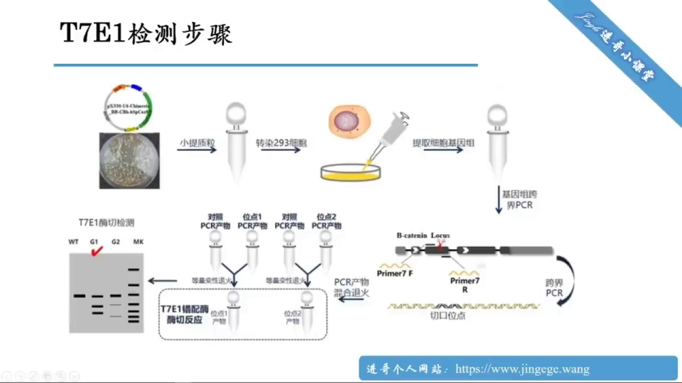
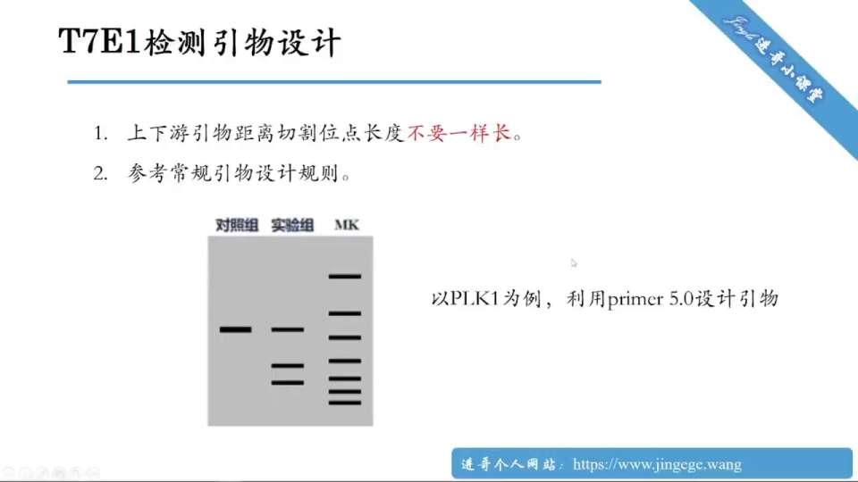
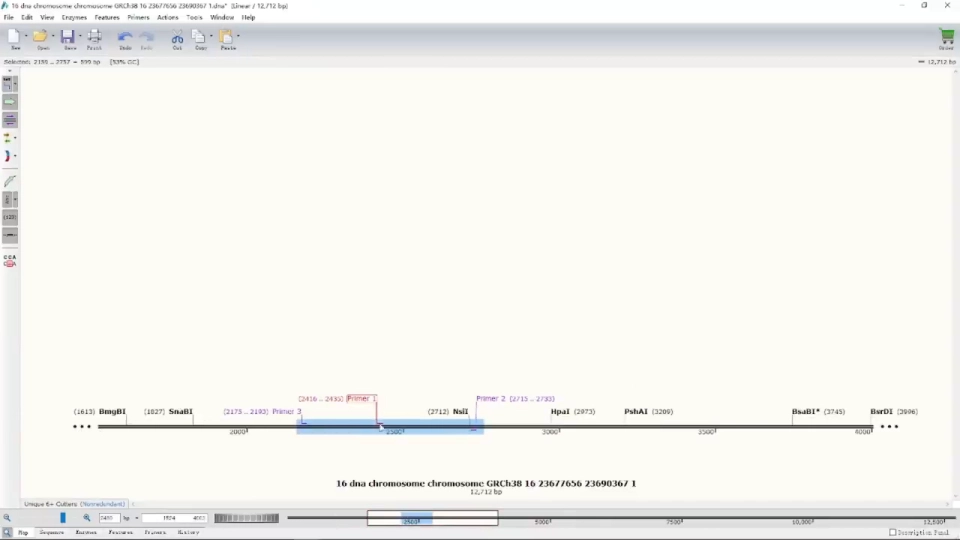
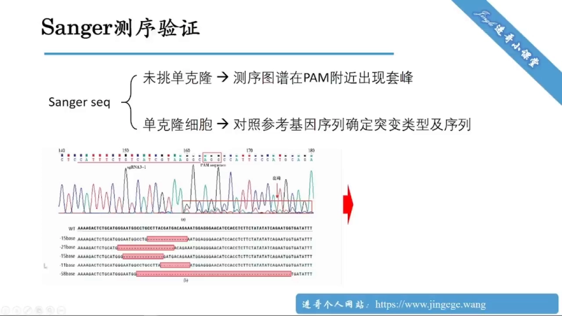

# CRISPR 敲除到底成没成？用 T7E1 酶切和 Sanger 测序在 DNA 层面给出证据

> 视频来源：[CRISPR-cas9靶点活性/敲除效率验证（T7E1酶切/Sanger测序）](https://www.bilibili.com/video/BV1hh4y12718/)（B 站 · Jingle进哥）｜时长约 23 分钟
> 简要导读：这支视频是实操向的，讲的是"编辑完之后怎么证明自己真的编辑成功了"。它先区分双靶点缺失与单靶点 indel 两种情形，再给出 T7E1 酶切的完整原理、引物设计规则和一次完整的引物设计演示，最后落到 Sanger 测序与套峰拆解。本文按这条线索整理，并保留了视频里一个很关键的推论：**Cas9 敲除改变的是蛋白，不是 mRNA 丰度，所以 qPCR 不能当作敲除效率的证据**。

## 本讲要解决的核心问题（SCQA）

**背景**：用 CRISPR/Cas9 做基因敲除，流程已经很成熟——设计 sgRNA、构建到 lentiCRISPR v2 这类载体、转染细胞、切割、细胞自己用 NHEJ 修好。看起来做完转染就等于做完了敲除。

**冲突**：NHEJ 修复是"随机"的。同一个位点在不同细胞里可能少几个碱基、多几个碱基，也可能什么都没变。也就是说，"我转了 Cas9"和"这个细胞真的被敲掉了"之间隔着一层不确定：**切割效率是一个分布，不是一个数字**。如果不做验证，后面所有基于"这个基因已经没了"的结论都悬空。

**疑问**：怎么在 DNA 层面拿出"确实被编辑了"的直接证据？不同编辑类型该用哪种验证方法？这些方法的读数和引物设计有哪些坑？

**回答（中心思想）**：敲除验证要按**编辑类型**分流——双靶点缺失用"跨缺失位点 PCR 能不能扩出来"判断，单靶点 indel 用 **T7E1 错配酶切**做半定量初筛、用 **Sanger 测序**做金标准确认；同时要记住 Cas9 敲除在分子层面改的是**蛋白翻译**而非 mRNA 丰度，所以 **qPCR 不是敲除效率的合适读数**。

## 一、先分清两种编辑类型，验证方法完全不同

### 1.1 单靶点造成 indel，双靶点造成片段缺失

单个 sgRNA 在 PAM 上游 3 个碱基处造成一个双链断裂，细胞用 NHEJ 修回来，修的过程中随机插入或缺失几个碱基，这就是 indel。

[【跳转到 01:14】](https://www.bilibili.com/video/BV1hh4y12718/?t=74)

但单个 sgRNA 往往只能造成一个突变。如果要把整个基因敲掉，就需要**双靶点切除**：在基因两端各设计一个 sgRNA，两边同时断开，中间那一段在修复时被丢掉，形成一个片段缺失。

视频里给了一条很实用的经验：**lncRNA 这类非编码基因，大部分情况下必须用双靶点**，因为它不编码蛋白质，单靶点造成的移码突变对它没有意义；而编码蛋白的基因用单靶点就够，靠移码来破坏蛋白。

### 1.2 双靶点验证：看 PCR 能不能扩出来

[【跳转到 02:04】](https://www.bilibili.com/video/BV1hh4y12718/?t=124)

双靶点的验证"比较简单，因为它直接就是整个 DNA 上缺失一段"。做法是在缺失段的两侧布置两对引物：

- **P1_F / P1_R** 与 **P2_F / P2_R**：分别落在两个切割位点的外侧。如果某条染色体上这一段真的被删掉了，这两对引物就 **P 不出产物**。
- **P3_F / P3_R**：跨过整个缺失区。野生型和突变型都能扩增出来，但突变型的产物**明显更短**——因为中间少了一段。

所以判断逻辑很干净：外侧引物对无条带 + 跨区引物对出现短条带 = 这一段被删掉了。视频里说"这个结果应该是比较明确、比较清楚的"，跑个胶就能看出来。

### 1.3 单靶点验证：只能从序列里找证据

单靶点没有"整段消失"这种干净的信号，只能在序列层面找。视频把可用方法收窄成两个：

- **T7E1 酶切反应**——快速、便宜、半定量，适合初筛；
- **Sanger 测序**——直接读出碱基变化，是金标准。

## 二、indel 之后蛋白会怎样：三种结局，以及一个被忽略的推论

### 2.1 三种结局取决于 indel 长度是不是 3 的倍数

编辑发生在编码区，DNA 变了，RNA 照样转录，蛋白照样翻译——只是翻译出来的东西不一样。[【跳转到 04:59】](https://www.bilibili.com/video/BV1hh4y12718/?t=299)

视频把结局分成三类：

| indel 情况 | 蛋白层面后果 | 是否达到敲除 |
| :--- | :--- | :--- |
| 极少数情况被修回 | 恢复原序列或无义突变 | 否 / 视情况 |
| 长度是 3 的倍数（$\text{indel} \bmod 3 = 0$） | 增减几个氨基酸 | 通常不破坏功能 |
| 长度不是 3 的倍数（$\text{indel} \bmod 3 \neq 0$） | 移码，提前出现终止密码子，蛋白变短（也可能密码子延后变长） | 是 |

这里有个容易被说反的细节：移码之后**蛋白质其实还是被翻译出来了**，只是短了或者序列全乱。它之所以等于"敲除"，是因为细胞内的监控机制会把这种错误蛋白降解掉。

### 2.2 关键推论：Cas9 敲除不改变 mRNA 丰度，所以 qPCR 测不出敲除效率

视频在这里做了一个很硬的推论，值得单独拎出来：

> Cas9 介导的敲除影响的是蛋白水平的翻译过程，而对 mRNA 的丰度并没有影响。

[【跳转到 05:49】](https://www.bilibili.com/video/BV1hh4y12718/?t=349)

推理很直接：qPCR 引物如果设计在编辑位点之外，那么野生型和突变型的模板在这一段上是**一样的**，扩增效率也一样，Ct 值自然一样。你测到的"表达量"根本没变。

那为什么实验里有时候确实能看到 mRNA 下调？视频给的解释是**翻译过程的质量监测（QC）**：

QC 机制识别三类问题：

1. **mRNA 模板缺陷**——也就是这里的插入和缺失；
2. **翻译复合物缺陷**——翻译机器本身的组分出问题；
3. **新生多肽链在延伸或终止过程中阻止核糖体前进或脱离**——结果是要么产生短肽、要么产生长肽。

QC 被激活后，暂停的翻译复合物会解体回收，同时降解 mRNA、多肽链和核糖体。**mRNA 被一起降解了，所以 qPCR 才能看到下调。**

这个链条说明：qPCR 看到的 mRNA 下降是 QC 的**下游后果**，不是编辑的直接读数。它依赖 QC 是否被有效触发，因此幅度不稳定、方向也不保证。视频的结论是明确的——**DNA 层面的验证才是最直接的证据，"证实我是被编辑了，而不是通过某些间接的作用途径"**。

## 三、T7E1 酶切：把"杂合双链"变成一条看得见的切割带

### 3.1 原理：只切错配，不切纯合

T7E1 是一种核酸错配酶，专门识别并切割 DNA 中**不匹配**的碱基位点。[【跳转到 08:19】](https://www.bilibili.com/video/BV1hh4y12718/?t=499)

关键在于它的**选择性**：

- 纯合野生型双链 → 完全配对 → **不切**；
- 纯合突变型双链 → 也是完全配对 → **不切**；
- 一条野生型 + 一条突变型配成的杂合双链 → 在 indel 处错配 → **切**。

所以 T7E1 读的不是"有没有突变"，而是"**这个样本里野生型和突变型是不是同时存在**"。这个区别决定了后面所有操作细节。

### 3.2 流程：PCR → 变性退火 → 酶切 → 跑胶

[【跳转到 09:09】](https://www.bilibili.com/video/BV1hh4y12718/?t=549)

1. 在靶位点两侧设计引物，做 PCR。野生型和突变型都能被扩增出来，但**各自是重合的**——胶上只有一条带，看不出编辑。
2. **变性退火**：高温把双链解开，再缓慢降温重新配对。重配时会出现三种组合：野生配野生、突变配突变、野生配突变。第三种就是杂合双链。
3. **T7E1 酶切**：杂合双链在错配处被切开。
4. **跑胶**：如果出现切割条带，说明样本里存在突变型。

[【跳转到 09:34】](https://www.bilibili.com/video/BV1hh4y12718/?t=574)

### 3.3 一个反直觉的操作细节：单克隆细胞反而测不出来

[【跳转到 10:48】](https://www.bilibili.com/video/BV1hh4y12718/?t=648)

这是视频里最实用的一条经验。如果你已经筛到**单克隆敲除细胞株**，里面只有突变型 DNA、没有野生型，那么变性退火之后全是"突变配突变"的纯合双链，**T7E1 切不动，你会误判成"没编辑"**。

正确做法是：拿一管野生型细胞和一管突变型细胞，混到一起再退火，人为造出杂合双链。

反过来，如果你做的是**未经筛选的混合群体**，里面本来就同时有野生型和突变型，直接退火就能形成杂合 DNA，不需要额外加野生型细胞。

这条细节说明 T7E1 的适用范围其实很窄：**它只适合"混合群体"或"人为混合后的样本"，不适合直接验证纯合单克隆。**

### 3.4 引物设计：两条规则，第二条最容易被忽略

[【跳转到 10:11】](https://www.bilibili.com/video/BV1hh4y12718/?t=611)

**规则一：上下游引物距离切割位点的长度不要一样长。**

因为酶切之后要跑胶鉴定，两条切割带必须大小不同才能分开。如果切割位点正好在 PCR 产物正中间，切出来的两条带长度相同，在胶上会重合，**没法判断到底切没切**。

**规则二：其余按常规引物设计原则。**

视频随后用 PRK1 基因做了一次完整演示，几个数字值得记下来：

- 扩增长度控制在 **500–1000 bp**。小于 500 bp 分辨率不够，大于 1000 bp 扩增有难度。
- 在 SnapGene 里把 sgRNA 位点标出来，确认切割位点在产物中的相对位置。
- 用 Primer Premier 5 设计时，先试"上游 1~100 / 下游 700~1000"，发现两段长度差不多（切出来两条带接近），于是把上游范围改成 **200~400**，让两段长度拉开。
- 引物长度按 **19~22 bp ± 3**，产物长度设 **500~1800**。
- 评估候选引物对时，直接算切出来的两个片段长度。演示里第一对切出 245~250 与 307，只差 50 bp，"相对分辨率不是很强"；换一对切出 140~150 与 300~370，就"能够很清楚地区分开"。
- **片段不要短于 80 bp**，否则容易和引物二聚体等混在一起。

## 四、Sanger 测序：从"有没有切"到"切成了什么"

T7E1 只能回答"有没有编辑"，回答不了"编辑成了什么"。要拿到具体序列，就做 Sanger 测序——用同一份 PCR 产物去测。[【跳转到 21:22】](https://www.bilibili.com/video/BV1hh4y12718/?t=1282)

### 4.1 两种样本，两种读法

| 样本 | 测序图谱表现 | 能得出什么 |
| :--- | :--- | :--- |
| 未挑单克隆（混合群体） | 在 PAM 附近出现**套峰**（同一位置多个峰叠加） | 证明该位点发生了多种形式的编辑，但读不出具体序列 |
| 单克隆细胞 | 套峰变成**双峰**，可对照参考序列 | 确定两条等位基因各自的突变类型与序列 |

视频还提到一个技术细节：Sanger 测序对两端侧翼有一定要求，所以可以把 PCR 产物**连到 T 载体上再测序**，这样能得到准确的 PCR 产物序列。

### 4.2 套峰怎么读：手动拆峰与工具拆峰

混合群体的套峰是多个编辑事件的叠加。[【跳转到 22:12】](https://www.bilibili.com/video/BV1hh4y12718/?t=1332)

视频给了分档建议：

- **只有两条带（两个等位基因）**：手动拆峰比较方便；
- **情况复杂、有多种编辑**：手动拆很麻烦，用工具拆——包括 R 语言也可以做拆峰。

[【跳转到 21:47】](https://www.bilibili.com/video/BV1hh4y12718/?t=1307)

## 五、把这条链路放回单细胞扰动实验里

视频讲的是群体层面的 KO 验证，但它给出的判据可以直接搬到 Perturb-seq 这类单细胞扰动实验里，因为两者面对的是同一个问题：**"我施加的扰动真的生效了吗"**。

**第一，效率是一个分布，不是一个数字。** NHEJ 的 indel 长度随机、类型随机，所以同一个 sgRNA 在不同细胞里造成的编辑后果不同：有的细胞是 3 的倍数的缺失（蛋白只是少了几个氨基酸，功能可能还在），有的是移码（真敲除），有的根本没被编辑。群体的"敲除效率 70%"背后，是这三种细胞混在一起。在 pooled 筛选里，这意味着**一个 sgRNA 对应一个效率分布**，而不是一个确定的效应。

**第二，验证要落在正确的分子层面。** Cas9 敲除改的是蛋白，不是 mRNA。用 qPCR 去评估 KO 效率，测到的只是 QC 降解的副产品，幅度不稳定。在单细胞实验里，这一点更危险：单细胞转录组测的是 mRNA，一个 KO 细胞的转录组可能看起来"目标基因表达正常"，但这不代表敲除失败——**它可能只是 QC 没有把 mRNA 拉下来**。反过来，如果只看 mRNA 就断言"扰动无效"，就会把真信号当成假阴性丢掉。

**第三，读数方法本身有量程和选择性。** T7E1 只能读"混合群体里有没有杂合双链"，对纯合单克隆完全失效；Sanger 在混合群体里只能给出套峰。每种方法都有它读不出来的情形，**"没检测到"不等于"没发生"**。

## 小结

- 敲除验证按编辑类型分流：**双靶点缺失**看跨缺失位点 PCR 能否扩出、是否变短；**单靶点 indel** 用 T7E1 初筛、Sanger 确认。
- lncRNA 等非编码基因通常必须双靶点；编码蛋白基因单靶点靠移码即可。
- indel 长度是否为 3 的倍数决定蛋白结局；移码之所以等于敲除，是因为错误蛋白被细胞降解。
- **Cas9 敲除不改变 mRNA 丰度**，qPCR 引物若在编辑位点之外就测不出差异；偶尔看到的 mRNA 下调来自翻译 QC 机制对 mRNA 的连带降解，是下游后果而非直接读数。
- T7E1 只切杂合双链，因此对**纯合单克隆无效**，需要人为混入野生型细胞。
- T7E1 引物设计的核心是**让切割位点偏离产物中点**，使两条切割带在胶上可分；产物 500–1000 bp，最短片段不小于 80 bp。
- Sanger 测序是金标准：混合群体看套峰，单克隆看双峰并比对参考序列。

## 关键术语速查

| 术语 | 一句话解释 |
| :--- | :--- |
| indel | insertion/deletion，NHEJ 修复双链断裂时随机产生的碱基插入或缺失 |
| NHEJ | 非同源末端连接，细胞修复双链断裂的主要方式，不依赖模板、因此不精确 |
| 双靶点切除 | 在基因两端各切一刀，使中间片段在修复中丢失，适合非编码基因敲除 |
| T7E1 | 识别并切割 DNA 错配位点的核酸酶，只切杂合双链，用于 indel 半定量初筛 |
| 变性退火 | 高温解链后缓慢复性，使野生型与突变型单链随机配对，从而生成杂合双链 |
| 套峰 | Sanger 测序中同一位置出现多个叠加峰，说明样本含多种序列，即混合编辑 |
| 拆峰 | 从套峰中反解出各编辑事件的比例与序列，可手动或用工具完成 |
| 翻译 QC | 细胞对异常翻译的监控机制，会降解 mRNA、多肽链与核糖体 |
| 移码突变 | indel 长度不是 3 的倍数，导致下游密码子全部错位，通常提前终止 |