# RT-qPCR 会高估 RNA 敲低率：残留 gRNA 如何伪造出"敲低 90%"的假象

> 视频来源：[RNA靶向CRISPR实验者请立刻自查！！！你的RNA敲低可能测错了：gRNA会让RT-qPCR高估敲低率](https://www.bilibili.com/video/BV1REtz66EmJ/)（B 站 · 学术Rxiv快递姬）｜时长约 8 分钟
> 简要导读：这是一篇论文解读，讲的是 2026 年 9 月发表在 Nature Biotechnology 上的一项发现：用 RT-qPCR 评估 RNA 靶向 CRISPR（Cas13/Csm）的敲低率时，**引物位置会显著改变结果**，而且连"失活"的效应器都会显示出强烈敲低。本文按"现象 → 机制 → 证据 → 对策"的顺序整理，并把它接回单细胞扰动实验里"扰动效率怎么测"这条主线。

## 本讲要解决的核心问题（SCQA）

**背景**：RNA 靶向 CRISPR（Cas13、CasRx、Csm 等）通过 gRNA 引导切断目标 RNA，从而降低 RNA 水平。实验室评估"敲低了多少"的标准做法是 RT-qPCR：先把 RNA 逆转录成 cDNA，再 PCR 扩增，反推原始 RNA 量。

**冲突**：研究者做了一个本该失败的对照——用**已经失去 RNA 切割能力的失活 Csm**。结果跨 gRNA 结合位点的引物显示，正常 Csm 和失活 Csm **都敲低了约 90%**。一个切不动 RNA 的蛋白，却测出了 90% 的敲低率。

**疑问**：这个 90% 是从哪来的？如果测量方法本身在制造信号，那么我们过去读到的所有"敲低效率"还可信吗？

**回答（中心思想）**：这个假信号来自**测量流程本身**。裂解细胞纯化 RNA 时，gRNA 也跟着进了样本；逆转录时残留的 gRNA 重新结合到尚未被切断的目标 RNA 上，形成一道物理障碍，让逆转录酶过不去，cDNA 合成中断。**"cDNA 没合成出来"被当成了"RNA 变少了"**。因此 RNA 靶向 CRISPR 的敲低效率不能再由一组 RT-qPCR 结果单独定案，至少要建立三层验证。

## 一、现象：同一批样本，换个引物位置，结果从 90% 掉到 14%

### 1.1 实验设计

研究者想复现两个已知的敲低效果：Csm 对 **XIST** 和 **BRCA1** 的敲低。[【跳转到 00:51】](https://www.bilibili.com/video/BV1REtz66EmJ/?t=51) 关键在于他们同时测了两组：

- **正常 Csm**：有 RNA 切割能力；
- **失活 Csm**：已经失去 RNA 切割能力，理论上不应该造成任何敲低。

这是一个标准的"阴性对照"，用来区分"真敲低"和"方法学假象"。[【跳转到 01:19】](https://www.bilibili.com/video/BV1REtz66EmJ/?t=79)

### 1.2 结果：失活效应器也"敲低"了 90%

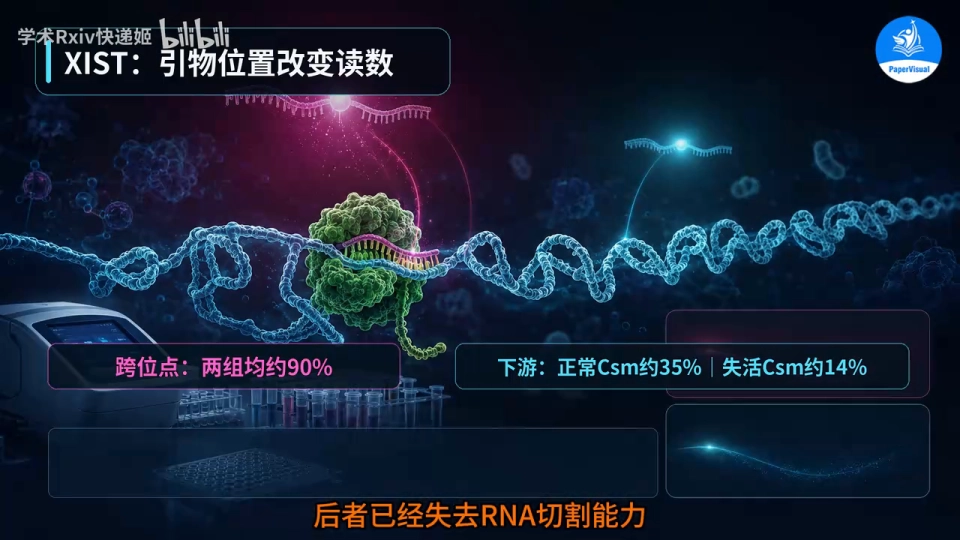

| 引物位置 | 正常 Csm | 失活 Csm |
| :--- | :--- | :--- |
| 跨越 gRNA 结合位点 | 约 90% 敲低 | 约 90% 敲低 |
| gRNA 结合位点下游 | 约 35% 敲低 | 约 14% 敲低 |

跨位点引物给出的结论是"两组都敲低了 90%"——这等于说**失活的酶和正常的酶效果一样**，显然荒谬。换成下游引物，正常 Csm 只剩 35%，失活 Csm 只剩 14%，两者的差距才回到合理范围。

### 1.3 蛋白层面的交叉验证

研究者在同一批 mCherry 样本里同时测了 RNA 和蛋白：[【跳转到 01:43】](https://www.bilibili.com/video/BV1REtz66EmJ/?t=103)

- 正常 Csm → mCherry **蛋白明显下降**；
- 失活 Csm → 蛋白**没有下降**。

但跨位点 RT-qPCR 仍然报告"失活 Csm 降低了 RNA"。**蛋白没变、RNA 却"降了"**，这个矛盾把问题指向了测量环节。

### 1.4 不是单个系统的偶然

类似的矛盾随后在 **PspCas13B** 和 **CasRx** 实验中也出现了。[【跳转到 01:59】](https://www.bilibili.com/video/BV1REtz66EmJ/?t=119) 三个受测系统都出现同一类异常，说明问题不在某一个蛋白，而在它们**共同经历的 RT-qPCR 检测过程**。

## 二、机制：gRNA 跟着样本进了试管，在逆转录时挡路

### 2.1 关键一步：RNA 纯化不会只留下目标 RNA

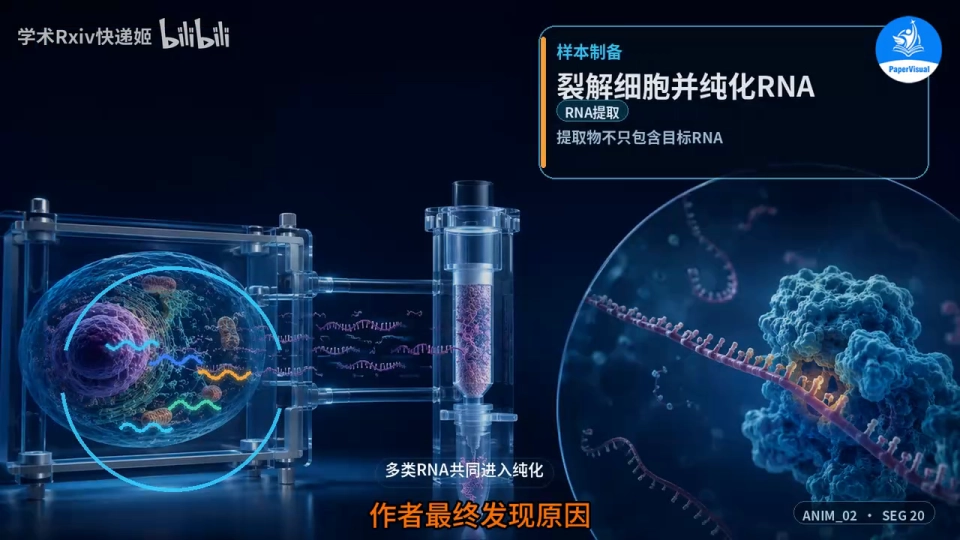

做 RT-qPCR 前要先裂解细胞、把 RNA 纯化出来。这一步不会只留下目标 RNA——**gRNA 本身也是 RNA**，其中一部分会跟细胞 RNA 一起进入待测样本。

于是进入逆转录反应的不只有目标 mRNA，还有大量 gRNA。

### 2.2 障碍的形成

进入逆转录反应后，这些残留的 gRNA 会**重新结合到尚未被切断的目标 RNA 上**（它本来就是设计来结合这个位点的）。结合位置形成一道物理障碍，常用的逆转录酶难以顺利越过。

结果就是：**跨越这一位置的 cDNA 无法完整生成**。[【跳转到 02:36】](https://www.bilibili.com/video/BV1REtz66EmJ/?t=156) 随后 PCR 得到的模板变少，Ct 值变大。而数据分析时，"cDNA 没有顺利生成"被计算成了"原始 RNA 已经减少"。

[【跳转到 02:11】](https://www.bilibili.com/video/BV1REtz66EmJ/?t=131)

一句话概括这条链条：

> 发生在试管里的逆转录阻挡，被记录成了发生在细胞里的 RNA 敲低。

### 2.3 为什么引物位置会决定读数

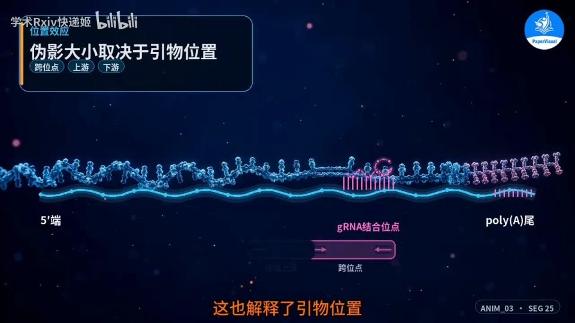

在论文使用的**随机六聚体引物**条件下：[【跳转到 02:49】](https://www.bilibili.com/video/BV1REtz66EmJ/?t=169)

| 扩增区域位置 | 是否受影响 | 原因 |
| :--- | :--- | :--- |
| 跨越 gRNA 结合位点 | **最容易受影响** | 逆转录必须穿过障碍 |
| 结合位点近端上游 | 也会下降 | 逆转录酶需要越过障碍才能继续 |
| 远端上游（约 500 nt 以外） | 基本不再明显 | 距离越远影响越弱 |
| 下游 | **相对不受影响** | 不需要穿过 gRNA 形成的障碍 |

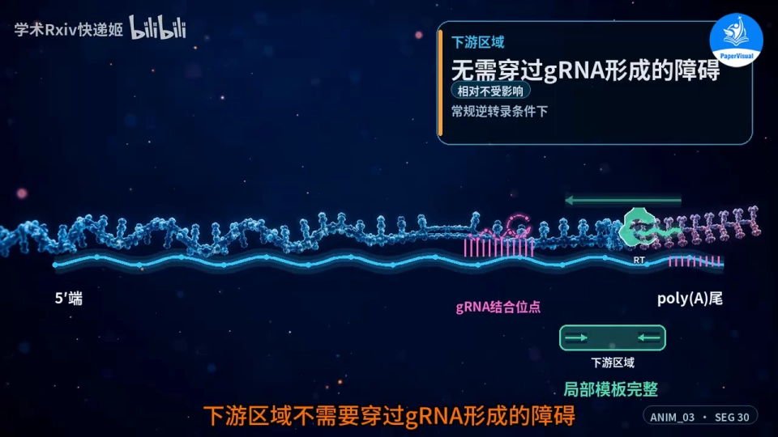

如果改用 **oligo(dT)** 从 poly(A) 尾部启动逆转录，情况会变：逆转录酶要沿 RNA 向 5′ 端延伸，那么位于 gRNA **上游**的扩增区域可能都会受影响。

这条规律解释了一个很实际的困惑：**同一次敲低实验，换一对引物就能得到完全不同的效率数字**，而且这个差异不是生物学差异，是测量伪影。

## 三、证据：五组实验把机制钉在逆转录这一步

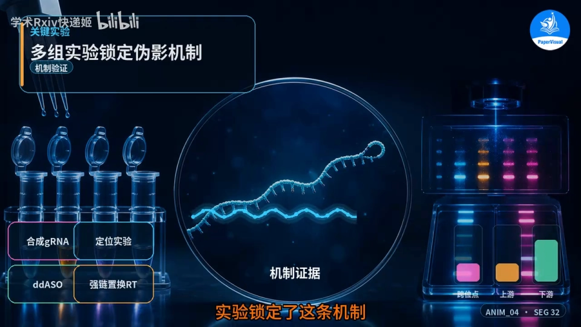

视频把论文的验证链条拆得很清楚，每一步都在排除一种替代解释：[【跳转到 03:26】](https://www.bilibili.com/video/BV1REtz66EmJ/?t=206)

1. **把人工合成的 gRNA 直接加入逆转录反应** → 就能制造出位置依赖、剂量依赖的假敲低。说明 gRNA 单独就足够造成这个现象，不需要细胞。
2. **蛋白酶 K 处理** → 排除蛋白质因素的干扰。
3. **在 PCR 阶段加入 gRNA** → 不产生同样的效应，说明问题不在 PCR。
4. **cDNA 生成后再做 RNA 酶处理** → 也不产生效应，进一步把问题锁定在**逆转录阶段**。
5. **加入 ddASO 封住 gRNA** → ddASO 是一条与 gRNA 互补、末端经过封闭的寡核苷酸，能把 gRNA 占住。随着 ddASO 浓度升高，被压低的跨位点和上游信号**逐渐恢复**，直接证明伪影来自 gRNA 对逆转录的阻挡。

### 3.1 换酶就能解决

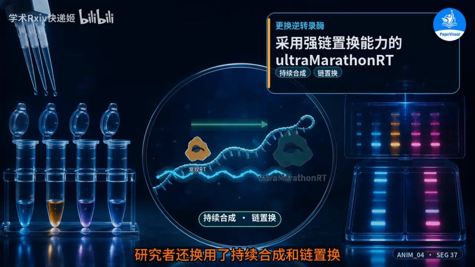

研究者换用了**持续合成和链置换能力更强的逆转录酶 UltraMarathon RT**，它能越过结合在 RNA 上的 gRNA。[【跳转到 04:08】](https://www.bilibili.com/video/BV1REtz66EmJ/?t=248) 结果是：

- 失活 Csm 和失活 PspCas13B **不再显示虚假的 RNA 敲低**；
- 正常 CRISPR 在不同引物位置测出的结果**重新趋于一致**。

"不同引物位置结果一致"这个判据很有价值：它说明测量不再依赖引物落在哪里，也就说明伪影被消除了。

## 四、哪些既有结论需要重新核查

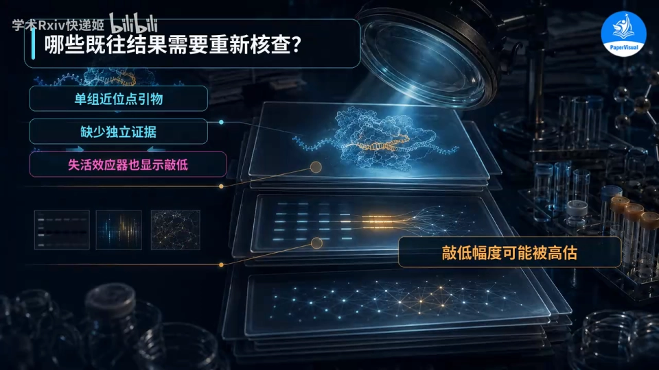

视频给了一份自查清单。[【跳转到 04:28】](https://www.bilibili.com/video/BV1REtz66EmJ/?t=268) 如果一项研究**同时**具备以下特征，它报告的敲低幅度可能被明显夸大：

- 使用 Csm 或 Cas13 等 RNA 靶向系统；
- **只依靠一组**跨越 gRNA 结合位点或位于其附近的 RT-qPCR 引物判断敲低；
- **缺少蛋白、RNA 成像等独立证据**；
- 如果**失活效应器在 RT-qPCR 中也显示强烈敲低**，就更应检查信号下降是否主要来自 gRNA 对逆转录的阻挡。

最后一条是最强的诊断信号。**一个切不动 RNA 的酶测出了敲低，那这个敲低一定不是酶造成的。**

## 五、三层验证：今后 RNA 靶向 CRISPR 该怎么测

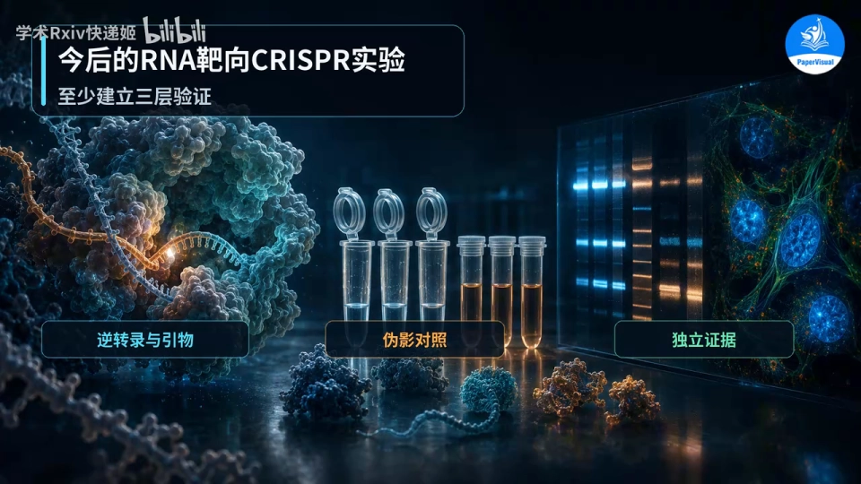

视频的结论是：RNA 靶向 CRISPR 的敲低不能再由一组 RT-qPCR 结果单独定案，**至少需要三层验证**。[【跳转到 05:00】](https://www.bilibili.com/video/BV1REtz66EmJ/?t=300)

### 5.1 第一层：修正逆转录和引物设计

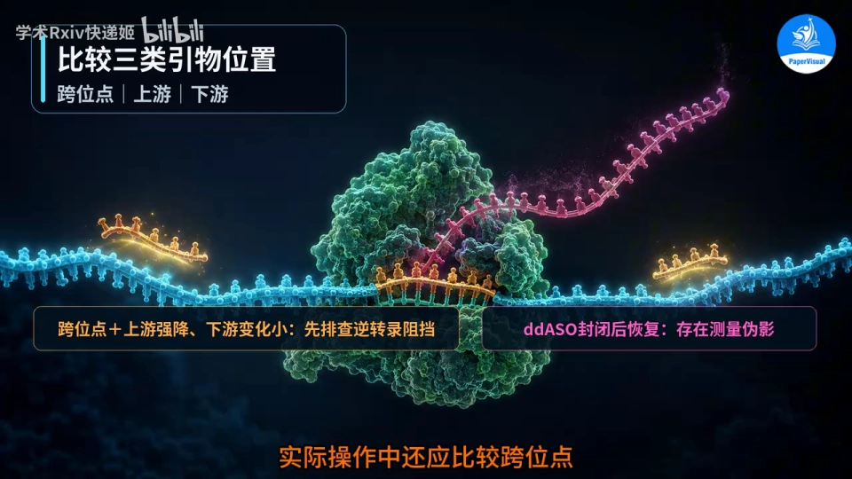

- **保留跨位点引物，但配合强链置换逆转录酶。** 跨位点引物本身是有价值的——它更不容易把已经切开的 RNA 片段记入"完整转录本"，因为片段被切开后跨位点扩增就失败了。问题只在于常规逆转录酶越不过 gRNA 障碍。
- **只能用常规逆转录酶时，改测 gRNA 结合位点下游。** 但要注意：下游 RNA 片段可能在切割后继续存在，所以**不能单独据此判断完整 RNA 水平**。
- **实际操作中比较三组引物**：跨位点、下游、远端上游。

判读规则很明确：**如果跨位点和近端上游显示强烈敲低、下游却变化很小，就应首先排查 gRNA 造成的逆转录阻挡。**[【跳转到 05:40】](https://www.bilibili.com/video/BV1REtz66EmJ/?t=340)

- **ddASO 可以作为机制诊断工具。** 封住 gRNA 后信号恢复，就说明原来的部分下降来自测量伪影，而不是 RNA 真的减少了。

### 5.2 第二层：设置能暴露伪影的对照

至少在**方法建立阶段**和**支撑关键结论的实验**中，除了非靶向 gRNA 对照，还要加入**失去 RNA 切割能力的 CRISPR 对照**（失活效应器）。[【跳转到 06:03】](https://www.bilibili.com/video/BV1REtz66EmJ/?t=363)

判读规则：如果失活效应器在 RT-qPCR 中仍显示强烈敲低，而蛋白和其他方法没有相应变化，**就不能把这个结果直接解释成 RNA 真的减少了**。

这一层的价值在于：它把"阴性对照"从"非靶向 gRNA"升级为"失活效应器"。非靶向 gRNA 只能排除 gRNA 序列本身的影响，**排除不了 gRNA 这个 RNA 分子对逆转录的物理阻挡**——因为非靶向 gRNA 也会进样本，只是它结合的是别的位点。

### 5.3 第三层：加入独立于同一测量链的证据

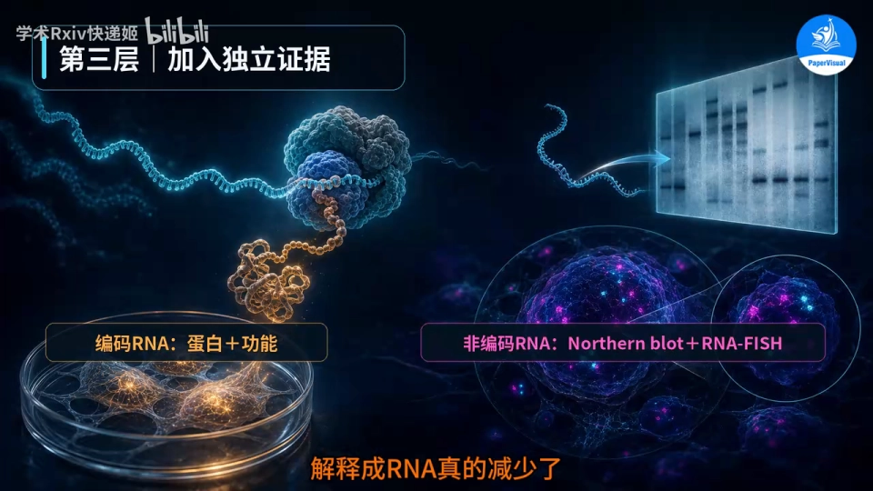

| RNA 类型 | 推荐的独立证据 |
| :--- | :--- |
| 编码蛋白的 RNA | 检测**蛋白水平**和相关**功能** |
| 非编码 RNA（如 XIST） | **Northern blot**、**RNA-FISH** |

视频还特别指出一个容易误判的地方：**RT-ddPCR 同样要先把 RNA 逆转录成 cDNA，因此不会天然避开这种伪影。**[【跳转到 06:49】](https://www.bilibili.com/video/BV1REtz66EmJ/?t=409) 数字 PCR 提高的是定量精度，不是逆转录这一步的准确性。

## 六、这条发现对单细胞扰动实验意味着什么

视频最后把问题提升到了方法论层面，这也是它对"扰动效率与响应测量"最直接的贡献。

### 6.1 干预工具和测量工具可能是同一个分子

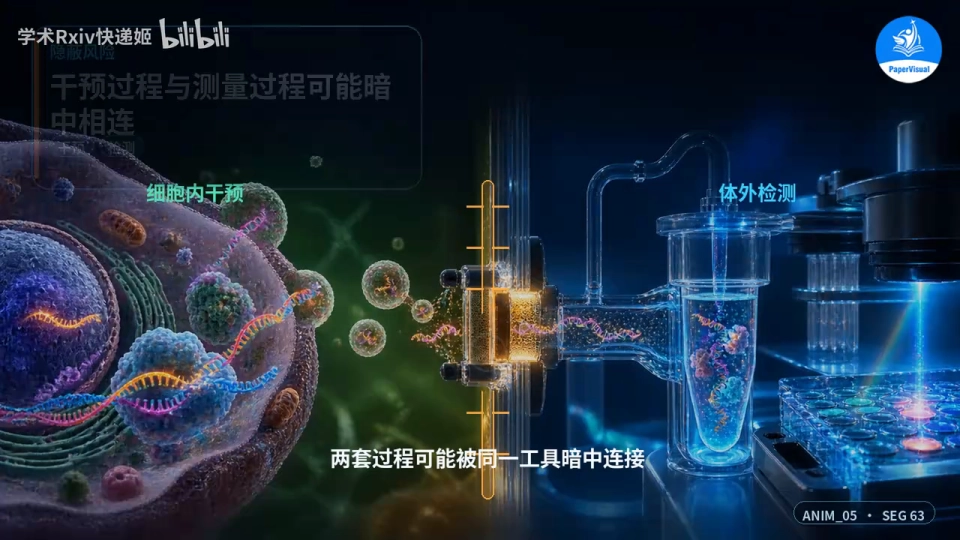

gRNA 原本被送进细胞，用来引导 CRISPR 识别 RNA。细胞被裂解以后，它却**跟随样本进入检测流程，继续影响 cDNA 的生成**。

于是干预工具变成了测量工具的一部分。我们通常担心的是"实验工具没有发挥作用"——扰动没生效、效率太低。这项研究提醒的是相反的一面：**工具越过了干预与检测的边界，在不该起作用的地方继续起作用。**

### 6.2 对单细胞扰动实验的三点提醒

**第一，效率估计的偏差方向是系统性的，不是随机的。** 伪影只会让敲低看起来更强，不会更弱。这意味着文献里报告的敲低效率整体偏高，而真实的扰动强度比报告的弱。在 Perturb-seq 这类实验里，这直接影响"效应量"的解释：如果扰动本身比以为的弱，那么观察到的转录组变化幅度也就被相对低估了扰动强度。

**第二，扰动效率的度量必须跨层面。** 一个 RNA 层面的数字，如果和蛋白、功能层面不一致，优先怀疑的是测量而不是生物学。视频里 mCherry 的例子就是模板：蛋白没降而 RNA"降了"，答案在测量端。

**第三，阴性对照的设计决定了你能发现什么。** 只用非靶向 gRNA 做对照，发现不了"gRNA 分子本身干扰测量"这类问题；必须用**失活效应器**。这条原则可以推广到所有扰动实验：**对照要能暴露你想排除的那个具体机制，而不是笼统的"没扰动"。**

## 小结

- 用 RT-qPCR 评估 RNA 靶向 CRISPR 敲低率时，**跨 gRNA 结合位点的引物会系统性高估敲低幅度**；XIST 例子里两组都报 90%，换下游引物后只剩 35% 与 14%。
- 失活 Csm、失活 PspCas13B 也显示强烈敲低，而蛋白层面毫无变化——这是伪影的典型指纹。
- 机制是：RNA 纯化时 gRNA 一同进入样本，逆转录时重新结合目标 RNA 形成障碍，cDNA 合成中断，被误读为 RNA 减少。
- 伪影大小取决于引物位置：跨位点最严重，近端上游次之，约 500 nt 以外基本消失，下游相对不受影响。
- 换用强链置换逆转录酶（UltraMarathon RT）或用 ddASO 封住 gRNA，伪影消失，不同引物位置结果趋于一致。
- 三层验证：修正逆转录与引物（比较跨位点/上游/下游三组）、设置失活效应器对照、加入独立于同一测量链的证据（蛋白与功能，或 Northern blot / RNA-FISH）。
- RT-ddPCR 不免疫，因为它同样依赖逆转录。
- 方法论层面的教训：**干预工具可能跟着样本进入检测流程，把试管里的假象写成细胞里的结论。**

## 关键术语速查

| 术语 | 一句话解释 |
| :--- | :--- |
| RNA 靶向 CRISPR | 用 Cas13/CasRx/Csm 等切割 RNA 而非 DNA 的 CRISPR 系统，实现敲低而非敲除 |
| RT-qPCR | 逆转录后定量 PCR，通过 cDNA 量反推原始 RNA 量，不能直接数 RNA |
| 失活效应器 | 切割活性被突变掉的 Cas 蛋白，用作阴性对照，理论上不应产生敲低 |
| 随机六聚体引物 | 逆转录时用随机六碱基引物起始 cDNA 合成，可从 RNA 任意位置启动 |
| oligo(dT) | 从 poly(A) 尾起始逆转录的引物，逆转录酶需沿 RNA 向 5′ 端延伸 |
| ddASO | 与 gRNA 互补、末端封闭的寡核苷酸，可占住 gRNA 阻断其再结合，用作机制诊断 |
| 链置换活性 | 逆转录酶/聚合酶越过二级结构或结合蛋白继续合成的能力 |
| 跨位点引物 | 扩增区域跨越 gRNA 结合位点的引物对，对逆转录阻挡最敏感 |
| RT-ddPCR | 逆转录结合微滴数字 PCR，定量更精确但仍需逆转录，不免疫该伪影 |