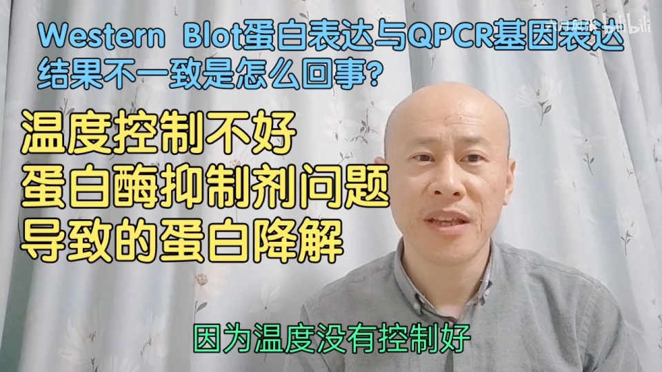
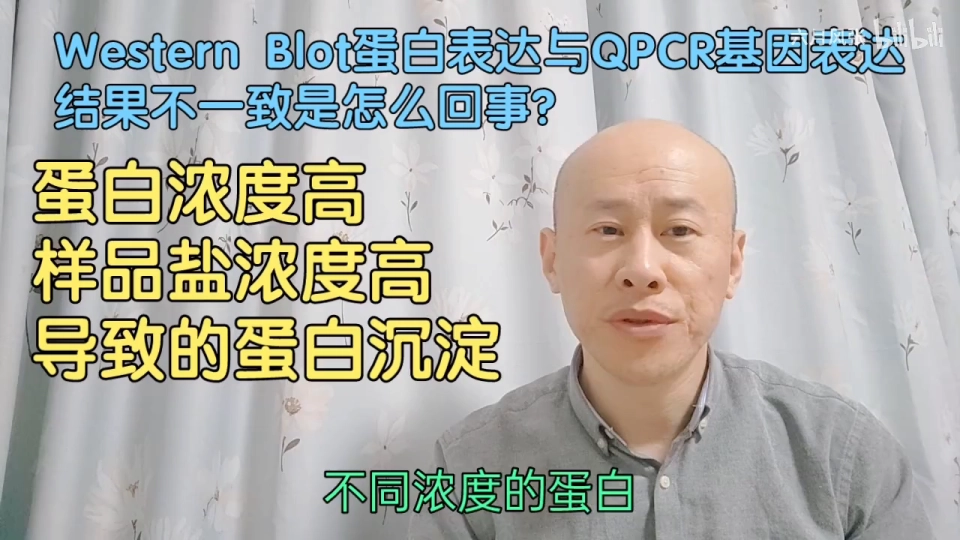
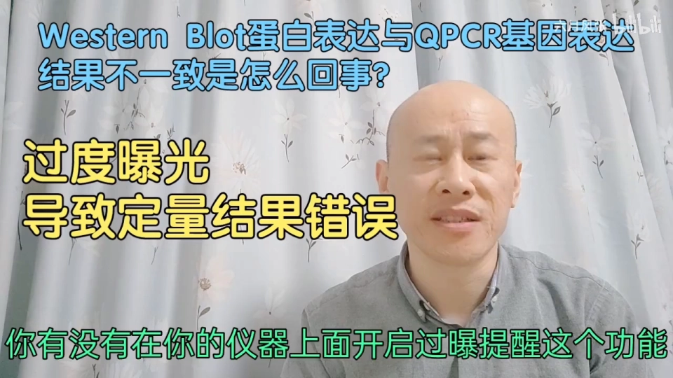
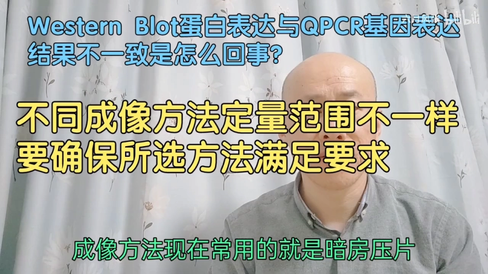
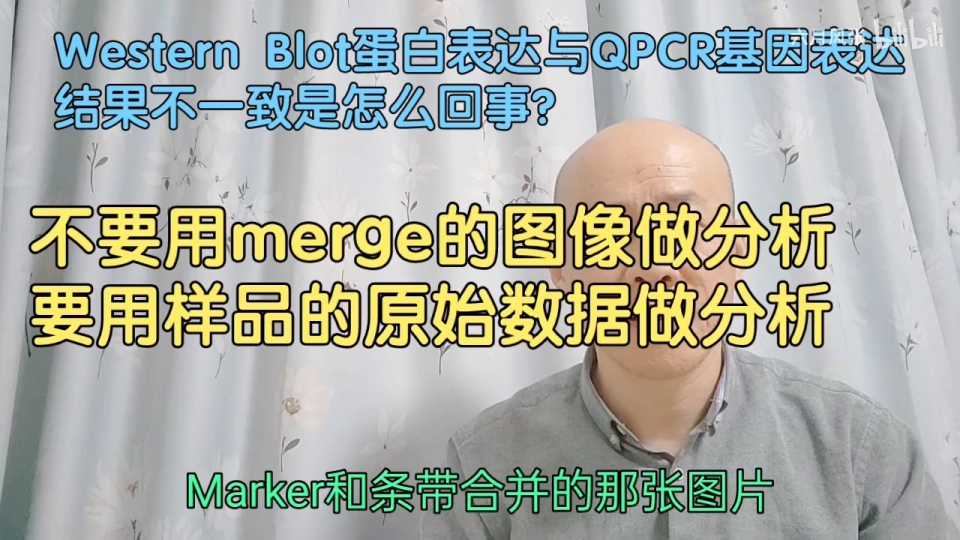
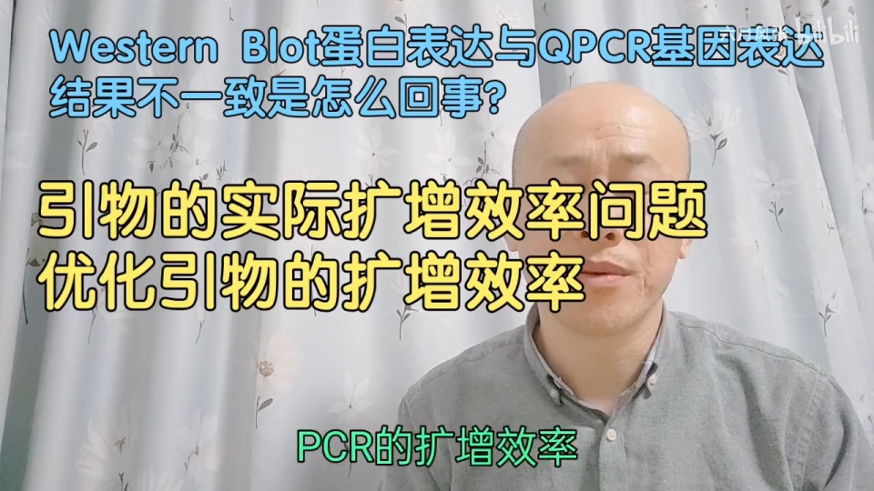
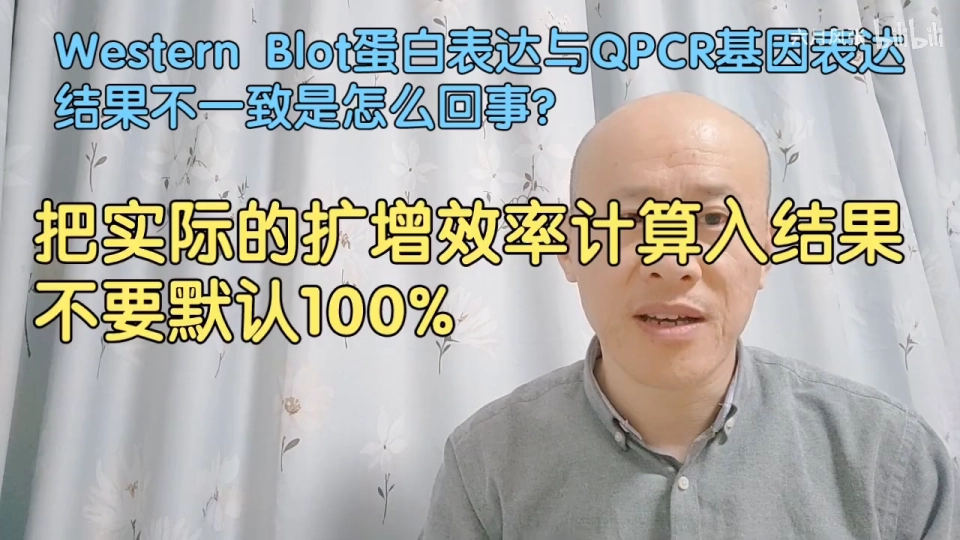

# 蛋白没降、mRNA 降了：WB 与 qPCR 结果对不上的七类原因

> 视频来源：[Western Blot蛋白表达与QPCR基因表达结果不一致是怎么回事？](https://www.bilibili.com/video/BV1sL4y1c78w/)（B 站 · 六月风WB）｜时长约 7 分钟
> 简要导读：这是一支经验分享型的短讲，UP 主把"WB 是玄学"这个流行说法拆成了可排查的具体环节：样品制备、成像、结果分析，以及 qPCR 侧的扩增效率，最后落到"mRNA 与蛋白本来就不一定划等号"。本文按"先排除测量问题、再承认生物学差异"的顺序整理，并把它接回扰动实验里"用什么读数判断扰动生效"这条主线。

## 本讲要解决的核心问题（SCQA）

**背景**：验证一次基因敲低或敲除是否生效，最常用的两个读数是 qPCR（看 mRNA）和 Western blot（看蛋白）。按中心法则，mRNA 少了蛋白就该少，两者应该同向变化。

**冲突**：实际做实验时，这两个读数经常打架——有时候这次一致、下次又不一致，实验结果不可重复，而且很难找到原因。于是 WB 被戏称为"玄学"。

**疑问**：这种不一致到底是实验没做好，还是生物学本身如此？如果两者真的可以不一致，那判断"扰动生效"该信哪个？

**回答（中心思想）**：不一致的原因可以分成两层。**第一层是测量问题**——WB 侧有样品降解、蛋白沉淀、过曝、成像动态范围不足、用合并图分析五类；qPCR 侧有 RNA 降解和扩增效率未校准两类。**第二层是生物学本身**——mRNA 水平与蛋白水平不一定划等号。排查顺序应该是：**先把测量问题逐个排除，剩下的不一致才可能是真信号。**

## 一、WB 侧：五类会让定量失真的问题

### 1.1 样品制备：降解与沉淀

**问题一：蛋白降解。** 蛋白提取过程中如果温度没有控制好，或者没有加蛋白酶抑制剂，蛋白就会降解。[【跳转到 00:35】](https://www.bilibili.com/video/BV1sL4y1c78w/?t=35) 关键在于**不同样品的降解程度不一样**——降解多的那个样品，目标蛋白看起来就"表达下降"了，而对照样品没有。这不是生物学差异，是操作差异。

**问题二：蛋白沉淀。** 蛋白浓度高了容易沉淀，样品里盐浓度高了也容易沉淀。[【跳转到 01:00】](https://www.bilibili.com/video/BV1sL4y1c78w/?t=60) 同样地，**不同浓度的蛋白沉淀程度不同**，最终影响表达结果。

这两条的共同逻辑值得记住：**误差不是随机的，而是和样品本身的性质相关**。降解和沉淀都更容易发生在蛋白量高的样品上，于是误差和"表达量"纠缠在一起，无法通过重复来平均掉。

### 1.2 成像：过曝会让定量彻底失效

如果你用化学发光，曝光时间是多长？曝光时间一长特别容易过曝。[【跳转到 01:25】](https://www.bilibili.com/video/BV1sL4y1c78w/?t=85) 过曝之后信号被削平——两条本来有差异的带，过曝后都变成饱和的黑色，**差异消失了**。

UP 主给了一个很具体的操作建议：**无论用哪一款设备，一定要把成像软件上的"过曝提醒"功能打开**，实时看哪一张过曝了、哪一张没有，过曝的图片直接丢掉。

理由说得很直白：科研做的是**定量、是相对表达**，过曝的结果不能用。仅凭经验判断"可能没过曝"，拿去做分析就会得到不正确的结论。

### 1.3 成像方法的动态范围差异巨大

这是视频里最有信息量的一组数字。三种常用成像方法的**定量范围**相差非常大：[【跳转到 02:15】](https://www.bilibili.com/video/BV1sL4y1c78w/?t=135)

| 成像方法 | 定量范围（数量级） |
| :--- | :--- |
| 暗房压片 | $10^{1.5}$ |
| 冷 CCD 成像 | $10^{3}$ |
| 电子压片 | $10^{4.2}$ |

如果用的是暗房压片，定量范围只有约 31 倍，条带信号一强就特别容易过曝，而它**又没有过曝提醒功能**。这时候你拿一张"经验判断没过曝、实际已经过曝"的图去分析，得到的蛋白表达结果就不对了。冷 CCD 成像也一样，信号强了也容易过曝。

这条对扰动实验有直接影响：**敲低效率高的样本，目标蛋白信号弱；敲低效率低的样本，信号强**。如果动态范围不够，强信号那一端先饱和，两端差异被压缩，你会**低估敲低效率**。

### 1.4 结果分析：不要用合并图

UP 主提到一个很常见的错误：很多老师做结果分析时，用的是 **Marker 和条带合并（merge）的那张图片**。[【跳转到 03:30】](https://www.bilibili.com/video/BV1sL4y1c78w/?t=210)

这是不对的。**合并之后原始数据已经发生了改变**，灰度值不再是样品本身的信号。[【跳转到 03:55】](https://www.bilibili.com/video/BV1sL4y1c78w/?t=235) 应该用来分析的是**单独样品的那张原始图片**。

这条看似琐碎，但它属于"数据来源被污染"这一类错误——一旦用错，后面所有定量都建立在被改动过的像素上，无法通过重复实验发现。

## 二、qPCR 侧：两个容易被忽略的控制点

### 2.1 RNA 降解

基因表达的结果来自定量 PCR。而定量 PCR 不是做一次实验、结果就一定对。

第一个问题是 RNA 提取过程中 RNA 有没有降解。[【跳转到 04:45】](https://www.bilibili.com/video/BV1sL4y1c78w/?t=285) 视频特别提醒：**RNA 相对于蛋白质更容易降解**，所以在基因表达结果的控制上要格外注意。这条和 WB 侧的蛋白降解是对称的——两侧的样品完整性问题会独立发生，因此两侧的误差**不会互相抵消**，反而会叠加成"不一致"。

### 2.2 扩增效率：默认 100% 是一个系统性错误

这是视频里最硬的一条技术规范：[【跳转到 05:10】](https://www.bilibili.com/video/BV1sL4y1c78w/?t=310)

> 按照定量 PCR 的国际标准，要求基因的扩增效率在 **95% 到 105%** 之间，而且最终计算结果的时候要把扩增效率计算进去。

而实际操作中，很多人的做法是：引物合成回来后，直接拿引物合成公司给的推荐退火温度去做实验，然后**默认 100% 的扩增效率**去做计算。

UP 主的评价是：这样算出的结果跟实际实验结果**相差非常大**。

为什么这件事对扰动效率的测量特别致命？因为 $2^{-\Delta\Delta C_t}$ 这套相对定量公式里，扩增效率是**指数项**。效率从 100% 掉到 90%，经过 30 个循环，误差会被放大到 $(1.9/2)^{30}$ 这个量级——不是百分之几，而是数量级的偏差。而且**目标基因和内参基因的效率偏差方向不一定相同**，两者相除时误差不会抵消。

换句话说：**一个没有校准扩增效率的 qPCR，测出来的"敲低 80%"可能只是引物效率的差异。**

## 三、最后一层：mRNA 与蛋白本来就不一定相等

排除掉上面所有测量问题之后，如果结果仍然不一致，视频给出的判断是：[【跳转到 06:00】](https://www.bilibili.com/video/BV1sL4y1c78w/?t=360)

> 蛋白表达和基因表达本身就可能不一致，**mRNA 的表达水平和蛋白的表达水平不一定划等号**。

UP 主的态度是开放的：如果你摸遍了所有条件、确认实验没有问题，但就是做不出一致的表达结果，**这也未必是坏事**——你可以再做更深入的探讨。另外还可以增加其他水平的平行验证实验，比如细胞水平、组织水平，甚至活体水平，这些都能帮助你更深入地探索所研究事物的机理。

[【跳转到 06:25】](https://www.bilibili.com/video/BV1sL4y1c78w/?t=385)

## 四、把这条排查链放回扰动实验

视频讲的是 WB 与 qPCR 的对比，但它给出的排查顺序，正好是"扰动效率怎么测"这个问题的标准作业流程。

### 4.1 三个读数的可信度不同

| 读数 | 测的是什么 | 主要失真来源 | 对"扰动生效"的证明力 |
| :--- | :--- | :--- | :--- |
| qPCR | mRNA 丰度 | RNA 降解、扩增效率未校准、引物位置 | 中——受转录后调控影响 |
| Western blot | 蛋白丰度 | 降解、沉淀、过曝、动态范围 | 较高——但定量精度受动态范围限制 |
| 功能/表型 | 蛋白活性 | 实验设计 | 最高——直接对应"功能丧失" |

这张表的实用含义是：**不要用单一读数下结论**。qPCR 说敲低了、WB 说没变，正确的反应不是"哪个错了"，而是"这两个读数分别测的是链条上的哪一环"。

### 4.2 误差的方向性比误差的大小更重要

视频里几乎每一个问题都带有**方向性**：

- 蛋白降解 → 目标蛋白看起来**更低** → 高估敲低效率；
- 过曝 → 强信号被削平 → 高低两端差异被压缩 → **低估**敲低效率；
- 动态范围不足 → 同样压缩差异 → **低估**敲低效率；
- 默认 100% 扩增效率 → 方向取决于引物实际效率，**不可预测**。

在 pooled 筛选里，这意味着不同 gRNA 的效率估计会带着**不同方向的系统偏差**，而排序结果直接建立在这些数字上。一个效率被高估的 gRNA 会挤掉真正有效的候选。

### 4.3 "没检测到差异"的三种可能

把视频的排查链倒过来读，可以得到一个对扰动实验很重要的清单。当你在扰动组和对照组之间**没有检测到差异**时，至少有三类解释：

1. **扰动没生效**（真阴性）——效率太低，或者根本没编辑上；
2. **扰动生效了，但读数看不见**——蛋白半衰期长、mRNA 被 QC 降解的幅度不够、成像动态范围不足把差异压掉了；
3. **扰动生效了，读数也看得见，但被测量误差掩盖**——降解、过曝、扩增效率偏差。

视频的贡献在于把第 2、3 类具体化了。而它们的共同后果是：**把真信号当成"没有响应"，也就是假阴性。**

## 小结

- WB 与 qPCR 结果不一致，先分两层看：**测量问题**与**生物学差异**。排查顺序是先排除测量问题。
- WB 侧五类问题：蛋白降解（温度、抑制剂）、蛋白沉淀（浓度、盐）、过曝（未开过曝提醒）、成像动态范围不足、用 merge 图而非原始图分析。
- 三种成像方法的定量范围差三个数量级：暗房压片 $10^{1.5}$、冷 CCD $10^{3}$、电子压片 $10^{4.2}$。动态范围不足会**压缩差异、低估敲低效率**。
- qPCR 侧两个控制点：RNA 降解、扩增效率。国际标准要求效率在 95%–105%，且必须把实际效率计入计算；默认 100% 会带来指数级偏差。
- 排除测量问题后仍不一致，要承认 mRNA 与蛋白水平本来就不一定相等，此时应增加其他水平的平行验证。
- 对扰动实验的启示：误差带方向性、不同 gRNA 的偏差方向不同，会直接扭曲效率排序；"没检测到差异"至少有"没生效""看不见""被误差掩盖"三种解释。

## 关键术语速查

| 术语 | 一句话解释 |
| :--- | :--- |
| Western blot | 用抗体检测特定蛋白丰度的方法，经电泳分离、转膜、显色或发光成像 |
| 过曝 | 信号超出检测器线性范围而饱和，条带变黑、差异被削平，定量失效 |
| 动态范围 | 检测器能线性响应的信号跨度，超出即饱和或不可测 |
| 暗房压片 | 用 X 光胶片曝光的传统 WB 成像方式，动态范围最窄 |
| 电子压片 | 用成像板/磷屏记录信号的 WB 成像方式，动态范围最宽 |
| 扩增效率 | qPCR 每个循环产物倍增的倍数，理想为 2（即 100%），标准要求 95%–105% |
| $\Delta\Delta C_t$ | 相对定量法，用目标基因与内参基因的 Ct 差再与对照组相减，效率偏差会被指数放大 |
| merge 图 | Marker 与样品条带合并后的图片，像素已被改动，不能用于定量 |
| 假阴性 | 扰动实际生效但未被检出，与"扰动未生效"在数据上难以区分 |