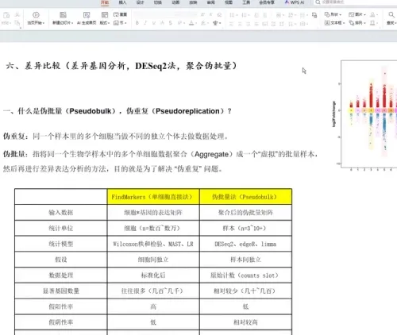
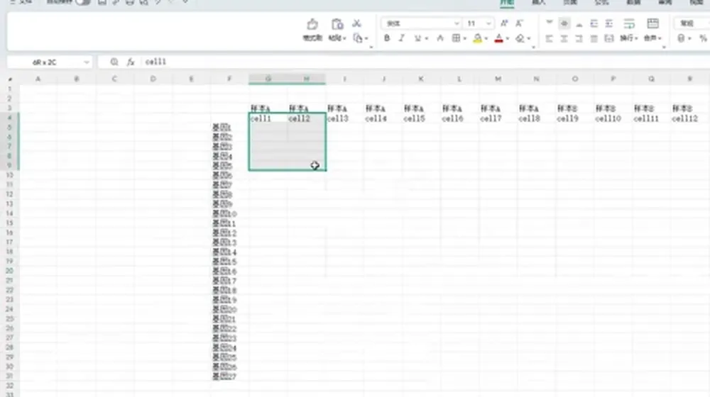
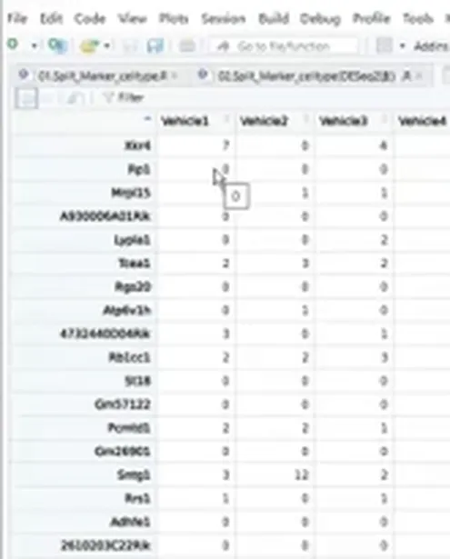
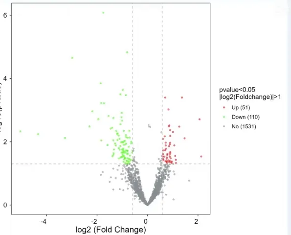
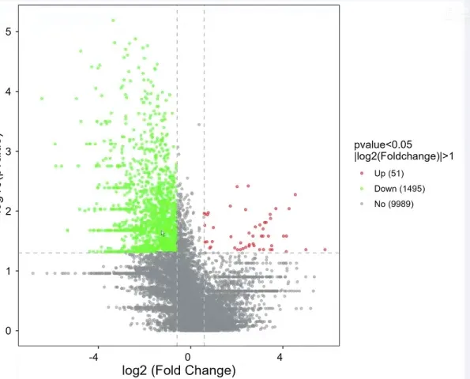
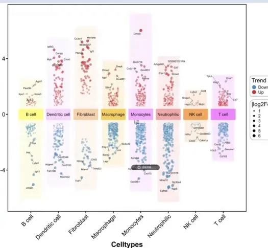

# 伪重复与聚合伪批量：单细胞差异基因到底该按「细胞」还是按「样本」检验

> 视频来源：[单细胞转录组生信分析-11.3组间差异基因分析/DESeq2/聚合伪批量/伪重复](https://www.bilibili.com/video/BV1m6h86LE4f/)（Bilibili · UP 主 组学生信老胡）｜时长约 13 分钟
> 导读：这是一节课程录屏，讲者用「伪重复」这一个概念把单细胞差异分析的两种做法串起来：为什么把每个细胞当独立重复是错的、聚合伪批量（pseudobulk）为什么能修好它、以及同一份数据下两种方法给出的差异基因数量差了一个量级。讲者后半段跑了一遍代码，本文只保留「聚合怎么算、结果差在哪」这两处与判断有关的细节，具体的代码操作属于分析章的内容。字幕为 B 站 AI 字幕，术语按上下文订正（原文把 pseudobulk 识别成「伪批量/pluto bug」、DESeq2 识别成「disc ct to/desktwo」、FindMarkers 识别成「finder马克」等）。

## 本讲要解决的核心问题（SCQA）

**背景**：单细胞测序把每个细胞单独测了一遍，所以拿到的表达矩阵是「基因 × 细胞」。做两组之间的差异基因分析时，最直接的做法就是把这个矩阵原样丢进检验函数——上一节课用的 Seurat `FindMarkers` 就是这么干的，很多人也都这么用。

**冲突**：这么做有一个隐患。假设实验组和对照组各有一个样本，每个样本测了几千个细胞；`FindMarkers` 会把这几千个细胞当成几千个独立个体去做检验。可这些细胞来自同一个样本、同一管试剂、同一次测序，它们之间并不独立。讲者说，用 `FindMarkers` 跑出来的差异基因数量「确确实实」比另一种方法多得多，而差异基因数量一多，假阳性的概率也就跟着上去了 [【跳转到 04:19】](https://www.bilibili.com/video/BV1m6h86LE4f/?t=259)。

**疑问**：那到底该拿什么当「重复」？如果不按细胞算，又该怎么算？

**回答（中心思想）**：**统计单位必须是样本，不是细胞。** 把同一个样本里的所有细胞按基因求和，聚合成一个「虚拟的 bulk 样本」，再用为 bulk RNA-seq 设计的 DESeq2 去做组间比较——这就是聚合伪批量（pseudobulk）。它把「细胞数」这个虚高的样本量换回了真实的生物学重复数，代价是统计功效下降（假阴性率相对升高），换来的是假阳性率低、可重复性好、结论更可信 [【跳转到 05:44】](https://www.bilibili.com/video/BV1m6h86LE4f/?t=344)。

## 一、伪重复：把细胞当独立重复，是把「同一只动物的几千次测量」当成几千只动物

讲者先给了定义，再给图。

**伪重复（pseudoreplication）**：同一个样本里的多个细胞，被当做不同的独立个体去做数据处理 [【跳转到 02:49】](https://www.bilibili.com/video/BV1m6h86LE4f/?t=169)。

为什么这是错的？讲者用两个样本 A、B 举例：每个样本下挂着七八个、八九个细胞（真实数据里是几千上万个），矩阵长这样——一行一个基因、一列一个细胞 barcode [【跳转到 03:39】](https://www.bilibili.com/video/BV1m6h86LE4f/?t=219)：

问题就出在列标签上：`样本A cell1`、`样本A cell2`、`样本A cell3` 都属于样本 A，它们来自同一个样本。**真正意义上的生物学重复是「样本 A」和「样本 B」这两个，不是底下的每一个细胞** [【跳转到 04:04】](https://www.bilibili.com/video/BV1m6h86LE4f/?t=244)。

这件事为什么严重？因为统计检验的 p 值是按「独立重复的个数」算出来的。把 n 从 2 个样本放大成 2 万个细胞，标准误会被压到极小，p 值随之假性变小——细胞之间那点技术噪声被当成了「重复之间的变异」，而真正关心的「样本之间的变异」反而被稀释掉了。这与 2.4.4 节讲批次效应时是同一个道理：同一个样本内的细胞共享同一批技术偏差，它们不提供独立证据。

## 二、聚合伪批量：把每个样本的细胞按基因求和，还原成一张 bulk 矩阵

**伪批量（pseudobulk）**：将同一个生物学样本中的多个单细胞数据聚合（aggregate）成一个「虚拟」的批量样本，然后再进行差异表达分析，目的就是为了解决伪重复的问题 [【跳转到 04:54】](https://www.bilibili.com/video/BV1m6h86LE4f/?t=294)。

用公式说，对基因 $g$ 和样本 $s$：

$$
y_{g,s} = \sum_{c \in s} y_{g,c}
$$

其中 $y_{g,c}$ 是基因 $g$ 在细胞 $c$ 里的原始 UMI 计数，求和范围是样本 $s$ 里的所有细胞。聚合之后矩阵从「基因 × 细胞」变成「基因 × 样本」，列数从成千上万个细胞掉回样本数——对比表里把两个量级分别写成「细胞 $10^3$–$10^5$ 个」与「样本 $10^3$–$10^4$ 个」。

这里有一个讲者自己当场纠正的口误，值得单独记一笔：他先说的是「取平均」，随后改口——**是求和，不是取平均** [【跳转到 09:38】](https://www.bilibili.com/video/BV1m6h86LE4f/?t=578)。原因很实在：取平均会得到小数，而 DESeq2 要求输入的是整数 counts 矩阵；求和之后仍然是整数，语义上也正好等价于「把这几千个细胞当成一管 bulk 样本来测序」。所以伪批量的输出可以直接喂给为 bulk RNA-seq 写的那一整套工具。

## 三、两种方法的逐项对比：差异基因数量差一个量级，假阳性率差一个方向

讲者给了一张十行的对比表，这是全片信息密度最高的一页 [【跳转到 05:44】](https://www.bilibili.com/video/BV1m6h86LE4f/?t=344)：

| 维度 | FindMarkers（单细胞直接法） | 伪批量法（Pseudobulk） |
| --- | --- | --- |
| 输入数据 | 细胞 × 基因的表达矩阵 | 基因 × 样本的聚合 count 矩阵 |
| 统计单位 | 细胞（$10^3$–$10^5$ 个） | 样本（$10^3$–$10^4$ 个） |
| 统计模型 | Wilcoxon 秩和检验、MAST、LR | DESeq2、edgeR、limma |
| 假设 | 细胞间独立 | 样本间独立 |
| 数据处理 | 标准化后 | 原始计数（counts slot） |
| 差异基因数量 | 往往很多（几百到几千） | 相对较少（几十到几百） |
| 假阳性率 | 高 | 低 |
| 假阴性率 | 低 | 相对较高 |
| 可重复性 | 差（对批次效应敏感） | 好 |
| 生物学可信度 | 需验证 | 更可靠 |

这张表里有三处值得展开：

**第一，统计模型的差别不是「新旧」，而是「假设对不对」。** Wilcoxon 秩和检验、MAST、似然比检验（LR）都是为「每个观测是一个独立个体」设计的；当观测其实是细胞时，这个前提不成立。而 DESeq2、edgeR、limma 本来就是为「每个观测是一个样本」设计的，把聚合后的矩阵交给它们，前提刚好对上。

**第二，差异基因数量少不等于效果差。** 讲者反复强调这一点：用伪批量法拿到的差异基因「会很少」，但如果你得到的差异基因数量很多，「那其实很有可能就是假阳性，假阳性的概率也会比较高」[【跳转到 07:24】](https://www.bilibili.com/video/BV1m6h86LE4f/?t=444)。换句话说，一张动辄几千个差异基因的清单，先要怀疑的应该是方法，而不是庆祝发现多。

**第三，代价写在「假阴性率」那一行。** 样本数总是远小于细胞数，统计功效自然下降，一些真实但效应温和的基因会被漏掉。所以伪批量不是「更灵敏」，而是「更保守」——它用灵敏度换特异性。这也是为什么讲者提到，有文献把 DESeq2、FindMarkers 和其他多种方法放在一起比过可靠性，结论都是伪批量这条路更可靠 [【跳转到 02:11】](https://www.bilibili.com/video/BV1m6h86LE4f/?t=131)。

## 四、同一份数据，两张火山图：1531 个「无差异」对 9989 个「无差异」

讲者说，聚合这一步的原理「其实非常简单」，真正让人信服的是跑完代码之后两张图的对比。

先看伪批量 + DESeq2 的结果 [【跳转到 10:53】](https://www.bilibili.com/video/BV1m6h86LE4f/?t=653)：

再看同一份数据换 FindMarkers [【跳转到 11:29】](https://www.bilibili.com/video/BV1m6h86LE4f/?t=689)：

两张图放在一起，差异一眼可见：

| | DESeq2（伪批量） | FindMarkers（单细胞直接法） |
| --- | --- | --- |
| 上调 | 51 | 51 |
| 下调 | 110 | **1495** |
| 无差异 | 1531 | 9989 |

上调的 51 个两边完全一致，说明真正强的信号两种方法都抓得到；分歧全部集中在「下调」这一侧——FindMarkers 多报了 1385 个。而且看图形状也能看出问题：FindMarkers 那张图的绿点排成了明显的水平条带——稀疏计数下大量基因的计数彼此并列（tie），检验统计量只能取少数几个离散值，画出来就成了一层层的横线。讲者形容这类图「大多数就会长得像这种奇奇怪怪的」[【跳转到 11:36】](https://www.bilibili.com/video/BV1m6h86LE4f/?t=696)。DESeq2 那张则是一个干净对称的漏斗。

除单张火山图之外，代码还会输出一张按细胞类型分组的多组火山图 [【跳转到 11:58】](https://www.bilibili.com/video/BV1m6h86LE4f/?t=718)：

这张图的读法是：**每个细胞类型单独做一次「扰动组 vs 对照组」的伪批量比较**，然后横着排在一起。它回答的是「这个扰动在哪一类细胞里动静最大」，而不是「整体上有没有差异」。代码层面就是一个 for 循环遍历细胞类型、逐个聚合、逐个跑 DESeq2 [【跳转到 08:48】](https://www.bilibili.com/video/BV1m6h86LE4f/?t=528)；讲者也说明，除了这套流程，Seurat 注释结果和每个 cluster 的组间比较都有对应的 DESeq2 版本，操作方法与上一节课完全一样。

## 五、把两个概念记牢，比记住代码更重要

讲者结尾没有总结代码，只说了一句：「大家就是要正确地去理解这两个概念」[【跳转到 12:44】](https://www.bilibili.com/video/BV1m6h86LE4f/?t=764)。这句话点出了这一节的位置：伪批量的价值不在于多一个函数，而在于它逼你想清楚「你到底有几个重复」。

落到实际判断上，有三条可以直接用：

1. **先数样本，再数细胞。** 如果实验组和对照组各只有 1 个样本，那无论多少细胞都做不出合法的组间检验——这时候该做的是补样本，而不是换检验方法。伪批量在这里帮不了你，它只是把「没法算」这件事诚实地暴露出来。
2. **差异基因数量异常多时，先怀疑方法。** 几百到几千个差异基因是单细胞直接法的典型输出，几十到几百个是伪批量的典型输出；拿到前者先检查统计单位，而不是直接拿去富集。
3. **细胞数不是统计功效。** 增加细胞数能让单细胞直接法的 p 值更小，但那部分「功效」来自伪重复，不是来自新的生物学证据。

> 本节边界：伪批量的具体代码实现、DESeq2 的建模细节、以及效应量与检验的选择，分别在 5.2.2 节和 5.2.3 节展开；扰动是否真的生效、效率异质性如何影响这些检验，见 3.3.5 节。本节只回答「该按什么单位做检验」这一个问题。

## 小结

- **伪重复**是把同一个样本里的多个细胞当成独立重复；它会让 p 值假性变小、差异基因数量虚高。
- **聚合伪批量**把同一生物学样本的细胞按基因求和，得到「基因 × 样本」的整数 count 矩阵，把统计单位从细胞还原成样本。
- 聚合是**求和不是取平均**——DESeq2 要求整数输入，求和也正好等价于「把细胞当一管 bulk 样本」。
- 伪批量的统计模型（DESeq2 / edgeR / limma）本来就是为「观测 = 样本」设计的，前提刚好对上；FindMarkers 用的 Wilcoxon / MAST / LR 假设细胞独立，前提不成立。
- 代价是**假阴性率相对升高**：用灵敏度换特异性，结论更保守也更可信。
- 同一份数据上，DESeq2 给出 Up 51 / Down 110 / No 1531，FindMarkers 给出 Up 51 / Down 1495 / No 9989——分歧集中在下调侧，且 FindMarkers 的火山图出现明显的水平条带。

## 关键术语速查

| 术语 | 一句话解释 |
| --- | --- |
| 伪重复（pseudoreplication） | 把同一个样本内的多个细胞当作独立重复去检验，人为放大了样本量 |
| 聚合伪批量（pseudobulk） | 把同一生物学样本的所有细胞按基因求和，聚成一个虚拟 bulk 样本 |
| FindMarkers | Seurat 里做组间差异分析的函数，默认对细胞逐个检验（Wilcoxon 秩和等） |
| DESeq2 | 为 bulk RNA-seq 原始 counts 设计的差异分析 R 包，输入是「基因 × 样本」整数矩阵 |
| 统计单位 | 一次检验里被当作「一个独立观测」的东西；单细胞数据里应该是样本而不是细胞 |
| 假阳性率 / 假阴性率 | 把没差异的判成有差异 / 把有差异的判成没差异的比例，伪批量压低前者、抬高后者 |