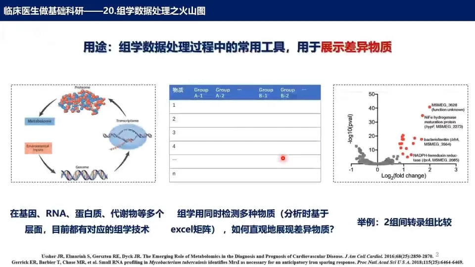
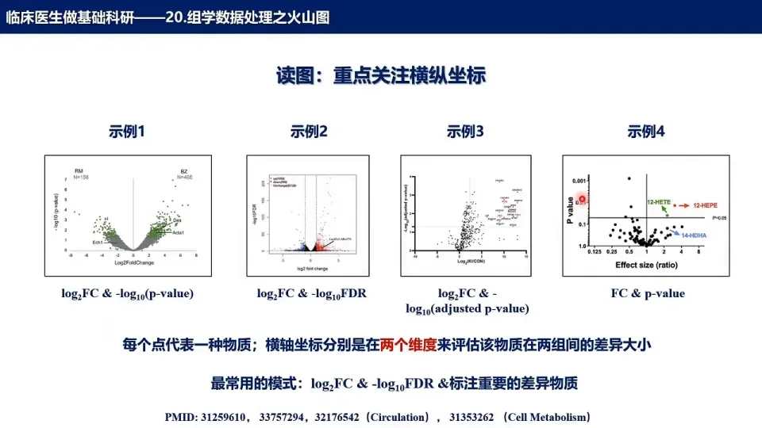
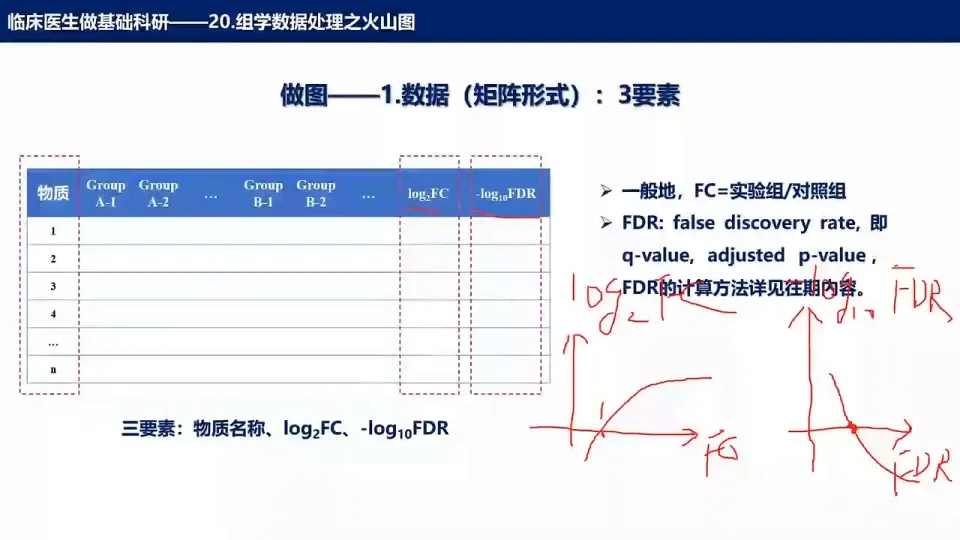
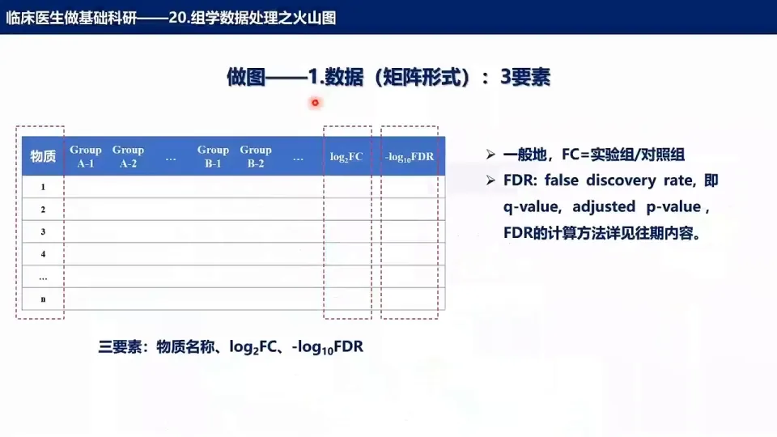
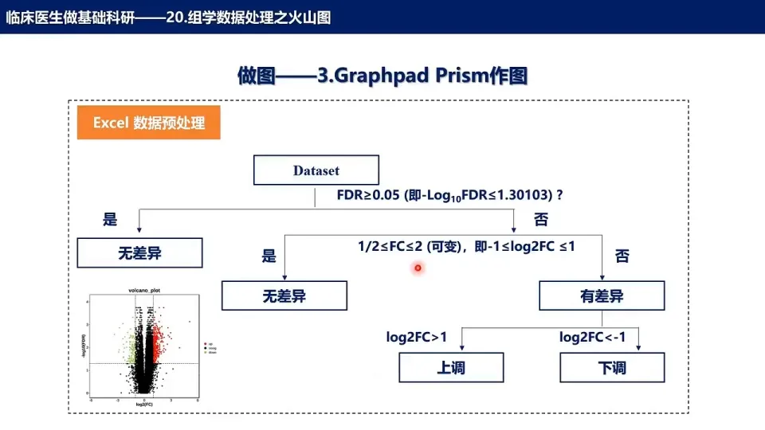
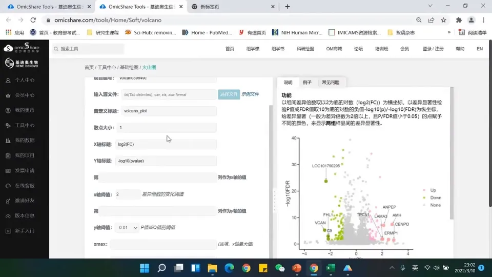
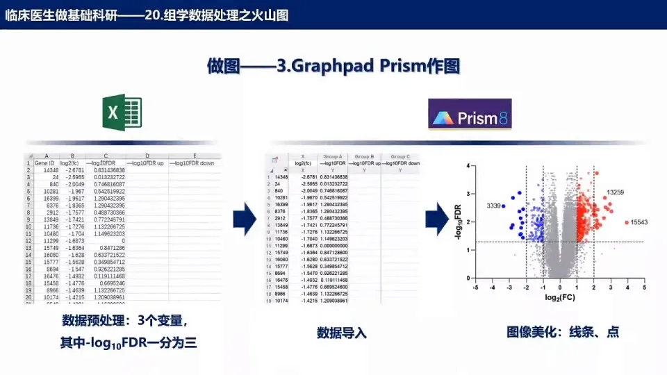
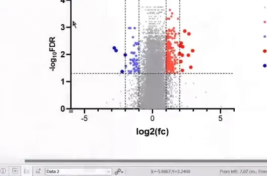

# 火山图怎么读：两个维度、三条线，把「变了」变成「可信的变了」

> 视频来源：[临床医生做基础科研——20.组学数据处理之火山图](https://www.bilibili.com/video/BV1Er4y1B7RH/)（Bilibili · UP 主 定观，中国医学科学院北京协和医学院）｜时长约 35 分钟
> 导读：这是「临床医生做基础科研」系列的第 20 讲，前两讲分别讲了 T 检验、U 检验与 FDR，这一讲把前两讲的产物拼成一张图。全片按「用途 → 读图 → 作图」三段走：先讲清火山图的两根轴分别是什么、为什么不同文章里的轴会变；再给出一套「FDR 加 FC 双阈值」的分组判据；最后演示网站一键出图和 GraphPad Prism 个性化出图。本文重点在前两段——**怎么读、怎么定阈值**；Prism 的逐项美化操作只保留思路，不逐步复刻（工具操作属于分析章内容）。字幕为 B 站 AI 字幕，术语按上下文订正（原文把 fold change 识别成「photo change」、把 Omicshare 识别成「on my share」等）。

## 本讲要解决的核心问题（SCQA）

**背景**：组学实验跑完，拿到的是一张「物质 × 样本」的矩阵——每一列是一个样本，每一行是一个基因（或蛋白、代谢物），格子里是检测值。差异分析之后，每个物质会多出两个数字：它在这两组之间差了几倍，以及这个差异有多显著。

**冲突**：一张表里有上万个物质、每个物质两个数字，看表格是看不出结构的。更麻烦的是，**这两个数字经常互相打架**：有的物质倍数变化很大但 p 值不显著（可能只是噪声），有的物质 p 值极小但倍数变化只有 1.05 倍（统计上确定，生物学上可忽略）。只按其中一个维度排序，都会挑出你不想要的东西。

**疑问**：怎么把「差了几倍」和「有多确定」同时摆在一张图上，让人一眼看出哪些物质既变得多、又变得可信？

**回答（中心思想）**：**火山图把「效应量」和「显著性」拆成两根轴，再用两条阈值线把它们切成三块。** 横轴是 $\log_2$ fold change（效应量，可正可负），纵轴是 $-\log_{10}$ FDR（显著性，只能为正）；点越靠左右两侧表示变化倍数越大，越靠上表示越确定。然后用一条竖线卡住「倍数够不够大」、一条横线卡住「FDR 够不够小」，只有同时越过两条线的点才算差异物质 [【跳转到 17:21】](https://www.bilibili.com/video/BV1Er4y1B7RH/?t=1041)。

## 一、用途：把「N 行 M 列的矩阵」压成一张能看的图

讲者先交代了火山图要解决的问题。近年组学技术铺开，基因转录、蛋白、代谢各个层面都有对应的检测手段，随之而来的是大量组学数据。这些数据的原始形态都是矩阵：每一列一个样本，每一行一种物质，每个样本检测到 N 种物质、一共 M 个样本，就得到一个 N × M 的矩阵 [【跳转到 01:38】](https://www.bilibili.com/video/BV1Er4y1B7RH/?t=98)。

问题在于：这么一个矩阵，怎么直观地展示「哪些物质在两组间差异很大」？火山图就是为此衍生出来的 [【跳转到 02:28】](https://www.bilibili.com/video/BV1Er4y1B7RH/?t=148)。讲者把这一讲的主线拆成三段——**用途、读图、作图**，并强调读图是重点：因为不同研究者在不同文章里画的火山图，横纵坐标是会有变化的，得能对不同的模式都做出解读。

## 二、读图第一课：横纵坐标有四种常见变体

讲者从四篇文献里各取了一张图（前三篇来自 *Circulation*，第四篇来自 *Metabolism*），摆在一起对比 [【跳转到 03:16】](https://www.bilibili.com/video/BV1Er4y1B7RH/?t=196)：

| 示例 | 横轴 | 纵轴 | 备注 |
| --- | --- | --- | --- |
| 1 | $\log_2$ fold change | $-\log_{10}$ p-value | 未校正的 p 值 |
| 2 | $\log_2$ fold change | $-\log_{10}$ FDR | 校正后的显著性 |
| 3 | $\log_2$ fold change | $-\log_{10}$ adjusted p-value | 与 FDR 同一回事，只是换了叫法 |
| 4 | fold change（原始比值） | p-value（原始值，未取对数） | 未做任何变换 |

讲者的结论是：不管轴怎么变，有一点必须搞清楚——**图里每一个点代表一种物质**，每个点由它的横纵坐标决定位置；而横纵坐标基本上都是「比值」和「p 值 / Q 值 / FDR」这两类量 [【跳转到 04:31】](https://www.bilibili.com/video/BV1Er4y1B7RH/?t=271)。

这两类量的共同点是：**它们都在评估同一个东西——这个物质在两组之间差异有多大**。fold change 是两组平均值的比值，p value 是做组间比较看差异是否显著。两个关键变量、或者说两个维度，共同决定了一个点在图上的位置 [【跳转到 04:56】](https://www.bilibili.com/video/BV1Er4y1B7RH/?t=296)。

讲者调研后给出的推荐是：**最常用的模式是横轴 $\log_2$FC、纵轴 $-\log_{10}$FDR，再对感兴趣的重要差异物质做标注**——因为图里只有点，要让人知道某个点对应哪个物质，就得人为标注上去 [【跳转到 05:21】](https://www.bilibili.com/video/BV1Er4y1B7RH/?t=321)。

## 三、为什么是「取对数」：把比值摊开、把显著性拉高

理解了轴是什么，还要理解为什么要做 $\log$ 变换。讲者用高中的对数知识现场画了两条曲线。

**横轴：$\log_2$FC 把「倍数」变成对称的刻度。** fold change 是实验组比对照组的比值：

$$
\log_2 \mathrm{FC} = \log_2 \frac{\bar{x}_{\text{实验组}}}{\bar{x}_{\text{对照组}}}
$$

如果实验组比对照组高 4 倍，$\log_2 4 = 2$；如果低到对照组的 1/4，$\log_2 (1/4) = -2$。**取对数之后，上调 4 倍和下调 4 倍在图上离原点的距离相同**——这就是火山图左右对称的原因，也是为什么必须取 $\log$：不取对数的话，上调可以是任意大的正数、下调最多只能到 0，图会被拉得极不对称（示例 4 那种画法就有这个毛病）[【跳转到 07:48】](https://www.bilibili.com/video/BV1Er4y1B7RH/?t=468)。

**纵轴：$-\log_{10}$FDR 把「很小的数」摊成可读的刻度。** FDR 常常小到 0.001 甚至 $10^{-10}$，直接画在轴上根本分不开；取 $-\log_{10}$ 之后，0.05 变成 1.301，0.001 变成 3，$10^{-10}$ 变成 10，越显著越靠上 [【跳转到 08:13】](https://www.bilibili.com/video/BV1Er4y1B7RH/?t=493)。

讲者在这里点了一句关键：**这两个变量里的任意一个，都和「差异程度」正相关**——差异越大，$\log_2$FC 的绝对值越大；差异越显著，$-\log_{10}$FDR 越大。所以选这两个变量是有道理的，不是随便挑的。

## 四、双阈值：一张流程图决定每个点归哪一组

到了作图环节，讲者先交代数据要准备成什么样。**只需要三个要素**：物质名称、$\log_2$FC、$-\log_{10}$FDR [【跳转到 06:08】](https://www.bilibili.com/video/BV1Er4y1B7RH/?t=368)。

然后是最有价值的一段：**怎么把一个点判成「上调 / 下调 / 无差异」**。讲者给了一张流程图 [【跳转到 17:21】](https://www.bilibili.com/video/BV1Er4y1B7RH/?t=1041)：

把它写成文字就是三条判据：

1. **先看显著性**：$-\log_{10}\mathrm{FDR} \le 1.30103$（等价于 $\mathrm{FDR} \ge 0.05$）→ **无差异**。这条线在图上就是那条水平虚线。
2. **再看效应量**：FDR 过关了，但 fold change 落在 $1/2$ 到 $2$ 之间（即 $-1 \le \log_2\mathrm{FC} \le 1$）→ **仍然算无差异**。讲者的原话是：即使你的 FDR 小于 0.05，但是 FC 不够大，那依然认为没有差异 [【跳转到 17:46】](https://www.bilibili.com/video/BV1Er4y1B7RH/?t=1066)。
3. **最后分方向**：$\log_2\mathrm{FC} > 1$ 判**上调**，$\log_2\mathrm{FC} < -1$ 判**下调**。

这里有两个细节值得单独拎出来：

**第一，倍数阈值是可调的。** 讲者明确说「这个阈值是可以变的，有的时候取二，有的时候取 1.5」[【跳转到 17:21】](https://www.bilibili.com/video/BV1Er4y1B7RH/?t=1041)。取 2 倍的好处是 $\log_2 2 = 1$，图上正好是一条整数刻度线；取 1.5 倍则对应 $\log_2 1.5 \approx 0.585$，线会落在 0.585 这个不好看的位置。**但无论取哪个，都必须写进方法学里**——不同扰动之间比较时阈值不统一，是这一节要提醒的典型陷阱。

**第二，两条线缺一不可。** 只卡 FDR 会挑出一堆「统计上确定、但只变了 5%」的基因；只卡 FC 会挑出一堆「变了 10 倍、但组内方差极大」的噪声。讲者那张流程图里，先过 FDR 再过 FC，正是把这个顺序讲清楚了：**显著性决定「能不能信」，效应量决定「值不值得看」。**

## 五、两条作图路线：一键网站与三步 Prism

讲者把作图方式归为两类，并各演示了一遍。

**路线一：傻瓜式网站。** 用 Omicshare 的基础绘图工具，上传 Excel、指定「第几列是 $\log_2$FC、第几列是纵轴值」、填上阈值，点提交生成，等几分钟就能拿到一张中规中矩的图 [【跳转到 09:14】](https://www.bilibili.com/video/BV1Er4y1B7RH/?t=554)。讲者的评价是「能看得过去，但是没有个性化的元素在里面」[【跳转到 09:14】](https://www.bilibili.com/video/BV1Er4y1B7RH/?t=554)。

这张界面截图里其实藏着全片最凝练的一句话，就在右侧的「说明」栏里：**以组间差异倍数取以 2 为底的对数为横坐标，以差异显著性检验 P 值或 FDR 取 10 为底的对数的负值为纵坐标，将差异显著（一般为差异倍数为 2 倍以上、且 P/FDR 值小于 0.05）的点赋予不同颜色，来显示两组样本间的差异显著性。** 这段话把两根轴和两条阈值一次讲完了。

**路线二：GraphPad Prism 个性化出图。** 讲者把它拆成三步：Excel 预处理 → 导入 Prism → 图像美化 [【跳转到 10:02】](https://www.bilibili.com/video/BV1Er4y1B7RH/?t=602)。

**为什么要先在 Excel 里「一分为三」？** 讲者解释得很实在：如果不预先分组，进了 Prism 之后「你一改所有的点都改了」；先按 FC 和 FDR 把点分成三组（无差异 / 上调 / 下调），后面才能只给某一组上色、改大小、加标注 [【跳转到 14:17】](https://www.bilibili.com/video/BV1Er4y1B7RH/?t=857)。这个预处理步骤本质上是把第四节的判定流程在 Excel 里执行了一遍。

后面的美化操作（加阈值线、把线置于点下方、把横轴调成对称的 -6 到 6、再加一对 ±2 的线把「差异更大」的点单独放大、给显著物质标名字、导出）[【跳转到 33:05】](https://www.bilibili.com/video/BV1Er4y1B7RH/?t=1985)，属于工具技巧，这里只记两条与「读图」有关的：

- **横轴要做成对称的**。讲者特意把横坐标调成 -6 到 6，理由是「一般来说火山图我们希望它对称」。不对称的火山图会让人误判上调与下调的比例。
- **可以叠第二对阈值线**。在 ±1 之外再加 ±2，就能把「差异更大」的点单独标出来——这实际上是在一张图上同时展示两档效应量。

## 六、把火山图放回扰动实验里读

这一讲用的是「肿瘤 vs 癌旁」这类两组比较的例子，但同样的读法可以直接搬到扰动实验上。有三条判断可以直接用：

**第一，先看纵轴，再看横轴。** 纵轴高说明「这个差异不太可能是噪声」，横轴远说明「这个差异幅度大」。落在右上/左上角的点才是既可信又值得追的候选；落在正上方但贴着 x = 0 的点，往往是「统计上确定、生物学上没意思」的那一类。

**第二，火山图上的点数是方法决定的，不是生物学决定的。** 同一份数据，把倍数阈值从 2 改成 1.5、或把 FDR 从 0.05 放宽到 0.1，红蓝点的数量会成倍变化。所以看别人文章里的火山图，第一件事是找图注里的两条阈值。

**第三，不同扰动之间比较时，阈值必须统一。** 如果扰动 A 用 2 倍 + FDR 0.05、扰动 B 用 1.5 倍 + p 值 0.05，那「A 的差异基因比 B 少」这个结论毫无意义。这也是为什么讲者反复强调「最常用的模式」——统一到 $\log_2$FC 与 $-\log_{10}$FDR、统一到 2 倍与 0.05，才具备可比性。

> 本节边界：火山图的上游是差异分析本身（用什么检验、按细胞还是按样本），见 3.4.1 节另一篇关于伪批量的文章；FDR 是怎么算出来的，见同节的多重检验校正一篇；拿到差异基因表之后往通路富集走，是 3.4.2 节的内容。本节只讲到「把差异基因表变成一张可读的图」为止。

## 小结

- 火山图解决的是「N × M 的组学矩阵看不出来」的问题：把每个物质的**效应量**和**显著性**拆成两根轴。
- 横轴 $\log_2$FC 让上调与下调对称，纵轴 $-\log_{10}$FDR 把极小的 FDR 摊成可读刻度；两者都与「差异程度」正相关。
- 常见四种坐标变体（p 值 / FDR / adj.P / 原始值），读图前先确认两根轴各是什么。
- **双阈值判据**：$-\log_{10}\mathrm{FDR} > 1.30103$（FDR < 0.05）且 $\lvert\log_2\mathrm{FC}\rvert > 1$（2 倍以上）才算差异物质；倍数阈值可换成 1.5 倍，但必须写进方法。
- 只卡显著性会挑出效应极小的基因，只卡效应量会挑出噪声，两条线缺一不可。
- 作图有两条路：网站一键出图（快、样式固定）与 Prism 三步出图（需要先在 Excel 里按双阈值把点分成三组）。
- 横轴要做成对称；可以在 ±1 之外再叠一对 ±2 的线，把差异更大的点单独标出来。

## 关键术语速查

| 术语 | 一句话解释 |
| --- | --- |
| 火山图（volcano plot） | 横轴效应量、纵轴显著性的散点图，形状像喷发的火山 |
| fold change（FC） | 两组平均表达量的比值，一般用实验组比对照组 |
| $\log_2$FC | FC 取以 2 为底的对数；上调为正、下调为负，±1 对应 2 倍与 1/2 倍 |
| FDR / q value / adjusted p value | 多重检验校正后的 p 值，三者常混用 |
| $-\log_{10}$FDR | 把 FDR 取负对数，数值越大越显著；0.05 对应 1.30103 |
| 双阈值筛选 | 同时用显著性阈值和效应量阈值判定差异物质，缺一不可 |
| 上调 / 下调 | $\log_2\mathrm{FC} > 1$ 为上调，$< -1$ 为下调（以 2 倍阈值为例） |