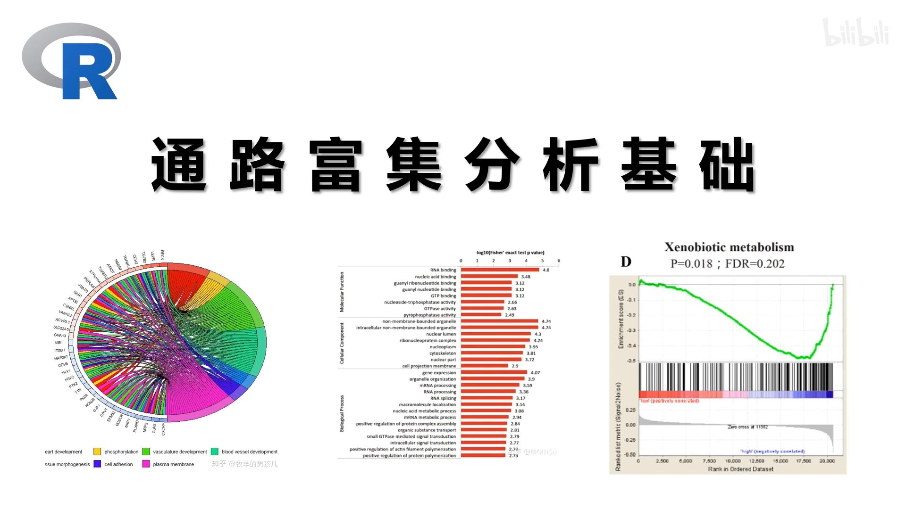
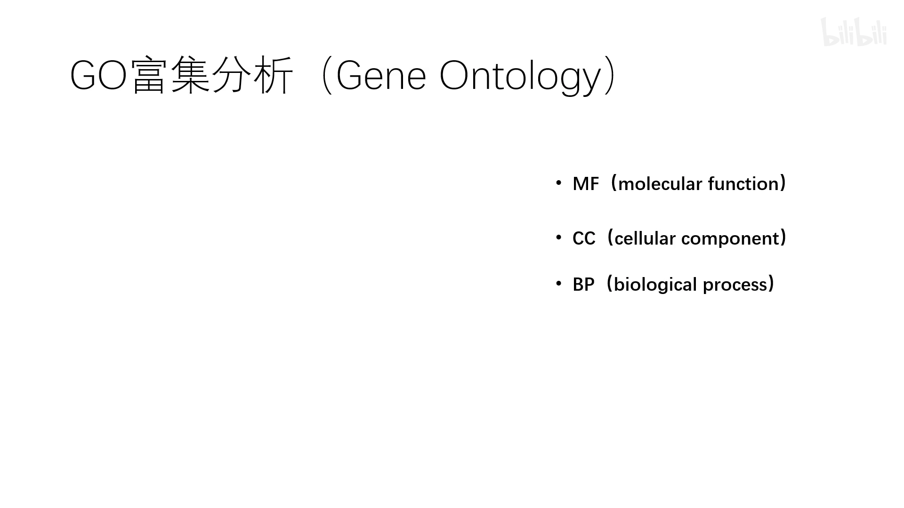
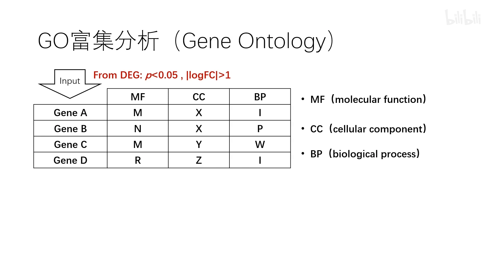
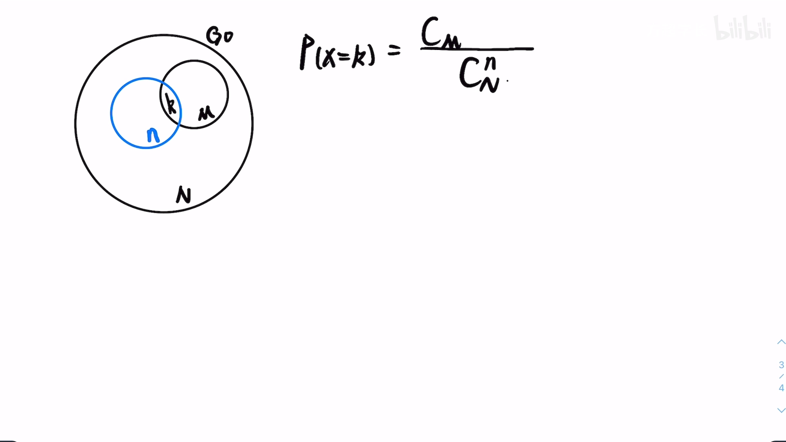
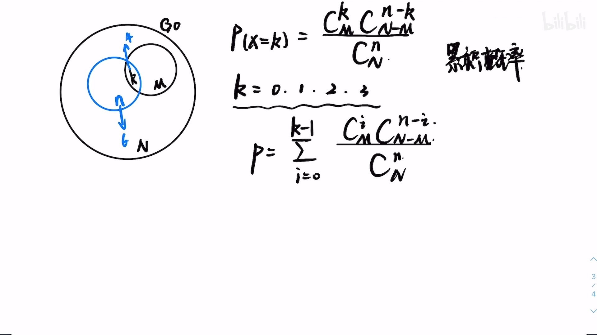
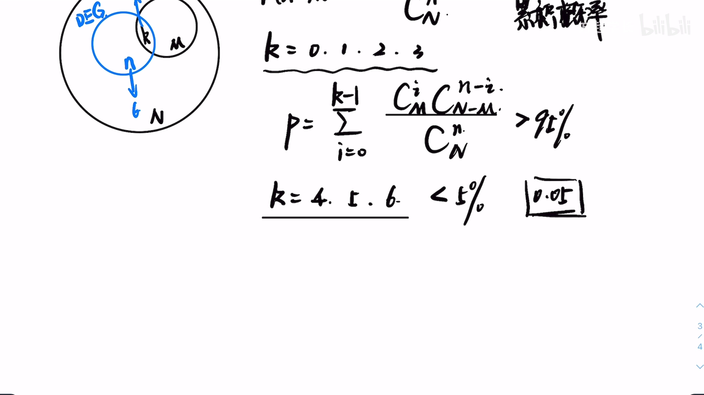
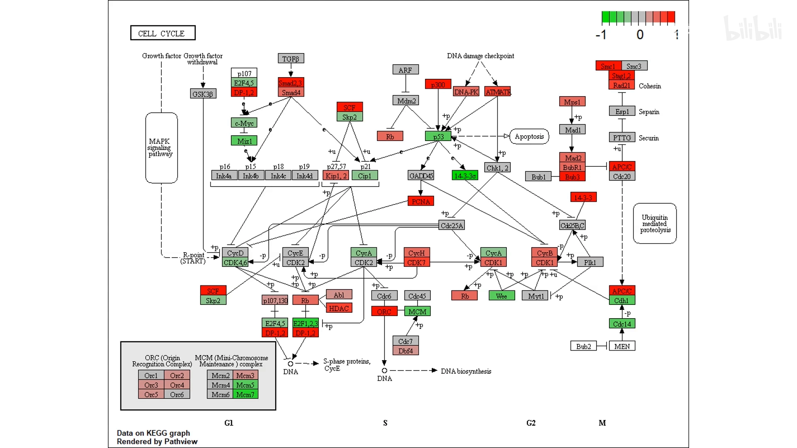
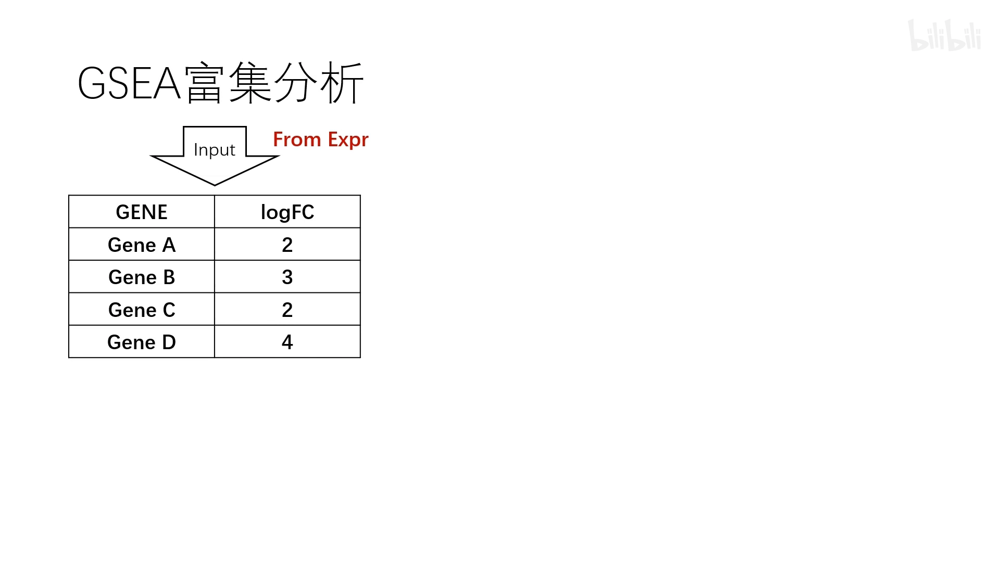
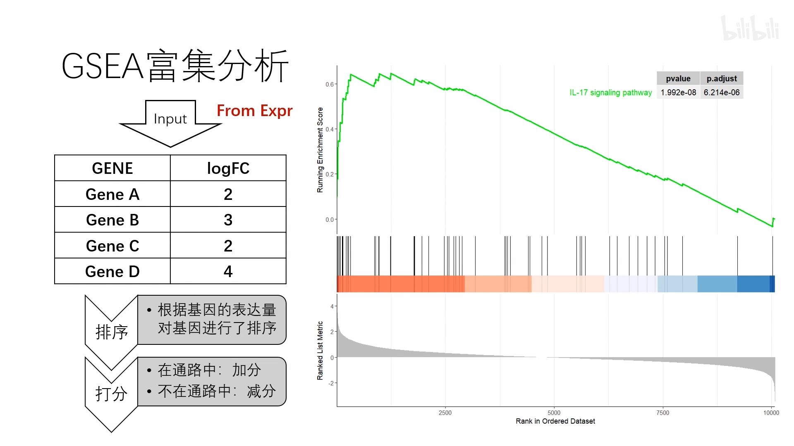

# 差异基因之后：GO、KEGG 与 GSEA 三种通路富集的原理与判读

> 视频来源：[GO/KEGG/GSEA通路富集那些事](https://www.bilibili.com/video/BV1MN4y1V7Gv/)（Bilibili · 方超学长）｜时长约 23 分钟
> 导读：这是一讲"只讲原理、不写代码"的通路富集课。讲者把 GO、KEGG、GSEA 三种方法拆到统计量层面讲清楚：P 值是怎么来的、GSEA 的跑分曲线为什么长那样。本文按"为什么富集 → ORA 的算法 → KEGG 的差别 → GSEA 的算法 → 怎么选"的顺序整理，适合已经拿到差异基因列表、准备把它翻译成生物学结论的读者。字幕为 AI 生成，术语已按上下文订正。

## 本讲要解决的核心问题（SCQA）

**背景**：做完差异分析，你手上有一张几百上千行的基因列表：基因名、logFC、P 值。这张表本身不是结论，没有人会逐个基因去讲。

**冲突**：要把它变成一句能写进文章的话，就得把基因压成"有名字的集合"——通路、复合物、调控程序。可富集分析的结果往往是一屏几十条显著通路，其中大部分互相重叠、方向混杂；而不同方法（GO、KEGG、GSEA）给出的结果还不一样。

**疑问**：这三种富集到底在算什么？同一个基因列表，为什么换个方法结论就变了？看到一堆显著通路时，凭什么判断哪条可信？

**回答（中心思想）**：**三种方法回答的是两个不同的问题——GO/KEGG 富集（ORA）问"我的名单里有没有这条通路的基因"，GSEA 问"这条通路的基因是不是整体排在名单的一端"。**前者依赖你设的阈值、丢掉幅度信息；后者用全部基因排序、保留幅度信息。理解了各自的统计量，才知道结果里哪些部分是数据说的、哪些部分是你设阈值时自己塞进去的。

---

## 一、通路富集在分析链里的位置：它干的活是"缩小范围"

讲者一开场就把这件事的动机说得很直白：做数据库筛选时我们会用通路富集、也会用 PPI 网络找 hub 基因，"反正这一大堆东西"，但按他的理解，**所有这些手段都在干同一件事——缩小范围**。[【跳转到 00:50】](https://www.bilibili.com/video/BV1MN4y1V7Gv/?t=50)

道理很朴素：一次测序做出来可能是成千上万个基因，但最终要确定的研究对象只有几个基因。怎么从成千上万个里挑出那几个？只能一层层筛：先用 limma 这类包做差异基因筛选，再用 PPI 网络找 hub 基因，再用通路富集看这些基因聚在哪条生物学过程上——每一步都在把范围压小一点。[【跳转到 01:09】](https://www.bilibili.com/video/BV1MN4y1V7Gv/?t=69) [【跳转到 01:34】](https://www.bilibili.com/video/BV1MN4y1V7Gv/?t=94)

这个定位很重要，它决定了后面所有判读的基调：**富集分析是一个"筛选器"，不是一个"证明器"。**它给你的是一条值得追的线索，不是一个已经成立的机制。放在扰动实验的语境里，这句话的意思是：扰动之后你拿到 DEG 列表，富集告诉你"这个扰动可能打到了细胞周期"，但"打到了细胞周期"还需要方向性、剂量关系、靶基因一致性这些证据来支撑。

讲者说常见的富集就三种：GO 富集、KEGG 富集、GSEA 富集，今天要讲清的是它们的区别、原理，以及什么情况下该用哪个。[【跳转到 02:08】](https://www.bilibili.com/video/BV1MN4y1V7Gv/?t=128)

## 二、GO 富集：一个基因挂三个标签，然后数重叠

### 2.1 GO 数据库把基因拆成三个互不干扰的维度

GO 的全称是 Gene Ontology（基因本体）。它的组织方式是把一个基因从三个层次分别注释：[【跳转到 02:33】](https://www.bilibili.com/video/BV1MN4y1V7Gv/?t=153)

- **MF（molecular function，分子功能）**：这个基因产物在分子层面干什么，比如"RNA binding"；
- **CC（cellular component，细胞成分）**：它在细胞的哪个位置，比如"nucleus"；
- **BP（biological process，生物过程）**：它参与哪条生物学过程，比如"mRNA processing"。

一个基因在这三个维度上都有注释：A 基因在 MF 里属于某个通路，在 CC 里属于另一个，在 BP 里又属于第三个。而 GO 数据库对每条通路只是给出"这条通路包含哪些基因"，**并不建立通路之间的联系**——它们是相互独立的通路。[【跳转到 03:23】](https://www.bilibili.com/video/BV1MN4y1V7Gv/?t=203)

这一点在实际判读时经常被忽略：同一个信号（比如"增殖"）会在 MF、CC、BP 三个维度上分别点亮一批条目，看起来"三个维度都显著"，其实说的是同一件事，不是三重独立证据。

### 2.2 ORA 的输入只有基因名

GO 富集（严格说是过表达分析，over-representation analysis，ORA）的输入很"薄"：**只导入基因名，不导入 logFC**。讲者特意提醒，这里和后面的 GSEA 有本质差别。[【跳转到 04:13】](https://www.bilibili.com/video/BV1MN4y1V7Gv/?t=253)

程序拿到基因名以后，去 GO 数据库里查每个基因在三个维度上分别对应哪条通路，然后给出一张"基因 × 维度"的对应表。[【跳转到 04:38】](https://www.bilibili.com/video/BV1MN4y1V7Gv/?t=278)

**输入只有基因名，意味着幅度信息在进入富集之前就已经被丢掉了。**一个 logFC 等于 8 的基因和一个 logFC 等于 1.01 的基因，在 ORA 眼里完全等价；而一个 logFC 等于 0.9 但生物学影响很大的基因，则根本进不了名单。这是 ORA 全部优缺点的根源。

### 2.3 超几何检验：P 值到底在算什么

有了对应表，下一步是判断"这条通路上的基因是不是比随机情况下更多"。讲者用超几何分布（hypergeometric test）来讲这件事，变量只有四个：[【跳转到 05:28】](https://www.bilibili.com/video/BV1MN4y1V7Gv/?t=328)

- $N$：GO 数据库里的基因总数（背景集大小）；
- $M$：某条通路里的基因数；
- $n$：你这次丢进去的差异基因数；
- $K$：这 $n$ 个差异基因里，落在该通路上的基因数。

"从 $N$ 个基因里随机抓 $n$ 个，其中恰好有 $K$ 个来自那条通路"的概率，就是超几何分布：

$$
P(X=K) = \frac{C_M^{K}\, C_{N-M}^{\,n-K}}{C_N^{\,n}}
$$

但富集分析要的 P 值不是这个单一概率，而是**累积概率**——累积的是"不好那一侧"的概率。讲者把数具体化来讲：假设 $K=4$、$n=6$，我们想看到的是 $K$ 尽量大（4、5、6），而"不好"的结果是 $K$ 尽量小（0、1、2、3）。于是把 $i$ 从 0 加到 $K-1$ 求和：[【跳转到 09:02】](https://www.bilibili.com/video/BV1MN4y1V7Gv/?t=542)

$$
P_{\text{cum}} = \sum_{i=0}^{K-1} \frac{C_M^{\,i}\, C_{N-M}^{\,n-i}}{C_N^{\,n}}
$$

当这个累积概率大于 95% 时，换一种说法就是：$K$ 取 4、5、6 的概率小于 5%，也就是小于 0.05。在统计上这就被当作"不可能事件"。可现实中它偏偏发生了——于是我们说这条通路显著富集。[【跳转到 09:52】](https://www.bilibili.com/video/BV1MN4y1V7Gv/?t=592) [【跳转到 12:04】](https://www.bilibili.com/video/BV1MN4y1V7Gv/?t=724)

### 2.4 这个 P 值最容易被误读的地方

讲者专门讲了一段"为什么它偏偏发生了"，这是全片最值得记住的推理：超几何分布建立在**随机抽样**的前提上——就像高中抽球题，题目总强调球大小相等、互不影响，为的就是保证随机性。而现实数据里它偏偏发生了，说明**它不随机**：这条通路上的基因在你的差异基因列表里确实扎堆了，所以这批差异基因不满足随机性假设。[【跳转到 10:59】](https://www.bilibili.com/video/BV1MN4y1V7Gv/?t=659) [【跳转到 11:24】](https://www.bilibili.com/video/BV1MN4y1V7Gv/?t=684)

换句话说，**富集的 P 值小，含义是"这批基因不是随机凑出来的"，而不是"这条通路被激活了"。**它没有方向、没有幅度、也没有因果。在扰动实验里，一个敲低实验的 DEG 列表在"细胞周期"上显著富集，可能意味着扰动让细胞周期相关基因整体下调（真信号），也可能意味着你的敲低引起了应激、把一批增殖相关基因一起压下去了（间接效应）。ORA 本身分不出这两种情况——这正是后面要引入 GSEA 和方向性检验的原因。

## 三、KEGG：换一个数据库，检验流程不变

KEGG 富集和 GO 富集"其实差不了太多"，差别只在库：GO 是按 MF/CC/BP 三个分类注释基因，而 **KEGG 注重的是通路**——它描述的是"实验变量作用于个体或组之后，发生了较大的基因表达变化，导致某条通路有较大改变"。[【跳转到 12:58】](https://www.bilibili.com/video/BV1MN4y1V7Gv/?t=778) [【跳转到 13:23】](https://www.bilibili.com/video/BV1MN4y1V7Gv/?t=803)

输入也一样：还是 P<0.05、|logFC|>1 筛出来的差异基因，还是只导入基因名。输出不一样的地方在于，KEGG 没有三个维度，每个基因只归属到一条（或几条）信号通路上，所以结果表只有一列通路归属。[【跳转到 14:13】](https://www.bilibili.com/video/BV1MN4y1V7Gv/?t=853)

**原理上两者没差：检验 P 值同样来自超几何分布。**[【跳转到 14:38】](https://www.bilibili.com/video/BV1MN4y1V7Gv/?t=878)

KEGG 真正有价值的地方在结果的可视化：因为它自带通路图，你可以把基因的 logFC 映射到图上，红色是上调、绿色是下调，一眼就能看出这条通路里"哪一段被推动了"。[【跳转到 15:01】](https://www.bilibili.com/video/BV1MN4y1V7Gv/?t=901)

这张图对扰动实验特别有用：**它把"通路显著"变成了"通路的哪一段在动"**。同样是细胞周期通路显著，如果上调集中在 G1/S 转换（CycD、CDK4/6、E2F），和上调集中在 M 期（CycB、CDK1），生物学含义完全不同。讲者说结果判读留到后面讲代码时再展开，这里先建立"KEGG 是一个通路数据库"的印象。[【跳转到 15:26】](https://www.bilibili.com/video/BV1MN4y1V7Gv/?t=926)

## 四、GSEA：不设阈值，用全部基因的排序说话

### 4.1 它要解决的正是 ORA 的致命短板

GSEA（gene set enrichment analysis，基因集富集分析）和前面两种最大的区别，是**不用人为设定阈值**。[【跳转到 16:00】](https://www.bilibili.com/video/BV1MN4y1V7Gv/?t=960)

讲者把动机讲得很具体：ORA 的输入是"P<0.05 且 |logFC|>1"筛出来的基因，这就带来一种情况——某个基因的 logFC 虽然达不到 1，变化很小，但它哪怕微小的一点变化，都可能让整条通路发生很大的改变；而这种基因在做 GO/KEGG 分析时**在进入富集之前就已经被删掉了**。[【跳转到 16:50】](https://www.bilibili.com/video/BV1MN4y1V7Gv/?t=1010) [【跳转到 17:15】](https://www.bilibili.com/video/BV1MN4y1V7Gv/?t=1035)

这在扰动实验里是常态而不是例外：**很多扰动的效应是"整条通路轻微整体位移"，而不是"几个基因剧烈变化"。**敲低一个转录因子，它的靶基因可能每个只降 20%–30%，单看任何一个都过不了 |logFC|>1，但整组一起降就非常显著。ORA 会把这种信号整组丢掉，GSEA 恰好能捡回来。

### 4.2 输入是全部基因的 logFC，不是筛选后的名单

GSEA 的输入是表达矩阵，或者所有基因的 logFC 值——**全部基因，不筛**。[【跳转到 17:40】](https://www.bilibili.com/video/BV1MN4y1V7Gv/?t=1060)

有些代码甚至不用先算 logFC，可以直接导入表达矩阵，因为 logFC 本来就是 limma 处理后的产物。[【跳转到 18:05】](https://www.bilibili.com/video/BV1MN4y1V7Gv/?t=1085)

### 4.3 跑分机制：排序 + 加分减分

GSEA 只做两件事，讲者用两个箭头概括：**排序、打分**。

1. **排序**：按 logFC 从大到小排，正的是上调、负的是下调，全部基因排成一列；
2. **打分**：沿着这个排序往下走，基因如果在这条通路里就**加分**，不在就**减分**。

[【跳转到 18:30】](https://www.bilibili.com/video/BV1MN4y1V7Gv/?t=1110)

把加分减分累积起来，就得到一条随排名推进而变化的曲线，叫 running enrichment score（运行富集分数）。它"running"的含义就是边处理边给分：前面连续遇到通路内基因，分数一路上涨；后面都不在通路里，分数一路往下掉。[【跳转到 20:10】](https://www.bilibili.com/video/BV1MN4y1V7Gv/?t=1210) [【跳转到 20:35】](https://www.bilibili.com/video/BV1MN4y1V7Gv/?t=1235)

这张图是文献里最常见的一张 GSEA 图，讲者把它拆成三段，从下往上看：

- **最下面**是 ranked list metric（这里是 logFC）：正的一侧是上调基因，负的一侧是下调基因，形成一条从红到蓝的渐变；
- **中间**像二维码一样的黑色竖线：每一条竖线代表一个基因，位置表示它在排序中的名次，只有落在这条通路里的基因才画线；
- **最上面**是 running enrichment score 曲线：竖线密集的地方分数上涨，稀疏的地方分数下跌。

曲线的**峰值**就是富集分数（ES）。讲者给了一个非常实用的读图规则：**峰值以前的那些基因，就是这条通路里真正在动、值得关注的核心基因**——因为峰值之前分数一直在涨，说明这一段里通路内基因高度集中。[【跳转到 21:00】](https://www.bilibili.com/video/BV1MN4y1V7Gv/?t=1260) [【跳转到 21:25】](https://www.bilibili.com/video/BV1MN4y1V7Gv/?t=1285)

如果曲线是往下的（先跌后回升），说明这条通路是整体下调的，同样可以取谷值前的基因作为核心基因。讲者说这类"竖条形态不同"的判读细节留到结果判读那节课再讲。[【跳转到 21:50】](https://www.bilibili.com/video/BV1MN4y1V7Gv/?t=1310)

### 4.4 一句话记住三者的区别

讲者在结尾做了总结：GSEA 最不同于 KEGG 和 GO 的地方，是**数据来源不是人为设阈值筛出来的，而是把表达矩阵（或全部基因的 logFC）直接导进去跑**，因此避免了"变化虽小但影响很大"的基因在前期被筛掉。[【跳转到 22:15】](https://www.bilibili.com/video/BV1MN4y1V7Gv/?t=1335)

用一张表把三者放在一起：

| 维度 | GO 富集（ORA） | KEGG 富集（ORA） | GSEA |
| --- | --- | --- | --- |
| 输入 | 差异基因的**基因名** | 差异基因的**基因名** | **全部基因**的 logFC 或表达矩阵 |
| 是否依赖阈值 | 是（P<0.05、$\vert$logFC$\vert$>1） | 是（同上） | 否 |
| 统计量 | 超几何分布 | 超几何分布 | 排序后的 running ES |
| 是否保留幅度 | 否（只看在不在名单里） | 否 | 是（排序本身就是幅度） |
| 是否带方向 | 不带（只有"有没有"） | 不带 | 带（正值富集 / 负值富集） |
| 基因集来源 | GO 的 MF/CC/BP | KEGG 通路图 | 任意基因集（GO、KEGG、Hallmark、自建） |
| 典型产出 | 三大类别的富集条目表 | 通路富集表 + 通路着色图 | 富集曲线 + ES/NES + FDR |

## 五、怎么选：三个问题决定用哪个

讲者没有给"哪个更好"的排序，但从他的原理讲解里可以推出一个清晰的决策顺序。做扰动分析时，可以按三个问题来选：

**第一个问题：你要回答"有没有"还是"是不是整体在动"？**

如果只是想快速看一眼这个扰动大致碰到了哪些生物学过程，ORA（GO/KEGG）最省事、也最容易和文献对话——因为审稿人和读者都熟悉"GO 富集到细胞周期"这种表述。但如果你的假设是"这个扰动让某条通路整体轻微位移"，就必须用 GSEA：阈值筛选会把这个信号删掉。[【跳转到 17:15】](https://www.bilibili.com/video/BV1MN4y1V7Gv/?t=1035)

**第二个问题：你的基因集从哪来？**

GO 和 KEGG 是"别人替你定好的集合"，好处是标准、可比，坏处是**冗余极重**：一个信号会同时点亮几十条高度重叠的条目（"cell cycle"、"mitotic cell cycle"、"cell cycle process"……），因为它们共享同一批基因。判读时要做的第一件事不是看 P 值排序，而是**把重叠条目合并成一条生物学结论**。GSEA 则允许你换用冗余更低的集合（如 Hallmark），或者干脆自建一个"我关心的靶基因集合"——后者在扰动分析里非常有用，因为你往往已经知道这个扰动应该影响哪组基因。

**第三个问题：你需要方向吗？**

这是扰动分析里最关键的一条。ORA 只说"这条通路在名单里"，GSEA 的 ES 有正负：**正 ES 表示这条通路的基因整体偏向排序的上调端，负 ES 表示整体偏向下调端**。对敲低实验来说，方向就是可证伪的检验：如果你敲低的是一个转录因子，而它的靶基因集合给出显著的正 ES（整体上调），那基本可以断定这个结论有问题——要么敲低没成功，要么基因集不对。[【跳转到 21:00】](https://www.bilibili.com/video/BV1MN4y1V7Gv/?t=1260)

## 六、把结果读成一句话：可信度分级

综合讲者讲的原理，判读富集结果时可以按证据强度分三档：

**最可信**：基因集整体方向一致（GSEA 的 ES 与扰动方向自洽）＋ 在多个重复/多个时间点里稳定出现 ＋ 与已知的扰动机制对得上。比如敲低一个增殖相关基因，细胞周期基因集给出显著负 ES，且这个结论在三个生物学重复里都成立。

**中等**：只有富集显著，但方向混杂——ORA 里显著、GSEA 里 ES 不显著，或者上调下调基因各占一半。这通常意味着"这条通路参与了响应"，但参与的方式还不清楚，需要看具体是哪些基因在动。

**最不可信**：只有一条通路显著，而且落在里面的基因数很少。这是富集分析的经典假阳性形态：通路本身基因少（比如只有十几个基因的小通路），只要有两三个基因恰好进了差异名单，P 值就会很小。讲者在讲超几何检验时其实已经埋下了这个伏笔——$M$ 很小时，$K$ 稍微大一点，累积概率就会迅速偏离随机期望。[【跳转到 07:15】](https://www.bilibili.com/video/BV1MN4y1V7Gv/?t=435)

一句话收束：**通路富集给的是假设，不是结论。它的价值在于把几百个基因压成一句可检验的话**——"这个扰动抑制了细胞周期"就是一句可以拿方向性、剂量关系、靶基因一致性去验证的话。验证不了的富集结果，就还停在"值得看一眼"的阶段。

## 小结

- **富集分析是筛选器，不是证明器**：它和差异分析、PPI 网络一样，干的是"从成千上万个基因缩小到几个研究对象"的活。[【跳转到 00:50】](https://www.bilibili.com/video/BV1MN4y1V7Gv/?t=50)
- **GO 富集把基因拆成 MF/CC/BP 三个互不关联的维度**，同一信号常在三个维度同时点亮，那不是三重证据。
- **ORA（GO/KEGG）的输入只有基因名**，幅度信息在进入检验前就丢了；P 值来自超几何分布，累积的是"不好那一侧"的概率。
- **富集 P 值小 = 这批基因不是随机凑出来的**，不等于"通路被激活"；它没有方向、没有幅度、没有因果。[【跳转到 11:24】](https://www.bilibili.com/video/BV1MN4y1V7Gv/?t=684)
- **KEGG 与 GO 原理相同，价值在通路图**：把 logFC 映射到通路上，能看出"这条通路的哪一段在动"。
- **GSEA 不设阈值，用全部基因排序 + 加分减分**，因此能捡回"单个变化小、整组变化大"的信号，这是它在扰动分析里最不可替代的地方。[【跳转到 22:15】](https://www.bilibili.com/video/BV1MN4y1V7Gv/?t=1335)
- **GSEA 曲线峰值以前的基因是核心基因**，峰值位置告诉你信号集中在排序的哪一端。
- **判读顺序**：先合并冗余条目，再看方向是否与扰动自洽，最后才看 P 值大小；基因数很少的孤立显著通路要打问号。

## 关键术语速查

| 术语 | 一句话解释 |
| --- | --- |
| ORA（over-representation analysis） | 过表达分析：先卡阈值得到基因名单，再看哪些通路在名单里"超额出现" |
| 超几何检验（hypergeometric test） | ORA 用的统计检验，算"随机抽这么多基因，恰好抽到 K 个通路内基因"的累积概率 |
| 背景集（background / universe） | 超几何检验里的 $N$，即"从哪个基因池里抽样"，选错会直接改变 P 值 |
| GO（Gene Ontology） | 基因本体数据库，按 MF 分子功能、CC 细胞成分、BP 生物过程三个维度注释基因 |
| KEGG | 以通路图组织的数据库，每个基因归属到具体的信号通路上，可把 logFC 映射到图上着色 |
| GSEA（gene set enrichment analysis） | 基因集富集分析：不设阈值，用全部基因按 logFC 排序，看某基因集是否整体偏向一端 |
| running enrichment score | GSEA 沿排序累积的分数，通路内基因加分、通路外减分，形成一条曲线 |
| ES / NES | 富集分数 / 归一化富集分数，曲线的峰值高度；正负表示整体上调或下调 |
| 基因集（gene set） | 一组被当作整体分析的基因，可来自 GO、KEGG、Hallmark，也可自建（如某转录因子的靶基因） |
| 冗余条目（redundant terms） | 共享大量基因的多个通路条目，判读时要合并，不能当成多个独立证据 |
