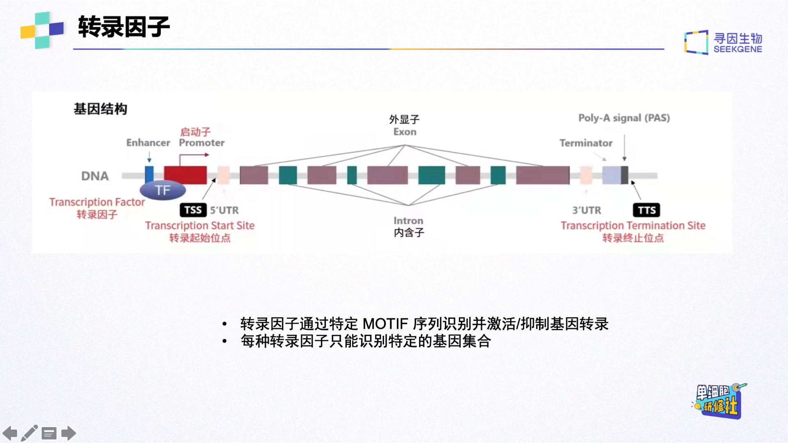
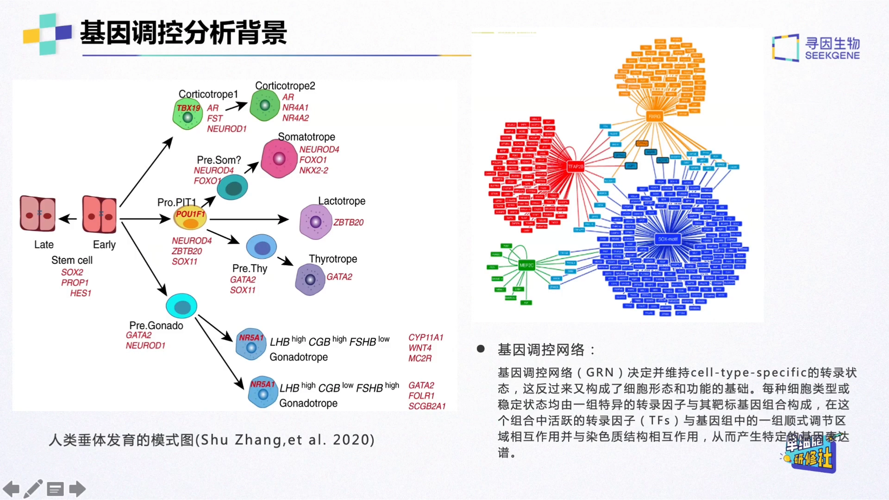
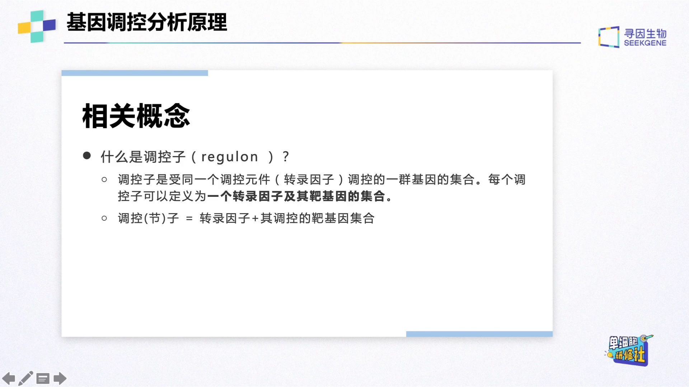
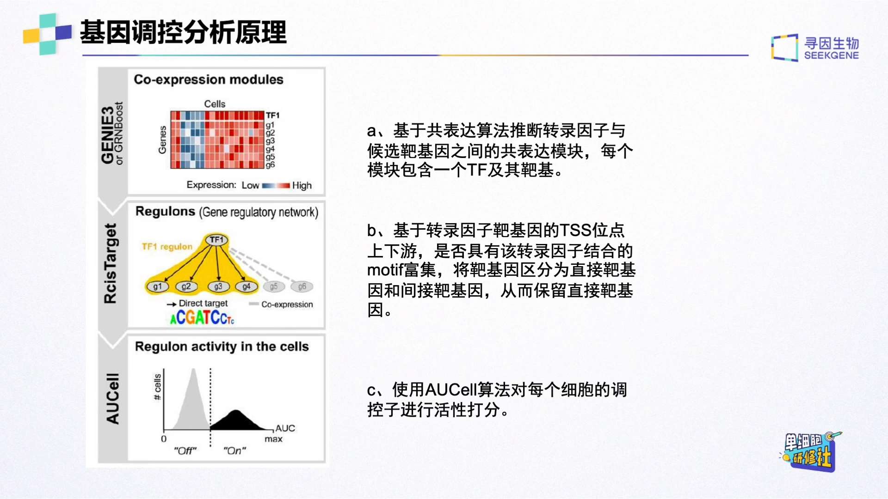
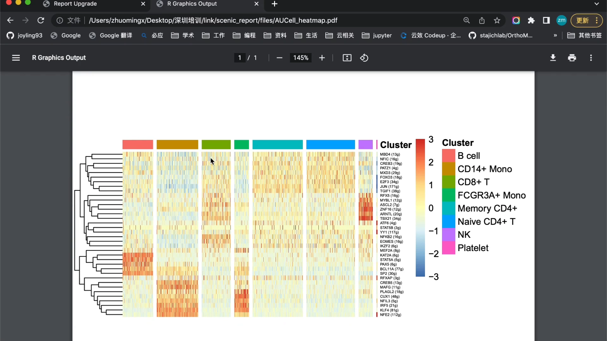
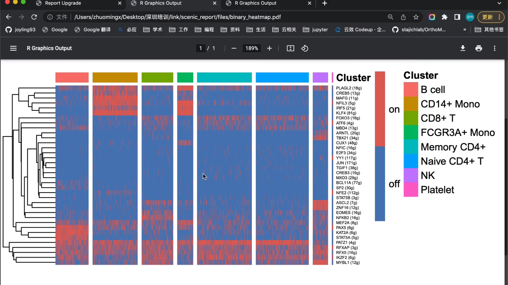
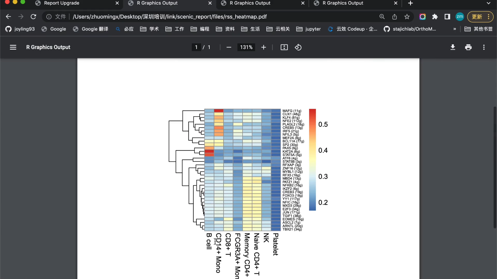
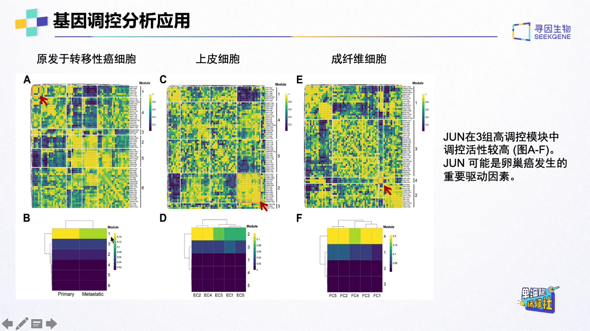

# 谁在指挥：用 SCENIC 从差异基因反推转录因子活性

> 视频来源：[第19讲 单细胞高级分析-看懂转录因子调控结果](https://www.bilibili.com/video/BV1nN4y1C7VS/)（Bilibili · 寻因生物）｜时长约 13 分钟
> 导读：这一讲回答的是"通路富集之后还能往上游走一步吗"。讲者先用几分钟讲清 SCENIC 的三步原理（共表达模块 → motif 过滤 → AUCell 打分），再逐张讲解报告里的三种热图怎么读，最后用一篇卵巢癌单细胞文献演示"从热图里挑出一个转录因子、再用抑制剂验证"的完整链条。本文保留这条推理链，并补上它在扰动实验里的用法。字幕为 AI 生成，术语（SCENIC、regulon、AUCell、motif、JUN 等）已按上下文订正。

## 本讲要解决的核心问题（SCQA）

**背景**：扰动实验做完、差异基因算出来、通路富集也跑完了。你现在知道"这个扰动让细胞周期相关基因整体下调"。

**冲突**：这句话还是描述性的。审稿人真正会问的是——**是谁在指挥这批基因？**是哪个转录因子被扰动打中了，导致它的下游一起变化？但麻烦在于：转录因子本身的 mRNA 往往几乎不变（它被调控靠的是蛋白修饰、入核、辅因子），所以你在差异基因列表里根本找不到它。

**疑问**：不靠转录因子自己的表达变化，还能不能判断它的活性变了没有？

**回答（中心思想）**：**能，但要反过来推——不看转录因子自己表达多少，而看它的靶基因集合整体有没有一起动。**SCENIC 做的就是这件事：先把"转录因子 → 靶基因"的集合（regulon）建出来，再给每个细胞的每个 regulon 打一个活性分。方向是反的，所以靶基因集合的质量决定了结论的质量：集合错了，活性推断会给出很自信的错误答案。

---

## 一、为什么必须从"基因"走到"调控子"

### 1.1 转录因子决定了下游基因能被转录成什么

讲者先花几分钟回顾真核生物的转录调控。基因结构除了外显子和内含子，在转录起始位点（TSS）上游还有增强子、启动子这些元件；转录因子结合上去以后，可以显著改变下游基因的转录。[【跳转到 00:40】](https://www.bilibili.com/video/BV1nN4y1C7VS/?t=40)

关键在于**特异性从哪来**：转录因子是通过特定的 motif 序列去结合增强子和启动子的，所以每一个转录因子只能调控特定的一批基因，这受限于 motif 序列的差别。[【跳转到 01:05】](https://www.bilibili.com/video/BV1nN4y1C7VS/?t=65)

这句话是整个方法的地基：**如果"TF → 靶基因"的对应关系是确定的，那么反过来，靶基因的整体变化就能反推 TF 的状态。**这也是为什么后面第二步要用 motif 数据库去过滤——motif 就是那个"确定关系"的物证。

### 1.2 调控网络决定细胞状态，而单细胞能测出"群体间"的差异

讲者用一张人类垂体发育的模式图说明转录调控的分量：干细胞向不同细胞类型分化时，不同的转录因子组合决定了分化方向；不同的转录因子及其下游基因构成一个个转录调控网络，显著决定了细胞的活性状态。[【跳转到 01:27】](https://www.bilibili.com/video/BV1nN4y1C7VS/?t=87)

单细胞的价值在这里体现得很直接。讲者说，单细胞转录组分析出现以前，只能在体外培养的细胞系里研究转录因子和基因的调控关系；现在借助成熟软件，**单细胞转录组可以很快推断出样本内细胞群体间活跃的转录因子调控关系**。[【跳转到 01:51】](https://www.bilibili.com/video/BV1nN4y1C7VS/?t=111)

"群体间"三个字很重要：SCENIC 给出的不是"这个样本里某个 TF 活跃"，而是"**哪些细胞里的哪些调控子比其他细胞更活跃**"。对扰动实验来说，这正好对应"处理组 vs 对照组"的比较——同一个 regulon 在两组细胞里的活性分布差异，就是扰动打中上游调控者的证据。

## 二、SCENIC 的三步：从共表达走到活性分数

讲者点明最经典的软件是 SCENIC，最早发表在 Nature Methods 上，现在有很多迭代版本；它比较耗内存，建议在集群上跑。[【跳转到 02:16】](https://www.bilibili.com/video/BV1nN4y1C7VS/?t=136)

核心概念只有一个：**调控子（regulon）**。

有了这个定义，三步流程就很好理解：

### 2.1 第一步：共表达模块——先猜"谁可能和谁一起动"

第一步用共表达算法（GENIE3 或 GRNBoost）推断转录因子与候选靶基因之间的共表达模块，每个模块包含一个 TF 及其候选靶基因。[【跳转到 02:51】](https://www.bilibili.com/video/BV1nN4y1C7VS/?t=171)

这一步的产物是**一堆"疑似"关系**。共表达只能说明"这两个基因在细胞间一起高一起低"，不能说明"前者调控后者"——两个基因也可能同时被第三个因子调控，或者只是同一细胞状态的伴随现象。所以必须过滤。

### 2.2 第二步：motif 过滤——把"疑似"变成"直接靶基因"

第二步是 SCENIC 的关键：对每个调控子内部，检查靶基因 TSS 位点上下游是否真的有该转录因子结合的 motif 富集。现在有很多公共数据库通过文献查找和 motif 序列比对，记录了转录因子和它潜在调控基因的对应关系；比对这些数据库，就可以排除调控子内部的假阳性——**就算某个基因和转录因子共表达，如果它的 motif 序列对不上，那几乎不可能发生真正的调控。**[【跳转到 03:16】](https://www.bilibili.com/video/BV1nN4y1C7VS/?t=196)

这一步在概念上极其重要，因为它做了两件事：

1. **把"共表达"升级为"直接靶基因"**（有 motif 支撑的那部分），剩下的共表达基因被降级为"间接"；
2. **给活性推断提供了可证伪的依据**——你之所以敢说"靶基因整体变化 = TF 活性变化"，靠的就是这批有 motif 支撑的直接靶基因。

### 2.3 第三步：AUCell 打分——把"靶基因集合"压成一个数

第三步给每一个细胞的每一个调控子打活性分，用的是 **AUCell** 算法。讲者的类比很到位：它类似于前面讲过的 GSVA、GSEA 那种基因集富集思路——**给每一个细胞里、和某个调控子相关的一组基因，综合打一个分数**。分数越高，说明这个调控子在这个细胞里的调控活性越强。[【跳转到 03:41】](https://www.bilibili.com/video/BV1nN4y1C7VS/?t=221)

注意这里的逻辑和通路富集完全同构：都是"拿一个基因集合去打分"，只不过集合从"通路"换成了"某 TF 的靶基因"。**所以判读规则也同构**——单个基因的表达高低不重要，重要的是这个集合是不是整体偏向表达排序的高端。

### 2.4 从分数到"开/关"：双峰分布的意义

打完分以后，还要确定"多高算活跃"。讲者说：观察每一个调控子的打分分布，就能确定哪些细胞里它是相对更活跃的；**理想状态下这个打分应该呈现双峰分布**，这样就可以把低分的那一群划为背景，把高分的那一群划为"调控活性比较高"的细胞。[【跳转到 04:06】](https://www.bilibili.com/video/BV1nN4y1C7VS/?t=246)

这一步埋着一个容易被忽略的判读陷阱：**双峰是"理想状态"，不是保证。**如果某个 regulon 的分数分布是单峰、或者两峰严重不平衡，那么"on/off"的划分就非常依赖阈值选择，此时把它当成"某群细胞特异活跃"的证据就很脆弱。看到单峰分布时，更稳妥的做法是回到连续分数去比较，而不是用二元结果下结论。

## 三、报告里的三张热图：同一件事的三种看法

讲者接着逐张讲报告，这部分是判读训练。三张图的数据是同一份，只是视角不同。

### 3.1 AUCell 热图：横轴细胞、纵轴调控子

第一张是 AUCell heatmap。横坐标是一个个细胞（按细胞类型分块），纵坐标是不同的调控子，交叉处的颜色就是 AUC 值。[【跳转到 05:47】](https://www.bilibili.com/video/BV1nN4y1C7VS/?t=347)

读图前要先会看标签。讲者专门解释了调控子的命名格式：**前面是转录因子名，后面括号里是数字加 G，表示这个调控子包含多少个基因**。比如 19G 就是 19 个基因；如果括号里是 4，那就是 4G。他举的例子是一个包含 14 个基因的调控子——**一个转录因子加上 13 个它下游调控的基因**。[【跳转到 06:06】](https://www.bilibili.com/video/BV1nN4y1C7VS/?t=366)

这个数字不是装饰，它是判读的第一道筛子：**括号里只有 3、4 个基因的调控子，活性分数极不稳定**，因为 AUC 只对几个基因打分的方差很大；而 100 多个基因的调控子（如 YY1 117g）则往往过于宽泛、特异性差。中间量级（十几到几十个基因）的调控子通常最值得看。

读图方法是横着看：某个细胞类型的整列在某个调控子那一行上颜色偏暖，就说明这个调控子在这群细胞里活性更高。讲者举的例子是 B 细胞的几个调控子——横过来看，它们相比其他细胞活性更强，这启示我们这些调控子在 B 细胞里发挥了更大的活性作用。[【跳转到 06:56】](https://www.bilibili.com/video/BV1nN4y1C7VS/?t=416)

### 3.2 二元热图：把连续分数压成 on/off

第二张图长得很像，横纵坐标相同，但交叉处的值换成了 on 和 off 两个状态。[【跳转到 07:31】](https://www.bilibili.com/video/BV1nN4y1C7VS/?t=451)

它的来源就是上一节说的阈值判断：软件根据 AUC 值分布确定哪些细胞的 regulon 相对更活跃，把活跃的值表现成 on，把非活跃的背景值定义为 off，画在一张图上就是一个二元矩阵。讲者说这个矩阵比刚才的连续矩阵**稍微直观一些**，能更明显地看出哪些细胞的哪些调控子活性程度更高。[【跳转到 07:56】](https://www.bilibili.com/video/BV1nN4y1C7VS/?t=476) [【跳转到 08:21】](https://www.bilibili.com/video/BV1nN4y1C7VS/?t=501)

它和上一张图是同一个意思，只是通过活性阈值把高活性的调控关系进一步凸显出来。[【跳转到 09:00】](https://www.bilibili.com/video/BV1nN4y1C7VS/?t=540)

**代价是丢了信息**：连续分数里的"略高"和"极高"在二元图里都变成 on。所以二元图适合做"一眼看格局"，不适合做定量比较——真要比较处理组和对照组的差异，回到连续分数。

### 3.3 平均活性热图：把细胞压成细胞类型

第三张图把所有细胞的 AUC 取平均，于是每个细胞类型 × 每个调控子得到一个平均值，然后做横向比较。[【跳转到 09:24】](https://www.bilibili.com/video/BV1nN4y1C7VS/?t=564)

这张图最适合回答"哪个细胞类型由哪个调控子主导"。讲者举的例子是 B 细胞比较强的两个调控子，比如 STAT5A 等。[【跳转到 09:24】](https://www.bilibili.com/video/BV1nN4y1C7VS/?t=564)

他也把"调控活性"这个词解释得很实在：**所谓调控活性高，就是说这个细胞里和该调控子相关的转录因子以及下游基因，表达量相比其他细胞更强，它们的调控关系也更强。**[【跳转到 09:49】](https://www.bilibili.com/video/BV1nN4y1C7VS/?t=589)

这句话值得反复读：活性分数是"靶基因集合的整体表达"的代理量，**不是转录因子蛋白的浓度，也不是它的 DNA 结合状态**。所以严格说，SCENIC 给的是"这个调控程序是否被打开"，而不是"这个 TF 是否被激活"。

## 四、案例：从热图里挑出一个驱动因子，再拿抑制剂验证

讲者用一篇卵巢癌单细胞文献演示完整链条。研究设计是：两个病人的原发与转移配对卵巢样本做单细胞测序，目的是理解卵巢癌的异质性和分子特征，帮助理解发生、转移与耐药机制，并找潜在治疗靶点。[【跳转到 10:13】](https://www.bilibili.com/video/BV1nN4y1C7VS/?t=613)

### 4.1 先注释，再做 SCENIC，再把调控子聚成模块

常规流程：先做细胞注释，发现两个样本里主要是上皮细胞、成纤维细胞、T 细胞，其他细胞较少。[【跳转到 10:38】](https://www.bilibili.com/video/BV1nN4y1C7VS/?t=638)

然后作者对全部细胞做了 SCENIC 分析。**关键的一步在这里**：拿到 AUC 矩阵后，他没有直接看单个调控子，而是先对 AUC 矩阵做相关性分析，把调控子聚成多个模块，再对这些模块分别打分，找出哪些模块的分值显著更高。[【跳转到 10:50】](https://www.bilibili.com/video/BV1nN4y1C7VS/?t=650)

这一步和通路富集里"合并冗余条目"是同一个思路：**几百个 regulon 逐个看没有意义，先降维成几个协同工作的模块，才能看出格局。**相关性聚类在这里的作用是找出"总是一起活跃"的调控子群——它们很可能共享上游信号。

### 4.2 三个细胞类型各有一个高活性模块，交集是 JUN

结果：原发与转移样本里，**1 号模块**的活性显著高于其他模块，它包含箭头指示的那些调控子；上皮细胞里是 **2 号模块**，成纤维细胞里是 **4 号模块**。[【跳转到 11:15】](https://www.bilibili.com/video/BV1nN4y1C7VS/?t=675)

接着作者在这三个高活性模块里都发现了一个共同的调控子——**JUN**。因为这三类细胞在样本里占比最高，且大部分都有较强的 JUN 相关调控活性，他因此认为 JUN 在这个癌症样本里调控活性较高，可能是卵巢癌发生的重要驱动因素。[【跳转到 11:40】](https://www.bilibili.com/video/BV1nN4y1C7VS/?t=700) [【跳转到 12:05】](https://www.bilibili.com/video/BV1nN4y1C7VS/?t=725)

这个推理的形式值得单独拎出来：**"三个独立模块的交集"比"单个模块里最显著的一个"可靠得多。**如果 JUN 只在 1 号模块里高，它可能只是转移样本的伴随现象；而它在三个细胞类型的高活性模块里都出现，说明这是一个跨细胞类型的共性调控程序。

### 4.3 用抑制剂做功能验证：把相关性变成因果

最后一步是实验验证，也是这条链条最值钱的地方：作者在两个不同的卵巢癌细胞系里加入 **T5224**——讲者称其为 JUN 转录的抑制剂，可以抑制细胞里 JUN 的活性。加入以后发现，这个抑制剂能显著抑制两种癌细胞的增殖和侵袭，因此作者认为 JUN 可以作为卵巢癌的潜在治疗靶点。[【跳转到 12:19】](https://www.bilibili.com/video/BV1nN4y1C7VS/?t=739) [【跳转到 12:44】](https://www.bilibili.com/video/BV1nN4y1C7VS/?t=764)

注意这个验证的形式：**SCENIC 给出的是"JUN 的调控程序在这批肿瘤细胞里更活跃"，这是一个相关性观察；抑制剂实验做的是"关掉 JUN 的活性，肿瘤细胞的增殖和侵袭下降"，这才把相关性变成了因果。**单细胞转录调控分析本身永远走不到最后一步——它能做的，是给你一个足够具体、值得去验证的候选因子。

## 五、把这套方法用到扰动实验上：一个可证伪的自洽性检查

视频讲的是疾病样本的细胞类型比较，但这套工具在扰动实验里有一个非常实用的用法，值得单独说清楚。

**做法**：扰动（比如敲低某个转录因子 T）之后，用 SCENIC 分别算出对照组和处理组各细胞的 regulon 活性，然后比较 T 自己的 regulon 在两组间的活性差。

**判读**：

- 如果扰动成功敲低了 T，那么 **T 的 regulon 活性在处理组应当整体下降**——因为它的直接靶基因（motif 支撑的那批）会跟着下调。这是方向性检验，和前面通路富集里"敲低某 TF 则靶基因应整体下调"是同一条逻辑，只是换到了 regulon 层面。
- 如果 T 的 regulon 活性**不降反升**，那就要怀疑：敲低没成功（效率问题）、靶基因集合建错了（motif 数据库不适用于这个细胞类型）、或者细胞在用别的因子代偿。
- 如果 T 自己的 mRNA 在差异基因列表里根本没变，但它的 regulon 活性显著下降——这恰恰是 SCENIC 最擅长、也是单基因差异分析完全看不到的情形：**TF 的表达没变，但它的调控程序被关掉了。**

**要小心的三件事**：

1. **靶基因集合的质量决定一切。**motif 数据库对某些 TF（尤其缺乏 motif 信息的）覆盖很差，此时 regulon 里的基因可能主要来自共表达，活性推断会很自信地给出错误答案。
2. **直接靶基因和间接靶基因要分开看。**SCENIC 第二步用 motif 过滤的目的就是把直接靶点留下；如果只关心"扰动目标 TF 的直接效应"，就应该只看有 motif 支撑的那部分基因的变化，而不是整个 regulon。
3. **平均活性会掩盖异质性。**regulon 活性是每个细胞一个分数，把它平均成"处理组 vs 对照组"会丢掉"只有一部分细胞响应"这种信息——那是扰动效应异质性的问题，不在本文范围内。

## 小结

- **转录因子自己的 mRNA 常常不变，所以不能靠它判断活性；要反过来看靶基因集合整体有没有一起动。**
- **regulon = 一个转录因子 + 它的靶基因集合**，这是 SCENIC 全部计算的单位。[【跳转到 02:41】](https://www.bilibili.com/video/BV1nN4y1C7VS/?t=161)
- **三步流程各有分工**：共表达模块负责"猜"，motif 过滤负责"证"，AUCell 负责"打分"；跳过 motif 过滤，活性推断就失去了可证伪性。
- **AUCell 分数是"调控程序是否被打开"的代理量**，不是 TF 蛋白浓度，也不是 DNA 结合状态。
- **读热图先看标签**：调控子名后括号里的数字是靶基因数，基因数太少的 regulon 分数不稳定，太多的特异性差。
- **三张热图三种视角**：连续 AUC 看定量、二元 on/off 看格局、平均活性看细胞类型；二元图会丢幅度信息。
- **多个模块的交集比单个模块的最强项更可靠**，这是从卵巢癌案例里能学到的最实用的一条推理习惯。
- **SCENIC 给的是候选因子，因果要靠扰动/抑制剂实验补上**——JUN 的故事就是"热图 → 交集 → 抑制剂 → 靶点"的完整链条。

## 关键术语速查

| 术语 | 一句话解释 |
| --- | --- |
| regulon（调控子） | 一个转录因子加上它调控的靶基因集合，是 SCENIC 分析的基本单位 |
| motif | DNA 上一段短序列，转录因子通过识别它来结合增强子/启动子，因此决定了 TF 的靶基因特异性 |
| GENIE3 / GRNBoost | 第一步用的共表达推断算法，输出"TF 与候选靶基因"的共表达模块 |
| RcisTarget | 第二步的 motif 富集工具，用数据库比对把共表达基因区分为直接靶基因与间接靶基因 |
| AUCell | 第三步的打分算法，给每个细胞的每个 regulon 算一个活性分数（AUC） |
| AUC 值 | 调控子活性分数，越高表示该细胞里这组靶基因整体表达越强 |
| RSS / 平均活性 | 按细胞类型对 AUC 取平均（或算调控子特异性分数），用来比较不同细胞类型的调控格局 |
| on/off 二元矩阵 | 按阈值把连续 AUC 压成"活跃/不活跃"两态，直观但丢幅度信息 |
| 双峰分布 | 理想的 AUC 分布形态，低峰为背景、高峰为活跃；单峰分布时阈值划分不可靠 |
| 直接靶基因 vs 间接靶基因 | 有 motif 支撑的是直接靶点，只有共表达的是间接（级联）效应 |
