# 差异丰度分析：扰动后是细胞变了，还是细胞的数量变了

> 视频来源：[Day 10 差异丰度分析 DA -- 每天10分钟，15 天学习单细胞](https://www.bilibili.com/video/BV1kMsF6PEn2/)（Bilibili · Ninagoon）｜时长约 9 分钟
> 导读：这支视频用一篮水果、六只小鼠和一张「邻域 × 小鼠」计数表，把「细胞状态变化」与「细胞比例变化」这两件在 UMAP 上长得极像的事拆开。本文按它的三步走（定义 → 分母 → 方法）整理，重点是判读逻辑：什么时候该说「细胞变了」，什么时候只能说「细胞的数量变了」。

## 本讲要解决的核心问题（SCQA）

**背景**：单细胞扰动实验做完，我们手上是一张「细胞 × 基因」的表达矩阵，每个细胞还带着一个样本标签（供体、小鼠、孔）和一个细胞类型/状态标签。上一课做的事是：固定同一种细胞状态，比较扰动组与对照组里某个基因的表达高低，这叫**差异表达（differential expression，DE）**。

**冲突**：但扰动常常不是「让同一群细胞表达变高」，而是「让某类细胞变多」。疾病组里炎症相关中性粒细胞从 10% 涨到 30%，这个数字很显眼，可它到底意味着什么？是每个中性粒细胞都变得更炎症了，还是炎症状态的那部分细胞变多了，还是别的细胞死掉了？更麻烦的是，把 12000 个细胞当成 12000 个独立观测去做检验，几乎必然「显著」——因为同一只鼠的细胞共享来源，它们不是独立重复。

**疑问**：怎样描述、检验和解释这种「群体层面的变化」？它和状态内的表达变化是什么关系？两种变化同时出现时又该怎么拆？

**回答（中心思想）**：扰动在群体层面有**两种性质完全不同**的读出——**状态变化（state shift）**问的是「同一群细胞有没有进入另一个表达状态」，**比例变化（composition shift，也叫差异丰度 differential abundance，DA）**问的是「各状态/邻域的相对数量占比有没有变」。两者的分析单位不同（细胞 vs 样本）、统计模型不同（表达模型 vs 组成数据模型），**一个结果不能自动替另一个问题作答**。任何一句「扰动让 X 更多了」，都必须先说清楚比较的**单位和分母**。

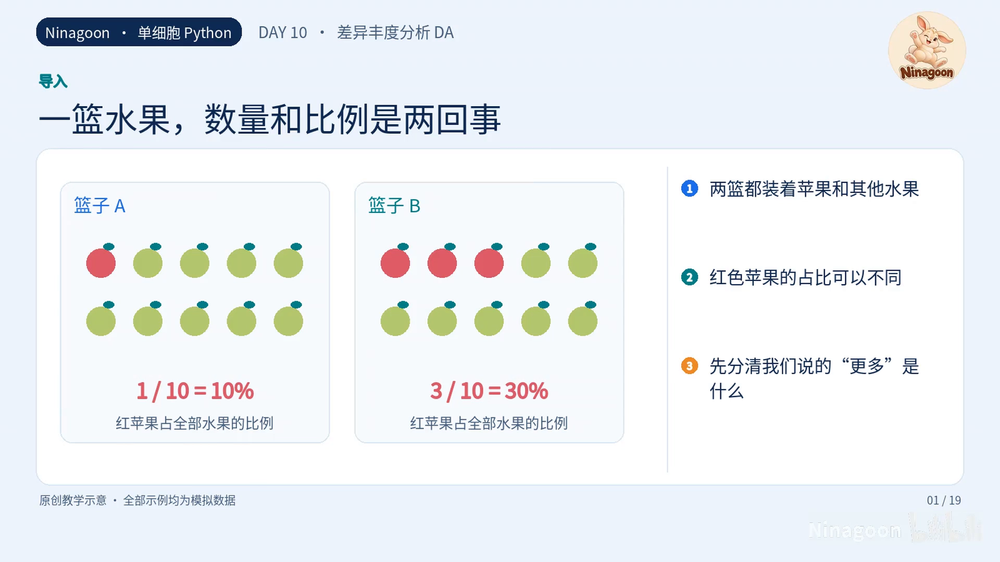

## 一、两种响应：状态变了，还是数量变了

### 1.1 差异丰度在问什么

视频给的模拟场景很干净：对照组小鼠的中性粒细胞里，**炎症相关（红色）状态占 10%**；镰状细胞病模型鼠（SCD 鼠）里，**红色占 30%**。剩下的细胞分成成熟（Mature，蓝）与未成熟（Immature，橙）两类。

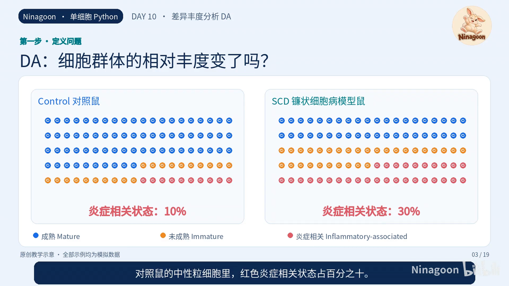

差异丰度（DA）问的就是：**这种群体或局部状态的相对丰度有没有变化** [【跳转到 01:20】](https://www.bilibili.com/video/BV1kMsF6PEn2/?t=80)。注意措辞：是「相对丰度」，不是「绝对数量」，也不是「表达水平」。

### 1.2 和差异表达并排看，区别立刻显形

把两件事并排放：左边固定同一种细胞状态，比较 S100A9 的表达（示意值 3 → 6），这是 **DE**；右边比较炎症相关群体的占比（10% → 30%），这是 **DA**。

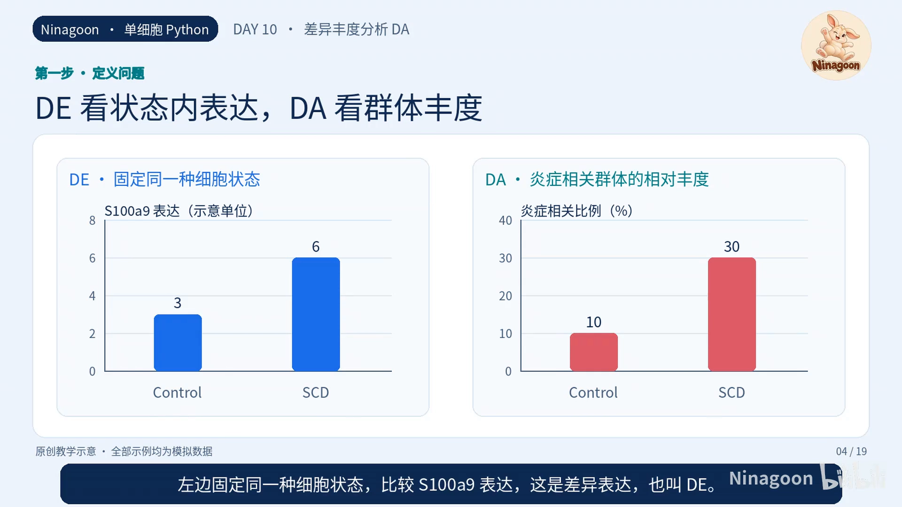

两者的差别不只是「换个指标」，而是**输入、模型和解释都不同** [【跳转到 01:50】](https://www.bilibili.com/video/BV1kMsF6PEn2/?t=110)：

| 维度 | 差异表达 DE | 差异丰度 DA |
| --- | --- | --- |
| 比较对象 | 同一状态内的基因表达量 | 群体或邻域的细胞占比 |
| 分析单位 | 样本（伪批量）或细胞（需谨慎） | 样本（小鼠/供体/孔） |
| 典型结论 | 「该状态下 S100A9 升高」 | 「炎症相关状态占比升高」 |
| 不能推出的结论 | 群体占比变化 | 状态内表达变化 |

一句话：**DE 看状态内表达，DA 看群体丰度；一个结果不能自动替另一个问题作答**。

### 1.3 为什么这两件事在图上长得像

这是本讲最实用的判读提醒。单细胞分析里，两种变化会互相「伪装」：

- **比例变化会拉动全局降维**。某一群占比大幅上升时，UMAP 的整体布局会跟着变，看起来像「所有细胞都动了」；
- **重新聚类会改变群的定义**。扰动后重新聚类，群的数量与边界都会变，于是「新出现一群」到底是新状态，还是原来稀有的群变多了，肉眼分不出；
- **连续状态被硬切成簇**（下一节展开）。中性粒细胞的成熟、激活是连续变化的，硬切簇会把一段局部变化分散到好几个簇里，最后每个簇的差异都不显著。

所以判读的第一步不是看变化，而是**先把「群的定义」固定住**：用对照组定义好的标签去标注扰动细胞，再谈变化。

## 二、分析单位是样本，不是细胞

### 2.1 12000 个细胞，只有 6 个独立重复

模拟实验的设计是：3 只对照鼠（C1–C3）+ 3 只 SCD 鼠（D1–D3），每只捕获 2000 个中性粒细胞，共 **12000 个细胞**。

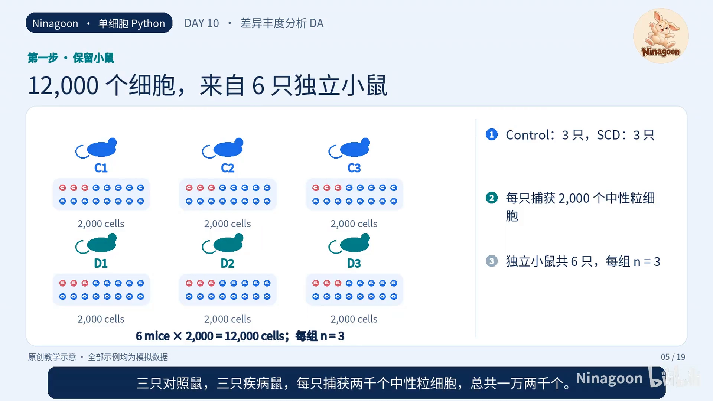

关键点：**真正的独立生物学重复是 6 只鼠，每组 n = 3** [【跳转到 02:13】](https://www.bilibili.com/video/BV1kMsF6PEn2/?t=133)。同一只鼠里的 2000 个细胞共享同一套基因型、同一段饲养环境、同一次解离处理，把它们当作独立个体，会造成**伪重复（pseudo-replication）**——p 值会小得离谱，因为统计量把「细胞数」当成了「样本数」。

### 2.2 先按小鼠统计，再算比例

正确做法是两步：先按小鼠统计每种状态的细胞数，再除以这只鼠捕获的中性粒细胞总数，得到比例 [【跳转到 02:36】](https://www.bilibili.com/video/BV1kMsF6PEn2/?t=156)。

用公式写，对第 $i$ 只鼠的第 $k$ 种状态：

$$
p_{ik} = \frac{n_{ik}}{\sum_{k'} n_{ik'}}
$$

其中 $n_{ik}$ 是第 $i$ 只鼠里第 $k$ 种状态的细胞数，分母是**这只鼠捕获到的中性粒细胞总数**（这里是 2000）。

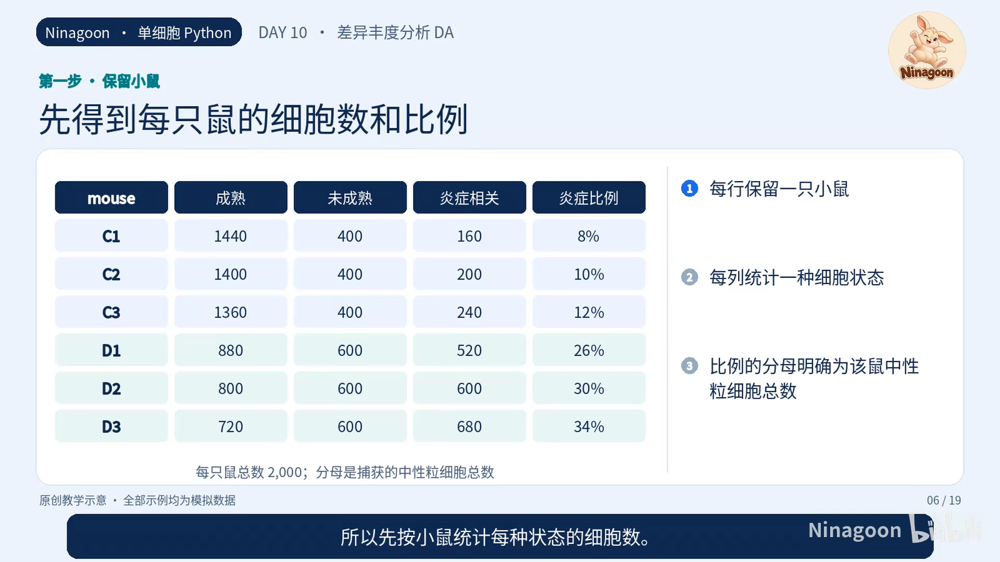

看表里的六行，炎症相关比例分别是 8%、10%、12%（对照）与 26%、30%、34%（SCD）——**鼠与鼠之间并不完全一样** [【跳转到 02:41】](https://www.bilibili.com/video/BV1kMsF6PEn2/?t=161)。这种变异必须保留在统计里；如果把全组细胞混成一个百分比（对照 10%、SCD 30%），组内变异就被抹平了，检验也就无从谈起。

### 2.3 比例的分母，还隔着一整条实验流程

两篮水果的算例把「分母」讲透了：左边 100 个红色细胞 + 900 个其他细胞，红色占 10%；右边让其他细胞逐渐减少到约 233 个，红色仍是 100 个，红色的比例就接近 30% [【跳转到 03:10】](https://www.bilibili.com/video/BV1kMsF6PEn2/?t=190)。**盯住红色：它的数量始终没有变化。** 比例上升，完全可以由「别的细胞变少」造成，不需要任何一个细胞改变状态。

真实数据还多一层：组织里的细胞要经过**解离 → 存活 → 捕获 → 测序 → 质控**才进入分析表，不同群体留下来的机会可能不同。

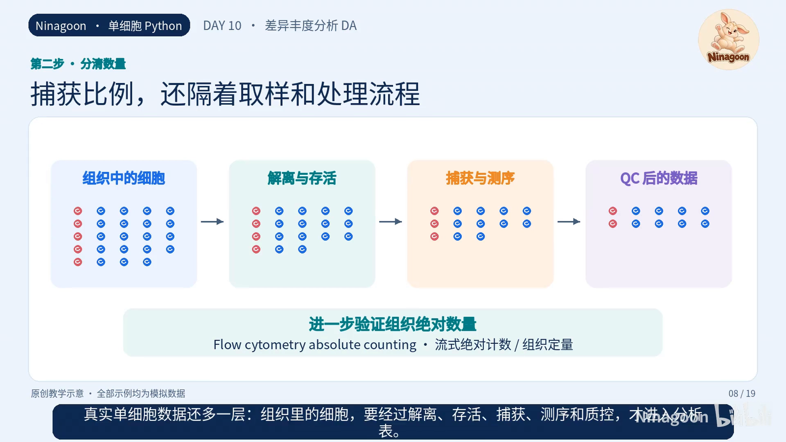

所以「捕获比例」不等于「组织比例」 [【跳转到 03:38】](https://www.bilibili.com/video/BV1kMsF6PEn2/?t=218)。如果确实想知道组织里到底有多少，可以结合流式细胞术与计数微球做绝对计数，或按组织单位进一步定量——这是独立于测序的一条证据线。
## 三、状态连成一条路时，硬切簇会丢信息

### 3.1 连续状态的问题

如果细胞状态像一条渐变色带，而不是几个清楚的小岛，硬切成簇就可能把局部变化分散到不同簇里 [【跳转到 04:06】](https://www.bilibili.com/video/BV1kMsF6PEn2/?t=246)。中性粒细胞的成熟或激活恰恰可能是这种连续性：从成熟到未成熟到炎症相关，中间没有一道清晰的墙。

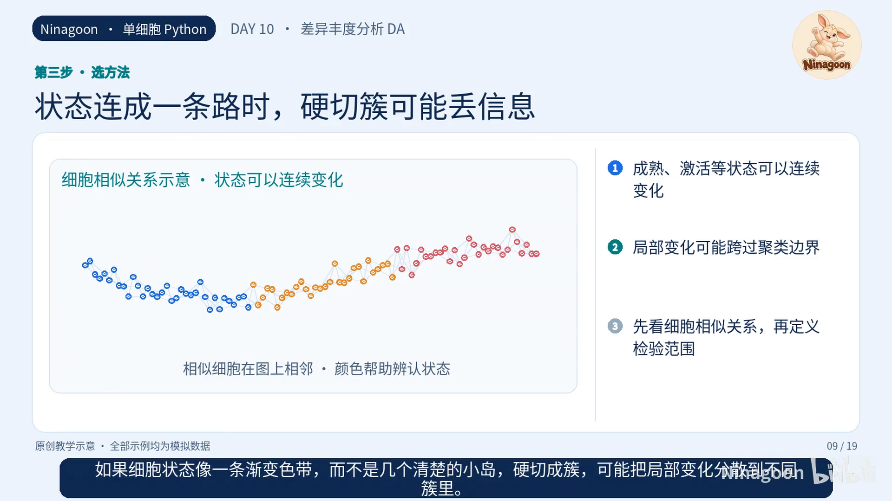

这时我们真正想问的是：**沿着相似细胞的关系，哪一段在疾病组更丰富？** 这就引出 Milo。

### 3.2 Milo：在近邻图上定义相互重叠的邻域

Milo 的思路是绕开「簇」这个概念：先在细胞的近邻图（KNN graph）上定义一组**局部、相互重叠的邻域（neighborhood）** [【跳转到 04:34】](https://www.bilibili.com/video/BV1kMsF6PEn2/?t=274)。

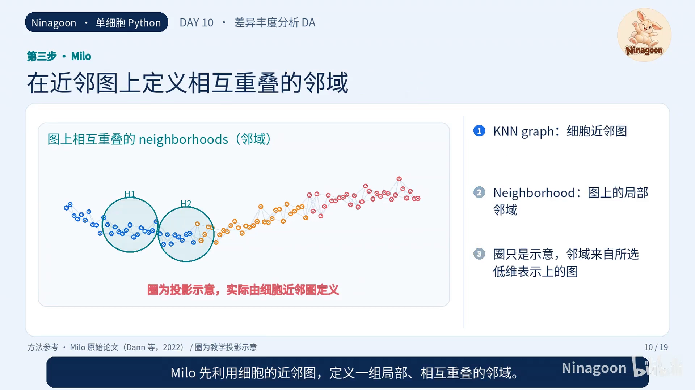

两个容易搞错的细节：

- 建图通常用**合适的主成分等低维表示**，不是直接在二维 UMAP 上画个圆、再把圆里的细胞拿来检验；
- 画面上的圈只是把邻域**投影**出来帮助理解，邻域本身由图上的连接关系定义。

定义好邻域之后，**分别数每只鼠在这个邻域里贡献了多少细胞**，得到一张「邻域 × 小鼠」的计数表 [【跳转到 05:01】](https://www.bilibili.com/video/BV1kMsF6PEn2/?t=301)。

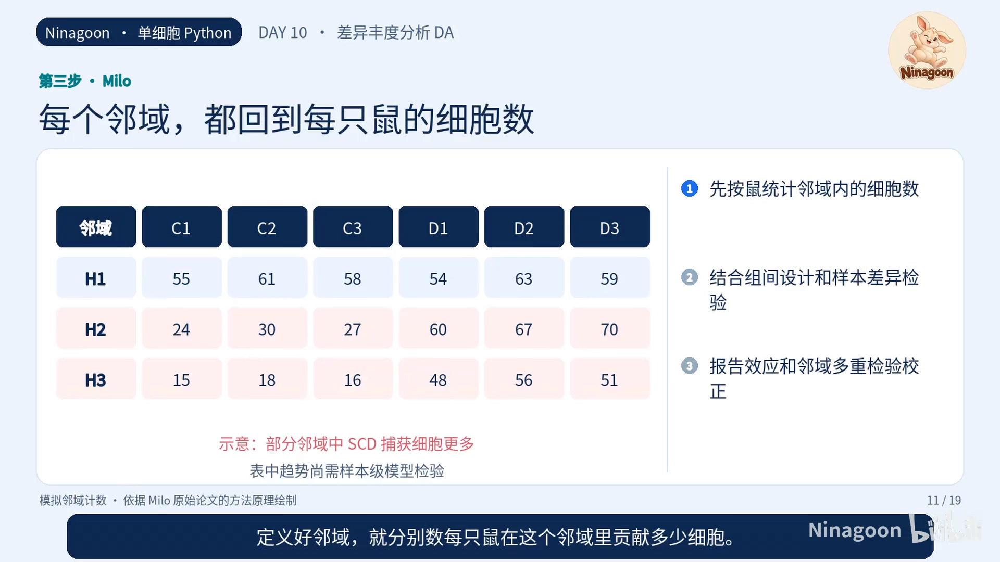

再结合条件、可估计的批次因素和样本规模做检验。因为邻域互相重叠，一个细胞会出现在多个邻域里，Milo 还要做相应的**多重检验校正**。注意整条流程的重点始终没变：**独立重复是小鼠，不是邻域里的细胞。**

## 四、组成数据：三个比例加起来永远是 100%

### 4.1 比例不是独立的数字

如果三种状态已经定义好，可以换一种思路看堆叠柱：对照组是 70 / 20 / 10，SCD 组是 40 / 30 / 30，每根柱都加到 100% [【跳转到 05:27】](https://www.bilibili.com/video/BV1kMsF6PEn2/?t=327)。

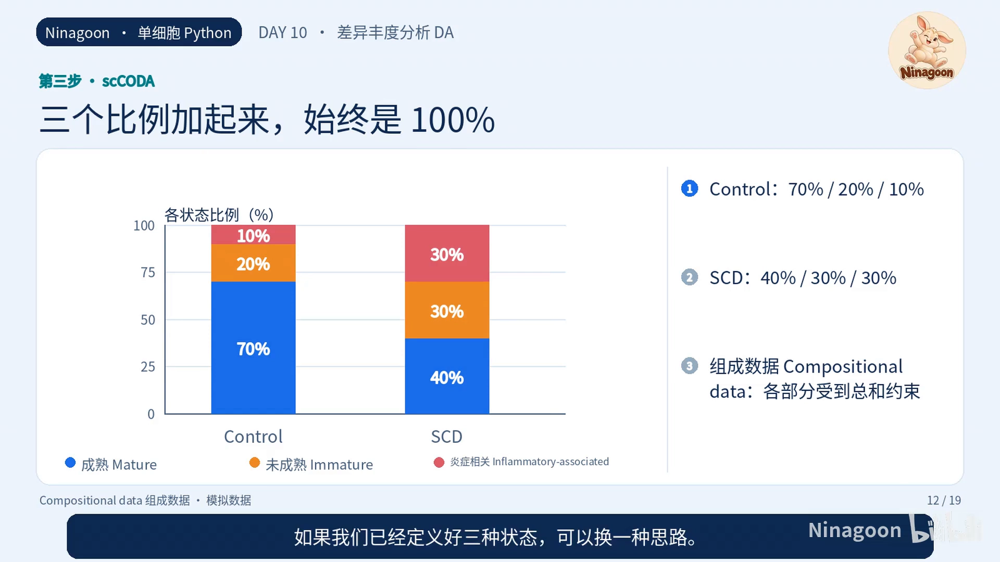

这叫**组成数据（compositional data）**。它的数学约束是：

$$
\sum_{k=1}^{K} p_{ik} = 1 \quad \text{对每一只鼠 } i
$$

这个约束带来一个直接后果：**一类的占比变大，其他类能分到的比例就受影响**。所以不能把各部分当成完全互不相关的数字，逐个做普通的两组比较——那样做，一个群变大就会连带让其他群「显著变小」，结论会互相矛盾。

### 4.2 scCODA：贝叶斯组成模型 + 参考群体

scCODA 用**贝叶斯组成模型**联合分析已定义群体的计数和实验条件 [【跳转到 05:51】](https://www.bilibili.com/video/BV1kMsF6PEn2/?t=351)。为了让「相对变化」可以解释，它需要指定或选择一个**参考群体（reference cell type）**，可以理解为找一个比较的基准。

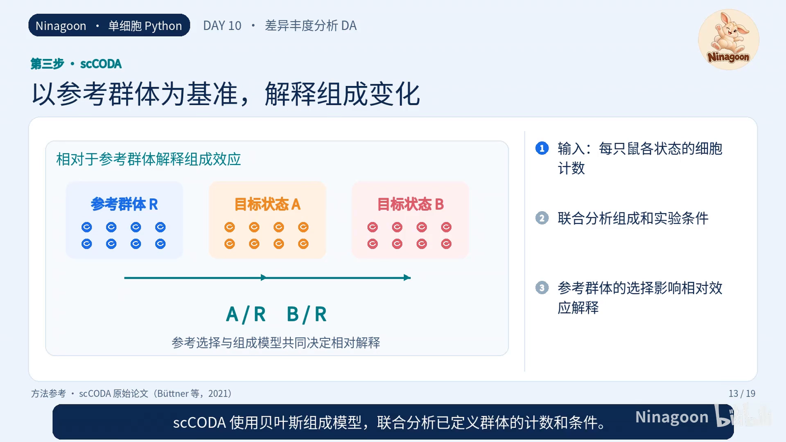

但这里有个常被忽略的前提：**不能随便认定参考群体在组织里绝对不变** [【跳转到 05:56】](https://www.bilibili.com/video/BV1kMsF6PEn2/?t=356)。参考群体的选择要有依据，并且要检查「换一个参考」或「换一套注释」之后结论是否稳定。如果结论随参考漂移，那它就不该被写成生物学发现。

## 五、两种方法怎么选

把 Milo 和 scCODA 并排放，差别在**分析单位**：

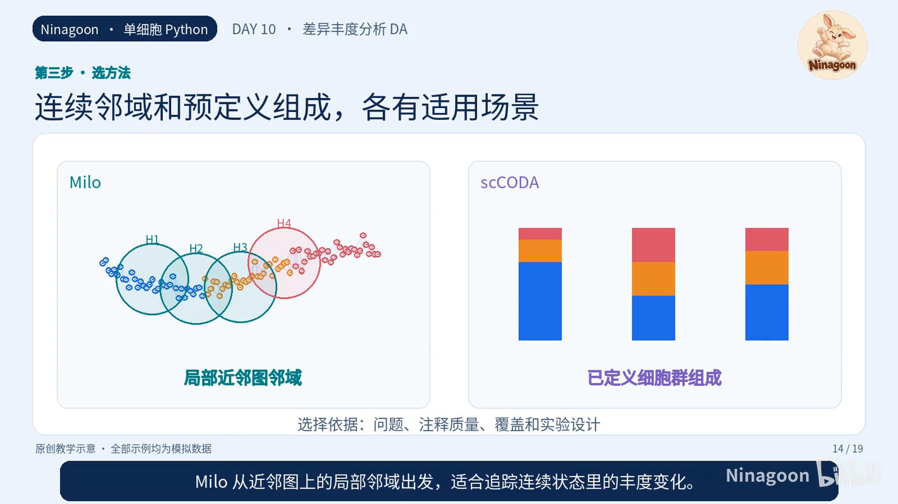

| 方法 | 出发的分析单位 | 适合的问题 | 主要代价 |
| --- | --- | --- | --- |
| Milo | 近邻图上的局部邻域 | 连续状态里的丰度变化；注释不细也能用 | 邻域重叠需多重检验校正 |
| scCODA | 已定义细胞群的组成 | 群体层面的相对变化，需要可解释的效应 | 依赖注释质量与参考群体选择 |

选择依据是**问题、注释质量、细胞覆盖和实验设计** [【跳转到 06:24】](https://www.bilibili.com/video/BV1kMsF6PEn2/?t=384)。两者也可以用互补结果互相检查解释：如果 Milo 发现某段邻域富集，而 scCODA 在对应的已注释群体上也给出同方向的效应，结论就稳得多。

## 六、回到 S100A9：整体表达升高的三种来源

### 6.1 一个数字，三种解释

假设疾病组的整体 S100A9 表达更高。这个「整体更高」可以来自三条完全不同的路径 [【跳转到 06:51】](https://www.bilibili.com/video/BV1kMsF6PEn2/?t=411)：

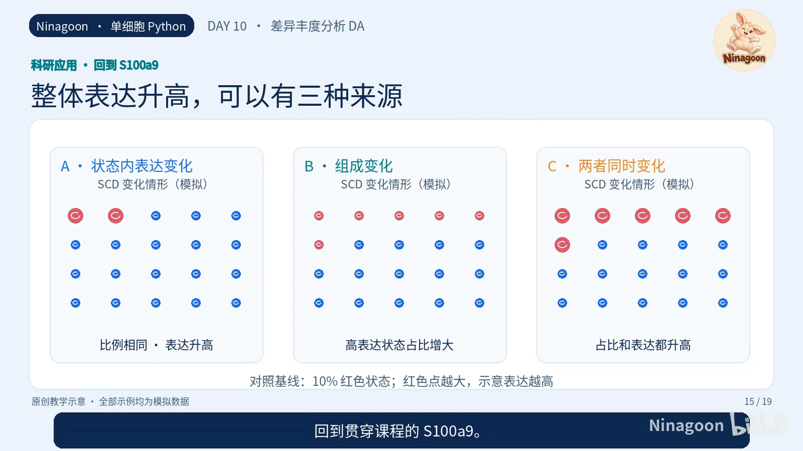

- **A 状态内表达变化**：各状态占比不变，但同一状态里的 S100A9 升高——这是纯 DE；
- **B 组成变化**：状态内表达不变，但本来就高表达的那个状态占比增大——这是纯 DA；
- **C 两者同时变化**：占比和表达都升高——这时必须分别报告，不能合并成一句「扰动改变了细胞组成与状态」。

视频特别提醒：S100A9 只是例子，**判断状态身份要结合一组标记**，不能靠单个基因下结论。

### 6.2 两条证据一起读

要区分上面三种解释，就要把两条分析接起来 [【跳转到 07:20】](https://www.bilibili.com/video/BV1kMsF6PEn2/?t=440)：

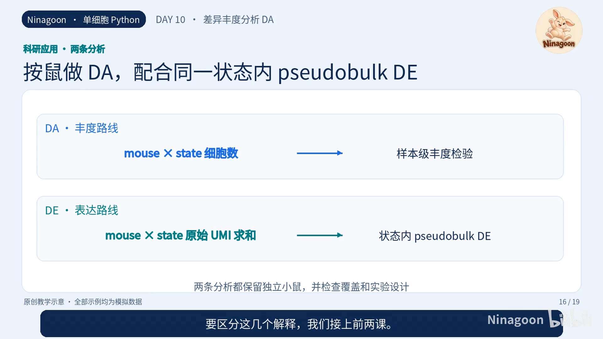

1. **丰度路线（DA）**：先按鼠比较状态或邻域的丰度，得到「鼠 × 状态」的计数表，做样本级丰度检验；
2. **表达路线（DE）**：固定两组都覆盖得足够的**共同状态**，把每只鼠的原始 UMI 逐基因加总（伪批量，pseudobulk），做状态内差异表达。

伪批量这一步可以写成：

$$
X_{g,i,k} = \sum_{c \in \text{state } k,\ \text{mouse } i} u_{g,c}
$$

其中 $u_{g,c}$ 是细胞 $c$ 中基因 $g$ 的原始 UMI 计数。求和之后，每个「鼠 × 状态」组合只贡献一个观测，伪重复问题自然消失。

两条证据一起读，才能讨论整体变化的来源；**具体机制和因果关系仍要实验验证**——统计上区分了 A、B、C，只是把「该往哪个方向做实验」这个问题问对了。

## 七、把流程接起来

### 7.1 五条判断，带走

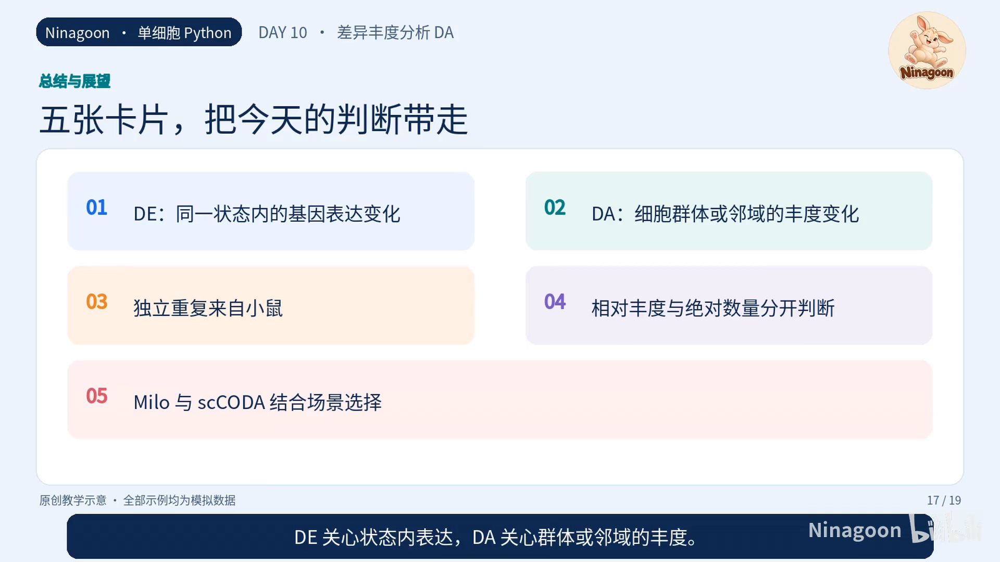

1. 关心**状态内表达**，还是关心**群体或邻域的丰度**——这是两个问题；
2. **独立重复来自小鼠**（样本），不是细胞；
3. **相对比例不能直接推出组织绝对数量**；
4. **Milo 和 scCODA 从不同的分析单位出发**，按场景选；
5. 每一次说「更多」，都先说清楚**比较的单位和分母** [【跳转到 07:44】](https://www.bilibili.com/video/BV1kMsF6PEn2/?t=464)。

### 7.2 完整流程

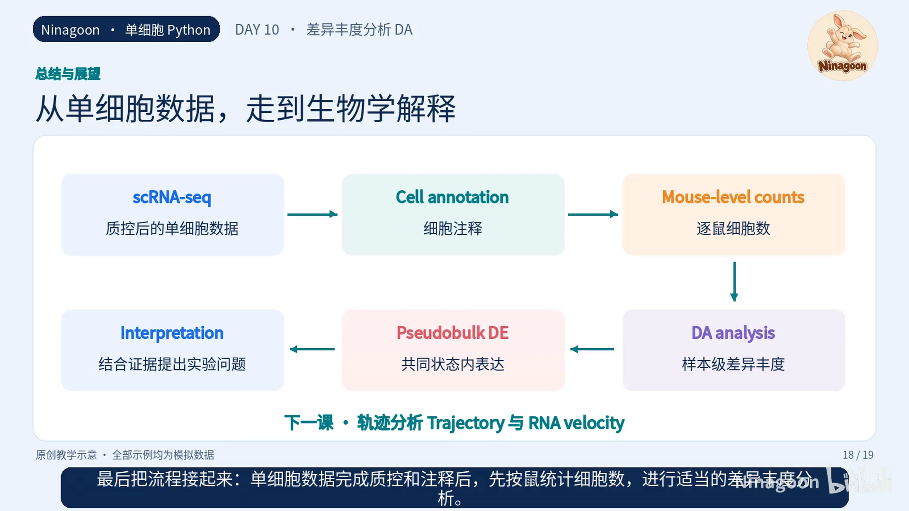

单细胞数据完成质控和注释后，先按鼠统计细胞数、做适当的差异丰度分析，再结合共同状态内的伪批量表达，分析组织证据并提出实验问题 [【跳转到 08:18】](https://www.bilibili.com/video/BV1kMsF6PEn2/?t=498)。视频的下一课把细胞放到连续变化的路径上，讲轨迹分析与 RNA 速度。

### 7.3 留给自己的问题

视频最后留了一道思考题：SCD 里炎症相关中性粒细胞从 10% 增加到 30%，**是否说明组织内的绝对细胞数量增加了三倍？为什么？** [【跳转到 08:45】](https://www.bilibili.com/video/BV1kMsF6PEn2/?t=525)

把今天的三块内容连起来就能回答：比例的分母是**捕获到的中性粒细胞总数**，而捕获数又受解离、存活、上样量影响；炎症相关比例上升可能来自其他状态减少，也可能来自该状态真的扩增。要谈「绝对数量」，得靠流式绝对计数这类独立定量，而不是测序比例。

## 小结

- 扰动在群体层面有两种读出：**状态变化（state shift）** 与 **比例变化（composition shift / DA）**；前者问「同一群细胞有没有换状态」，后者问「各状态的相对占比有没有变」，两者不能互相替代。
- 比例变化可以完全由**分母变化**造成：红色细胞始终是 100 个，只要其他细胞从 900 减到 233，比例就从 10% 升到约 30%。
- **最小分析单位是样本（小鼠/供体/孔），不是细胞**；把 12000 个细胞当 12000 个重复会造成伪重复。
- 细胞比例是**组成数据**，满足 $\sum_k p_{ik} = 1$，不能逐群做独立的普通检验；scCODA 用贝叶斯组成模型 + 参考群体处理这一约束，但参考群体的选择必须交代依据并做敏感性检查。
- 状态连续时，**硬切簇会把局部变化分散掉**；Milo 改在近邻图上定义相互重叠的邻域，统计每个邻域里各样本贡献的细胞数。
- 整体表达升高有**三种来源**（状态内表达、组成、两者同时），要靠「按鼠的 DA + 共同状态的伪批量 DE」两条证据一起读，才能拆开。
- 一句话收束：**先问「是细胞变了，还是细胞的数量变了」，再问「为什么」。**

## 关键术语速查

| 术语 | 一句话解释 |
| --- | --- |
| 差异表达 DE | 固定同一种细胞状态，比较扰动组与对照组的基因表达量 |
| 差异丰度 DA | 比较细胞群体或局部状态的相对占比是否变化 |
| 状态变化 state shift | 同一群细胞在扰动后进入另一个表达状态，表现为整体平移或沿轨迹移动 |
| 比例变化 composition shift | 各细胞类型/状态的相对数量占比改变，群内状态可能完全没变 |
| 伪重复 pseudo-replication | 把同一样本内的多个细胞当作独立观测，导致 p 值虚低 |
| 组成数据 compositional data | 各部分比例之和恒为 1 的数据，各部分之间不独立 |
| 参考群体 reference cell type | scCODA 中作为比较基准的细胞群，其选择会影响相对效应的解释 |
| 邻域 neighborhood | Milo 在细胞近邻图上定义的局部、相互重叠的细胞集合 |
| 伪批量 pseudobulk | 把同一样本同一状态内的细胞原始计数逐基因加总，得到样本级表达 |
| 绝对计数 absolute counting | 用流式细胞术与计数微球等手段直接测定细胞数量，独立于测序比例 |
