# 扰动效应的异质性：同一个敲除，为什么只有一部分细胞有反应

> 视频来源：[科研讲座 In vivo Perturb-seq: scaled investigation of gene functions in the brain](https://www.bilibili.com/video/BV1iX4y1B7sP/)（Bilibili · 讲者 Xin Jin，主持 Sarah Marzi / Alexi Nott）｜时长约 40 分钟
> 简要导读：这是一场关于「体内 Perturb-seq」的研究讲座，讲者用自闭症风险基因的体内筛选，说明同一批扰动在不同细胞类型、不同亚型里打出的结果完全不同。本文按「异质性从哪来 → 怎么看见 → 为什么不能平均 → 怎么处理」重排了讲者的内容，并保留讲者的原始数据与幻灯片；字幕为 B 站 AI 轨（机器翻译），文中已按上下文订正 MECP2、SYNGAP1、CHD8、慢病毒载体、FACS 等术语，拿不准的人名一律略去。

## 本讲要解决的核心问题（SCQA）

**背景**：过去二十年，自闭症谱系障碍（ASD）的遗传学研究积累出一份可重复的风险基因清单——讲者提到，大约十年前还不到十个基因，最近的分析里已经有 71 个高置信的风险基因。经典做法是一个基因一个基因地做敲除小鼠，用电生理、分子生物学、行为学去刻画表型。

**冲突**：当风险基因从 10 个变成 71 个，「一个基因一个模型」的做法立刻撞墙；更麻烦的是，同一个基因敲掉以后，在不同细胞里看到的结果并不一致——有的细胞类型反应强烈，有的几乎没反应，有的只在一个很小的亚型里有反应。

**疑问**：这些风险基因是各自独立地起作用，还是收敛到相同的细胞类型与分子通路上？如果同一个扰动在不同细胞里效果不同，我们该用什么粒度去测量、又该怎么避免把真实效应平均掉？

**回答（中心思想）**：**同一个扰动在单细胞层面本来就是异质的**——它可能只在一部分细胞类型、甚至只在一个亚型里生效；要看见这种异质性，必须做到「单细胞分辨率 + 足够稳健的读出（基因模块）+ 每批都有的负对照」，而把细胞混成 bulk 或只报告一个平均效应量，恰恰会把这种异质性抹平。

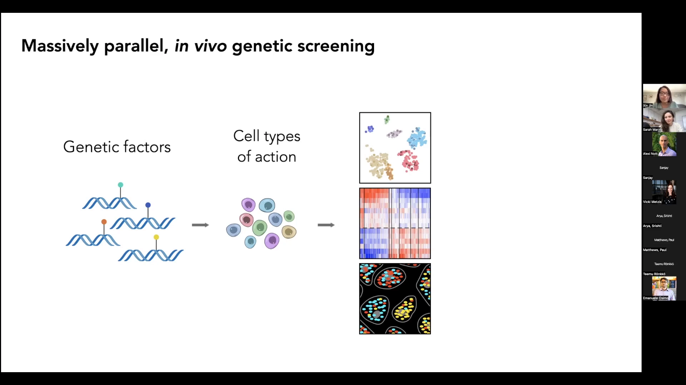

## 一、从「一个基因一个表型」到「一个 panel 一张图谱」

讲者先用两个基因说明问题的来历。MECP2 的破坏会导致 Rett 综合征——一种自闭症亚型，它编码的是转录调控因子，影响基因转录和 RNA 如何产生；而 SYNGAP1 编码的是突触上调节受体转运的蛋白，影响的是神经元之间的传递。同一个疾病、两条完全不同的分子路径。

于是问题变成：**这 71 个风险基因，是 71 个独立的问题，还是收敛成少数几种机制？** 讲者把问题拆成三层：

1. 这些风险基因影响的是**相似的细胞类型，还是相同的细胞类型**；
2. 在细胞类型内部，它们是否**收敛到相似的分子通路**；
3. 有没有**特定的亚型或细胞状态**，比其他细胞更容易受这个基因改变的影响。

第三层就是本小节的主题：**同一个扰动，在不同细胞里的响应强度不一样**。讲者特别强调，大脑以细胞异质性著称，与其他组织相比，这给实验设计又加了一层复杂性。

[【跳转到 05:00】](https://www.bilibili.com/video/BV1iX4y1B7sP/?t=300)

他们选择聚焦的变异类型是**新生的功能缺失变异**（de novo loss-of-function）：这类变异通常外显率高、效应量大，与常见的多基因变异不同，因此是理解复杂疾病生物学的早期切入点。

## 二、把扰动做进发育中的大脑：体内 Perturb-seq 的构造

因为神经发育障碍的本质在发育期，成年期再做干扰对理解其起源帮助有限，讲者把扰动做在**子宫内的发育中大脑**里：

- **载体**：慢病毒载体，一个引导 RNA 瞄准目标基因，后面跟荧光蛋白和条形码（barcode）；Cas9 蛋白由转基因小鼠提供；
- **为什么用慢病毒而不是 AAV**：发育中的细胞分裂很快，像 AAV 这样的附加体（episomal）载体不能可靠地标记谱系，慢病毒会整合进基因组，后代细胞都能继承标记；
- **时间线**：胚胎第 12.5 天注射到侧脑室，之后几天到两周内扰动在体内发生，产后第七天（P7）收获；
- **读出**：FACS 分选富集带荧光的扰动细胞，做单细胞 RNA 测序。

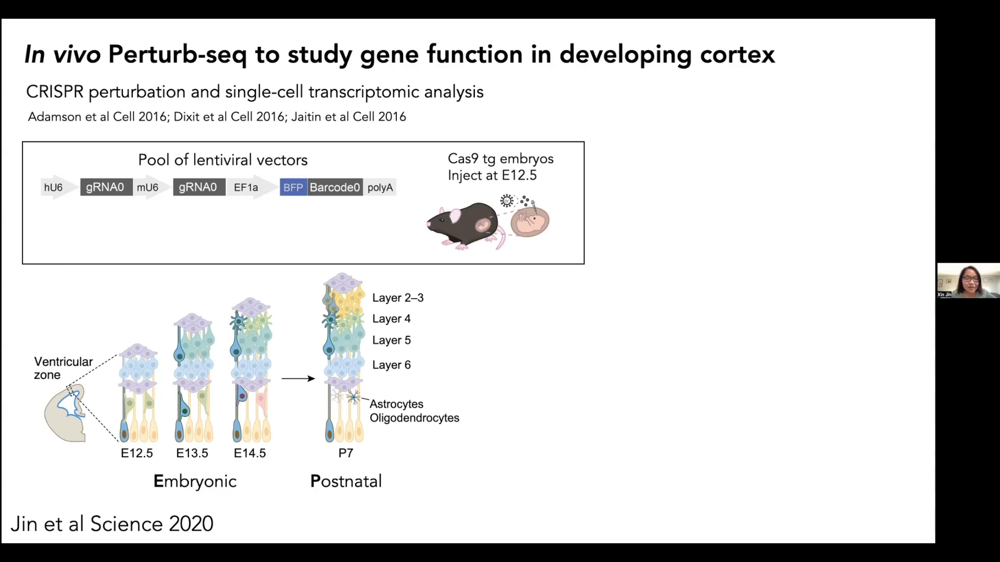

关键设计是**多路复用（multiplexing）**：不是一次注射一个载体、一次一个扰动，而是注射一个慢病毒载体池，扰动的身份由转录本上可检测的条形码解码，只在分析阶段才把细胞归到各自的扰动上。讲者提到，他们分析了 35 个扰动（对照为控制载体），收集了超过 40,000 个细胞，来自 17 个独立实验批次，每一批都包含全部扰动和对照。

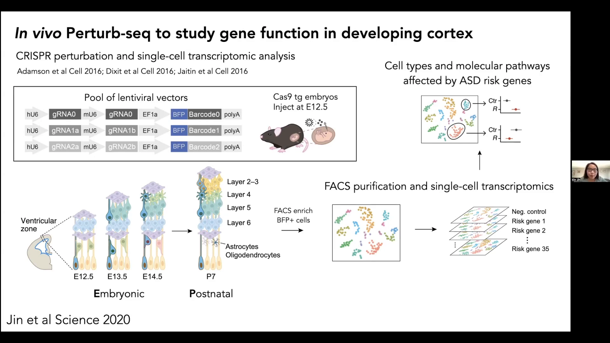

这里有一个容易被忽略、但对本小节至关重要的点：**每批实验都带一个内部负对照**（瞄准 GFP/Rosa26 基因座的引导 RNA）。讲者的原话是，这让研究者可以「建立一个回归，去对抗所有可能的混杂因素」——不同的分选批次、发育时机、批次之间的细微差异。换句话说，**异质性分析的第一步不是找生物学差异，而是先给技术差异留一个可估计的基准**。

[【跳转到 13:42】](https://www.bilibili.com/video/BV1iX4y1B7sP/?t=822)

## 三、扰动本身就是不均匀的：三条「效应分布里出现近零峰」的原因

在讨论「细胞之间为什么不一样」之前，讲者先讲清了**扰动本身就不均匀**这件事——这正是异质性最容易被忽略的第一层来源。

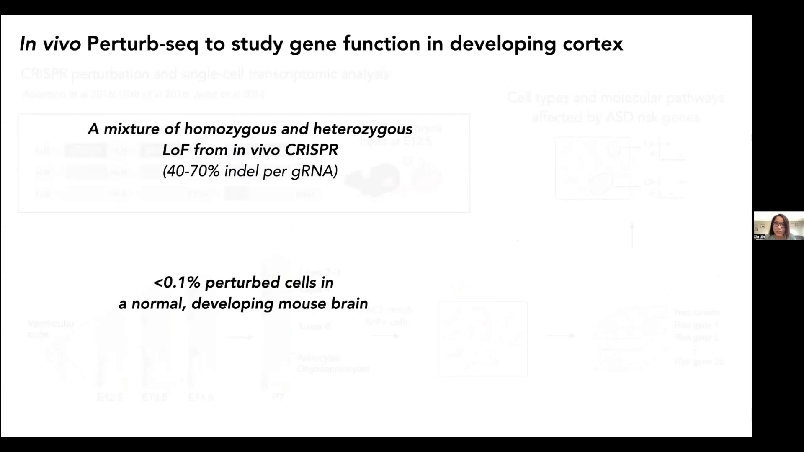

这张图上有两个数字值得记住：

- **「40–70% indel per gRNA」+「纯合与杂合 LoF 的混合物」**：同一个 gRNA 在不同细胞里切出来的结果并不一样，有的细胞两个等位都坏了（纯合），有的只坏一个（杂合）。讲者说得很直接——对于特定的合子型（zygosity），等位基因特异的 CRISPR 很难控制。**同一个「扰动标签」下面，其实混着效应强度不同的细胞**。
- **「<0.1% perturbed cells」**：被扰动的细胞散落在正常发育的大脑中，是「野生型细胞海洋」里的极少数。

由此引出三条属于「扰动没生效 / 生效程度不同」的机制：

1. **合子型混合**：纯合与杂合混在一起，效应量天然是分布的，不是一个数；
2. **瞬时扰动**：扰动只发生在神经祖细胞里，载体与扰动的半衰期相当短，讲者把它称为「短暂的感染和炎症」；如果某些细胞后代没有持续受到扰动，它们的表型就会趋近于零；
3. **细胞自主 vs 非细胞自主**：因为突变细胞坐在野生型细胞中间，讲者强调他们关注的主要是**细胞自主的转录效应**，但邻近细胞的影响、注射本身引起的炎症反应都可能掺进来——有听众就问「注射本身是否会导致炎症、影响大脑发育」，讲者的回答是「我想确实如此，就像所有操纵都会改变细胞特性一样，某些方面微妙、某些方面明显」，所以**必须和内部负对照比较**。

[【跳转到 19:07】](https://www.bilibili.com/video/BV1iX4y1B7sP/?t=1147)

### 3.1 为什么故意把转导率控制在「中等」

听众问的第一个技术问题是转导效率，讲者的回答里藏着一条与异质性直接相关的设计取舍：他们**故意把转导率控制在中等水平，而不是越高越好**。理由是如果转导率很高，被扰动的细胞就会挨在一起，成为邻近细胞、突触前或突触后的伙伴，这些细胞会因为「与扰动细胞相邻」而呈现某些转录变化。所以他们希望标记是**稀疏的**——这样读到的差异更可能来自细胞自身的扰动，而不是邻居的影响。

这条取舍说明：**异质性分析里的「细胞自主」是一个需要设计去保护的前提**。如果扰动细胞密集相邻，你看到的「同一扰动的不同响应」里就混进了位置效应；反过来，密度本身也可以作为协变量来检验。讲者也提到，转导率可以通过病毒载体浓度调节，AAV 与慢病毒都兼容，不同载体带来的炎症反应强弱也不同（他认为 AAV 在免疫炎症方面可能稍微良性一些），这是未来可以比较的方向。

[【跳转到 14:32】](https://www.bilibili.com/video/BV1iX4y1B7sP/?t=872)

还有两个时间窗上的限制，讲者自己点明了：扰动的只是**从胚胎第 12 天开始发育**的大脑，不是传统的种系敲除（那会从更早的时候就剥夺基因功能）；分析也只覆盖**产后第七天**这一个早期时间点。这两点意味着：一部分「看起来没反应」的细胞，可能只是**响应还没发生**或**响应已经过去**——这是时间维度上的异质性。

## 四、读出精度决定你能看见哪一层异质性

讲者展示注射后 12 小时就能看到荧光表达，并解释了为什么载体要「快」：发育过程中如果你错过了几个小时，就错过了整个关键窗口。侧脑室早期注射会靶向不同脑区里产生神经元和胶质细胞的不同神经祖细胞——皮层、海马、丘脑等等。

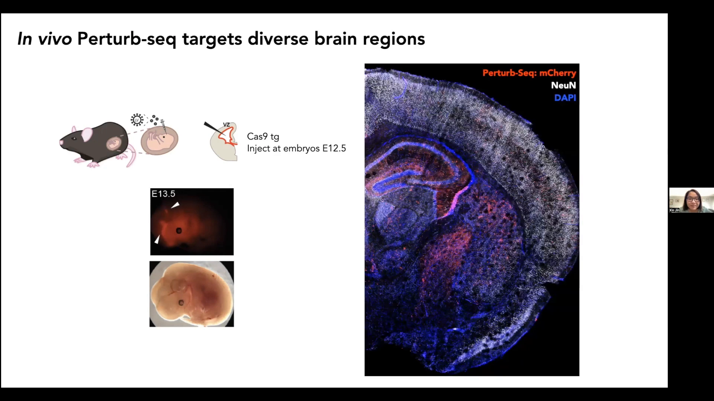

聚焦到 P7 皮层后，单细胞测序给出五种主要细胞类型：星形胶质细胞、兴奋性神经元、抑制性神经元、小胶质细胞、少突胶质细胞，每一类都能用经典标记基因可靠地注释。

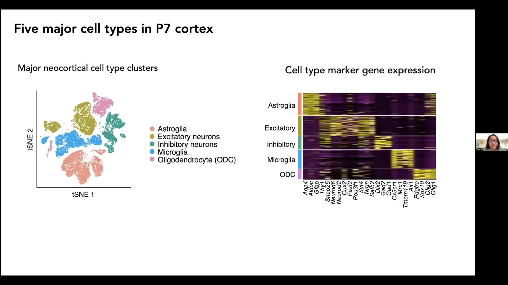

但讲者强调的重点不是这五类，而是**再往下分一层**：兴奋性投射神经元还可以按皮层中的层位置分成亚型。

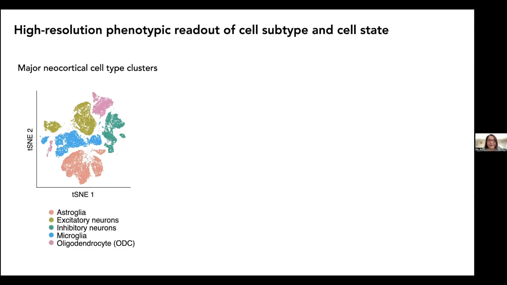

这就是本小节最关键的一句话，讲者的原话大意是：**即使这五个基本细胞类型中只有一个有扰动效应，甚至只是众多亚型中的一个亚型有扰动效应，它仍然会被读出和分析，不会被掩盖——就像在 bulk 测序或任何批量分析中那样。**

换句话说：

- 在 bulk 里，一个只影响 5% 细胞的强效应，会被 95% 无反应细胞稀释成一个「弱效应」，甚至变成「没效应」；
- 在单细胞里，这 5% 的细胞仍然是一个独立的、可检验的群体。

**「平均会稀释效应」不是一句理论警告，而是测序粒度决定的可见性上限。**

[【跳转到 20:50】](https://www.bilibili.com/video/BV1iX4y1B7sP/?t=1250)

## 五、多少细胞才够：为什么用基因模块而不是单基因

既然要按细胞类型、亚型分层看效应，每个扰动在每个亚群里的细胞数就会很少。讲者在这里给了一个非常实用的下采样（downsampling）分析，回答「多少细胞才够」。

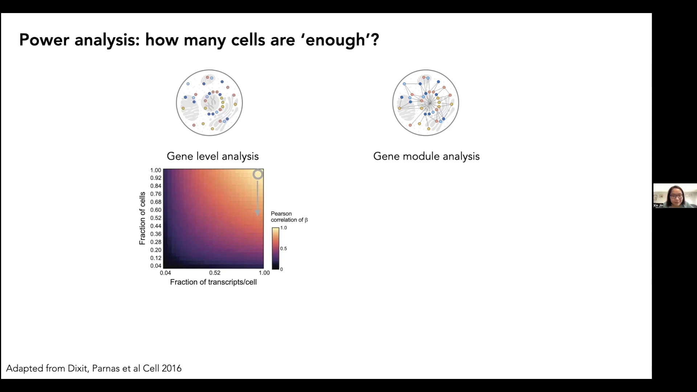

- **基因水平分析（如 DE，把两万个基因当变量）**：横轴是每个细胞的转录本比例（相当于测序深度），纵轴是保留的细胞比例，颜色是效应量 β 的 Pearson 相关性。从右上角往下走，相关性掉得很快——**分析对细胞数和测序深度非常敏感**。
- **基因模块分析**：把一组共变基因的得分当作表型读数，下采样到约 20% 的细胞，表型仍然稳健一致；讲者给出的经验值是**每个扰动、每个主要细胞类型取约 50 个细胞、测几千个转录本**。

为什么模块更稳健？讲者的理由是生物学上的：**扰动不会只改变一两个基因，它改变的是一个网络**。所以把「一两个基因的变化」当读数，等于用最 noisy 的那一维去代表整个响应；把「一个模块的得分」当读数，相当于对网络里几十上百个基因做了一次平均，噪声互相抵消。

这也直接对应本小节的核心问题：**当你用单基因 DE 去看一个只有几十个细胞的亚群时，你看到的「异质性」里有很大一部分其实是抽样噪声；换成模块得分，才更可能看到真实的响应强度差异。**

[【跳转到 24:35】](https://www.bilibili.com/video/BV1iX4y1B7sP/?t=1475)

## 六、模块：把「一个细胞的响应」变成可比较的量

讲者的做法分两步。第一步，**不看扰动身份**，只从表达数据里找共变基因网络（用 WGCNA，以及结构主题模型 structural topic modeling 作为交叉验证，两者给出非常相似的模块集）；第二步，把每个扰动细胞按扰动身份分组，用线性回归估计**每个扰动在每个模块上的效应量**，与对照相比。

最终他们在所有主要细胞类型中一共提取了 **14 个基因模块**。讲者强调这些模块分两类：

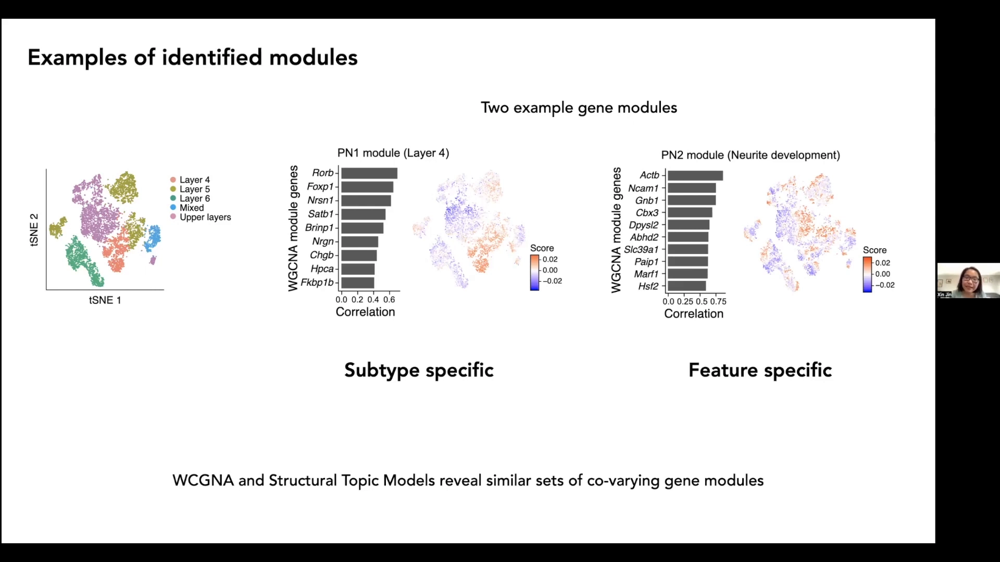

- **亚型特异的模块**：例如 PN1 模块（Rorb、Foxp1、Nrsn1、Satb1 等），它的表达在第 4 层投射神经元群体中高度富集，模块里排名靠前的基因基本就是这一层投射神经元的关键标志与决定因子；
- **特征/过程特异的模块**：例如 PN2 模块，在所有类型的投射神经元里都有表达，研究模块里的基因发现它对应的是**神经突起发育**，是所有投射神经元的共同特征，与层位置、亚型无关。

这个区分对异质性分析很重要：**「模块」本身就是一把尺子**。亚型特异的模块量的是「这个亚型有没有被扰动」，特征特异的模块量的是「这个生物过程有没有被扰动」——同一个扰动可能只动前者，也可能两个都动。

[【跳转到 28:02】](https://www.bilibili.com/video/BV1iX4y1B7sP/?t=1682)

## 七、扰动 × 模块 × 细胞类型：异质性被摊开成一张矩阵

把 9 个风险基因的扰动（列）、14 个模块（行）、4 种细胞类型（行的颜色分组）放在一起，就得到下面这张点图。点的颜色是效应量，点的大小是显著性（Padjusted < 0.05 的用黑圈标出）。

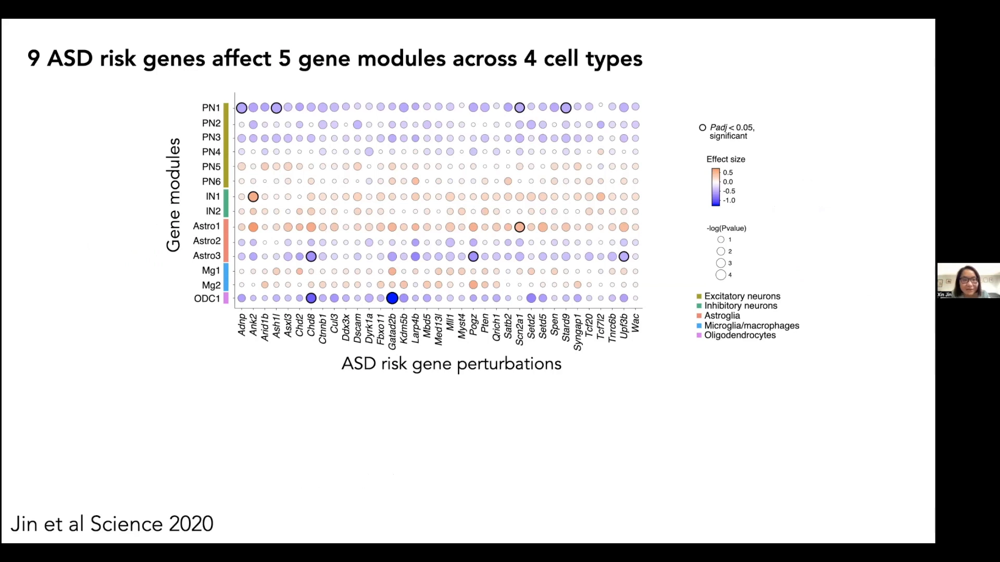

这张图就是本小节主题的直观答案，讲者从中读出三种模式：

1. **只影响一种细胞类型**：ADNP 的扰动特别地只影响投射神经元（PN1 模块一列显著，其他行基本空白）；
2. **影响多个模块、多种细胞类型**：另一些扰动同时击中多个模块和多种细胞类型，包括胶质细胞；
3. **只在一个亚型里可见**：讲者特别提到，有些效应只有在一个亚型里才看得到——如果只按「五种主要细胞类型」聚合，这个效应就会被平均掉。

[【跳转到 29:17】](https://www.bilibili.com/video/BV1iX4y1B7sP/?t=1757)

讲者坦言自己作为神经科学家，原本只期待在神经元里看到效应，结果「令我惊讶的是，不仅有神经元，其中几个扰动对胶质细胞也有影响」。他还补了一句很有分量的话：这有助于思考如何更好地建模和分析这些风险变异，**尤其是体外——体外细胞的异质性可能稍微有限**。言下之意：体外模型里看不到某些效应，不一定是效应不存在，而可能是那类细胞根本不在培养皿里。

具体到几个例子：

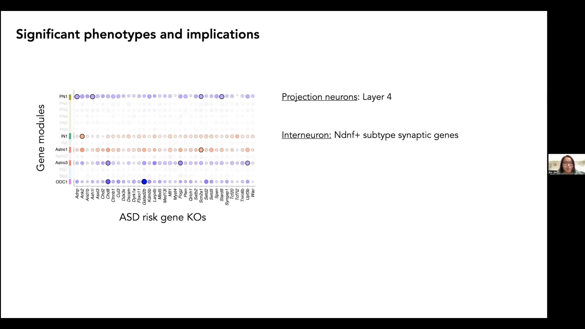

- **第 4 层投射神经元特别脆弱**：总共有四种细胞类型受到显著影响（投射神经元、星形胶质细胞等）。讲者指出第 4 层恰好是丘脑感觉输入接入皮层的那一层，因此这里观察到的基因表达变化可能与自闭症患者的感觉超敏及其机制有关。
- **MeCP2 在中间神经元里的新作用**：在表达 Ndnf 的一种亚型中间神经元里，MeCP2 的扰动改变了突触模块的表达（字幕 AI 轨此处把 MeCP2 拼成「n2」，按上下文订正）（模块里包含钾通道、GABA 受体等突触基因）。讲者说，以前我们知道 MeCP2 在调节兴奋性神经元的连接性方面有作用，**但这里确定了它在中间神经元中的一个新作用**，虽然分子途径相似。——同一个基因，在不同细胞类型里既可能「有已知作用」，也可能「有全新作用」，这正是异质性的价值。
- **星形胶质细胞的两个稳态模块**：几个扰动都干扰到了它们，说明非神经元细胞不是背景。

[【跳转到 32:37】](https://www.bilibili.com/video/BV1iX4y1B7sP/?t=1957)

## 八、验证：把单细胞里的效应量带回组织

讲者用 CHD8 走完了「筛选 → 验证」的完整链条，这一段特别能说明**为什么要区分「细胞状态」这一层异质性**。

CHD8 是染色质修饰因子，可以招募组蛋白修饰来调控发育中的信号。在扰动数据里，CHD8 的扰动显著降低了一个**在祖细胞中高表达**的模块（ODC1）。

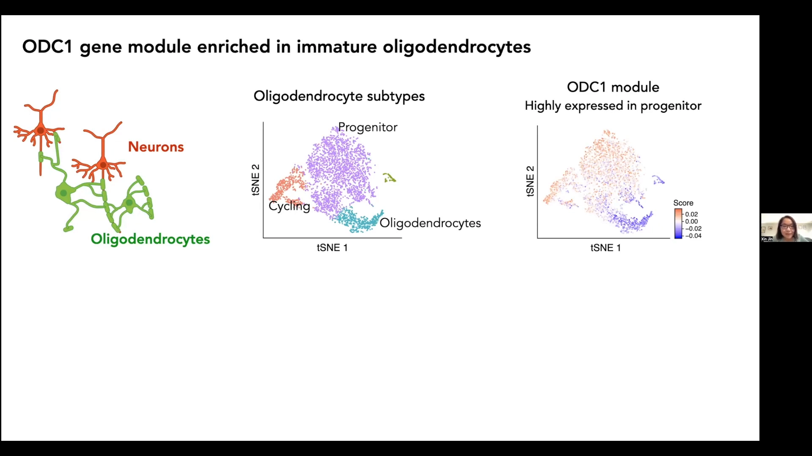

注意这里的逻辑：P7 的少突胶质细胞群体里，大多数其实是**祖细胞和增殖中的细胞**，只有一个小尾巴是成熟的和新形成的少突胶质细胞。所以「CHD8 敲了以后少突胶质谱系变了」这句话，精确的说法是「**CHD8 敲了以后，处于祖细胞/不成熟状态的细胞比例或状态表达变了**」——**效应落在哪个细胞状态上，比效应落在哪个细胞类型上更细一层**。

他们还用 ChIP-seq 文献做了交叉验证：已有研究确定了 CHD8 的直接结合伙伴，并发现它们与一个对祖细胞分化至关重要的靶点相互作用，这让讲者对自家数据更有信心，于是继续用 CHD8 杂合功能缺失小鼠做验证。

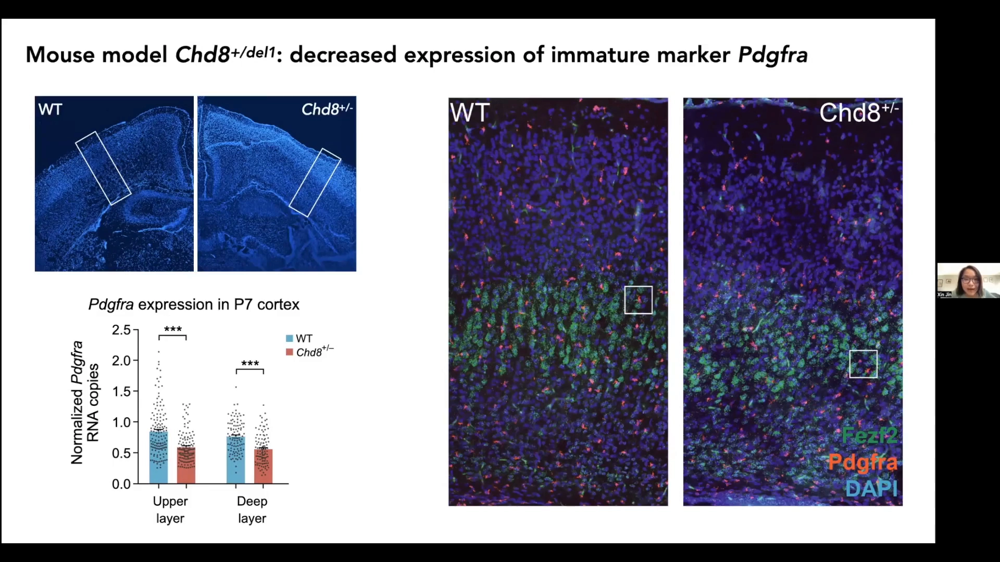

用 RNAscope 量化两个经典标记（其中 Pdgfra 是不成熟标记，正是从模块分析里定出来的），在上层和深层皮层中，CHD8 杂合动物里这个祖细胞标记的表达**大约下降了 30%**——讲者强调，**这与他们在扰动数据集中观察到的效应量相近**。

这一步的意义在于：单细胞筛选给出的效应量不是纸面数字，它在另一种实验体系（种系杂合突变小鼠）、另一种读出方式（原位杂交）里能被复现，而且**效应量大小对得上**。

[【跳转到 34:42】](https://www.bilibili.com/video/BV1iX4y1B7sP/?t=2082)

## 九、把这场讲座翻译成可操作的判据

讲者没有单独列一节「方法学建议」，但他的每一步选择都对应着一条处理异质性的判据。把散落在各处的做法收拢起来，就是下面五条：

**判据一：先看效应量的分布，不只看均值。** 讲者反复强调「即使只有一个亚型有反应也会被读出」，反过来说，**只报告一个跨细胞类型的平均效应量，等于主动放弃了发现亚型特异效应的机会**。操作上就是把「扰动组 vs 对照组」的差异按细胞类型、亚型分层计算，每一层给一个效应量（点图的颜色）和一个显著性（点图的黑圈），让读者看到效应量在细胞类型之间的分布，而不是一个数。

**判据二：给技术差异留一个可估计的基准。** 每批实验都带内部负对照，用回归去吸收批次、分选、发育时机等混杂。讲者还提到注射本身可能引起炎症反应，因此「把数据与内部负对照进行比较是非常非常重要的」。对应到分析上：**在解释任何「细胞状态异质性」之前，先确认它与批次、测序深度、注射/炎症这些技术协变量不共线**。

**判据三：用对噪声不敏感的读出。** 下采样曲线说明，基因水平的 DE 在细胞数或深度下降时迅速失效，而模块得分到 20% 细胞仍然稳定。所以当你要比较的亚群只有几十个细胞时，**模块得分比单基因 DE 更可能反映真实响应强度**，而不是抽样噪声。

**判据四：把「响应者比例」当成一个可分析的量。** 讲者的数据里，同一个扰动标签下混着纯合与杂合 LoF（40–70% indel），还混着瞬时扰动导致的「没被持续扰动」的细胞。这意味着一个扰动的效应可以分解成两部分：**有多少细胞真的响应了**（比例），以及**响应的细胞响应多强**（强度）。只报告后者，会把一个「一半细胞强响应」的扰动误读成「弱响应」。

**判据五：用第二种体系验证效应量。** CHD8 的例子说明，单细胞里的效应量（祖细胞标记下降）可以在杂合小鼠里用 RNAscope 复现，且**量级一致（约 30%）**。这一步是区分「真实异质性」与「技术噪声」最硬的证据。

[【跳转到 36:42】](https://www.bilibili.com/video/BV1iX4y1B7sP/?t=2202)

讲者在结尾把这件事的意义说得更远：这些风险基因是了解基础生物学的关键切入点，因为「基因和分子不会直接产生思想、行为或疾病，真正做这件事的是神经系统」；而 Perturb-seq 这类功能基因组学方法，让我们能拿着基因和蛋白的清单，系统地追问**神经系统的哪些亚群、哪些特定细胞亚型、哪些分子**承载了这种功能与功能障碍。

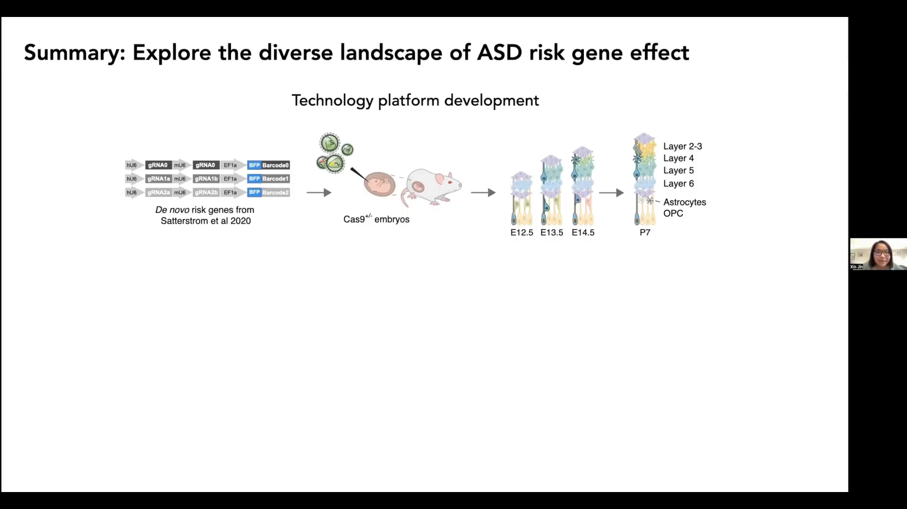

[【跳转到 38:31】](https://www.bilibili.com/video/BV1iX4y1B7sP/?t=2311)

## 小结

- **同一个扰动在单细胞层面本来就是异质的**：它可能只在一个细胞类型、甚至只在一个亚型里生效；ADNP 只影响投射神经元，MeCP2 在 Ndnf+ 中间神经元里有新作用，都是直接证据。
- **异质性的第一层来源是扰动本身不均匀**：纯合与杂合 LoF 混合（每个 gRNA 约 40–70% indel）、扰动瞬时且半衰期短、突变细胞坐在野生型细胞海洋里（<0.1% 被扰动），都会在效应分布里造出近零峰。
- **第二层是细胞状态与亚型**：第 4 层投射神经元特别脆弱；CHD8 的效应精确落在「祖细胞/不成熟」这个状态上，而不是笼统的「少突胶质细胞」。
- **第三层是技术因素**：批次、测序深度、注射引起的炎症都会伪造异质性，所以每批都要有内部负对照，并用回归吸收掉。
- **平均会稀释效应**：bulk 会把 5% 细胞的强效应摊成「弱效应」甚至「无效应」；单细胞分辨率才能保住亚型特异的信号。
- **读出方式决定你能看见什么**：基因水平 DE 对细胞数和深度极敏感，基因模块得分在 20% 细胞下仍稳健——每个扰动、每个主要细胞类型约 50 个细胞、几千个转录本就够了。
- **效应量要能被第二种体系复现**：CHD8 杂合小鼠里 Pdgfra 下降约 30%，与 Perturb-seq 的效应量对得上，这才让「异质性」站得住。

## 关键术语速查

| 术语 | 一句话解释 |
| --- | --- |
| Perturb-seq | 把 CRISPR 扰动和单细胞转录组读出来结合的方法：一个细胞既知道被哪个 gRNA 打了，也知道它当下的表达谱 |
| 体内 Perturb-seq（in vivo） | 在发育中的动物体内做扰动（本例为 E12.5 侧脑室注射），而不是在培养细胞里做 |
| 多路复用（multiplexing） | 一个载体池里混着多种扰动，靠条形码在分析阶段把细胞归回各自的扰动 |
| 条形码（barcode） | 载体上的一段可测序序列，用来标记「这个细胞被哪个扰动打过」 |
| 合子型（zygosity） | 一个细胞里两个等位基因被破坏的情况：纯合（两个都坏）或杂合（只坏一个） |
| indel | 插入/缺失突变，CRISPR 切割修复后留下的痕迹，是判断「切没切到」的依据 |
| 负对照（negative control） | 瞄准无关位点（如 GFP/Rosa26）的 gRNA，用来估计技术噪声与批次效应 |
| 基因模块（gene module） | 一群表达同步变化的基因，用它们的综合得分代表一个生物过程或一个细胞亚型 |
| WGCNA | 一种常用的共表达网络分析工具，用来从数据里提取基因模块 |
| 结构主题模型（STM） | 借用文本主题模型的思路找「基因程序」，与 WGCNA 互为交叉验证 |
| 下采样（downsampling） | 随机丢掉一部分细胞或转录本，用来看分析结果对细胞数、测序深度的敏感程度 |
| 效应量（effect size） | 扰动组与对照组之间差异的大小，与「是否显著」是两件事 |
| 细胞自主效应 | 扰动只影响被扰动细胞自身的表达，而不是通过影响邻居间接产生 |
| RNAscope | 一种原位杂交技术，能在组织切片里逐细胞量化特定 RNA 的拷贝数 |
