# gRNA 设计与脱靶分析：脱靶风险从哪里来，怎么挡在实验之前

> 视频来源：[基因敲除的gRNA设计与脱靶分析](https://www.bilibili.com/video/BV1vB4y1u7Eh/)（Bilibili · 海星生物 徐超）｜时长约 61 分钟
> 导读：这是一场以实操为主的直播，讲者用一个具体基因（人 BAG1）把「查基因 → 选敲除区域 → 设计 gRNA → 脱靶分析」四步完整走了一遍。本文按同样的顺序整理，重点放在两件容易被跳过的事上：**脱靶风险是在哪一步被引入的**，以及**为什么「敲了」不等于「敲干净了」**。字幕为 B 站 AI 轨，基因名、工具名与数值已按上下文订正。

## 本讲要解决的核心问题（SCQA）

**背景**：在单细胞扰动实验里，我们习惯把「某基因被扰动」当成一个干净的标签——gRNA 打上细胞 barcode，就认为这个细胞里只有这一个基因被动了。做 CRISPR 敲除时，大家通常的操作是：拿到一篇文章作参考，照着它的方案设计一条 gRNA，转染、筛选、做下游。

**冲突**：讲者开场就点出了最常见的翻车现场——**gRNA 设计好、下游实验做完，基因组水平上确实切了，但 RNA 水平甚至蛋白水平还是原来的样子**，完全达不到敲除的目的 [【跳转到 02:30】](https://www.bilibili.com/video/BV1vB4y1u7Eh/?t=150)。另一头是反向的风险：gRNA 在基因组别处也切了一刀，表型其实来自那个位点。两种情况都会让「扰动 → 表型」的因果链断掉，而它们在数据里长得一样：一个显著的变化。

**疑问**：脱靶到底是在流程的哪一步被引入的？哪些环节可以靠设计提前压住，哪些只能靠实验验证？以及，一条 gRNA 打得准，是否就意味着这个细胞真的失去了这个基因的功能？

**回答（中心思想）**：脱靶与「假敲除」不是两个孤立的意外，而是**同一条设计链上四个环节各自的失效模式**——查错基因/转录本、选错敲除区域、选错 gRNA 序列、跳过脱靶评估。每一个环节都有可核查的判据（Gene ID、外显子长度、特异性得分、错配计数、top10 位点），把判据走完，风险就从「不可控」变成「可量化、可验证」。而即便四步都走对，**「扰动」仍然只是「扰动」**：残余表达、截短蛋白、抗体不特异、细胞池未克隆化，都会让「无显著差异」被误读成「这个基因无关」。

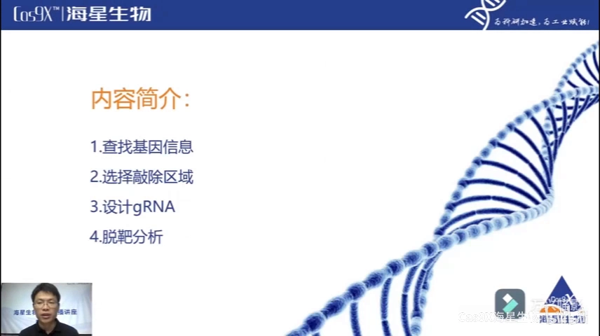

## 一、脱靶不是「切错一次」，而是四类可测量的风险

### 1.1 先看全流程：四个环节，四条可能出错的路

讲者把 gRNA 设计拆成四步，并强调这四步「相当于四条路」，缺一条方案就不完整 [【跳转到 05:17】](https://www.bilibili.com/video/BV1vB4y1u7Eh/?t=317)：

1. **查找基因信息**：找出目的基因在基因组上的实际位置和实际序列；
2. **选定敲除区域**：决定做移码敲除还是片段敲除，gRNA 落在哪个外显子或内含子上；
3. **设计 gRNA**：在候选区域里挑出序列；
4. **脱靶分析**：对挑出的 gRNA 做脱靶预测，必要时做验证。

目前主流的 gRNA 设计有两种思想——**移码敲除**与**片段敲除**——但不管哪一种，底层都是这四步 [【跳转到 05:42】](https://www.bilibili.com/video/BV1vB4y1u7Eh/?t=342)。

### 1.2 把「脱靶类假象」按环节归位

初学者容易把「脱靶」理解成单一事件：gRNA 切到了别处。但按上面四步拆开，一个「看起来像脱靶」的结果至少有四种来源，它们的排查手段完全不同：

| 环节 | 失效模式 | 后果 | 判据 |
| --- | --- | --- | --- |
| 查基因 | 按基因名检索，查到同名的另一个基因 | 整条方案打在错误靶点上 | 用 NCBI Gene ID 而非基因名 |
| 选区域 | 敲除区域落在非共有外显子、或敲掉 ATG 所在外显子 | 部分转录本未被破坏；或下游 ATG 重启产生截短蛋白 | 外显子表 + 蛋白结构域图 |
| 设计 gRNA | 序列在基因组别处有近似匹配 | 真实脱靶切割 | 特异性得分、错配计数、top10 位点 |
| 设计 gRNA | 序列含连续 5 个以上 T | U6 启动子提前终止，gRNA 根本没表达 | 序列自查 |

这张表就是本讲的骨架。下面按顺序展开，每一格都会落到一个具体可查的数字或界面上。

## 二、先把基因和转录本搞对：最容易被忽略的一层假象

### 2.1 基因名不可靠，Gene ID 才可靠

讲者用的案例是**人肺癌细胞（A549）中的 BAG1 基因敲除**。BAG1 是一个抗凋亡基因，分泌的蛋白是一种多功能的结合蛋白；它在正常组织中基本不表达，而在小细胞肺癌、乳腺癌、前列腺癌等癌组织中高表达 [【跳转到 08:24】](https://www.bilibili.com/video/BV1vB4y1u7Eh/?t=504)。

查找从 NCBI 的 Gene 库开始。这里有一个初学者几乎必踩的坑：**同一个基因的名字往往非常多**——有曾用名、现用名，还有一些「艺名」。讲者的原话是，按名字查「可能会查到一个南辕北辙的结果」，所以对基因的认知应该落在它**唯一的 NCBI Gene ID** 上 [【跳转到 09:44】](https://www.bilibili.com/video/BV1vB4y1u7Eh/?t=584)。

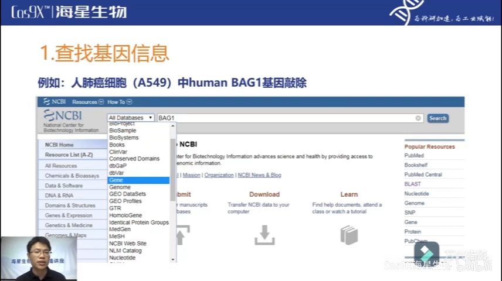

检索结果里，人 BAG1 的 Gene ID 是 **573**，同时列出了小鼠、大鼠、拟南芥、斑马鱼等物种的同源基因 [【跳转到 10:09】](https://www.bilibili.com/video/BV1vB4y1u7Eh/?t=609)。讲者顺带提了一句实用经验：小鼠的敲除数据库比较全，有时候可以借小鼠的信息先判断这个基因的功能，再回到人的细胞系上做实验。

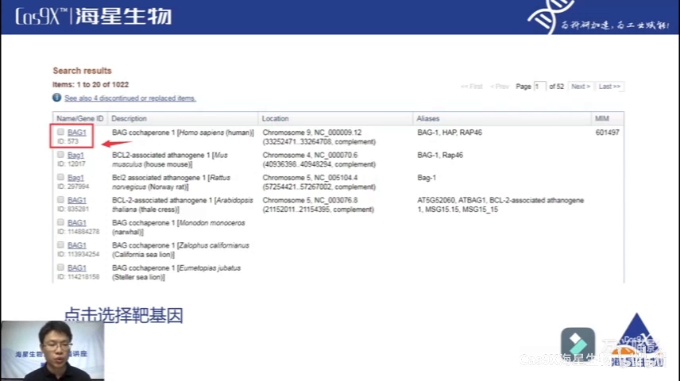

### 2.2 基因组版本与拷贝数：两个常在方案里被漏写的参数

点进基因页面后，第一件要确认的事是**定位信息**。这里有两个必须一起说清楚的东西：染色体位置，以及**基因组版本**。讲者指出，基因编辑使用的数据库已经从 GRCh37 更新到 GRCh38，也就是常说的 hg19 与 hg38；我们说某个基因的位点时，其实就附带着说明它用的是哪个版本 [【跳转到 11:24】](https://www.bilibili.com/video/BV1vB4y1u7Eh/?t=684)。

BAG1 定位在 **9 号染色体**（9q13.3），是一个常染色体基因。常染色体基因一般拷贝数在两个以上；而肿瘤细胞系的染色体是变异的，不同细胞系核型可能不同，拷贝数可能更多 [【跳转到 11:49】](https://www.bilibili.com/video/BV1vB4y1u7Eh/?t=709)。这一点直接关系到「能不能敲干净」：**拷贝数越多，要同时破坏所有等位基因的难度越大**，讲者把拷贝数当作判断敲除难易程度的第一个线索。

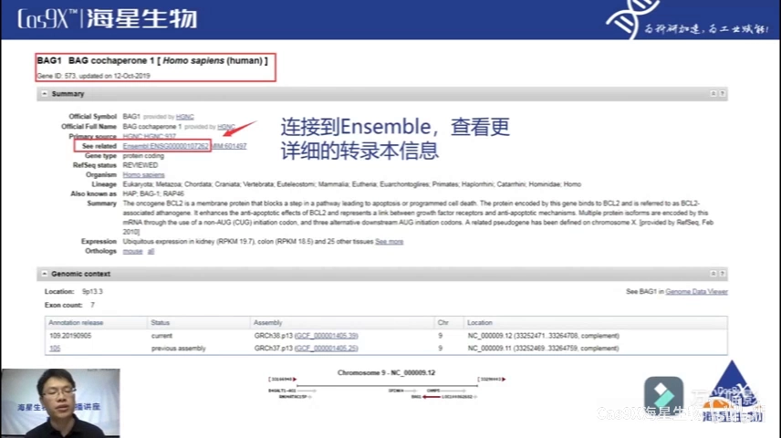

获取基因组序列有两条路：直接在 NCBI 下载 GenBank 数据，或者链接到 Ensembl 下载转录本与基因组信息。讲者推荐后者，理由是 Ensembl 展示信息更详尽、对方案设计更友好 [【跳转到 13:04】](https://www.bilibili.com/video/BV1vB4y1u7Eh/?t=784)。

### 2.3 选最大编码转录本，然后找「共有区域」

进入 Ensembl 会看到一个反直觉的现象：NCBI 里看到的转录本，和 Ensembl 里看到的**描述形式不一样、数量也不一样**。原因是两者链接的是不同数据库的底板，但描述的都是转录本信息；对编码转录本、主转录本，两边给的其实是一致的。Ensembl 因为包含很多预测转录本，信息更齐全 [【跳转到 14:30】](https://www.bilibili.com/video/BV1vB4y1u7Eh/?t=870)。

于是问题来了：一个基因有十几个转录本，敲除到底针对哪一个？讲者的规则很干脆——**无特别要求时，选择最大的编码转录本**，因为它基本覆盖了所有的蛋白质序列 [【跳转到 14:05】](https://www.bilibili.com/video/BV1vB4y1u7Eh/?t=845)。

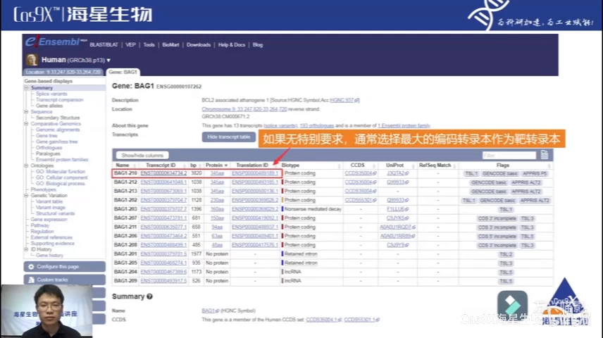

BAG1-210 编码 345 个氨基酸，转录本全长 3820 bp。选定主转录本后，还要看它在基因组上的整体分布：各转录本五撇端、三撇端的起始位置不同，UTR 区也不同（210 与 2026 的 UTR 就不一致）[【跳转到 16:40】](https://www.bilibili.com/video/BV1vB4y1u7Eh/?t=1000)。

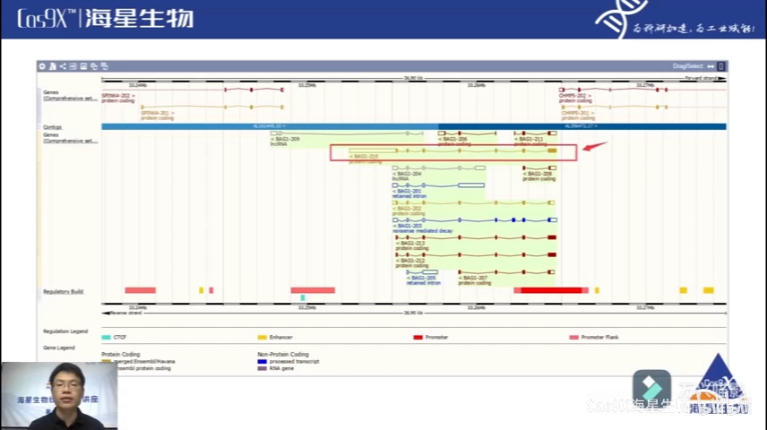

这张图同时回答了另一个问题：**这个基因与邻近基因的位置关系**。做敲除方案时，如果敲除区域压到了别的基因上，那你就无法区分表型来自目标基因还是邻居——这是「cis 效应」这一类假象在设计阶段就能看见的一半。

## 三、敲除区域怎么选：五条原则决定了「敲了但没敲干净」

### 3.1 五条原则

讲者把片段敲除的方案设计原则总结成五条 [【跳转到 18:18】](https://www.bilibili.com/video/BV1vB4y1u7Eh/?t=1098)：

1. **尽量覆盖尽可能多的编码转录本**——既然要敲掉基因功能，就要让所有编码转录本的蛋白功能都丧失；
2. **敲除的外显子是非 3 的倍数**，造成移码；
3. **为保证敲除效率，敲除区域一般不超过 10 kb**；
4. **敲除区域最好在编码区的前 50%**；
5. **一般不建议直接敲除 ATG 所在的外显子**。

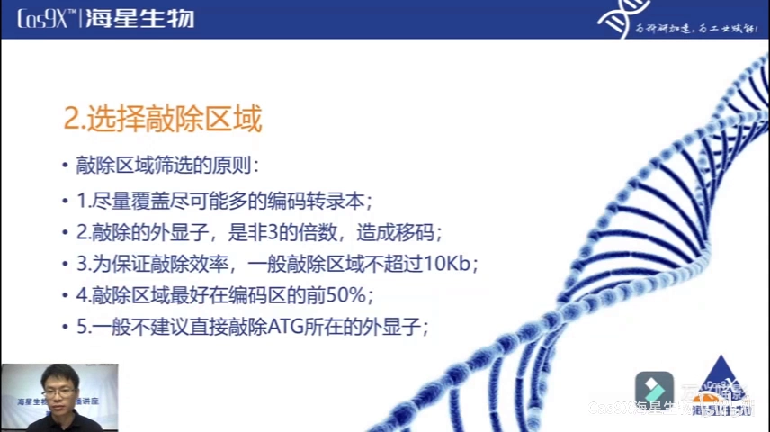

### 3.2 第 2、4 条在防两件不同的事

这两条经常被混为一谈，其实防的东西不一样。

**第 2 条（非 3 的倍数）防的是「蛋白还在」**。基因正常翻译是三个核苷酸对应一个密码子、对应一个氨基酸 [【跳转到 26:56】](https://www.bilibili.com/video/BV1vB4y1u7Eh/?t=1616)。如果敲掉的外显子长度是三的倍数，读框不变，下游照样翻译出一个「少了一段但框架完整」的蛋白，功能可能还在。设外显子长度为 $L$，只有

$$
L \bmod 3 \neq 0
$$

才会让下游读框整体移位，产生移码。

**第 4 条（前 50%）防的是「截短蛋白被审稿人看见」**。讲者说得很直白：即使保留了一个比较大的截短蛋白，它的功能可能确实丧失了，但你做 WB、做 RNA 检测时**往往还是有残留**——RNA 残留、蛋白残留。功能上失活，可大条带还在，审稿人就会问：你如何说明这个基因被完全敲掉了 [【跳转到 21:38】](https://www.bilibili.com/video/BV1vB4y1u7Eh/?t=1298)。所以敲除区域最好在编码区前 50%，甚至前 30%；如果能结合抗体识别的区域来选，就更精准。

### 3.3 第 5 条：为什么不敲 ATG 所在的外显子

这是五条里最反直觉的一条。既然要破坏蛋白，敲掉起始密码子不是最彻底吗？

讲者的解释是转录机制本身决定的：基因转录是寻找**第一个 ATG** 然后起始。如果你把第一个 ATG 消除掉，转录机器有可能继续往下寻找**新的 ATG** [【跳转到 22:28】](https://www.bilibili.com/video/BV1vB4y1u7Eh/?t=1348)。这样产生的截短蛋白可能是有功能的——它和原蛋白基本一致，只是少了五撇端一段序列。对 WB 来说这是「完全不可控的风险」。

所以正确做法是：**保留它自己原始的 ATG，再往下选一段序列敲除**。这样转录起始位置确定、形成的截短蛋白确定、功能性也确定 [【跳转到 23:18】](https://www.bilibili.com/video/BV1vB4y1u7Eh/?t=1398)。

### 3.4 第 3 条与内含子：两个「经验数字」

**10 kb 这条上限**来自效率考量。CRISPR-Cas9 确实可以做到染色体级别、几百 kb 的删除，但那种敲除效率很低 [【跳转到 20:23】](https://www.bilibili.com/video/BV1vB4y1u7Eh/?t=1223)。做正常的基因功能丧失实验不需要这么苛刻，超过 10 kb 会让效率下降，后续筛选压力变大、成本变高。

**内含子大小**则是另一个容易被忽略的变量。正常基因的剪接由**剪切受体与剪切供体**共同决定剪切信号，而它们就位于外显子两端、内含子一侧的结构域里。如果内含子区域比较狭小，你设计 gRNA 消除时往往会影响上下两个外显子，产生不可控的剪接信号；内含子比较大，就不必担心异常剪接的风险 [【跳转到 25:41】](https://www.bilibili.com/video/BV1vB4y1u7Eh/?t=1541)。这也是为什么讲者建议：gRNA 放在内含子上时，要**尽量靠近需要消除的外显子**，但不要压到上游外显子的剪接信号上 [【跳转到 31:22】](https://www.bilibili.com/video/BV1vB4y1u7Eh/?t=1882)。

## 四、把原则落到一个具体基因上

### 4.1 读外显子表

在 Ensembl 的转录本页面点左上角的「Exons」，就能看到这个转录本所有外显子的起止坐标与长度 [【跳转到 24:46】](https://www.bilibili.com/video/BV1vB4y1u7Eh/?t=1486)。

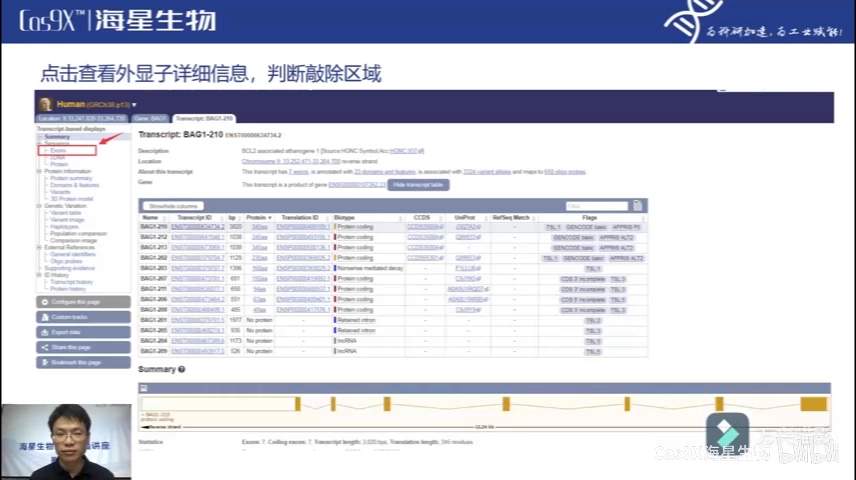

BAG1-210 的关键数字：

- 1 号外显子 **485 bp**，ATG 位于其上，但不在外显子起始处；
- 1 号内含子 **1393 bp**，属于比较大的内含子；
- 2 号外显子 **129 bp**，3 号外显子 **83 bp**；
- 4、5、6 号外显子长度都是 3 的倍数。

### 4.2 为什么最终选 2 号 + 3 号：212 bp、非三倍数、共有、覆盖核心结构域

按第 2 条原则，第一反应是敲 3 号外显子——83 bp，不能被 3 整除，敲掉后下游必然移码 [【跳转到 27:21】](https://www.bilibili.com/video/BV1vB4y1u7Eh/?t=1641)。

但 3 号比较靠后，于是可以往前并：2 号（129 bp）也是 3 的倍数，两个加起来 129 + 83 = **212 bp**，仍然不是 3 的倍数，移码照样成立 [【跳转到 27:46】](https://www.bilibili.com/video/BV1vB4y1u7Eh/?t=1666)。

那为什么不是 1 号？因为 1 号外显子**并不是所有转录本共有的**，违反第 1 条原则 [【跳转到 28:11】](https://www.bilibili.com/video/BV1vB4y1u7Eh/?t=1691)。

最后一个验证是蛋白层面：点开蛋白结构域图，BAG1 的核心结构域主要从 2 号外显子起始、一直到下游，所以敲掉 2、3 号外显子正好把核心功能域带走 [【跳转到 29:26】](https://www.bilibili.com/video/BV1vB4y1u7Eh/?t=1766)。

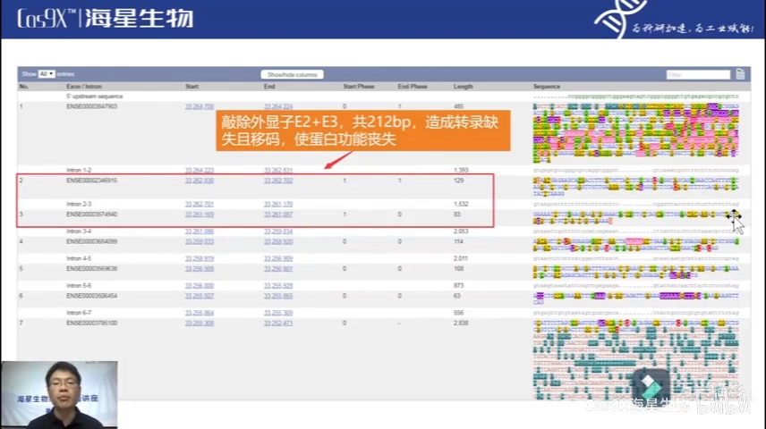

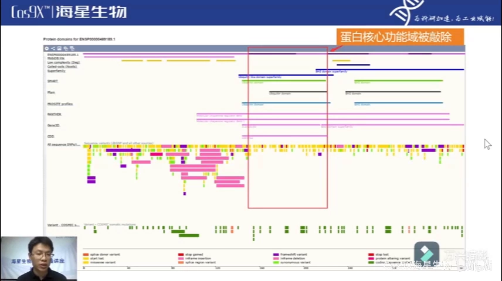

讲者在这里做了一个小结：敲除区域的选择要经过多方面衡量，不能「随意选一个外显子、随意设计一条 gRNA」就认为方案满足需求 [【跳转到 29:01】](https://www.bilibili.com/video/BV1vB4y1u7Eh/?t=1741)。这句话其实就是本小节的主题：**方案里每一个「随意」，最后都会变成数据里一个无法解释的差异**。
## 五、gRNA 层面：特异性得分与效率得分是两件事

### 5.1 两个核心原则

gRNA 设计的原则被讲者压缩成两条：**特异性要高，切割效率要高** [【跳转到 32:12】](https://www.bilibili.com/video/BV1vB4y1u7Eh/?t=1932)。

特异性的含义很直白：不要脱靶，或者说脱靶得分要非常低。讲者补了一句很关键的话——**即使脱靶位点落在基因荒漠区、即使那个位点对功能没有影响，还是不行** [【跳转到 32:37】](https://www.bilibili.com/video/BV1vB4y1u7Eh/?t=1957)。理由在单细胞扰动实验里尤其成立：你无法证明「这个细胞的转录组变化来自目标基因」，因为你自己也不知道那一刀切在了哪里。

### 5.2 为什么特异性得分可以信，效率得分不能全信

这是本节最有价值的方法学判断。

**特异性得分的预测比较简单**：基因组是已知的，不同网站的算法大同小异，都是拿你的 gRNA 去比对基因组，数一个碱基不同、两个、三个、四个的脱靶情况，再折算成得分。所以不同网站算出来的特异性得分基本类似，**得分也都是可信的** [【跳转到 33:02】](https://www.bilibili.com/video/BV1vB4y1u7Eh/?t=1982)。

**切割效率得分不一样**：它取决于实验数据和理论数据，不同网站用的基础模型不同，得分就会存在很大差异。讲者提醒，如果你比对不同网站的同一段方案设计，会发现效率得分有明显偏差——那么「用哪一个效率得分作为依据」，本身就是一个需要考量的点 [【跳转到 33:27】](https://www.bilibili.com/video/BV1vB4y1u7Eh/?t=2007)。

换句话说：**特异性是「可计算的」，效率是「被训练出来的」**。前者可以当硬指标，后者只能当参考。

### 5.3 门槛值：特异性 > 70，效率 > 40

讲者推荐 **CRISPOR**（crispor.tefor.net）作为设计网站，理由是经过他们比对筛选，综合性和与实际应用的一致性比较好 [【跳转到 34:17】](https://www.bilibili.com/video/BV1vB4y1u7Eh/?t=2057)。配套给出一组通用门槛 [【跳转到 34:42】](https://www.bilibili.com/video/BV1vB4y1u7Eh/?t=2082)：

- **特异性得分 > 70**，最好 80、90，越高越好；
- **切割效率得分 > 40**（即 40% 的切割效率），40 其实并不算高；太低则可能是序列复杂度问题，或别人用过类似序列发现效率很差；
- **序列避免连续 5 个以上的 T**。

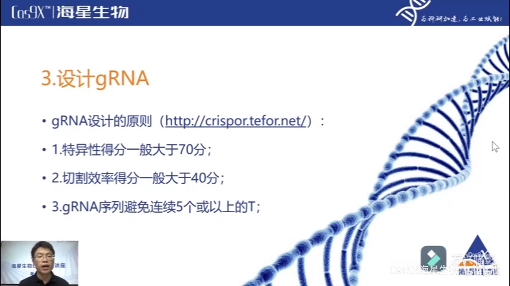

### 5.4 连续 5 个 T：一个与脱靶无关、但同样致命的假象

这条原则和脱靶没关系，但它制造的假象和脱靶一样难查。

原因在 U6 启动子：常规 gRNA 递送（质粒法、病毒法）用 U6 启动子驱动，而 **U6 的终止信号是连续的四个 T**。所以序列里只要有连续四到五个以上的 T，转录就会提前终止，你这个 gRNA 就变成一个无功能的、被截短的小序列 [【跳转到 35:32】](https://www.bilibili.com/video/BV1vB4y1u7Eh/?t=2132)。

结果是什么？**细胞转染了、抗性筛了、测序也测到了 gRNA 序列，但那个 gRNA 从来没有被完整转录出来**。在 Perturb-seq 这类实验里，这会直接表现为「这个扰动的细胞有 gRNA 标签、却没有任何转录组响应」——很容易被误读成「该基因在这个细胞类型里不影响转录」。讲者用的是蛋白法的话不存在这个问题，因为不经过 U6 转录。

## 六、脱靶分析：从打分表到 top10 位点

### 6.1 把候选序列送进 CRISPOR

选定区域后，先把基因组序列下载下来（讲者演示的是在 NCBI 直接下 GenBank），在注释里确认外显子、内含子的分布 [【跳转到 36:27】](https://www.bilibili.com/video/BV1vB4y1u7Eh/?t=2187)。

因为要敲 E2+E3，gRNA 就放在 1–2 号内含子和 3–4 号内含子上，并且**尽量靠近要消除的这两个外显子**，避免破坏上下游外显子的剪接信号、产生预期外的新转录本——新转录本有可能变成非移码的融合，那就白敲了 [【跳转到 37:23】](https://www.bilibili.com/video/BV1vB4y1u7Eh/?t=2243)。

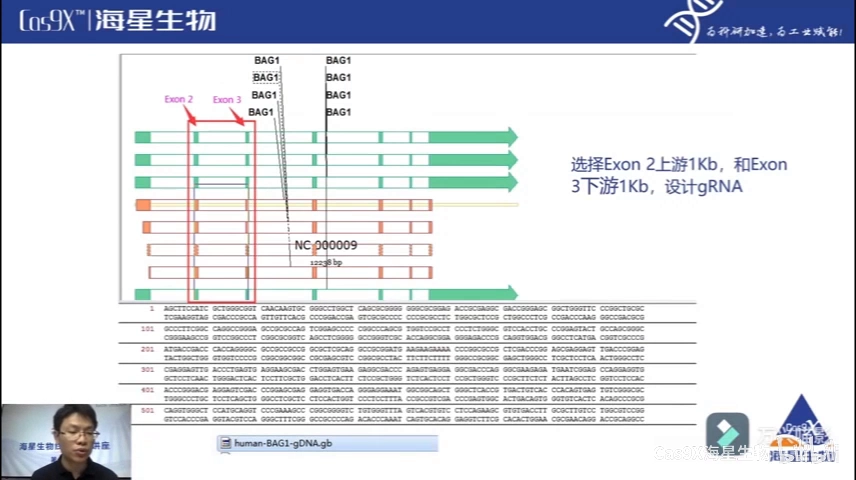

CRISPOR 的输入只有三个要素：**序列**、**基因组版本**（这里是 hg38）、**Cas 蛋白**（这里是最通用的 SpCas9；网站也支持 SaCas9 等其他蛋白，以及小鼠、大鼠等物种）[【跳转到 38:29】](https://www.bilibili.com/video/BV1vB4y1u7Eh/?t=2309)。

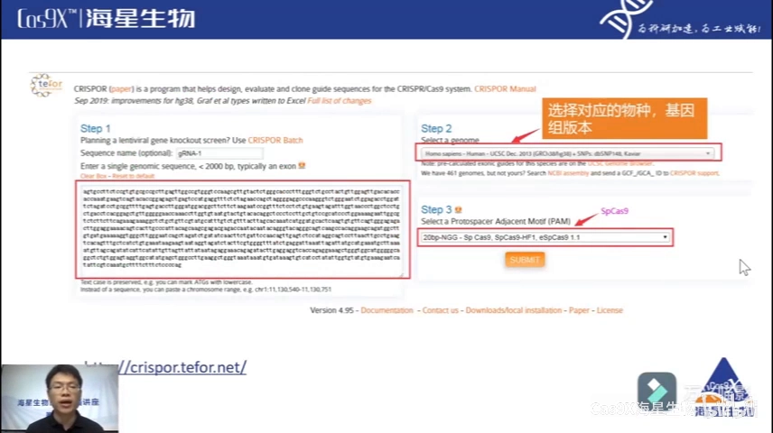

### 6.2 打分表怎么读：三块信息，缺一不可

结果页面上，讲者只强调三块 [【跳转到 40:09】](https://www.bilibili.com/video/BV1vB4y1u7Eh/?t=2409)：

1. **特异性得分（两列）**：分别来自 MIT 算法与另一个算法。两者非常接近，参考其中一个即可；分数越高代表在基因组上脱靶的概率越低。
2. **切割效率得分（两列）**：**Doench 2016** 与 **MM**。Doench 2016 适用于 U6 启动子驱动的 gRNA；MM 的算法背景来自 T7 启动子体外转录的 RNA。因为我们主要用 U6 驱动，所以**直接参照 Doench 2016 那一列** [【跳转到 41:24】](https://www.bilibili.com/video/BV1vB4y1u7Eh/?t=2484)。
3. **脱靶计数（0/1/2/3/4）**：分别表示有 1、2、3、4 个碱基不同的潜在脱靶位点有多少个。

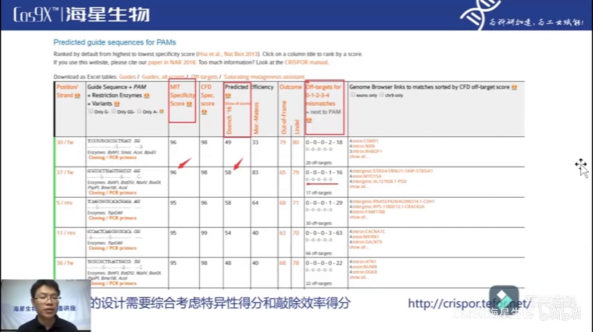

以讲者演示的那条 gRNA 为例：一共 17 个脱靶位点，其中 3 个碱基不同的 1 个、4 个碱基不同的 16 个 [【跳转到 41:49】](https://www.bilibili.com/video/BV1vB4y1u7Eh/?t=2509)。

### 6.3 「4 个错配基本不脱靶」这条经验值

讲者给了一条非常实用的判读线：对一个 20 bp 的 gRNA 保守区域来说，**如果有 4 个碱基以上的不同，基本就认为它不会脱靶在这个位点** [【跳转到 42:14】](https://www.bilibili.com/video/BV1vB4y1u7Eh/?t=2534)。

所以 0/1/2/3/4 这一列不是装饰：它是把「特异性得分」这个抽象数字还原成**可数的位点清单**。特异性的本质就是这个分布——**0–2 个错配的位点越少越安全**，3–4 个错配的位点再多也基本无害。

### 6.4 CCTop：把脱靶位点落到基因结构上

CRISPOR 也能看脱靶，但讲者更推荐 **CCTop**（crispr.cos.uni-heidelberg.de），因为它能让你对脱靶结果有更直观的认识 [【跳转到 43:54】](https://www.bilibili.com/video/BV1vB4y1u7Eh/?t=2634)。CCTop 的输入同样简洁：gRNA 序列、gRNA 来源（T7 转录 / U6 转录 / 化学合成）、基因组版本 [【跳转到 45:59】](https://www.bilibili.com/video/BV1vB4y1u7Eh/?t=2759)。

它给出的表比 CRISPOR 更「面向验证」：

- 第一列是**染色体上的具体脱靶坐标**，方便你直接设计脱靶验证引物 [【跳转到 47:06】](https://www.bilibili.com/video/BV1vB4y1u7Eh/?t=2826)；
- 第二列是**哪些位点不匹配**，并区分外显子（exonic）、内含子（intronic）、基因间（intergenic）；
- 还会给出基因名与基因 ID。

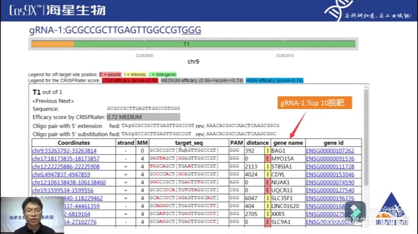

### 6.5 8 bp + 12 bp：错配长在哪里才算数

讲者把一条 20 bp 的 gRNA 分成**前面 8 bp + 后面 12 bp 的核心序列**。核心序列的不匹配往往可以让切割效率变得非常低，也就是根本无法有效切割 [【跳转到 47:31】](https://www.bilibili.com/video/BV1vB4y1u7Eh/?t=2851)。

所以判读 CCTop 的表时，不只看「有几个错配」，还要看**错配落在哪里**：如果 top10 位点的错配几乎都在核心区，这条 gRNA 的实际脱靶率会非常低。

结合「落在哪个基因结构上」，就能排出优先级 [【跳转到 48:21】](https://www.bilibili.com/video/BV1vB4y1u7Eh/?t=2901)：讲者演示的这条 gRNA，第一个脱靶位点在某个基因的**外显子**上，其余多在**内含子**区域。外显子上的脱靶更可能影响那个基因的功能，属于「脱靶概率高 + 落在关键基因外显子上」的双重风险位点，必须验证；内含子上的位点，除非有需要，可以不额外验证。

### 6.6 预测与实测：什么时候必须做 NGS

讲者给了一条明确的分流规则 [【跳转到 44:19】](https://www.bilibili.com/video/BV1vB4y1u7Eh/?t=2659)：

- gRNA 设计时特异性得分就很好 → **做脱靶预测**即可；
- gRNA 得分比较差 → **必须做脱靶效率的验证**，看它实际是否真的脱靶。

常规验证是 **top5 / top10**：拿脱靶概率最高的前五或前十个位点，用 PCR + 测序看是否真的被切 [【跳转到 44:44】](https://www.bilibili.com/video/BV1vB4y1u7Eh/?t=2684)。

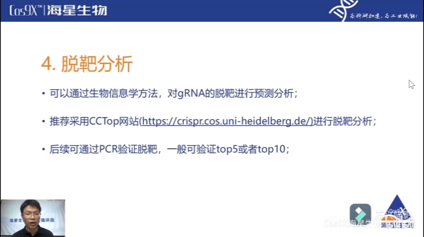

但对实验要求严苛的场景——干细胞、体内实验、基因治疗——**top10 的 PCR 套路不够**，必须用 **NGS 测全基因组脱靶**，而且**预测内的和预测外的脱靶位点都要验证** [【跳转到 45:34】](https://www.bilibili.com/video/BV1vB4y1u7Eh/?t=2734)。这句话在方法学上很重要：预测工具只能告诉你「它认为会切哪里」，**预测不到的脱靶只能靠无偏的实测去发现**。

## 七、即使 gRNA 完美，「扰动」也不等于「敲除」

前面六节都在讲「怎么切得准」。但讲者在答疑环节把话题拉回到更根本的一层：**你怎么知道它真的被敲掉了？**

### 7.1 移码方案最好做，片段敲除最稳定

第一个问题很经典：方案到底做移码还是做片段？讲者的总结是八个字——**移码方案最好做，片段敲除最稳定** [【跳转到 51:45】](https://www.bilibili.com/video/BV1vB4y1u7Eh/?t=3105)。

移码方案就是在某一个外显子上设一条 gRNA 做移码，效率高，在基因组上拿到移码的概率也很高。但它有两个问题 [【跳转到 52:10】](https://www.bilibili.com/video/BV1vB4y1u7Eh/?t=3130)：

1. **WB 不好做**：蛋白表达、条带水平还是很高，你拿固化的条带水平证明不了它被敲除了；
2. **可能产生截短蛋白**：所以移码位点的选择必须很好——选太靠前要防剪接跳过，选太靠后要防蛋白结合结构域仍然完整。

所以对一个基因敲除，讲者还是推荐**片段敲除**：效率可能低一点，但结果最稳定，RNA 水平、WB 水平都不会有太多疑问 [【跳转到 53:00】](https://www.bilibili.com/video/BV1vB4y1u7Eh/?t=3180)。

### 7.2 WB 还有条带：三种解释，对应三种不同的「假象」

第二个问题几乎是每个做敲除的人都会遇到的：基因敲除了，为什么 WB 还有条带？讲者先纠正了一个前提——**「基因敲除细胞株」的定义是：挑出单克隆，且这个单克隆的所有等位基因都被完全编辑** [【跳转到 53:50】](https://www.bilibili.com/video/BV1vB4y1u7Eh/?t=3230)。在这个前提下还有条带，有三种解释：

| 解释 | 本质 | 怎么排除 |
| --- | --- | --- |
| **抗体不特异** | 市面上很多抗体没经过 KO 验证，条带根本不是你的目标蛋白 | 用真正的 KO 细胞株做抗体对照 |
| **截短蛋白** | 敲除区域产生了截短蛋白，抗体仍能识别 | 在 RNA 水平看转录本的实际表达框 |
| **克隆不纯** | 没有单克隆化，池子里还有野生型细胞 | 挑单克隆后重新验证 |

讲者对第一条说得很直接：「不是你的细胞株有问题，而是它的抗体有问题——**你的 WB 是最准的，你的细胞株才是对的**」[【跳转到 54:15】](https://www.bilibili.com/video/BV1vB4y1u7Eh/?t=3255)。

第二条尤其要注意移码敲除：讲者明确说，**做移码敲除时尤其要注意截短蛋白的风险** [【跳转到 54:40】](https://www.bilibili.com/video/BV1vB4y1u7Eh/?t=3280)。

### 7.3 单克隆、细胞池，与「高射炮打蚊子」

讲者把用途分了三种，对应三种验证强度：

- **要完全敲除的细胞株** → 必须挑单克隆。只有单克隆化之后才能获得基因敲除细胞株 [【跳转到 55:05】](https://www.bilibili.com/video/BV1vB4y1u7Eh/?t=3305)；
- **只要 knockdown 效果** → 类似干扰实验，转染之后不挑克隆也能满足需求；
- **类似筛选的形式** → 保留杂合子 + 纯合子混合的细胞池，通过药物诱导看不同基因型细胞的丰度变化，判断药物有效性 [【跳转到 55:30】](https://www.bilibili.com/video/BV1vB4y1u7Eh/?t=3330)。

除这三类之外，讲者建议都做到单克隆化，理由是：**用 CRISPR 做 knockdown 是「高射炮打蚊子」**。既然用了 CRISPR，你要的就不是 shRNA 那样敲掉七八十% 就满足的效果，而是**百分之百被敲除**——只有百分之百敲除才是基因功能性的完整描述形式 [【跳转到 56:20】](https://www.bilibili.com/video/BV1vB4y1u7Eh/?t=3380)。

这句话对单细胞扰动实验是一个重要提醒：**细胞池里混着未编辑细胞时，pooled 读出的是「编辑细胞 + 野生型细胞」的平均**。效应量会被稀释，弱效应会直接消失，然后被记成「该基因无响应」。

## 八、把局限写进结论

### 8.1 一张自查表

把讲者的四步与答疑内容合起来，就是一份可以直接贴在实验记录本上的自查表：

| 检查项 | 合格判据 | 不做的后果 |
| --- | --- | --- |
| 基因身份 | 用 NCBI Gene ID 确认，不用基因名 | 整条方案打在错靶点上 |
| 基因组版本 | 明确写 GRCh37 还是 GRCh38 | 坐标对不上，区域选错 |
| 拷贝数 | 从染色体定位与细胞系核型判断 | 低估「敲干净」的难度 |
| 转录本 | 选最大编码转录本，并找共有区域 | 部分转录本未被破坏 |
| 外显子长度 | 敲除外显子长度不是 3 的倍数 | 读框不变，蛋白功能可能保留 |
| 敲除位置 | 编码区前 50%（最好前 30%），避开 ATG 外显子 | 截短蛋白残留 / 下游 ATG 重启 |
| 敲除大小 | 一般不超过 10 kb | 效率下降，筛选成本上升 |
| 特异性得分 | > 70（越高越好） | 脱靶切割无法排除 |
| 效率得分 | Doench 2016 > 40（U6 驱动） | gRNA 可能根本不切 |
| 序列自查 | 无连续 5 个以上 T | U6 提前终止，gRNA 未表达 |
| 脱靶清单 | 0–2 错配位点数、top10 落点与所在基因结构 | 无法判断表型是否来自脱靶 |
| 脱靶验证 | 得分差 → top5/top10 PCR；严苛场景 → NGS 全基因组 | 预测外的脱靶完全漏掉 |
| 敲除证明 | 单克隆 + 全等位基因编辑 + KO 验证过的抗体 | 「无差异」其实是「没敲掉」 |

### 8.2 递送方式：稳转优于瞬转

最后一个问题：敲除实验用质粒好还是病毒好？讲者的回答是**病毒法效率更高**，因为病毒可以达到稳转效果，Cas9 持续表达、持续切割基因组；而质粒法一般是瞬转，转染之后质粒逐步丢失，只能做瞬时切割，效率往往更低 [【跳转到 57:35】](https://www.bilibili.com/video/BV1vB4y1u7Eh/?t=3455)。

第三个选项是**转座子系统**：转座子可以介导转座指令稳定整合到基因组上，实现 Cas9 的稳定表达，效果与病毒法类似 [【跳转到 58:25】](https://www.bilibili.com/video/BV1vB4y1u7Eh/?t=3505)。

这条对单细胞扰动实验有直接含义：**瞬转体系里，不同细胞的 Cas9 暴露时长不同**，编辑效率因此参差。同一扰动的细胞里，有的敲干净了、有的没敲——这会在下游表现为「同一 gRNA 的细胞响应不一致」，看起来像生物学异质性，其实是递送与编辑效率的异质性。

## 小结

- **脱靶不是单一事件，而是四类可测量的风险**：查错基因/转录本、选错敲除区域、选错 gRNA 序列、跳过脱靶评估。每一类都有自己的判据，走完判据风险就从「不可控」变成「可量化」。
- **基因身份用 Gene ID 锚定，不用基因名**；位点必须带基因组版本；拷贝数决定「敲干净」的难度。
- **敲除区域的五条原则在防两件不同的事**：非 3 的倍数防「蛋白还在」，前 50% 与避开 ATG 外显子防「截短蛋白被看见」。
- **特异性得分可信，效率得分只能参考**：前者靠基因组比对，算法大同小异；后者依赖训练数据，网站之间差异很大。U6 驱动时看 Doench 2016。
- **连续 5 个 T 制造的假象和脱靶一样难查**：U6 提前终止，gRNA 从未完整转录，表现却是「有 gRNA 标签、无转录组响应」。
- **脱靶判读要看三个维度**：0–2 错配位点的数量、错配落在 8 bp 还是 12 bp 核心区、位点落在外显子还是内含子。
- **预测与实测是两件事**：预测工具只能覆盖它认为会切的位点；严苛场景必须用 NGS 做全基因组、预测内 + 预测外的验证。
- **「扰动」不等于「敲除」**：残余表达、截短蛋白、抗体不特异、细胞池未克隆化，都会把「没敲掉」伪装成「无效应」。**「无显著差异」不等于「该基因无关」**。
- **把局限写进结论**：说清这个结论在什么条件下成立——哪条 gRNA、哪个细胞系、敲除效率多少、脱靶验证做到哪一步。

## 关键术语速查

| 术语 | 一句话解释 |
| --- | --- |
| off-target（脱靶） | gRNA 在基因组其他位置造成的非预期切割，表型可能来自这些位点而非目标基因 |
| on-target 一致性 | 同一基因的多条独立 gRNA 是否给出方向一致的效应；不一致要先怀疑 gRNA 层面假象 |
| Gene ID | NCBI 给每个基因的唯一编号（BAG1 为 573），比基因名可靠 |
| 最大编码转录本 | 一个基因最长的蛋白编码转录本，敲除方案默认针对它设计 |
| 共有区域 | 多个编码转录本共有的外显子，敲这里才能覆盖尽可能多的转录本 |
| 移码（frameshift） | 敲除长度不是 3 的倍数的外显子，使下游读框整体移位、蛋白提前终止 |
| 片段敲除 | 用一对 gRNA 删除一段外显子区域，效率略低但结果最稳定 |
| ATG 重启 | 敲掉首个起始密码子后，转录从下游 ATG 起始，产生可能仍有功能的截短蛋白 |
| 剪切供体 / 受体 | 决定外显子-内含子边界剪接信号的序列，位于外显子两端的内含子一侧 |
| 特异性得分 | 基于基因组比对与错配计数算出的脱靶风险分数，不同网站结果接近 |
| 切割效率得分 | 预测 gRNA 切割活性的分数，依赖训练数据，网站间差异较大（Doench 2016 / MM） |
| 核心序列 | 20 bp gRNA 中靠近 PAM 的约 12 bp 区域，此处的错配对切割活性影响最大 |
| CCTop | 把脱靶位点连同染色体坐标、基因名与所在结构（外显子/内含子/基因间）一起列出的工具 |
| top5 / top10 验证 | 对脱靶概率最高的前 5 或前 10 个位点做 PCR + 测序，确认是否真的被切 |
| 单克隆化 | 挑出单细胞扩增成株，确保所有等位基因都被编辑，是「基因敲除细胞株」的前提 |
| 细胞池（pool） | 未克隆化的混合群体，含杂合子与纯合子，效应会被未编辑细胞稀释 |
