# 脱靶检测方法全景：从断裂点捕获到全基因组测序

> 视频来源：[基因编辑脱靶检测技术的原理和应用](https://www.bilibili.com/video/BV1qjf7YwErn/)（Bilibili · 达澈生物）｜时长约 26 分钟
> 导读：这是一场产品线宣讲性质的技术讲座，但前半段把「脱靶怎么测」这件事梳理得相当系统：先讲脱靶为什么必然存在、后果为什么可轻可重，再把十来种检测方法按**三条思路**归类，逐一给出原理、优势与不足，最后给出一张按场景选方法的建议表。本文保留这条「三条思路」的主线，把每种方法的**能证明什么 / 不能证明什么**整理成表。字幕为 B 站 AI 轨，工具名与蛋白名已按上下文订正。

## 本讲要解决的核心问题（SCQA）

**背景**：做 CRISPR 扰动实验时，我们最终要回答的是一个因果问题——「这个细胞的转录组变化，是不是因为这个基因被动了」。gRNA 特异性打分、脱靶位点预测这些手段大家多少都用过，输出是一串位点和分数。

**冲突**：讲者一开场就把这个信心打掉了：**即便你设计的 sgRNA 是准的，Cas9 编辑也会有小概率、非常小的概率出现脱靶——毕竟宇宙射线这种东西它不管你** [【跳转到 09:35】](https://www.bilibili.com/video/BV1qjf7YwErn/?t=575)。更麻烦的是，预测工具只能告诉你「它认为会切哪里」；至于实际切了哪里，**计算模拟也好、别人的经验之谈也好，都不能完全保证** [【跳转到 10:25】](https://www.bilibili.com/video/BV1qjf7YwErn/?t=625)。

**疑问**：既然预测不够，实测该怎么做？十几种听起来都很专业的检测方法（CIRCLE-seq、GUIDE-seq、DISCOVER-seq、WGS……）到底在测什么？它们各自能证明什么、不能证明什么？在单细胞扰动实验这种场景里，该选哪一个？

**回答（中心思想）**：所有脱靶检测方法都可以归到**三条思路**——**直接抓断裂点**、**抓与断裂点相关的蛋白**、**把基因组上的改动全部枚举出来** [【跳转到 11:15】](https://www.bilibili.com/video/BV1qjf7YwErn/?t=675)。三条思路的**灵敏度、检测时间窗、是否需要对照、能否定量、能否覆盖预测外位点**各不相同，没有一种方法全占。选方法不是选「最先进」，而是先想清楚**你要证明什么**，再挑能覆盖这件事、且代价可接受的那一种。

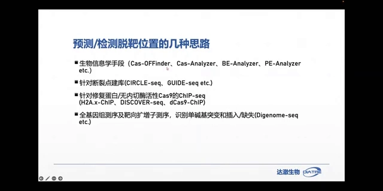

## 一、脱靶的后果，取决于它落在哪里

### 1.1 为什么脱靶是这套系统的固有属性

讲者先花了几分钟铺背景（这部分属于 CRISPR 分子机制的范畴，本系列 3.2.1 已展开，这里只留与脱靶直接相关的几点）：

- 细菌的 CRISPR-Cas 系统分三型，真正被拿来用的是 **II 型**，因为精度非常高 [【跳转到 01:15】](https://www.bilibili.com/video/BV1qjf7YwErn/?t=75)；
- 常用的 Cas9 是一个特异性核酸酶，内部有**两个核酸酶切位点**；对这两个位点做工程改造，可以得到只能切单链的 **nCas9** 和完全没有内切酶活性的 **dCas9** [【跳转到 02:55】](https://www.bilibili.com/video/BV1qjf7YwErn/?t=175)；
- Cas9-sgRNA 复合物识别靶点后，在 sgRNA 匹配的 protospacer 上制造**平头断裂**，位置通常在 PAM 前面约 3 个碱基处，具体取决于所用 Cas9 的工程修饰 [【跳转到 02:30】](https://www.bilibili.com/video/BV1qjf7YwErn/?t=150)。

关键在于：**这套系统的识别依赖 sgRNA 与基因组的序列匹配**。匹配是概率性的，基因组又足够大，所以「在别处也存在部分匹配」不是意外，而是必然。碱基编辑（CBE / ABE）与先导编辑（prime editor）虽然不制造双链断裂，但**仍然建立在 sgRNA + Cas9 的框架上**，所以脱靶问题并没有消失 [【跳转到 04:35】](https://www.bilibili.com/video/BV1qjf7YwErn/?t=275)。

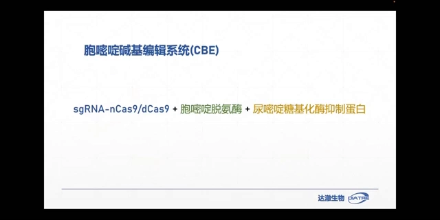

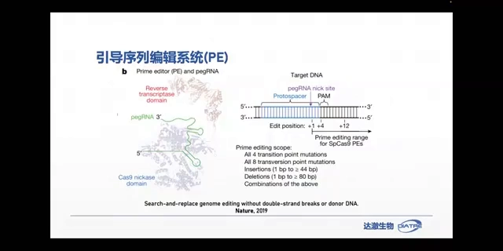

### 1.2 断裂点最终都要被修复，修复方式决定了「脱靶长什么样」

Cas9 切出来的双链断裂最后总要用一定方式修好，不然细胞就要死掉。讲者列了三种机制 [【跳转到 07:30】](https://www.bilibili.com/video/BV1qjf7YwErn/?t=450)：

| 修复方式 | 特点 | 与脱靶检测的关系 |
| --- | --- | --- |
| **NHEJ**（非同源末端连接） | 整个细胞周期都能发生，不需模板，效率高但精确度低，会留下少量碱基插入/缺失 | 脱靶位点的「疤痕」主要由此产生，是断裂点捕获类方法的信号来源 |
| **HR**（同源重组） | 只在特定细胞周期发生，需要同源染色体，保真度高但效率低 | 可用来敲入大片段，不是脱靶检测的主要信号 |
| **MMEJ**（交错式非同源末端连接） | 不是双链断裂的主要修复机制，讲者按下不表 | — |

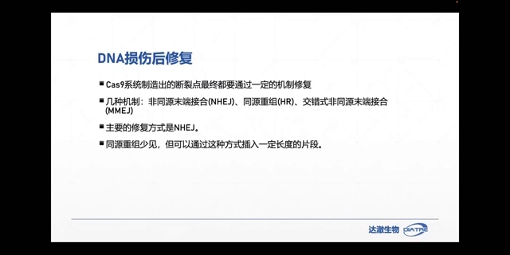

### 1.3 后果可轻可重：一个必须写进结论的判断

这是本节最实用的一句话：**脱靶的后果可轻可重，具体要看脱靶脱在了哪里、整个序列被改写成了什么样子** [【跳转到 08:45】](https://www.bilibili.com/video/BV1qjf7YwErn/?t=525)。

- 脱靶打在**基因间区**：一般来说没有太大的事情；
- 脱靶打在**外显子**上，并且很不巧地让这个外显子沉默了，而且是你**不想沉默**的外显子：结果会非常严重 [【跳转到 09:10】](https://www.bilibili.com/video/BV1qjf7YwErn/?t=550)。

所以「脱靶数」这个数字本身没有意义。**同样 17 个脱靶位点，全在基因间区和有一个落在关键基因外显子上，是完全不同的两件事**。这也是为什么后面那些检测方法都要给出「位点落在什么结构上」这一列。

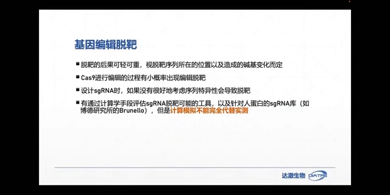

### 1.4 预测能做什么，不能做什么

讲者对预测的定位很克制：设计阶段可以用生物信息学工具评估 sgRNA 的脱靶可能性；也可以直接用现成的库，比如博德研究所的 **Brunello** 库 [【跳转到 10:00】](https://www.bilibili.com/video/BV1qjf7YwErn/?t=600)。

但结论是：**不管是计算模拟，还是你自己或别人的经验之谈，实际状况都不能完全靠这两种方法得到保证** [【跳转到 10:25】](https://www.bilibili.com/video/BV1qjf7YwErn/?t=625)。这句话是整场讲座的转折点——从这里开始，讲者才进入「实测」的世界。

## 二、检测脱靶的三条思路

讲者把实测方法按「你打算抓什么」分成三条 [【跳转到 11:15】](https://www.bilibili.com/video/BV1qjf7YwErn/?t=675)：

1. **直接抓断裂点**：既然复合物要制造双链缺口，那就把断裂点分离出来，再抓它两端的序列。代表方法：**CIRCLE-seq、CHANGE-seq、GUIDE-seq、HTGTS**，以及针对先导编辑的 **PEAC-seq / TAPE-seq**；
2. **抓蛋白**：断裂是蛋白制造的，那就针对这个蛋白做 ChIP；或者针对**标记/修复断裂点的蛋白**做 ChIP。代表方法：**dCas9-ChIP、DISCOVER-seq（MRE11）、γH2AX-ChIP**；
3. **枚举全部改动**：不做针对性捕获，直接把基因组上（或感兴趣区间里）的所有改动列出来。代表方法：**全基因组测序（WGS）** 与**靶向扩增子测序**。

这三条思路的差别不是「精度高低」，而是**你在测什么东西**：

| 思路 | 直接测的对象 | 天然优势 | 天然短板 |
| --- | --- | --- | --- |
| 抓断裂点 | DNA 断裂的物理位置 | 直接、灵敏、能发现预测外位点 | 多为体外或需转染；建库复杂 |
| 抓蛋白 | 蛋白在基因组上的占据 | 可在活细胞内、可定量 | 间接；灵敏度差；时间窗短；需对照 |
| 枚举改动 | 最终的序列改变 | 检测窗极长、精度高、无偏 | 数据量巨大或受引物限制 |

## 三、思路一：直接捕获断裂点

### 3.1 CIRCLE-seq：体外把基因组切成环，谁能被切谁就暴露

原理链条很清晰 [【跳转到 12:55】](https://www.bilibili.com/video/BV1qjf7YwErn/?t=775)：

1. 提取全基因组 DNA，**体外随机打断**；
2. 把片段**截成环**（环化）；
3. 加入 sgRNA-Cas9 复合物：如果某个环里存在能被识别的位点，环就被切开、变成线性；
4. 线性片段两端**加接头、扩增、建库**；
5. 测序 read 比对回基因组，得到断裂点位置。

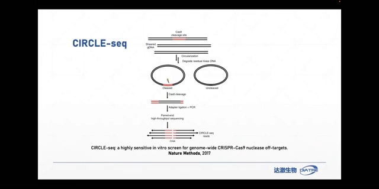

讲者的评价是：这个方法**非常灵敏**，而且能比较好地识别序列里的插入与缺失——不过**只限于单个碱基的插入** [【跳转到 13:20】](https://www.bilibili.com/video/BV1qjf7YwErn/?t=800)。

缺点也很明确：**只能用于体外**，而且成环与建库的过程比较复杂 [【跳转到 13:45】](https://www.bilibili.com/video/BV1qjf7YwErn/?t=825)。这一点在单细胞扰动实验里尤其要注意：CIRCLE-seq 测的是**裸露 DNA 的可切割性**，不是活细胞里真实发生的切割——染色质状态、核内环境都不在考虑之内。

### 3.2 CHANGE-seq：把「打断」换成 Tn5，把染色质构象带进来

CHANGE-seq 是对 CIRCLE-seq 的改良：把前面「成环打断」的那一步换成用 **Tn5** 做打断。相较于 CIRCLE-seq，它**能更好地反映细胞内的染色质构象对你的编辑事件有没有影响** [【跳转到 14:10】](https://www.bilibili.com/video/BV1qjf7YwErn/?t=850)。

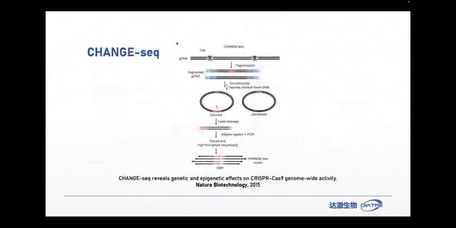

### 3.3 HTGTS：靠易位与倒位捕获，代价是效率

HTGTS 是一种基于**易位和倒位**来捕获 sgRNA 所造成断裂点的方法。讲者直接点出了它的物理限制：倒位与易位发生的概率**跟遗传距离成反比**，所以这个方法的效率本身就不高 [【跳转到 14:35】](https://www.bilibili.com/video/BV1qjf7YwErn/?t=875)。

它的好处是可以针对**大片段缺失**做检测；麻烦之处在于需要用诱饵（bait）去捕获 DSB，效率不高；而且如果你的酶是缺口酶、或者基于 nCas9，这个方法就没法用。更微妙的一点是：它要用 DSB 去捕获 DSB，**如果构造出来的双链断裂正好落在 bait 里，结果就不好说了**，所以需要设计很多个诱饵来覆盖这些情形 [【跳转到 15:00】](https://www.bilibili.com/video/BV1qjf7YwErn/?t=900)。

### 3.4 GUIDE-seq：在活细胞里插一段标签

GUIDE-seq 的流程是 [【跳转到 15:25】](https://www.bilibili.com/video/BV1qjf7YwErn/?t=925)：

1. 在**活细胞**里用 Cas9 + sgRNA 把基因组切开；
2. 在切开的位置**插入一段平头标签序列**（依靠 NHEJ）；
3. 提取带标签的基因组，针对标签序列扩增、建库；
4. 测序读出标签两头的序列，即断裂点两侧信息。

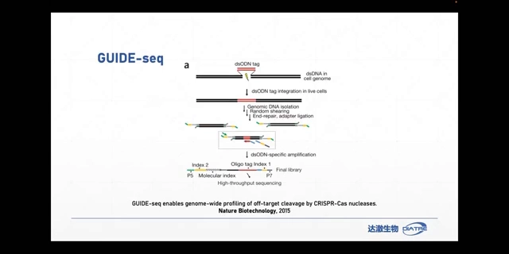

和 CIRCLE-seq 相比，GUIDE-seq 的**灵敏度不如前者，但胜在测序量小** [【跳转到 16:15】](https://www.bilibili.com/video/BV1qjf7YwErn/?t=975)。它的主要不足是：需要**两次 NHEJ 过程**把标签插进断裂点，效率并不高；而且**必须转染**，有些细胞特别不好转染。

对单细胞扰动实验来说，最后这条限制很实际：Perturb-seq 常用的细胞系（如 K562、THP-1）转染效率差异很大，GUIDE-seq 在这些细胞上的可行性要先验证。

### 3.5 PEAC-seq / TAPE-seq：把标签写进 pegRNA 的模板里

针对 prime editor，有两篇文章给出了思路相同的检测方法：**PEAC-seq** 与 **TAPE-seq**。核心做法是把 prime editor 里 **pegRNA 的逆转录模板直接写成标签序列**，再针对标签序列做扩增 [【跳转到 16:40】](https://www.bilibili.com/video/BV1qjf7YwErn/?t=1000)。

它的独特价值是：能直接捕获 prime editor 的编辑过程，而且**可以同时评估 pegRNA 结合引起的脱靶，以及逆转录过程出错引起的变化**。

但讲者给了一个很谨慎的限定：因为要把逆转录模板改写成标签序列，**它只适合做临床前的评估**——如果直接临床投入使用，标签序列写在模板里会导致什么后果，讲者明确说「我们是没有办法告诉你的」[【跳转到 17:05】](https://www.bilibili.com/video/BV1qjf7YwErn/?t=1025)。

## 四、思路二：基于 ChIP 的间接检测

### 4.1 dCas9-ChIP：测「Cas9 去过哪里」

思路最直接：既然编辑用的是 Cas9，那就用 **dCas9 + sgRNA** 的复合物去看它会和基因组怎么结合。这相当于对 sgRNA 在整个基因组范围内的结合情况、以及生理条件下的结合信息做了一次比较好的模拟 [【跳转到 17:55】](https://www.bilibili.com/video/BV1qjf7YwErn/?t=1075)。

但 ChIP 类方法的固有短板在这里全部出现 [【跳转到 18:20】](https://www.bilibili.com/video/BV1qjf7YwErn/?t=1100)：

- **灵敏度不够好**；
- 因为它测的是 **dCas9 的位置**而不是断裂点，所以**必须有一个正常样本做对照**；
- 必须在 dCas9 结合在基因组上的时候去测，**有效检测时间窗并不长**；
- 抗体需求量稍大。

注意这里有一个容易混淆的点：dCas9-ChIP 测的是**结合**，不是**切割**。结合了但没切的位点，在 dCas9-ChIP 里会出现，在真正的脱靶事件里却不算——这是一个「假阳性方向」的偏差。

### 4.2 DISCOVER-seq：盯住修复蛋白 MRE11

既然断裂要被修复，那就针对**修复蛋白**做 ChIP。DISCOVER-seq 的靶点是 **MRE11**。为什么是 MRE11？讲者让看图：同样是制造双链断裂，一系列相关蛋白里**只有 MRE11 会在断裂位置有非常特异的富集，而且背景很干净** [【跳转到 18:45】](https://www.bilibili.com/video/BV1qjf7YwErn/?t=1125)。

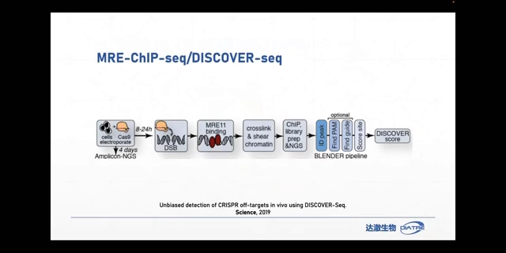

它的两个优势是：**可以定量**，以及**具备针对等位基因特异性编辑的识别能力** [【跳转到 19:10】](https://www.bilibili.com/video/BV1qjf7YwErn/?t=1150)。

但讲者把不足列得很清楚 [【跳转到 19:48】](https://www.bilibili.com/video/BV1qjf7YwErn/?t=1188)：

| 优势 | 不足 |
| --- | --- |
| 实验操作简单 | 样品需求量略大 |
| 分析较快，可定量 | **有效检测时间窗短**，需要在 MRE11 结合时建库 |
| 数据需求量低 | **灵敏度低** |
| — | **并非直接捕获断裂点**（抗体捕获的是参与修复的蛋白），意味着存在断点不是由 Cas9 导致的可能性 |
| — | 需要设置正常样本作为对照 |

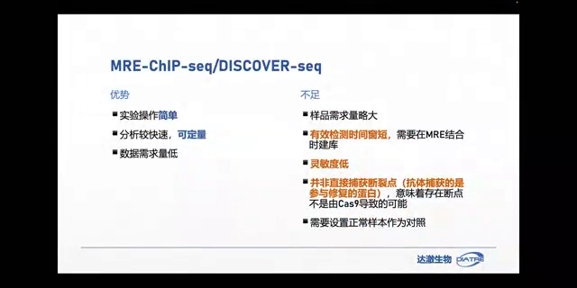

### 4.3 γH2AX-ChIP：讲者明确不推荐的一种

针对磷酸化的 H2AX（γH2AX）做 ChIP 也能标记断裂，但讲者说这是**他们个人不太推荐**的方法 [【跳转到 19:48】](https://www.bilibili.com/video/BV1qjf7YwErn/?t=1188)。

原因在于：γH2AX 本身是基于 H2AX 的分布来看的，而**H2AX 的分布本身就有偏好**，所以你需要做两个对照来识别——正常的对照，以及全部 H2AX 的样本做对照。讲者还提示，γH2AX 的分布跟 RNA 聚合酶的结合基本上是反过来的 [【跳转到 20:13】](https://www.bilibili.com/video/BV1qjf7YwErn/?t=1213)。

也就是说，这个方法除了继承 ChIP 类的全部缺陷之外，还额外背了一个**分布偏好**的偏差。

## 五、思路三：全基因组测序与靶向扩增子测序

讲者提醒了这类方法的历史地位：在前面那些基于 ChIP、或者直接捕获断裂点的方法出现之前，**如果你要知道一个基因编辑的结果，几乎只能靠这种法子** [【跳转到 20:38】](https://www.bilibili.com/video/BV1qjf7YwErn/?t=1238)。

### 5.1 WGS：无偏，但代价高

原理非常好讲：把整个基因组上所有的碱基改动统统枚举出来，再去看你具体想编辑的位置发生了什么 [【跳转到 21:03】](https://www.bilibili.com/video/BV1qjf7YwErn/?t=1263)。

| 优势 | 不足 |
| --- | --- |
| **超长的有效检测时间窗**——编辑做完之后什么时间测几乎都可以 | 样本需求量大且要求严格 |
| 适合平头编辑酶（如 Cas9）以及黏性末端编辑酶（如 Cpf1）的断点分析 | 测序数据需求大但**深度低**，最终获得的数据量巨大 |
| **直接识别双链断裂点，以及脱靶对基因组的具体改动** | 分析耗时 |
| **极高精度** | 需要设置正常样本作为对照 |

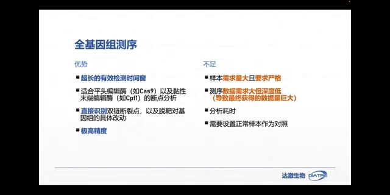

这张表里最值得记住的是第一行：**检测时间窗超长**。这是 WGS 相对于所有「抓断裂点」和「抓蛋白」方法的根本优势——后两者都要求你在事件发生的那个窗口里去采样，而 WGS 是回头去看已经写进基因组的「疤痕」[【跳转到 21:21】](https://www.bilibili.com/video/BV1qjf7YwErn/?t=1281)。

代价是「深度低」：同样的测序量摊到全基因组，每个位点的覆盖就薄，所以**低频脱靶事件容易漏** [【跳转到 21:46】](https://www.bilibili.com/video/BV1qjf7YwErn/?t=1306)。这正好和 CIRCLE-seq 的「灵敏但只能体外」互补。

### 5.2 靶向扩增子测序：性价比方案，但视野被引物框住

为了解决 WGS 耗时与数据量巨大的问题，可以只测「感兴趣的区域」：针对潜在脱靶位置设计特异性引物（或用链霉亲和素标记等方式），把区间扩增出来建库测序 [【跳转到 22:11】](https://www.bilibili.com/video/BV1qjf7YwErn/?t=1331)。

| 优势 | 不足 |
| --- | --- |
| 超长的有效检测时间窗 | 需要设置正常样本作为对照 |
| 适合平头编辑酶（如 Cas9）以及黏性末端编辑酶（如 Cpf1）的断点分析 | **仅可检测由 PCR 引物特异性确定的区间**，对区间外的编辑事件无能为力 |
| 直接识别双链断裂点，以及脱靶对基因组的具体改动 | **缺乏对大片段增减的分辨能力**（受 PCR 扩增长度所限） |
| 极高精度 | — |
| 数据需求量低、分析快速 | — |

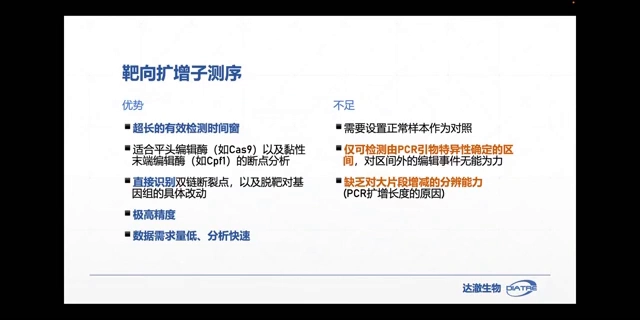

这两条不足合起来是一个很强的限定：**靶向扩增子测序的视野，就是你的引物清单**。它适合「验证已知候选位点」，不适合「发现未知脱靶位点」[【跳转到 23:01】](https://www.bilibili.com/video/BV1qjf7YwErn/?t=1381)。而且因为 PCR 扩增长度与测序 read 长度都有限，**上 kb 级别的改动它是检测不出来的** [【跳转到 23:26】](https://www.bilibili.com/video/BV1qjf7YwErn/?t=1406)。

## 六、方法选择：一张按场景查的表

讲者最后给了一张建议表，按「你在做什么」来选方法 [【跳转到 23:51】](https://www.bilibili.com/video/BV1qjf7YwErn/?t=1431)：

| 场景 | 推荐方法 |
| --- | --- |
| 设计阶段，还没做实验 | 生物信息学预测：Cas-OFFinder、CCTop、CRISPOR、CROP-IT 等 |
| 体外实验（细胞外、基因组 DNA） | CIRCLE-seq、Digenome-seq、nDigenome-seq；碱基编辑用 ABE/CBE-Digenome-seq、EndoV-seq |
| 细胞内实验 | GUIDE-seq；先导编辑用 PEAC-seq、TAPE-seq |
| 体内实验 | 基于 WGS 的测序手段（成本很高） |
| 体内、要性价比 | 靶向测序；基于修复相关蛋白的 ChIP（DISCOVER-seq、γH2AX-ChIP-seq） |

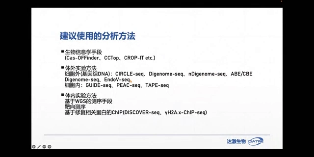

讲者补了一句很实在的话：具体要确定方法，还是要根据各位老师的具体需求来定 [【跳转到 24:41】](https://www.bilibili.com/video/BV1qjf7YwErn/?t=1481)。

## 七、这套方法学对单细胞扰动实验意味着什么

这场讲座讲的是 bulk 层面的基因编辑脱靶检测，但它的框架可以直接搬到 Perturb-seq 这类实验上，而且能回答几个平时含糊过去的问题。

**第一，脱靶是「每个扰动」的属性，不是「整个实验」的属性。** 一个文库里有上千条 gRNA，每条的特异性得分、脱靶位点分布都不同。如果只在文库层面做一次脱靶评估，等于假设所有扰动的脱靶风险相同——这个假设在数据里会表现为「某些扰动的效应特别嘈杂」，而你会把它归因于生物学异质性。

**第二，「无显著差异」有三种可能，其中两种是技术性的。** 一是这个基因真的无关；二是 gRNA 没切（效率问题，见另一篇关于 gRNA 设计的整理）；三是切了但脱靶带来的变化掩盖或抵消了 on-target 效应。后两种都需要脱靶实测才能排除。

**第三，方法选择应该跟着「你要证明什么」走。** 如果你的结论是「这套文库的 on-target 效应可信」，那需要的是**发现型**方法（CIRCLE-seq 类，覆盖预测外位点）；如果结论是「这 20 个候选位点确实没被切」，那**验证型**方法（靶向扩增子）就够了，而且更便宜。

**第四，任何单一方法都不足以支撑「无脱靶」这个结论。** 讲者对每种方法都同时列了优势和不足，这个结构本身就是结论：**CIRCLE-seq 灵敏但只能体外，GUIDE-seq 在活细胞里但灵敏度低且需转染，DISCOVER-seq 可定量但时间窗短、间接，WGS 无偏但深度低，靶向测序便宜但视野被引物框住**。真实项目里通常是「一种发现型 + 一种验证型」组合使用。

## 小结

- **脱靶是这套系统的固有属性**：识别依赖序列匹配，基因组足够大；碱基编辑与先导编辑虽然不切双链，但仍建立在 sgRNA + Cas9 框架上，脱靶问题没有消失。
- **脱靶后果可轻可重**，取决于位点落在基因间区还是关键外显子；所以「脱靶数」本身不是指标，「脱靶位点落在什么结构上」才是。
- **预测不能代替实测**：计算工具与经验之谈都不能完全保证实际状况。
- **所有检测方法归为三条思路**：直接抓断裂点、抓相关蛋白、枚举全部改动。三条思路测的是不同的东西，因此优势和短板互补而非替代。
- **抓断裂点类**（CIRCLE-seq / CHANGE-seq / GUIDE-seq / HTGTS / PEAC-seq）灵敏、能发现预测外位点，但多为体外或需转染，建库复杂。
- **ChIP 类**（dCas9-ChIP / DISCOVER-seq / γH2AX-ChIP）能在活细胞内做、可定量，但间接、灵敏度低、时间窗短、必须配对正常样本。
- **测序类**（WGS / 靶向扩增子）检测时间窗最长、精度高，但前者深度低、数据量巨大，后者视野被引物框住、测不了大片段。
- **选方法先想清楚要证明什么**：发现型还是验证型，体外还是体内，成本能承受多少。

## 关键术语速查

| 术语 | 一句话解释 |
| --- | --- |
| off-target（脱靶） | sgRNA 引导 Cas9 在非目标位点造成的切割或碱基改变 |
| protospacer / PAM | sgRNA 匹配的那段靶序列，以及紧邻其旁、Cas9 识别所必需的一小段基序（motif） |
| 平头断裂（blunt end） | Cas9 在 protospacer 上切出的无突出末端的双链断裂 |
| nCas9 / dCas9 | 只切一条链的切口酶 / 完全失去内切酶活性的 Cas9，是碱基编辑与先导编辑的基础 |
| CBE / ABE | 胞嘧啶碱基编辑（C·G → T·A）与腺嘌呤碱基编辑（A·T → G·C） |
| prime editor（PE） | 先导编辑，用 pegRNA 携带的逆转录模板把新序列写入基因组，不需双链断裂与外源 DNA |
| pegRNA | 先导编辑专用的 sgRNA，三撇端带引物结合位点与逆转录模板 |
| NHEJ / HR / MMEJ | 非同源末端连接 / 同源重组 / 交错式非同源末端连接，双链断裂的三种修复方式 |
| CIRCLE-seq | 体外把基因组 DNA 环化后用 Cas9 切割，再测被切开的环，灵敏但只能体外 |
| CHANGE-seq | CIRCLE-seq 的改良版，用 Tn5 打断，能反映染色质构象的影响 |
| GUIDE-seq | 活细胞内把双端标签插入断裂点，再针对标签扩增测序；测序量小但需转染 |
| HTGTS | 基于易位/倒位捕获断裂点，可测大片段缺失，但效率受遗传距离限制 |
| PEAC-seq / TAPE-seq | 把标签写进 pegRNA 逆转录模板，专门检测先导编辑的脱靶 |
| dCas9-ChIP | 用 dCas9 的基因组占据位置间接推断潜在脱靶，测的是结合不是切割 |
| DISCOVER-seq | 针对修复蛋白 MRE11 做 ChIP，标记双链断裂位置，可定量但时间窗短 |
| γH2AX | 磷酸化的 H2AX，断裂附近的组蛋白标记；因分布本身有偏好，需双重对照 |
| WGS 脱靶检测 | 全基因组测序枚举所有改动，检测窗最长、精度高，但深度低、数据量巨大 |
| 靶向扩增子测序 | 只测引物覆盖的区间，便宜快速，但视野受引物限制、测不了大片段 |
| Brunello 库 | 博德研究所构建的全人基因组 CRISPR 敲除文库，可直接取用现成 gRNA 设计 |