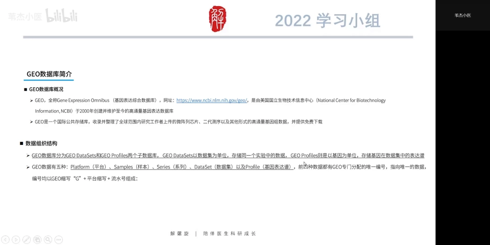
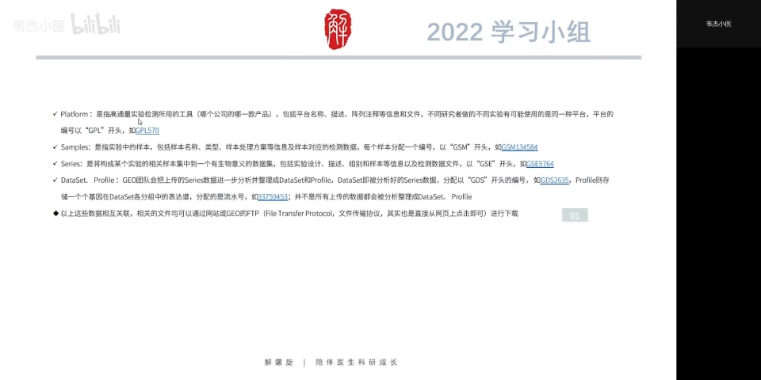
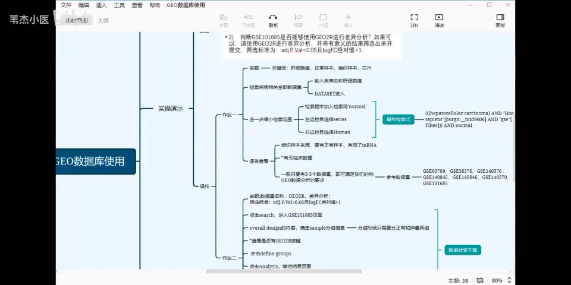
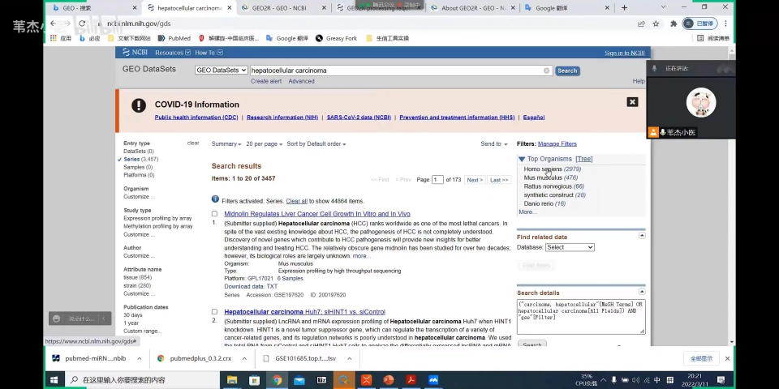
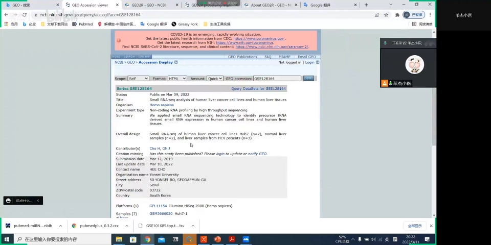
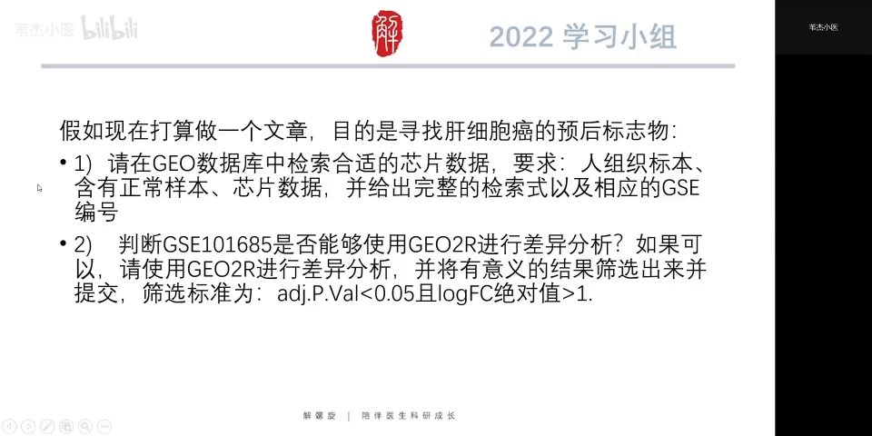
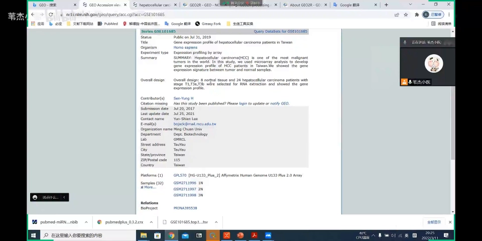
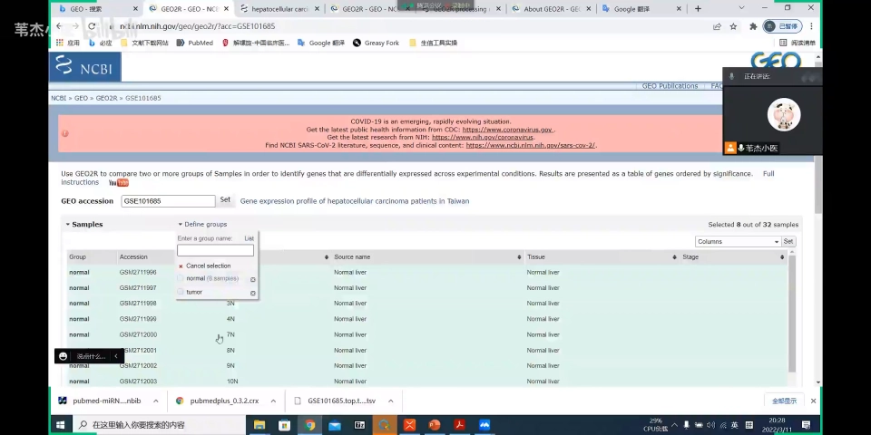
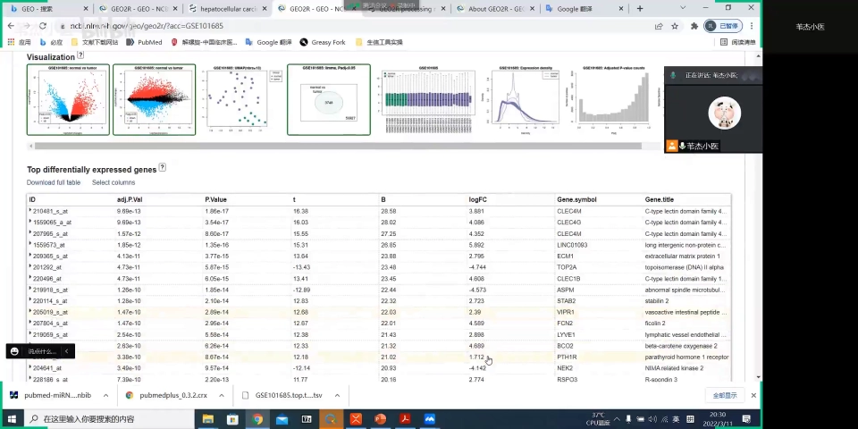
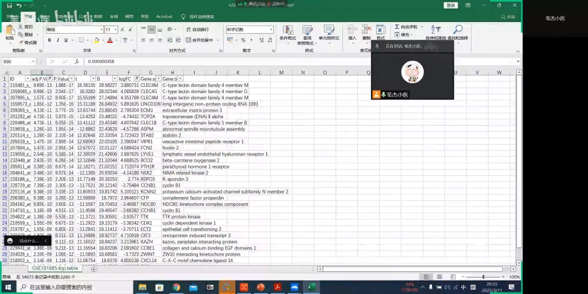

# GEO 数据库的四层编号与数据集筛选：从 GSE 到 GSM，再到一张可用的差异表达表

> 视频来源：[【生信在线工具】01 GEO数据库介绍及使用](https://www.bilibili.com/video/BV1DS4y137k6/)（Bilibili · 苇杰小医）｜时长约 37 分钟
> 导读：这支视频先用一页幻灯片把 GEO 的五种记录类型（GPL/GSM/GSE/GDS/Profile）讲清楚，再拿「找肝细胞癌预后标志物」当作业，完整走一遍「检索 → 筛数据集 → GEO2R 差异分析 → 导出筛选结果」。本文按「库的结构 → 库里的数据长什么样 → 怎么判断一份数据能不能用」重排，只讲结构、筛选与判据，不涉及下载命令（那属于后续小节）。

## 本讲要解决的核心问题（SCQA）

**背景**：单细胞与转录组研究几乎都要用公共数据。做非肿瘤方向的人，第一个被推荐的库通常就是 GEO（Gene Expression Omnibus，基因表达综合数据库）；做肿瘤方向的人手里还有 TCGA。

**冲突**：知道「有 GEO 这个库」很容易，但打开首页之后往往就卡住了——GSE、GSM、GPL、GDS 一串编号看不出谁包含谁；同一个疾病搜出几千条数据集，不知道哪一条能用来做对照分析；好不容易挑中一个，下载下来的文件里却没有想象中那张表达矩阵。

**疑问**：GEO 到底怎么组织数据？一份公共数据集要满足什么条件，才算「能用」？

**回答（中心思想）**：GEO 是一个按「平台 → 样本 → 系列」三层套起来、再额外整理出「数据集/表达谱」两种视图的档案库。判断一份数据能不能用，不看它被引用多少次，而看四件事：**有没有原始矩阵、样本与分组对不对得上、有没有重复、平台注释是否齐全**。这四件事都能在 GSE 页面和它的 Overall Design 里查到。

## 一、GEO 是论文数据的公共档案馆，不是「精选数据集商店」

视频里给的第一条定义值得逐字读：GEO 由美国国立生物技术信息中心（NCBI）于 2000 年创建、维护至今，收集并整理了全球范围内研究者提交的微阵列芯片、二代测序以及其他形式的高通量基因组数据，并提供免费下载 [【跳转到 04:01】](https://www.bilibili.com/video/BV1DS4y137k6/?t=241)。

它为什么会有这么多数据集？讲者给的原因是制度性的：**一些期刊硬性要求投稿时上传原始数据**，这样后来的研究者不必再花一笔测序费去重复同一个实验 [【跳转到 06:59】](https://www.bilibili.com/video/BV1DS4y137k6/?t=419)。测序费用昂贵，这条规定直接让 GEO 变成了「别人替你付过测序费的仓库」。

但同一段话里还有一个更重要的提醒：**很多研究者只上传了部分数据集**，或者上传的内容「到了我们手里无法进行应用」。也就是说，GEO 的条目数量并不等于可用数据量——仓库很大，货架上却混着残缺品。这就是为什么检索之后必须逐条筛，而不能拿搜索结果的条数当结论。

顺带回答视频里观众提的那个问题：GEO 比 TCGA 全吗？讲者的回答是 GEO 相对更全，因为它囊括所有疾病的基因表达数据，而 TCGA 是专门针对肿瘤的泛癌数据库 [【跳转到 07:24】](https://www.bilibili.com/video/BV1DS4y137k6/?t=444)。换句话说，TCGA 是「一种疾病的专题库」，GEO 是「所有疾病的公共档案库」——后者的代价就是标准化程度更低。

## 二、GEO 内部先分成两半：以数据集为单位，和以基因为单位

打开 GEO 会看到两个子库，这是第一个容易混淆的地方 [【跳转到 07:49】](https://www.bilibili.com/video/BV1DS4y137k6/?t=469)：

| 子库 | 组织单位 | 什么时候用它 |
| --- | --- | --- |
| GEO DataSets | 以**数据集**为单位，储存同一个实验中的数据 | 想找「一组对照 vs 处理」的完整实验，做差异分析 |
| GEO Profiles | 以**基因**为单位，储存某个基因在各数据集中的表达谱 | 想查「某个基因在哪些研究里被检测过、表达如何」 |

讲者把两者的关系说得很直白：DataSets 是一个集合，Profiles 是查单个基因的入口 [【跳转到 08:14】](https://www.bilibili.com/video/BV1DS4y137k6/?t=494)。

**做生信的第一步是「挑」，而挑的对象一定是 DataSets**：因为挑的前提是「有正常组和疾病组的对照」，只有在数据集层面才存在分组；Profiles 里没有分组，只有一条条基因曲线。

## 三、五种记录类型，四层编号：GPL、GSM、GSE、GDS 到底谁包含谁

这是本节最该记住的一张表。视频里那一页幻灯片把五种类型和编号前缀一次讲完了 [【跳转到 09:04】](https://www.bilibili.com/video/BV1DS4y137k6/?t=544) [【跳转到 10:09】](https://www.bilibili.com/video/BV1DS4y137k6/?t=609)：

| 记录类型 | 编号前缀 | 它代表什么 | 视频里给的例子 |
| --- | --- | --- | --- |
| Platform（平台） | GPL | 高通量实验用的工具：哪个公司的哪一款产品，含平台名称、描述、探针注释等信息 | GPL570 |
| Samples（样本） | GSM | 实验中的一个样本：样本名称、类型、样本处理方案，以及它对应的检测数据 | GSM134584 |
| Series（系列） | GSE | 把构成某个实验的相关样本汇总成一个有生物学意义的数据集，含实验设计、描述、组别和样本信息 | GSE5764 |
| DataSet（数据集） | GDS | GEO 团队把上传的 Series 进一步分析整理成的可比较集合 | GDS2635 |
| Profile（表达谱） | — | 储存一个基因在各 DataSet 分组中的表达量 | 流水号，如 GDS375453 |

四条编号规则里，前三条是日常必用的：

1. **GPL 是平台**。它决定了「一行数据代表什么」——芯片时代是探针，测序时代是基因或转录本。同一个平台可以被无数研究复用，所以平台页里的注释表（探针号 → 基因符号）是跨数据集通用的。
2. **GSM 是样本**。一个 GSM 就是「一只小鼠 / 一个病人 / 一个时间点」这一级别的东西，元数据（characteristics 字段）挂在它身上。
3. **GSE 是系列**。一个 GSE 号通常对应一篇论文的数据集，**它把一批 GSM 装在一起，并说明这批 GSM 用的是哪个 GPL**。所以「GSE 里有很多 GSM，GSM 挂在某个 GPL 上」这句话是完整的层级描述。
4. **GDS 是 GEO 自己再加工的一层**。幻灯片里有一句关键限定：**并非所有上传的数据都会被分析整理成 DataSet 和 Profile** [【跳转到 10:34】](https://www.bilibili.com/video/BV1DS4y137k6/?t=634)。这解释了为什么现在大家基本不用 GDS——它覆盖面不全，而且整理标准由 GEO 团队定，你无法控制。

一个实操上的推论：**你在论文里看到的编号，决定了你能拿到什么**。论文写「数据见 GSE101685」，你拿到的是一个系列（一批样本的集合）；论文写「GPL570」，那只是平台，不是数据；论文写「GSM211996」，那只是 32 个样本里的一个。看懂编号前缀，就知道自己站在层级的哪一级。

## 四、GEO 收的不只是 mRNA：九类上传数据

视频提到 GEO 接受九种数据的上传，并逐类点名：基因表达数据、非编码 RNA 数据、染色质免疫沉淀（ChIP）实验数据、甲基化数据、高通量基因表达 PCR 数据、蛋白微阵列芯片数据等 [【跳转到 11:24】](https://www.bilibili.com/video/BV1DS4y137k6/?t=684)。

讲者解释为什么要了解「上传」而不是只了解「下载」：**只有知道别人能传什么，你才知道自己能检索到什么**。这条对单细胞研究尤其重要——同一个 GSE 里可能混着 RNA-seq、scRNA-seq、空间转录组等不同实验类型，检索时如果不限定 Experiment type，就会把不相关的实验一起捞进来。

另外一条容易忽略的规范：**用 GEO 数据集发表文章，要引用 GEO 的文献** [【跳转到 11:43】](https://www.bilibili.com/video/BV1DS4y137k6/?t=703)。这是数据来源的署名义务，不是可选项。
## 五、一次真实的检索：从 3457 条缩到一个能用的数据集

视频用「寻找肝细胞癌的预后标志物」当题目，把检索拆成可复述的步骤 [【跳转到 12:46】](https://www.bilibili.com/video/BV1DS4y137k6/?t=766)。题目本身给了三个限定词，这三个词就是检索式的骨架：

- **人组织标本**（不是细胞系、不是动物模型）；
- **含正常样本**（否则没有对照，做不了差异分析）；
- **芯片数据**，并要给出完整检索式和对应的 GSE 编号。

### 5.1 先做「缩小范围」，再做人眼筛查

在 GEO DataSets 里输入 `hepatocellular carcinoma`，得到 3457 条结果 [【跳转到 16:18】](https://www.bilibili.com/video/BV1DS4y137k6/?t=978)。接着靠左侧筛选面板一步步收窄：

1. 点 **Series**，把条目类型限定成系列（而不是单个样本或平台）；
2. 点 **Homo sapiens**，把物种限定成人 [【跳转到 19:06】](https://www.bilibili.com/video/BV1DS4y137k6/?t=1146)；
3. 再加上「有正常样本」等条件，条目从 2000 多条缩到 1000 多条。

讲者强调：**筛选的顺序不必照抄，但限定条件必须自己手动加**。检索框右侧会给出完整的检索式，可以直接复制下来写进论文方法部分——这一步既是操作，也是留痕。

### 5.2 打开一条 GSE，先看 Overall Design

任意点开一条结果，会看到这个数据集的标题、时间、物种、实验类型。但**真正决定「能不能用」的是 Overall Design 那一段** [【跳转到 20:38】](https://www.bilibili.com/video/BV1DS4y137k6/?t=1238)：它写清了组别怎么设、正常组多少例、疾病组多少例。

看 Overall Design 有两个用途，讲者分别点明：

- **用于排除**：如果我们要找的是 mRNA 的数据，那这个数据集如果是 miRNA 芯片，就不符合条件，直接排除 [【跳转到 21:28】](https://www.bilibili.com/video/BV1DS4y137k6/?t=1288)；
- **用于后续分组**：差异分析要设置「对照组 vs 处理组」，分组信息只能从 Overall Design 和样本列表里来。

### 5.3 「需要几个数据集」这个问题

视频回答了一个新手最常问的问题：**一般 3~5 个数据集就够了**；如果疾病非常小众、本身就没有那么多数据，需求可以更少，期刊的容忍度也相对更高 [【跳转到 17:20】](https://www.bilibili.com/video/BV1DS4y137k6/?t=1040)。

为什么不是 1 个？讲者在结尾给了完整逻辑：对每个数据集分别做差异分析，然后**取交集**——一方面缩小需要研究的基因数量，另一方面「在多个数据集中表达都有明显变化」这件事本身，就是该基因与疾病相关的一个证据 [【跳转到 36:12】](https://www.bilibili.com/video/BV1DS4y137k6/?t=2172)。这就是「生物学重复」思想在公共数据上的替代方案：你自己没做重复，就用别人的独立研究当重复。

## 六、解剖 GSE101685：一个「教科书式可用」的数据集

第二个作业换成了具体编号：GSE101685，要求先判断它能否用 GEO2R 做差异分析，再做分析并按阈值筛结果 [【跳转到 12:46】](https://www.bilibili.com/video/BV1DS4y137k6/?t=766)。

打开这个 GSE，页面上的信息正好把前面讲的层级全部串了一遍 [【跳转到 23:34】](https://www.bilibili.com/video/BV1DS4y137k6/?t=1414)：

- **Overall design**：8 例正常组织 + 24 例肝细胞癌患者样本，分期包含 T1、T3a、T3b；
- **Platforms (1)**：GPL570，Affymetrix Human Genome U133 Plus 2.0 Array —— 平台只有一个，说明所有样本在同一平台上测，**不存在跨平台合并的麻烦**；
- **Samples (32)**：8 + 24 = 32，与 Overall Design 一致，数量对得上；
- **Relations**：BioProject PRJNA395538 —— 这一行就是通往原始测序数据的接口。

这四条信息恰好构成一份「可用性体检」：分组清晰、样本数自洽、平台单一、有原始数据入口。

还有一个必须自己做的动作：**分期要合并**。原始设计里有 T1、T3a、T3b 三个分期，但视频里做差异分析时只设两组——normal 和 tumor。因为问题问的是「肿瘤 vs 正常」，不是「不同分期之间有什么区别」；分期留作后续分层分析的变量，不进入这次比较。

## 七、GEO2R：把 GSE 变成一张差异表达表

### 7.1 先判断按钮能不能点

GEO2R 是 GEO 自带的在线差异分析工具。判断一个数据集能不能用它，标准简单到有点意外：**页面往下滑，看有没有 GEO2R 这个按钮；如果没有，或者按钮是灰的按不了，就说明这个数据集无法分析** [【跳转到 24:43】](https://www.bilibili.com/video/BV1DS4y137k6/?t=1483)。

按钮灰掉的常见原因是数据本身不适合做组间比较（例如没有可用的分组信息，或数据不是表达矩阵形式）。这一步值得养成习惯：**先看按钮状态，再决定要不要花时间读这个数据集**。

### 7.2 分组靠手点，所以必须核对数量

进入 GEO2R 后，界面会列出所有样本。做法是：输入组名 `normal`，按住 Shift（连续样本）或 Ctrl（不连续样本）选中正常样本，再点组名把它们归组 [【跳转到 26:23】](https://www.bilibili.com/video/BV1DS4y137k6/?t=1583)。

选中后界面会显示「8 samples」，与 Overall Design 里的 8 例正常样本一致。讲者特意提醒：**分组之后一定要回头核对数量**，因为「原本数据是越多越好的，如果没选全，最后发现了还要重做」[【跳转到 26:55】](https://www.bilibili.com/video/BV1DS4y137k6/?t=1615)。

这条提醒背后是一个很现实的问题：GEO2R 的分组是**人工点击**出来的，而不是从元数据自动读出来的。也就是说，分组正确与否完全取决于操作者有没有读懂 GSM 的字段——这正是公共数据「成本在读懂元数据」的具体体现。

### 7.3 结果表里每一列是什么

点 Analyze 之后，上方是一组可视化图（火山图、表达分布箱线图、降维图、adj.P 值排序图等），下方是「Top differentially expressed genes」表格 [【跳转到 28:15】](https://www.bilibili.com/video/BV1DS4y137k6/?t=1695)。表格的列值得逐个认清：

| 列 | 含义 | 用途 |
| --- | --- | --- |
| ID | 探针号（芯片平台的行标识） | 需要靠平台注释文件翻译成基因 |
| adj.P.Val | 多重检验校正后的 P 值 | 控制假阳性，是筛选的主阈值 |
| P.Value | 未校正的 P 值 | 参考用，一般不单独作为标准 |
| t | 检验统计量 | 反映效应与方差的比值 |
| B | 经验贝叶斯统计量 | 排序参考 |
| logFC | 以 2 为底的对数倍数变化 | 衡量变化幅度 |
| Gene.symbol / Gene.title | 基因符号与全名 | 有的数据集缺失，需要自己转换 |

讲者特别点出 ID 与 Gene.symbol 的关系：**前面是探针名，后面才是基因名；有的数据集里没有 gene symbol，只有探针名，这时需要做一次转换** [【跳转到 28:40】](https://www.bilibili.com/video/BV1DS4y137k6/?t=1720)。这就是 GPL 平台页存在的意义——探针到基因的映射表挂在平台上，不在数据集里。

### 7.4 阈值为什么是 adj.P < 0.05 且 logFC 绝对值 > 1

视频给的筛选标准是两条同时满足：

$$
\text{adj.P.Val} < 0.05 \quad \text{且} \quad \lvert \log_2 \text{FC} \rvert > 1
$$

第一条控制「差异是否可能只是随机波动」，用校正后的 P 值而不是原始 P 值，是因为一次检验上万个基因，假阳性会成堆出现；第二条控制「变化幅度是否够大」，logFC 绝对值大于 1 意味着表达量至少翻倍或减半 [【跳转到 34:12】](https://www.bilibili.com/video/BV1DS4y137k6/?t=2052)。

在这份数据上，原始表有 54675 条记录，先按 adj.P 值筛掉一大批，再按 logFC 筛完，最后剩下 2280 个基因 [【跳转到 33:43】](https://www.bilibili.com/video/BV1DS4y137k6/?t=2023) [【跳转到 34:33】](https://www.bilibili.com/video/BV1DS4y137k6/?t=2073)。

导出与筛选这两步在视频里是用 Excel 完成的（下载 TSV → 打开 → 数据筛选 → 自定义条件）。讲者也说明：会 R 语言的话直接用 R 筛更方便，用 Excel 只是照顾零基础观众。**工具不重要，重要的是阈值写清楚、结果可复现**。

## 八、把视频里的经验收成一份「GEO 数据集判据清单」

把整支视频的操作倒推一遍，可以整理出五条判据。它们都能在 GSE 页面上查到，不需要下载任何文件：

| 判据 | 在页面哪里看 | 不合格的表现 |
| --- | --- | --- |
| 有没有**原始矩阵** | Supplementary file / Series Matrix File | 只有图片、只有表格截图、只有 RAW.tar |
| 有没有**清晰的样本-分组对应** | Overall Design + Samples 列表 | 只写「treated vs control」却不说是哪几个 GSM |
| 有没有**生物学重复** | Samples 数量与分组 | 每组只有 1 例，无法估计组内变异 |
| 是不是**同一批建库 / 同一平台** | Platforms 数量 | 同一 GSE 里挂多个 GPL，跨平台合并引入批次效应 |
| 有没有**配套的扰动标签** | Samples 的 characteristics 字段 | 扰动数据却不写哪个样本对应哪个 gRNA |

前四条在这支视频里都有对应操作：矩阵看 Supplementary file、分组看 Overall Design、重复看样本数、平台看 Platforms 数。第五条对扰动组学尤其关键——**做 Perturb-seq / CRISPR 筛选的数据，如果 GSM 里没有 gRNA 或 target gene 字段，这份数据基本只能当「一堆细胞」用**，无法做扰动-响应对应。

还有一条隐性判据：**元数据的写法是否统一**。视频里反复出现「需要人工核对分组」这个动作，本身就说明 GEO 的元数据不是机器可读的标准格式——同一字段不同研究可能写成 control、CTRL、untreated，甚至把信息塞在样本名里。这也是第 4 章后续几节要讲标准化门户的原因：它们做的正是把这种参差不齐的元数据，压成一套统一字段。

## 九、GEO 是起点，不是答案

视频结尾的落点很朴素：GEO 是一个「挑数据」的地方，挑完之后还有「圈、联、靠」——圈定基因集、构建网络、做通路与外部验证。这个顺序也解释了 GEO 在整个体系里的位置：**它提供的是原料，不是结论**。

对单细胞扰动研究来说，GEO 提供的东西有三层，用的时候要清楚自己拿的是哪一层：

1. **处理后的矩阵**（Series Matrix File 或 Supplementary file）：可以直接进 Seurat / Scanpy 做下游分析；
2. **样本元数据**（GSM 的 characteristics）：决定你能不能把细胞按「对照 / 处理」正确拆开；
3. **原始读段的入口**（Relations 里的 BioProject 编号）：想自己跑上游流程时才需要，走这条路就要去 SRA。

第 3 层正是下一篇要展开的内容——GEO 页面上的那个 BioProject 编号，指向的是同一批数据的另一副面孔。

## 小结

- **GEO 是档案库，不是精选集**：期刊强制上传让数据量巨大，但提交质量参差，条目数不等于可用数据量。
- **两个子库分工明确**：DataSets 以数据集为单位（做差异分析走这里），Profiles 以基因为单位（查单个基因走这里）。
- **四层编号是阅读 GEO 的语法**：GPL 是平台（决定探针与注释）、GSM 是样本（挂元数据）、GSE 是系列（一篇论文的数据集）、GDS 是 GEO 再加工的精选集（覆盖不全，现在少用）。
- **筛选靠 Overall Design**：组别、例数、实验类型（mRNA 还是 miRNA）都写在这一段，读不懂它就没法分组。
- **3~5 个数据集取交集**，是用「别人的独立研究」替代「自己的生物学重复」。
- **GEO2R 的分组是手点的**，所以分组后必须核对样本数；结果表的 ID 是探针号，基因名要靠平台注释翻译。
- **判据清单**：原始矩阵、样本-分组对应、生物学重复、平台一致、扰动标签齐全——五条都过，才值得投入时间。

## 关键术语速查

| 术语 | 一句话解释 |
| --- | --- |
| GEO | Gene Expression Omnibus，NCBI 维护的公共高通量基因表达数据库，2000 年创建 |
| GEO DataSets | GEO 的子库，以数据集为单位组织同一实验的数据 |
| GEO Profiles | GEO 的子库，以基因为单位储存该基因在各数据集分组中的表达谱 |
| GPL | Platform 编号前缀，指测序或芯片平台，决定探针与基因的对应关系 |
| GSM | Sample 编号前缀，指一个样本，携带样本名称、类型、处理方案等元数据 |
| GSE | Series 编号前缀，指一项研究的数据集，把一批 GSM 汇总在一起 |
| GDS | DataSet 编号前缀，GEO 团队对部分 Series 再加工得到的可比较集合，并非全部数据都有 |
| Overall Design | GSE 页面上的实验设计描述，写明组别、例数、实验类型，是分组分析的依据 |
| GEO2R | GEO 自带的在线差异分析工具，用 R 的 limma 做两组比较 |
| adj.P.Val | 多重检验校正后的 P 值，控制大规模并行检验的假阳性 |
| logFC | 以 2 为底的对数倍数变化，绝对值大于 1 约等于表达量翻倍或减半 |
| BioProject | NCBI 的项目编号（PRJNA 开头），是 GEO 记录通往 SRA 原始数据的接口 |
