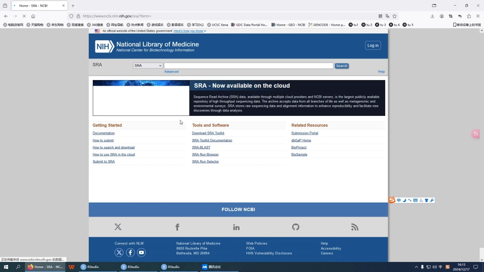
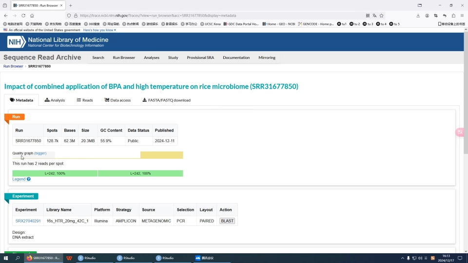
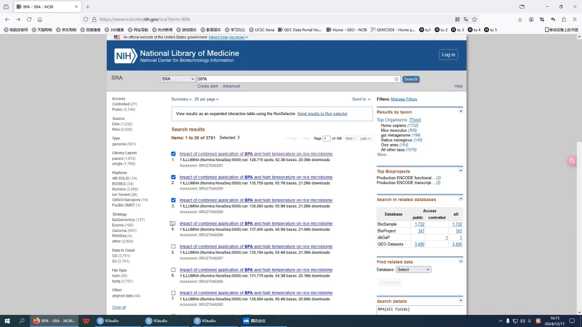
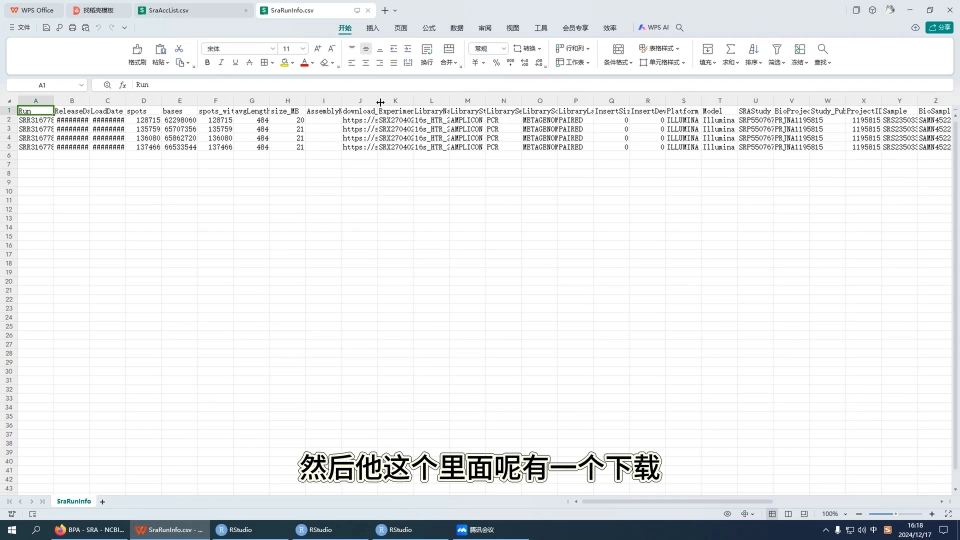
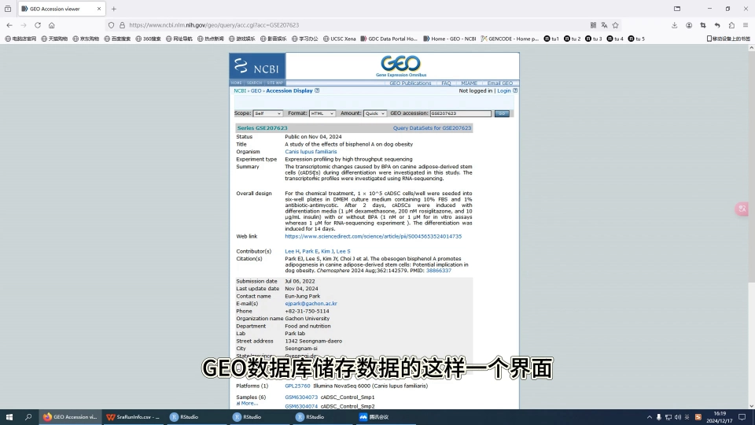
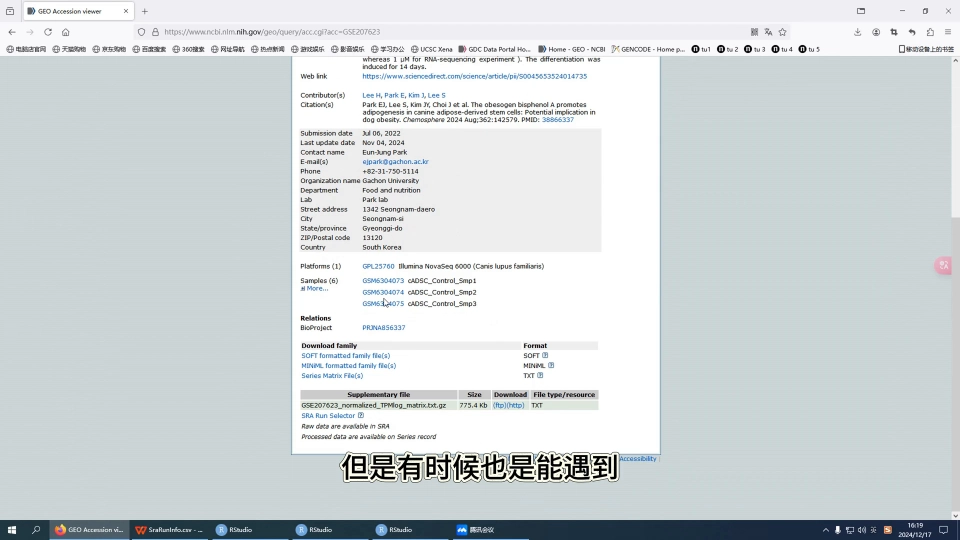
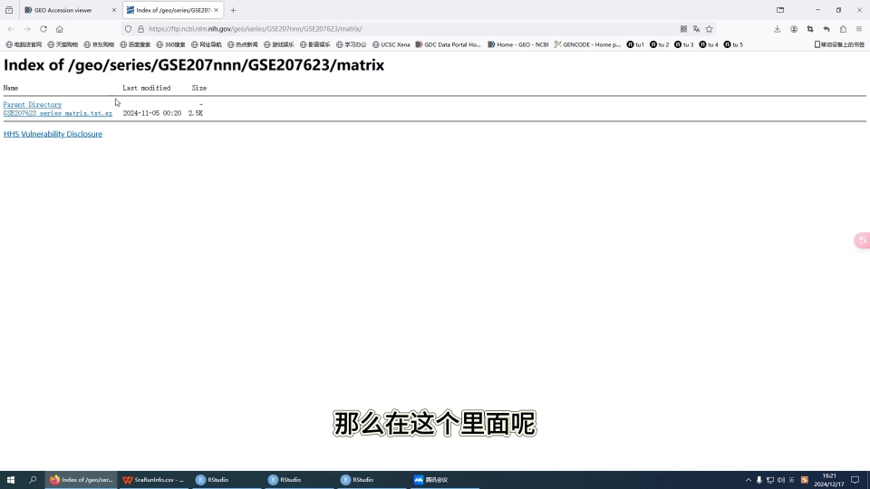
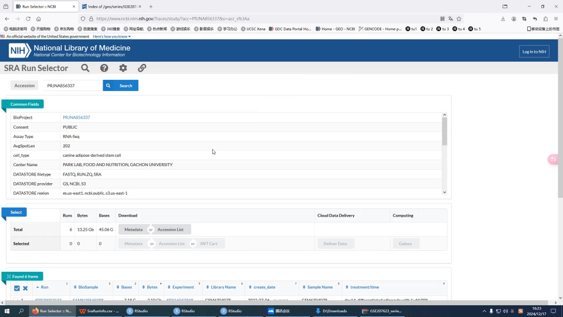
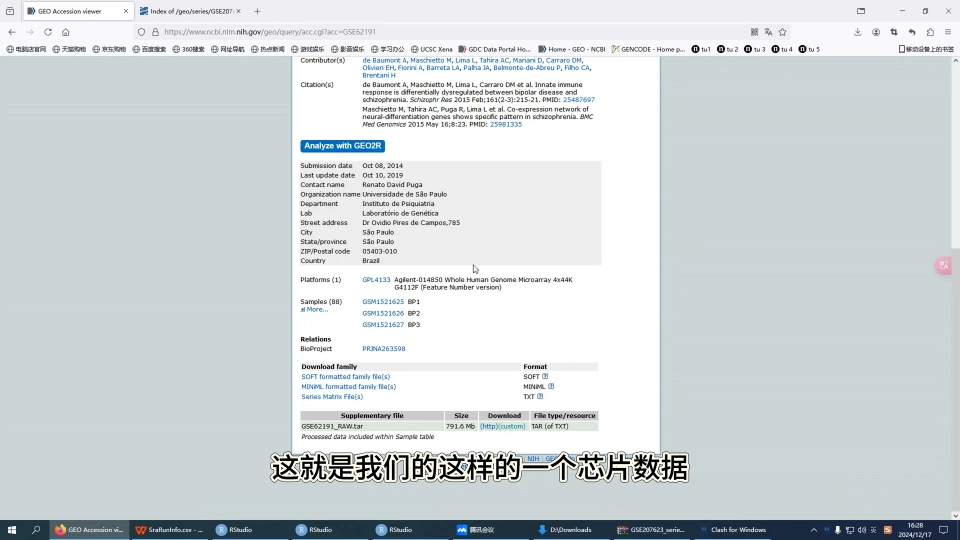
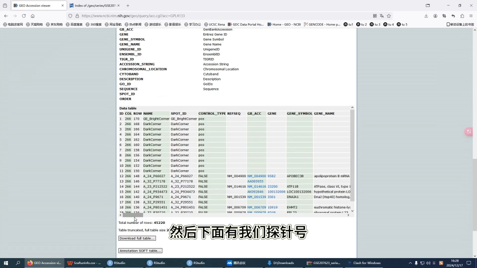

# SRA 与 GEO 是同一批数据的两副面孔：原始读段与处理后矩阵

> 视频来源：[SRA数据库GEO数据库转录组原始文件高通量数据芯片数据](https://www.bilibili.com/video/BV1W8kMYCEok/)（Bilibili · 大碗豌杂加个蛋）｜时长约 11 分钟
> 导读：这支视频用十几分钟把 NCBI 两个最常用的库摆在一起对照：SRA 里是原始测序数据，GEO 里是处理好的表达数据；并且现场演示了同一个 GEO 页面上，「处理后的矩阵」和「原始 SRR 文件」分别从哪个入口取。本文按「两层分工 → 各自层级 → 三个数据出口 → 该选哪一层」重排，只讲结构与存在形式，不写成下载教程。

## 本讲要解决的核心问题（SCQA）

**背景**：做转录组或单细胞分析，几乎绕不开 NCBI 的两个库：SRA（Sequence Read Archive，序列读段档案）和 GEO（Gene Expression Omnibus，基因表达综合数据库）。很多人默认它们是两个独立的数据源，各查各的。

**冲突**：同一个研究，在两个库里都能搜到；同一篇论文的「数据可用性」声明里，往往同时给出一个 GSE 号和一个 PRJNA 号。更麻烦的是，从 GEO 下载下来的文件有时是表达矩阵，有时只是一堆样本信息——同一个按钮，拿到的却是两种完全不同的东西。

**疑问**：这两个库到底是什么关系？我要的分析起点，应该从哪一层取？

**回答（中心思想）**：SRA 和 GEO 不是两个数据源，而是**同一批数据的两层**。SRA 存的是测序仪吐出来的原始读段，以 SRR（一次测序运行）为最小可下载单位；GEO 存的是作者提交的、带实验设计说明的数据集，以 GSE（一项研究）为单位，附处理后的矩阵和样本元数据。**只想做下游分析，GEO 通常够用；想自己跑上游流程，才必须下到 SRA 那一层。**

## 一、两层的分工，一句话就能说清

视频开头把两者的差别讲得非常干脆：**GEO 数据库储存的是处理好的、可以直接使用的转录组表达数据；SRA 里面储存的是原始的测序数据** [【跳转到 00:25】](https://www.bilibili.com/video/BV1W8kMYCEok/?t=25)。

这句话里有两个关键词值得拆开：

- **「处理好的」**：指已经过比对、定量、甚至归一化的结果。你拿到的是一个「基因 × 样本」的数值表，可以直接做差异分析。
- **「原始的」**：指测序仪输出的读段（reads）。你拿到的是碱基序列本身，必须自己比对到参考基因组、自己计数，才能得到表达矩阵。

所以两者的关系不是「两个仓库」，而是**同一条分析流水线上的两个位置**：

```
测序仪 → 原始读段（SRA 层） → 比对/定量 → 表达矩阵（GEO 层） → 下游分析
```

越往左，数据越原始、体积越大、自由度越高；越往右，数据越接近可用、体积越小、但作者的处理选择已经被固化进去了。



## 二、SRA 的层级：SRR 才是真正能下载的单位

在 SRA 里检索，看到的不是「一篇论文一条记录」，而是一层套一层的编号。视频里的操作把三层都点到了：

1. **BioProject / Study（PRJNA、SRP 开头）**：一项研究的整体，相当于「这个课题一共测了什么」；
2. **Experiment（SRX 开头）**：一次测序实验的设计，包含平台、文库、测序策略（单端还是双端）；
3. **Run（SRR 开头）**：一次测序运行产出的文件，**这才是真正能下载的 FASTQ 单位**。

视频演示的页面正好把这三层并排显示出来：一个 Run 编号下面，同时给出它的 Experiment 编号、平台（Illumina）、策略（AMPLICON）、Layout（PAIRED，双端），以及 GC 含量、碱基数等质控信息 [【跳转到 01:09】](https://www.bilibili.com/video/BV1W8kMYCEok/?t=69)。



一个必须记住的细节：**一个 Experiment 可能对应多个 Run**。同一样本分多个 lane 测序、或者分批补测，都会产生多个 SRR，但它们共享同一个 SRX。所以「下载一个样本」在 SRA 里往往意味着「下载好几个 SRR，再合并」——这也是为什么单细胞数据在 SRA 里的组织方式比在 GEO 里麻烦。

视频还点出了双端测序的意义：**双端测序比单端测序更准确一些**，但上游处理上也有一些区别 [【跳转到 01:09】](https://www.bilibili.com/video/BV1W8kMYCEok/?t=69)。对 10x 单细胞数据来说，这一点尤其关键——R1 是 barcode + UMI，R2 才是转录本序列，两个文件必须配对处理。

### 2.1 检索结果怎么变成一张下载清单

SRA 的检索结果页支持按物种、文库策略、平台、测序策略等条件过滤，也可以勾选多条记录后一次性导出 [【跳转到 00:59】](https://www.bilibili.com/video/BV1W8kMYCEok/?t=59)。



勾选之后点 Send to → File，选择 **Accession List**，就得到一个只含 SRR 编号的纯文本文件 [【跳转到 01:42】](https://www.bilibili.com/video/BV1W8kMYCEok/?t=102)：


这张清单的意义在于：**它是「这批数据包含哪些测序运行」的可核查凭证**。你在方法部分写「从 SRA 下载了 N 个 run」，依据就是这张表。

如果选择 Run Selector 导出的完整表格，信息量更大——一行一个 Run，同时带有 BioProject、Experiment、Sample、Library Name、Platform、Layout 等列 [【跳转到 03:45】](https://www.bilibili.com/video/BV1W8kMYCEok/?t=225)：



这张表其实是本节最有用的东西：**它把「研究 → 实验 → 运行 → 样本」的映射关系直接摊平成一行行数据**。想知道哪个 SRR 属于哪个样本、哪个样本属于哪个项目，看这张表就够了。

视频里还顺手做了个工程提醒：用 NCBI 官方工具在服务器上下载速度比较慢，尤其是公共服务器很多人同时用的时候更慢；讲者更推荐先用下载工具把文件拉到本地，再传到服务器上 [【跳转到 02:56】](https://www.bilibili.com/video/BV1W8kMYCEok/?t=176)。这属于经验之谈，具体命令不在本文范围。

## 三、GEO 的层级：GSE 是入口，页面上有三个数据出口

切到 GEO，第一眼看到的界面和 SRA 完全不同：它按「研究」组织，页面上是 GSE 号、数据类型、平台、样本列表 [【跳转到 04:36】](https://www.bilibili.com/video/BV1W8kMYCEok/?t=276)。



一个 GSE 页面往下滑，会依次遇到三类「能拿到东西的地方」，它们给的完全不是同一种数据：

| 出口 | 给的是什么 | 什么时候用 |
| --- | --- | --- |
| Series Matrix File | 作者整理好的表达矩阵 + 样本信息（芯片数据通常在这里） | 做下游分析，且作者提供了矩阵 |
| Supplementary file | 作者上传的附加文件（可能是 TPM 矩阵、也可能是 RAW.tar） | Series Matrix 里没有矩阵时，来这里找 |
| SRA / BioProject 链接 | 原始读段的入口（跳到 SRA Run Selector） | 想自己跑上游流程 |

视频里演示的那个 GSE（GSE207623）正好把三者同时挂在页面上 [【跳转到 05:01】](https://www.bilibili.com/video/BV1W8kMYCEok/?t=301)：

- Platforms (1)：GPL25750，Illumina NovaSeq 6000；
- Samples (6)：GSM6304072 等 6 个样本；
- Relations：BioProject PRJNA858337；
- Download family：SOFT、MINiML、Series Matrix Files；
- Supplementary file：`GSE207623_nonnormalized_TPM_...txt.gz`；
- 页面底部两行小字：**Raw data are available in SRA / Processed data are available on Series record**。



**这两行小字就是本节的核心证据**：同一个数据集，GEO 页面自己就写明了「原始数据在 SRA、处理后数据在 Series 记录」。它们不是两个库，是同一份研究的两个出口。

Series Matrix 文件本身长这样——一个压缩包，文件名由 GSE 编号加上 series_matrix 后缀组成，扩展名是 txt.gz [【跳转到 06:00】](https://www.bilibili.com/video/BV1W8kMYCEok/?t=360)：



## 四、同一份研究的两副面孔：GEO 页面上的 BioProject

把上面两条线索接起来，就得到本节最重要的判断：

**GEO 的一个 GSE，对应 SRA 里的一个 BioProject；GSE 里的一批 GSM，对应 SRA 里的一批 SRR。**

视频里演示的路径是：在 GEO 的 GSE 页面点 SRA Run Selector，直接跳到以该 BioProject 为筛选条件的 Run 列表页 [【跳转到 07:36】](https://www.bilibili.com/video/BV1W8kMYCEok/?t=456)。



这张页面把两层的对应关系摊开在眼前：

- 顶部 **Common Fields** 是全项目共享的信息（BioProject、Assay Type = RNA-Seq、Center Name 等）；
- 中间 **Runs 表格**是逐个测序运行的信息，每行一个 Run，可导出 Metadata 或 Accession List；
- 底部还可以直接投递到云平台（Cloud Data Delivery）或 Galaxy。

所以「GEO 和 SRA 是什么关系」这个问题，标准答案是：**它们是同一批数据的目录层与文件层**。GEO 给你的是「这项研究是什么、有哪些样本、作者算好的矩阵在哪」；SRA 给你的是「这项研究实际产出了哪些测序文件」。


## 五、GEO 给的矩阵不一定是同一种东西：芯片 vs 高通量

视频后半段做了一个很多人会踩坑的对比：**同样是 GEO 的 Series Matrix File，芯片数据和高通量数据里面装的东西不一样** [【跳转到 06:00】](https://www.bilibili.com/video/BV1W8kMYCEok/?t=360)。

- **芯片数据**：Series Matrix File 里通常直接有作者处理好的表达矩阵，下载即用；
- **高通量（RNA-seq）数据**：Series Matrix File 里往往只有临床数据和表型信息，**没有表达矩阵**；矩阵要另外去 Supplementary file 里找。

视频里那个高通量数据集的 Supplementary file 就明确标注了格式：**归一化后的 TPM 表达数据** [【跳转到 06:35】](https://www.bilibili.com/video/BV1W8kMYCEok/?t=395)。

这一点直接影响你后面用什么方法：

| 拿到的数据形态 | 常见处理方式（视频提到的） |
| --- | --- |
| TPM（已归一化） | 用 edgeR 之类的包处理 |
| count（原始计数） | 用 DESeq2 之类的包处理 |

讲者顺带说了一句很实在的话：数据处理时有很多操作，具体怎么选要看数据的形态 [【跳转到 07:00】](https://www.bilibili.com/video/BV1W8kMYCEok/?t=420)。**换句话说，下载之前就得知道「我要的是 count 还是 TPM」——这决定了你该点哪个文件。**

## 六、平台决定「一行是什么」：探针号与基因名

视频还演示了芯片数据的结构，这一段解释了为什么 GPL 平台页那么重要。

在一个芯片数据集（GSE52191）的页面上，可以看到 Platforms 是 GPL4133（Agilent 的芯片），Samples 有 88 个，页面上还带一个 Analyze with GEO2R 按钮 [【跳转到 08:20】](https://www.bilibili.com/video/BV1W8kMYCEok/?t=500)：



点进探针号，看到的是平台注释表：左边是探针 ID，右边是 GENE_SYMBOL、GENE_NAME 等字段 [【跳转到 08:45】](https://www.bilibili.com/video/BV1W8kMYCEok/?t=525)：



这里有一个必须处理的现实问题：**多个探针可能对应同一个基因**。视频给的做法是，对表达数据排序，取表达量最大的那个探针，作为该基因的表达量 [【跳转到 09:10】](https://www.bilibili.com/video/BV1W8kMYCEok/?t=550)。

这条规则听起来随意，其实是芯片数据处理的标准操作之一：探针是设计出来的，不是基因本身，同一基因被多个探针覆盖时，取哪一个都会引入偏差，取「表达量最大」是一种常见且保守的选择（保留信号最强的那条）。**重要的是把这个选择写进方法部分**，而不是默默做掉。

对单细胞数据来说，这一步的等价物是「基因注释」：10x 的 `features.tsv` 里同时给出 Ensembl ID 和 gene symbol，处理时要明确用哪一列做索引，否则同名基因或缺失 symbol 的基因会出问题。

## 七、什么时候必须去 SRA，什么时候 GEO 就够

把视频里的信息收成一张决策表：

| 你的目标 | 该取哪一层 | 原因 |
| --- | --- | --- |
| 做差异表达、聚类、细胞注释 | GEO 的矩阵 | 作者已经比对定量，省掉最耗时的一步 |
| 想统一重跑上游流程（同一套比对与定量参数） | SRA 的原始读段 | 只有原始 reads 才能自己控制比对与计数 |
| 想提取 barcode / UMI 层面的信息（如重新做 cell calling） | SRA 的原始读段 | 处理后的矩阵已经丢掉了这些信息 |
| 想核对作者的处理是否有问题 | 两层都要 | 用原始数据复现，再与作者的矩阵比对 |
| 只想看某个基因在哪些研究中被检测到 | GEO Profiles | 以基因为单位的视图 |

视频结尾还留了一句很关键的提醒：**作者提供的数据不一定是百分之百准确的**，原始数据的处理虽然麻烦，但可以自己处理 [【跳转到 10:31】](https://www.bilibili.com/video/BV1W8kMYCEok/?t=631)。

这句话是整支视频的价值判断：GEO 的便利是「别人替你算好了」，代价是「你接受了别人的每一个处理选择」——用哪个参考基因组、用哪种归一化、有没有去掉低质量细胞，这些都不在你的控制范围内。当结论对处理方式敏感时，回退到 SRA 那一层重新算，是唯一可靠的办法。

## 小结

- **SRA 与 GEO 是两层，不是两个源**：SRA 存原始读段，GEO 存处理后的数据集与元数据；同一份研究在两边都能找到。
- **SRA 的层级**：BioProject（研究）→ Experiment（SRX，一次实验设计）→ Run（SRR，一次测序运行）；**SRR 才是能下载的单位**，一个 SRX 可能对应多个 SRR。
- **GEO 的层级**：GSE（系列）→ GSM（样本）→ GPL（平台）；GSE 页面同时挂着处理后的矩阵和通往 SRA 的 BioProject 链接。
- **GEO 页面有三个数据出口**：Series Matrix File、Supplementary file、SRA 链接；它们给的完全不是同一种东西。
- **芯片与高通量在 GEO 里的长相不同**：芯片的矩阵常在 Series Matrix 里，RNA-seq 的矩阵常在 Supplementary file 里，且要看清是 count 还是 TPM。
- **平台决定「一行是什么」**：芯片是探针，需要靠 GPL 注释表翻译成基因，多探针对应同一基因时取表达量最大者。
- **判断标准很简单**：要「能直接分析的表」就去 GEO，要「能自己重算的读段」就去 SRA。

## 关键术语速查

| 术语 | 一句话解释 |
| --- | --- |
| SRA | Sequence Read Archive，NCBI 的原始测序读段档案库，储存 FASTQ 级数据 |
| GEO | Gene Expression Omnibus，NCBI 的基因表达综合数据库，以研究为单位组织数据 |
| BioProject | 一项研究的项目编号（PRJNA 开头），是 GEO 与 SRA 之间的桥 |
| SRP | SRA 中 Study 级别的编号前缀，对应一项研究 |
| SRX | Experiment 编号前缀，指一次测序实验的设计（平台、文库、策略） |
| SRS | Sample 编号前缀，指一个样本 |
| SRR | Run 编号前缀，指一次测序运行产出的文件，是实际下载单位 |
| GSE | GEO 的 Series 编号，一项研究的数据集 |
| GSM | GEO 的 Sample 编号，一个样本及其元数据 |
| GPL | GEO 的 Platform 编号，测序或芯片平台，决定探针与基因的映射 |
| Accession List | 只含编号（如 SRR）的清单文件，用于批量下载与结果核查 |
| Run Selector | SRA 的批量筛选与导出工具，可把 Run、Experiment、Sample 的对应关系导成表 |
| Series Matrix File | GEO 提供的矩阵文件，芯片数据通常含作者处理好的表达矩阵 |
| Supplementary file | 作者上传的附加文件，可能是 TPM 矩阵，也可能是 RAW.tar |
| TPM | Transcripts Per Million，按转录本长度与测序深度归一化后的表达量 |
| count | 原始计数矩阵，未经归一化，适合 DESeq2 等基于负二项分布的模型 |