# CELLxGENE Discover：用统一字段在网页上跨数据集找细胞

> 视频来源：[CellxGene数据库](https://www.bilibili.com/video/BV13XTx6EEoP/)（B 站 · AI4Biology）｜时长约 6 分钟
> 导读：这支视频是一次完整的网页操作演示——以脑类器官图谱为例，从 Datasets 筛选、进 Explore 看 UMAP，到查 SOX2 / PAX6 / MAP2 三个基因的表达。本文在复述操作的同时，重点补上视频画面里那两栏字段（Standard Categories 与 Author Categories）背后的含义：为什么同一个筛选框可以跨数据集找细胞。字幕为 B 站 AI 字幕，术语已按画面订正。

## 本讲要解决的核心问题（SCQA）

**背景**：单细胞 RNA 测序已经积累了大量公开数据，研究者想看"某类细胞里某个基因表达高不高"，理论上数据都是现成的。

**冲突**：这些数据分散在不同的数据库里，而且分析过程需要有编程能力——想回答上面那个小问题，通常要先下载几十 G 的矩阵、搭一套分析流程。使用门槛比较高。

**疑问**：能不能不下载数据、不写代码，直接在网页上按细胞类型、按基因去查？

**回答（中心思想）**：CELLxGENE Discover 就是为这件事做的：它把公开发表的单细胞数据收进一个平台，用**统一的字段**描述每个数据集（技术、细胞类型、组织、疾病、物种、供体……），于是"按细胞类型检索"这种跨数据集的查询才成立；但它是**初步探索**工具，复杂的分析仍然要回到专业软件里做。

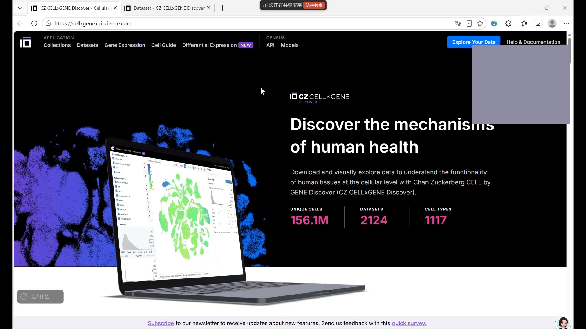

[【跳转到 00:00】](https://www.bilibili.com/video/BV13XTx6EEoP/?t=0)

---

## 一、先分清 CELLxGENE 的三层：门户、字段规范、Census

视频开头一句话交代了它的身份：工具叫 **CELLxGENE Discover**，由 **Chan Zuckerberg Initiative（CZI）** 开发和维护，是一个单细胞组学数据库与在线分析平台 [【跳转到 00:00】](https://www.bilibili.com/video/BV13XTx6EEoP/?t=0)。它建立的动机很直接——"为了提高数据共享和利用效率，CELLxGENE 建立了统一的平台，使研究人员可以直接浏览、检索和分析公开发表的单细胞测序数据，无需自己搭建复杂的分析流程" [【跳转到 00:24】](https://www.bilibili.com/video/BV13XTx6EEoP/?t=24)。

看首页顶部导航栏，其实写着两套东西：

| 位置 | 入口 | 它是什么 |
| --- | --- | --- |
| 左侧 APPLICATION | Collections / Datasets / Gene Expression / Cell Guide / Differential Expression | **网页门户**，用来浏览、筛选、可视化、下载单个数据集 |
| 右侧 CENSUS | API / Models | **把所有数据集拼成一张大表**的版本，供程序化查询 |

初学者最容易只看见左边那一半，以为 CELLxGENE 就是个"数据下载站"。但真正让它区别于普通数据库的，是每个数据集在入库时必须满足的一套字段规范：**门户是界面，字段规范才是它的核心**。视频里没有专门讲这套规范的名称，但演示过程中它一直摆在屏幕左侧——下一节就来看它。

目前平台收录了大量人类和模式生物的单细胞数据，被广泛应用于发育生物学、神经科学、肿瘤学和药物研发等领域 [【跳转到 00:36】](https://www.bilibili.com/video/BV13XTx6EEoP/?t=36)。

## 二、Datasets 页：为什么"筛选框"比"搜索框"更值钱

演示从左上角的 **Datasets** 开始 [【跳转到 00:56】](https://www.bilibili.com/video/BV13XTx6EEoP/?t=56)。这一页是理解 CELLxGENE 的关键，值得停下来看清楚：

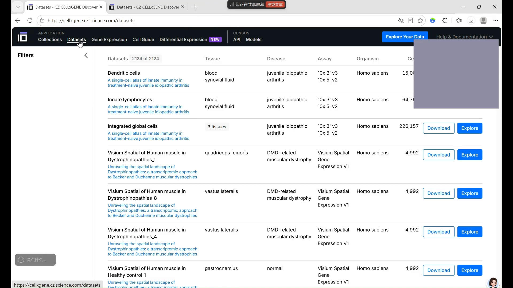

左侧 Filters 里列出的筛选维度，几乎就是每个数据集必须交代的信息：Assay、Cell Count、Cell Type、Consortium、Development Stage、Disease、Gene Count、Organism、Publication、Publication Date、Self-Reported Ethnicity、Sex、Suspension Type、Tissue。右侧列表的每一行，则用 Tissue / Disease / Assay / Organism 这几列把数据集"摊平"成一张表。

这一步为什么重要？因为**只有当所有数据集用同一套字段名、同一套取值时，跨数据集的筛选才可能**。如果一篇论文写 `lung`、另一篇写 `Lung`、第三篇写 `肺`，机器就没法把它们当成同一件事；一旦统一到受控词表（组织用 UBERON 这类本体、疾病用 MONDO 这类本体、细胞类型用 Cell Ontology），"筛出所有含 neural stem cell 的人类数据集"才是一次点击的事。

进入某个数据集的 Explore 界面后，这种"两套字段"的对比更明显：

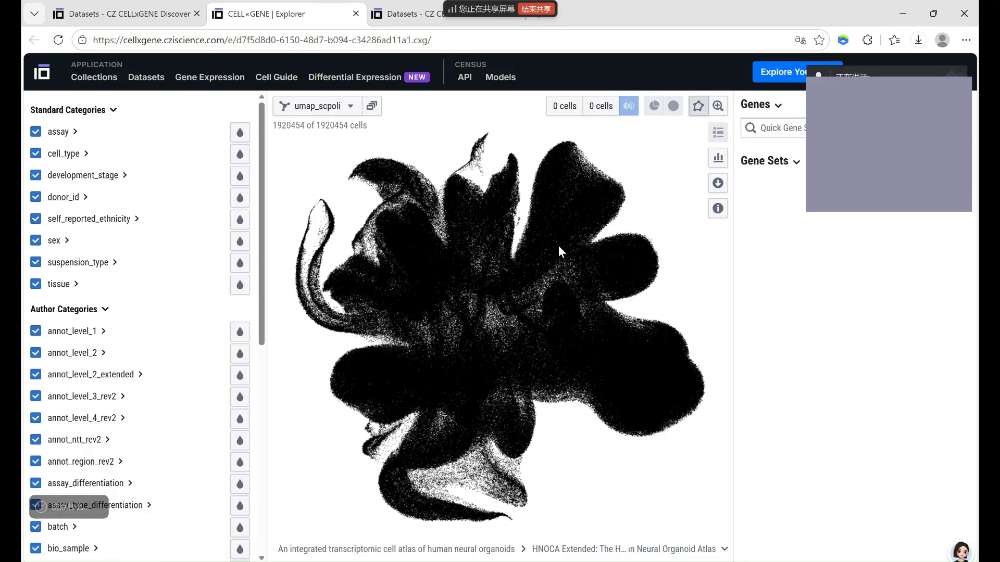

- **Standard Categories** 是标准化字段，值来自受控词表，所有数据集共用；
- **Author Categories** 是作者自己提交的注释，保留原始标签。

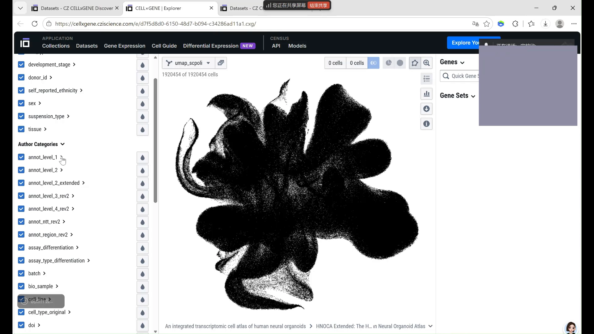

把这两栏放在一起看，就能理解 CELLxGENE 的取舍：它**不抹掉**作者的原始注释（`annot_level_1`、`cell_type_original` 这些细粒度标签都留着），但**额外强制**一套标准字段，让不同数据集之间至少有一个共同坐标系。字段名统一 + 取值统一，才谈得上"放在同一张表里比较"。

[【跳转到 02:23】](https://www.bilibili.com/video/BV13XTx6EEoP/?t=143)
## 三、按细胞类型检索：受控词表是分层的

演示者的例子是脑类器官：他想研究 brain organoid，于是在 **Cell Type** 筛选框里输入 neural stem cell [【跳转到 01:20】](https://www.bilibili.com/video/BV13XTx6EEoP/?t=80)。

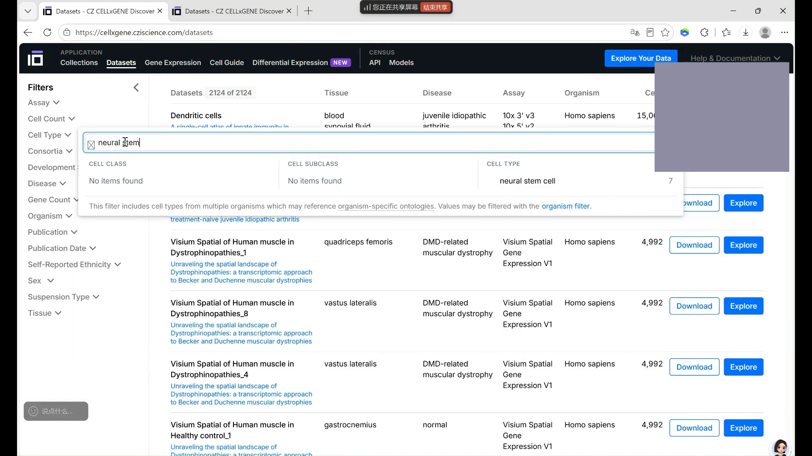

这个下拉框很能说明问题：候选不是一串平铺的字符串，而是分成 **CELL CLASS（细胞大类）→ CELL SUBCLASS（亚类）→ CELL TYPE（具体类型）** 三层。这正是 Cell Ontology 这类本体的组织方式——"neural stem cell" 落在第三层，而它上面还有更粗的类目。

分层的好处是查询时可以选择粒度：想找得全，就按大类筛；想找得准，就按具体细胞类型筛。如果每个数据集都自由命名，这种"按层级检索"根本无法实现。

## 四、进 Explore：192 万个细胞长什么样

筛选后，2124 个数据集里只剩 7 个命中 [【跳转到 01:44】](https://www.bilibili.com/video/BV13XTx6EEoP/?t=104)。

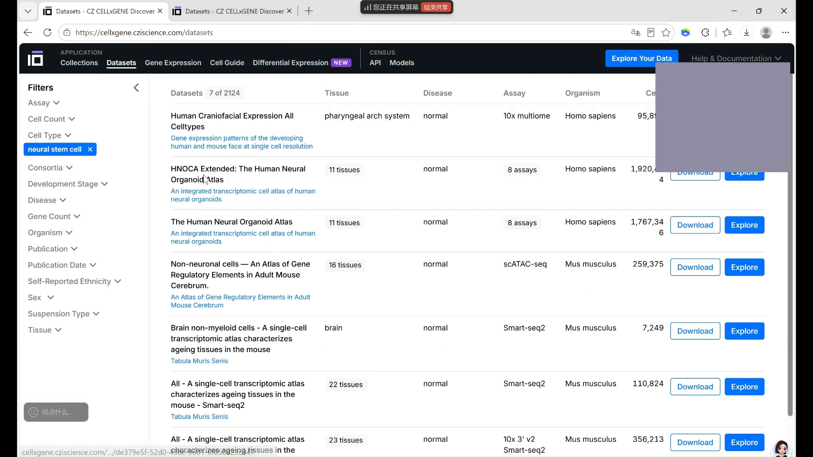

演示者选了其中一个：它整合了多个研究团队发表的数据，一共包含 **192 万个单细胞**，是目前规模最大的脑类器官单细胞图谱之一 [【跳转到 01:44】](https://www.bilibili.com/video/BV13XTx6EEoP/?t=104)。点击 **Explore** 进入分析界面 [【跳转到 01:56】](https://www.bilibili.com/video/BV13XTx6EEoP/?t=116)。

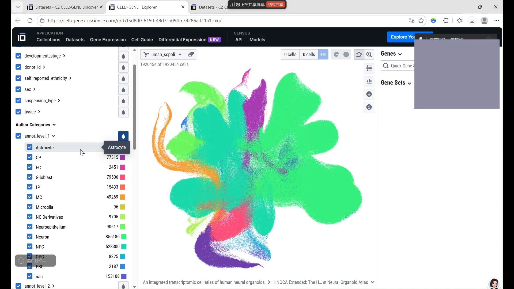

中间展示的是 **UMAP 降维图**。单细胞测序中每一个点代表一个细胞，由于原始数据的维度非常高，需要用 UMAP 这类降维方法把细胞投影到二维空间里展示 [【跳转到 02:11】](https://www.bilibili.com/video/BV13XTx6EEoP/?t=131)。

左侧的 **Author Categories → annot_level_1** 就是作者已经完成的细胞类型注释 [【跳转到 02:35】](https://www.bilibili.com/video/BV13XTx6EEoP/?t=155)。点击字段旁边的"水滴"图标，就可以按它给细胞上色，不同颜色代表不同的细胞群体 [【跳转到 02:39】](https://www.bilibili.com/video/BV13XTx6EEoP/?t=159)：

- **Astrocyte**（星形胶质细胞）、**Neuron**（神经元）、**NPC**（神经祖细胞）是其中几个常见群体；
- 图例旁边直接标出每个群体的细胞数（例如 Neuron 855186、NPC 528300），比例一目了然；
- 还有一个 **nan** 类别（15 万多个细胞），表示作者没有给出注释——这本身就是一条值得注意的信息。

这些结果说明，脑类器官中包含多种神经系统相关的细胞类型，具有比较高的细胞异质性 [【跳转到 03:03】](https://www.bilibili.com/video/BV13XTx6EEoP/?t=183)。

## 五、查基因：用表达分布反过来验证细胞身份

除了观察细胞组成，这个平台还可以分析特定基因的表达模式 [【跳转到 03:03】](https://www.bilibili.com/video/BV13XTx6EEoP/?t=183)。右侧有一个基因搜索框 [【跳转到 03:15】](https://www.bilibili.com/video/BV13XTx6EEoP/?t=195)，演示者依次查了三个基因。

**SOX2**：经典的神经干细胞和神经祖细胞标志基因 [【跳转到 03:26】](https://www.bilibili.com/video/BV13XTx6EEoP/?t=206)。

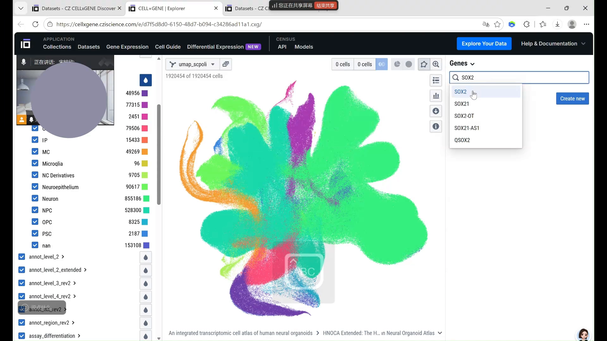

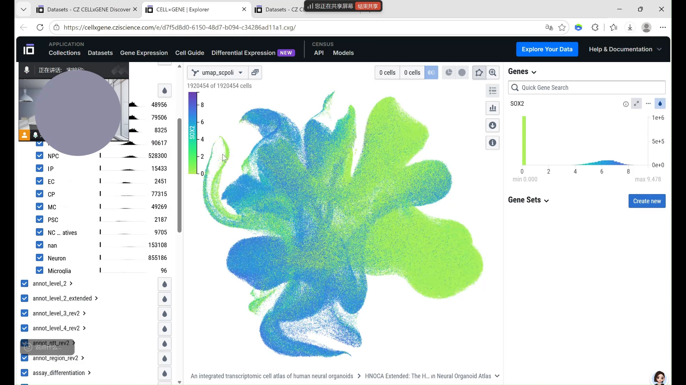

在表达图中，不同的颜色深浅代表表达水平的高低。可以看到 SOX2 主要表达于部分细胞群体，说明这些区域富含神经祖细胞 [【跳转到 03:38】](https://www.bilibili.com/video/BV13XTx6EEoP/?t=218)。界面右侧还会同时给出该基因的分布直方图（最小值 0、最大值约 9.5）和按细胞类型分组的小提琴图——**同一张图既能看"在哪些细胞里"，也能看"表达量多少"**。

**PAX6**：神经发育过程中重要的转录因子，在神经前体细胞中有较高的表达 [【跳转到 03:50】](https://www.bilibili.com/video/BV13XTx6EEoP/?t=230)。

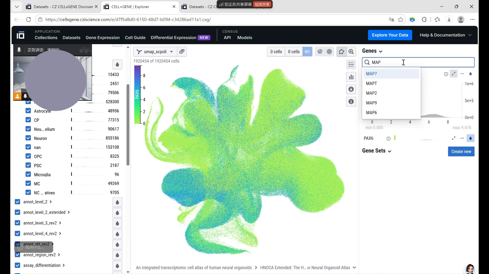

**MAP2**：成熟神经元的标志基因。如果 MAP2 的表达水平较高，就说明部分神经细胞已经发生了神经元分化 [【跳转到 04:14】](https://www.bilibili.com/video/BV13XTx6EEoP/?t=254)。

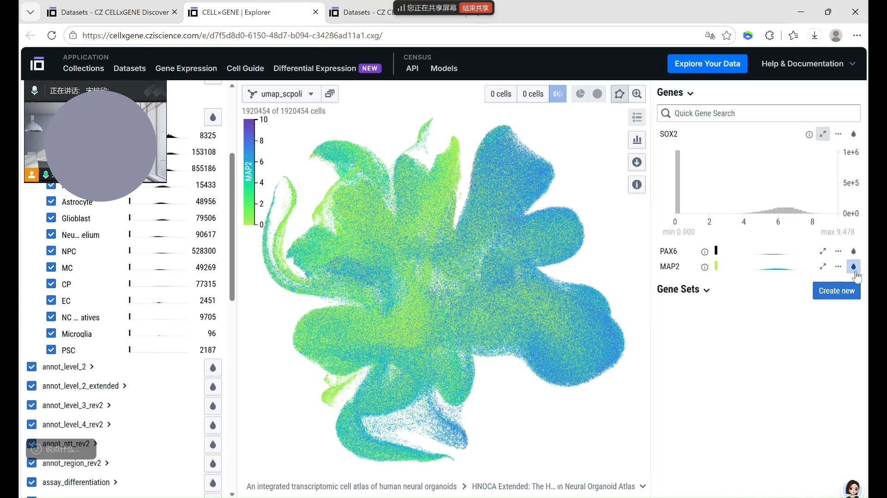

于是通过比较 SOX2 和 MAP2 的表达情况，就可以观察脑类器官从神经祖细胞向成熟神经元分化的过程 [【跳转到 04:26】](https://www.bilibili.com/video/BV13XTx6EEoP/?t=266)。这一步的隐含逻辑值得记住：**细胞类型的注释是作者给的，但基因表达是数据本身给的**——用 marker 基因的表达去核对注释，是判断"这份注释靠不靠谱"最便宜的办法。

## 六、这套界面能回答的四类问题

回到 UMAP 图，视频总结了这类探索能快速回答的问题 [【跳转到 04:50】](https://www.bilibili.com/video/BV13XTx6EEoP/?t=290)：

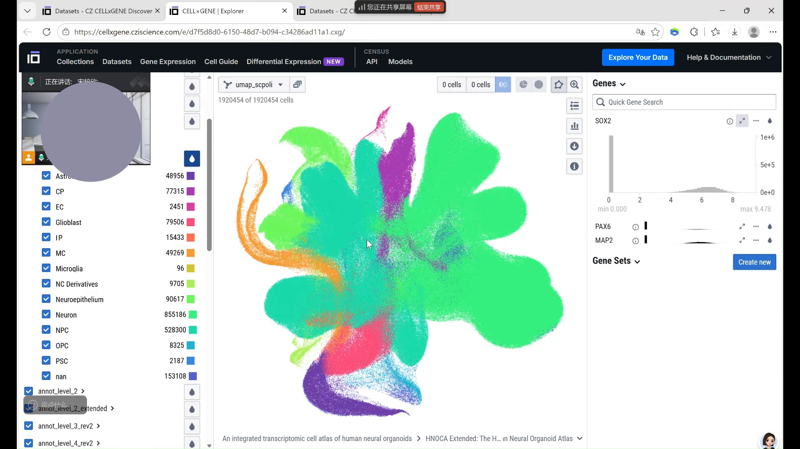

1. 这个样本/图谱里包含哪些细胞类型？
2. 不同细胞类型的比例如何？
3. 某个基因主要在哪些细胞中表达？
4. 某个过程（比如神经发育）是否能够正常进行？

这些问题通常需要一套复杂的单细胞分析流程，但通过 CELLxGENE 这个网页界面就可以完成**初步的探索** [【跳转到 05:02】](https://www.bilibili.com/video/BV13XTx6EEoP/?t=302)。

## 七、优点与局限：它保证"可比较"，不保证"正确"

视频最后对这个工具做了简单评价 [【跳转到 05:14】](https://www.bilibili.com/video/BV13XTx6EEoP/?t=314)。

**优点**（[【跳转到 05:26】](https://www.bilibili.com/video/BV13XTx6EEoP/?t=326)）：

- 免费开放；
- 数据资源非常丰富；
- 操作简单，不需要有编程基础，非常适合快速探索公开的单细胞数据。

**局限**（[【跳转到 05:38】](https://www.bilibili.com/video/BV13XTx6EEoP/?t=338)）：

- 只能做初步的分析，复杂的分析还是需要使用其他更专业的软件；
- 分析结果比较依赖原始的数据质量和细胞注释的准确性。

第二点尤其要展开一句：统一字段能保证每个数据集**都有** `cell_type` 这一列，但不能保证这一列**填得对**。注释是提交者写的，标准化的作用是把不同来源的注释映射到共同词表上——映射过程本身可能把作者原本更细的标签合并掉（这也是为什么 Explore 里还保留着一整套 Author Categories）。所以在这类门户上做探索，合理的姿势是：**先用标准字段快速定位到相关数据集和细胞群，再回原始注释（annot_level_1 到 annot_level_4、`cell_type_original`）核对细粒度标签，最后下载数据自己做分析**。

## 八、在扰动组学里，它提供的是"基线"

视频提到，CELLxGENE 不仅可以用于脑类器官研究，还可以应用于疾病机制研究、药物筛选以及精准医学等领域 [【跳转到 05:50】](https://www.bilibili.com/video/BV13XTx6EEoP/?t=350)。

放到本系列的主线上看，它的位置很清楚：CELLxGENE 主要收录的是**观察性图谱**（正常组织、疾病组织、发育过程），遗传扰动、药物扰动这类数据更多在专门的资源里。但正因为它的字段是统一的，它给出的"正常组织里各类细胞长什么样"才可以直接当作**基线参考**——扰动实验读出响应之后，要和这样一份标准化的基线对齐，才能说清楚"偏离了多少、偏在哪一类细胞上"。

一句话收束：**CELLxGENE 是标准化的基线图谱，扰动数据要跟它对齐，才谈得上"偏离"。**

## 小结

- CELLxGENE Discover 由 CZI 维护，解决的是"数据分散 + 分析要编程"这两个门槛：把公开数据收进一个平台，网页上就能浏览、检索、可视化。
- 它的核心不是"又存了一份数据"，而是每个数据集必须满足的统一字段：assay、cell_type、tissue、disease、organism、sex、development_stage、donor_id、suspension_type 等。
- 字段统一之外，取值也要统一：细胞类型用 Cell Ontology（CELL CLASS / SUBCLASS / TYPE 三层），组织、疾病各自映射到对应本体。只有字符串标签是没法自动合并的。
- Explore 界面把 Standard Categories 与 Author Categories 并列，既保留作者原始注释，又提供共同坐标系。
- 典型用法是三步：Datasets 按字段筛选 → Explore 看 UMAP 和细胞组成 → 搜 marker 基因核对注释。
- 局限同样明确：只做初步探索，结论依赖原始数据质量与注释准确性；深度分析仍要下载数据、回到专业软件。

## 关键术语速查

| 术语 | 一句话解释 |
| --- | --- |
| CELLxGENE Discover | CZI 维护的单细胞数据门户，网页端浏览、检索、可视化公开发表的单细胞数据 |
| Collections | 门户里按主题/论文组织的数据集集合，一个 collection 下可含多个 dataset |
| Explore | 单个数据集的可视化界面：UMAP、按字段上色、基因表达查询 |
| Standard Categories | 标准化字段（assay、cell_type、tissue、donor_id 等），值来自受控词表，跨数据集通用 |
| Author Categories | 提交者自带的原始注释字段，如 annot_level_1、cell_type_original |
| Cell Ontology | 细胞类型的受控词表，分 CELL CLASS / CELL SUBCLASS / CELL TYPE 层级 |
| UBERON / MONDO | 分别描述解剖结构（组织）与疾病的本体，用来给 tissue、disease 字段提供统一 ID |
| UMAP | 把高维表达谱压到二维的降维方法，图上每个点是一个细胞 |
| marker 基因 | 某一细胞类型高表达、可用来识别该类型的基因，如 SOX2（神经祖细胞）、MAP2（成熟神经元） |
| Census | 把所有已收录数据集拼成一张大表（按细胞、按基因）的版本，可通过 API 程序化查询 |
