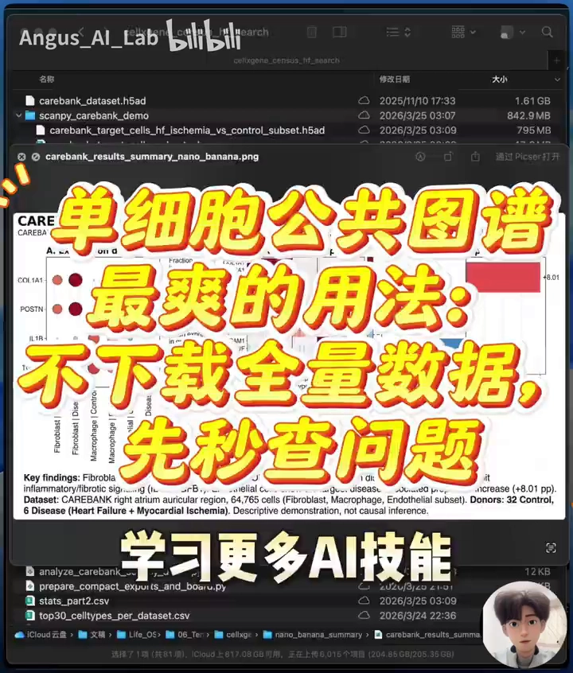
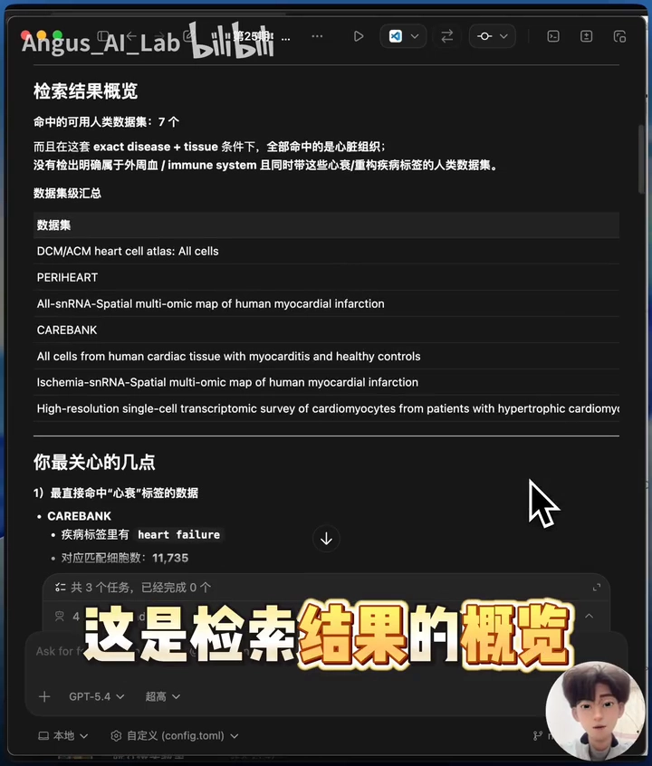
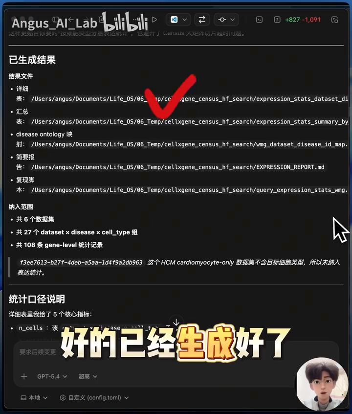
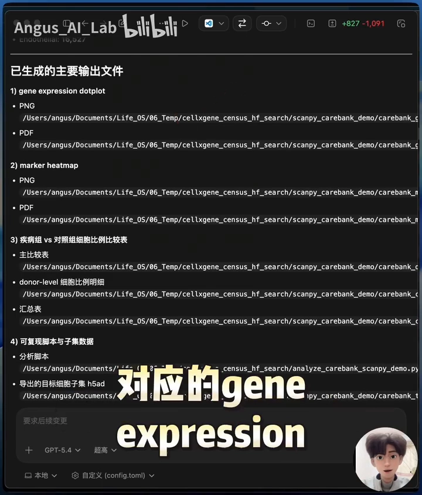
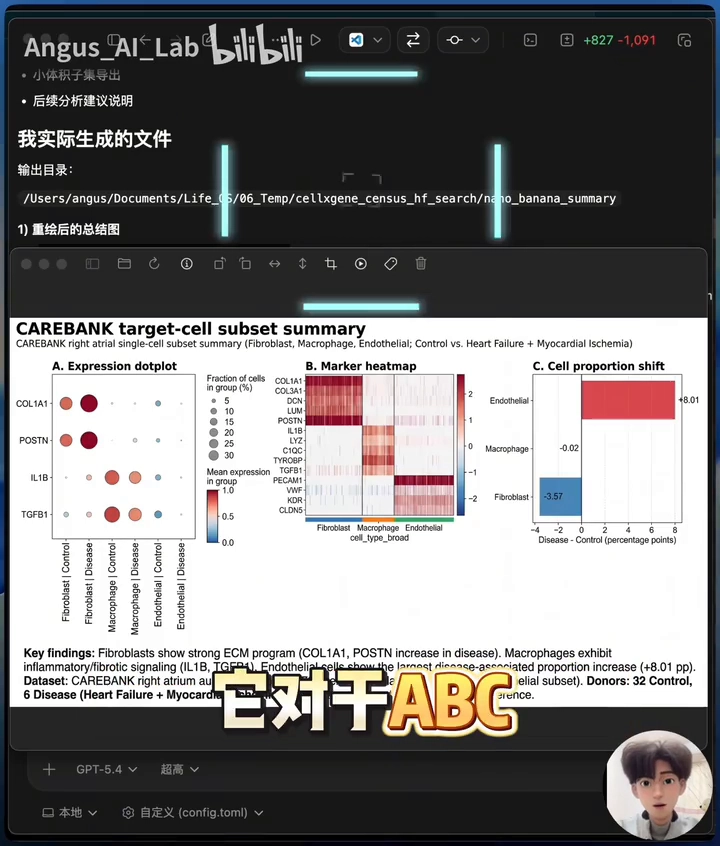
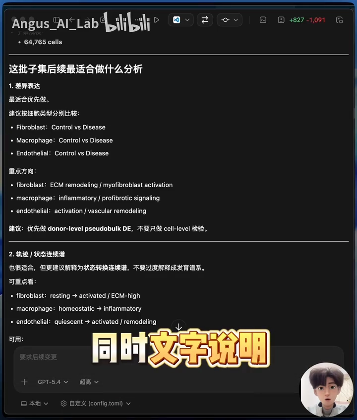
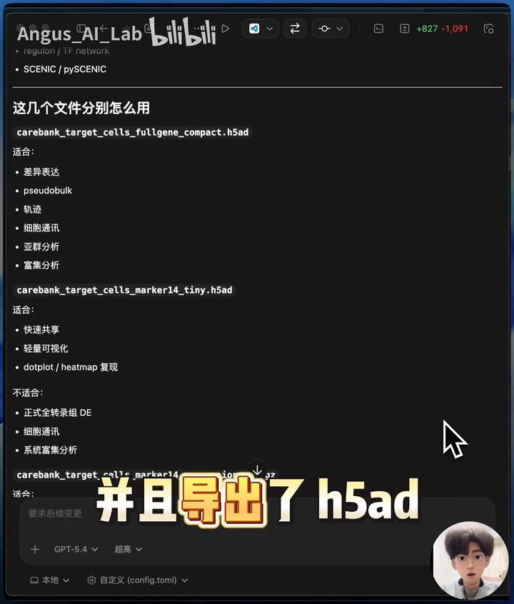

# 不下载全量数据也能查：用 CELLxGENE Census 按组织、疾病、细胞类型取子集

> 视频来源：[第25期：CELLxGENE 单细胞图谱速查](https://www.bilibili.com/video/BV1YKD1BCEzF/)（B 站 · Angus_AI_Lab）｜时长约 3 分半
> 导读：这支短片演示的不是"怎么分析"，而是"怎么少搬数据"——用 CELLxGENE Census 按物种、组织、疾病、细胞类型直接取子集，再交给 Scanpy 出图。字幕为 B 站 AI 字幕、口语密度很高，基因名与工具名已按上下文订正；文中对流程的取舍见各节说明。

## 本讲要解决的核心问题（SCQA）

**背景**：CELLxGENE 这类门户已经把大量公开单细胞数据收进统一字段，理论上"按细胞类型查表达"已经可以做到。

**冲突**：真到动手时，最劝退人的不是不会分析，而是数据太大——下载慢、解压慢、读进去更慢。你只想看肌成纤维细胞里 COL1A1 和 POSTN 的表达，却要先和几十上百 G 的矩阵搏斗。

**疑问**：能不能不把全量数据搬回本地，直接按"物种 + 组织 + 疾病 + 细胞类型"取一小块出来？

**回答（中心思想）**：能。CELLxGENE **Census** 就是为此存在的——它把已收录的数据集拼成一张可按字段查询的大表，用几个条件就能取到目标子集，再交给 Scanpy / AnnData 出 dotplot、热图和比例表。**真正省掉的，是无意义的全量下载。**

[【跳转到 00:00】](https://www.bilibili.com/video/BV1YKD1BCEzF/?t=0)

---

## 一、为什么"会查 Census"能省掉一大半工作

视频开头就把两种做法摆在一起：当你还在为了单细胞大队列下载上百 G 的矩阵、卡在服务器上的时候，会查 Census 的人已经把桌子掀了——几千万个细胞里，你最关心的细胞群和 marker 表达可以直接秒回 [【跳转到 00:05】](https://www.bilibili.com/video/BV1YKD1BCEzF/?t=5)。

传统流程是三步：**先下载 → 再清洗 → 再抽子集**，常常卡在第一步 [【跳转到 02:59】](https://www.bilibili.com/video/BV1YKD1BCEzF/?t=179)。而按字段查询的做法，把顺序倒过来了：先想清楚"我要哪一类细胞、在什么组织、什么疾病条件下"，再只把命中的那部分取出来。

这里有个容易被忽略的前提：**之所以能"按组织、按疾病、按细胞类型"查，是因为这些字段在入库时已经被统一过**。如果每个数据集的组织名、疾病名各写各的，这种查询根本无从下手。Census 的价值不在于"又存了一份数据"，而在于它把统一字段变成了**可查询的接口**。

## 二、一次真实的检索：从"心衰"到具体的 dataset

演示的任务是：检索人类心脏、外周血或炎症相关基因集中，与心衰或心肌重构相关的单细胞数据，返回可用的数据集、组织来源、疾病标签和细胞数量 [【跳转到 00:43】](https://www.bilibili.com/video/BV1YKD1BCEzF/?t=43)。

结果页给出的信息结构值得注意——它不是给你一堆文件，而是先给你一张**清单**：

- 命中的数据集名称（如 DCM/ACM heart cell atlas、PERIHEART、CARE BANK 等）；
- 组织来源与疾病标签的匹配情况；
- 每个数据集对应的细胞数量；
- dataset 的 ID，方便后续精确引用。

视频还点出了一个很实际的细节：在"精确疾病 + 组织"这两个条件同时满足时，**没有**检出明确属于外周血/免疫系统、又同时带心衰或心肌重构标签的人类数据集 [【跳转到 00:56】](https://www.bilibili.com/video/BV1YKD1BCEzF/?t=56)。这恰恰是标准化字段带来的好处：**查不到也是一种结论**——你能明确知道"这个组合在现有公共数据里是空的"，而不是翻了十篇论文才敢下判断。

[【跳转到 00:11】](https://www.bilibili.com/video/BV1YKD1BCEzF/?t=11)

## 三、取子集：把"整个数据集"缩成"我要的那几类细胞"

确定数据集后，下一步是从中提取目标细胞和基因：比较 POSTN 等几个基因与内皮细胞的表达，输出按细胞类型分层的表达统计 [【跳转到 01:23】](https://www.bilibili.com/video/BV1YKD1BCEzF/?t=83)。

这一步的产物是一张**按细胞类型分层的表**，而不是一个巨大的矩阵。注意画面里的两个细节：

1. 统计口径被明确写出来——多少个数据集、多少个 dataset × disease × cell_type 组合、多少条 gene-level 记录；
2. 有数据集因为"不含目标细胞类型"被排除，并给出了它的 ID。

第二点很重要：**取子集本身就带着筛选判断**，把被排除的对象写清楚，结果才可复核。

[【跳转到 01:46】](https://www.bilibili.com/video/BV1YKD1BCEzF/?t=106)

## 四、出图：dotplot、热图与细胞比例变化

子集取好之后，用 Scanpy / AnnData 对子集生成 dotplot 与热图 [【跳转到 01:46】](https://www.bilibili.com/video/BV1YKD1BCEzF/?t=106)，并给出疾病组和对照组的细胞比例比较表 [【跳转到 02:06】](https://www.bilibili.com/video/BV1YKD1BCEzF/?t=126)。

这张三联图是把"查询"变成"结论"的关键一步：

- **A 表达 dotplot**：点的大小表示该组中表达该基因的细胞比例，颜色表示组内平均表达量——一眼看出"在哪种细胞、哪一组里更高"；
- **B marker 热图**：把成纤维细胞、巨噬细胞、内皮细胞三类的 marker 摆在一起，检查分群是否干净；
- **C 细胞比例变化**：横轴是"疾病组 − 对照组"的百分点差，正值表示疾病组中该细胞比例升高。

图下方给出的解读是：成纤维细胞表现出强烈的 ECM 程序（COL1A1、POSTN 在疾病组升高），巨噬细胞呈现炎症/促纤维化信号，内皮细胞比例上升约 8 个百分点；数据集为 CARE BANK 右心房，32 例对照 + 6 例疾病 [【跳转到 02:16】](https://www.bilibili.com/video/BV1YKD1BCEzF/?t=136)。

这里必须补一句视频画面里也写着的限定：这是**描述性演示，不是因果推断**。细胞比例的变化可以来自真实的状态转变，也可以来自取样、解离、测序深度的差异——后面要谈因果，得回到有对照设计的扰动实验。

## 五、把"分析入口"一起准备好

演示的最后一步，是让工具顺带给出"这个子集后续适合做什么分析" [【跳转到 02:31】](https://www.bilibili.com/video/BV1YKD1BCEzF/?t=151)：

它给出的建议包括：

1. **差异表达**——按细胞类型分别比较 Control vs Disease，并特别提示"优先做 donor-level pseudobulk DE，不要只做 cell-level 检验"；
2. **轨迹 / 状态连续谱**——适合解释为状态转换（如成纤维细胞 resting → activated、巨噬细胞 homeostatic → inflammatory），但不宜过度解读成发育谱系；
3. **细胞通讯**、**亚群分析/重新分群**、**富集分析与调控网络**。

同时导出 h5ad 文件，并说明不同版本文件的用途 [【跳转到 02:36】](https://www.bilibili.com/video/BV1YKD1BCEzF/?t=156)：

这个分工很实用：**完整版用于正式分析，精简版用于分享和快速复现图**。用精简版跑正式的差异表达或细胞通讯，是不合适的。

## 六、省下来的到底是什么

视频的收尾把账算清楚了：传统方式先下载、再清洗、再抽子集，常常卡在第一步；而按字段查询能在 5 到 10 分钟里直接按组织、疾病、细胞类型和基因表达做目标查询 [【跳转到 03:04】](https://www.bilibili.com/video/BV1YKD1BCEzF/?t=184)。**真正省掉的是无意义的全量下载** [【跳转到 03:09】](https://www.bilibili.com/video/BV1YKD1BCEzF/?t=189)。

它适合的场景也很明确：做单细胞公共图谱，或者只想先验证一个 marker 是否值得深入 [【跳转到 03:14】](https://www.bilibili.com/video/BV1YKD1BCEzF/?t=194)。

需要提醒的是，这支视频演示的是**一条 AI 辅助的自动化流程**（检索 → 取子集 → 出图 → 写报告），而不是手写 `cellxgene_census` 查询语句的教程。两者用的是同一套底层字段，区别只在"谁来写查询"。对初学者来说，先理解"字段决定能查什么"这件事，比记住某个工具的按钮位置更重要。

## 小结

- CELLxGENE Census 把已收录数据集拼成一张可按字段查询的大表，省掉的是全量下载、清洗、抽子集这一整段搬运工作。
- 能按物种、组织、疾病、细胞类型查询，前提是这些字段在入库时已被统一——**标准化是查询能力的基础**。
- 检索结果先给清单（数据集、组织、疾病标签、细胞数、dataset ID），"查不到"本身也是有效结论。
- 取子集会排除"不含目标细胞类型"的数据集，把排除项写清楚，结果才可复核。
- 出图三件套：表达 dotplot、marker 热图、疾病组 vs 对照组的细胞比例变化表；描述性结论不等于因果结论。
- 后续分析建议里最值得记住的一条：差异表达优先做 donor-level pseudobulk，而不是只做 cell-level 检验。

## 关键术语速查

| 术语 | 一句话解释 |
| --- | --- |
| CELLxGENE Census | 把所有已收录数据集拼成一张大表（按细胞、按基因）的版本，可按统一字段查询，无需逐个下载 |
| 子集（subset） | 按条件筛出的那部分细胞与基因，通常存成较小的 h5ad 文件 |
| AnnData / h5ad | 单细胞数据的标准容器与文件格式，AnnData 是对象，h5ad 是它的磁盘格式 |
| Scanpy | Python 的单细胞分析库，dotplot、热图、差异表达都在这里做 |
| dotplot | 点大小表示表达该基因的细胞比例、颜色表示平均表达量的图，常用于比较基因 × 细胞类型 × 分组 |
| pseudobulk | 把同一供体的细胞表达加总成一个样本再比较，避免把细胞当独立样本导致的假阳性 |
| 细胞比例变化 | 疾病组与对照组中某类细胞占比之差，常用百分点表示 |
| marker 基因 | 某类细胞高表达、可用来识别该类型的基因，如成纤维细胞的 COL1A1、POSTN |