# 人类细胞图谱（HCA）是怎么建成的：18 个生物网络、三层元数据与共识注释

> 视频来源：[人类细胞图谱 || 202503](https://www.bilibili.com/video/BV1fmH1zYEJT/)（Bilibili · UP 主 MCBRLab 搬运，Human Cell Atlas 联盟 2025 年 3 月全体会议录像，主讲 Aviv Regev、Sarah、Gary Bader、Jose Ordovas-Montanes、Chloe Villani 等）｜时长约 84 分钟
> 导读：这不是一场「介绍 HCA 是什么」的科普演讲，而是 HCA 联盟**内部的工作会议**——各生物网络汇报图谱进度、讨论元数据标准、演示共识注释平台。正因为它不面向公众，反而把「一个国际图谱计划到底怎么把上千个实验室的数据拼成一张图」这件事讲得最具体：验收标准长什么样、元数据分几层、注释怎么投票。字幕来自 B 站 AI 自动生成（英文原声转译），存在较多识别错误，本文按幻灯片与上下文订正（例如字幕把「1 亿个细胞」识别成「一千万个细胞」，以幻灯片为准）。

## 本讲要解决的核心问题（SCQA）

**背景**：单细胞测序做了十几年，公共数据里已经有海量的细胞表达谱。任何一个课题组想研究某个组织，几乎都能找到几篇已发表的数据集。

**冲突**：但这些数据集彼此**拼不起来**。同一群细胞，在这个实验室叫「炎症性成纤维细胞」，在另一个实验室叫「基质细胞亚群 3」；同一块组织，一个研究用冷冻样本、另一个用 FFPE，一个做单细胞、另一个做单核。把十个数据集放在一起做聚类，第一个主成分往往不是生物学差异，而是「实验室差异」。数据越多，这个问题越严重。

**疑问**：那么一个号称要「把人体所有细胞类型都建成参考图谱」的国际计划，究竟靠什么把成千上万个来源各异的数据集变成**一张**图谱？

**回答（中心思想）**：**HCA 的核心产出不是「一个更大的数据池」，而是一套可验收的建图谱流程。** 这套流程由四层构成：18 个生物网络分工生产、三层元数据规范保证可整合、V1 图谱的五条验收标准保证质量、共识注释平台把「细胞该叫什么」变成可投票的公共决策。数据只是跑完这套流程的结果—— Aviv Regev 在会上说得很直接：如果不做元数据标准，「之前幻灯片里那些目标就很难实现，你无法达到规模，因为你无法整合数据、无法跨组织比较」[【跳转到 11:28】](https://www.bilibili.com/video/BV1fmH1zYEJT/?t=688)。

## 一、HCA 的定位：不是「更大的数据集」，而是「可整合的图谱」

会议进行到第 8 分钟，Aviv Regev 接过话筒，先不讲进度，而是重申一件事：**HCA 与其他专注构建组织特异性图谱的项目，区别在哪里** [【跳转到 08:56】](https://www.bilibili.com/video/BV1fmH1zYEJT/?t=536)。她把答案写成六条原则，最后收敛成一句目标。

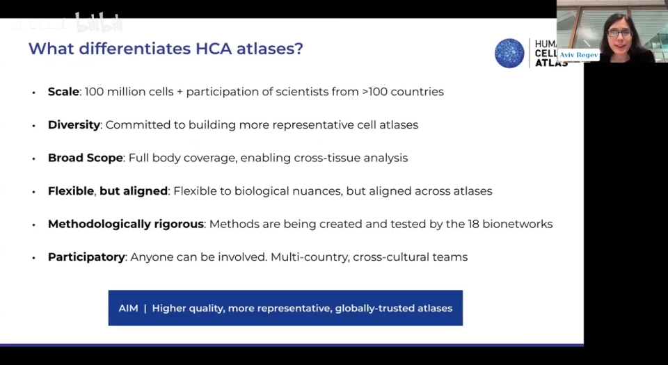

### 1.1 六条原则，每条都在回答「为什么不能各做各的」

| 原则 | 会上给出的内容 | 它解决的问题 |
| --- | --- | --- |
| Scale（规模） | 超过 1 亿个细胞，来自 100 多个国家的数千名科学家 | 单一实验室不可能覆盖全身 |
| Diversity（多样性） | 致力于构建更具代表性的细胞图谱 | 只测欧美人群样本，图谱就不代表全人类 |
| Broad Scope（广泛范围） | 全身覆盖，支持跨组织分析 | 免疫系统、脂肪组织这类系统横跨多个器官 |
| Flexible, but aligned（灵活但保持一致） | 允许生物学细节上的灵活，但各图谱之间必须对齐 | 各组织有各自的特殊性，但不能各说各话 |
| Methodologically rigorous（方法论严谨） | 方法由 18 个生物网络共同创建和测试，标准与技术工作组管实验方法、分析工作组管分析 | 避免每个网络自己发明一套流程 |
| Participatory（参与性） | 不需要特殊资助，不需要被某个联盟选中，遵守 HCA 的价值观就能参与 | 门槛低才能覆盖 100 多个国家 |

这张表里最容易被忽略的是第四条和第六条。**「灵活但保持一致」**说的是：各生物网络可以按自己的生物学特点调整流程，但必须保证关键的对齐点一致，否则最后合不成一个图谱；**「参与性」**说的是：HCA 不是一个有钱才能进的俱乐部，参与的前提是接受共同的价值观和标准——这既是它的开放之处，也是它必须把标准写清楚的原因。

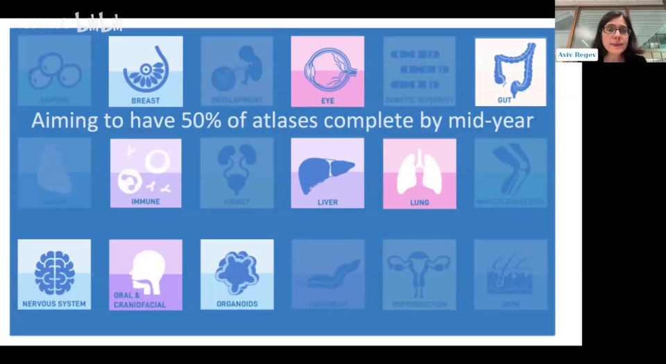

### 1.2 为什么「跨组织」比「单组织做得更深」更重要

Aviv 的解释是：身体里许多系统本身跨越多个组织。研究免疫系统，你不能只看血液或只看某个器官的驻留免疫细胞；研究脂肪组织，也要放在身体不同部位的背景下理解 [【跳转到 09:36】](https://www.bilibili.com/video/BV1fmH1zYEJT/?t=576)。单个器官的图谱做得再精细，也无法回答「这类细胞在全身是怎么分布的」。

这就是 HCA 与「组织特异性图谱项目」最本质的分工：后者可以把一个器官做到极致，HCA 要做的是**让这些局部图谱能拼起来**。而「能拼起来」这件事，靠的不是测更多细胞，而是标准。

## 二、组织方式：18 个生物网络是生产单元，战略靠社区调研决定

### 2.1 生物网络：把「建全身图谱」拆成 18 个可管理的单元

从进度看板可以看到，HCA 把全身拆成 18 个生物网络（bionetwork），每个网络负责一个组织或器官系统：乳腺、眼睛、肠道、免疫、肝脏、肺、神经系统、口腔与颅面、类器官、生殖、皮肤等 [【跳转到 16:05】](https://www.bilibili.com/video/BV1fmH1zYEJT/?t=965)。每个网络有自己的协调员（coordinator）、计算团队和参与标注的专家。

这个结构在会议里体现得非常具体：肝脏网络的协调员是 Gary Bader 和 Alan Mullen，肠道网络是 Jose Ordovas-Montanes，各自上台汇报进度、回答提问。**「18 个网络」不是行政划分，而是 18 条并行的生产线**，每条线都要独立跑完「收集数据 → 元数据标准化 → 整合 → 注释 → 提交组织委员会评审」的全流程。

### 2.2 参与门槛：不需要经费，但需要遵守标准

Aviv 强调参与性时说得很清楚：你不需要特殊资助，也不需要被某个特定联盟选中，只要遵守人类细胞图谱的价值观就可以参与，可以来自任何国家 [【跳转到 10:51】](https://www.bilibili.com/video/BV1fmH1zYEJT/?t=651)。

为了让这种松散的国际协作能运转，会议宣布了两件配套的事：

- **HCA Hub**：一个会员平台的学术匹配平台，可以按地理位置、共同研究兴趣、所属机构检索，帮你找到合作者，也用来推送调研和项目通知 [【跳转到 07:00】](https://www.bilibili.com/video/BV1fmH1zYEJT/?t=420)。
- **与联合国教科文组织签署合作意向书**：由 HCA 执行董事 John Randell 在巴黎签署，推进数据生态系统和能力建设，会上把它定位为「通过促进国际合作对科学外交的贡献」[【跳转到 07:50】](https://www.bilibili.com/video/BV1fmH1zYEJT/?t=470)。

### 2.3 战略不是自上而下定的，而是调研出来的

会议开头用了近五分钟讲两项**社区调研**的初步结果，这一点很能说明 HCA 的运作方式：下一步做什么，先问社区 [【跳转到 01:40】](https://www.bilibili.com/video/BV1fmH1zYEJT/?t=100)。

**第一项：空间组学调研。** 目的是评估可用于空间分析的技术与样本类型、摸清社区已经生成了哪些空间数据。已收到近一百份回复，趋势是：组织保存方式冷冻与 FFPE 各占一部分；约 80% 的人关注细胞层面的空间分析，43% 关注亚细胞分辨率，40% 关注多细胞区域这类更粗的粒度 [【跳转到 02:35】](https://www.bilibili.com/video/BV1fmH1zYEJT/?t=155)。

**第二项：疾病研究优先级调研。** 想了解社区当前在研究哪些疾病、代表哪些患者群体、有哪些样本可用。结果是代谢性疾病被提及最多，癌症紧随其后，然后是自身免疫性疾病，再后面是一长串感染性疾病，其中新冠和登革热最受关注 [【跳转到 04:59】](https://www.bilibili.com/video/BV1fmH1zYEJT/?t=299)。

调研里有一条受访者的回答被 Aviv 专门念出来：「如果能利用已有的优秀分组和基础设施——这些为健康组织建立的 HCA 工作成果——来生成跨器官的疾病图谱，将大幅加速新型疗法的开发。」[【跳转到 04:15】](https://www.bilibili.com/video/BV1fmH1zYEJT/?t=255) 这句话其实点出了 HCA 第二阶段的方向：**先建健康的参考图谱，再把它当作疾病图谱的参照系**。

顺带一提，会上也明确了边界：目前已知登记的疾病约有二万五千种，HCA 无法覆盖所有地区的所有疾病，目标不是绘制所有疾病，而是补充全球现有研究网络的工作 [【跳转到 67:09】](https://www.bilibili.com/video/BV1fmH1zYEJT/?t=4029)。

## 三、什么算「做完了」：V1 图谱的五条验收标准

整场会议最有价值的一张幻灯片，是「一个 V1 图谱的验收指南」。它把「一张参考图谱做好了没有」这件原本很主观的事，变成了五条可检查的硬指标 [【跳转到 14:42】](https://www.bilibili.com/video/BV1fmH1zYEJT/?t=882)。

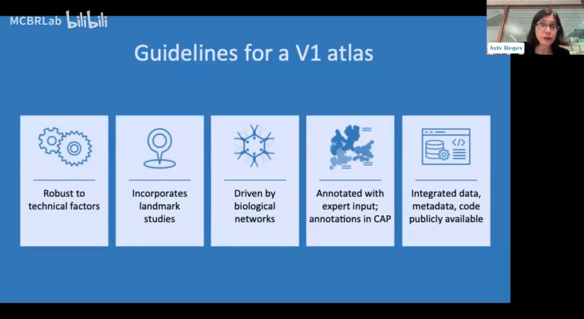

### 3.1 五条标准分别在防什么

1. **Robust to technical factors（对技术因素稳健）**：整合结果不能是批次效应的产物。会上提到肝脏网络的做法是「比较四种方法、用三个指标评估整合效果」，并且对多种技术因素（研究中心、细胞悬液制备）做稳健性检验。
2. **Incorporates landmark studies（包含标志性研究）**：图谱必须建立在领域公认的里程碑数据集之上，而不是自己新测一批就宣布成图。
3. **Driven by biological networks（由生物网络驱动）**：图谱要由该领域的专家网络主导，保证专业性。
4. **Annotated with expert input, annotations in CAP（专家参与标注，注释在 CAP 平台完成）**：注释不能是黑箱自动生成的，必须有专家介入，并且要在公共平台上留下可追溯的记录。
5. **Integrated data, metadata, code publicly available（整合数据、元数据、代码全部公开）**：三者缺一不可——只有数据没有元数据，别人无法复用；没有代码，结果无法复现。

### 3.2 流程：草稿图谱 → 组织委员会评审 → 版本一 → 数据门户

一个图谱要走完的路径是：草稿图谱提交给 HCA 组织委员会，由科学家按上述指南评审，检查技术指标、是否包含标志性研究、是否由生物网络驱动、专家是否参与标注、注释是否在平台完成、数据与元数据和代码是否公开可访问 [【跳转到 14:17】](https://www.bilibili.com/video/BV1fmH1zYEJT/?t=857)。**只有这五大核心项目全部通过，图谱才会被认定为 HCA v1**；一旦被接受，它就会出现在数据门户上并对外发布 [【跳转到 15:07】](https://www.bilibili.com/video/BV1fmH1zYEJT/?t=907)。

中期目标是：18 个生物网络中完成 9 个草稿图谱——乳腺、眼睛、肠道、免疫系统、肝脏、肺、神经系统，以及相关的颅面和类器官图谱 [【跳转到 15:40】](https://www.bilibili.com/video/BV1fmH1zYEJT/?t=940)。会上现场汇报的两个案例，正好是这套流程跑通的样子。
## 四、案例一：肝脏图谱——一张「验收卡片」长什么样

肝脏是第一个获批的 V1 图谱，协调员 Gary Bader 花了近十分钟讲它是怎么拼出来的。有意思的是，他展示的不是炫目的 UMAP，而是一张**结构化的验收卡片**：每一栏对应一条验收标准，填的是具体数字和链接 [【跳转到 17:45】](https://www.bilibili.com/video/BV1fmH1zYEJT/?t=1065)。

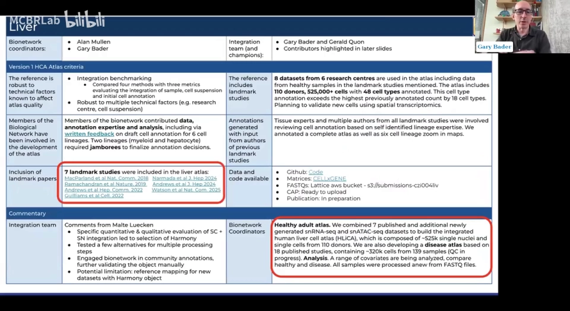

### 4.1 数据从哪来：8 个数据集、6 家机构、110 位供体

健康成人肝脏图谱（H-LIA）整合了 **8 个数据集、来自 6 家研究中心**，包括 7 项已发表研究加上新生成的 snRNA-seq 与 snATAC-seq 数据，最终得到 **110 位供体、超过 52.5 万个细胞核与细胞、48 种细胞类型** [【跳转到 18:46】](https://www.bilibili.com/video/BV1fmH1zYEJT/?t=1126)。Gary 特别强调，48 种细胞类型「远超其他同类研究纳入的数量」，而且整合过程中发现了新的生物学现象 [【跳转到 21:18】](https://www.bilibili.com/video/BV1fmH1zYEJT/?t=1278)。

注意这里的一个细节：卡片上同时给出了 **GitHub 代码、CELLxGENE 上的矩阵数据、云存储桶里的 FASTQ、以及 CAP 平台上就绪的注释**。这正是第五条验收标准「数据、元数据、代码公开」的具体落地形态——**同一张图谱，在四个不同的地方以四种形态存在**：原始读段（FASTQ）、表达矩阵（CELLxGENE）、注释（CAP）、可复现流程（GitHub）。想从原始数据重跑的人、想直接下载矩阵做分析的人、想投票改注释的人，各取所需。

### 4.2 注释怎么做出 48 种细胞类型：α、β、γ 三轮

肝脏网络的注释流程值得单独看，因为它把「人工注释」这件很主观的事拆成了三轮可分工的工序 [【跳转到 19:30】](https://www.bilibili.com/video/BV1fmH1zYEJT/?t=1170)。

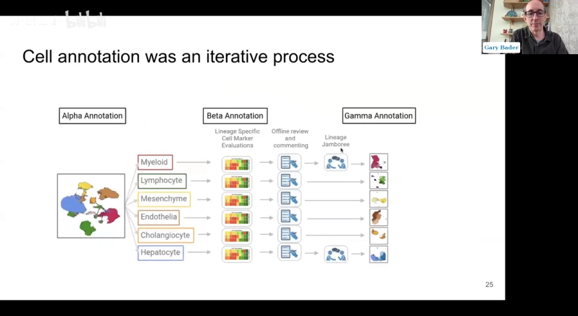

- **α 轮（Alpha）**：基于自动细胞注释，依据是从网络各处收集来的基因表达标记，先切分出需要拆分的主要细胞谱系（髓系、淋巴细胞、间充质、内皮、胆管细胞、肝细胞）。
- **β 轮（Beta）**：由全职投入的博士后做详细标注，按谱系评估标志基因，容易识别的部分离线完成复核；遇到髓系、造血系这类困难的地方，就开在线会议讨论怎么分类 [【跳转到 20:20】](https://www.bilibili.com/video/BV1fmH1zYEJT/?t=1220)。
- **γ 轮（Gamma）**：通过「谱系研讨会」（lineage jamboree）把各谱系的结论对齐，最终定稿。

整个过程有 **21 位肝脏生物网络的专家**自愿参与，帮助识别所有发现的细胞类型 [【跳转到 19:11】](https://www.bilibili.com/video/BV1fmH1zYEJT/?t=1151)。专家标注同时起到了质量控制的作用：它让团队能识别出「需要移除的簇」和「需要保留的簇」[【跳转到 20:45】](https://www.bilibili.com/video/BV1fmH1zYEJT/?t=1245)。成果之一是发现了新的标志物，比如髓系里的 BAG3，并据此确定了肝单核细胞类型 [【跳转到 21:53】](https://www.bilibili.com/video/BV1fmH1zYEJT/?t=1313)。

### 4.3 多样性不是口号：从 RNA 数据反推祖先成分

「图谱要代表全人类」听起来像口号，但肝脏网络把它做成了具体的技术动作。他们从一半样本里拿到了自报的种族和族裔信息，图谱中男女分布大致均衡；但并非所有样本都有遗传族谱数据，于是他们与合作的团队一起，开发了**从单细胞 RNA 测序数据自动推断遗传祖先**的方法 [【跳转到 22:48】](https://www.bilibili.com/video/BV1fmH1zYEJT/?t=1368)。

原理在会上被问出来了：单细胞 RNA-seq 的原始测序读段里含有 DNA reads（由于渗漏现象，能拿到跨转录本的读段），因此有相当多的序列覆盖，可以在样本层面识别 SNP；这些 SNP 再映射到已知的遗传与多样性基因组项目，就能推断样本接近数据库中的哪个群体 [【跳转到 26:52】](https://www.bilibili.com/video/BV1fmH1zYEJT/?t=1612)。重复样本始终得到相同结果，说明方法稳定。

这件事的意义在于：**「代表性」是可以被测量的**。不靠自报问卷，而是从数据本身推断，才能对全部样本给出可比较的多样性指标。

### 4.4 疾病图谱：先建健康参考，再谈疾病

肝脏网络同时在开发疾病图谱，基于收集到的所有已发表研究，预计提供数百万个细胞和 130 多个样本 [【跳转到 18:10】](https://www.bilibili.com/video/BV1fmH1zYEJT/?t=1090)。但顺序很清楚：**先把健康成人肝脏图谱定稿，再把疾病数据映射上去**。

会上有人问了一个很尖锐的问题：经典细胞类型在疾病中常发生显著状态变化，很难映射回健康对应物，怎么保证不遗漏疾病相关的细胞群体？回答是：疾病图谱会单独分析，同时用几种方式与健康图谱结合，其中一种方法就是专门寻找罕见的、在主图谱里没有发现的类型；同时提醒大家，分析大型数据时要特别警惕，确保不遗漏罕见但可能非常重要的信号 [【跳转到 26:52】](https://www.bilibili.com/video/BV1fmH1zYEJT/?t=1612)。

Gary 还补充了一个容易被忽略的点：这是**第一版**图谱，随着迭代，注释当然也会更新 [【跳转到 27:17】](https://www.bilibili.com/video/BV1fmH1zYEJT/?t=1637)。参考图谱不是一次交付的静态文件，而是有版本号、会持续修订的公共资源。

## 五、案例二：肠道图谱——元数据标准化为什么排在整合之前

肠道图谱还没获批，正在等下一次汇报的批准，但它把「元数据先行」这件事讲得比肝脏更透。协调员 Jose Ordovas-Montanes 一上来就说：肠道本身是一段很长的组织，包含食道、胃、小肠、大肠甚至更细的分段，纵轴结构差异显著；而且肠道是高度环境响应性的组织，受发育阶段、微生物组、营养、污染和毒素影响 [【跳转到 31:25】](https://www.bilibili.com/video/BV1fmH1zYEJT/?t=1885)。**这些生物学复杂性，最终都落在元数据上**——你必须记录样本来自哪一段、什么年龄、什么处理方式，否则整合出来的东西没法解释。

### 5.1 先做元数据，再做整合

肠道网络的时间线是这样的：2022 年发布人类肠道细胞图谱的路线图；2023 年论文经团队深入评审后被接受；随后开始对现有数据集做**元数据标准化和预处理**；去年夏天举办剑桥生物网络聚会，把倡导者、资助方、数据贡献者和专家聚在一起，主要目标就是汇报元数据收集进展、推进第二阶段元数据收集 [【跳转到 33:12】](https://www.bilibili.com/video/BV1fmH1zYEJT/?t=1992)。

会后他们制定了每周培训计划，成立三个小组：周一例会、周二元数据处理、周三整合标注与用例讨论 [【跳转到 33:58】](https://www.bilibili.com/video/BV1fmH1zYEJT/?t=2038)。最终汇聚了 **29 个研究项目（其中 5 项未发表）、12 个参与标注的实验室**，覆盖多个国家 [【跳转到 34:39】](https://www.bilibili.com/video/BV1fmH1zYEJT/?t=2079)。

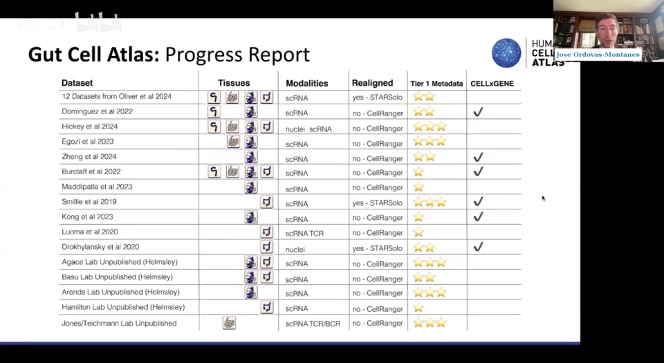

这张进度表很值得看：它把「一个数据集能不能用」拆成了四列可勾选的项——组织覆盖、模态、是否用统一流程重新比对、一级元数据完整度（用星级表示）、是否已上传 CELLxGENE [【跳转到 35:09】](https://www.bilibili.com/video/BV1fmH1zYEJT/?t=2109)。**能不能进图谱，不看数据集大小，看这几列填没填满。**

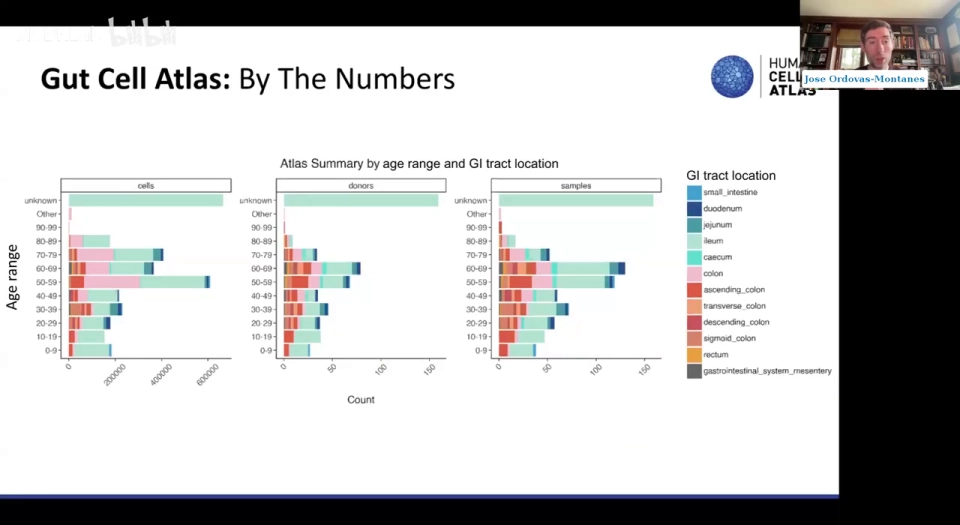

数据快照暴露了图谱的偏倚：细胞数、供体数、样本数都集中在 50–60 岁，两端还有提升空间；样本主要来自回肠和结肠的特定区域，十二指肠等其他区域覆盖不足 [【跳转到 36:24】](https://www.bilibili.com/video/BV1fmH1zYEJT/?t=2184)。**这种「不体面」的统计恰恰是参考图谱必须公开的**——只有公开偏倚，使用者才知道哪里不能外推。

### 5.2 整合方法的选择：为什么最后用了 scVI

肠道网络的整合流程是三步：特征筛选 → 处理计数矩阵 → 多轮迭代（CITE-seq 与 RNA、单核与单细胞，联合或分开，按谱系或细胞类型分类）[【跳转到 38:45】](https://www.bilibili.com/video/BV1fmH1zYEJT/?t=2325)。他们试过 scVI、Harmony 以及其他方法，最终选择 scVI，依据是团队生成的整合基准报告，并用作者的细胞类型标签评估生物一致性，确保不过度拟合 [【跳转到 40:00】](https://www.bilibili.com/video/BV1fmH1zYEJT/?t=2400)。

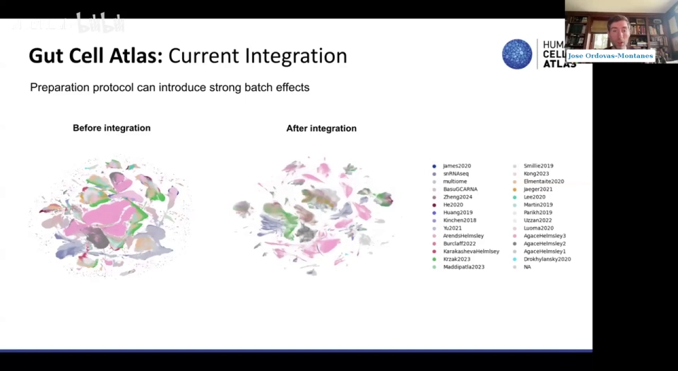

选择 scVI 的关键理由很具体：在 Harmony 的整合结果里，小肠和大肠的上皮细胞被普遍分在了一起，而 scVI 能保持这种区分 [【跳转到 40:25】](https://www.bilibili.com/video/BV1fmH1zYEJT/?t=2425)。**「整合过度」和「整合不足」都是错误**——把本该分开的细胞强行混在一起，图谱就失去了分辨力。所以选择整合方法的标准不是「看起来混得最匀」，而是「是否保住了已知的生物学区分」。

### 5.3 元数据本身也有结构

这是整场会议里技术含量最高、也最容易被跳过的一页。Jose 说：元数据不只是「填表」，它本身有结构——用 Theil's U 可以量化「知道 X 能不能帮你猜出 Y」[【跳转到 41:23】](https://www.bilibili.com/video/BV1fmH1zYEJT/?t=2483)。

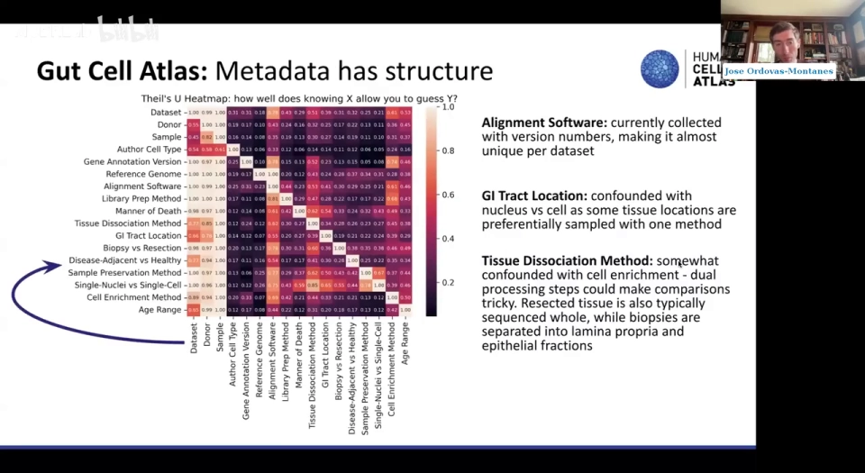

热图读出三件具体的事：

- **对齐软件**：目前只记录版本号，几乎每个数据集都不同，所以它和数据集高度关联；
- **胃肠道位置与单核/单细胞混杂**：某些组织位置偏好用某一种方法采样，于是「方法差异」和「位置差异」纠缠在一起；
- **组织解离方法与细胞富集混杂**：切除的组织通常整体测序，活检则会被分成固有层和上皮层，两步处理让比较变复杂。

这类分析的价值在于：**它告诉你哪些「批次效应」其实是元数据没记全造成的**。如果不知道样本用了哪种解离方法，你就无法判断整合后的差异是生物学差异还是处理差异。这也解释了为什么 HCA 在元数据上花的力气，看起来远大于「多测几个细胞」。

## 六、三层元数据：HCA 为什么把「填表」当成核心任务

Aviv 在讲完六条原则后，立刻把话题引到元数据：「所有这些其实往往归结到元数据」[【跳转到 11:28】](https://www.bilibili.com/video/BV1fmH1zYEJT/?t=688)。她给出的逻辑链是完整的：如果不做严格的元数据标准，就无法达到规模（因为无法整合数据）、无法跨组织比较、也谈不上方法论严谨。

### 6.1 三层结构：技术层、生物层、注释层

会上明确把元数据分成三层 [【跳转到 13:33】](https://www.bilibili.com/video/BV1fmH1zYEJT/?t=813)：

| 层级 | 内容 | 支撑什么 |
| --- | --- | --- |
| 第一层：技术元数据 | 测序平台、比对软件、解离方法、保存方式等 | 跨组织整合、批次效应建模 |
| 第二层：生物元数据 | 数据来自哪个组织、供体年龄、性别、疾病状态等 | 后续的生物学分析 |
| 第三层：细胞注释元数据 | 统一的细胞标签、标志基因、本体论术语 | 对细胞身份的共识理解 |

这个分层不是随意的：**第一层决定「能不能拼」，第二层决定「拼完能不能解释」，第三层决定「拼完大家说的是不是同一件事」**。肠道图谱的 Theil's U 分析正好印证了第一层和第二层的耦合关系。

### 6.2 数据生态系统团队：向作者「追债」是制度化的工作

HCA 有一个数据生态系统团队，专门做的事是：确保元数据收集得全面、可访问，必要时联系原始研究的作者，补充他们最初没有提供的元数据 [【跳转到 12:18】](https://www.bilibili.com/video/BV1fmH1zYEJT/?t=738)。

Aviv 在会上直接向全体成员喊话：如果生态系统团队向你提出这类请求，请打开邮件配合，他们已经把流程简化了 [【跳转到 12:43】](https://www.bilibili.com/video/BV1fmH1zYEJT/?t=763)。她还给了一个「对你自己有什么好处」的理由：完善元数据会提升你的数据价值，让研究更可能被引用、在社区里产生影响，也让你更容易和别人的数据整合 [【跳转到 13:08】](https://www.bilibili.com/video/BV1fmH1zYEJT/?t=788)。

**这一段透露出一个现实**：参考图谱的成本大头不在测序，而在「把已发表数据的元数据补齐」。这项工作要求原作者配合，是无法完全自动化的社会性工作。

## 七、共识注释：把「这群细胞该叫什么」变成可投票的公共决策

会议后半段由 Chloe Villani 主讲，主题是 HCA 的共识注释方法。这是整个计划里最不「数据」，却最决定成败的部分。

### 7.1 为什么注释难以统一

她把原因拆得很清楚 [【跳转到 48:34】](https://www.bilibili.com/video/BV1fmH1zYEJT/?t=2914)：

- 注释大多由人工完成，团队之间存在差异；
- 对细胞**类型**与细胞**状态**的定义存在分歧；
- 分子特征识别有差异，用的基因标记不同；
- 术语不同——同一组织内的术语和标签不一致，精确度也取决于聚类方法。

结果就是开头提到的那个问题：数据能拼在一起，但标签对不上。**如果标签对不上，图谱就只是一堆聚在一起的细胞，不能作为「参考」。**

### 7.2 第一步：定义 12 个注释字段，建立共享词汇

解决方案是制定标准注释规范、构建共享词汇。具体做法是定义 **12 个注释元数据字段**，让不同研究组的细胞分类可以被客观比较 [【跳转到 50:24】](https://www.bilibili.com/video/BV1fmH1zYEJT/?t=3024)。

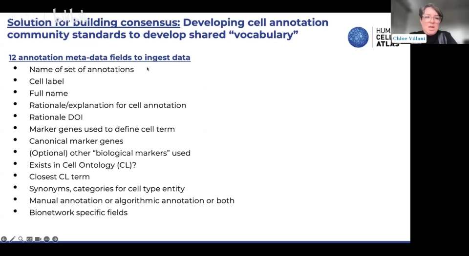

这 12 个字段的设计逻辑值得逐条体会：前四个（标签、全名、理由、DOI）解决「你说的是什么、凭什么」；中间四个（标志基因、经典标志基因、其他标志物、Cell Ontology 术语）解决「怎么和已有知识对齐」；最后四个（同义词、注释方式、网络专用字段）解决「跨研究、跨组织能不能合并」。

特别是「**人工注释还是算法注释**」这一栏——它把「这个标签是专家判断还是软件输出的」变成了显式记录。在自动注释工具越来越多的今天，这一栏决定了标签的可信度权重。

### 7.3 「罗塞塔石碑」：为什么要求上传原始数据集和整合图谱两份

一个很实际的问题：既然已经有整合好的图谱，为什么还要每个贡献者把**原始数据集**也上传一遍？Chloe 的解释是：需要把整合图谱的注释与**已发表的注释、细胞本体论**关联起来 [【跳转到 55:02】](https://www.bilibili.com/video/BV1fmH1zYEJT/?t=3302)。

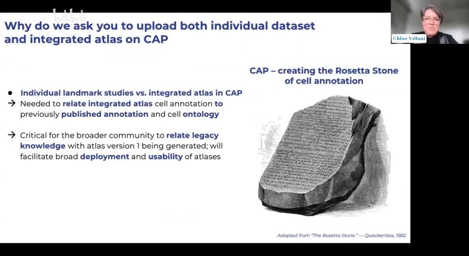

她用了「罗塞塔石碑」这个比喻：石碑上同一段话用三种文字写，才让后人能解读古埃及文。**原始数据集就是那块双语碑**——它同时带着作者当年的标签和 HCA 的新标签，两者对照，社区才能把「过去几十年的发表成果」和「新图谱」接上 [【跳转到 55:27】](https://www.bilibili.com/video/BV1fmH1zYEJT/?t=3327)。

这背后是一个很现实的采纳问题：如果新图谱的标签和作者原来发表的对不上，作者不会认，读者也不敢用。**共识注释不只是技术问题，还是社会认同问题。**

### 7.4 CAP 平台：注释、复核、投票都在一个界面里

承载这套流程的是 CAP（Cell Annotation Platform），会上给出了地址 `https://celltype.info`，以及当时的规模：227,653 个细胞、637 个细胞标签、7 篇文献、6 位专家 [【跳转到 49:20】](https://www.bilibili.com/video/BV1fmH1zYEJT/?t=2960)。

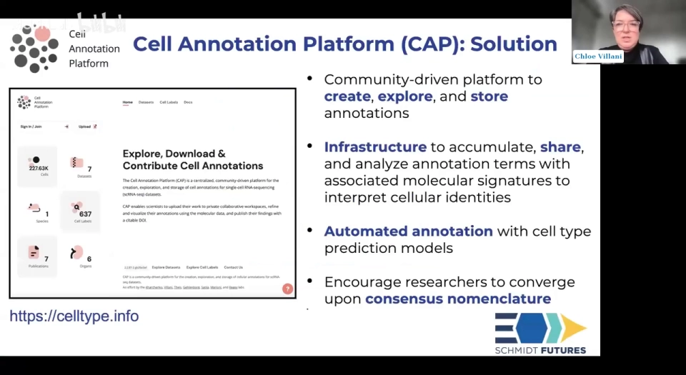

平台的实际界面长这样：左侧是细胞标签列表与细胞数，中间是 UMAP 嵌入图，右侧是选中簇的高表达基因（CD3D、TRAC、NKG7、GNLY 等）与基因表达分布，底部有「差异表达」和「提供反馈」按钮 [【跳转到 60:07】](https://www.bilibili.com/video/BV1fmH1zYEJT/?t=3607)。

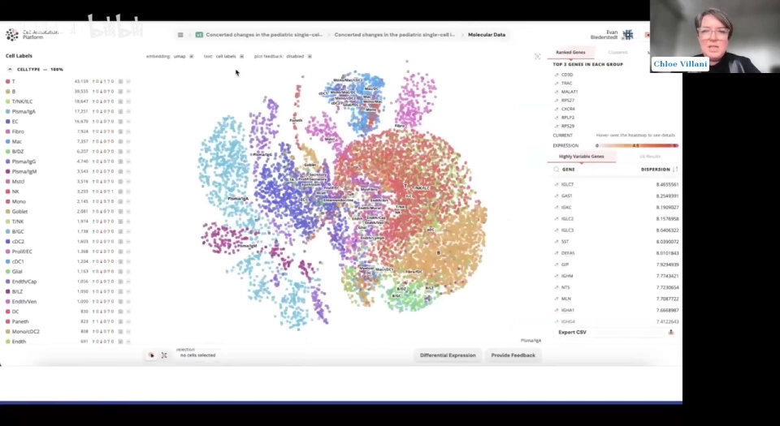

反馈机制支持三种态度，粒度很细 [【跳转到 56:44】](https://www.bilibili.com/video/BV1fmH1zYEJT/?t=3404)：

1. **同意**：认可细胞标签、标志基因和元数据描述，一键同意，也可以附理由；
2. **修改**：同意「这组细胞是一个独特实体」这个分子定义，但不同意元数据描述——比如认为标注方式不对、本体论术语用错，可以提交替代术语、分类和完整名称 [【跳转到 57:22】](https://www.bilibili.com/video/BV1fmH1zYEJT/?t=3442)；
3. **反对**：明确反对某些细胞群应合并为独特实体，认为过度分群应合并、或应该拆分、或遗漏了罕见亚群，需要说明应有多少细胞群并给出理由 [【跳转到 58:14】](https://www.bilibili.com/video/BV1fmH1zYEJT/?t=3494)。

所有反馈汇总成摘要，由社区审核，生物网络可以组织会议讨论；平台上还能在嵌入图上直接画出「标注一致性」——绿色表示共识区域，其他颜色表示存在不确定性，最左侧显示有多少人同意或不同意 [【跳转到 60:07】](https://www.bilibili.com/video/BV1fmH1zYEJT/?t=3607)。所有注释和作者公开，审核结果公开可见，资源持续保留时间戳 [【跳转到 60:37】](https://www.bilibili.com/video/BV1fmH1zYEJT/?t=3637)。

**这套设计的巧妙之处在于：它把「谁对谁错」的争论，转化成了可累积、可回溯的投票记录。** 分歧本身成为信息——会上明确说，识别出广泛分歧的领域，正好告诉社区该把精力集中在哪里 [【跳转到 61:27】](https://www.bilibili.com/video/BV1fmH1zYEJT/?t=3687)。

### 7.5 共识注释在第二阶段有什么用

Chloe 最后讲了共识注释对 HCA 第二阶段的四个用途 [【跳转到 64:36】](https://www.bilibili.com/video/BV1fmH1zYEJT/?t=3876)：

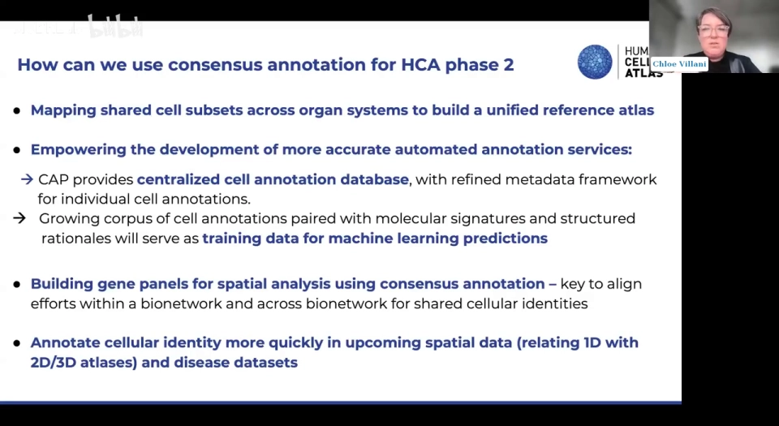

1. **构建统一参考图谱**：跨器官系统映射共享的细胞亚群。她举的例子是免疫生物网络——所有器官系统里都有免疫细胞，有些是循环的、有些是驻留的，最终要建立一套跨器官系统的统一细胞命名法 [【跳转到 63:21】](https://www.bilibili.com/video/BV1fmH1zYEJT/?t=3801)。
2. **训练自动注释模型**：CAP 提供集中式的细胞注释数据库，不断增长的「注释 + 分子特征 + 结构化理由」语料，正好作为机器学习预测的训练数据。
3. **为空间分析构建基因 panel**：统一的注释让不同空间平台之间可以对齐，也方便同一细胞身份在不同生物网络之间协作。
4. **加速 2D/3D 图谱与疾病数据的注释**：把一维的分子定义与二维、三维的空间图谱关联起来。

第 2 点值得单独强调：**共识注释不只是给图谱用的，它本身在训练下一代自动注释工具**。人工校准做得越一致，自动注释就越准；自动注释越准，人工校准的负担就越轻。这是一个正反馈。

## 八、这套流程的代价：会上被公开承认的三个难题

工作会议的价值就在于它会讲问题。这场会议里，几位协调员主动承认了几个卡点。

**第一，集中式计算平台应该先建。** Gary 回顾时说，如果现在重新启动一个图谱项目，应该优先建立集中化的计算平台供所有人使用，因为团队决定统一从原始 FASTQ 提取数据、使用相同的 Cell Ranger 流程，但并非所有人都在这样做；这样做能带来多少价值尚不明确，而且需要大量计算资源和下载、处理数据的成本 [【跳转到 75:15】](https://www.bilibili.com/video/BV1fmH1zYEJT/?t=4515)。他们靠 Lattice 团队搭建的云存储基础设施才撑住 [【跳转到 75:40】](https://www.bilibili.com/video/BV1fmH1zYEJT/?t=4540)。

**第二，没有万能整合方案。** Sarah 总结时说：来自肠道和肝脏的网络经验表明，没有适用于所有情况的解决方案；最重要的是各团队透明说明整合方法、测试多种方法，并提供定量指标证明整合的有效性 [【跳转到 80:46】](https://www.bilibili.com/video/BV1fmH1zYEJT/?t=4846)。也就是说，**HCA 的统一不是「统一方法」，而是「统一汇报格式」**。

**第三，组织工作比数据工作更难。** Jose 说他们真正学到的是团结协作的重要性：把任务分解为明确目标（这是元数据、这是整合、这是用例），再设立倡导者（Kyle 和 Chris）统一不同讨论，事情才真正向前推进；这远不止是拼凑数据集列表 [【跳转到 73:08】](https://www.bilibili.com/video/BV1fmH1zYEJT/?t=4388)。Alan 补充说，按专业领域分工（髓系组、肝细胞组）并促成人员面对面交流，对最终确定注释有很大帮助 [【跳转到 79:20】](https://www.bilibili.com/video/BV1fmH1zYEJT/?t=4760)。

## 小结

- **HCA 的产出是一套流程，不是一堆数据。** 18 个生物网络分工生产、三层元数据保证可整合、五条标准验收、共识注释平台统一语言——数据是跑完流程的结果。
- **V1 图谱的五条验收标准**：对技术因素稳健、包含标志性研究、由生物网络驱动、专家参与标注并在 CAP 完成、数据与元数据和代码全部公开。
- **元数据分三层**：技术层决定能不能拼、生物层决定拼完能不能解释、注释层决定大家说的是不是同一件事。
- **注释是三到四轮的工序**：α 轮自动注释切谱系、β 轮专家按谱系细标、γ 轮谱系研讨会定稿，全程留痕在 CAP 上。
- **整合方法没有标准答案**：肠道图谱最终选 scVI 而不是 Harmony，理由是它保住了小肠与大肠上皮的区分——标准是「不破坏已知生物学」，不是「混得最匀」。
- **共识注释把学术争论变成可累积的投票**，并反过来成为训练自动注释模型的语料。
- **成本大头在社会协作**：向原作者追元数据、组织跨机构标注、维护公共平台，这些无法自动化，却是参考图谱能不能成立的关键。

## 关键术语速查

| 术语 | 一句话解释 |
| --- | --- |
| HCA（Human Cell Atlas） | 由国际联盟协作构建的人体细胞参考图谱计划，目标是把全身所有细胞类型建成可比较的参考图谱 |
| 生物网络（Bionetwork） | HCA 的生产单元，每个网络负责一个组织或器官系统，共 18 个 |
| 参考图谱（Reference Atlas） | 以健康组织为主、经过统一整合与共识注释的图谱，用作其他研究的对照坐标系 |
| 标志性研究（Landmark study） | 领域内公认的里程碑数据集，V1 图谱必须包含 |
| 元数据三层级 | 技术元数据（测序与处理方式）、生物元数据（组织与供体信息）、细胞注释元数据（标签与本体论） |
| Cell Ontology（CL） | 标准化的细胞类型本体术语库，让不同研究能用同一个术语描述同一种细胞 |
| CAP（Cell Annotation Platform） | HCA 的细胞注释平台，支持注释创建、专家复核、投票反馈与自动注释 |
| α / β / γ 注释 | 三轮注释工序：自动切谱系 → 专家按谱系细标 → 谱系研讨会定稿 |
| scVI / Harmony | 两种常用的单细胞数据整合方法，选择依据是能否保住已知的生物学区分 |
| Theil's U | 衡量两个类别变量关联强度的指标，用来判断元数据字段之间是否混杂 |
| 谱系研讨会（Lineage jamboree） | 各谱系专家集中对齐注释结论的会议形式 |
| CELLxGENE | 存放统一处理后的表达矩阵与元数据的公共门户，HCA 图谱的矩阵数据会同步上传 |
