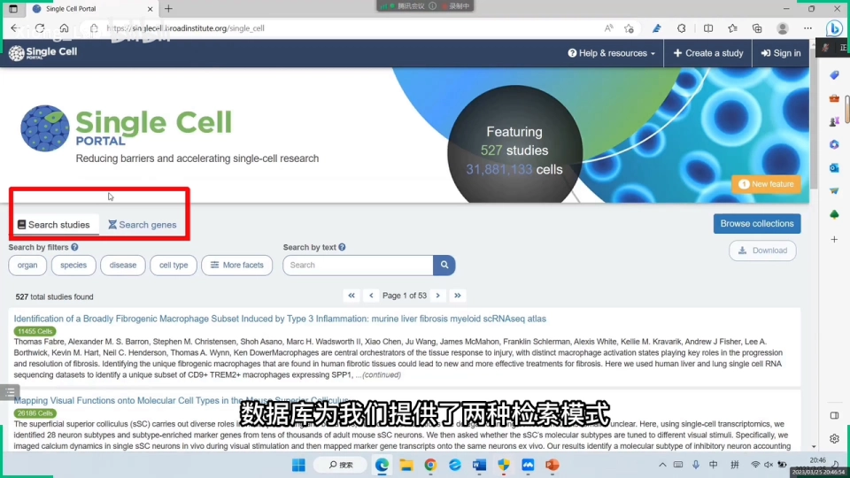
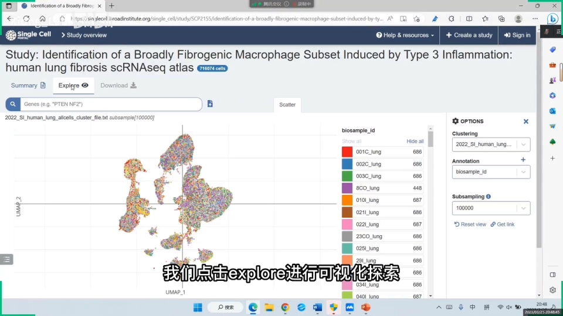
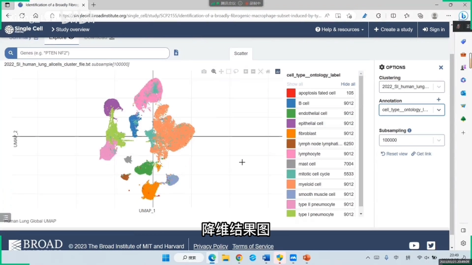
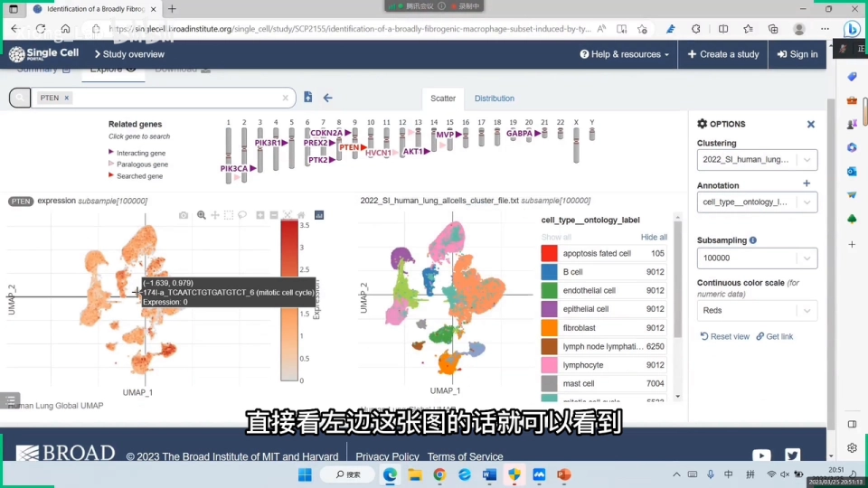
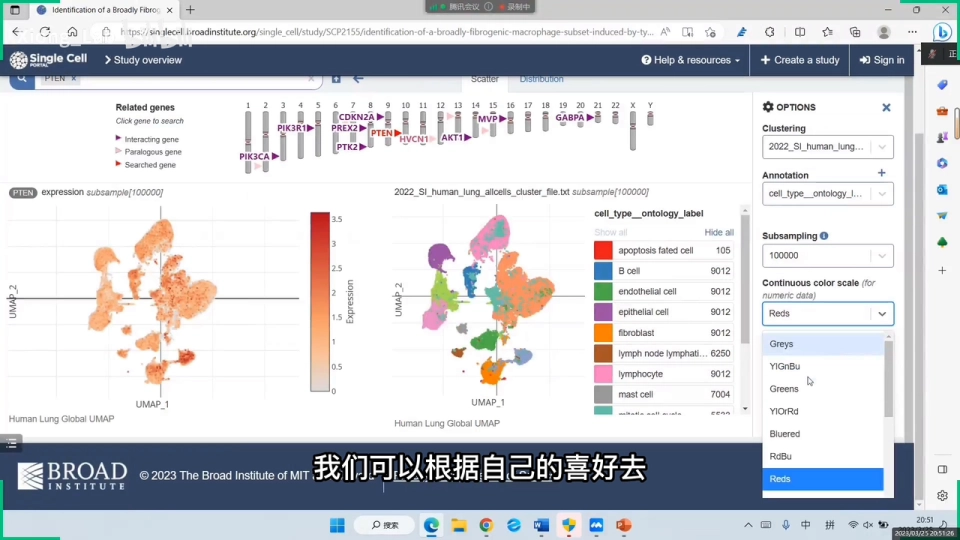
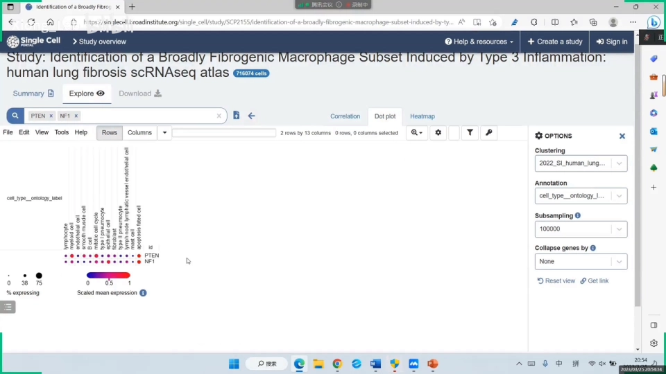
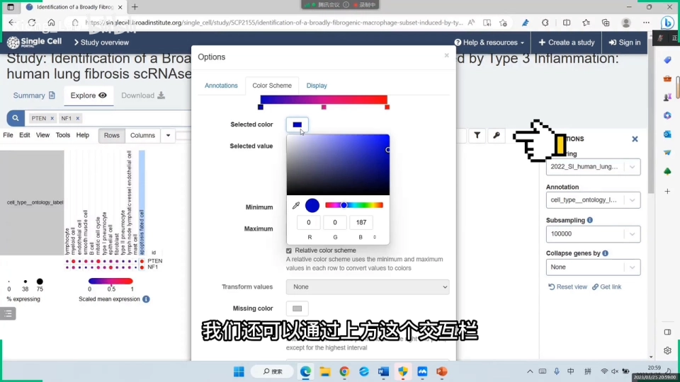
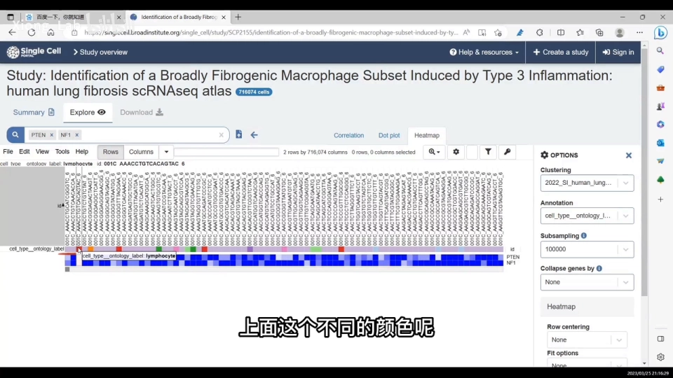
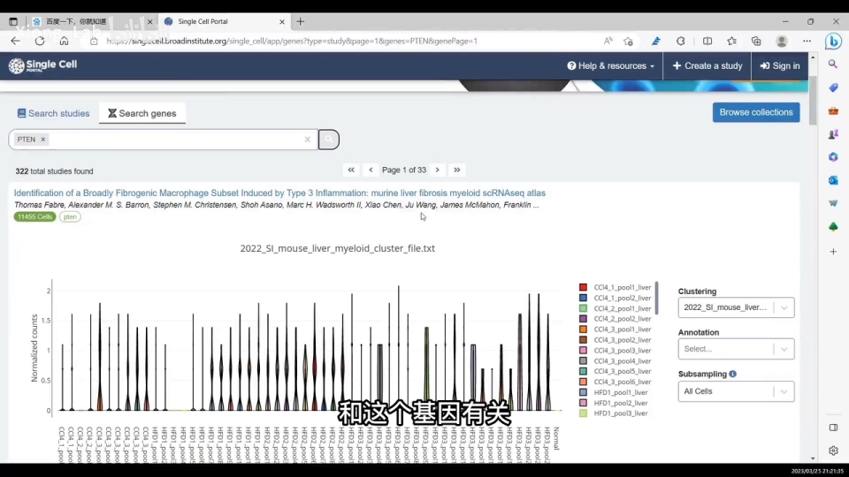
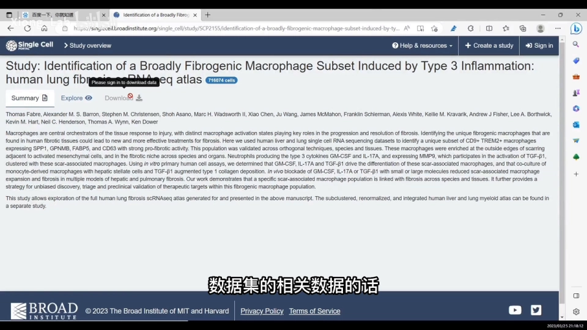

# Single Cell Portal 的基因检索与在线出图：六分钟走完一遍

> 视频来源：[单细胞在线数据库分析single cell portal](https://www.bilibili.com/video/BV1Hc41157EF/)（Bilibili · UP 主 Xiong_Lab）｜时长约 6 分钟
> 导读：这是一支节奏很快的屏幕录制，全程只有一个动作——把 Single Cell Portal 的两个检索入口各走一遍。它的价值不在「讲得深」，而在**把「按基因反查数据集」这条路径完整演示了一次**：一个基因名输进去，能同时得到「哪些研究测过它」和「它在染色体上的位置、有哪些互作基因和旁系同源基因」。字幕为 B 站 AI 字幕，术语按上下文订正（原文把 Single Cell Portal 识别成「sgo cle purple」、把检索识别成「解锁/解读」、把 UMAP 识别成「umad」、把 dot plot 识别成「dotplant」等）。

## 本讲要解决的核心问题（SCQA）

**背景**：上一节讲清了 Single Cell Portal 的项目页怎么用——进一个数据集，看它的 UMAP、查它的基因表达。

**冲突**：但真实的研究常常是反过来的。你手上先有一个**基因**（比如从自己的差异分析里冒出来的 PTEN），想知道「公共数据里有没有人测过它、它在哪些细胞类型里表达」。这时按项目一个个翻是不现实的。

**疑问**：能不能**以基因为入口**去反查数据集？

**回答（中心思想）**：**可以，而且这是 SCP 的第二种检索模式。** 平台的 `Search genes` 标签页接受任意基因名，返回所有检测到该基因表达的研究项目；点进任何一个项目，除了常规的 UMAP 表达图，还会多给两样东西——**该基因在染色体上的位置，以及它的互作基因（interacting gene）和旁系同源基因（paralogous gene）**。再加上可自定义的配色和可导出的图，这条路走完只需要几分钟，却能在不下载任何数据的前提下判断「这个基因值不值得追」[【跳转到 03:05】](https://www.bilibili.com/video/BV1Hc41157EF/?t=185)。

## 一、先看清平台的两个入口，以及它「收的是什么」

打开首页，讲者先报了平台的规模：录制时（2023 年）收录 **527 项研究、31,881,133 个细胞**，并且还在持续更新 [【跳转到 00:42】](https://www.bilibili.com/video/BV1Hc41157EF/?t=42)。

> 这个数字会随时间增长。同一平台在 2025 年的另一次演示里已经是 816 项研究、5697 万个细胞——**看规模数字时要记住它是录制当时的快照，不是平台的固定属性。**

讲者对收录范围的判断是：**平台收集得「蛮全」**，最近发表的文章会陆续被收录进来，所以实用性挺强 [【跳转到 00:42】](https://www.bilibili.com/video/BV1Hc41157EF/?t=42)。他还给了一个更实用的评价——**平台给出的图表，用在文章里「我认为是没有问题的」**，因为参数可以按自己的需求调节 [【跳转到 00:42】](https://www.bilibili.com/video/BV1Hc41157EF/?t=42)。这句话点出了 SCP 的另一层价值：它不只是「看数据」的工具，也是一个**出图工具**。

页面上方有三个入口：**Help & resources（帮助与资源）、Create a study（创建研究）、Sign in（登录）**。讲者提到，**如果要下载数据，需要先注册**，而且注册走的是 Google 账号 [【跳转到 00:42】](https://www.bilibili.com/video/BV1Hc41157EF/?t=42)。

## 二、按项目检索：从物种筛到「人肺纤维化」

讲者先走的是 Search studies 这条路，演示目标很具体：**想看人的肺纤维化的单细胞数据**。操作分两步——先把物种筛成 `Homo sapiens`（智人），再在搜索框里输入「肺纤维化」[【跳转到 01:07】](https://www.bilibili.com/video/BV1Hc41157EF/?t=67)。

讲者顺带点了一下筛选器的完整度：除了 organ、species、disease、cell type，还可以按性别、library preparation protocol（建库方案）等条件过滤 [【跳转到 00:42】](https://www.bilibili.com/video/BV1Hc41157EF/?t=42)。

**为什么「物种 + 疾病」这个组合最常用**：它对应研究里最常见的两个前提——「我要人还是小鼠的数据」「我要这个病还是正常对照的数据」。这两条一筛，候选集通常就从几百条降到个位数。

点开筛出来的那条研究，进入项目页。页面顶部是 **Summary / Explore / Download** 三个标签，标题下方标着这项研究包含 **716,074 个细胞** [【跳转到 01:25】](https://www.bilibili.com/video/BV1Hc41157EF/?t=85)。

讲者对 Summary 的用法说得很直接：**根据自己的课题设计认真读一下，判断是否跟自己的课题有关** [【跳转到 01:25】](https://www.bilibili.com/video/BV1Hc41157EF/?t=85)。这一步不能跳——标题和摘要决定了这份数据到底是「同一个生物学问题」还是「只是同一个器官」。

## 三、Explore：换聚类、换注释，再看基因

点 Explore 进入可视化界面。默认的聚类标签是 `biosample_id`，也就是**按样本**给细胞上色 [【跳转到 01:38】](https://www.bilibili.com/video/BV1Hc41157EF/?t=98)。

讲者接着把 Annotation 换成 `cell_type_ontology_label`，得到按细胞类型上色的 UMAP——图例里是 B cell、endothelial cell、epithelial cell、fibroblast、lymphocyte、mast cell、myeloid cell、smooth muscle cell、type II pneumocyte 等标准细胞类型名 [【跳转到 01:58】](https://www.bilibili.com/video/BV1Hc41157EF/?t=118)。

**这里有个细节值得留意**：字段名里的 `ontology` 说明这个项目的注释映射到了细胞本体（Cell Ontology）的标准术语，而不是作者自造的缩写。对跨项目比较来说，这比 `Category`、`Celltype` 这类自定义字段友好得多——**在挑数据集时，优先选注释用了本体术语的项目**。

讲者还提到一个操作体验上的问题：**选择的细胞数越大，渲染时间就越长**，所以界面提供了 Subsampling（下采样）选项，默认抽 100000 个细胞来画 [【跳转到 01:58】](https://www.bilibili.com/video/BV1Hc41157EF/?t=118)。这也解释了为什么几十万细胞的项目也能在浏览器里流畅交互。

## 四、查基因：一次搜索，三样东西

这是这支视频最有信息量的一段。在左上角的搜索框（提示语是 `Genes (e.g. "PTEN NF2")`）里输入 `PTEN`，页面同时给出三块内容 [【跳转到 02:49】](https://www.bilibili.com/video/BV1Hc41157EF/?t=169)。

### 4.1 表达 UMAP：颜色越深，表达越高

左下那张图是 PTEN 在这批细胞里的表达分布，右侧配一条 `Expression` 色标。讲者的读法是：**颜色越深，一般代表它的表达越高** [【跳转到 02:49】](https://www.bilibili.com/video/BV1Hc41157EF/?t=169)。

这和项目页里查基因是同一个功能，但**配合右边的细胞类型图一起看**，信息就完整了：左边告诉你「哪里表达高」，右边告诉你「那片区域是什么细胞」。

### 4.2 染色体位置：这个基因坐在哪条染色体上

上方是一条染色体示意图（1 到 22、X、Y 依次排开），**红色箭头标出该基因所在的位置** [【跳转到 02:19】](https://www.bilibili.com/video/BV1Hc41157EF/?t=139)。

讲者对这个设计的解释是：**紫色箭头指的是可以与它相互作用的基因，粉色箭头一般指的是它的同源基因** [【跳转到 02:19】](https://www.bilibili.com/video/BV1Hc41157EF/?t=139)。

### 4.3 Related genes 面板：互作基因、旁系同源、已检索

染色体图左侧还有一个 `Related genes` 面板，把三类关系分开列出 [【跳转到 02:49】](https://www.bilibili.com/video/BV1Hc41157EF/?t=169)：

- **Interacting gene（互作基因）**：与目标基因产物有相互作用关系的基因；
- **Paralogous gene（旁系同源基因）**：由基因复制产生的同源基因；
- **Searched gene（已检索基因）**：你自己查过的那些。

**这三样东西为什么放在一个「数据浏览平台」里**：因为它们回答的是同一个问题的三个层次——「这个基因表达在哪」（表达图）、「它在基因组上的邻居是谁」（染色体图）、「它和谁一起工作」（互作/同源）。对做机制的人来说，后两者往往是下一步实验设计的起点，而 SCP 把它们做成了「输一个基因名就自动带出来」的默认视图。

## 五、出图：配色、图形、导出

讲者后半段基本在演示「怎么把这张图变成能放进文章的样子」。

### 5.1 换配色

右侧 OPTIONS 面板里有 **Continuous color scale (for numeric data)** 下拉，可选 Greys、YlGnBu、Greens、YlOrRd、Bluered、RdBu、Red 等色阶 [【跳转到 03:00】](https://www.bilibili.com/video/BV1Hc41157EF/?t=180)。

讲者的建议是：**根据自己文章的整体色系去选**，亮色、暗色都可以调 [【跳转到 03:00】](https://www.bilibili.com/video/BV1Hc41157EF/?t=180)。这看起来是小功能，但它解决了一个真实痛点——**同一篇文章里的多张 UMAP 用同一套色阶，读者才读得顺**。

### 5.2 换图形，以及更细的配色编辑

查两个基因时，中间会多出 **Correlation / Dot plot / Heatmap** 三个视图。讲者演示了 PTEN + NF1 两个基因的 dot plot [【跳转到 03:53】](https://www.bilibili.com/video/BV1Hc41157EF/?t=233)。

读法与前一篇博客一致：**点的大小 = % expressing（表达该基因的细胞比例），颜色 = scaled mean expression（标度化平均表达量）**，色标从 0 到 1。

图形本身还带一个编辑工具栏（File / Edit / View / Tools / Help），点开可以进 **Options**，里面分 Annotation、Color Scheme、Display 三栏，能改选中颜色、最小值、最大值，还能勾选 **Relative color scheme**——**用每一行的最小值和最大值来做颜色映射** [【跳转到 04:06】](https://www.bilibili.com/video/BV1Hc41157EF/?t=246)。

**Relative color scheme 这个选项值得单独记一下**：它决定颜色深浅是「按全局统一刻度」还是「按每一行自己的范围」。前者适合跨细胞类型比较绝对高低，后者适合看每个细胞类型内部的相对变化——两种读法会得到不同的结论，用之前要想清楚。

### 5.3 热图：一张图看两个基因在所有细胞里的分布

再点 **Heatmap**，得到的是「细胞 × 基因」的矩阵视图：行是两个基因，列是成千上万个细胞，颜色表示表达量 [【跳转到 04:22】](https://www.bilibili.com/video/BV1Hc41157EF/?t=262)。

讲者的说法是：**上面不同的颜色就是不同的细胞类型**，可以看出这两个基因在每一个样本细胞中的表达情况，一般越红代表表达量越高 [【跳转到 04:22】](https://www.bilibili.com/video/BV1Hc41157EF/?t=262)。

热图的优点是**能看单个细胞层面的共表达**（哪些细胞同时高表达两个基因），缺点是**列太多、看不出细胞类的整体趋势**。所以它和 dot plot 是互补关系：dot plot 看群体层面的规律，heatmap 看个体层面的分布。

### 5.4 导出

图形工具栏的 File 菜单里可以导出数据和表格，讲者的原话是「最后就是 File，就导出这些数据和表格就可以了」[【跳转到 04:22】](https://www.bilibili.com/video/BV1Hc41157EF/?t=262)。

## 六、反过来：从基因检索到数据集

演示完项目路径，讲者回到首页，点 **Search genes** 标签页，走另一条路 [【跳转到 03:05】](https://www.bilibili.com/video/BV1Hc41157EF/?t=185)。

输入 `PTEN` 之后，页面显示 **322 total studies found（共 322 项研究）**，每条结果都标出该研究包含多少细胞、以及它检测到了这个基因 [【跳转到 03:18】](https://www.bilibili.com/video/BV1Hc41157EF/?t=198)。

这个入口的用法是：**先用基因把候选数据集圈出来，再按物种、组织、器官、性别、年龄这些条件去筛** [【跳转到 03:18】](https://www.bilibili.com/video/BV1Hc41157EF/?t=198)。讲者还提到，基因检索的结果页本身就带一张表达图（小提琴图），可以直接看出这个基因在这批数据里表达在哪些群。

讲者最后总结了两条路径的关系：**两种检索方式只是路径不同，最终到达的终点和看到的研究内容是一样的** [【跳转到 03:32】](https://www.bilibili.com/video/BV1Hc41157EF/?t=212)。

## 七、这支视频给出的使用建议

讲者结尾讲了三句很实在的话，可以直接当使用原则：

1. **不会写代码的人，在线工具是最方便的**——「用这种数据库在线的工具是最方便的」[【跳转到 05:00】](https://www.bilibili.com/video/BV1Hc41157EF/?t=300)；
2. **它给的图本身就是规范化、美观的**，能达到发表级别的图表要求，不用自己再改颜色，只要按文章整体色系选一下就行 [【跳转到 05:00】](https://www.bilibili.com/video/BV1Hc41157EF/?t=300)；
3. **下载要注册**，注册之后就能下载数据 [【跳转到 04:42】](https://www.bilibili.com/video/BV1Hc41157EF/?t=282)；页面里那些指向外部站点的链接「可以不用管」，因为它链到外面反而麻烦，**就在这个页面里做就行** [【跳转到 04:42】](https://www.bilibili.com/video/BV1Hc41157EF/?t=282)。

关于下载这一步，界面上给的是 `Please sign in to download` 的提示 [【跳转到 04:42】](https://www.bilibili.com/video/BV1Hc41157EF/?t=282)：

**这条限制与平台的定位是一致的**：浏览和出图开放，数据下载需要身份。对只想核对一个基因表达的人来说，免费的那部分已经够用。

## 小结

- **SCP 的第二种入口是「按基因反查」**：`Search genes` 输入基因名，返回所有检测到它表达的研究（演示里 PTEN 对应 322 项研究）；再用物种、组织等条件筛 [【跳转到 03:18】](https://www.bilibili.com/video/BV1Hc41157EF/?t=198)。
- **项目检索的常用组合是「物种 + 疾病」**：先筛 `Homo sapiens`，再搜疾病名，候选集立刻收窄 [【跳转到 01:07】](https://www.bilibili.com/video/BV1Hc41157EF/?t=67)。
- **查一个基因会同时给出三样东西**：表达 UMAP、染色体位置、互作基因与旁系同源基因 [【跳转到 02:49】](https://www.bilibili.com/video/BV1Hc41157EF/?t=169)。
- **注释字段优先选带 ontology 的**：`cell_type_ontology_label` 用的是标准术语，比作者自定义的 `Category` 更好跨项目理解 [【跳转到 01:58】](https://www.bilibili.com/video/BV1Hc41157EF/?t=118)。
- **出图能力是这个平台的隐藏价值**：色阶可换、颜色映射可切换（含 Relative color scheme）、图形可导出，图本身达到发表级别 [【跳转到 03:00】](https://www.bilibili.com/video/BV1Hc41157EF/?t=180)。
- **大项目靠下采样保证交互流畅**：默认抽 100000 个细胞渲染，细胞数越大渲染越慢 [【跳转到 01:58】](https://www.bilibili.com/video/BV1Hc41157EF/?t=118)。
- **下载需要注册登录**，浏览与出图不需要 [【跳转到 04:42】](https://www.bilibili.com/video/BV1Hc41157EF/?t=282)。

## 关键术语速查

| 术语 | 一句话解释 |
| --- | --- |
| Search genes | SCP 的按基因检索入口，返回所有检测到该基因表达的研究项目 |
| Interacting gene | 与目标基因产物存在相互作用关系的基因，在 Related genes 面板中列出 |
| Paralogous gene | 旁系同源基因，由基因复制产生、序列相似但功能可能分化 |
| cell_type_ontology_label | 映射到细胞本体（Cell Ontology）标准术语的细胞类型字段，比自定义命名更通用 |
| biosample_id | 样本编号，Explore 里默认的上色依据，用于观察样本间差异 |
| Subsampling | 下采样，为流畅渲染只取部分细胞画图，SCP 默认抽 100000 个 |
| Continuous color scale | 连续色阶，用于给数值型元数据或表达量上色，如 Reds、YlGnBu、RdBu |
| Relative color scheme | 用每一行的最小/最大值做颜色映射，而非全局统一刻度 |
| % expressing | 表达该基因的细胞占比，决定 dot plot 中点的大小 |
| Scaled mean expression | 标准化后的平均表达量，决定 dot plot 中点的颜色 |
| Dot plot | 双基因对比图，同时编码表达比例（点大小）与平均表达量（颜色） |
| Heatmap | 细胞 × 基因的表达矩阵视图，看单细胞层面的共表达分布 |
| Sign in / Download | 下载入口，需注册登录（演示中通过 Google 账号注册） |