# Single Cell Portal 怎么用：从检索数据集到基因表达可视化的完整走查

> 视频来源：[Single cell portal 数据库如何使用](https://www.bilibili.com/video/BV1L2QaYpEtc/)（Bilibili · UP 主 见贤思齐医学助研）｜时长约 20 分钟
> 导读：这是一场面向课题组内部的线上分享，讲者用肠道（intestine）的一个真实项目从头点到尾：怎么搜数据集、项目页三栏各是什么、怎么在 UMAP 上换聚类层级和注释维度、怎么查一个基因的表达、怎么比较两个基因的相关性、以及论文里的 SCP 编号从哪来。后半段是问答，讲者把 Single Cell Portal 和 GEO 做了对比，并谈了「公共数据能用来干什么、不能用来干什么」。字幕为 B 站 AI 字幕，术语按上下文订正（原文把 Single Cell Portal 识别成「single cell photo / single cell pal」、把 bulk 识别成「bug」、把 GEO 识别成「JU / JO」、把 MUC2 识别成「MUSTO」等）。

## 本讲要解决的核心问题（SCQA）

**背景**：做单细胞研究时，除了自己测序、自己用 R 语言跑聚类和差异分析，还有另一条路——去公共数据库里找别人已经做好、已经注释好的数据集。这条路不需要服务器、不需要写代码，打开浏览器就能看图。

**冲突**：但公共数据的主流入库渠道（GEO、SRA）存的是**原始测序文件**。想看到一张 UMAP，得先把几十 GB 的文件下载下来、跑完一整套上游流程。对「我只是想确认一下某个细胞类型里这个基因到底高不高」这种需求，代价太大了。

**疑问**：有没有一个地方，能让人在下载之前，先在网页上把数据「看一眼」？

**回答（中心思想）**：**Single Cell Portal（SCP）就是这样一个「先看一眼」的地方。** 它由 Broad Institute 维护，收录的是各研究团队**为配合自己论文而上传的单细胞数据集**，并且每个数据集都配了一套交互式可视化界面——UMAP 可以按不同聚类层级和元数据上色，基因表达可以即时查，两个基因的相关性可以即时比。它的定位不是「原始数据存档」（那是 GEO/SRA），也不是「统一处理的参考图谱」（那是 CELLxGENE/HCA），而是**论文配套数据 + 交互式浏览**。所以正确的用法是：先用它判断「这个数据集值不值得下载、能不能支持我的假设」，再决定要不要登录下载、要不要回到 R 里做正式分析 [【跳转到 17:47】](https://www.bilibili.com/video/BV1L2QaYpEtc/?t=1067)。

## 一、Single Cell Portal 是什么：一个「论文配套数据」的在线浏览窗口

讲者的开场就把这个工具的定位说清楚了：做单细胞时，传统路径是用 R 语言处理原始文件、聚类、做差异基因分析、再做功能分析；而**在线的可视化工具是这条路径前面的一道「侦察」工序**——先看看能不能找到对实验有利的数据集、搜集一些证据，如果确实找到了，再回到 R 里做正式分析 [【跳转到 00:00】](https://www.bilibili.com/video/BV1L2QaYpEtc/?t=0)。

这个「侦察」的定位，决定了 SCP 与另外两类资源的分工：

| 资源 | 存的是什么 | 拿到之后能做什么 |
| --- | --- | --- |
| GEO / SRA | 作者上传的原始测序文件（FASTQ、矩阵、补充材料） | 必须自己跑上游流程，才能得到 UMAP 和聚类 |
| CELLxGENE / HCA | 经过统一处理的参考图谱 | 跨研究、跨组织地比较细胞类型 |
| **Single Cell Portal** | **每篇论文自己的一套数据 + 一套可视化界面** | **打开网页就能看图、查基因，不必先下载** |

### 1.1 首页的三个数字：它收录了多少东西

打开 `singlecellbroadinstitute.org/single_cell`，首页右侧有一个圆形的统计块，录制时（2025 年 3 月）显示 **816 studies（816 项研究）、56,972,180 cells（约 5697 万个细胞）** [【跳转到 01:46】](https://www.bilibili.com/video/BV1L2QaYpEtc/?t=106)。讲者强调这个数字一直在更新，而且「5000 多万个细胞」这个体量，值得好好利用起来为科研服务 [【跳转到 01:46】](https://www.bilibili.com/video/BV1L2QaYpEtc/?t=106)。

页面右上角有三个入口：**Help（帮助文档）、Create study（创建自己的研究）、Sign in（登录）**。讲者说登录之后会有更多功能，但这次演示全程没有登录——因为**浏览和看图不需要账号，只有下载需要** [【跳转到 02:11】](https://www.bilibili.com/video/BV1L2QaYpEtc/?t=131)。

### 1.2 学一个新平台，先看它的工具栏

讲者给了一条通用的学习方法：**学任何数据库、任何新软件，都先从它的工具栏看起，从大往小看** [【跳转到 02:36】](https://www.bilibili.com/video/BV1L2QaYpEtc/?t=156)。SCP 的检索区只有两个标签页：

- **Search studies**：按项目找数据集，可以按 organ（器官）、species（物种）、disease（疾病）、cell type（细胞类型）等条件筛选；
- **Search genes**：按基因找数据集，输入一个基因，就能找到所有检测到它表达的研究。

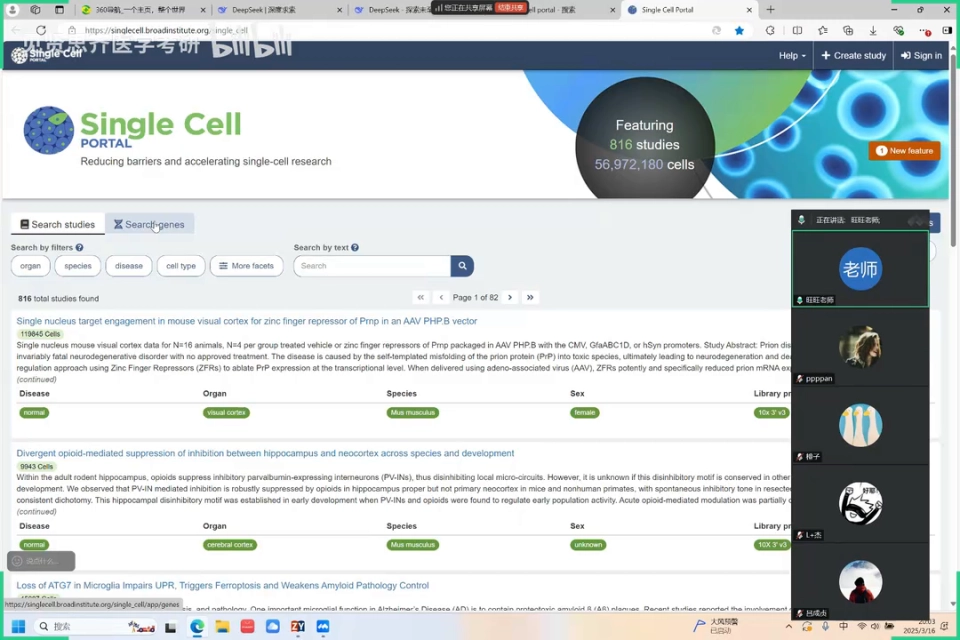

讲者说，实际使用中**最常见的还是按项目搜**，按基因搜是辅助手段 [【跳转到 03:13】](https://www.bilibili.com/video/BV1L2QaYpEtc/?t=193)。

## 二、按项目检索：器官筛选 + 模糊检索

讲者本身做肠道研究，所以演示用的是「先按器官筛，再模糊检索」的路子：点 organ 筛选，会先列出很多器官选项，再在搜索框里输入 `intestine`，页面立刻返回 **42 条研究** [【跳转到 03:39】](https://www.bilibili.com/video/BV1L2QaYpEtc/?t=219)。

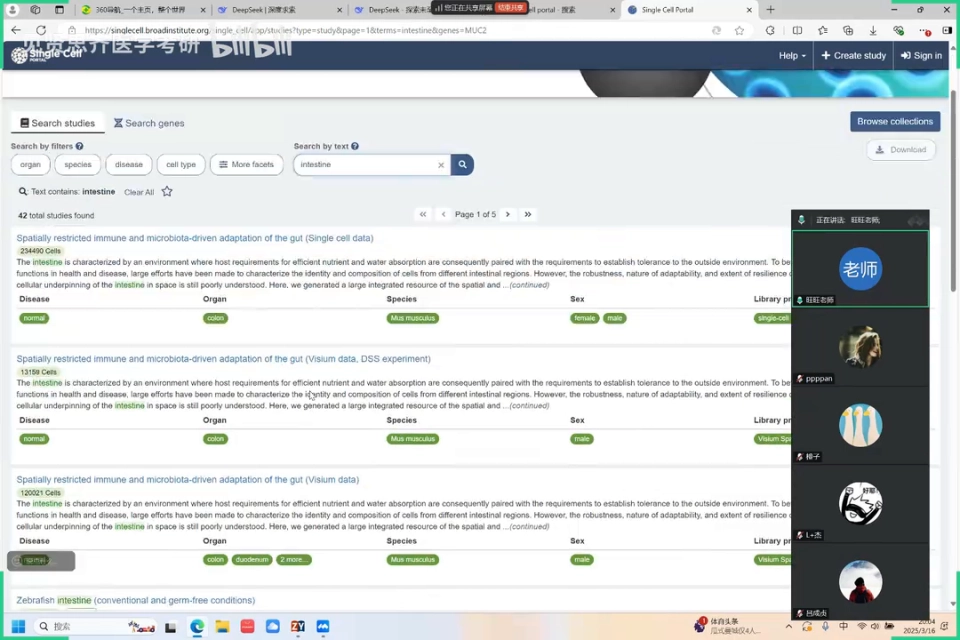

这个结果列表的信息密度值得注意：每条结果除了标题和摘要开头，还直接标出 **Disease（疾病）、Organ（器官）、Species（物种）、Sex（性别）、Library preparation protocol（建库方案）** 五个标签，以及这项研究包含多少个细胞。讲者随手点开第一条，看到它包含 **23 万个细胞**，感叹「这个数据量是很大的」[【跳转到 03:39】](https://www.bilibili.com/video/BV1L2QaYpEtc/?t=219)。

**为什么这些标签比标题更有用**：标题只告诉你作者研究了什么，标签才告诉你「这份数据能不能回答我的问题」。比如你要找的是人肠道而不是小鼠肠道，看 Species 标签就能直接排除一半候选；你要找 10x 3' 建库的数据，看 Library preparation protocol 就行。

## 三、项目页的三层结构：Summary → Explore → Download

点进任何一个项目，页面顶部固定有三个标签页。讲者说「还是从左往右看」[【跳转到 04:03】](https://www.bilibili.com/video/BV1L2QaYpEtc/?t=243)。

### 3.1 Summary：先搞清楚这篇论文为什么做这个数据集

Summary 页是一段对该项目的描述，讲者的概括是：**它讲的是「为什么做这个项目、做了一个什么样的研究」，是一个总览性、概括性的内容** [【跳转到 04:03】](https://www.bilibili.com/video/BV1L2QaYpEtc/?t=243)。

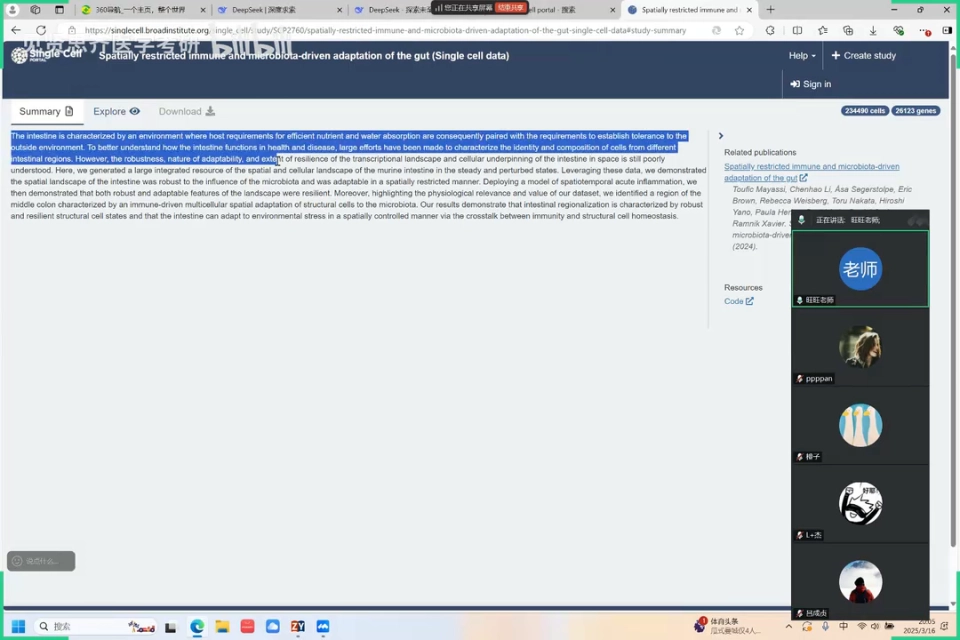

注意右侧的 **Related publications**——它把数据集和论文对应起来，作者、年份、期刊都在。这一步很关键：**SCP 上的一个项目 ≈ 一篇论文的一套数据**，先确认「这是不是我要引用的那篇文章」，再往下看图。

### 3.2 Explore：整个平台的核心

Explore 是可视化界面，也是这个平台真正区别于 GEO 的地方。讲者说「内容特别多」，界面大致分三块：左边是图，中间是图类型切换（Scatter / Distribution / Correlation / Dot plot / Heatmap），右边是 OPTIONS 面板（Clustering、Annotation、Subsampling）[【跳转到 04:44】](https://www.bilibili.com/video/BV1L2QaYpEtc/?t=284)。

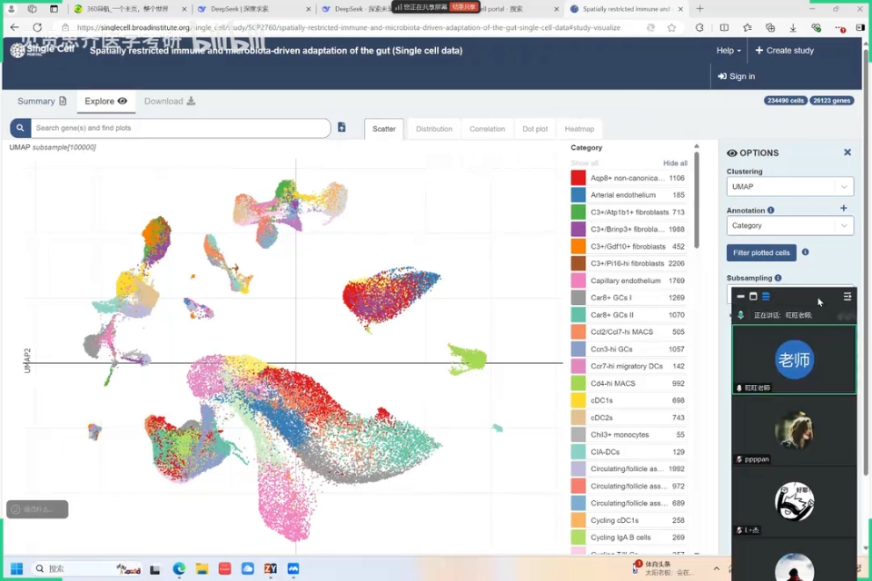

### 3.3 Download：需要登录

第三个标签页是 Download。讲者演示时它显示成一个「小圈加一个叉」的图标，点不动——**不登录就下载不了，需要申请一个账号** [【跳转到 11:28】](https://www.bilibili.com/video/BV1L2QaYpEtc/?t=688)。讲者也提到这一步可能涉及网络访问上的问题，需要自己想些办法 [【跳转到 11:53】](https://www.bilibili.com/video/BV1L2QaYpEtc/?t=713)。

**这个设计其实很符合它的定位**：看是开放的，拿数据要登记。对只想验证一个结论的人来说，免费的「看」已经够了；对真要下载的人来说，注册一次的成本也不算高。
## 四、Explore 里到底能做什么：五个动作，覆盖「看图」的全部需求

讲者的演示可以拆成五个动作。它们的共同点是：**都不需要下载数据，也不需要写一行代码**。

### 4.1 换聚类层级：从「所有细胞」钻到「某一类细胞的亚群」

打开 Explore，默认展示的是**全部细胞的总 UMAP**，按 `Category`（大类的细胞类型）上色 [【跳转到 04:44】](https://www.bilibili.com/video/BV1L2QaYpEtc/?t=284)。讲者演示了两个交互：

- **点图例里的某一群，那一群会变灰消失，再点一下又回来**——用来把某一类细胞单独「拎出来」看位置；
- **在右边的 Clustering 下拉里换一套聚类**——这个项目除了总 UMAP，还提供了 `Enterocyte UMAP`、`Goblet UMAP`、`Fibroblast UMAP` 三套，分别对应上皮细胞、杯状细胞、成纤维细胞各自的再聚类 [【跳转到 05:27】](https://www.bilibili.com/video/BV1L2QaYpEtc/?t=327)。

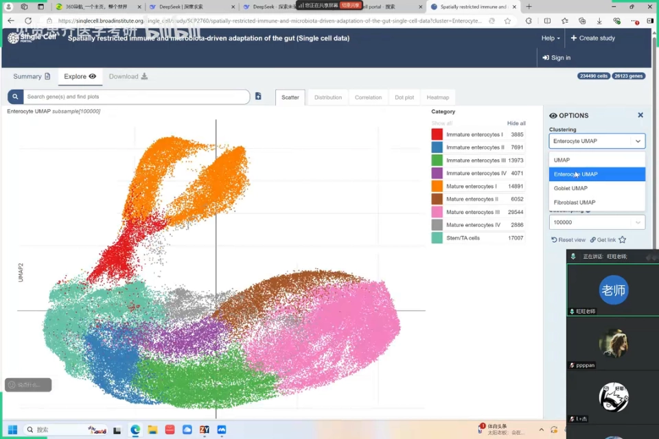

这个「总图 → 亚群图」的层级设计，正好对应单细胞分析里的常规做法：先粗分大类，再对感兴趣的类单独做二次聚类。**区别在于，作者已经替你把二次聚类跑完了，你只需要在下拉框里点一下。**

讲者还顺带说了一句关于注释的话：这些亚群「怎么定义，肯定是根据一些 marker 基因，或者根据以往的一些报道」[【跳转到 05:41】](https://www.bilibili.com/video/BV1L2QaYpEtc/?t=341)。这句话很重要——**细胞类型标签是各研究团队自己给的，平台不做统一**。所以看到 `Immature enterocytes I/II/III/IV` 这种命名时，要知道它是这篇文章的定义，换一篇文章同样的名字未必指同一群细胞。

### 4.2 换注释维度：同一张 UMAP，按样本、供体、性别、年龄上色

总 UMAP 的每个点是一个细胞，而每个细胞都带着元数据。Explore 的 **Annotation** 下拉可以换用哪个元数据来上色。讲者依次演示了：

- 按 **样本（biosample_id）** 上色，图例是 M001A、M001B、M001C……这样的样本编号 [【跳转到 06:10】](https://www.bilibili.com/video/BV1L2QaYpEtc/?t=370)；
- 按 **供体（donor_id）** 上色，看个体之间的差异；
- 按 **性别（sex）**、**年龄（age）** 上色。

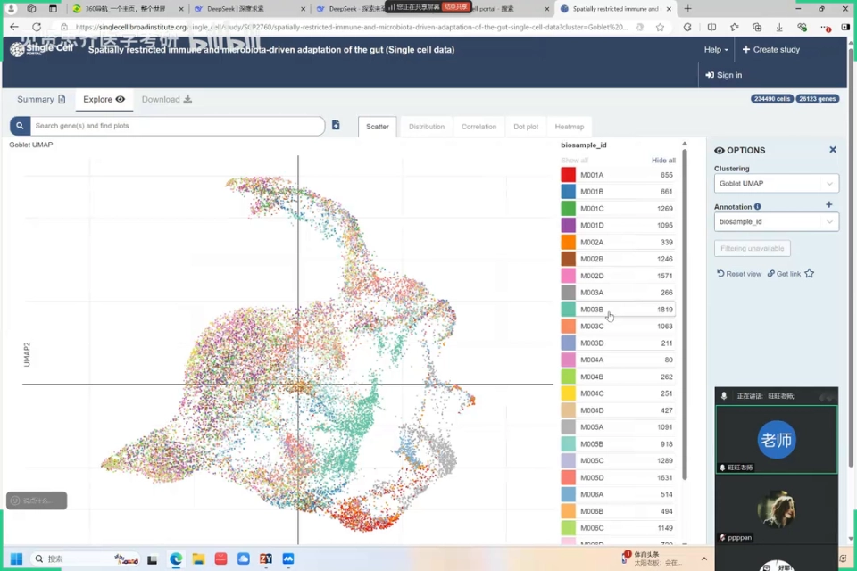

讲者的建议是：**根据不同的实验设计、不同的实验目的，去看相应的 UMAP 群** [【跳转到 06:10】](https://www.bilibili.com/video/BV1L2QaYpEtc/?t=370)。

这一步的实用价值在于**判断批次效应**：如果按样本上色之后，颜色是沿着 UMAP 的某一片区域整块分布的，说明样本之间差异很大；如果各种颜色均匀混在一起，说明整合得比较好。这在下载数据之前就能看出来，省掉一次白跑流程。（这一段是本文根据界面功能做的延伸解读，不是视频原话。）

### 4.3 查一个基因的表达：以 MUC2 为例

这是讲者说「我们最关心的一个功能」[【跳转到 06:35】](https://www.bilibili.com/video/BV1L2QaYpEtc/?t=395)。操作只有一步：在左上角的搜索框里输入基因名。

演示用的例子是 **Muc2**——讲者的原话是「一个很典型的 marker 基因，一个粘液蛋白的基因」，也就是杯状细胞（goblet cell）的标志基因。输入之后，左侧立刻出现 Muc2 在这群细胞里的表达分布：

- **颜色越深、越黑，表达越高**；越黄、越浅绿，表达越低；
- 右侧纵轴标着 `Expression`，是一个连续的数值刻度 [【跳转到 06:52】](https://www.bilibili.com/video/BV1L2QaYpEtc/?t=412)。

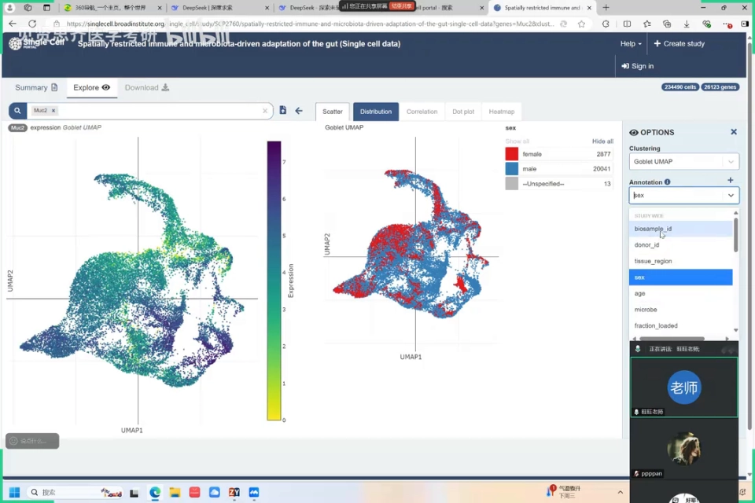

如果把注释换回「全部细胞类型」，就能看到 Muc2 的表达集中在哪一群——讲者的说法是「最深的其实是这一群」，也就是图例里红色的那组杯状细胞 [【跳转到 07:27】](https://www.bilibili.com/video/BV1L2QaYpEtc/?t=447)。

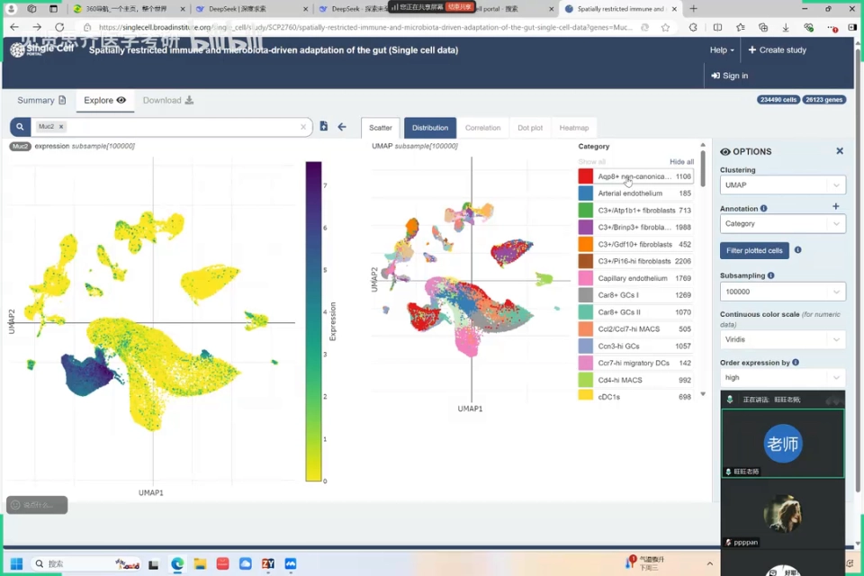

**这就是 SCP 最核心的使用场景**：你读论文时看到「作者说 X 基因在 Y 细胞里高表达」，不需要下载数据、不需要跑代码，输一下基因名就能自己核对一遍。

### 4.4 换图形：小提琴图比 UMAP 更能比较「谁高谁低」

UMAP 上的表达着色有个天然的缺点：**颜色深浅只能定性看，很难横向比较不同细胞群**。讲者的解法是点中间的 **Distribution** 标签，把同一份数据换成小提琴图 [【跳转到 07:52】](https://www.bilibili.com/video/BV1L2QaYpEtc/?t=472)。

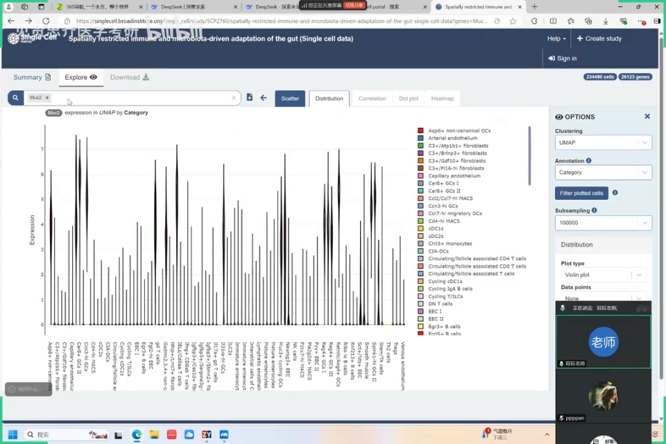

读法很直接：**小提琴越高，代表这个基因在该细胞群里的表达越高**。讲者说这样「可以更直观地去看它在哪一个细胞群表达比较高」，并且补充了一句可以自己验证的推论——表达最高的肯定是跟杯状细胞（GC）相关的那些细胞群 [【跳转到 07:52】](https://www.bilibili.com/video/BV1L2QaYpEtc/?t=472)。

### 4.5 比两个基因：dot plot 上看正相关与负相关

再往下一步，是**同时查两个基因**。在搜索框里再输入一个杯状细胞的 marker（演示里是 Spink4），然后点 **Dot plot**，就能看到这两个基因在各个细胞群里的表达对比 [【跳转到 08:42】](https://www.bilibili.com/video/BV1L2QaYpEtc/?t=522)。

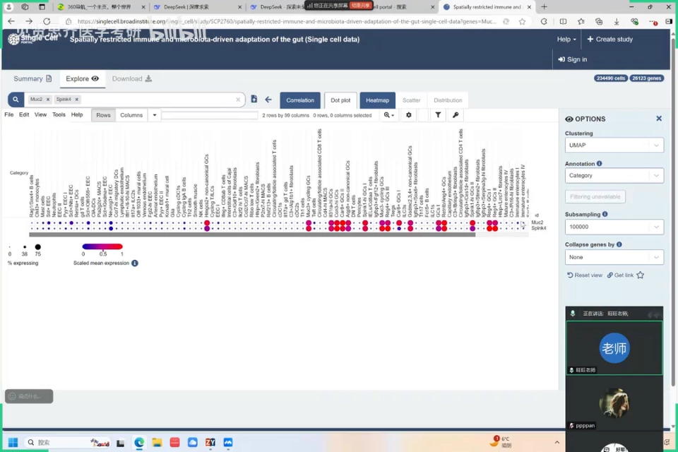

这张图的编码方式要看清：**点的大小 = 表达该基因的细胞比例（% expressing），点的颜色 = 标度化后的平均表达量（scaled mean expression）**。

讲者用它读出两件事：

- **正相关**：在杯状细胞相关的群里，Muc2 和 Spink4 都是又大又红的点——「Muc2 表达特别高的这个大红点，相应的 Spink4 的表达就越高」，说明在这个细胞群里两者正相关 [【跳转到 08:42】](https://www.bilibili.com/video/BV1L2QaYpEtc/?t=522)；
- **负相关**：再换一个细胞群看，同一个基因的表达就变成偏蓝的点了，也就是表达比较低——这时两个基因呈现负相关的关系 [【跳转到 09:07】](https://www.bilibili.com/video/BV1L2QaYpEtc/?t=547)。

**为什么这件事值得单独讲**：基因之间的正/负相关是构造假设的起点（比如「这两个基因是不是在同一个调控模块里」）。在 SCP 上，这个判断只需要点两下；而在本地做，要先下载矩阵、做归一化、再画图。

### 4.6 还有热图，但讲者不推荐用它来「看细胞类型」

中间还有一个 **Heatmap** 标签。讲者的评价很直接：热图**不直观**——因为它本质上是一张「细胞的坐标」表，横轴是成千上万个细胞的 barcode，没法让人看出某个细胞属于哪一类 [【跳转到 09:32】](https://www.bilibili.com/video/BV1L2QaYpEtc/?t=572)。

讲者的建议是：**要看表达高低，优先用 dot plot 或小提琴图** [【跳转到 09:57】](https://www.bilibili.com/video/BV1L2QaYpEtc/?t=597)。这条建议背后是一个通用原则：选图的标准是「这张图的编码方式能不能直接回答问题」，而不是「这张图看起来信息量大」。

## 五、怎么找到「论文对应的那个数据集」：认 SCP 编号

前面都是「先有数据集、再看图」。但在真实场景里，顺序往往是反的：**你先读了论文，想知道它的数据在不在 SCP 上。**

讲者给的路径是：论文的**材料方法部分、文章最后**，通常会有一段数据或代码获取的说明（`Analysis data reported in this paper...`），里面会给出**项目编号** [【跳转到 10:06】](https://www.bilibili.com/video/BV1L2QaYpEtc/?t=606)。

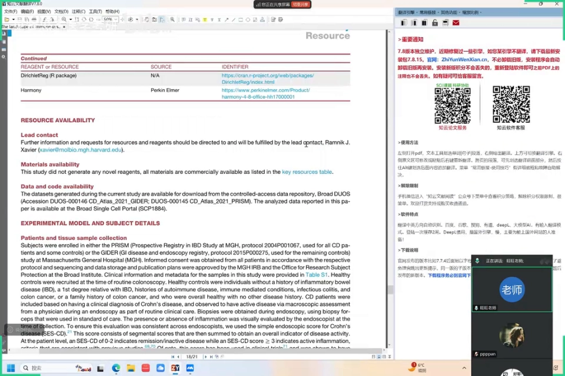

这段文字值得逐句读，因为它把三类数据的去向分得很清楚：

- **原始数据（raw data）** → Broad DUOS 等受控访问仓库（DUOS 编号）；
- **本文分析的数据（analyzed data）** → **Broad Single Cell Portal（SCP1884）**。

同一个研究在 GEO 上还有一个 Series 编号 **GSE243316**，讲者后半段就是拿这个编号去 GEO 里对照的（见 5.1）。

拿到编号之后，回到 SCP 首页，把 `SCP1884` 输进搜索框，就能**精确**定位到这个项目——讲者演示时搜索框还会自动补全一串 SCP 编号 [【跳转到 10:36】](https://www.bilibili.com/video/BV1L2QaYpEtc/?t=636)。

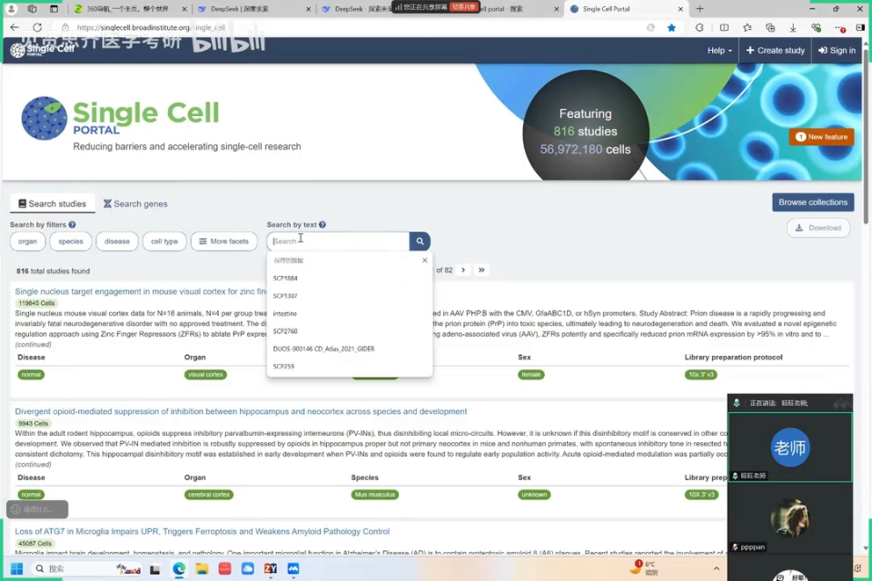

进去之后看到的页面结构和前面完全一样：整体介绍 + 可视化界面。这个项目按文章的方法把数据分成了若干群，讲者特别解释了命名：**`colon` 指的是结肠，`TI` 指的是回肠末端（terminal ileum）**，其余几群按文章自己的分法命名 [【跳转到 10:55】](https://www.bilibili.com/video/BV1L2QaYpEtc/?t=655)。

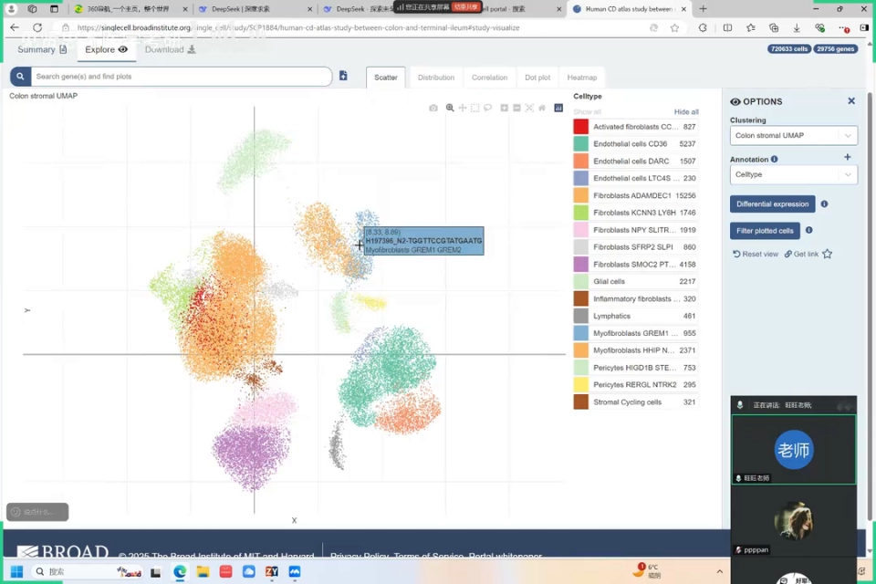

注意这个项目的 Explore 右侧多了一个 **Differential expression** 按钮——也就是说，**部分项目还支持在线做差异表达**，不只是看图。

### 5.1 同一个研究，SCP 与 GEO 各存一份

讲者在问答里把这件事讲透了：**很多文章的原始数据除了上传到 SCP，也会传到 GEO；有些文章两个数据库都上传，方便大家去看** [【跳转到 14:07】](https://www.bilibili.com/video/BV1L2QaYpEtc/?t=847)。

演示里同一个研究在 GEO 上的页面是 **GSE243316**，标题和 SCP1884 完全一致（`Spatially restricted immune and microbiota-driven adaptation of the gut`），下面列出物种、实验类型、平台、72 个样本，以及子系列（scRNA-seq 与空间转录组各一个）[【跳转到 15:17】](https://www.bilibili.com/video/BV1L2QaYpEtc/?t=917)。

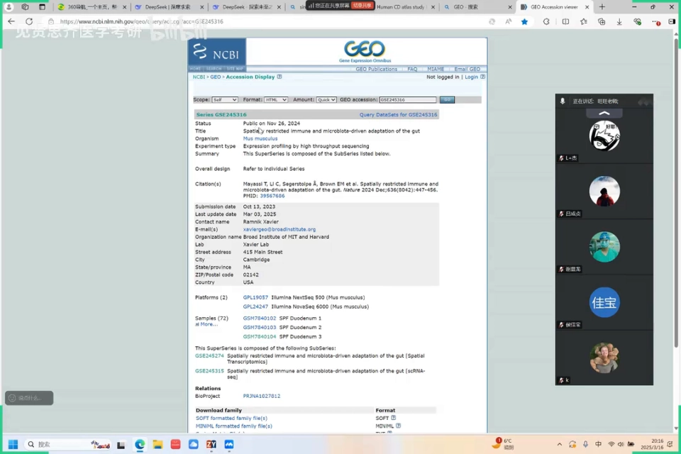

**这个对照非常有教育意义**：同一个研究，在 SCP 上你看到的是「已经处理好的 UMAP 和注释」，在 GEO 上你看到的是「一堆待下载的文件」。

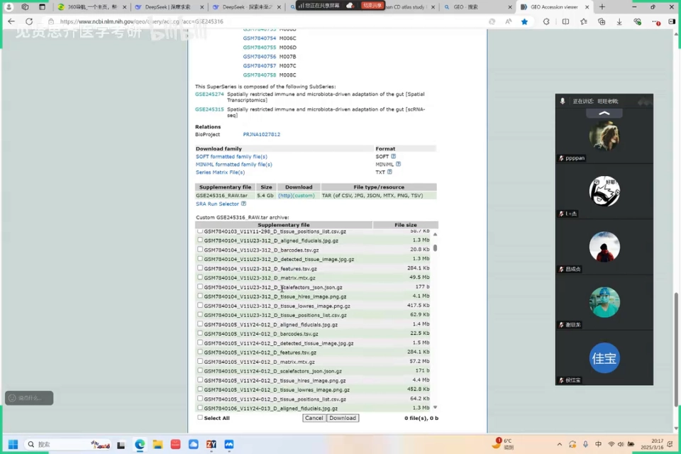

讲者对 GEO 下载的描述是：点开之后下面有好多链接，你想分析哪个数据，就把对应的前面打个对勾 [【跳转到 16:07】](https://www.bilibili.com/video/BV1L2QaYpEtc/?t=967)。这也是 GEO 的常态——**它负责「存全」，不负责「好用」**。

## 六、什么时候该用它，什么时候不该用

讲者后半段的问答，实际上给出了这个平台的使用边界。

### 6.1 它比 GEO「专」，GEO 比它「全」

被问到「这个数据库和 GEO 有什么不一样」时，讲者的回答是 [【跳转到 13:03】](https://www.bilibili.com/video/BV1L2QaYpEtc/?t=783)：

- **SCP 很「专一」**：它只收单细胞数据，名字就叫 Single Cell Portal；
- **GEO 更「全」也更「杂」**：它既存单细胞，也存 bulk，还有空间转录组等其他类型的数据。

讲者还补了一句很实用的观察：**单细胞和 bulk 最大的区别，是 bulk 没法从单个细胞的层面去看**；但要说「筛基因」，单细胞肯定比 bulk 更精确，因为它是在单个细胞水平上筛的 [【跳转到 14:27】](https://www.bilibili.com/video/BV1L2QaYpEtc/?t=867)。

### 6.2 适合：验证结论、判断值不值得下载、给课题找引子

综合整场演示，SCP 站得住的使用场景有三类：

1. **验证论文里的一个说法**：作者说某基因在某细胞类型高表达，输进去看一眼就知道（见 4.3、4.4）；
2. **判断这个数据集值不值得下载**：先看它的细胞类型注释、样本构成、整合质量，再决定要不要花时间下载、跑流程；
3. **给自己的课题找「引子」**：讲者说得最直白——如果课题组没有资金去做大规模测序，可以借助单细胞、空间转录组、bulk 这类公共平台做相应分析，**给文章前面做一个引子，引出想研究的基因或想做的机制**，这叫「抛砖引玉」，用来带动课题推进 [【跳转到 17:47】](https://www.bilibili.com/video/BV1L2QaYpEtc/?t=1067)。

### 6.3 不适合：拿公共数据当自己的对照组

有位听众问「空间转录组自测能不能设计对照组」，讲者的回答很干脆：**不行** [【跳转到 16:57】](https://www.bilibili.com/video/BV1L2QaYpEtc/?t=1017)。

理由讲得很清楚：**你和数据库的处理方式很难达到一致**，所以拿数据库的数据来当对照「我觉得这样是不准的」；要做对照，肯定要用同一批样本去处理，保证在同一个条件之下，出来的实验结果才可靠 [【跳转到 17:22】](https://www.bilibili.com/video/BV1L2QaYpEtc/?t=1042)。

这条限制值得牢记。它其实是 2.4.4 节讲过的批次效应的直接推论：**不同实验室、不同建库批次、不同处理流程产生的数据之间，差异里混着大量技术因素**。SCP 上的每个项目都是独立团队独立处理的，跨项目直接比较表达量，等于把批次效应当成了生物学差异。

### 6.4 平台的固有局限（本节背景补充，非视频内容）

视频里能看到一个细节：不同项目的注释字段命名并不统一——SCP1884 用 `Celltype`，另一个肠道项目用 `Category`，还有的项目用 `cell_type_ontology_label`。这说明**注释体系由各研究团队自己决定，平台不做统一映射**。由此带来两个后果：

- **同一群细胞在不同项目里可能叫不同名字**，跨项目检索细胞类型时要小心；
- **不适合做跨研究的大规模比较**。这类需求应该转向做了统一处理与统一注释的参考图谱门户（CELLxGENE、HCA），而不是 SCP。

> 上面这一小节是根据演示中观察到的界面差异做的补充说明，不是视频里的原话，供读者判断平台边界时参考。

## 小结

- **Single Cell Portal 的定位是「论文配套数据 + 交互式可视化」**：一个项目对应一篇论文的一套数据，作者上传时就配好了浏览界面，读者不必下载就能看图 [【跳转到 01:46】](https://www.bilibili.com/video/BV1L2QaYpEtc/?t=106)。
- **两个入口**：Search studies 按项目找（器官、物种、疾病、细胞类型筛选），Search genes 按基因找；实际使用以按项目搜为主 [【跳转到 02:36】](https://www.bilibili.com/video/BV1L2QaYpEtc/?t=156)。
- **项目页三层**：Summary 看这篇论文为什么做这个数据；Explore 看图；Download 要登录 [【跳转到 04:03】](https://www.bilibili.com/video/BV1L2QaYpEtc/?t=243)。
- **Explore 的五个动作**：换聚类层级（总图 → 亚群）、换注释维度（样本/供体/性别/年龄）、查单基因表达、换图形（小提琴图比 UMAP 更好比高低）、比两个基因的相关性（dot plot）[【跳转到 04:44】](https://www.bilibili.com/video/BV1L2QaYpEtc/?t=284)。
- **找数据集的正确姿势是认编号**：论文的 Data availability 里会写 SCP 编号，拿编号回首页精确检索 [【跳转到 10:06】](https://www.bilibili.com/video/BV1L2QaYpEtc/?t=606)。
- **同一个研究常常在 SCP 和 GEO 各存一份**：SCP 给你看处理好的图，GEO 给你存全的原始文件 [【跳转到 15:17】](https://www.bilibili.com/video/BV1L2QaYpEtc/?t=917)。
- **能用**：验证结论、判断是否值得下载、给课题找引子；**不能用**：拿它当自己的对照组 [【跳转到 16:57】](https://www.bilibili.com/video/BV1L2QaYpEtc/?t=1017)。

## 关键术语速查

| 术语 | 一句话解释 |
| --- | --- |
| Single Cell Portal（SCP） | Broad Institute 维护的单细胞数据浏览与共享平台，收录各研究团队为论文上传的数据集并配交互式可视化 |
| Study（研究/项目） | SCP 上的一个数据条目，通常对应一篇论文的一套数据，有 SCP 编号（如 SCP1884） |
| Search studies / Search genes | 平台的两种检索入口：按项目筛选、按基因反查哪些数据集检测到了它 |
| Explore | 项目页的可视化标签页，提供 Scatter、Distribution、Correlation、Dot plot、Heatmap 五种视图 |
| Clustering | Explore 里的聚类层级选择，决定当前 UMAP 是「全部细胞」还是「某一类细胞的再聚类」 |
| Annotation | Explore 里的上色依据选择，可切换样本、供体、组织区域、性别、年龄等元数据 |
| UMAP | 一种降维可视化，把高维表达谱压到二维，相似细胞聚在一起 |
| Dot plot | 双基因对比图：点的大小表示表达该基因的细胞比例，颜色表示标度化后的平均表达量 |
| Scaled mean expression | 把每个基因的表达按细胞群做标准化后的平均值，用于跨基因比较颜色深浅 |
| % expressing | 某个细胞群里检测到该基因表达的细胞占比，反映「有多少细胞表达」而非「表达多高」 |
| Celltype / Category | 项目自定义的细胞类型注释字段，命名由各研究团队决定，平台不统一 |
| GEO（Gene Expression Omnibus） | NCBI 的公共基因表达数据存档，存原始与处理后文件，类型覆盖 bulk、单细胞、空间转录组 |
| GSE 编号 | GEO 的 Series 编号，一个研究一个 GSE，如 GSE243316 |
| Data availability | 论文中说明数据存放位置的段落，是找到 SCP / GEO 编号的入口 |
| Differential expression | 差异表达；部分 SCP 项目在 Explore 里提供在线计算入口 |
