# SRA 数据下载的三条路：迅雷、SRA Toolkit 与 Aspera

> 视频来源：[01.NCBI高通量测序数据SRA下载](https://www.bilibili.com/video/BV1SbL7znEAk/)（Bilibili · 组学大讲堂）｜时长约 24 分钟
> 导读：这支视频把「从 NCBI 把原始测序数据搬到本地」这件事拆成三条路——迅雷、SRA Toolkit 的 prefetch、Aspera 走 ENA——每条路都现场跑一遍，包括 prefetch 中途报错中断的片段。本文按「编号层级 → 三种下载方式 → 批量下载 → sra 转 fastq」重排，重点保留每条路的代价与适用场景，课程推广部分略去。

## 本讲要解决的核心问题（SCQA）

**背景**：想用别人的数据发自己的文章，最省钱的办法就是去 NCBI 下载公共测序数据——视频里举的两篇论文，都是下载公共高通量数据、用基因表达量画热图做出来的 [【跳转到 00:08】](https://www.bilibili.com/video/BV1SbL7znEAk/?t=8)。

**冲突**：下载按钮人人会点，但真下起来问题一堆。一个 study 下面几十个 run，逐个点太慢；用官方工具 prefetch 下到一半报 `transfer interrupted`；下回来的 `.sra` 文件打不开，还得再转成 FASTQ；转一次要一两个小时。

**疑问**：公共测序数据到底有哪几种下载路径？各自的代价是什么？什么时候该用哪一种？

**回答（中心思想）**：SRA 数据有三条下载路径，**按「速度与省事程度」排序是：Aspera 走 ENA > 迅雷 > SRA Toolkit 的 prefetch**。Aspera 最快（实测 55–60 MB/s）而且能直接从 ENA 拿到 FASTQ，省掉格式转换；迅雷最省事但只有 2 MB/s 左右，适合数据量小的情况；prefetch 是官方工具、能批量，但速度慢且经常中断，视频里的实测就断了一次。选哪条路，取决于数据量、网络条件，以及你愿不愿意多装一个软件。

## 一、SRA 的五层编号：PRJ 到 SRR，一层层往下

SRA（Sequence Read Archive）主要存储高通量测序数据。它的组织架构是五层 [【跳转到 01:15】](https://www.bilibili.com/video/BV1SbL7znEAk/?t=75)：

| 层级 | 含义 | 检索号前缀 |
| --- | --- | --- |
| BioProject | 项目编号，一个课题 | PRJ（如 PRJNA497270） |
| Study | 研究内容 | SRP（如 SRP165999） |
| Experiment | 实验信息 | SRX |
| Sample | 样本信息 | SRS |
| Run | 数据信息（真正能下载的单位） | SRR |

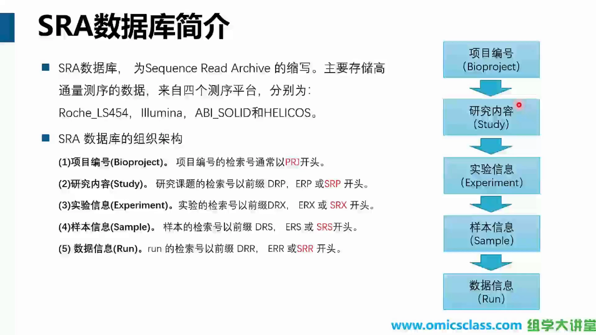

这张图值得记住的理由很实际：**检索时你手上可能只有 PRJ 或 SRP 号，但下载时你必须落到 SRR 号**。中间这三层（SRX/SRS）平时用不到，但它们解释了为什么「一个 study 号对应一堆 run 号」——一个 study 里有多个样本，每个样本可能有多次测序（多 lane），每次测序就是一个 run [【跳转到 01:40】](https://www.bilibili.com/video/BV1SbL7znEAk/?t=100)。

这也正是单细胞数据下载时最容易踩的坑：**同一个样本的多个 run 必须合并，否则一个样本会被拆成几份**。所以下载前先数清楚：N 个样本、每个样本几个 run。

## 二、方法一：迅雷——最省事，也最慢

迅雷的思路是「拿到直链，丢给下载器」。取直链的步骤是固定的 [【跳转到 02:24】](https://www.bilibili.com/video/BV1SbL7znEAk/?t=144)：

1. 打开 NCBI，选择 SRA 数据库，输入 study 号或项目编号，点搜索 [【跳转到 02:48】](https://www.bilibili.com/video/BV1SbL7znEAk/?t=168)；
2. 搜索结果就是该 study 下的所有数据 [【跳转到 03:08】](https://www.bilibili.com/video/BV1SbL7znEAk/?t=188)；
3. 点 **Send to → File**，Format 选 **run info**，点 **Create file** [【跳转到 03:18】](https://www.bilibili.com/video/BV1SbL7znEAk/?t=198)；
4. 得到一个 `SraRunInfo.csv`，第一列是 Run 编号，最后一列 `download_path` 就是下载地址 [【跳转到 03:42】](https://www.bilibili.com/video/BV1SbL7znEAk/?t=222)；
5. 把地址复制到迅雷里，开始下载 [【跳转到 03:56】](https://www.bilibili.com/video/BV1SbL7znEAk/?t=236)。

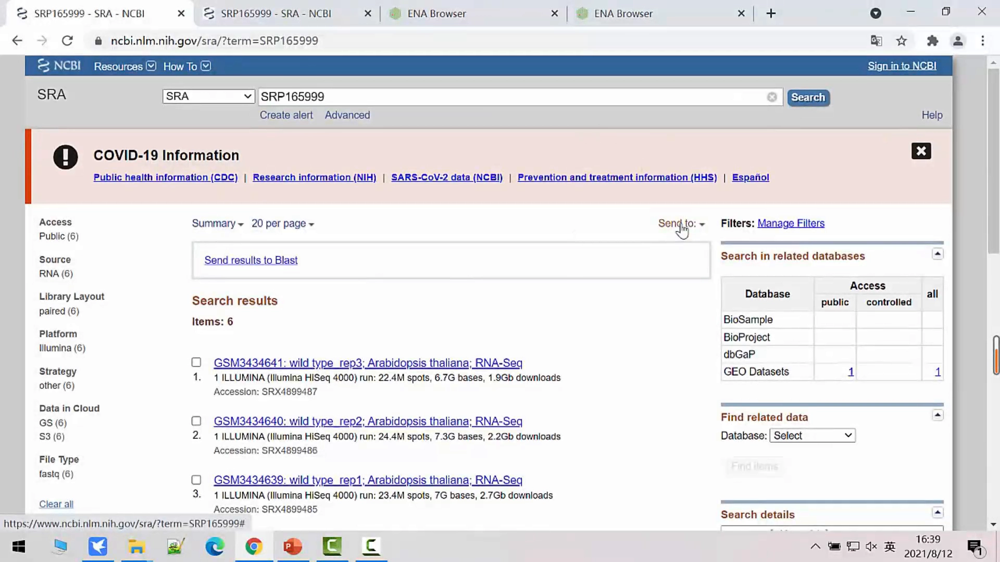

**这张 `SraRunInfo.csv` 本身就是一份元数据表**，值得单独看一眼：除了 `Run` 和 `download_path`，它还有 `spots`（reads 数）、`bases`（碱基数）、`size_MB`（文件大小）、`avgLength`（读长）[【跳转到 03:37】](https://www.bilibili.com/video/BV1SbL7znEAk/?t=217)。

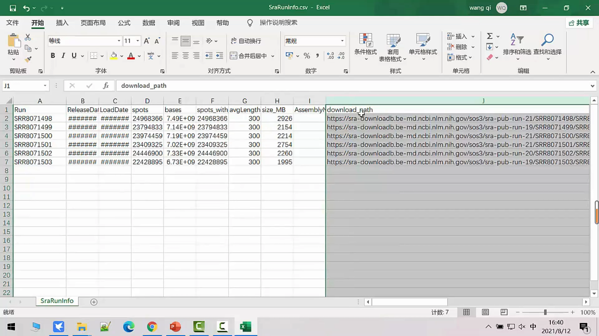

用这张表可以做两件很实用的事：**下载前估算总磁盘占用**（把 `size_MB` 一列求和），以及**核对 run 与样本的对应关系**（哪几个 run 属于同一个 GSM）。后者正是「合并同一 GSM 的多个 run」的依据。

缺点是速度：迅雷大概 2 MB/s 左右，取决于自己的网速，买会员会快很多。讲者的结论是「数据比较少的话可以用迅雷」[【跳转到 04:01】](https://www.bilibili.com/video/BV1SbL7znEAk/?t=241)。

## 三、方法二：SRA Toolkit 的 prefetch——官方工具，但慢且不稳

SRA Toolkit 是 NCBI 提供的官方下载软件，需要下载安装。视频里的做法是走 Docker（镜像里已经装好），所以只需要装 Docker [【跳转到 04:31】](https://www.bilibili.com/video/BV1SbL7znEAk/?t=271)。

prefetch 的用法只有一行 [【跳转到 04:56】](https://www.bilibili.com/video/BV1SbL7znEAk/?t=296)：

```bash
prefetch --option-file SRR.txt
```

前提是**先准备好一个装着所有 run 编号的 `SRR.txt`**——把 `SraRunInfo.csv` 第一列复制进去就行 [【跳转到 05:21】](https://www.bilibili.com/video/BV1SbL7znEAk/?t=321)。

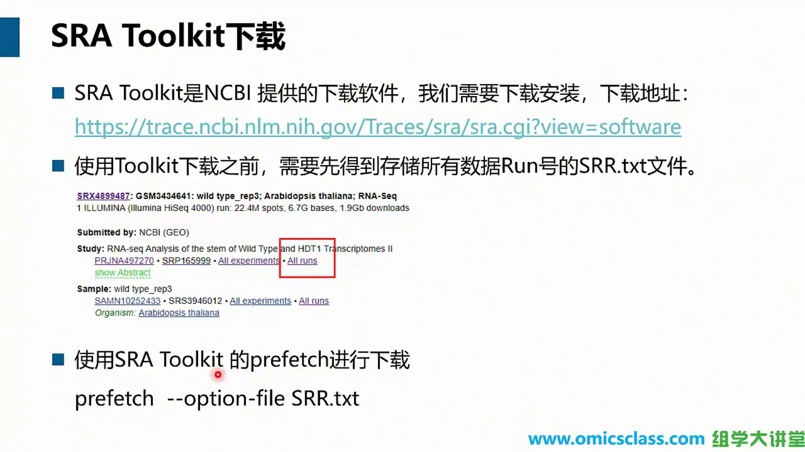

视频里用 Docker 跑这套工具，命令是 [【跳转到 07:19】](https://www.bilibili.com/video/BV1SbL7znEAk/?t=439)：

```bash
docker search omicsclass                    # 搜索镜像
docker pull omicsclass/sratoolkit           # 下载镜像
docker images                               # 确认已下载
docker run --rm -v D:\sratoolkit:/work -it omicsclass/sratoolkit:latest   # 进入虚拟机
```

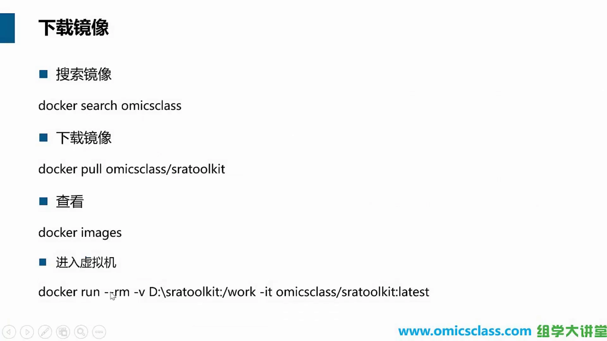

命令里的 -v 挂载参数是关键：**它把宿主机的文件夹挂载到容器里**，这样下载的数据落在你自己电脑上，容器退出后不会丢。讲者特别提醒：**运行前必须先手动创建 `sratoolkit` 这个文件夹，否则会报错** [【跳转到 08:00】](https://www.bilibili.com/video/BV1SbL7znEAk/?t=480)。

进容器后，把 run 编号粘进 `SRR.txt`，`ls` 确认文件在，然后跑 prefetch [【跳转到 09:27】](https://www.bilibili.com/video/BV1SbL7znEAk/?t=567)。开始下载后，工作目录下会多出一个以 SRR 号命名的文件夹，里面是下载的中间文件 [【跳转到 09:58】](https://www.bilibili.com/video/BV1SbL7znEAk/?t=598)。

然后就是这支视频最有说服力的一段：**prefetch 下到一半报错了** [【跳转到 10:03】](https://www.bilibili.com/video/BV1SbL7znEAk/?t=603)：

```
prefetch.2.10.3 int: transfer interrupted while reading file within network system module
prefetch.2.10.3 1) failed to download SRR8071498
```

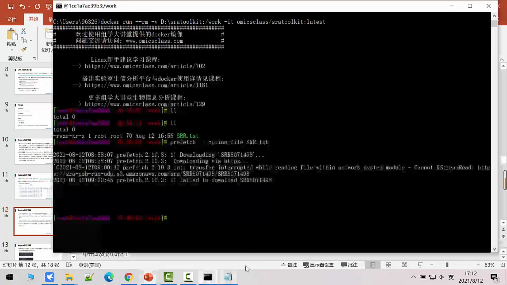

讲者的结论很直接：「下载的速度会非常慢，而且稳定性也不太好，下载过程经常会中断，所以我们并不是很推荐大家使用 SRA Toolkit 进行下载」[【跳转到 10:10】](https://www.bilibili.com/video/BV1SbL7znEAk/?t=610)。

## 四、方法三：Aspera + ENA——最快，还能直接拿 FASTQ

Aspera Connect 是 IBM 旗下的商业高速文件传输软件，因为高通量数据量太大而被引入生物领域，与 NCBI、EBI 有协作合同，可以免费用来下载测序数据，速度可达 300–500 MB/s [【跳转到 10:33】](https://www.bilibili.com/video/BV1SbL7znEAk/?t=633)。

配套用的是 **ENA（European Nucleotide Archive）**：隶属 EBI，功能等同 SRA，数据互通，界面更友好，**最诱人的一点是可以直接下载 FASTQ（.gz）文件** [【跳转到 10:58】](https://www.bilibili.com/video/BV1SbL7znEAk/?t=658)。

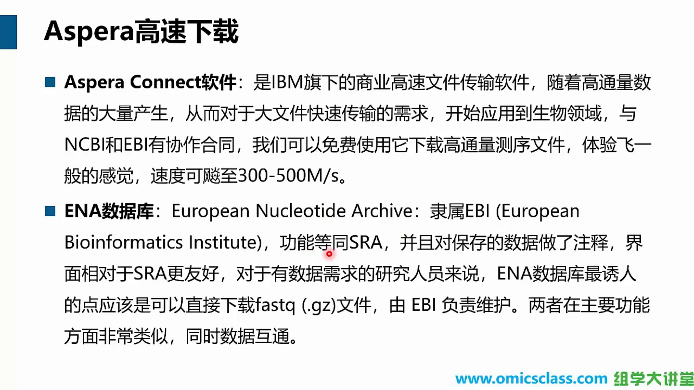

「能直接下 FASTQ」这一条的价值要说清楚：走 SRA 路线下载得到的是 `.sra` 格式，还得再花一两个小时转成 FASTQ（见第六节）；走 ENA 则一步到位。**这是三条路里唯一能省掉格式转换的一条。**

取地址的流程：登录 ENA 网站，输入 study 号或 BioProject 号（视频用 SRP165999）[【跳转到 11:14】](https://www.bilibili.com/video/BV1SbL7znEAk/?t=674) → 在 study 下点数据编号 [【跳转到 11:51】](https://www.bilibili.com/video/BV1SbL7znEAk/?t=711) → 页面上能看到 FASTQ 的 FTP 地址 [【跳转到 12:01】](https://www.bilibili.com/video/BV1SbL7znEAk/?t=721)。讲者提到原来这里还有 SRA 的 FTP 地址，后来 ENA 更新时删掉了，「不过影响不大，我们可以直接下载 FASTQ 数据」[【跳转到 12:12】](https://www.bilibili.com/video/BV1SbL7znEAk/?t=732)。

点 **TSV** 可以把整张表下载下来 [【跳转到 12:28】](https://www.bilibili.com/video/BV1SbL7znEAk/?t=748)。这张表比 SRA 的 run info 更适合做元数据骨架：

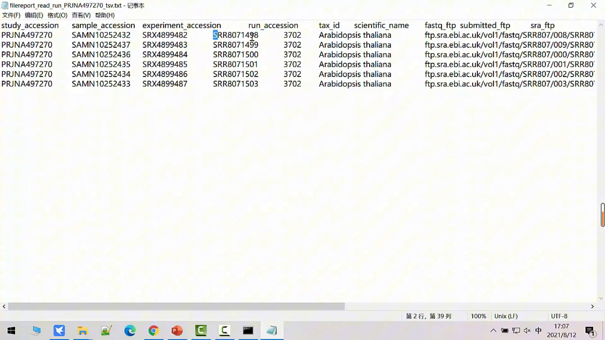

- `sample_accession`、`experiment_accession`、`run_accession`：把 SRA 的层级一次列全；
- `scientific_name`：物种，避免下错物种的数据；
- `fastq_ftp`：FASTQ 的地址，**两个地址用分号隔开，前面是 read1、后面是 read2** [【跳转到 12:40】](https://www.bilibili.com/video/BV1SbL7znEAk/?t=760)；
- `submitted_ftp`、`sra_ftp`：作者原始提交的格式与 SRA 格式的地址。

单文件下载的命令是 [【跳转到 13:10】](https://www.bilibili.com/video/BV1SbL7znEAk/?t=790)：

```bash
ascp -QT -l 300m -P33001 -i ~/.aspera/connect/etc/asperaweb_id_dsa.openssh \
     era-fasp@fasp.sra.ebi.ac.uk:/vol1/fastq/SRR807/002/SRR8071502/SRR8071502_1.fastq.gz ./
```

参数逐个拆开看：

| 参数 | 作用 |
| --- | --- |
| `-QT` | 传输选项（静默 + 超时控制） |
| `-l 300m` | 最大带宽，这里是 300 Mbps |
| `-P33001` | 端口，默认 33001 |
| `-i <密钥>` | Aspera 的认证密钥，用默认的即可 |
| `era-fasp@fasp.sra.ebi.ac.uk` | ENA 在 Aspera 上的用户名 + 主机 |
| `./` | 下载到当前目录 |

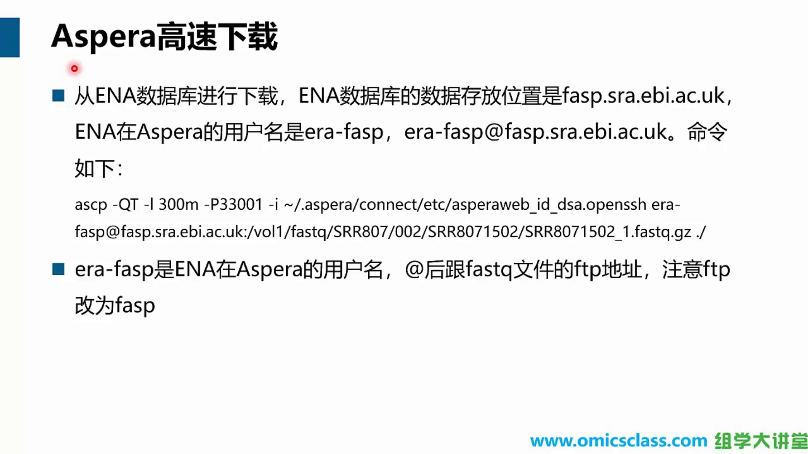

**最容易错的一步**：ENA 给的地址是 `ftp://ftp.sra.ebi.ac.uk/...`，用 ascp 时必须改成 `fasp://`，也就是写成 `era-fasp@fasp.sra.ebi.ac.uk:/vol1/...` 这种形式 [【跳转到 14:07】](https://www.bilibili.com/video/BV1SbL7znEAk/?t=847)。讲者反复强调了两遍，因为这个改动不显眼但缺了就跑不起来。

实测速度 55 MB/s，一个 23 G 的数据十几分钟就能下完 [【跳转到 14:29】](https://www.bilibili.com/video/BV1SbL7znEAk/?t=869)。
## 五、批量下载：把路径整理成 filelist

单个文件下载演示完，讲者立刻转到批量：数据一多，一个个下太费劲 [【跳转到 15:00】](https://www.bilibili.com/video/BV1SbL7znEAk/?t=900)。

做法是把所有文件的路径整理到一个文本文件里——**但要的是 `/vol1/` 之后的相对路径，不是完整 URL** [【跳转到 15:25】](https://www.bilibili.com/video/BV1SbL7znEAk/?t=925)：

```
# fastq.txt（每行一个文件）
/vol1/fastq/SRR807/008/SRR8071498/SRR8071498_1.fastq.gz
/vol1/fastq/SRR807/008/SRR8071498/SRR8071498_2.fastq.gz
/vol1/fastq/SRR807/009/SRR8071499/SRR8071499_1.fastq.gz
...

# SRA.txt（如果下 SRA 格式）
/vol1/srr/SRR807/008/SRR8071498
/vol1/srr/SRR807/009/SRR8071499
...
```

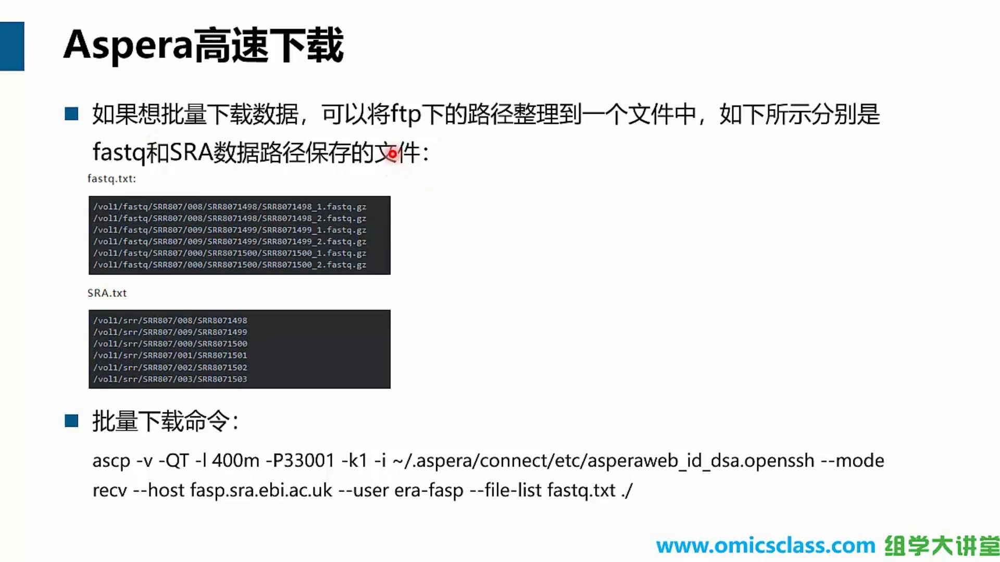

为什么必须去掉主机部分？因为批量命令里已经把主机写在 `--host` 参数里了，filelist 只负责「相对这个主机的路径」。**这一点搞错，整批都会失败。**

批量命令 [【跳转到 15:50】](https://www.bilibili.com/video/BV1SbL7znEAk/?t=950)：

```bash
ascp -v -QT -l 400m -P33001 -k1 -i ~/.aspera/connect/etc/asperaweb_id_dsa.openssh \
     --mode recv --host fasp.sra.ebi.ac.uk --user era-fasp \
     --file-list fastq.txt ./
```

比单文件版多了几个参数：

- `-k1`：**断点续传**。下载中断后重新运行同一条命令，已下过的部分不会重下 [【跳转到 16:15】](https://www.bilibili.com/video/BV1SbL7znEAk/?t=975)；
- `--mode recv`：表示接收（下载）；
- `--host` / `--user`：主机与用户名，固定为 `fasp.sra.ebi.ac.uk` 与 `era-fasp`；
- `--file-list`：指向刚才整理的清单。

讲者强调：**这一整条命令只需要改 `--file-list` 后面的文件名**，其他地方都不用动 [【跳转到 16:40】](https://www.bilibili.com/video/BV1SbL7znEAk/?t=1000)。

实测批量下载速度 60 MB/s 左右 [【跳转到 18:36】](https://www.bilibili.com/video/BV1SbL7znEAk/?t=1116)。还有一个很实用的小现象：**进度和速度都不动了，别慌，它其实还在下载，只是显示没刷新，敲一下回车就恢复显示** [【跳转到 18:47】](https://www.bilibili.com/video/BV1SbL7znEAk/?t=1127)。

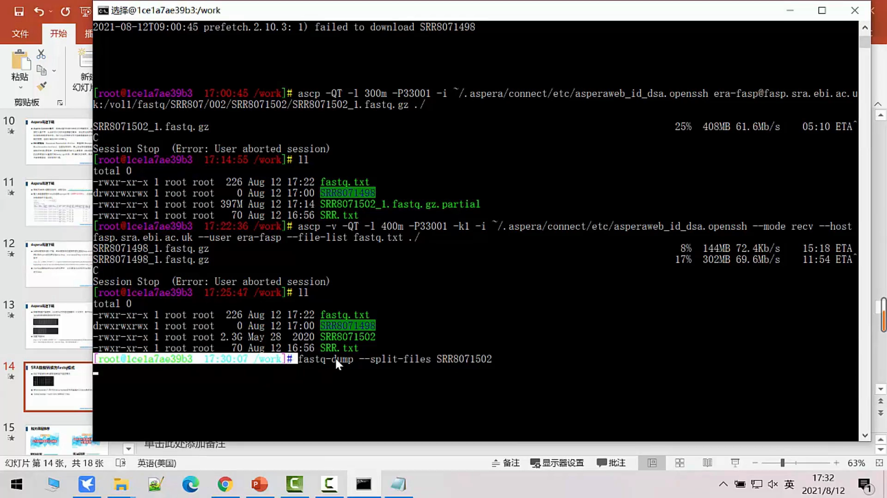

## 六、sra 转 fastq：fasterq-dump 慢得要有耐心

如果你走的是迅雷或 prefetch 路线，拿到的是 `.sra` 文件，必须再转成 FASTQ。**如果走 Aspera + ENA 直接下了 FASTQ，这一步可以跳过** [【跳转到 19:36】](https://www.bilibili.com/video/BV1SbL7znEAk/?t=1176)。

下载好的 SRA 数据通常长这样：一个 SRR 编号加 `.sra` 后缀。讲者补了一句很实用的提醒：**后缀也可能是 `.1`、`.2`，甚至根本没有后缀，这些都只是文件名，不影响转换** [【跳转到 20:01】](https://www.bilibili.com/video/BV1SbL7znEAk/?t=1201)。

转换命令：

```bash
fasterq-dump --split-files SRR8071502
```

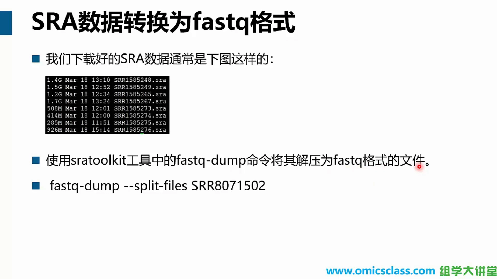

`--split-files` 的作用是**把双端数据拆成两个文件**，转换完会得到 `SRR8071502_1.fastq` 和 `SRR8071502_2.fastq`，分别对应 read1 和 read2 [【跳转到 21:49】](https://www.bilibili.com/video/BV1SbL7znEAk/?t=1309)。

转换过程非常慢：光标一直闪，说明还在转；**再次出现命令行提示符才表示转换完成**，整个过程可能需要一两个小时 [【跳转到 21:58】](https://www.bilibili.com/video/BV1SbL7znEAk/?t=1318)。转换过程中也可以用 `less -SN` 直接查看已经写出的部分 [【跳转到 22:13】](https://www.bilibili.com/video/BV1SbL7znEAk/?t=1333)。

## 七、三条路怎么选

把三条路放在一起对比，取舍就很清楚了：

| 路径 | 实测速度 | 拿到什么 | 适合什么情况 |
| --- | --- | --- | --- |
| 迅雷 | ~2 MB/s | `.sra`，需转换 | 数据量小、不想装任何工具 |
| SRA Toolkit（prefetch） | 慢，且常中断 | `.sra`，需转换 | 必须批量、且只认官方渠道 |
| Aspera + ENA | 55–60 MB/s | **直接 FASTQ** | 数据量大、要批量、想省掉转换 |

对单细胞研究来说，这个对比还有一层额外意义：**单细胞一个样本的原始数据动辄几十 G，用 2 MB/s 的迅雷下几十个样本是不现实的**；而 ENA 的 TSV 表里 `fastq_ftp` 一列正好给出每个 run 的 read1/read2 地址，天然适合整理成 filelist 批量拉取。所以「下原始数据」这件事，实际工作中基本都会落到第三条路上。

## 小结

- **SRA 是五层结构**：BioProject（PRJ）→ Study（SRP）→ Experiment（SRX）→ Sample（SRS）→ Run（SRR）。检索可以用上层编号，**下载必须落到 SRR**。
- **`SraRunInfo.csv` 是免费的元数据表**：Run 编号、spots、bases、size_MB、download_path 都在里面，下载前可以据此估算磁盘占用、核对 run 与样本的对应关系。
- **迅雷最简单但最慢**（~2 MB/s），适合数据量小的情况；买会员能提速。
- **prefetch 是官方工具**，`prefetch --option-file SRR.txt` 就能批量，但视频实测中途报 `transfer interrupted`，速度慢、稳定性差。
- **Aspera + ENA 是最优路径**：速度 55–60 MB/s，而且能直接下 FASTQ，省掉格式转换。关键改动是把地址里的 `ftp` 换成 `fasp`，写成 `era-fasp@fasp.sra.ebi.ac.uk:/vol1/...`。
- **批量下载靠 filelist**：每行一个 `/vol1/` 之后的相对路径，主机和用户名写在 `--host` / `--user` 里；加 `-k1` 可断点续传。
- **`.sra` 转 FASTQ 用 `fasterq-dump --split-files`**，双端会拆成 `_1` 和 `_2` 两个文件，耗时可能一两个小时。
- **下载后第一件事是校验**：文件大小与 `size_MB` 对得上，才算下完整。

## 关键术语速查

| 术语 | 一句话解释 |
| --- | --- |
| SRA | Sequence Read Archive，NCBI 存储高通量测序原始数据的数据库 |
| BioProject / PRJ | 项目层级，一个课题一个编号 |
| Study / SRP | 研究层级，通常对应一篇论文的一组实验 |
| Run / SRR | 数据层级，真正可下载的单位；一个样本可能有多个 run |
| SraRunInfo.csv | NCBI 导出的 run 信息表，含 Run 编号、大小与下载地址 |
| prefetch | SRA Toolkit 的下载命令，`--option-file` 可批量 |
| SRA Toolkit | NCBI 官方的 SRA 工具集，含 prefetch、fasterq-dump |
| ENA | European Nucleotide Archive，EBI 维护，与 SRA 数据互通，可直接下 FASTQ |
| Aspera / ascp | IBM 的高速传输软件与命令行工具，走 fasp 协议 |
| fasp | Aspera 的传输协议，ENA 地址里的 `ftp` 要改成 `fasp` |
| `-k1` | ascp 的断点续传选项，中断后重跑不会重下 |
| filelist | 批量下载用的路径清单，每行一个 `/vol1/` 之后的相对路径 |
| fasterq-dump | 把 `.sra` 解压成 FASTQ 的命令，`--split-files` 拆分双端 |
