# 从 GEO 下载单细胞数据：四种格式的读取与分组信息整理

> 视频来源：[2.GEO单细胞数据下载与整理（超详细版_多种格式读取）](https://www.bilibili.com/video/BV1kArEBtEZA/)（Bilibili · 生信小当家阿伦）｜时长约 34 分钟
> 导读：这是一支纯实操视频——从 PubMed/GEO 上挑数据集开始，把 10x 三件套、H5、文本表格、RData 四种常见格式各读一遍，每一步都停在对初学者最卡的地方：文件怎么摆、分组信息怎么从细胞名里抠出来。本文按「先看页面判断能不能用 → 再按格式读取 → 最后把分组写进 meta.data」的顺序重排，代码片段按视频里实际敲的内容整理。

## 本讲要解决的核心问题（SCQA）

**背景**：公共单细胞数据绝大多数躺在 GEO 上，下载按钮就在页面上，点一下就能拿到文件。

**冲突**：文件到手之后才是真正的开始。有人下回来的是 `GSE157278_barcodes.tsv.gz` 这种带前缀的三个文件，`Read10X` 直接报错；有人读进来了却不知道哪个细胞是对照、哪个是疾病组，因为分组信息根本不在矩阵里，只藏在细胞名的后缀或者一个单独的 `cell_batch.tsv` 里；还有人下的是 `RAW.tar`，解压出来一堆 `GSM..._matrix.mtx.gz`，手工分文件夹分到崩溃。

**疑问**：从 GEO 拿到一份单细胞数据，要经过哪些步骤，才能变成一个「表达矩阵 + 分组信息」都齐备、可以直接进入下游分析的 Seurat 对象？

**回答（中心思想）**：整个流程只有两步——**① 把数据读取进来，② 把分组信息整理进 `meta.data`**。其中第二步才是重点，也是初学者最容易翻车的地方：矩阵是标准化的，分组却是每个数据集各写各的，必须一个数据集一个数据集地去 GEO 页面、补充文件、甚至细胞名后缀里把对应关系找出来，再落到 `meta.data` 的一列上。四种格式（10x、H5、文本、RData）只是读取方式不同，第二步的逻辑完全一样。

## 一、先找数据：从论文的方法部分反查 GSE 号

视频开篇给的第一条路径不是打开 GEO 搜索框，而是打开 PubMed [【跳转到 00:30】](https://www.bilibili.com/video/BV1kArEBtEZA/?t=30)。做法很朴素：输入 `scRNA` 加一个疾病词，再加 `GEO`，先粗筛出一批文章 [【跳转到 00:48】](https://www.bilibili.com/video/BV1kArEBtEZA/?t=48)。

挑中一篇之后，去它的 Methods 部分找数据可用性声明——那里通常写着 GSE 编号 [【跳转到 00:56】](https://www.bilibili.com/video/BV1kArEBtEZA/?t=56)。这条路径的价值在于：**你是从「这个研究做了什么」出发去找数据的**，而不是从一堆编号里猜哪个有用。论文里已经交代了物种、组织、分组、样本量，这些正是判断数据集能不能用的依据。

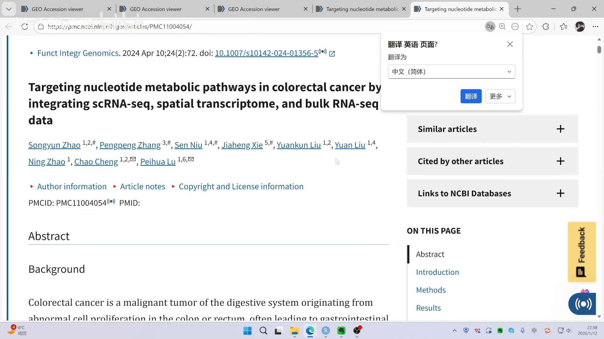

另一条路径是直接在 GEO 里搜：输入疾病词加 `scRNA`，再限定物种是人类还是小鼠 [【跳转到 01:22】](https://www.bilibili.com/video/BV1kArEBtEZA/?t=82)。讲者说这一步只是「简单浏览一下，看看哪些数据符合你的研究方向」——先粗筛，再细看，不要指望搜索结果页就能下判断。

## 二、GEO 页面上该看哪几处：这决定了你能不能把它用起来

视频里每换一个数据集，都会把同一套字段过一遍。这套字段值得固定成习惯，因为它对应的正是「这份数据能不能用」的几个判据。

以 GSE157278 为例 [【跳转到 05:02】](https://www.bilibili.com/video/BV1kArEBtEZA/?t=302)：

| 页面字段 | 看什么 | 为什么重要 |
| --- | --- | --- |
| Experiment type | 是不是 High Throughput，标题/摘要里有没有 scRNA、single cell RNA | 确认它确实是单细胞，而不是芯片或 bulk |
| Organism | Homo sapiens 还是 Mus musculus | 决定下游用人类还是小鼠的基因注释 |
| Overall design | 样本来源（PBMC 还是组织块）、细胞总数、分组与重复数 | 一眼看出实验设计是否支撑你要问的问题 |
| Samples | GSM 列表，每条后面跟着样本名 | 样本名里往往直接写着分组，如 HC-1、pSS-3 |
| Relations | BioProject（PRJNA…）与 SRA（SRP…）编号 | 需要原始 FASTQ 时从这里往下走 |
| Supplementary file | 有哪些文件、多大、什么格式 | 判断是「处理好的矩阵」还是「原始数据」 |

GSE157278 的 Overall design 写得很清楚：57,288 个外周血单个核细胞（PBMC），来自 5 位原发性干燥综合征患者和 5 位健康对照 [【跳转到 05:02】](https://www.bilibili.com/video/BV1kArEBtEZA/?t=302)。这句话已经把「样本量、组织、分组、重复数」四件事一次交代完了——这正是我们需要的元数据骨架。

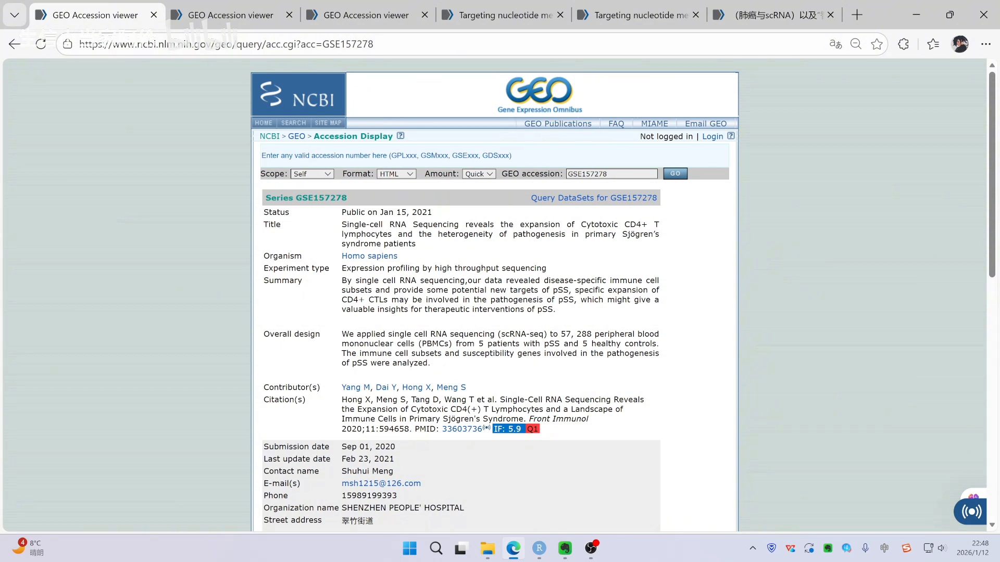

再往下滚，Samples 区列出 10 条 GSM，样本名直接是 `HC-1` 到 `HC-5`、`pSS-1` 到 `pSS-5`；Relations 给出 BioProject `PRJNA660749` 和 SRA `SRP279609`；Supplementary file 里是四个文件：`barcodes.tsv.gz`、`cell_batch.tsv.gz`、`features.tsv.gz`、`matrix.mtx.gz` [【跳转到 05:51】](https://www.bilibili.com/video/BV1kArEBtEZA/?t=351)。

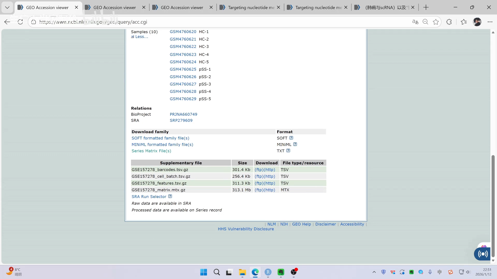

这里有个必须点出来的判断：**讲者明确说要下的是补充文件（supplementary file），不是 Series Matrix**。理由是 Series 那一项只有 2.5K，「很小，那肯定是没有它的数据」[【跳转到 05:27】](https://www.bilibili.com/video/BV1kArEBtEZA/?t=327)。这个经验很实用——**文件大小是最快的验伪手段**：一个几万细胞的数据集，表达矩阵不可能只有几 KB。

还有一处细节值得注意：这个数据集有 10 个样本，按理 10×3 应该有 30 个文件，但补充文件里只有一组三件套。讲者的解释是「它把这十个样本打包在一起了，通过 batch 来区分」[【跳转到 05:56】](https://www.bilibili.com/video/BV1kArEBtEZA/?t=356)。所以那个多出来的 `cell_batch.tsv.gz` 不是可有可无的附件，**它就是分组信息的唯一来源**——后面整节的分组整理都靠它。

## 三、10x 三件套：文件名比文件夹名重要

10x 数据是单细胞里最常见、也最「有讲究」的一种格式。一个数据集被拆成三个文件 [【跳转到 01:37】](https://www.bilibili.com/video/BV1kArEBtEZA/?t=97)：

- `barcodes.tsv.gz`：细胞标签，一行一个细胞；
- `features.tsv.gz`：基因列表，一行一个基因；
- `matrix.mtx.gz`：稀疏矩阵，存的是 count 值。

三个文件必须放在同一个文件夹里、文件名必须精确等于这三个名字，`Read10X` 才能认出来 [【跳转到 02:27】](https://www.bilibili.com/video/BV1kArEBtEZA/?t=147)。但 GEO 上给你的文件名几乎总是带前缀的，比如 `GSE157278_barcodes.tsv.gz`——**所以下载后的第一件事永远是删前缀**。讲者的原话是「不能多一个字符也不能少一个字符」，而**上级文件夹的名字可以随便取**（一般用数据集名）。

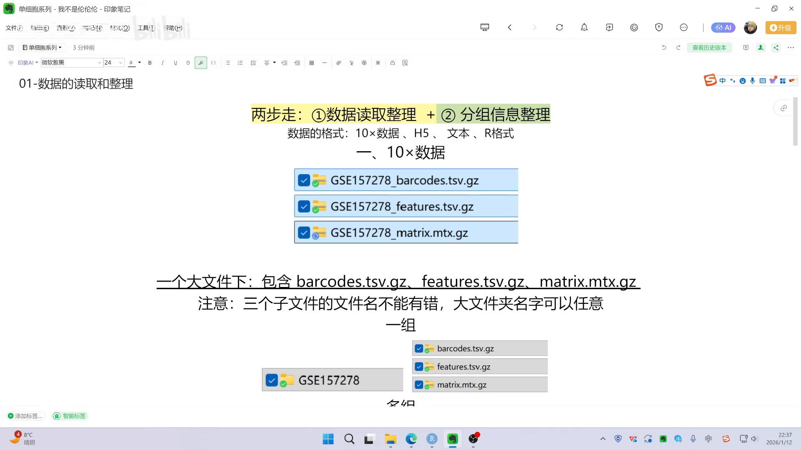

多组数据的规则完全一样，只是多一层文件夹：

```
10x数据/
├─ GSE157278/                 # 单组：一个数据集一个文件夹
│   ├─ barcodes.tsv.gz
│   ├─ features.tsv.gz
│   └─ matrix.mtx.gz
└─ GSE115604/                 # 多组：每个 GSM 一个子文件夹
    ├─ GSM9433269_BALF9618/
    │   ├─ barcodes.tsv.gz
    │   ├─ features.tsv.gz
    │   └─ matrix.mtx.gz
    └─ GSM9433270_BALF5483/
        ├─ barcodes.tsv.gz
        ├─ features.tsv.gz
        └─ matrix.mtx.gz
```

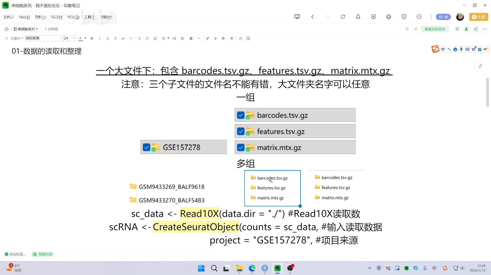

## 四、读进 Seurat：Read10X 与 CreateSeuratObject 只做两件事

读取只有两行代码 [【跳转到 03:17】](https://www.bilibili.com/video/BV1kArEBtEZA/?t=197)：

```r
sc_data <- Read10X(data.dir = "./")          # 读取三件套，得到基因×细胞的稀疏矩阵
scRNA <- CreateSeuratObject(counts = sc_data,
                            project = "GSE157278",   # 项目来源，会写进 orig.ident
                            min.features = 200,      # 一个细胞至少表达 200 个基因
                            min.cells = 3)           # 一个基因至少在 3 个细胞里表达
```

两个参数的含义值得记住，因为它们是后面所有分析的门槛：min.features 设为 200 是**细胞层面**的过滤——表达基因数少于 200 的细胞直接丢掉；min.cells 设为 3 是**基因层面**的过滤——只在 1 个或 2 个细胞里出现的基因丢掉 [【跳转到 04:07】](https://www.bilibili.com/video/BV1kArEBtEZA/?t=247)。讲者说「大家不需要纠结，就这样设置 200 和 3 就可以了」——这两个值不是金标准，但作为起点足够稳。

`project` 参数是这一节埋下的伏笔：它会被写进 `meta.data` 的 `orig.ident` 列，**多组数据时用它标记每个细胞来自哪个样本**。「一组的时候可以标成那个大文件夹的名字；多组的时候就可以标成 GSM33269，第二个读进来标成 GSM33270」[【跳转到 03:42】](https://www.bilibili.com/video/BV1kArEBtEZA/?t=222)。

读完之后，Seurat 对象是 S4 结构，取数据的路径要记牢 [【跳转到 04:32】](https://www.bilibili.com/video/BV1kArEBtEZA/?t=272)：

```
scRNA
└─ assays
   └─ RNA
      └─ layers
         └─ counts      ← 表达值（count 矩阵）在这里
```

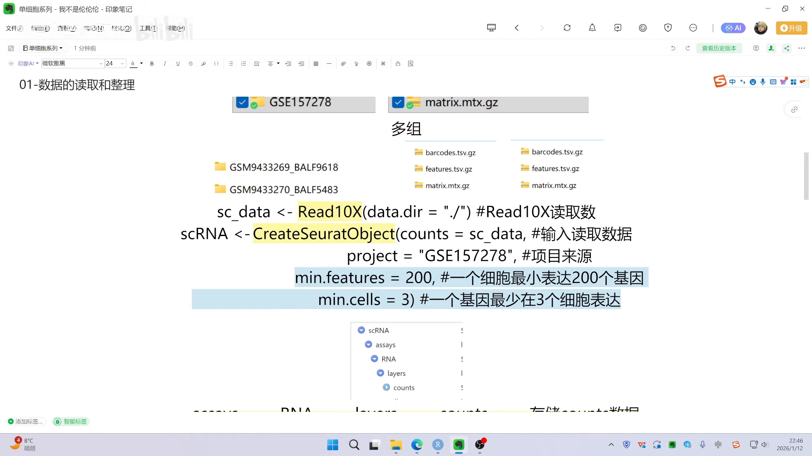

与之并列的是 `meta.data`：**行是细胞、列是样本信息**。讲者把这句话说得很重——「`meta.data` 其实就是我们的分组数据，这一点大家必须要掌握」[【跳转到 12:09】](https://www.bilibili.com/video/BV1kArEBtEZA/?t=729)。后面四种格式的读取流程之所以看起来重复，就是因为它们最终都在做同一件事：把 `meta.data` 补齐。
## 五、分组信息不在矩阵里：单样本示例怎么把 HC/pSS 抠出来

读进 Seurat 之后，表达量有了，但「哪个细胞是对照、哪个是疾病组」还不知道 [【跳转到 09:42】](https://www.bilibili.com/video/BV1kArEBtEZA/?t=582)。这是整支视频反复强调的核心难点。

GSE157278 的解法藏在细胞名里。打开补充文件里的 `cell_batch.tsv` 会发现，细胞名的最后一段是 `-1` 到 `-10` [【跳转到 09:50】](https://www.bilibili.com/video/BV1kArEBtEZA/?t=590)：

- `-1` 到 `-5` 对应 HC-1 到 HC-5，也就是健康对照；
- `-6` 到 `-10` 对应 pSS-1 到 pSS-5，也就是疾病组。

于是分组变成三步字符串操作 [【跳转到 10:23】](https://www.bilibili.com/video/BV1kArEBtEZA/?t=623)：

```r
# 1. 从细胞名里切出批次号：按 "-" 切开，取第 2 段
batch <- str_split(rownames(scRNA@meta.data), '-', simplify = TRUE)[, 2]
scRNA$batch <- batch                      # 把 batch 写进 meta.data

# 2. 按批次号判组：1~5 是对照，其余是疾病组
group <- ifelse(str_detect(batch, "[1-5]"), "Control", "pSS")
scRNA$group <- group                      # 把 group 写进 meta.data

# 3. 检查结果
table(scRNA$group)
```

`str_split` 负责切字符串，`ifelse` 负责把「批次号」翻译成「生物学分组」——这两步是本节最通用的套路，后面 H5 和文本格式的分组用的都是同一个思路，只是「批次号从哪来」不一样。

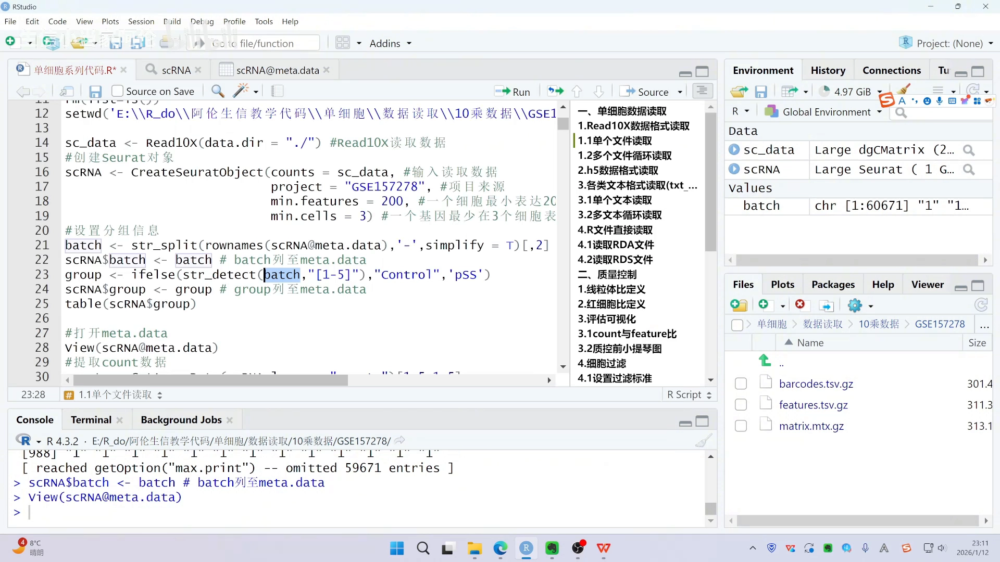

运行完 `table(scRNA$group)` 就能看到两组的细胞数：正常组三万多个，疾病组两万三千八百个 [【跳转到 12:09】](https://www.bilibili.com/video/BV1kArEBtEZA/?t=729)。这个数字必须核对——**它应该和 GEO 页面上 Overall design 写的样本量、以及各 GSM 的细胞数大致对得上**；如果某一组几乎是空的，多半是字符串切错了位置。

打开 `meta.data` 可以看到最终的样子：`orig.ident` 是数据集名，`nCount_RNA` 是每个细胞的 count 总数、`nFeature_RNA` 是检测到的基因数，后面跟着我们新加的 `batch` 和 `group` 两列 [【跳转到 11:44】](https://www.bilibili.com/video/BV1kArEBtEZA/?t=704)。

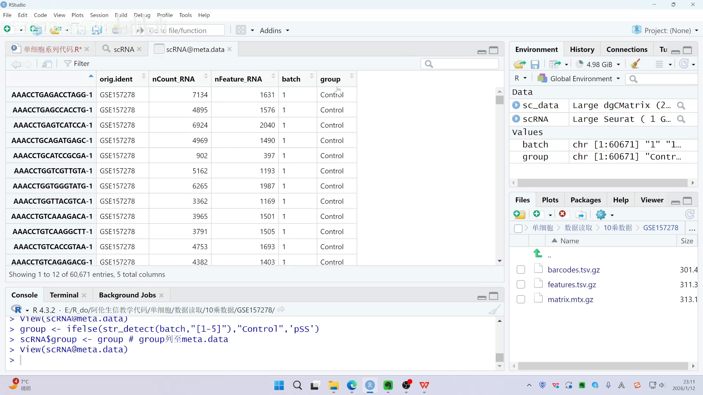

### 顺带补的三条 Seurat 取值语法

视频在这里插了一段语法说明，因为初学者常被 `@`、`$`、`[[]]` 绕晕 [【跳转到 12:34】](https://www.bilibili.com/video/BV1kArEBtEZA/?t=754)：

- `scRNA@meta.data`：用 `@` 取 S4 对象的**下一层**（assays、meta.data 这一级）；
- `scRNA$group`：用 `$` 取 `meta.data` 里的**某一列**——它是 `scRNA@meta.data$group` 的缩写，省略 `@meta.data` 也默认作用在 meta.data 上 [【跳转到 13:24】](https://www.bilibili.com/video/BV1kArEBtEZA/?t=804)；
- `GetAssayData(scRNA, layer = "counts")`：取表达矩阵，因为矩阵很大，演示时只取了前五行五列，再转成数据框看结构——**行是基因、列是细胞**，与 `meta.data` 的行列方向正好相反 [【跳转到 13:49】](https://www.bilibili.com/video/BV1kArEBtEZA/?t=829)。

最后 `dim(scRNA)` 确认规模（两万多个基因、六万多个细胞），`save()` 存成 `.rda`，一个数据集就算处理完了。

## 六、多样本：先用循环把文件摆对，再 merge 成一个对象

单样本的分组靠细胞名后缀，多样本则通常**一个 GSM 一个文件夹**。以 GSE115604 为例，补充文件解压出来是 6 个文件 = 2 个样本 × 3 件套 [【跳转到 06:21】](https://www.bilibili.com/video/BV1kArEBtEZA/?t=381)。

手工建文件夹、粘贴、改名、删前缀，两组还行，六组就是 18 个文件，讲者的评价是「这样就比较麻烦」[【跳转到 15:24】](https://www.bilibili.com/video/BV1kArEBtEZA/?t=924)。于是改用一段循环自动分类 [【跳转到 15:46】](https://www.bilibili.com/video/BV1kArEBtEZA/?t=946)：

```r
samples <- list.files()                    # 列出目录下所有文件
for (file in samples) {
  # 按文件名里的 GSM 号建子文件夹，把三件套按标准名放进去
  # （视频里用一段循环完成"建目录 + 移动 + 重命名"）
}
```

循环跑完，6 个文件被依次分配到两个文件夹，并重命名成标准的三件套 [【跳转到 16:30】](https://www.bilibili.com/video/BV1kArEBtEZA/?t=990)。这里有一个**必须做的收尾动作**：把外面那 6 个原始文件删掉，只保留两个大文件夹 [【跳转到 16:52】](https://www.bilibili.com/video/BV1kArEBtEZA/?t=1012)。否则下一步 `list.files()` 会把外面的散文件也列进来，循环就会读到不该读的东西。

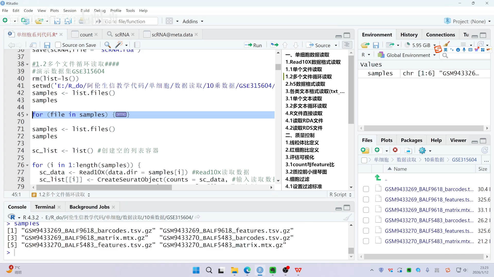

整理好目录，读取就是「循环 + 合并」[【跳转到 17:02】](https://www.bilibili.com/video/BV1kArEBtEZA/?t=1022)：

```r
sc_list <- list()                                  # 空列表当容器
for (i in 1:length(samples)) {
  sc_data <- Read10X(data.dir = samples[i])
  sc_list[[i]] <- CreateSeuratObject(counts = sc_data,
                                     project = samples[i],   # 样本名 → orig.ident
                                     min.features = 200,
                                     min.cells = 3)
}

# 合并：第一个单独拿出来，其余用 y 传入；add.cell.ids 给细胞名加样本前缀
scRNA <- merge(sc_list[[1]], y = sc_list[-1], add.cell.ids = samples)
scRNA <- JoinLayers(scRNA)                         # Seurat v5 必须补这一步
```

三个细节值得单独说：

1. **`project = samples[i]`**：把文件夹名（也就是 GSM 号）写进 `orig.ident`，这样合并之后仍然知道每个细胞来自哪个样本 [【跳转到 17:27】](https://www.bilibili.com/video/BV1kArEBtEZA/?t=1047)。
2. **`add.cell.ids`**：合并时给每个细胞的 barcode 加上样本前缀，避免不同样本的 barcode 撞车 [【跳转到 18:17】](https://www.bilibili.com/video/BV1kArEBtEZA/?t=1097)。
3. **`JoinLayers`**：Seurat v5 里 `merge` 之后每个样本的 counts 是分开的 layer，必须再 `JoinLayers` 合成一组，否则下游函数会报错 [【跳转到 18:42】](https://www.bilibili.com/video/BV1kArEBtEZA/?t=1122)。

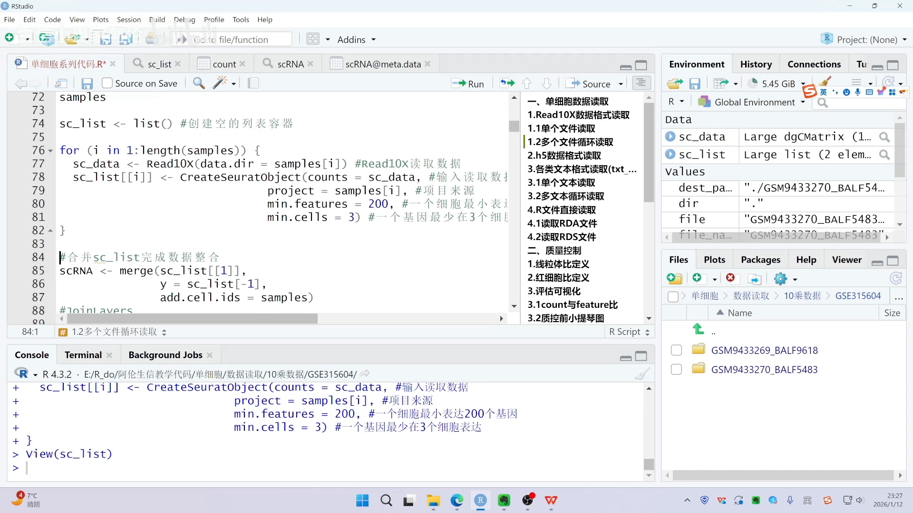

合并完看 `dim`：两万多个基因、一万五千零六个细胞。`meta.data` 的 `orig.ident` 就是两个 GSM 号——**它其实已经是一个分组了，只是不够直观** [【跳转到 19:07】](https://www.bilibili.com/video/BV1kArEBtEZA/?t=1147)。这个数据集好办，因为 269 是中期、270 是晚期，直接 `ifelse` 映射即可 [【跳转到 19:47】](https://www.bilibili.com/video/BV1kArEBtEZA/?t=1187)：

```r
group <- ifelse(str_detect(scRNA@meta.data$orig.ident, "GSM9433269"), "中期", "晚期")
scRNA$group <- group
table(scRNA$group)     # 晚期四千多个细胞，中期五千多个细胞
```

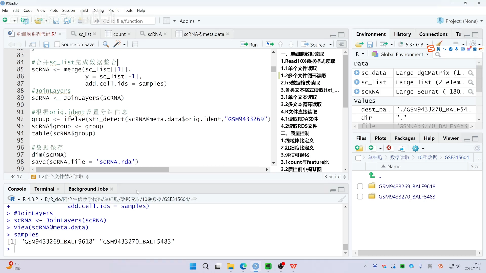

## 七、H5 格式：一个文件装下全部，但 project 得从文件名里切

H5 格式省事得多：三件套被压进一个 `.h5` 文件里，读取只需要 `Read10X_h5` [【跳转到 21:38】](https://www.bilibili.com/video/BV1kArEBtEZA/?t=1298)。代价是要先装一个读 HDF5 的 R 包（视频里用 `BiocManager` 安装）[【跳转到 21:50】](https://www.bilibili.com/video/BV1kArEBtEZA/?t=1310)。

以 GSE266155 为例，页面上的信息一眼就能读出设计 [【跳转到 21:07】](https://www.bilibili.com/video/BV1kArEBtEZA/?t=1267)：

- 平台 GPL24676，Illumina NovaSeq 6000；
- 6 个样本：`GSM8241611 CTRL-8856.3`、`GSM8241612 CTRL-1363.1`、`GSM8241613 CDG-11740`、`GSM8241614 CTRL-8399`、`GSM8241615 CDG-12105`、`GSM8241616 CDG-12016`；
- BioProject `PRJNA1106020`；
- 补充文件只有一个 `GSE266155_RAW.tar`（211.0 Mb），类型标注为 TAR of H5。

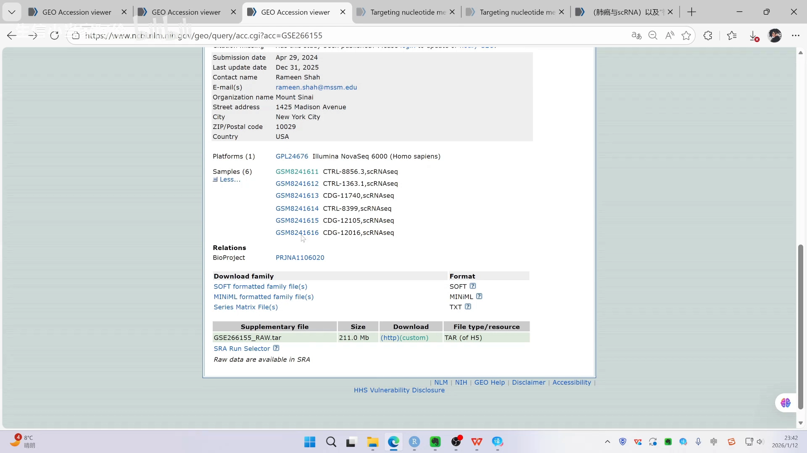

**这就是「元数据写在样本名里」的典型例子**：`CTRL-8856.3` 里，`CTRL` 是分组、后面的数字是样本编号。这类数据集不需要额外的 batch 文件，分组信息在页面上一目了然——但你必须把它抄下来，因为 Seurat 对象里只有 GSM 号。

读取用循环，和 10x 一样，只是函数换成了 `Read10X_h5` [【跳转到 22:15】](https://www.bilibili.com/video/BV1kArEBtEZA/?t=1335)。麻烦的是 `project`：H5 的文件名很长（`GSM8241611_Sample01_filtered_feature_bc_matrix.h5`），直接当 project 会很难看，所以中间插一行用 `str_split` 按**下划线**切开，取第一段 [【跳转到 22:40】](https://www.bilibili.com/video/BV1kArEBtEZA/?t=1360)：

```r
samples <- list.files(pattern = "h5")        # 只要 h5 结尾的文件
sc_list <- list()
for (i in 1:length(samples)) {
  sc_data <- Read10X_h5(filename = samples[i])
  project <- str_split(samples[i], '_', simplify = TRUE)[, 1]   # 取 GSM 号
  sc_list[[i]] <- CreateSeuratObject(counts = sc_data,
                                     project = project,
                                     min.features = 200,
                                     min.cells = 3)
}
```

取第一段得到的是 GSM 号；讲者补充说取第二段也可以，那就是 `Sample01` 到 `Sample08`——**选哪一段取决于你想让 `orig.ident` 显示什么**，只要能唯一标识样本就行 [【跳转到 23:05】](https://www.bilibili.com/video/BV1kArEBtEZA/?t=1385)。

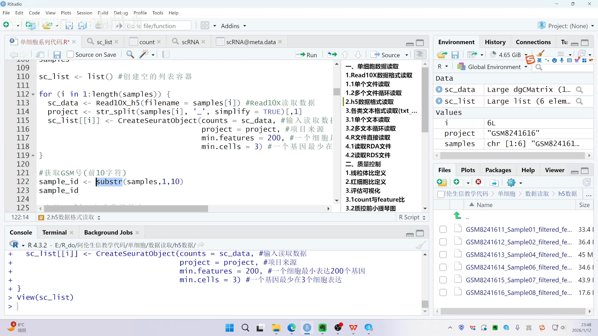

合并时细胞 id 用 `substr(samples, 1, 10)` 取前 10 个字符——正好是 GSM 号，效果和 `str_split` 一样 [【跳转到 23:30】](https://www.bilibili.com/video/BV1kArEBtEZA/?t=1410)。合并后 `layers` 里有 6 个 counts，同样要 `JoinLayers` 合成一组 [【跳转到 23:55】](https://www.bilibili.com/video/BV1kArEBtEZA/?t=1435)。

到这里，分组信息的整理方式变了：**不再有可以字符串切分的规律，只能人工建一张对照表**。讲者管这叫「最蠢的一个办法，但也是大家必须掌握」[【跳转到 24:50】](https://www.bilibili.com/video/BV1kArEBtEZA/?t=1490)：

```r
# 手工建一张 GSM → 分组 的对照表
groups <- c("GSM8241611" = "CTRL", "GSM8241612" = "CTRL", "GSM8241614" = "CTRL",
            "GSM8241613" = "CDG",  "GSM8241615" = "CDG",  "GSM8241616" = "CDG")

# 用 orig.ident 去对照表里查，查出分组写进 group 列
scRNA$group <- groups[scRNA$meta.data$orig.ident]
```

为什么可以这么「笨」？讲者给的理由很实在：**单细胞样本数本来就不多，一般都是三对三**，因为测序贵，没人做很多样本 [【跳转到 25:24】](https://www.bilibili.com/video/BV1kArEBtEZA/?t=1524)。六行对照表比写一堆正则更不容易错。

## 八、文本格式：CSV/TXT/TSV 最容易踩的是行名与列名不匹配

文本格式是三种里最「原始」的：表达矩阵和元数据分别是一个表格文件，通常是 `.csv.gz` 或 `.txt.gz`。以 GSE218743 为例，补充文件就两个——一个 count、一个 metadata，两个文件覆盖了全部 15 个样本 [【跳转到 26:44】](https://www.bilibili.com/video/BV1kArEBtEZA/?t=1604)。

读取时不用先解压，`gzfile()` 可以直接读压缩文件 [【跳转到 27:05】](https://www.bilibili.com/video/BV1kArEBtEZA/?t=1625)：

```r
sc_data <- read.csv(gzfile("GSE218743_irae_ht_integrated_counts.csv.gz"), row.names = 1)
sc_meta <- read.csv(gzfile("GSE218743_irae_ht_integrated_metadata.csv.gz"), row.names = 1)
```

函数按扩展名选：CSV 用 `read.csv`，TXT 用 `read.table`，TSV 用 `read.delim` [【跳转到 27:11】](https://www.bilibili.com/video/BV1kArEBtEZA/?t=1631)。`row.names = 1` 表示第一列是行名——对 counts 来说第一列是基因名，对 metadata 来说第一列是细胞名。

**文本格式最大的好处在这里显出来了**：metadata 文件本身就是一张完整的元数据表。打开 `sc_meta` 可以看到 17 列，除了 `percent.mt`、`S.Score`、`G2M.Score`、`Phase`、`RNA_snn_res.0.4`、`seurat_clusters` 这些质控和聚类结果，还有 `condition`、`treatment`、`sex` 这样的**生物学分组与协变量** [【跳转到 27:36】](https://www.bilibili.com/video/BV1kArEBtEZA/?t=1656)。

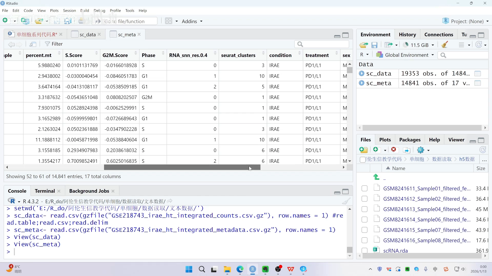

换句话说，**这份数据的分组不需要你去推断，作者已经写在表里了**——这比从细胞名后缀里切字符串可靠得多。遇到这种数据集，分组整理的工作量几乎为零。

但文本格式有一个专属的坑：**行名和列名对不上**。这个数据集的 metadata 行名是 `-1-1` 这种（横线），而 counts 的列名是 `.1-1` 这种（点）——因为 R 在读入时会把不合法的字符转成点 [【跳转到 27:51】](https://www.bilibili.com/video/BV1kArEBtEZA/?t=1671)。用 `identical()` 一验就是 `FALSE`，而 `FALSE` 意味着**一个细胞都对不上**，后面 `CreateSeuratObject` 会把元数据全部丢掉。

修法是一行 `gsub`：

```r
colnames(sc_data) <- gsub('\\.', '-', colnames(sc_data))   # 把列名里的点换回横线
identical(colnames(sc_data), rownames(sc_meta))            # 变成 TRUE

# 再取交集，只保留两边都有的细胞
common_cells <- intersect(colnames(sc_data), rownames(sc_meta))
sc_data <- sc_data[, common_cells]
sc_meta <- sc_meta[common_cells, ]

scRNA <- CreateSeuratObject(counts = sc_data,
                            meta.data = sc_meta,     # 元数据直接整表传进去
                            project = "GSE218743",
                            min.features = 200, min.cells = 3)
scRNA <- JoinLayers(scRNA)
```

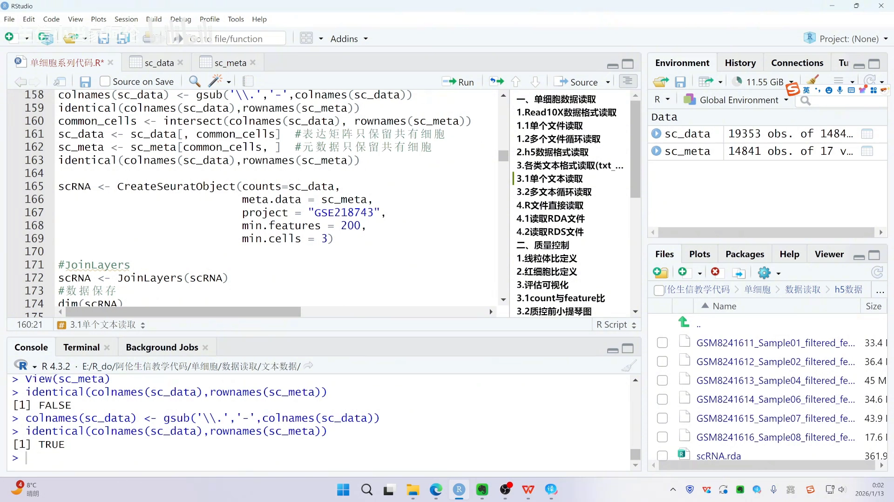

注意 `identical()` 返回 `TRUE` 之后，取交集那一步其实可以省略——讲者说「运行了也没什么问题」，但**只要保证它是 TRUE 就可以了** [【跳转到 28:16】](https://www.bilibili.com/video/BV1kArEBtEZA/?t=1696)。这句话是这一整节的判据：**行列名一致是一切的前提，不一致就先修名字，别急着建对象。**

多样本的文本格式则回到循环。以 GSE158629 为例，四个样本对应四个 `GSM..._raw_counts.txt.gz` 文件 [【跳转到 29:36】](https://www.bilibili.com/video/BV1kArEBtEZA/?t=1776)。循环里用 `read.table(gzfile(path), row.names = 1, header = TRUE)` 逐个读，`project` 用 `substr(samples[i], 1, 10)` 取 GSM 号 [【跳转到 30:23】](https://www.bilibili.com/video/BV1kArEBtEZA/?t=1823)。

这里有一个**视频里专门演示过的 bug**：如果只用 `project` 参数，某些情况下 `sample.id` 覆盖不到 `orig.ident` 上，合并后分不清样本。讲者的处理是**强制覆盖** [【跳转到 31:13】](https://www.bilibili.com/video/BV1kArEBtEZA/?t=1873)：

```r
for (i in 1:length(samples)) {
  path <- samples[i]
  sc_data <- read.table(gzfile(path), row.names = 1, header = TRUE)
  samples_id <- substr(samples[i], 1, 10)
  sc_list[[i]] <- CreateSeuratObject(counts = sc_data,
                                     project = samples_id,
                                     min.features = 200, min.cells = 3)
  sc_list[[i]]@meta.data$orig.ident <- samples_id   # 强制写一遍，确保不被覆盖丢失
}
```

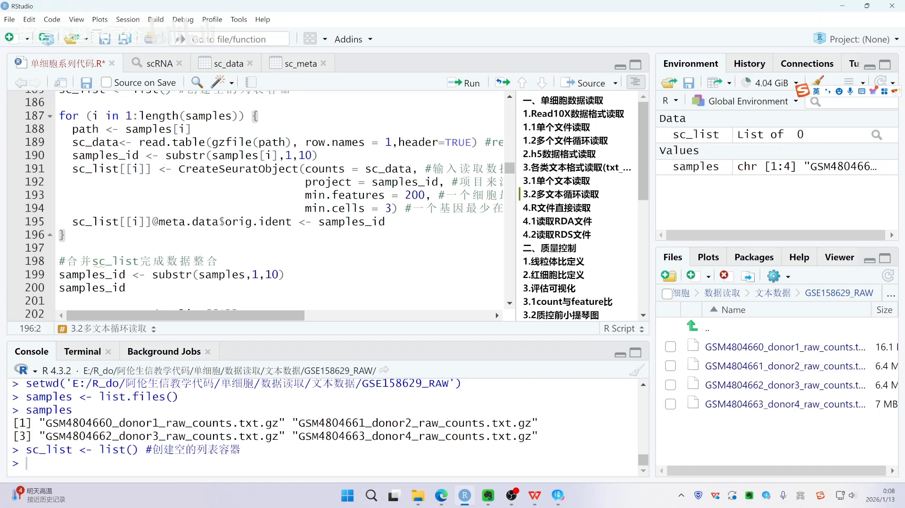

合并、`JoinLayers`、`table` 看每个样本的细胞数，然后**又是那张手工对照表**——因为文件名里只有 donor 编号，没有分组 [【跳转到 32:03】](https://www.bilibili.com/video/BV1kArEBtEZA/?t=1923)。

## 九、RData/RDS：别人已经整理好的成品

最后一种是 R 语言自己的格式，也是最省事的一种。GSE158629 的补充文件里除了 `RAW.tar`，还有一个 `GSE158629_scRNA_RPE_donors1-4.RData.gz`（566.7 Mb）[【跳转到 32:14】](https://www.bilibili.com/video/BV1kArEBtEZA/?t=1934)。

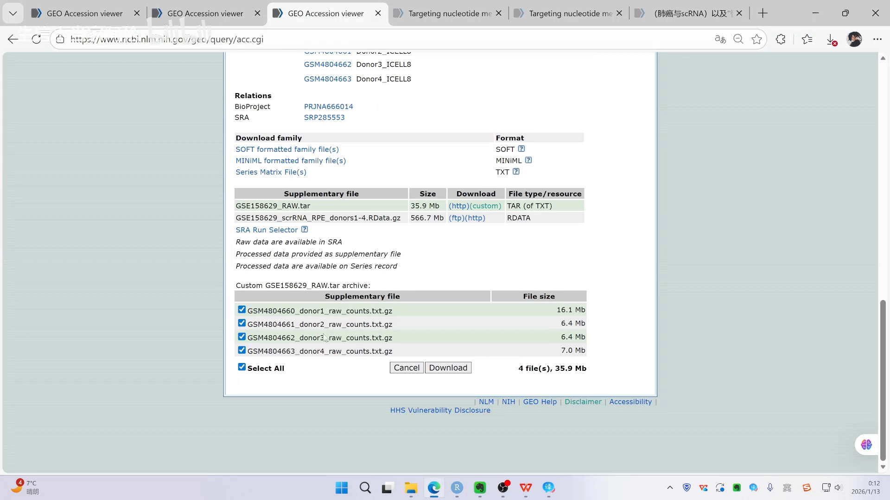

读取方式按扩展名区分 [【跳转到 32:27】](https://www.bilibili.com/video/BV1kArEBtEZA/?t=1947)：

- `.RData` / `.rda`：用 `load()`，会把里面保存的所有对象一次性加载到环境里；
- `.rds`：用 `readRDS()`，读进来赋给一个变量，一次一个对象。

视频里还遇到一个很具体的小问题：`load()` 进来的 Seurat 对象点开是空白的，因为它缺少 `@images` 这一层（作者保存时可能没带）。讲者的处理是**手工补一个空白的 images 槽**，补完就能正常打开 [【跳转到 32:27】](https://www.bilibili.com/video/BV1kArEBtEZA/?t=1947)。这类「别人整理好的对象」省掉了读取和分组两步，但代价是**你不知道它是怎么被处理的**——质控标准、是否已经标准化、聚类用了什么参数，都只能从它的 `meta.data` 里反推。

## 小结

- **流程只有两步**：读取数据 + 整理分组信息。四种格式（10x、H5、文本、RData）的区别只在第一步，第二步的逻辑完全一样——把分组落到 `meta.data` 的一列上。
- **判断数据集能不能用，看 GEO 页面的六个字段**：Experiment type、Organism、Overall design、Samples、Relations、Supplementary file。其中 Overall design 一句话就交代了样本量、组织、分组与重复数。
- **下补充文件，不下 Series Matrix**；文件大小是最快的验伪手段——几万细胞的数据集不可能只有几 KB。
- **10x 三件套的文件名不能改**（`barcodes.tsv.gz`、`features.tsv.gz`、`matrix.mtx.gz`），必须删掉 GEO 加的前缀；文件夹名可以随便取。
- **分组信息有三种来源**：细胞名后缀（用 `str_split` 切）、样本名（用 `str_split` 或 `substr` 切）、metadata 表（直接整表传入）。三者都没有时，就手工建一张 GSM → 分组的对照表。
- **Seurat v5 别忘了 `JoinLayers`**：`merge` 之后 counts 是按样本分层的，不合并会在下游报错。
- **文本格式先验行列名**：`identical(colnames(counts), rownames(meta))` 必须是 `TRUE`，否则一个细胞都对不上。
- **整理完一定 `table()` 核对细胞数**，和 GEO 页面的样本量对得上，才说明分组没切错。

## 关键术语速查

| 术语 | 一句话解释 |
| --- | --- |
| GSE / GSM | GEO 的系列号与样本号：一个 GSE 是一次研究，一个 GSM 是一个样本 |
| Supplementary file | GEO 页面上作者上传的附件，单细胞数据通常在这里（矩阵、barcode、batch 表） |
| Series Matrix | GEO 自动生成的表达矩阵，单细胞数据往往不适用或信息不全 |
| Overall design | GSE 页面上描述实验设计的一段话：样本来源、细胞数、分组与重复数 |
| 10x 三件套 | `barcodes.tsv.gz`（细胞）、`features.tsv.gz`（基因）、`matrix.mtx.gz`（稀疏矩阵） |
| `Read10X` / `Read10X_h5` | Seurat 读取 10x 目录与 H5 文件的函数 |
| `CreateSeuratObject` | 用 count 矩阵（可加 `meta.data`）创建 Seurat 对象 |
| min.features / min.cells | 建对象时的双向过滤门槛：细胞至少表达多少基因、基因至少在多少细胞里出现 |
| `orig.ident` | Seurat 对象里记录「这个细胞来自哪个样本」的列，由 `project` 参数写入 |
| `meta.data` | 细胞级元数据表：行是细胞、列是样本信息与分组 |
| `merge` / `JoinLayers` | 合并多个 Seurat 对象；v5 中还需把分层 counts 合成一组 |
| `gzfile` | R 里直接读取 `.gz` 压缩文件的连接函数，省去解压 |
| `identical` | 判断两个向量是否完全一致，用来验证 counts 列名与 metadata 行名是否对得上 |
