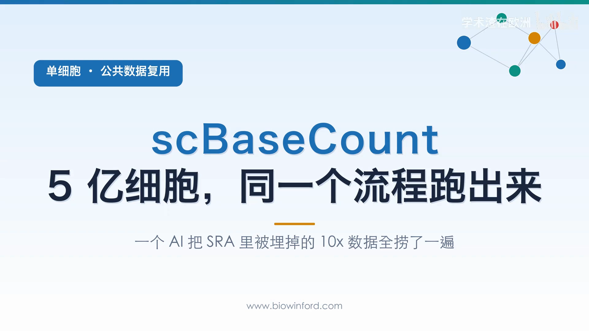
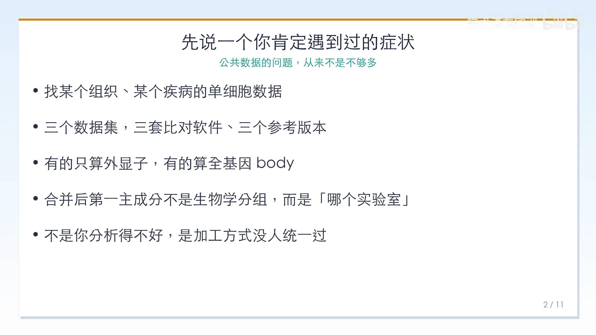
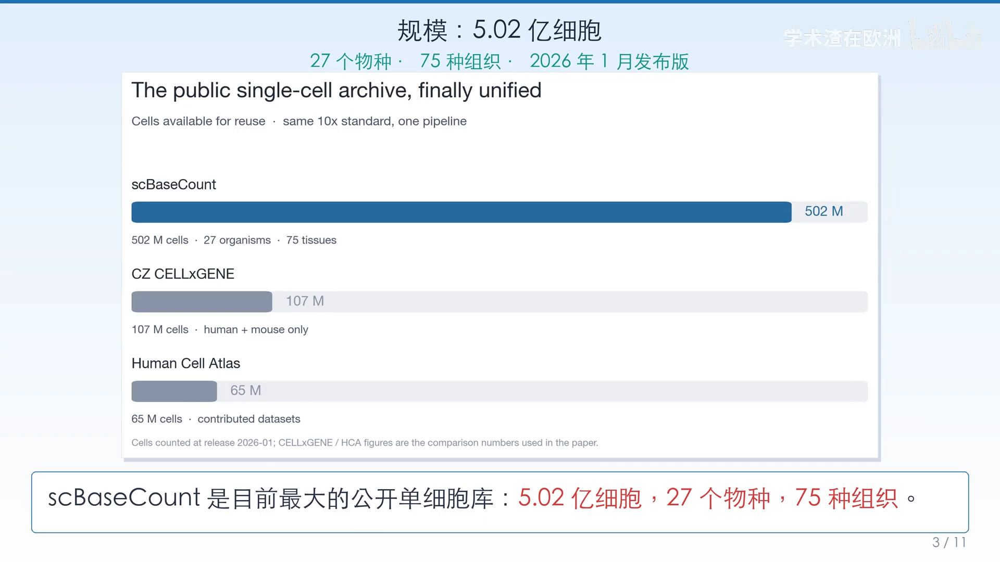
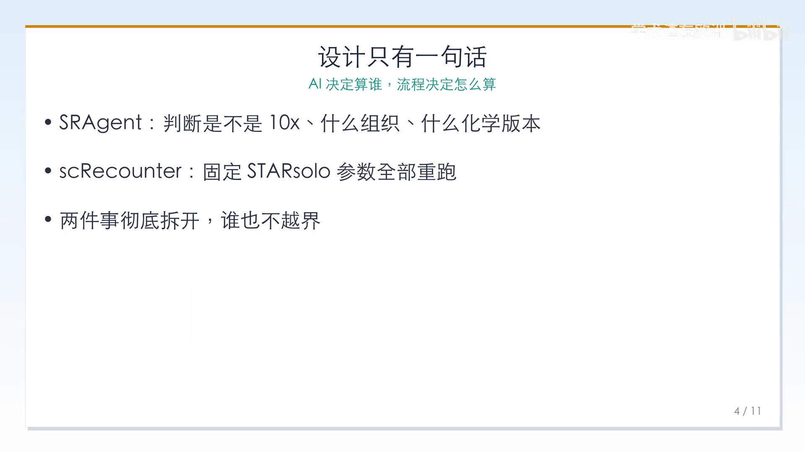
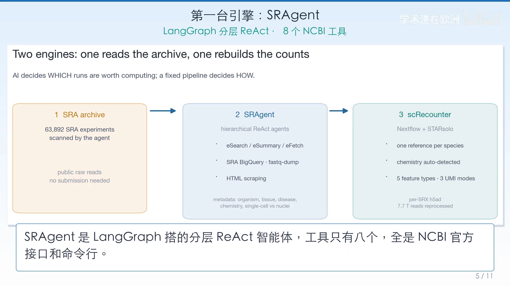
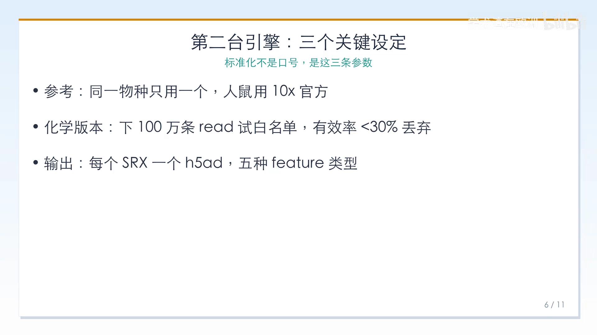
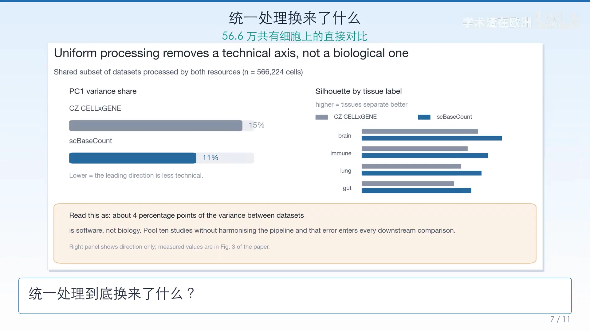
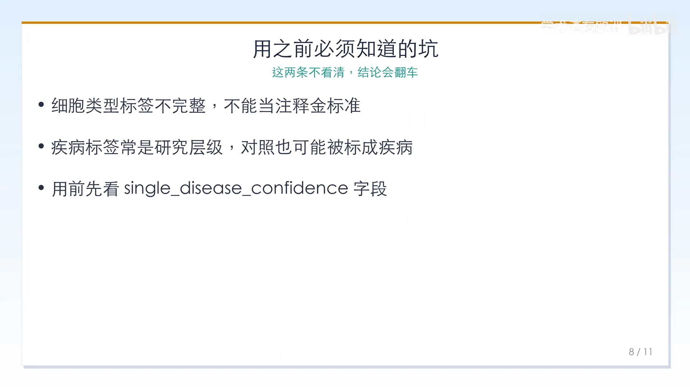
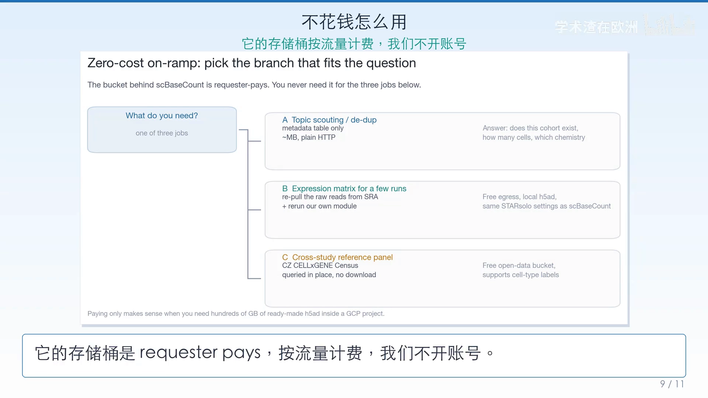
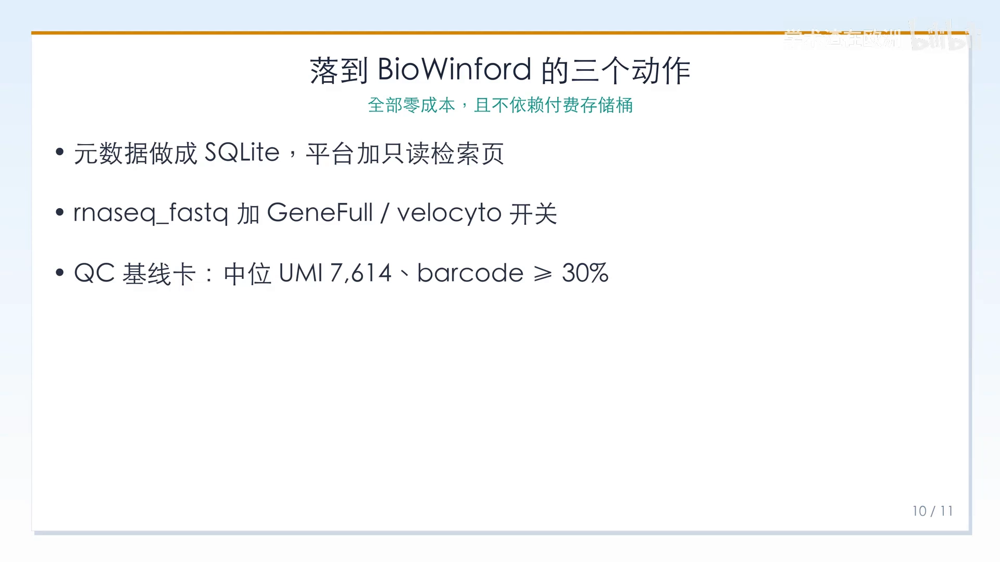

# scBaseCount 的建设思路：5 亿细胞用同一套流程跑出来

> 视频来源：[scBaseCount 一次性分析 5 亿细胞](https://www.bilibili.com/video/BV1zSxL6LEm2/)（Bilibili · 学术渣在欧洲）｜时长约 4 分钟
> 导读：一支 11 页幻灯片的快节奏讲解，把 scBaseCount 这个「把公共数据全部重跑一遍」的工程拆成：为什么做、两台引擎怎么分工、三条把「标准化」落到参数上的设定、换来了什么、以及用之前必须知道的坑。本文按这条线索展开，并补足初学者需要的术语解释。

## 本讲要解决的核心问题（SCQA）

**背景**：公共单细胞数据已经很多了——GEO、SRA、CELLxGENE、人类细胞图谱里堆着上亿个细胞。想研究某个组织、某个疾病，翻出十几个相关数据集并不难。

**冲突**：难的是把它们放在一起看。三个数据集可能用了三套比对软件、三个参考基因组版本；有的只统计外显子上的 reads，有的统计整个基因 body（外显子加内含子）。把它们合并后做 UMAP，第一主成分往往不是「这是什么细胞」，而是「这是哪个实验室做的」。

**疑问**：既然数据不缺，为什么还是没法直接比较？有没有办法让所有样本「长得一样」？

**回答（中心思想）**：scBaseCount 的答案是——**不采信作者上传的处理后矩阵，而是回到 SRA 的原始测序数据，用同一套流程、同一套参数重跑一遍**。它的价值不在「5 亿细胞」这个数字，而在于这 5 亿细胞用的是同一个 STARsolo 配置；你能复用的是它的**流程口径**，不是它的硬盘。

## 一、真正的瓶颈不是数据量，而是「加工方式从没人统一过」

视频开场就把结论摆出来了：SRA 里躺着全世界最多的单细胞原始数据，可是绝大多数从来没被好好用过 [【跳转到 00:00】](https://www.bilibili.com/video/BV1zSxL6LEm2/?t=0)。紧接着它讲了一个几乎每个做单细胞的人都遇到过的场景 [【跳转到 00:15】](https://www.bilibili.com/video/BV1zSxL6LEm2/?t=15)：

- 你要找某个组织、某个疾病的单细胞数据，翻到十几个数据集；
- 结果发现**三个数据集、三套比对软件、三个参考基因组版本**；
- 有的只算外显子（exon），有的算全基因 body——后者会把前体 mRNA 的内含子 reads 也算进去，同一个基因的计数天然就更高；
- 合并之后，UMAP 上第一主成分不是生物学分组，而是「哪个实验室做的」。

最后一句是整支视频的题眼：**问题不是你分析得不好，是公共数据的加工方式从来没人统一过**。

这里要解释两个词，后面会反复用到：

- **比对 / 定量（quantification）**：把测序仪吐出的 reads 比对到参考基因组上，再统计每个基因有多少条 reads，得到「基因 × 细胞」的计数矩阵。不同软件（CellRanger、STARsolo、alevin 等）对多重比对、内含子、UMI 的处理规则不同，结果就会有系统性差异。
- **参考基因组版本**：同一物种的参考序列会不断更新（如 GRCh38 的不同 patch、不同注释版本）。用不同版本定量，同一个基因的坐标和注释范围都可能不同，合并时就会出现「同一个基因对不上」的问题。

所以「公共数据不好用」不是玄学，而是**技术噪声被写进了表达矩阵本身**。只要每个研究各跑各的流程，这个噪声就会跟着数据一起被继承下来，而且会在下游每一次比较里重复出现。

## 二、scBaseCount 的选择：回到原始数据，重跑一遍

### 2.1 规模与数据来源：不是等人投稿，而是直接去 SRA 里挖

先看规模 [【跳转到 00:45】](https://www.bilibili.com/video/BV1zSxL6LEm2/?t=45)：**5.02 亿细胞、27 个物种、75 种组织**。视频给出的对比数字是：CZ CELLxGENE 约 1.07 亿（且只含人和鼠），人类细胞图谱（HCA）约 6500 万。

| 资源 | 细胞数（视频给出的对比数字） | 数据来源方式 |
| --- | --- | --- |
| scBaseCount | 5.02 亿（27 物种 / 75 组织） | 主动从 SRA 原始测序数据中挖掘并重处理 |
| CZ CELLxGENE | 约 1.07 亿（仅人 + 鼠） | 收集研究者提交的处理后数据 |
| Human Cell Atlas | 约 6500 万 | 收集研究者贡献的数据集 |

视频强调：**差距不在数量本身，而在数据来源**——它不是等人投稿，而是直接去 SRA 里挖。这句话点出了两种完全不同的建库哲学：

1. **收集型**（collect）：等作者把处理好的 h5ad 交上来。优点是省算力、尊重原作者的生物学判断；缺点是每个矩阵的加工口径都不一样，而且只有「愿意交」的研究才会进库。
2. **重处理型**（reprocess）：自己从 FASTQ 开始跑。优点是口径统一、覆盖面只受「原始数据是否公开」限制；缺点是要付出巨大的算力与存储代价。

scBaseCount 选了后者。这也解释了为什么它能同时做到「更大」和「更可比」——因为在 SRA 里，绝大多数 10x 原始数据从来没有被好好利用过。

### 2.2 两台引擎的分工：AI 决定算谁，流程决定怎么算

整套系统的设计被压缩成一句话 [【跳转到 01:04】](https://www.bilibili.com/video/BV1zSxL6LEm2/?t=64)：

> **AI 只决定算谁，流程决定怎么算。**

这句话是整支视频里最值得记住的工程判断。它把一件容易混淆的事彻底拆成两半：

- **SRAgent**：负责「算谁」。判断一个 run 到底是不是 10x 单细胞数据、里面是什么组织、什么化学版本（chemistry，即 10x 试剂盒的代次，如 3' v2、v3、5' 等，不同版本 barcode 白名单不同）。
- **scRecounter**：负责「怎么算」。用**固定的 STARsolo 参数**，把通过筛选的数据全部重跑一遍。

为什么要把这两件事拆开？因为它们的**确定性要求完全相反**：

- 「这个 run 是不是 10x、是什么组织」这类判断，本质上是从不规范的文本元数据里做推断，天然需要灵活性和容错——这正是大模型智能体擅长的地方。SRAgent 是 LangGraph 搭的**分层 ReAct 智能体**，工具只有八个，全是 NCBI 官方接口和命令行，每个任务只要两个 CPU、2G 内存。
- 「怎么把 reads 变成计数矩阵」这类计算，恰恰**不能有灵活性**。一旦让模型在这里自由发挥，标准化就失效了。所以 scRecounter 用死参数。

视频给出的量级 [【跳转到 01:35】](https://www.bilibili.com/video/BV1zSxL6LEm2/?t=95)：扫描 6.4 万个实验，最终重处理 3 万个。也就是说，**筛选环节本身就砍掉了一半以上**——不是所有标着「单细胞」的 run 都真的能用。

这里顺带解释两个术语：

- **ReAct**：一种让语言模型「边想边做」的范式——模型先推理（Reason）该做什么，再调用工具（Act）取回结果，然后根据结果继续推理。分层（hierarchical）指上层智能体负责拆任务，下层智能体负责具体调用。
- **run / SRX / SRR**：SRA 里的三级编号。一个实验（experiment，SRX）描述「怎么测的」，一次 run（SRR）对应「一批原始数据文件」。同一个 SRX 可能有多个 run。
### 2.3 三条把「标准化」落到参数上的设定

「统一处理」听起来像口号，但视频把它拆成了三条具体参数 [【跳转到 01:54】](https://www.bilibili.com/video/BV1zSxL6LEm2/?t=114)。这三条决定了「统一」到底统一在哪儿。

**第一条：参考基因组，同一物种只用一个。** 人和鼠用 10x 官方参考，其他物种用 Ensembl。这一条直接消掉了第一节里「三个参考版本」的问题——因为全库每个物种只有一份参考，跨数据集比较时基因坐标天然对齐。

**第二条：化学版本不靠原始元数据猜，而是「试白名单」。** 做法是：先下 100 万条 read，拿四套 barcode 白名单去试，看哪一套能匹配上；**有效 barcode 低于 30% 就直接丢弃这个 run**。这一条很关键，因为 SRA 里的「化学版本」字段经常缺失或写错。

这里要解释 **barcode 白名单（whitelist）**：10x 的凝胶珠上，barcode 是从一个固定的候选池里随机合成的。所以一个 barcode 序列「是否合法」是可以查表的——不在白名单里的，基本就是测序错误或环境 DNA。用「有效 barcode 比例」反过来推断化学版本，比相信元数据字段可靠得多。

**第三条：输出格式统一。** 每个 SRX 输出一个 **h5ad**，同时给出 GeneFull、velocyto 等**五种 feature 类型**、三种 UMI 模式，统一处理。

- **h5ad**：AnnData 的磁盘格式，是 Python 单细胞生态（Scanpy）的标准容器，一个文件里同时装表达矩阵、细胞元数据和基因元数据。
- **GeneFull vs Gene**：前者统计整个基因 body（含内含子），后者只统计外显子。对 10x 3' 数据，含内含子的计数通常更高，也更适合做 RNA 速率（velocyto 需要 spliced / unspliced 两类计数）。

把这三条放在一起看，会发现 scBaseCount 的「统一」其实统一在三个层次上：**参考空间统一**（同一物种一份参考）、**判定规则统一**（白名单试配 + 30% 阈值）、**输出契约统一**（同一种文件、同一批 feature 类型）。这三层缺一层，跨研究比较就会重新出现裂缝。

## 三、统一处理换来了什么：把「软件怎么算」的方差压下去

这是整支视频最有信息量的一页 [【跳转到 02:08】](https://www.bilibili.com/video/BV1zSxL6LEm2/?t=128)。作者在两个资源**都处理过**的数据集上，取共有细胞（56.6 万个）做直接对比。

先解释这两个指标。「第一主成分方差占比」是主成分分析（PCA）里的概念：对表达矩阵做 PCA 会得到一串按方差从大到小排列的主成分，第一个主成分解释的方差比例就是

$$
\text{PC1 方差占比} = \frac{\lambda_1}{\sum_{i=1}^{p} \lambda_i}
$$

其中 $\lambda_1$ 是最大的那个特征值，$p$ 是主成分个数。这个比例越高，说明数据里存在一个**特别强势的主导方向**——如果这个方向是「哪个实验室」，那就意味着技术噪声压过了生物学差异。所以对图谱类数据来说，**这个数字越低越好**。

| 指标 | CZ CELLxGENE | scBaseCount | 怎么读 |
| --- | --- | --- | --- |
| 第一主成分（PC1）方差占比 | 15% | 11% | 越低，说明「最主要的那个方向」越不技术 |
| 按组织标签的轮廓系数（silhouette） | 幻灯片仅示意方向 | 幻灯片仅示意方向 | 越高，说明不同组织分得越开 |

怎么读这张表？视频给的解读是：

- PC1 方差占比从 15% 降到 11%，意味着**大约四个百分点的方差来自「软件怎么算」，而不是「细胞是什么」**。把十个研究的数据池在一起却不统一流程，这 4% 的误差会进入下游每一次比较。
- 反过来，口播提到「把技术因素归一化之后，CELLxGENE 的分离度更高」。也就是说 scBaseCount **不是全面更强**，它只是在**生物学信号与技术信号的比例**上更干净。

> 关于右栏的读法要谨慎：幻灯片自己在右下角标注了「Right panel shows direction only; measured values are in Fig. 3 of the paper」，即这一栏只示意方向，真实数值要看论文原图。所以本节只把 PC1 的两个具体数字（15% → 11%）当作可引用的结论，分离度那一栏留作「方向性参考」。

第二点特别值得强调，因为它划出了这个项目的边界。统一重处理的目标不是「做出更好的数据」，而是「做出**可比**的数据」。这两件事经常被混为一谈：

- 如果目标是「单个数据集内的最佳分析」（比如精细的亚群划分、稀有细胞类型识别），原作者精心调过的流程很可能优于统一流程；
- 如果目标是「跨数据集、跨组织、跨物种放在一起看」，那么**口径一致**带来的收益，往往大于单数据集最优带来的收益。

这也是「图谱」类工作的核心价值所在：它卖的不是精度，是可比性。

## 四、这条路线的代价：统一处理不是免费午餐

前面讲的是收益，但「从 FASTQ 重跑一遍」是一个很重的决定。视频本身没有专门列一节讲成本，不过它给的几个数字已经能说明问题；再加上这一页幻灯片的标题——**统一处理去掉的是一条技术轴，不是一条生物学轴**（Uniform processing removes a technical axis, not a biological one）——就可以把代价讲清楚。

### 4.1 算力与工程成本：3 万个 SRX、7.7 T reads

按视频给出的量级：扫描 6.4 万个实验、最终重处理 3 万个 SRX，累计重处理 **7.7 T reads** [【跳转到 01:35】](https://www.bilibili.com/video/BV1zSxL6LEm2/?t=95)。

注意这里的「每个任务只要两个 CPU、2G 内存」并不等于「便宜」——单任务轻量恰恰是为了能大规模并行。真正的成本在总量：3 万次比对、7.7 万亿条 reads 的 I/O 与计算，加上每个 SRX 一个 h5ad 的长期存储。这也解释了为什么它的数据放在**按流量计费**的存储桶里（见第五节）：存储和出网流量本身就是这个项目的主要开销。

对个人研究者来说，这意味着一个现实结论：**你复现不了它的重处理，但你可以复用它的口径**。这也是视频最后那句总结的由来。

### 4.2 统一参数未必对每个数据集都最优

scRecounter 用「固定的 STARsolo 参数」跑所有数据，这是标准化的前提，但代价是可预期的：

- 某些数据集用别的参数（比如不同的 UMI 去重策略、不同的比对容忍度）本来能得到更好的结果；
- 对特殊建库方式（如 5' 端、多组学、靶向 panel），统一参数可能不是最优配置；
- 视频自己承认「它不是全面更强」——在单数据集内部的精细分析上，原作者精心调过的流程可能更好。

换句话说，**统一流程是用「单点最优」换「全局可比」**。这笔交易在图谱类工作里划算，在你只关心一个数据集时不划算。

### 4.3 元数据的问题会被继承，甚至被放大

讲完收益，视频立刻转到「用之前必须知道两个坑」[【跳转到 02:33】](https://www.bilibili.com/video/BV1zSxL6LEm2/?t=153)——这也是最容易翻车的地方 [【跳转到 02:38】](https://www.bilibili.com/video/BV1zSxL6LEm2/?t=158)：

**坑一：细胞类型标签不完整。** 标签只在「有参考的地方」才填。所以：

- 它**不能当注释的金标准**——没标签不等于没有这个细胞类型，只等于「这里没做参考映射」；
- 它也**不能当注释的参考图谱**直接拿来用——拿一个部分标注的库去训练注释器，会把「缺失」学成「不存在」。

**坑二：疾病标签常常是研究层级的。** 也就是说，标签描述的是「这个研究是关于什么病的」，而不是「这个细胞来自病人」。一个研究里的健康对照，也可能被整体标成疾病。

为此发布版专门加了一个 `single_disease_confidence` 字段，用之前先看它。这条设计很值得学：**当元数据不可靠时，与其假装它可靠，不如显式给出一个置信度字段，让使用者自己判断。**

这背后是一个更普遍的问题：重处理能统一**计算口径**，但统一不了**原始研究的实验设计与元数据质量**。作者写错的样本分组、缺失的临床信息、含糊的组织描述，会被原封不动地继承进这个「统一」的库里，而且因为库看起来更权威，错误反而更容易被下游当真。

### 4.4 批次效应不会因为统一处理就消失

这是最容易被误解的一点。统一流程消掉的是**流程差异**这一条技术轴（PC1 方差占比 15% → 11% 就是它的量化体现），但剩下的批次来源依然存在：

- 不同实验室的样本处理、组织解离方式、测序仪的运行批次；
- 不同建库化学版本本身的差异；
- 不同物种、不同组织的生物学差异。

所以拿到 scBaseCount 的数据之后，**该做的整合与批次校正一步都不能少**。统一处理只是把你的起点从「一堆口径不同的矩阵」变成了「一堆口径相同、但仍有批次结构的矩阵」——起点更干净，不等于终点不需要处理。

## 五、不花钱怎么用它：三条零成本路径

视频后半段转向非常实操的问题：它的存储桶是 **requester pays**（请求方付费），按流量计费，所以「我们不开账号」[【跳转到 03:02】](https://www.bilibili.com/video/BV1zSxL6LEm2/?t=182)。

幻灯片把使用场景分成三条分支，按「你需要什么」来选：

| 你的需求 | 做法 | 代价 | 能回答什么问题 |
| --- | --- | --- | --- |
| A 选题侦察 / 去重 | 只下元数据表（约几十 MB，普通 HTTP） | 几乎为零 | 这个队列存在吗？多少细胞？什么化学版本？ |
| B 少量 run 的表达矩阵 | 回原始 SRA 免费拉 FASTQ，用自己的模块重跑 | 自己的算力 | 拿到与 scBaseCount 同口径的本地 h5ad |
| C 跨研究参考面板与注释 | 去 CZ CELLxGENE Census 远程查询，不下载 | 几乎为零 | 细胞类型标签、跨研究参照 |

只有当你需要「几百 GB 现成 h5ad 直接进 GCP 项目」时，付费才是划算的。这个分层很值得抄：**先用元数据判断「有没有」，再决定要不要为矩阵付钱。**

### 5.1 落到自己平台的三个动作

视频最后给了三个可以立刻照做的动作 [【跳转到 03:28】](https://www.bilibili.com/video/BV1zSxL6LEm2/?t=208)：

1. **元数据做成 SQLite，平台加一个只读的公共数据集检索页。** 效果是：客户提需求时，30 秒就能判断有没有现成队列，而不是先跑一遍分析再说。
2. **给 `rnaseq_fastq` 模块加 GeneFull / velocyto 开关**，让输出和 scBaseCount 同口径。这一条是把「可比性」落到自己的流水线上——只有输出契约一致，你的数据和公共库才能直接拼在一起。
3. **把中位 UMI 7,614、有效 barcode ≥ 30% 写进 QC 基线卡。** 这两个数字来自 scBaseCount 全库的统计基线，写进质控卡之后，你自己的数据一跑完就能知道「是不是偏离了公共数据的常态」。

第 3 条尤其值得展开：**QC 阈值不该凭感觉设。** 把「中位 UMI 7,614」当基线，意味着如果你的样本中位 UMI 只有几百，那大概率不是生物学差异，而是建库或测序出了问题；而「有效 barcode ≥ 30%」正好对应第二节里判断化学版本的那条阈值——同一个数字，既用于筛选公共数据，也可以用于检查自己的数据。

## 小结

- **问题不在数据量，在加工口径**：三个数据集三套软件、三个参考版本、外显子 vs 全基因 body，合并后第一主成分变成「哪个实验室」。
- **scBaseCount 的答案是重跑**：不采信处理后矩阵，直接从 SRA 挖原始测序数据，用同一套 STARsolo 参数重处理，得到 5.02 亿细胞、27 物种、75 组织。
- **AI 与流程必须分工**：「AI 只决定算谁，流程决定怎么算」——SRAgent（LangGraph 分层 ReAct，8 个 NCBI 工具）负责判断，scRecounter（固定参数）负责计算，两件事彻底拆开、谁也不越界。
- **标准化落在三条参数上**：同一物种一份参考（人鼠用 10x 官方、其他用 Ensembl）、白名单试配化学版本（有效率 < 30% 丢弃）、每个 SRX 一个 h5ad 并统一五种 feature 类型。
- **收益是可量化的可比性**：56.6 万共有细胞上 PC1 方差占比 15% → 11%，约 4 个百分点的方差来自「软件怎么算」。
- **代价同样明确**：3 万 SRX / 7.7 T reads 的重处理成本、统一参数牺牲单点最优、元数据缺陷被继承、批次效应依然存在。
- **用之前先看标签**：细胞类型标签不完整（不能当注释金标准），疾病标签是研究层级（先看 `single_disease_confidence`）。
- **落地三个动作**：元数据做成 SQLite 加只读检索页、`rnaseq_fastq` 加 GeneFull / velocyto 开关对齐口径、把中位 UMI 7,614 与有效 barcode ≥ 30% 写进 QC 基线卡。

视频最后用一句话收尾 [【跳转到 03:50】](https://www.bilibili.com/video/BV1zSxL6LEm2/?t=230)：scBaseCount 的价值不在 5 亿细胞，而在 5 亿细胞用的是同一个 STARsolo 配置——**免费的从来不是硬盘，是口径**。

## 关键术语速查

| 术语 | 一句话解释 |
| --- | --- |
| scBaseCount | 把 SRA 中公开的 10x 单细胞原始数据统一重处理后形成的公开细胞库，发布版约 5.02 亿细胞 |
| 重处理（reprocess） | 不采信作者上传的计数矩阵，回到 FASTQ 用统一流程重新比对与定量 |
| SRAgent | 用 LangGraph 搭的分层 ReAct 智能体，负责判断一个 run 是否为 10x 单细胞、什么组织、什么化学版本 |
| scRecounter | 第二台引擎，用固定 STARsolo 参数把筛过的数据全部重跑，保证口径一致 |
| STARsolo | 基于 STAR 比对器的单细胞定量模块，可直接从 FASTQ 产出「基因 × 细胞」计数矩阵 |
| 化学版本（chemistry） | 10x 试剂盒的代次（如 3' v2 / v3、5'），决定 barcode 白名单与 UMI 长度 |
| barcode 白名单 | 10x 凝胶珠 barcode 的合法候选池；不在表内的序列基本是测序错误或环境 DNA |
| 有效 barcode 比例 | 能匹配白名单的 barcode 占比；低于 30% 通常说明化学版本判断错误或数据质量差 |
| h5ad | AnnData 的磁盘格式，一个文件装下表达矩阵、细胞元数据与基因元数据 |
| GeneFull / Gene | STARsolo 的两种计数范围：前者含内含子（整个基因 body），后者只算外显子 |
| velocyto | 分别统计 spliced / unspliced 计数的工具，用于 RNA 速率分析 |
| PC1 方差占比 | 第一主成分解释的方差比例；在图谱类数据里越低，说明主导方向越不技术 |
| silhouette（轮廓系数） | 衡量同类样本聚得多紧、异类分得多开的指标，越高说明分组越清晰 |
| requester pays | 云存储的计费模式：谁发起请求谁付流量费，因此「不开账号」也能用元数据 |
| single_disease_confidence | scBaseCount 发布版新增的字段，标注「这个细胞/样本的疾病标签有多可信」 |
