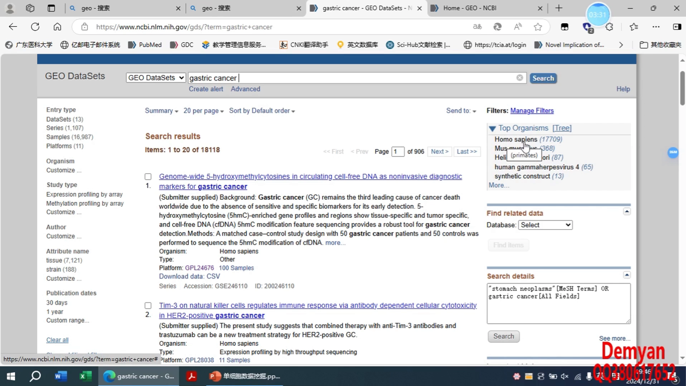
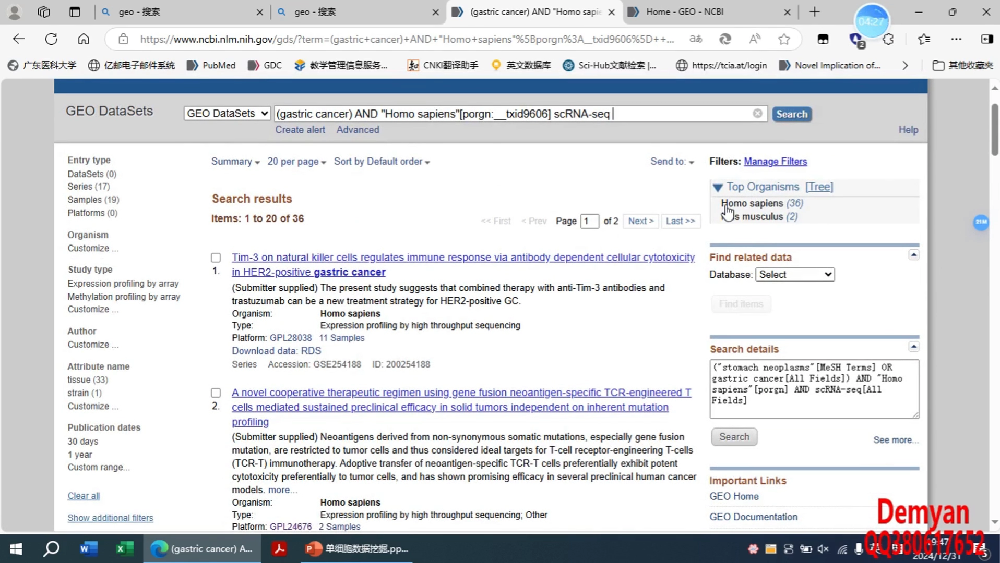
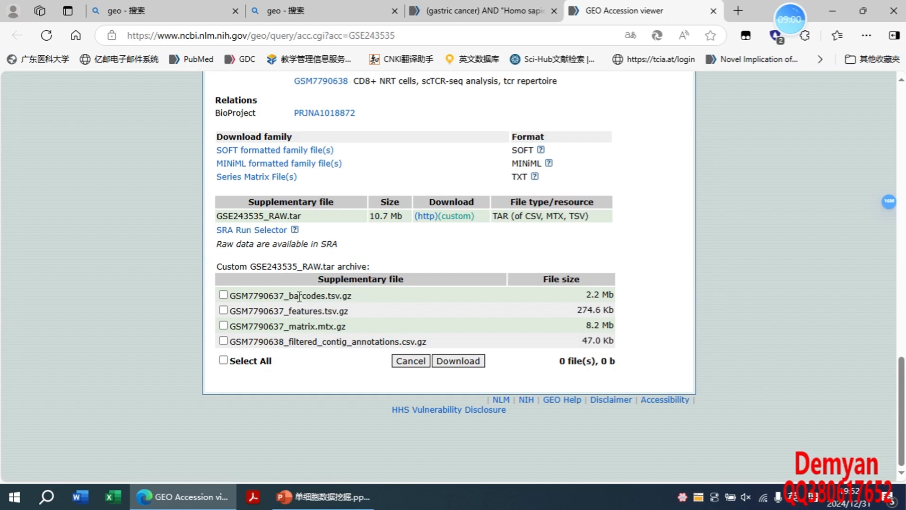
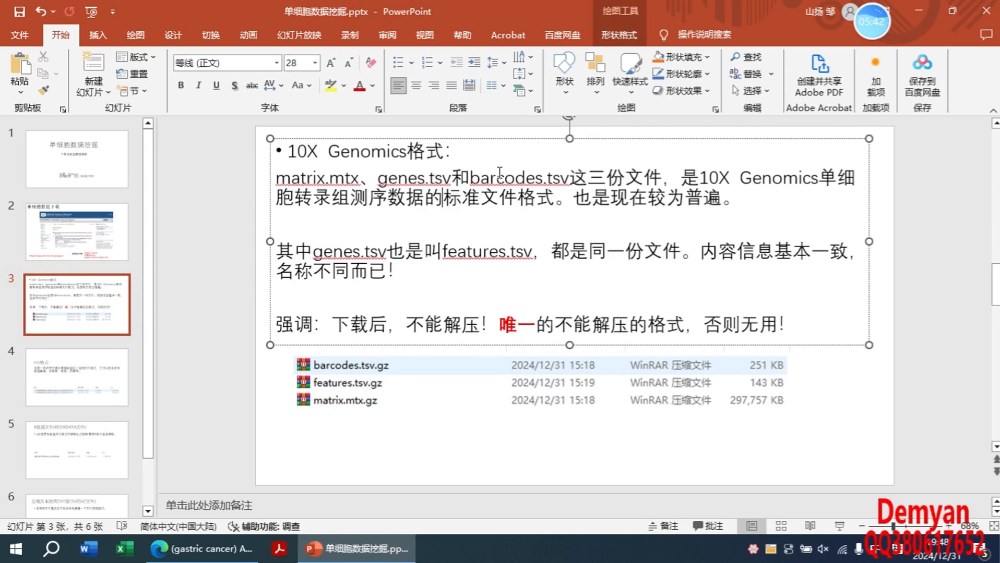
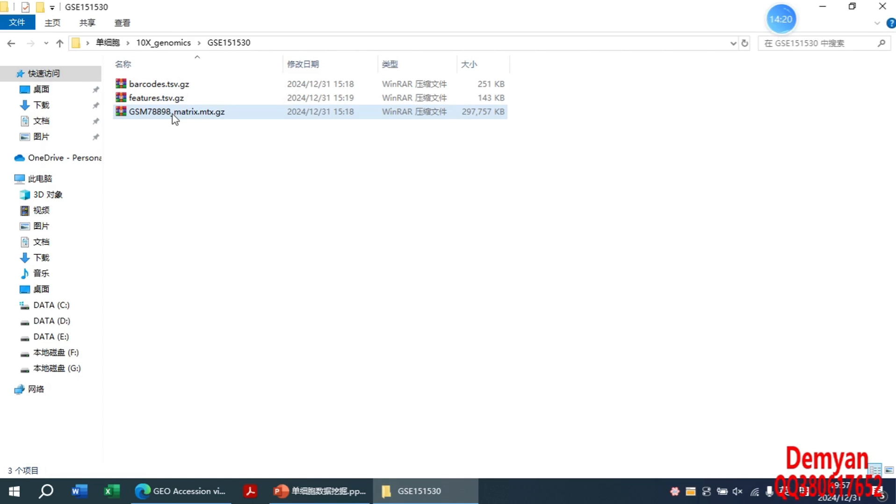
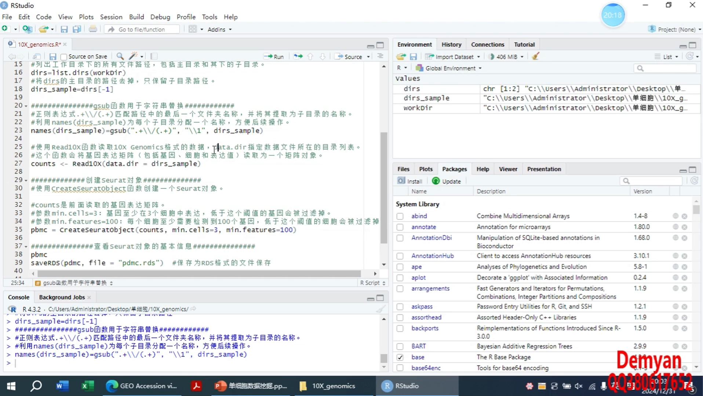
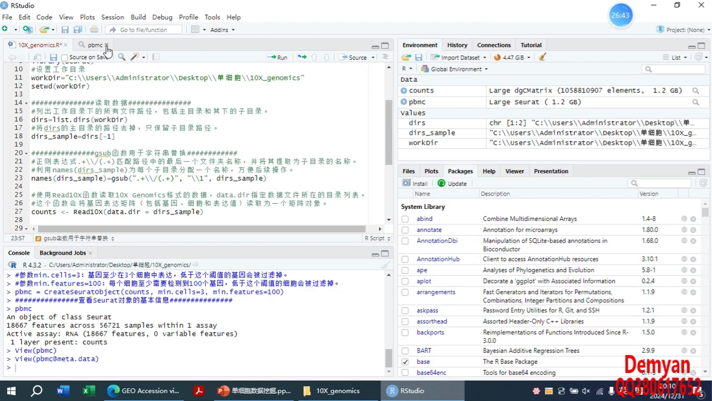
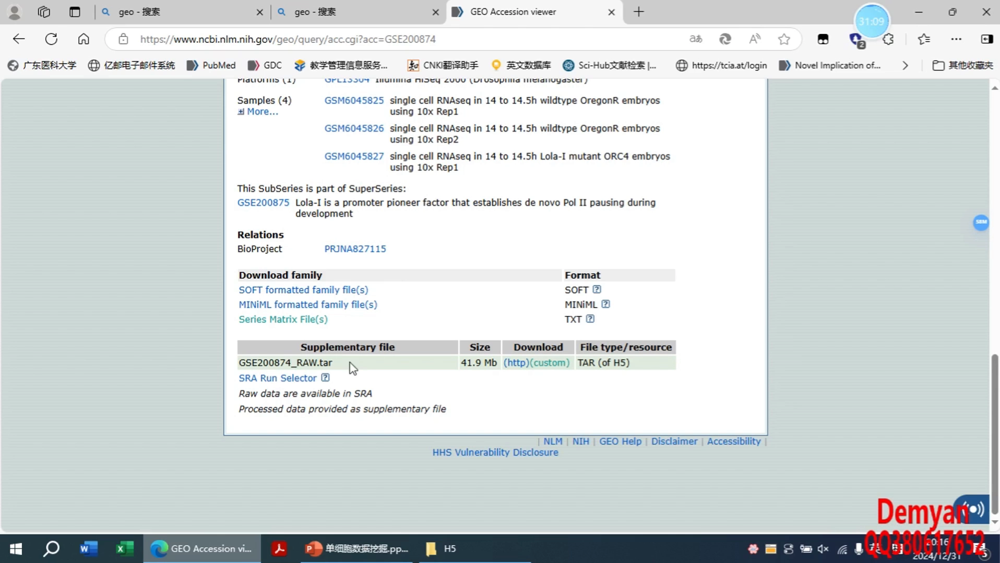
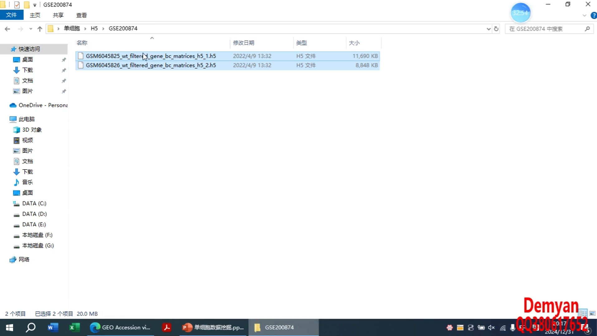

# 从 GEO 捞数据：公共单细胞数据的检索、格式与阈值统一

> 视频来源：[单细胞数据挖掘----下载与数据整理](https://www.bilibili.com/video/BV1KurNYqEiZ/)（Bilibili · 医学科研er）｜时长约 34 分钟
> 导读：这是一节面向零基础的实操课——在 GEO 里检索、判断格式、改文件名、读进 R、设过滤阈值、存成 RDS。本文把它读成"公共数据收集与统一处理"的前半段：**收集阶段的第一产物不是数据，而是一张能说清"为什么收它、怎么统一它"的清单**。字幕为 B 站 AI 字幕，术语已按上下文订正（如"时辰 genomics"→ 10x Genomics、"select 包"→ Seurat 包、"by recode"→ barcodes）。

## 本讲要解决的核心问题（SCQA）

**背景**：公共库（GEO / SRA）里有海量单细胞数据，任何图谱项目、任何二次分析都要从这里起步。

**冲突**：同一个数据库里，数据的**提交形态五花八门**——有人给 10x 三件套，有人给 H5，有人给 RDS，有人给压缩文本矩阵；文件名还带着 `GSM` 编号前缀。直接丢给下游流程，第一步就会失败。

**疑问**：从"检索到一批数据集"到"拿到一个能直接分析的矩阵"，中间到底要做哪些统一动作？

**回答（中心思想）**：收集阶段的真正工作量在**标准化三件事**——格式统一（都变成同一种可读形态）、命名统一（文件与目录名对得上流程）、阈值统一（同一套过滤口径）。这三件做完，数据才从"别人的数据"变成"我的数据"。

---

## 一、收集的第一步是"检索"，不是"下载"

### 1.1 两个入口

讲者提醒：GEO 有两个常用入口——直接进 GEO 主页，或者从 GEO DataSets 进入，两者都可以。[【跳转到 00:50】](https://www.bilibili.com/video/BV1KurNYqEiZ/?t=50)

### 1.2 先粗搜，再逐层收窄

检索过程是一个典型的"漏斗"，讲者演示得很清楚：

1. **先搜疾病名**：直接搜 `gastric cancer`，得到 18,118 条结果，物种五花八门（人类 17,709、小鼠 368、大鼠 87……）。[【跳转到 02:12】](https://www.bilibili.com/video/BV1KurNYqEiZ/?t=132)



2. **再筛物种**：点右侧 `Homo sapiens`，把范围收到人类。这一步是"纳入标准"的第一条——**物种不对的数据，后面所有统一都白做**。
3. **再加技术关键词**：加上 `single cell` / `scRNA-seq`，结果从一万多条降到 36 条。[【跳转到 03:50】](https://www.bilibili.com/video/BV1KurNYqEiZ/?t=230) 讲者的理由很直接：不加这个关键词，"获取的数据会很杂乱"，里面混着转录组、其他分析，什么都有。



最终检索式大致是 `(gastric cancer) AND "Homo sapiens" AND scRNA-seq`——**疾病 × 物种 × 技术**三个维度，正好对应"纳入/排除标准"里最常用的三个字段。

### 1.3 结果清单就是"数据集清单"的雏形

讲者强调：要**逐条读摘要**，判断"他做这个单细胞数据之前做了哪些分析、数据里都有哪些内容"。[【跳转到 04:43】](https://www.bilibili.com/video/BV1KurNYqEiZ/?t=283)

这一步在规模化收集里会被固化成一张表：数据集编号、物种、组织、技术平台、样本数、是否有原始数据、纳入或排除的理由。**没有这张表，几千个数据集收到一起之后就再也说不清"为什么收了它"。**

---

## 二、GEO 上的单细胞数据有四种形态，处理代码各不相同

### 2.1 四种格式

讲者把 GEO 上单细胞数据的提交形态归成四类：[【跳转到 05:43】](https://www.bilibili.com/video/BV1KurNYqEiZ/?t=343)

| 格式 | 典型文件 | 说明 |
| --- | --- | --- |
| 10x Genomics 格式 | `barcodes.tsv.gz`、`features.tsv.gz`、`matrix.mtx.gz` | 最普遍，三份文件缺一不可 |
| H5 格式 | `*.h5` | 二进制，一份文件装下矩阵与元信息 |
| R 数据格式 | `*.RDS`、`*.RData` | R 语言自己的序列化格式 |
| 压缩文本矩阵 | `*.csv`、`*.txt`、`*.tsv` | 直接是表达矩阵文本 |

**四种格式的整理代码完全不同**——这就是"格式统一"必须先做的原因：不是所有数据集都能用同一段代码读进来。

### 2.2 10x 三件套是主流

讲者打开一个具体数据集（GSE243535）演示：在 Supplementary file 里勾选 Custom，就能看到三份文件——`barcodes.tsv.gz`、`features.tsv.gz`、`matrix.mtx.gz`。[【跳转到 09:01】](https://www.bilibili.com/video/BV1KurNYqEiZ/?t=541)



三份文件的分工是：`barcodes` 是细胞（列名），`features` 是基因（行名），`matrix` 是稀疏矩阵里的非零值。**三者必须成套出现**，少一份就读不出来。

### 2.3 一个判断技巧：出现 `.mtx` 基本就是 10x

讲者给了一个很实用的经验：在文件列表里看到 `mtx` 后缀，基本就可以判定这是 10x Genomics 格式。[【跳转到 09:30】](https://www.bilibili.com/video/BV1KurNYqEiZ/?t=570)

这个技巧的价值在于**批量筛选**：面对成百上千个数据集，你不需要逐个打开，靠后缀就能先把"能走统一流程的那一批"挑出来。

### 2.4 为什么"格式统一"是可比性的第一道关

不同作者上传时用的格式不同，意味着**读入代码不同、读入后对象结构也可能不同**。图谱项目之所以要"重新处理"，一部分原因就在这里：只有把所有人拉回同一个入口（比如统一从 FASTQ 重跑，或者统一转成同一种矩阵对象），后面的合并才有意义。

---

## 三、三件套的两个坑：不能解压、要去前缀

### 3.1 不能解压

讲者反复强调了三遍：**10x Genomics 格式下载之后不能解压**，它是四种格式里唯一不能解压的，解压之后反而没有用。[【跳转到 11:59】](https://www.bilibili.com/video/BV1KurNYqEiZ/?t=719)

原因是读取函数认的是 `.gz` 文件名本身（`barcodes.tsv.gz`、`features.tsv.gz`、`matrix.mtx.gz`），解压后名字变了，函数就找不到。



### 3.2 `genes.tsv` 与 `features.tsv` 是同一份

讲者特别澄清：有的数据集里这份文件叫 `genes.tsv`，有的叫 `features.tsv`，**内容基本一致，只是名称不同**。[【跳转到 11:25】](https://www.bilibili.com/video/BV1KurNYqEiZ/?t=685)

这是老版本 Cell Ranger 与新版本命名差异留下的历史包袱。统一处理时要么改名，要么在读入时兼容两种名字——但**不能两种都留着**，否则同一批数据里会出现"有的读得进、有的读不进"。

### 3.3 去掉 `GSM` 前缀，只留三个标准名

第三个坑最容易被忽略：GEO 下载下来的文件名往往带样本编号前缀，例如 `GSM78898_matrix.mtx.gz`。[【跳转到 14:21】](https://www.bilibili.com/video/BV1KurNYqEiZ/?t=861)



讲者的要求是：**把前缀全部删掉，只留三个标准名**。

| GEO 下载的原名 | 统一后的名字 |
| --- | --- |
| `GSM78898_barcodes.tsv.gz` | `barcodes.tsv.gz` |
| `GSM78898_features.tsv.gz` | `features.tsv.gz` |
| `GSM78898_matrix.mtx.gz` | `matrix.mtx.gz` |

为什么要这么较真？因为读取函数"针对的只有这三个名称"。**这一步就是最朴素的命名统一**：把每个数据集各自的命名习惯，压平到流程能识别的唯一形态。

---

## 四、读进 R：把"一堆文件夹"变成"一个矩阵"

### 4.1 工作目录与路径的两个小坑

讲者用的是 RStudio + Windows，踩了两个很典型的坑：

- **斜杠方向**：Windows 里 R 只识别双反斜杠，从资源管理器复制来的单反斜杠必须全部改掉，否则报错；[【跳转到 18:36】](https://www.bilibili.com/video/BV1KurNYqEiZ/?t=1116)
- **编码**：脚本里的中文注释可能乱码，用 `File → Reopen with Encoding` 选 `GB2312` 重新打开即可。[【跳转到 15:07】](https://www.bilibili.com/video/BV1KurNYqEiZ/?t=907)

这两条看着琐碎，但它们是"同一段代码在不同机器上能不能跑出同样结果"的前提——**可复现性从路径和编码开始**。

### 4.2 用 `list.dirs` + `gsub` 批量拿到样本目录

真正有规模化意味的是这一段：讲者没有为每个数据集手写一行读入代码，而是先用 `list.dirs()` 列出工作目录下所有子目录，再去掉主目录、只保留子目录，然后用 `gsub()` 把目录名提取出来作为名字。[【跳转到 19:54】](https://www.bilibili.com/video/BV1KurNYqEiZ/?t=1194)

```r
# 列出工作目录下的所有文件路径，包括主目录和其下的子目录
dirs = list.dirs(workDir)
# 将 dirs 的主目录路径去掉，只保留子目录路径
dirs_sample = dirs[-1]
# 用 gsub 提取子目录名称，为每个子目录分配一个名称
names(dirs_sample) = gsub(".+\\/(.+)", "\\1", dirs_sample)
```

**这段代码就是"一个数据集一个文件夹"这个约定的兑现方式**：只要把每个数据集放进一个以数据集名命名的文件夹，这段代码就能自动遍历全部——不需要为新增数据集改代码。这与上游流程里"把样本名写进数组、用 for 循环批量跑"是同一个思路，只是换了个语言。

### 4.3 `Read10X`：读成稀疏矩阵

然后调用 Seurat 的 `Read10X()`，把 `dirs_sample` 作为 `data.dir` 参数传进去，把三件套读成一个矩阵对象。[【跳转到 20:19】](https://www.bilibili.com/video/BV1KurNYqEiZ/?t=1219)

```r
counts <- Read10X(data.dir = dirs_sample)
```



讲者顺带讲了一个观察细节：读入过程中如果光标没回到 `>` 提示符，说明还在跑；此时环境面板里的内存会一路上涨（他演示时到了 1.1 GB）。读完之后 `counts` 是一个 `dgCMatrix`（稀疏矩阵），元素数一亿多、体积 1.2 GB。[【跳转到 22:24】](https://www.bilibili.com/video/BV1KurNYqEiZ/?t=1344)

**这就是"为什么单细胞数据必须用稀疏矩阵存"的现场版**：绝大部分值是 0，稠密存储会直接爆内存。
---

## 五、两个阈值决定"哪些细胞算细胞"

### 5.1 `min.cells`：一个基因至少要在几个细胞里出现

创建 Seurat 对象时，讲者逐个解释了参数：参数 min.cells 取 3，表示一个基因至少要在 3 个细胞中有表达，低于这个阈值的基因会被过滤掉；参数 min.features 取 100，表示每个细胞至少要检测到 100 个基因，低于这个阈值的细胞会被过滤掉。[【跳转到 22:24】](https://www.bilibili.com/video/BV1KurNYqEiZ/?t=1344)

用数学写出来就是两条筛选条件：

$$
\text{保留基因 } g \iff n_{\text{cell}}(g) \ge \tau_{\text{cell}}, \qquad
\text{保留细胞 } c \iff n_{\text{gene}}(c) \ge \tau_{\text{feature}}
$$

其中 $n_{\text{cell}}(g)$ 是表达基因 $g$ 的细胞数，$n_{\text{gene}}(c)$ 是细胞 $c$ 中检测到的基因数，$\tau_{\text{cell}}$ 与 $\tau_{\text{feature}}$ 就是这两个阈值。

### 5.2 `min.features` 取 100、200 还是 500

讲者给了一组很实用的参照：

- 他演示时用 **100**；
- **官网默认是 200**；
- 现在很多发表的单细胞文章会把它设到 **500**。

数值越高，过滤条件越严苛，剩下的数据越少。[【跳转到 23:14】](https://www.bilibili.com/video/BV1KurNYqEiZ/?t=1394)[【跳转到 23:39】](https://www.bilibili.com/video/BV1KurNYqEiZ/?t=1419)

### 5.3 阈值必须全项目统一，否则过滤本身就成了批次

这是本小节最该被记住的一句话。设想两类样本：A 类把 min.features 设为 100，B 类设为 500。过滤之后，A 类里那些"低质量但还活着"的细胞被保留下来，B 类里同类细胞被删掉——**两批数据的细胞构成从入口处就不一样了**。

于是任何后续比较（细胞比例、表达均值、聚类结果）里出现的差异，你都说不清是生物学差异还是过滤阈值差异。**阈值不统一，过滤本身就是一个批次变量。**

### 5.4 过滤之后长什么样

跑完 `CreateSeuratObject`，讲者打印 `pbmc` 对象，控制台显示：`18667 features across 56721 samples within 1 assay`——也就是过滤后剩 18,667 个基因、56,721 个细胞。[【跳转到 26:44】](https://www.bilibili.com/video/BV1KurNYqEiZ/?t=1604)



这两个数字就是"数据集清单"里最有用的两列：**基因数 × 细胞数**。它们既是规模指标，也是"这个数据集和别的数据集能不能放在一起"的第一道体检。

---

## 六、整理产物：一个 RDS，一份可追溯的元数据

整理完成后，讲者把它保存成 `.RDS` 文件（`saveRDS(pbmc, file = "pbmc.rds")`），理由是"以便于后期的分析需要"——下次分析直接读入即可，不用重新解析三件套。[【跳转到 26:44】](https://www.bilibili.com/video/BV1KurNYqEiZ/?t=1604)

这里有个细节值得单独说：讲者点开 `pbmc@meta.data` 时指出，每个细胞的来源信息是**从文件夹名称读进来的**。[【跳转到 26:19】](https://www.bilibili.com/video/BV1KurNYqEiZ/?t=1579) 也就是说：

> **你给文件夹起什么名字，细胞元数据里就会出现什么名字。**

这正是"可追溯性"最便宜的实现方式——**用目录名承载数据集身份**。反过来说，如果文件夹命名随意（`新建文件夹(1)`），细胞的来源就永久丢失了，图谱里任何一个结论都无法回溯到原始数据集。

### 6.1 多样本：多建几个文件夹，同一行代码吃下全部

讲者演示了多样本的做法：多创建几个文件夹、各自命名（如 `GSE14786`），**每个文件夹里都必须包含那三份文件**，然后同样用那一行 `Read10X()` 调用就能把所有数据集整理进同一个对象。[【跳转到 28:19】](https://www.bilibili.com/video/BV1KurNYqEiZ/?t=1699)

因为数据量比较大，他没有现场跑多样本，但逻辑已经完整：**目录约定 + 一段遍历代码 = 可扩展的收集流水线**。

---

## 七、H5 格式：另一种主流形态

### 7.1 怎么在 GEO 里认出 H5

讲者以 GSE200874 为例：在 Supplementary file 里，File type 一栏写着 `TAR (of H5)`，说明这个数据集提交的是 H5 格式。[【跳转到 31:10】](https://www.bilibili.com/video/BV1KurNYqEiZ/?t=1870)



### 7.2 H5 与三件套的关键差异：要解压

讲者下载两个样本后，把它们放进一个新建文件夹，然后**解压**——这与三件套"绝不能解压"正好相反。[【跳转到 32:29】](https://www.bilibili.com/video/BV1KurNYqEiZ/?t=1949)



解压后得到的是 `GSM6045825_wt_filtered_gene_bc_matrices_h5_1.h5` 这样的文件——**注意文件名里带着 GSM 编号**，和前面三件套一样，需要统一命名才能进流程。讲者随后用另一段 H5 专用的 R 代码读取，单样本、多样本都可以。[【跳转到 33:15】](https://www.bilibili.com/video/BV1KurNYqEiZ/?t=1995)

**结论很清楚**：格式不同 → 读取代码不同 → 必须为每种格式准备一段统一入口。这就是"收集"这一步真正的工程内容。

---

## 八、这一步对图谱建设意味着什么

把这一课的动作抽象一下，收集阶段要交付的其实是四样东西：

1. **一张检索式**：疾病 × 物种 × 技术，能复现地圈出候选集；
2. **一张数据集清单**：每个条目的编号、物种、组织、技术、样本数、格式、纳入或排除理由；
3. **一套命名约定**：目录名 = 数据集身份，文件名 = 流程能识别的标准名；
4. **一套统一阈值**：min.cells、min.features 全项目一致，写进流程而不是凭手感。

这四样东西合起来，才让"把几千份别人做的实验拼成一张图谱"这件事在工程上成立。而它们对应的正是本小节的核心命题：

> **收集决定"能看多广"，统一处理决定"能不能比"。**

需要说明边界：这一课解决的是"格式、命名、阈值"三个层面的统一，**不涉及上游重新比对**（那是重跑 FASTQ 的活儿，见本小节另一篇），也**不涉及细胞类型注释的对齐**（那是后续小节的内容）。三件事各管一段，合起来才是完整的统一处理。

---

## 小结

- **检索是漏斗**：疾病 → 物种 → 技术关键词，18,118 条能收到 36 条；检索式本身就是可复现的纳入标准。
- **GEO 上单细胞数据有四种形态**：10x 三件套、H5、RDS、压缩文本矩阵，读取代码各不相同——所以"格式统一"必须先做。
- **`.mtx` 后缀是判断 10x 的快捷方式**，适合在成百上千个数据集里快速筛选。
- **三件套不能解压**；`genes.tsv` 与 `features.tsv` 等价；`GSM` 前缀必须删掉，只留三个标准名。
- **目录名承载数据集身份**：`list.dirs` + `gsub` 让"一个数据集一个文件夹"变成可遍历的流水线，细胞元数据里的来源就是文件夹名。
- **两个阈值必须全项目统一**：min.cells 管基因，min.features（100 / 200 / 500）管细胞；阈值不统一，过滤本身就是批次。
- **整理产物是 RDS + 一份元数据**：下次分析直接读入，不必重新解析三件套。
- **H5 是另一条入口**：要解压、文件名同样带 GSM 前缀、需要专用读取代码。

---

## 关键术语速查

| 术语 | 一句话解释 |
| --- | --- |
| GEO DataSets | NCBI 的基因表达数据集检索入口，可按物种、研究类型、属性筛选 |
| GSE / GSM | GSE 是一个 Series（一次研究），GSM 是其中一个样本 |
| 10x Genomics 格式 | 由 `barcodes.tsv.gz`、`features.tsv.gz`、`matrix.mtx.gz` 三份文件组成的标准提交形态 |
| `matrix.mtx` | Matrix Market 格式的稀疏矩阵文件，只存非零值及其行列下标 |
| `barcodes.tsv` | 细胞条形码列表，对应矩阵的列名 |
| `features.tsv` / `genes.tsv` | 基因列表，对应矩阵的行名；两者内容基本一致，只是新旧命名不同 |
| H5 | 一种二进制容器格式，一份文件装下矩阵与元信息；GEO 上常以 TAR 打包提交 |
| RDS | R 语言的单对象序列化格式，用于保存分析中间结果 |
| `Read10X` | Seurat 中读取 10x 三件套的函数，返回稀疏矩阵 |
| `min.cells` | 基因过滤阈值：一个基因至少在多少个细胞中表达才保留 |
| `min.features` | 细胞过滤阈值：一个细胞至少检测到多少个基因才保留 |
| 稀疏矩阵（dgCMatrix） | 只存非零值的矩阵表示，单细胞数据体积的主要节省手段 |
| 纳入/排除标准 | 事先写明的收录规则（物种、技术、是否有原始数据、元数据是否完整等） |
