# 统一上游流程：用 Cell Ranger 把一批样本跑成可比矩阵

> 视频来源：[单细胞转录组上游分析-1.cellranger流程/10X Genomics](https://www.bilibili.com/video/BV1QoLV6vEkU/)（Bilibili · 组学生信老胡）｜时长约 34 分钟
> 导读：这是一节手把手的上游实操课——建目录、改文件名、装 Cell Ranger、下参考基因组、单样本跑通、再用 for 循环批量跑。本文按"为什么要固定这些步骤"重新组织，把它读成一份**规模化统一处理的最小清单**。字幕为 B 站 AI 字幕，术语已按上下文订正（如"十层 genomics"→ 10x Genomics、"sell ranger"→ Cell Ranger）。

## 本讲要解决的核心问题（SCQA）

**背景**：单细胞数据越来越多地来自不同实验室、不同年份、不同版本的工具。你想把公共库里下载的一批数据，或者自家几批实验，放在一张图里比较。

**冲突**：直接拿作者给的表达矩阵拼起来，会发现同一批细胞、同一个基因，数值对不上——参考基因组版本不同、Cell Ranger 版本不同、文件命名不同、过滤阈值不同。**"下载"从来不是难点，"让它们可比"才是。**

**疑问**：那到底要固定哪些东西，才能让一批样本真正可比？

**回答（中心思想）**：可比性来自**上游的统一**——同一套目录结构、同一套文件命名、同一版比对软件、同一版参考基因组、同一组运行参数，最后用循环把这件事变成可重复执行的流水线。上游一旦统一，下游才有资格谈"跨样本比较"。

---

## 一、上游分析是"从 FASTQ 到表达矩阵"这一段，它决定了后面所有比较是否成立

### 1.1 上游与下游的分界线

讲者一开头就把边界划清楚了：上游分析指的是**从测序下机文件到表达矩阵**这一段——用测序得到的 FASTQ 文件，经过参考基因组的序列比对，最终得到矩阵文件；下游分析则是拿矩阵文件去做各种分析、各种可视化作图。[【跳转到 00:00】](https://www.bilibili.com/video/BV1QoLV6vEkU/?t=0)

这条分界线的意义在于：**矩阵一旦生成，后面所有分析都只是在解释它**。如果上游这一步在不同样本之间不一致，后面再精巧的整合算法也只能在"已经歪掉"的数值上做校正。

### 1.2 为什么必须在 Linux 服务器上跑

讲者的原话很直白：上游分析需要服务器，要在 Linux 系统上操作；如果用个人电脑去跑，"大概电脑跑冒烟了也不见得能把任务跑完"。[【跳转到 00:25】](https://www.bilibili.com/video/BV1QoLV6vEkU/?t=25)

这不是效率问题，而是**规模问题**：一个样本的比对就要几十分钟到几小时，图谱项目动辄上千个样本，只有把流程放到服务器上、写成脚本，才谈得上"统一处理"。

### 1.3 上游要固定的三样东西

把整节课的操作归纳一下，统一处理其实只固定三件事：

1. **固定的软件与版本**：同一版 Cell Ranger（本讲用 10.0.0）；
2. **固定的参考基因组**：同一物种、同一版本（本讲用小鼠 GRCm39-2024-A）；
3. **固定的参数与命名**：同一组 `cellranger count` 参数、同一套 FASTQ 命名规则。

这三样任意一样在不同样本之间漂移，就会在数据里留下"流程批次"——一种跟生物学完全无关、却会被下游当成差异的假信号。

---

## 二、统一处理从目录开始：三步建好一个可复现的工作区

### 2.1 三条 mkdir

讲者要求在家目录下建一个 `Single_cells` 文件夹，下面再有两个子文件夹：`01.Rawdata`（放 FASTQ）和 `02.Ref_genomics`（放参考基因组）。对应的就是三行命令：[【跳转到 02:55】](https://www.bilibili.com/video/BV1QoLV6vEkU/?t=175)

```bash
mkdir Single_cells
mkdir Single_cells/01.Rawdata
mkdir Single_cells/02.Ref_genomics
```

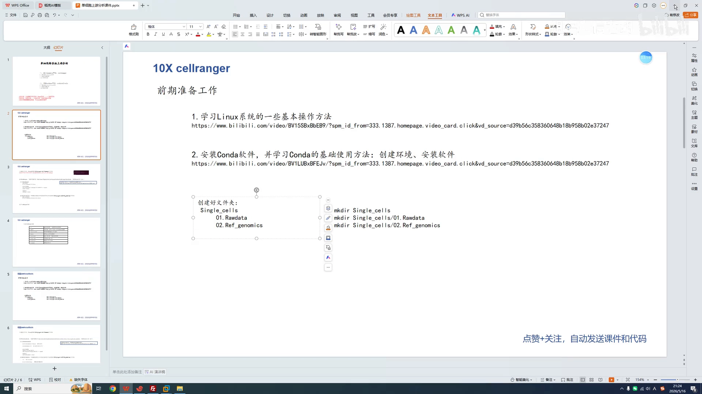

### 2.2 目录即契约

看起来只是"建两个文件夹"，但它其实是后面所有代码的**契约**：讲者明确说，后面 `cellranger count` 里的 `--fastqs` 和 `--transcriptome` 参数，就是照着这个路径写死的相对路径。[【跳转到 21:16】](https://www.bilibili.com/video/BV1QoLV6vEkU/?t=1276)

这就是规模化处理里最容易被忽略的一条：**目录结构不是个人习惯，而是流水线的接口**。接口一旦固定，任何新样本只要放进 `01.Rawdata`，就能被同一条命令处理；接口一变，脚本就要改，改脚本就意味着"这一批和上一批不是同一套流程"。

---

## 三、文件名不是小事：Cell Ranger 认的是命名规范

### 3.1 标准形态

讲者把这一条标成了红字，特意强调"千万不要忽略"：FASTQ 文件的命名有规范，标准形态是

```
SampleName_S1_L001_R1_001.fastq.gz
```

如果不按这个样式命名，程序会直接报错，并提示你去确认文件名。[【跳转到 06:56】](https://www.bilibili.com/video/BV1QoLV6vEkU/?t=416)

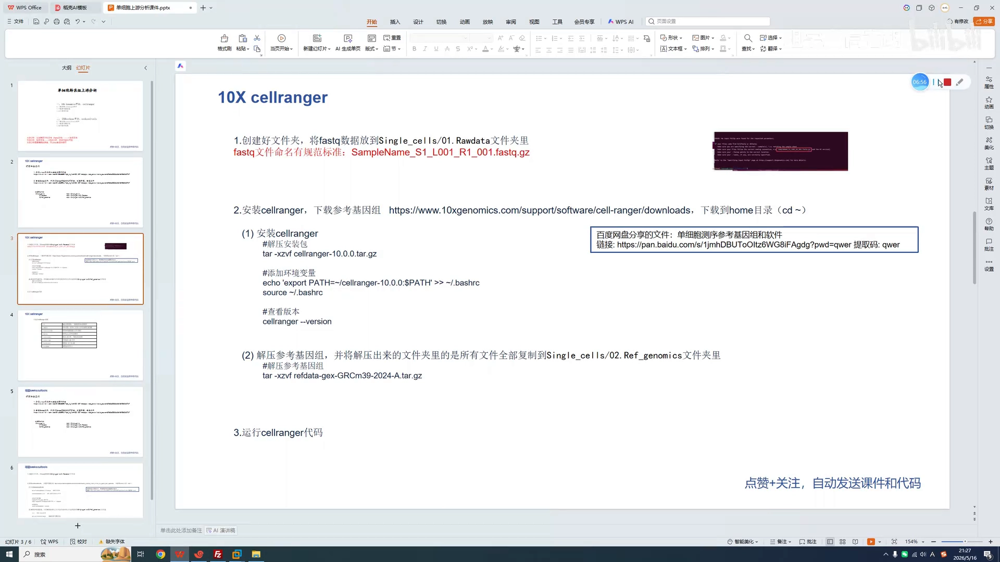

### 3.2 逐段拆解

讲者逐段解释了每个字段的含义：[【跳转到 07:45】](https://www.bilibili.com/video/BV1QoLV6vEkU/?t=465)

| 字段 | 含义 | 是否可随意编 |
| --- | --- | --- |
| `SampleName` | 样本名称，Cell Ranger 用它匹配 `--sample` | 必须与样本表一致 |
| `S1` | 样本序号（sample index） | 可编，但同一批内要唯一 |
| `L001` | 测序仪器上的 lane 编号 | 可编，不影响结果 |
| `R1` / `R2` | 双端测序的 read 1 / read 2 | 不可乱写，决定哪条是 barcode+UMI |
| `001` | 同一 read 的分卷号（数据太大时拆成 001、002…） | 可编，同一样本的分卷会被合并 |

几个关键点：

- **单细胞测序是双端测序**，所以每个样本对应两个文件（R1 与 R2），`R1`/`R2` 不是可有可无的装饰；
- 后缀 `.fastq` 与 `.fq` 等价，`.gz` 只是压缩标记，**不属于文件名本身**；
- `001`、`002`、`003` 这些分卷号表示"同一份数据被拆成了几块"，后续会被当作同一样本合并。

### 3.3 从公共库下载的数据要"改成像这个样子"

讲者特别提醒：**从数据库下载的数据，哪怕编号是自己编的，也要编成这个样子**。[【跳转到 08:10】](https://www.bilibili.com/video/BV1QoLV6vEkU/?t=490)

这一句其实就是"公共数据收集与统一处理"里最琐碎、也最容易翻车的一步：GEO / SRA 上的文件名往往带着 `GSMxxxxxx` 之类的前缀，或者用 `SRR` 编号命名，直接丢给 Cell Ranger 会匹配不上。**收集阶段的第一件统一工作，是把命名统一成流程能识别的样子。**
---

## 四、固定软件与参考基因组：版本一致才可比

### 4.1 下载 Cell Ranger：把版本号写进笔记

讲者直接进 10x 官网的 Download Center，页面上当前最新版本是 **Cell Ranger 10.0.0**，下面是参考基因组下载区；软件用 `wget`（或页面给出的 `curl`）下载到家目录。[【跳转到 09:48】](https://www.bilibili.com/video/BV1QoLV6vEkU/?t=588)

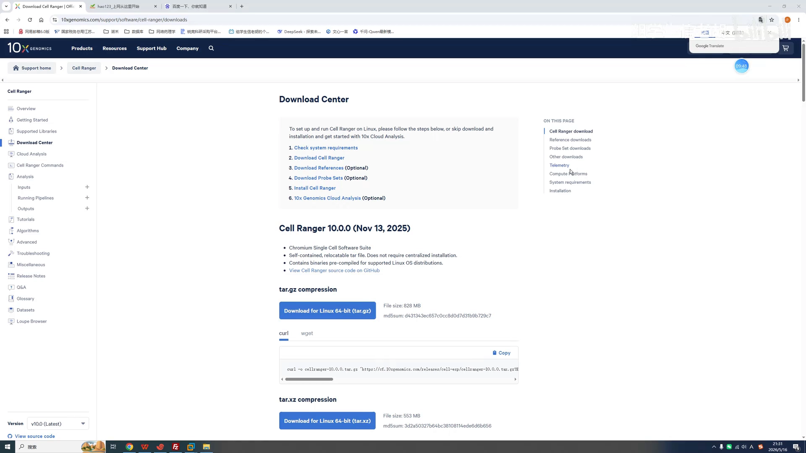

对图谱项目来说，"下载最新版"这个动作本身就要被记录：**版本号是可比性的一部分**。同一批数据用 7.0 和 10.0 跑出来的细胞数、基因数、甚至 cell calling 的结果都可能不同——这不是 bug，是算法更新。所以流程里必须明确写死"这一版图谱用的是哪个版本"。

### 4.2 参考基因组：三个物种、一个版本

参考基因组在同一个页面的 Reference 区，提供人类、小鼠、大鼠三个物种。讲者以小鼠为例，指出参考基因组文件非常大（他提到约 **9.7 G**），下载很慢，所以提前下好了。[【跳转到 11:16】](https://www.bilibili.com/video/BV1QoLV6vEkU/?t=676)[【跳转到 12:19】](https://www.bilibili.com/video/BV1QoLV6vEkU/?t=739)

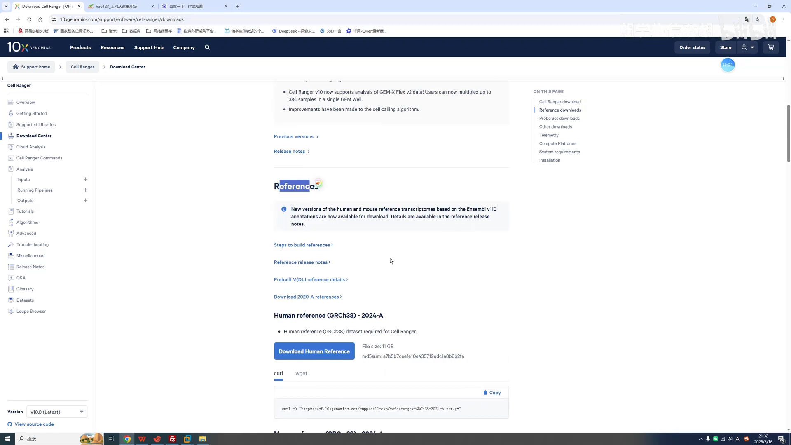

这里有两个必须统一的点：

1. **物种与组装版本**：人类是 GRCh38 的某个具体发布版（页面标注 2024-A），小鼠是 GRCm39-2024-A。不同发布版之间基因集合、基因名、甚至某些基因的注释边界都不同；
2. **注释来源**：页面说明新版参考转录组基于 Ensembl v110 注释。**Ensembl ID 与 gene symbol 的对应关系会随注释版本变化**，这也是"合并数据时基因对不上"的常见原因。

讲者还提到一个很现实的问题：国外网站下载经常中断、限速，所以他把三个物种的参考基因组和软件都放到了网盘做备用。[【跳转到 12:29】](https://www.bilibili.com/video/BV1QoLV6vEkU/?t=749) 对规模化项目来说，这意味着**参考基因组要当作"项目资产"统一存放一份**，而不是每个样本各下一次——否则不同时间下的"同名"参考基因组，内容可能已经变了。

### 4.3 解压、加环境变量、版本自检

安装分两步：解压安装包（`tar -xzvf cellranger-10.0.0.tar.gz`），然后把可执行目录加进 `PATH`，最后用 `cellranger --version` 确认能打印出版本号。[【跳转到 14:16】](https://www.bilibili.com/video/BV1QoLV6vEkU/?t=856)

```bash
# 解压安装包
tar -xzvf cellranger-10.0.0.tar.gz

# 添加环境变量
echo 'export PATH=~/cellranger-10.0.0:$PATH' >> ~/.bashrc
source ~/.bashrc

# 查看版本
cellranger --version
```

"能打印出版本号"这个动作看着像新手检查，其实是流水线里的**自检点**：脚本开头先打印一次 `cellranger --version` 和参考基因组路径，产出的日志就能证明"这批结果是用哪个版本、哪个参考跑出来的"。这就是后面要说的可追溯性（provenance）的最小实现。

### 4.4 参考基因组目录里有什么

解压后的参考基因组文件夹里有三样东西（外加一个可以忽略的 `reference.json`）：`fasta`、`genes`、`star`。[【跳转到 15:24】](https://www.bilibili.com/video/BV1QoLV6vEkU/?t=924)

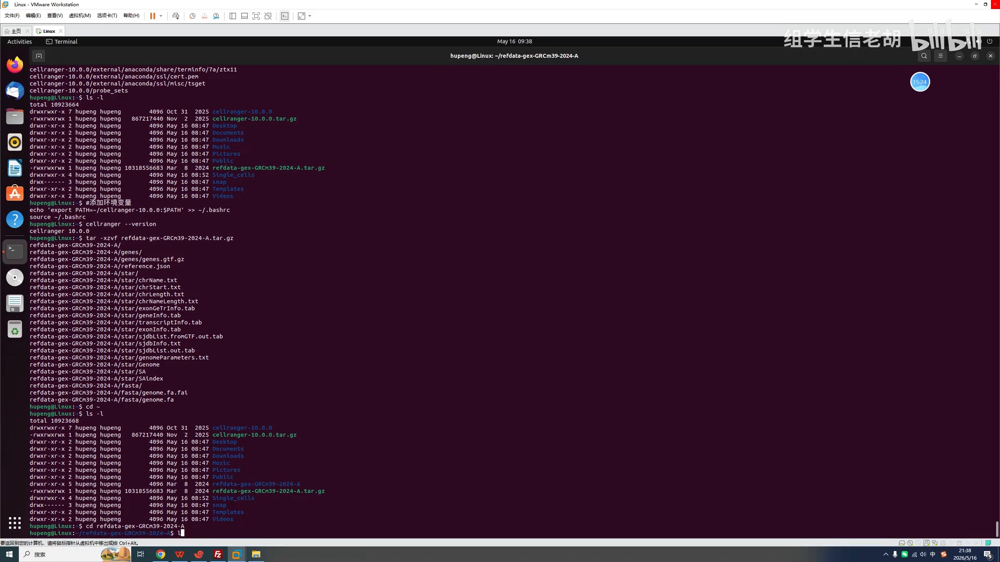

讲者要求把这几个文件全部复制到 `Single_cells/02.Ref_genomics` 里，最终工作区应该是这个样子：[【跳转到 16:59】](https://www.bilibili.com/video/BV1QoLV6vEkU/?t=1019)

```
Single_cells/
├─ 01.Rawdata/          # 按规范命名的 FASTQ
└─ 02.Ref_genomics/     # fasta / genes / star / reference.json
```

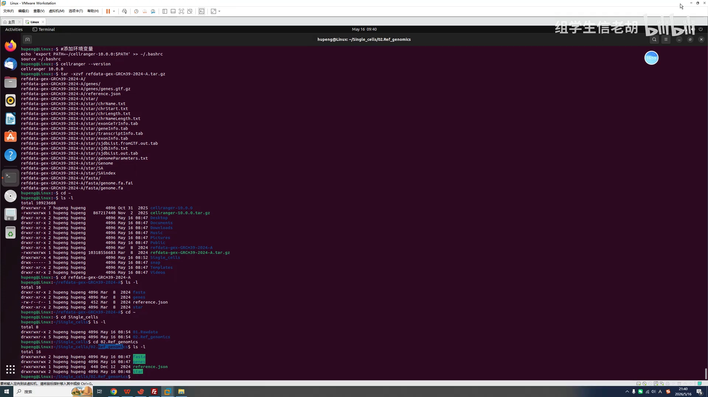

---

## 五、单样本跑通：每个参数都在回答"可比性"的问题

### 5.1 代码骨架

进入 `Single_cells` 工作目录后，脚本里其实有两段：**第一段对单个样本跑**，**第二段对多个样本循环跑**。[【跳转到 18:22】](https://www.bilibili.com/video/BV1QoLV6vEkU/?t=1102) 先看单样本这一段：

```bash
cellranger count \
  --id=A1 \
  --sample=A1 \
  --transcriptome=02.Ref_genomics \
  --fastqs=01.Rawdata \
  --nosecondary \
  --create-bam=true \
  --localcores=12 \
  --localmem=50
```

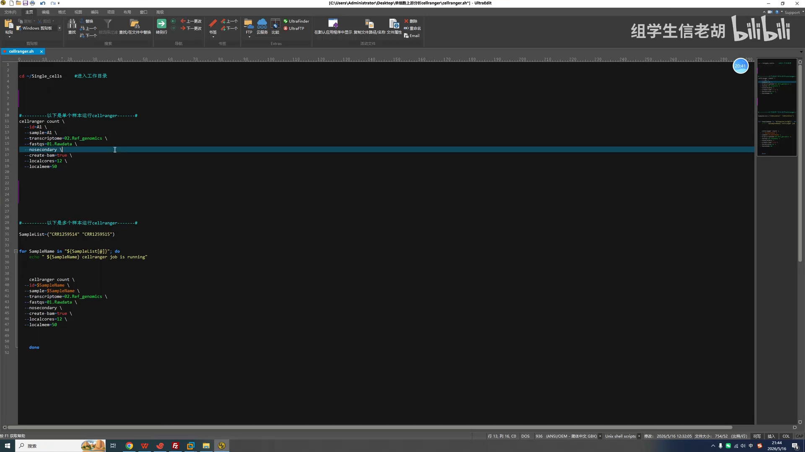

### 5.2 参数逐个看

讲者把每个参数写在幻灯片上逐个解释，这张表其实就是"统一处理要固定哪些参数"的清单：[【跳转到 20:29】](https://www.bilibili.com/video/BV1QoLV6vEkU/?t=1229)

| 参数 | 含义 | 对可比性的影响 |
| --- | --- | --- |
| `--id` | 输出目录名称，一般用样本名 | 决定结果落位，影响可追溯性 |
| `--sample` | 样本名称，必须与 FASTQ 文件名前缀完全匹配 | 匹配不上直接报错 |
| `--transcriptome` | 保存参考基因组的文件夹路径 | **必须全项目同一版** |
| `--fastqs` | 保存 FASTQ 的文件夹路径 | 决定读哪些文件 |
| `--nosecondary` | 跳过二级分析，只输出表达矩阵 | 统一输出形态 |
| `--create-bam` | 是否生成 BAM 文件 | 影响存储与后续回溯能力 |
| `--localcores` | 使用的 CPU 核心数 | 不影响结果，只影响耗时 |
| `--localmem` | 使用的内存大小 | 不影响结果，只影响耗时 |

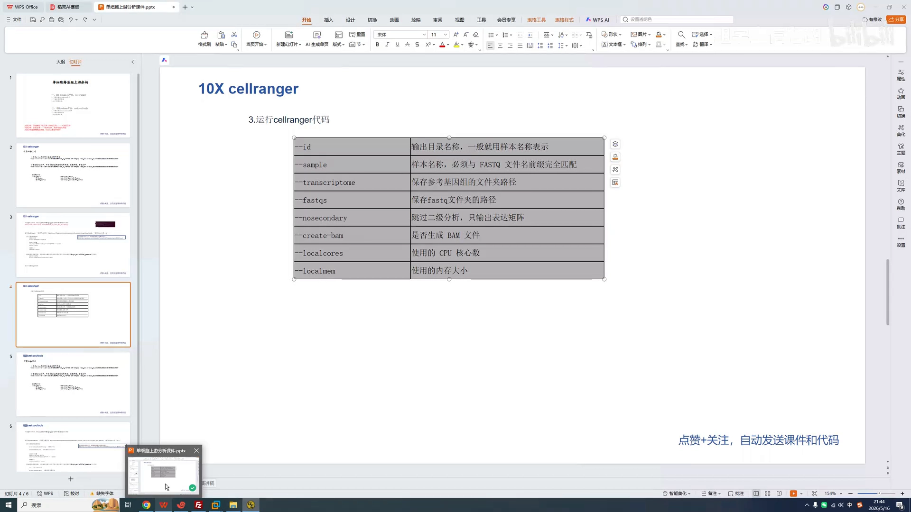

注意最后两行：`--localcores` 和 `--localmem` 是**唯一可以放心按机器配置改的参数**，因为它们只影响跑多久，不影响跑出什么。其余参数一旦在不同样本之间变化，产出的矩阵就不再是同一套流程的产物。这就是"哪些能改、哪些不能改"的判据。

讲者还提醒了一个常见坑：`--transcriptome` 和 `--fastqs` 用的是**相对路径**，因为已经 `cd` 到了 `Single_cells` 目录下；如果换了工作目录，就要改成绝对路径。[【跳转到 21:16】](https://www.bilibili.com/video/BV1QoLV6vEkU/?t=1276)

### 5.3 输出：raw 与 filtered，用 filtered

跑完之后，`Single_cells` 下面会多出一个以 `--id` 命名的文件夹（这里是 `A1`），里面包含两份矩阵文件和一份 HTML 报告：一份是**原始矩阵**，一份是**过滤之后的矩阵**。讲者的建议很明确：下游分析用过滤之后的那份。[【跳转到 22:53】](https://www.bilibili.com/video/BV1QoLV6vEkU/?t=1373)

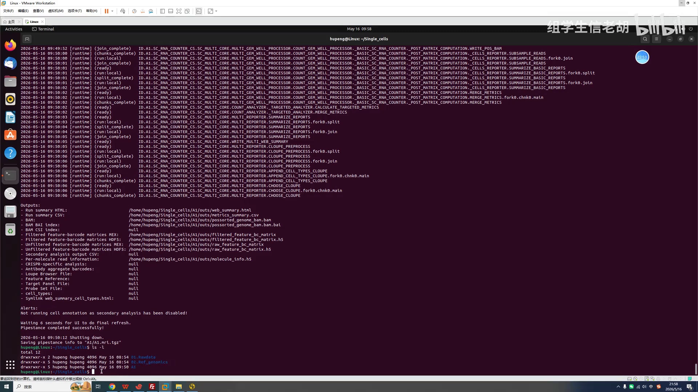

"用 filtered 还是 raw"这个选择必须在**整个项目里统一**——同一批数据里有的样本用 raw、有的用 filtered，等于在数据入口处就引入了不一致。

---

## 六、QC 报告是"批次"的第一份证据

### 6.1 web_summary.html 里看什么

跑完 Cell Ranger 会得到一个网页报告，讲者说这正是测序公司交付时会给你的那份"数据质控结果"。[【跳转到 23:45】](https://www.bilibili.com/video/BV1QoLV6vEkU/?t=1425)

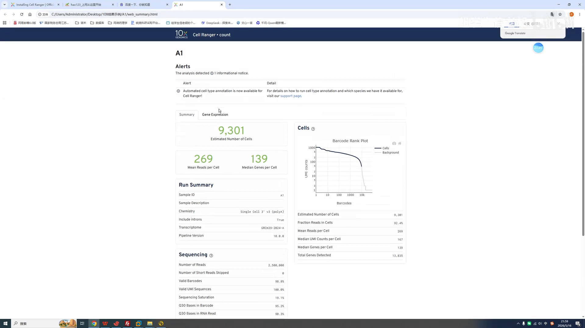

这份报告里，对"能不能放在一起比"最关键的几个字段是：

- **Estimated Number of Cells**：估计细胞数（示例样本为 9,301）；
- **Mean Reads per Cell / Median Genes per Cell**：每个细胞的平均 reads 与基因中位数（示例为 269 / 139）；
- **Barcode Rank Plot**：barcode 排序曲线，用来判断"细胞与背景"的分界是否清晰；
- **Chemistry**：建库化学（示例为 Single Cell 3' v3）；
- **Transcriptome**：参考基因组版本（示例为 GRCm39-2024-A）；
- **Pipeline Version**：流程版本（示例为 10.0.0）。

后三项尤其值得盯：**它们不是质量指标，而是"批次标签"**。同一批数据里如果 Chemistry 或 Transcriptome 不一致，就说明它们本来就不该被当作同一套流程的产物直接比较。

### 6.2 metrics_summary.csv 是横向比较的入口

除了网页，输出里还有一张 `metrics_summary.csv`，讲者打开它展示了同一批指标的表格式呈现。[【跳转到 24:09】](https://www.bilibili.com/video/BV1QoLV6vEkU/?t=1449)

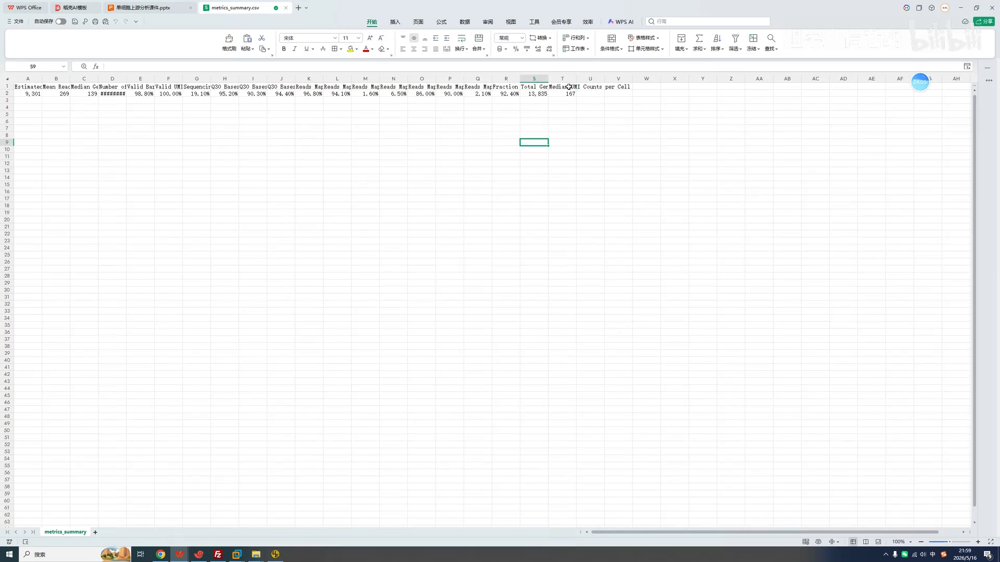

讲者特别点出了 **Valid Barcodes 98.8%** 这个数字，说"这个正确率挺高的，都接近百分之百了"。它的定义很直白：

$$
r_{\text{barcode}} = \frac{N_{\text{valid barcode reads}}}{N_{\text{total barcode reads}}}
$$

对规模化处理来说，这张 CSV 的真正价值是：**它把所有样本的同一组指标排在同一张表里**，你可以一眼看出哪些样本明显偏离——而"明显偏离"的样本，往往就是需要单独检查、甚至需要排除的样本。这正是"收集阶段要有一张数据集清单"的量化版本。

---

## 七、批量跑：变量 + for 循环，把重复劳动变成可重跑的流水线

### 7.1 为什么必须批量化

讲者算了一笔很实在的账：你不太可能做完 A1 再改一下去做 A2、再改一下做 A3，每次都要等很久才能做下一个样本，"工作量非常繁琐"。[【跳转到 24:28】](https://www.bilibili.com/video/BV1QoLV6vEkU/?t=1468)

更关键的是：**手改代码本身就是不一致的来源**。人改三次代码，就有三次写错参数的机会；而图谱项目要跑的是成百上千个样本。所以批量化不只是省事，它是"统一"这个目标的技术前提。

### 7.2 变量引用：把样本名变成参数

第一步是把写死的样本名换成变量。讲者定义了一个叫 `sample_name` 的变量，用 `$` 引用它：[【跳转到 25:43】](https://www.bilibili.com/video/BV1QoLV6vEkU/?t=1543)

```bash
SampleName="A1"

cellranger count \
  --id=$SampleName \
  --sample=$SampleName \
  --transcriptome=02.Ref_genomics \
  --fastqs=01.Rawdata \
  --nosecondary \
  --create-bam=true \
  --localcores=20 \
  --localmem=65
```

讲者强调：这一段的效果和把 `A1` 写死的那一段**完全一样**，因为此时变量的值就是 `A1`。[【跳转到 26:33】](https://www.bilibili.com/video/BV1QoLV6vEkU/?t=1593) 区别在于——现在换样本只需要改变量的值，不用碰命令本身。

### 7.3 一个非常实用的默认行为：输出目录已存在就跳过

讲者故意演示了一次"失败"：把变量版代码直接跑，结果几秒钟就结束了。[【跳转到 27:08】](https://www.bilibili.com/video/BV1QoLV6vEkU/?t=1628)

原因是：`A1` 这个输出目录已经存在，Cell Ranger 会判定这个样本已经跑过，**不覆盖，直接跳过**。要重跑必须先删掉旧目录（讲者用 `rm -r A1`）。[【跳转到 27:33】](https://www.bilibili.com/video/BV1QoLV6vEkU/?t=1653)

对规模化流程来说，这个行为其实是个礼物：它就是**断点续跑的雏形**。一批样本跑到一半中断，重新执行同一条脚本，已经完成的样本会被自动跳过，只有没跑完的会重跑——不需要额外写状态管理逻辑。代价是：**如果你改了参数想重跑，必须显式删掉旧结果**，否则你会拿到"旧参数产出的新数据"，这是最隐蔽的一类不一致。

### 7.4 for 循环：遍历样本数组

真正的批量化靠 for 循环。讲者先定义一个数组放样本名，再用 for 遍历它：[【跳转到 30:29】](https://www.bilibili.com/video/BV1QoLV6vEkU/?t=1829)

```bash
SampleList=("A1" "A2")

for SampleName in "${SampleList[@]}"; do
  echo "${SampleName} cellranger job is running"

  cellranger count \
    --id=$SampleName \
    --sample=$SampleName \
    --transcriptome=02.Ref_genomics \
    --fastqs=01.Rawdata \
    --nosecondary \
    --create-bam=true \
    --localcores=12 \
    --localmem=50
done
```

讲者把 for 循环的逻辑讲得很清楚：第一个循环里 `sample_name` 等于 A1，第二个循环里等于 A2，`do` 和 `done` 之间就是"每个循环要做的事"。[【跳转到 30:54】](https://www.bilibili.com/video/BV1QoLV6vEkU/?t=1854) 前面那句 `echo` 是进度提示，跑起来能看到"哪个样本正在跑"。

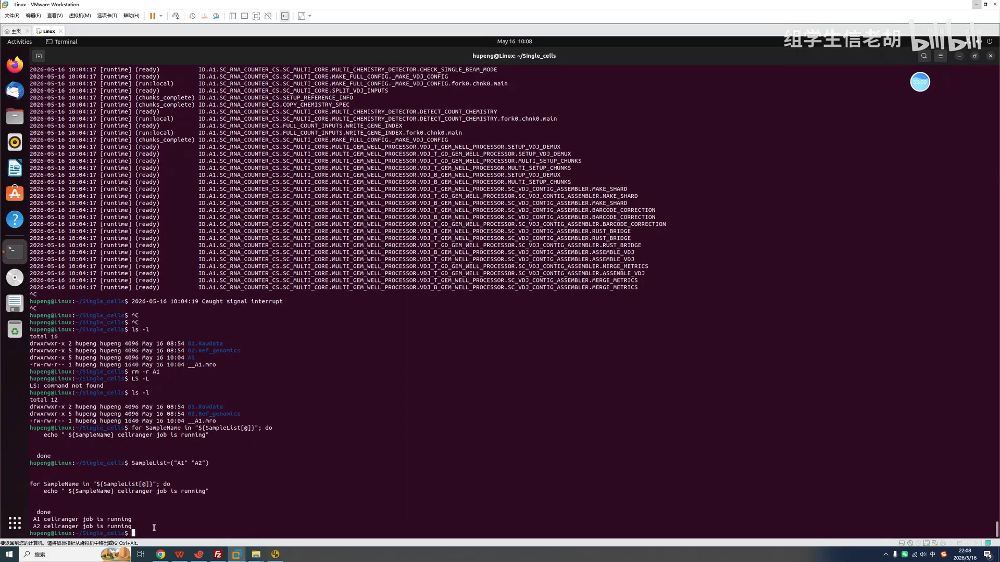

跑完之后，`Single_cells` 下面应该同时出现 `A1`、`A2` 两个输出文件夹，各自带自己的矩阵与报告。[【跳转到 33:00】](https://www.bilibili.com/video/BV1QoLV6vEkU/?t=1980)

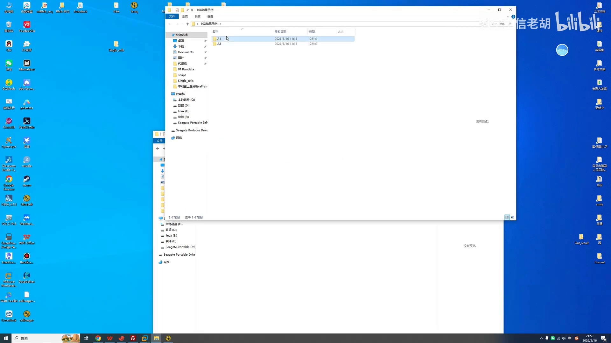

**这就是"统一处理"最朴素的样子**：一个样本数组、一段固定的命令、一次执行。样本从 2 个变成 200 个，脚本只多一行数组内容。

---

## 八、这套流程解决了什么，没解决什么

### 8.1 它解决的是"流程批次"

把这一课的操作清单摊开看，它固定的东西恰好是四类：

1. **目录与命名**：所有样本走同一条输入路径、同一套文件名规则；
2. **软件版本**：同一版 Cell Ranger；
3. **参考基因组**：同一物种、同一发布版本、同一注释来源；
4. **运行参数**：同一组 `--nosecondary`、`--create-bam` 等决定输出形态的参数。

这四类固定之后，样本之间剩下的差异，主要就不再是"谁用什么工具跑的"，而是"样本本身是什么"。**这一步消除的是流程批次（pipeline batch），不是样本批次。**

### 8.2 它没解决什么

必须说清楚边界，否则会过度承诺：

- **样本批次依然存在**：不同实验室、不同时间、不同操作者带来的差异，统一流程一步都消不掉；
- **建库化学差异依然存在**：3′ v2 与 3′ v3 的捕获效率不同，报告里的 Chemistry 字段会如实写出来，但它不会因为流程统一而消失；
- **组织解离方式、测序深度差异依然存在**：这些是实验侧的变量，流程只能测量它们，不能消除它们；
- **过度统一的风险**：把本来不同的组织、不同的细胞状态硬拉到同一套阈值下，可能把真实差异也一起抹平。

一句话：**统一处理让数据"可比"，不等于让数据"无偏"。**

### 8.3 为什么这是图谱项目的地基

回到 4.2 节的主线：大规模表达图谱之所以要下载 TB 级原始数据、用同一套流程重跑一遍，而不是直接拿作者给的矩阵，原因就在这一课里——**作者给的矩阵是"各自流程"的产物，只有重跑才能变成"同一流程"的产物**。

而规模化之后，工程问题会立刻浮现：

- **算力与存储**：参考基因组就近 10 G，一个样本的输出又是一整套矩阵加 BAM，上千样本就是 TB 级；
- **断点续跑与失败重试**：靠"输出目录已存在就跳过"这类默认行为兜底，但必须有日志能看出哪些样本失败了；
- **可追溯性（provenance）**：每个细胞都要能追回"来自哪个数据集、哪个样本、哪个 run"——本课里 `--id` 用样本名、报告里记录 Transcriptome 与 Pipeline Version，就是最小版本的可追溯；
- **版本管理**：流程升级会产出新版图谱，必须能说清"这一版和上一版差在哪"，而版本号从第一天就要记。

所以本节的一句话收束是：**收集决定"能看多广"，统一处理决定"能不能比"。**

---

## 小结

- **上游 = 从 FASTQ 到表达矩阵**。它一旦不统一，后面所有跨样本比较都建立在不可比的数值上。
- **统一处理固定四类东西**：目录与命名、软件版本、参考基因组版本、运行参数。少固定一样，就多一种"流程批次"。
- **命名规范是流程的入口**：`SampleName_S1_L001_R1_001.fastq.gz`，从公共库下载的数据必须改成流程能识别的样子。
- **参数分两类**：`--localcores`、`--localmem` 只影响快慢，可以按机器改；`--transcriptome`、`--nosecondary`、`--create-bam` 影响产出，必须全项目一致。
- **QC 报告是批次证据**：Chemistry、Transcriptome、Pipeline Version 三个字段不是质量指标，而是"这批数据是不是同一套流程产物"的标签。
- **批量化的技术前提是脚本化**：变量 + for 循环 + "输出目录已存在则跳过"的默认行为，构成了最简的断点续跑。
- **统一处理消除流程批次，不消除样本批次**：让数据可比，不等于让数据无偏。

---

## 关键术语速查

| 术语 | 一句话解释 |
| --- | --- |
| 上游分析（upstream） | 从测序下机 FASTQ 到表达矩阵这一段，核心是比对与定量 |
| Cell Ranger | 10x Genomics 官方上游工具，`cellranger count` 负责比对、定量与 cell calling |
| 参考基因组（reference genome） | 比对用的基因组序列与基因注释，版本不同则基因集合不同 |
| GRCh38 / GRCm39 | 人类 / 小鼠的基因组组装版本；后面还会跟具体发布年份（如 2024-A） |
| `--transcriptome` | 指向参考基因组文件夹的参数，全项目必须同一版 |
| `--nosecondary` | 跳过二级分析，只输出表达矩阵，用于统一输出形态 |
| filtered / raw 矩阵 | Cell Ranger 的两份输出，filtered 是过滤掉背景 barcode 后的矩阵 |
| web_summary.html | Cell Ranger 的 QC 报告，含估计细胞数、Barcode Rank Plot、化学版本等 |
| metrics_summary.csv | 把同一组 QC 指标排成一行，便于跨样本横向比较 |
| Barcode Rank Plot | barcode 按 UMI 数排序的曲线，用于判断细胞与背景的分界 |
| 流程批次（pipeline batch） | 因工具版本、参考版本、参数不同引入的技术差异，统一流程可消除 |
| 样本批次（sample batch） | 因实验室、时间、操作者不同引入的差异，统一流程无法消除 |
| 断点续跑 | 中断后重跑脚本，已完成样本被自动跳过，只补跑未完成的 |
| 可追溯性（provenance） | 每个细胞能追回来源数据集、样本与处理版本的能力 |
