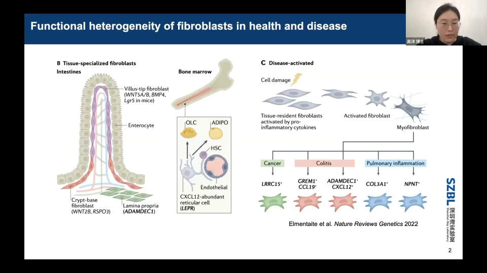
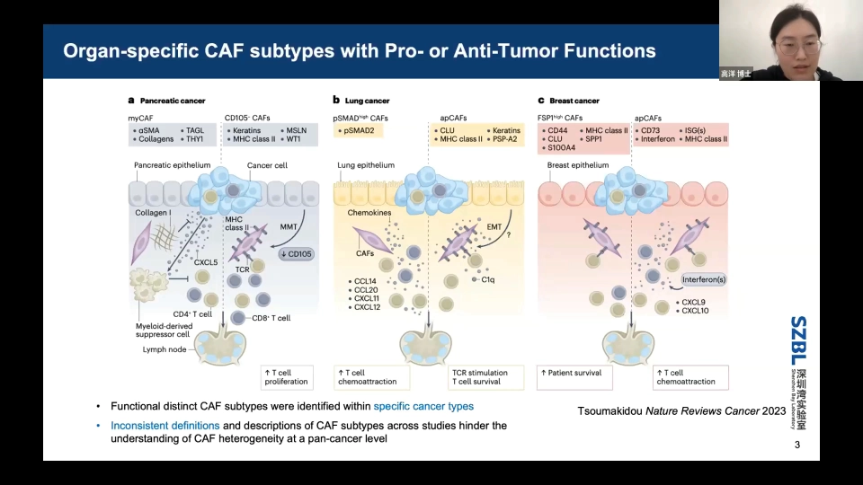
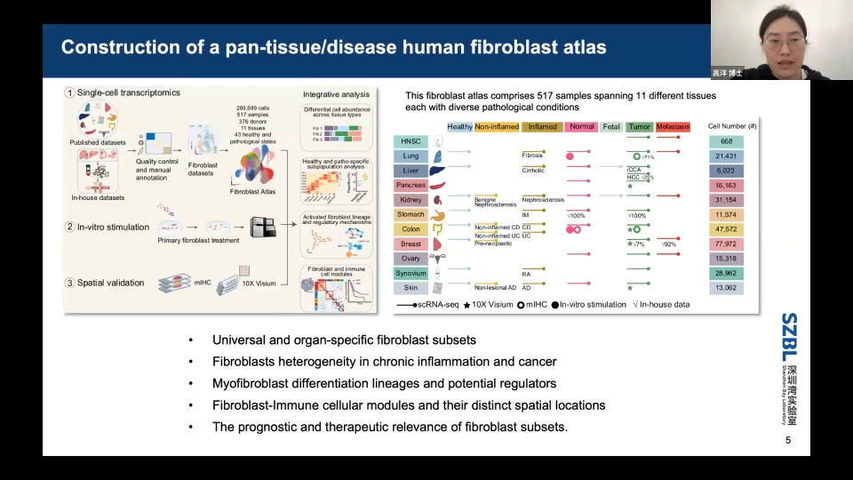
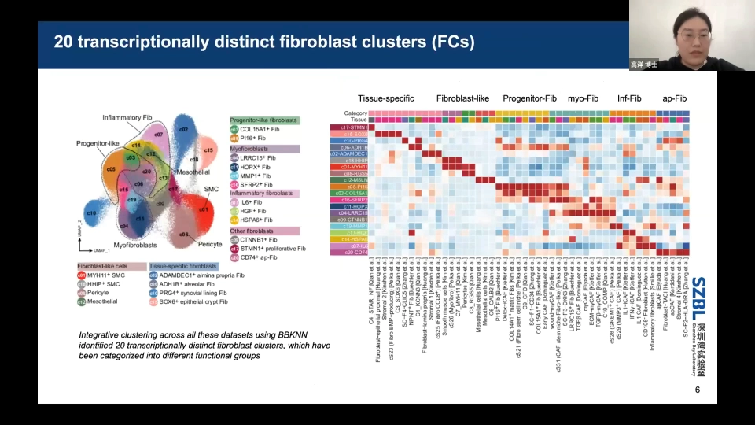
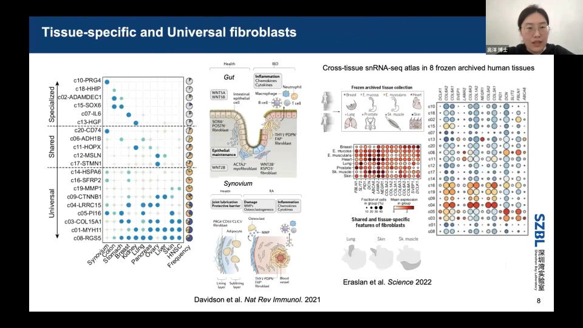
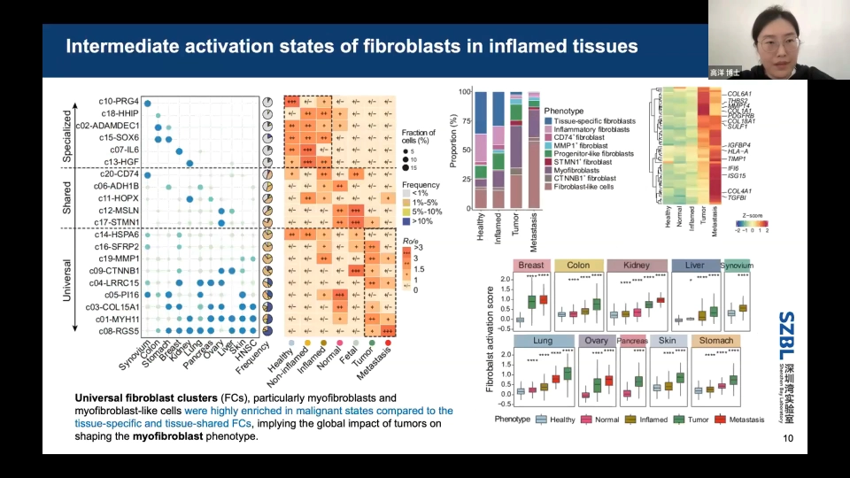
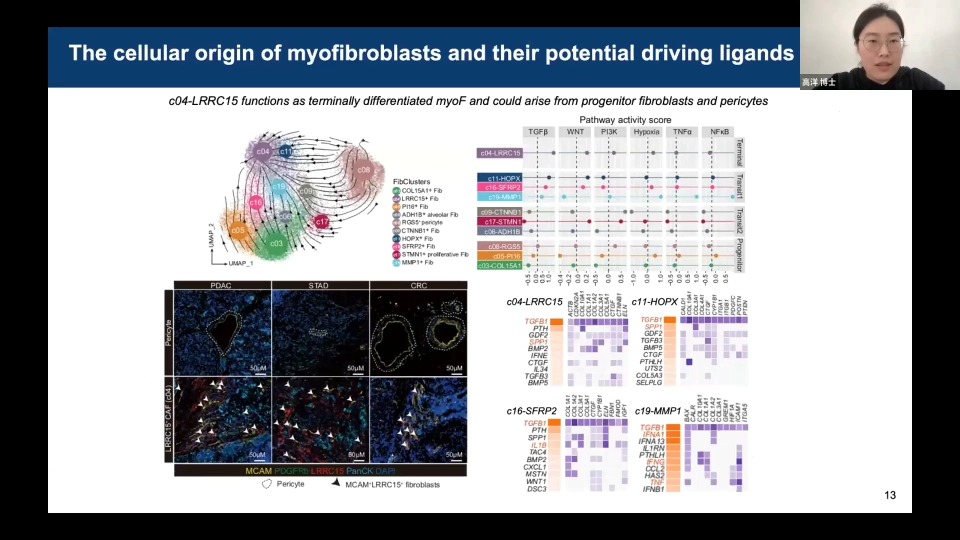
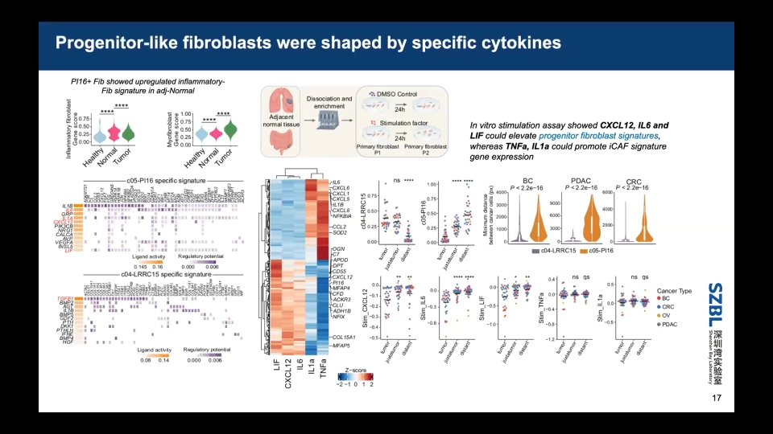
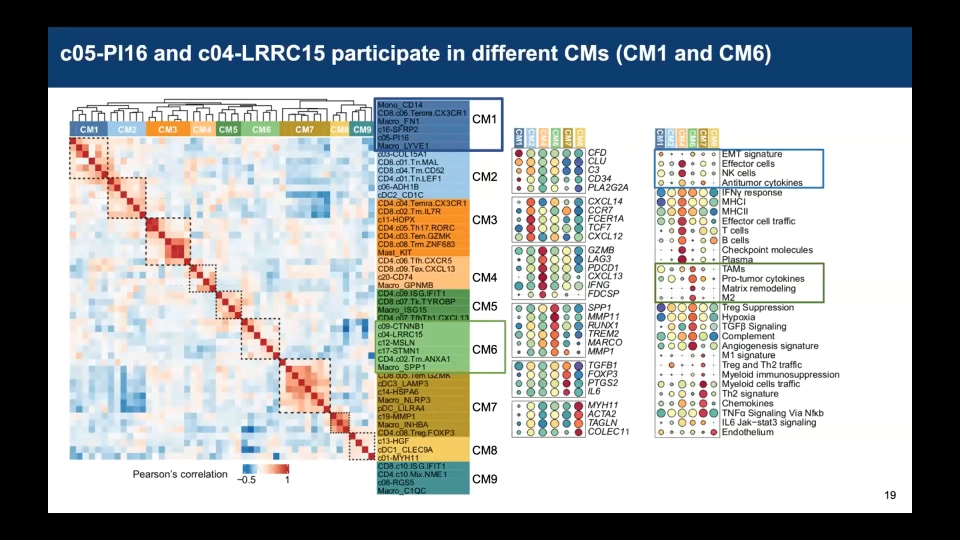

# 泛组织成纤维细胞图谱：同一个"成纤维细胞"名字下，藏着 20 种不同的细胞

> 视频来源：[Cancer Cell一作面对面｜单细胞多组学整合分析揭示成纤维细胞泛组织功能异质性图谱](https://www.bilibili.com/video/BV1LtBNYCE76/)（Bilibili · 百奥智汇 · 主讲：高阳，深圳湾实验室肿瘤所）｜时长约 33 分钟
> 简要导读：这是一篇 *Cancer Cell* 论文的一作报告。本文不逐条复述实验细节，而是顺着"**覆盖范围决定问题域**"这条线，看一张跨 11 个组织、多种疾病状态、517 个样本的图谱，如何在"跨组织"和"跨细胞类型"这两个维度上换来新的问题，又付出了什么代价。

## 本讲要解决的核心问题（SCQA）

**背景**：成纤维细胞（fibroblast）是几乎所有实体组织里都有的基质细胞，负责分泌胞外基质、支撑组织结构。过去十年，单细胞测序已经在很多**单个器官、单个癌种**里鉴定出了成纤维细胞的亚型，比如肿瘤里的 iCAF、myCAF、抗原呈递型 CAF。

**冲突**：这些亚型是在各自的"小世界"里定义的。同一个名字（例如"抗原呈递型 CAF"）在不同论文里指向的细胞群可能并不相同，功能描述甚至相反；反过来，同一个细胞群在不同论文里又可能被起了不同的名字。于是当你想问"**这个亚型是不是所有组织里都有**""**它在炎症和癌症里是不是同一种东西**"时，单组织数据根本回答不了。

**疑问**：把几十个数据集拼成一张**跨组织、跨疾病**的图谱，能不能把"组织特异性"和"疾病诱导"这两类异质性拆开？拼接之后，哪些结论变强了，哪些结论反而变弱了？

**回答（中心思想）**：这张图谱给出的答案是——**跨组织汇总把成纤维细胞拆成了"组织特异 / 组织间共享 / 泛组织"三层，并且证明同一个亚型在不同疾病状态下分子特征也会改变**；但代价是，"组织"与"解离方案""疾病分期""注释粒度"这些因素被混在一起，跨组织比较得到的所有差异都必须带着这份"混淆清单"来读。

## 一、为什么"跨组织"是这张图谱的第一个设计决定

讲者在背景部分先给了两个来源：成纤维细胞的异质性来自**组织特异性**和**疾病诱发**两条线 [【跳转到 01:09】](https://www.bilibili.com/video/BV1LtBNYCE76/?t=69)。

- 组织特异性：小肠隐窝底部、绒毛顶端、固有层各有自己的成纤维细胞；骨髓里有高表达 CXCL12 的网状细胞，可以进一步分化为脂肪细胞和破骨细胞。它们的表达特征反映的是"这个器官需要什么"。
- 疾病诱发：正常成纤维细胞在细胞因子、缺氧、机械应力刺激下转向疾病表型，比如肠炎里表达 CCL19 的成纤维细胞、癌症里 LRRC15 阳性的肌成纤维细胞。

这两条线在单个组织里是**纠缠**的：你在一份肿瘤样本里看到的差异，既可能是"这个器官本来就特殊"，也可能是"这个器官的肿瘤恰好诱导了这种状态"。要拆开它们，唯一的办法是**在同一套分析里同时跨多个组织、跨多个疾病状态取样**——这正是"覆盖范围"决定"问题域"的地方。

而促使作者动手的直接动机，是**定义的不一致**：同一种分子表型的亚型，在不同癌症里被描述成不同作用；这种不一致让"泛癌种、泛组织"层面的比较无法进行 [【跳转到 03:39】](https://www.bilibili.com/video/BV1LtBNYCE76/?t=219)。

这张幻灯片其实是本小节要讲的核心困难的一个具体版本：**"细胞类型"不是客观给定的类别，而是注释粒度的产物**。胰腺癌的 myCAF、肺癌的 apCAF、乳腺癌的 FSP1hi CAF，是按不同研究各自的 marker 组合切出来的，把它们放进同一张表里，要么全部粗化（丢失信息），要么保留细粒度（产生大量空标签）。这张图谱选择的是第三条路：**先统一重聚类，再回头对照旧名字**。

## 二、517 个样本、11 个组织：覆盖范围是怎么写进数据结构的

图谱的构建分三块 [【跳转到 06:14】](https://www.bilibili.com/video/BV1LtBNYCE76/?t=374)：

1. **单细胞转录组**：公共数据 + 自产数据，共 517 个样本、11 个组织、289,895 个细胞，覆盖健康、非炎症、炎症、正常、胎儿、肿瘤、转移等多种病理状态；
2. **体外刺激**：用原代成纤维细胞做配体刺激实验，验证计算预测；
3. **空间验证**：多重免疫组化（mIHC）与 10x Visium 空间转录组。

注意这张图的读法：它不是一个"细胞数排行榜"，而是一张**问题域的清单**。皮肤、肺、肝、胰腺、肾、胃、结肠、乳腺、卵巢、滑膜、骨骼肌——每个组织下面挂着它能提供的疾病状态。**某个组织只提供了健康样本，你就不能在这个组织里问"癌症如何改变它"**。这就是"图谱的边界不是数据量，而是它跨了几个维度"的最直白体现。

同时，这张图也暴露了跨组织比较的第一个技术陷阱：11 个组织的样本来自不同研究、不同建库方案、不同测序深度，**每个细胞的 UMI 数分布差异很大**，组织之间"细胞类型比例"的差异里，天然混着一层技术差异。

## 三、20 个亚型：稀有群体只有靠跨样本汇总才凑得出来

整合聚类得到 20 个转录组上可区分的成纤维细胞 cluster（FC），再按表达特征与已知 marker 归成几个功能大类 [【跳转到 06:35】](https://www.bilibili.com/video/BV1LtBNYCE76/?t=395)：

- 已知亚型：PI16 阳性成纤维细胞、LRRC15 阳性肌成纤维细胞；
- 新描述的亚型：肌成纤维细胞里的 HOPX 阳性、MMP1 阳性、SFRP2 阳性群体；
- 其他：COL15A1 阳性、CD74 阳性抗原呈递型、STMMN1 阳性增殖型等。

这里值得停下来想一件事：**HOPX 阳性、MMP1 阳性这些亚型，为什么以前没被充分描述？** 不是因为它们不存在，而是因为它们**在每个单独的组织里细胞数太少**，落在聚类的最小阈值之下，被并进了邻近的大群。跨组织汇总的直接收益，就是把这些稀有群体的细胞数"凑够"，让它们从噪声变成可分析的 cluster。

这就是"跨细胞类型"维度真正的价值：**它不是让你多认识几个细胞，而是让原本统计上不可见的细胞变得可见**。代价随之而来——20 个 cluster 的切分粒度是人为选定的，换一套参数可能得到 17 个或 24 个；作者用不同整合方法验证了分类的鲁棒性 [【跳转到 07:30】](https://www.bilibili.com/video/BV1LtBNYCE76/?t=450)，但"20"这个数字本身仍然是一次**粒度选择**，不是一个自然常数。
## 四、三类分布：组织特异、组织间共享、泛组织

拿到亚型之后，作者按"这个亚型出现在几个组织里"把 20 个 cluster 分成三层 [【跳转到 07:45】](https://www.bilibili.com/video/BV1LtBNYCE76/?t=465)：

| 层次 | 含义 | 例子 |
| --- | --- | --- |
| 组织特异（tissue-specific） | 只在少数组织出现，标记该器官特有的功能 | 肠道 ADAMDEC1、SOX6；滑膜 PRG4（润滑关节） |
| 组织间共享（shared） | 在部分组织共享 | HOPX、SFRP2、MMP1 等 |
| 泛组织（universal） | 几乎所有组织都有 | 肌成纤维细胞及其前体、平滑肌细胞、周皮细胞 |

"泛组织"这一层里，占比最大的是肌成纤维细胞及其前体，以及类似肌成纤维细胞的其他基质细胞（平滑肌细胞、周皮细胞）[【跳转到 08:10】](https://www.bilibili.com/video/BV1LtBNYCE76/?t=490)。作者还做了一次外部校验：把结果与一篇包含八个人体组织的成纤维细胞图谱比较，两者共享的基因集主要落在 universal cluster 上 [【跳转到 09:00】](https://www.bilibili.com/video/BV1LtBNYCE76/?t=540)。

这张图是本小节最该记住的一张：**它把"跨组织"这件事变成了一个可读的矩阵**。纵轴从上到下就是"组织特异性递减"，横轴从左到右是器官。你可以在同一张图上同时读到两件事——某个亚型只亮一列（组织特异），某个亚型整行都亮（泛组织）。

转录因子调控网络也支持这个分层：组织特异亚型靠上调特定转录因子维持功能，例如 SOX6 通过 FOXL1 调控 WNT 等通路促进表皮细胞分化与稳态；跨组织亚型则下调这些组织特异程序，转而依赖维持前体状态的转录因子，例如 FOXP2 上调 CD34、CD55 等干性相关基因 [【跳转到 10:02】](https://www.bilibili.com/video/BV1LtBNYCE76/?t=602)。

**但要留一个心眼**：这张点图里"组织特异"的信号，同样可能是"解离方案特异"的信号。不同组织的组织解离方式不同（酶解 vs 机械解离），会诱导不同的应激基因；不同组织的细胞大小与 RNA 含量不同，也会改变检出灵敏度。**"组织"与"解离方案"在这类跨组织图谱里是混淆在一起的**，几乎无法完全分开——这是读任何跨组织图谱时都要带着的免责声明。

## 五、跨疾病状态：同一个 cluster 的分子特征也会变

把亚型按疾病状态（健康 / 非炎症 / 炎症 / 正常 / 胎儿 / 肿瘤 / 转移）拆开看，出现了一个很干净的规律 [【跳转到 10:15】](https://www.bilibili.com/video/BV1LtBNYCE76/?t=615)：

- **组织特异亚型**主要在正常、非炎症或部分炎症样本中富集；
- **泛组织亚型**（尤其肌成纤维细胞）主要在恶性状态（癌症、转移）中富集；
- 炎症与癌旁组织处在中间状态。

作者据此定义了"成纤维细胞活化（activation）"基因集并打分：健康样本分数最低，肿瘤与转移最高，炎症与正常/癌旁居中 [【跳转到 11:05】](https://www.bilibili.com/video/BV1LtBNYCE76/?t=665)。这条连续谱的含义是：**炎症可能把成纤维细胞重塑成一个"癌前（precancerous）"状态**，癌症则把它推到谱的末端。

更进一步，作者还比较了**同一个 cluster 在炎症与肿瘤中的分子特征**：在炎症中，同一 cluster 更高地上调促炎基因；在肿瘤中则下调促炎因子、转而激活抑炎与组织重塑相关基因，信号通路明显切换，代谢上激活糖酵解与缺氧通路 [【跳转到 12:00】](https://www.bilibili.com/video/BV1LtBNYCE76/?t=720)。

这一点对"可比性"很重要：**跨疾病比较时，差异既可能来自细胞组成变化（哪些亚型变多了），也可能来自同一群细胞的表达状态变化**。把这两者分开统计，才不会把"组成"误读成"状态"。

## 六、肌成纤维细胞：四群亚型、两条来源、一套保守的调控因子

肌成纤维细胞是泛组织那一层里最重要的功能群体，作者把它拆成四群 [【跳转到 13:02】](https://www.bilibili.com/video/BV1LtBNYCE76/?t=782)：

- **C04 / LRRC15 阳性**：胞外基质基因表达最高，WNT 通路明显上调，处于终末分化状态；
- **C19 / MMP1 阳性**：虽然是肌成纤维细胞，但表现出明显的炎性特征（高表达 SOX 家族与 TWIST1），调控网络呈缺氧诱导趋势；
- **C11 / HOPX 阳性**、**C16 / SFRP2 阳性**：另外两群功能各异。

谱系分析给出两条来源路径：终末分化的 LRRC15 阳性肌成纤维细胞，可以来自前体细胞（PI16 阳性、COL15A1 阳性）或周皮细胞；随着谱系推进，TGF-β、WNT 等通路活性逐渐增强 [【跳转到 13:57】](https://www.bilibili.com/video/BV1LtBNYCE76/?t=837)。多重免疫组化在肿瘤血管周围找到了具有周皮细胞特征的 LRRC15 阳性成纤维细胞，支持这条来源。

NicheNet 分析给出上游配体：TGF-β 排在第一位（符合既有认知），此外 SPP1 对 LRRC15 阳性与 HOPX 阳性亚型有促进作用，IL-1β 与干扰素家族则对应 SFRP2 阳性、MMP1 阳性亚型 [【跳转到 14:47】](https://www.bilibili.com/video/BV1LtBNYCE76/?t=887)。这说明**同一类细胞在不同细胞因子组合下会被诱导成不同的功能亚型**。

最值得注意的是转录因子这一步：在 LRRC15 阳性成纤维细胞中高表达或高激活的转录因子，**在不同组织里呈现比较保守的上调趋势**，它们通过 FAP、AEBP1、RUNX1 等靶基因推动 CAF 转化；其中 SOX4 已知通过染色质重塑机制影响这一转化 [【跳转到 15:34】](https://www.bilibili.com/video/BV1LtBNYCE76/?t=934)。

"跨组织保守"这四个字，正是跨组织图谱能给出的、单组织数据给不出的结论：**它把"这是某个器官的特例"和"这是肌成纤维细胞转化的通用程序"区分开了**。

## 七、前体细胞：同一类细胞在不同位置的两种命运

两类前体细胞都高表达 DPT 等前体特征基因，但转录特征差别很大：

- **PI16 阳性**：上调缺氧、TNF-α 相关基因，位于血管周围，可能与血管重塑相关；
- **COL15A1 阳性（C03）**：上调基底膜、组织再生、增殖与脂肪生成相关基因，促进上皮重塑，位置靠近上皮细胞。

有意思的是它们的**疾病分布与肌成纤维细胞相反**：这两群前体细胞在癌旁富集，在正常和癌症中分布较少 [【跳转到 18:04】](https://www.bilibili.com/video/BV1LtBNYCE76/?t=1084)。进一步分析发现，PI16 阳性细胞在癌旁上调 iCAF 标志物、下调 myCAF 标志物 [【跳转到 19:37】](https://www.bilibili.com/video/BV1LtBNYCE76/?t=1177)，作者猜测这是"癌症远端的炎症信号诱导"的结果，而靠近癌细胞的区域被 TGF-β 浓度梯度抵消，于是转向 myCAF。

NicheNet 比较也支持这个解释：C05（PI16 阳性）的上游刺激因子主要是炎症因子（IL-6、IL-1α、CXCL12、LIF），而 C04 的则是 TGF-β 一类 [【跳转到 20:02】](https://www.bilibili.com/video/BV1LtBNYCE76/?t=1202)。

体外配体刺激实验把这条推断做实了：IL-1α 与 TNF-α 明显上调促炎程序（IL-6、IL-1B 等），CXCL12、IL-6、LIF 则上调 PI16、DPT 等前体特征 [【跳转到 20:52】](https://www.bilibili.com/video/BV1LtBNYCE76/?t=1252)。

空间转录组进一步把预测映射回切片：C05 明显远离癌细胞区域，而筛选出的几个细胞因子信号随"远离癌组织"逐渐增强，两个促炎信号则没有这个趋势 [【跳转到 22:07】](https://www.bilibili.com/video/BV1LtBNYCE76/?t=1327)。**同一个细胞类型，在同一个器官里因为空间位置不同而走上不同命运**——这是"跨组织"之外的另一层坐标。

## 八、落到临床：亚型组成能分型，也能预测预后

把成纤维细胞亚型组成拿去做患者分型，得到四类，其中最主要的两类 [【跳转到 22:54】](https://www.bilibili.com/video/BV1LtBNYCE76/?t=1374)：

- **肌成纤维细胞主导型**（C04 高、progenitor 少）：预后明显更差，无论单癌种还是跨癌种；
- **前体细胞主导型**（progenitor 多、肌成纤维细胞少）：预后相对更好。

TCGA 数据显示两群病人在 T 细胞浸润、抗肿瘤细胞因子表达上也有差异，说明成纤维细胞组成通过免疫微环境影响预后。

再往下一层，作者把成纤维细胞与之前发表的 T 细胞、髓细胞数据做空间标签映射，鉴定出**九个细胞群落（community）** [【跳转到 24:15】](https://www.bilibili.com/video/BV1LtBNYCE76/?t=1455)：

- PI16 阳性成纤维细胞与 CX3CR1 阳性肿瘤相关巨噬细胞、CD14 单核细胞、LYVE1 阳性巨噬细胞共处一群，对应抗肿瘤免疫特征；
- LRRC15 阳性成纤维细胞与 SPP1 阳性巨噬细胞共处 CM6，缺乏 T/B 细胞信号，表现为**免疫排斥生态位**；
- MMP1 阳性成纤维细胞与 Treg、LAMP3 阳性 DC、pDC、炎性巨噬细胞共处 CM7，表现为**免疫抑制生态位**。

基于 CellPhoneDB 的配体—受体分析给出群落内部的工作机制，例如 C05 通过 ACKR3、ACKR4 与巨噬细胞分泌的 CXCL12、CCL5 互作促进免疫细胞迁移 [【跳转到 25:39】](https://www.bilibili.com/video/BV1LtBNYCE76/?t=1539)；C04 通过 ADAM 类分子、SDC4、ITGB1 与 SPP1 阳性巨噬细胞互作。体外共培养实验验证了 MMP1 成纤维细胞能招募 Treg [【跳转到 28:40】](https://www.bilibili.com/video/BV1LtBNYCE76/?t=1720)。

最后，免疫排斥与免疫抑制这两群成纤维细胞，在多个癌种的免疫治疗数据里都与 **ICB 治疗不响应**相关 [【跳转到 29:05】](https://www.bilibili.com/video/BV1LtBNYCE76/?t=1745)——这也是"泛组织"结论的实用价值：**同一个生态位机制在多个癌种里重复出现，才值得当作靶点**。

## 小结

- **覆盖范围决定问题域**：只有在同一套分析里同时跨 11 个组织、跨多种疾病状态取样，"组织特异"与"疾病诱导"这两类异质性才可能被拆开；单组织数据连"这个亚型是否普遍"都问不出来。
- **跨细胞类型汇总让稀有群体变得可见**：HOPX 阳性、MMP1 阳性这些亚型在单组织里细胞数不足，跨样本汇总后才够格成为独立 cluster；但"20 个亚型"本身是一次粒度选择，不是自然常数。
- **跨组织带来三层结构**：组织特异（ADAMDEC1、SOX6、PRG4）/ 组织间共享 / 泛组织（肌成纤维细胞及前体、平滑肌、周皮细胞），并给出"跨组织保守的调控因子"这类单组织数据无法给出的结论。
- **跨疾病带来一条连续谱**：健康 → 炎症/癌旁 → 肿瘤/转移，成纤维细胞活化分数单调上升；炎症可能是通往"癌前状态"的中间站。
- **可比性代价必须写进结论**：跨组织比较里"组织"与"解离方案"混淆；跨疾病比较里"组成变化"与"状态变化"要分开统计；跨研究比较里"注释粒度不一致"会让同名亚型并非同物。
- **一句话收束**：图谱的边界不是数据量，而是它跨了几个维度、每个维度跨得多干净。这张图谱跨了组织和疾病两个维度，把成纤维细胞从"一个细胞类型"变成了"一个受组织和疾病共同塑造的状态谱"。

## 关键术语速查

| 术语 | 一句话解释 |
| --- | --- |
| fibroblast（成纤维细胞） | 结缔组织里的基质细胞，负责分泌胶原等胞外基质、支撑组织结构 |
| myofibroblast（肌成纤维细胞） | 获得收缩能力的活化成纤维细胞，是伤口愈合与纤维化的主力，肿瘤里多为促肿瘤表型 |
| CAF | cancer-associated fibroblast，肿瘤相关成纤维细胞，肿瘤微环境中的成纤维细胞总称 |
| iCAF / myCAF / apCAF | 三种经典 CAF 亚型：炎性型（iCAF）、肌成纤维型（myCAF）、抗原呈递型（apCAF） |
| tissue-specific / shared / universal | 按"出现在几个组织里"划分的三层分布：组织特异、组织间共享、泛组织 |
| dissociation bias（解离偏差） | 组织解离方式（酶解、机械）不同会诱导不同的应激基因表达，使跨组织比较混入技术差异 |
| annotation granularity（注释粒度） | 同一群细胞被切多细是人为选择；粒度不一致会让"同名亚型"并非同一群细胞 |
| NicheNet | 用配体—受体—下游靶基因的先验网络，从表达数据推断"哪些配体在驱动目标细胞的表达程序" |
| CellPhoneDB | 基于配体—受体对的细胞通讯分析工具，用于判断哪些细胞群之间可能存在信号交流 |
| community（细胞群落） | 在空间上反复共定位的一组细胞类型，是"生态位"在数据上的近似 |
| ICB 治疗 | immune checkpoint blockade，免疫检查点阻断疗法；不响应常与免疫排斥/免疫抑制生态位相关 |
