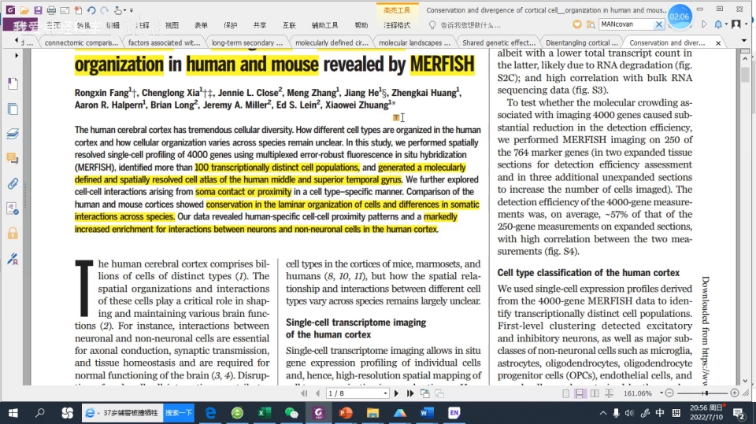
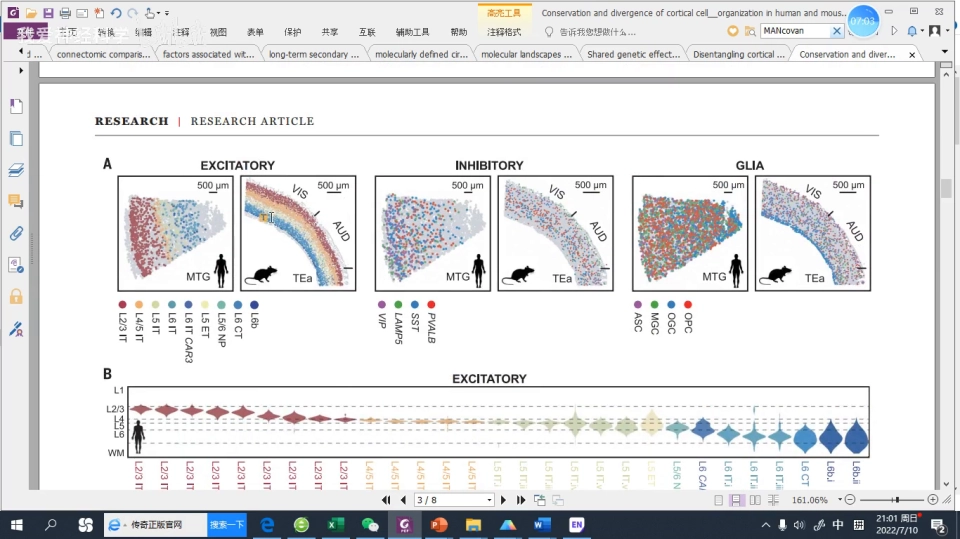
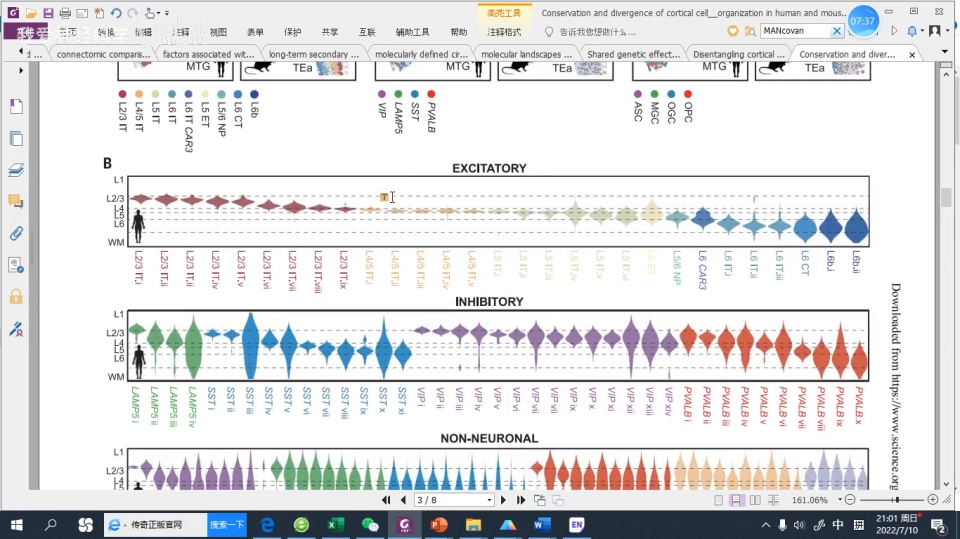
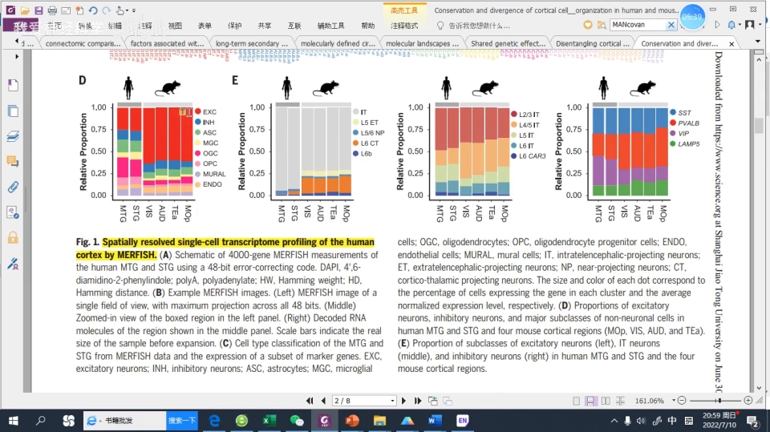
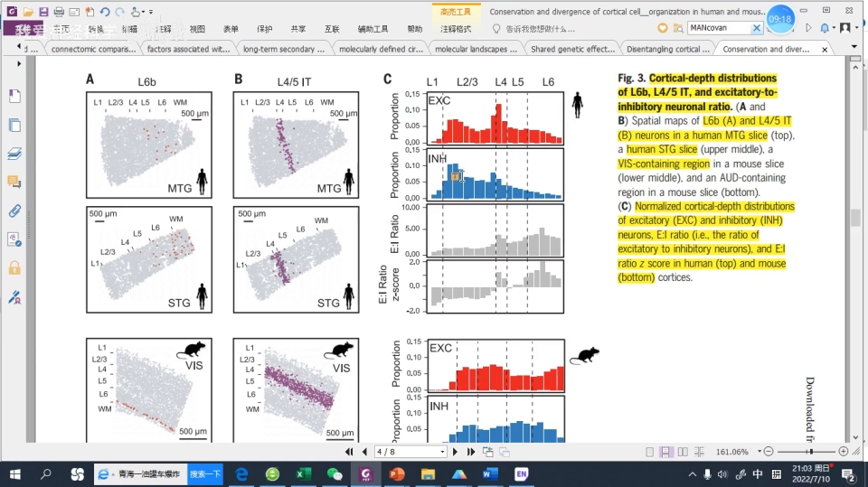
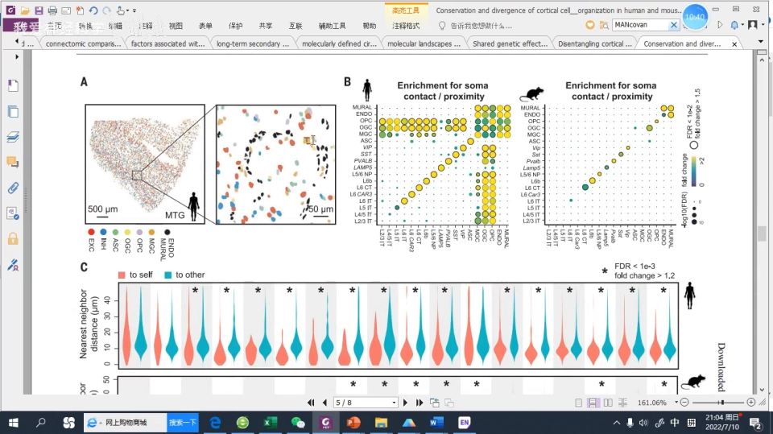
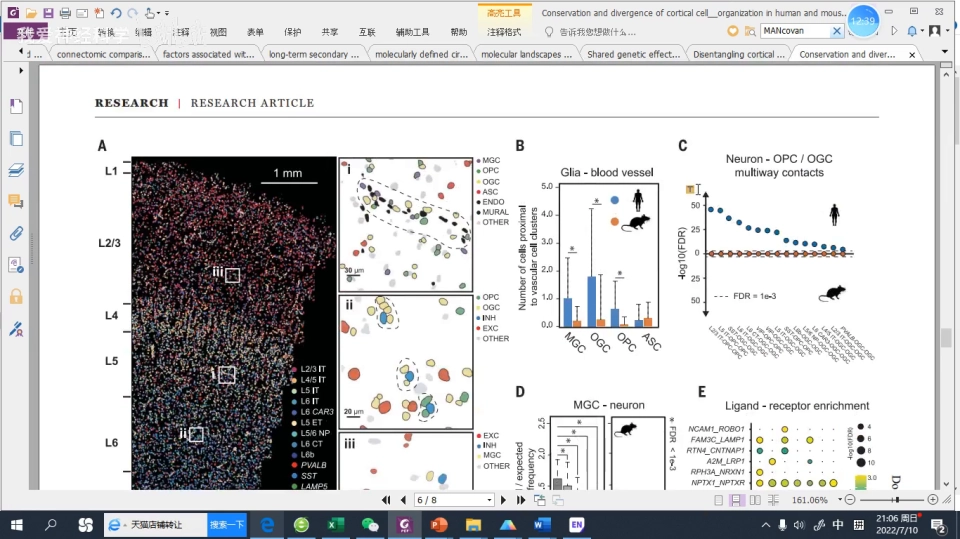
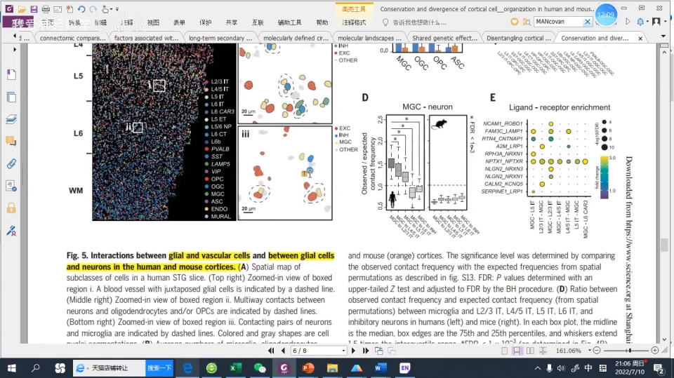

# 跨物种比较：哪些结论能从小鼠推给人，哪些不能

> 视频来源：[Science封面：MERFISH 揭示人类和小鼠大脑皮层细胞组织模式的保守性和差异性](https://www.bilibili.com/video/BV1NB4y1p7cF/)（Bilibili · 奇异脑博士）｜时长约 15 分钟
> 简要导读：本文是对 *Science* 论文《Conservation and divergence of cortical cell organization in human and mouse revealed by MERFISH》的逐图解读。视频里讲者边看论文截图边讲，本文按"**跨物种比较能得出什么、代价是什么**"重新组织：先看哪些结论是保守的，再看哪些是物种特异的，最后看这两类结论各自依赖什么前提。

## 本讲要解决的核心问题（SCQA）

**背景**：小鼠是神经科学最常用的模式生物。人类大脑皮层拿不到那么多新鲜样本，很多研究只能在小鼠里做，再把结论推给人。这个"推"的动作，默认了一个前提：**人和小鼠的皮层在细胞层面是可比的**。

**冲突**：人类皮层有极大的细胞异质性，细胞类型上百种；而"细胞类型在皮层里怎么组织""这种组织模式跨物种差多少"，一直不清楚。更麻烦的是，过去跨物种比较大多只比"有哪些细胞类型、各占多少比例"，很少比**空间位置**和**细胞间相互作用**——因为普通单细胞测序把位置信息丢掉了。

**疑问**：如果能把基因表达连同空间位置一起测出来，人和小鼠的皮层在哪些层面是一致的，在哪些层面是分化的？

**回答（中心思想）**：这项研究给出的答案是——**层状组织（laminar organization）是保守的，而细胞间相互作用是分化的**。也就是说，"皮层分成 L1–L6、某类神经元住在某一层"这个骨架可以跨物种迁移；但"哪些细胞挨着哪些细胞、彼此作用多强"这类结论不能直接迁移，人类在这方面的复杂度明显更高。

## 一、先看方法：为什么这项研究能问"空间"这件事

MERFISH 本质上是**荧光原位杂交**：用带荧光的探针直接在组织切片里把 mRNA 分子"点亮"，再逐轮成像、逐轮解码，从而在**保留位置的前提下**读出每个细胞里几千个基因的表达量 [【跳转到 00:52】](https://www.bilibili.com/video/BV1NB4y1p7cF/?t=52)。

这项研究的技术参数是：**4000 个基因**、覆盖人的颞中回与颞上回（middle and superior temporal gyrus），鉴定出 **100 种以上**转录组上不同类型的细胞 [【跳转到 01:42】](https://www.bilibili.com/video/BV1NB4y1p7cF/?t=102)。它跟普通 scRNA-seq 的关键差别在于：普通测序要先解离组织，细胞一散开，位置就没了；MERFISH 不解离，切片上的坐标原样保留。

这也正是"跨物种比较"能升级的前提：**只有当两个物种的数据都在同一类坐标系（切片 + 层级深度）里，你才能比较"组织模式"而不只是"细胞比例"**。

## 二、保守的部分：层状骨架

先说结论里最稳的一条：人和小鼠的皮层细胞都呈现明显的**层状分布**。某种细胞类型主要住在这一层，另一种住在那一层，相同类型的细胞倾向于聚集在同一层，而不是随机撒开——这就是 laminar organization [【跳转到 06:29】](https://www.bilibili.com/video/BV1NB4y1p7cF/?t=389)。

这张图是全文的骨架图，读法分两层：

- **上排（空间图）**：颜色代表细胞亚型，可以直接看出"带状"结构——不同亚型占据不同深度；
- **下排（深度分布）**：把空间图压成一维的"深度—丰度"曲线，人和小鼠可以逐层对照。

从图上还能读出一个跨物种一致、但类型之间有差别的规律：

- **兴奋性神经元**的层状结构最明显（L2/3、L4、L5、L6 各有自己的 IT/ET 亚型）；
- **抑制性神经元**分布更均匀，SST、PV、VIP 等类型在多个层都能看到，层特异性较低 [【跳转到 07:04】](https://www.bilibili.com/video/BV1NB4y1p7cF/?t=424)；
- **非神经元细胞**（星形胶质、小胶质、少突胶质、OPC、内皮等）在每一层都有，分布最广泛、特异性最低 [【跳转到 08:16】](https://www.bilibili.com/video/BV1NB4y1p7cF/?t=496)。

这张小提琴图把"层特异性"量化了：每一条小提琴的宽度表示该亚型在对应深度的细胞比例，形状越集中在一层，层特异性越强。兴奋性神经元那一块几乎条条都窄而集中；抑制性神经元那一块上下更分散；非神经元那一块则几乎铺满 L1 到白质。

换句话说，**"层状组织"这个结论的保守性，在兴奋性神经元上最强，在非神经元细胞上最弱**。这提醒我们：说"某结论跨物种保守"时，必须说清是**哪个细胞类别**上的保守。

## 三、不保守的部分之一：细胞比例与 E/I 比

把空间信息压成"每层各类细胞占多少"，人和小鼠的差别就显出来了 [【跳转到 05:40】](https://www.bilibili.com/video/BV1NB4y1p7cF/?t=340)。

具体差异有两条：

1. **深度分布的峰形不同**。人类的兴奋性神经元比例沿深度呈现**双峰**——一个峰在 L2/3 附近，一个在 L4/L5 附近；小鼠则更接近**平台**，中间只有一个浅凹陷，变化幅度（variation）比人小得多 [【跳转到 09:19】](https://www.bilibili.com/video/BV1NB4y1p7cF/?t=559)。
2. **E/I 比不同**。兴奋性/抑制性神经元比例（E/I ratio）在小鼠里比人类更大 [【跳转到 10:21】](https://www.bilibili.com/video/BV1NB4y1p7cF/?t=621)。

这两条差异的意义在于：**它们是"比例"层面的差异，而不是"有没有"层面的差异**。人和小鼠都有 L2/3、L4、L5 的兴奋性神经元，但它们在深度上的分布形状和兴奋/抑制平衡不一样。所以任何"按比例"做的推论——比如"某层里抑制性输入占多少"——都不能直接跨物种套用。

## 四、不保守的部分之二：细胞间相互作用

这项研究最想强调的差异在**细胞间相互作用**上。做法是：在空间里找"哪些细胞挨着哪些细胞"，统计每对细胞类型的**近邻接触频率**，再与"按空间位置随机打乱后的期望频率"比较，得到富集程度 [【跳转到 10:41】](https://www.bilibili.com/video/BV1NB4y1p7cF/?t=641)。

矩阵的读法是：对角线附近偏红表示"同类相聚"，远离对角线偏蓝表示"互相回避"。视频里讲者特别提到两个现象：

- **to other 强于 to self**：很多细胞类型与其他类型细胞的接触显著多于与自身同类细胞的接触 [【跳转到 11:21】](https://www.bilibili.com/video/BV1NB4y1p7cF/?t=681)；
- **人类整体更"富集"**：同样的细胞对，在人类里富集更明显、组合更多，小鼠里也有，但复杂度和富集程度都更低 [【跳转到 12:29】](https://www.bilibili.com/video/BV1NB4y1p7cF/?t=749)。

具体到细胞对上，差异集中在两类：

1. **胶质细胞—血管**：人类的胶质细胞与血管之间的相互作用显著多于小鼠 [【跳转到 12:40】](https://www.bilibili.com/video/BV1NB4y1p7cF/?t=760)；
2. **神经元—OPC/Oligo**：人类里 neuron 与 OPC 之间的相互作用远多于小鼠 [【跳转到 13:05】](https://www.bilibili.com/video/BV1NB4y1p7cF/?t=785)。

这张图还给出了一个"从接触到机制"的桥：右下角的配体—受体富集分析，把"细胞挨得近"进一步解释成"可能通过哪些分子对在通信"。

这张图值得单独看，因为它把"差异"做成了可比较的数字：**同一个统计口径下，人类胶质细胞与血管的接触数量明显高于小鼠**，而小胶质与神经元的接触比在人和小鼠之间也有系统性偏移。跨物种比较的结论要硬，就得是这样"同口径、同统计量"的对比，而不是各自看图说话。

**为什么这条差异值得单独拿出来讲？** 因为它是**跨物种比较里最容易被忽略、又最容易被误用**的一类结论。细胞类型清单可以跨物种对齐（都有 OPC、都有小胶质），但"这些细胞彼此之间有多亲密"是另一层信息。这一层在人类里明显更复杂，意味着**用小鼠的微环境组织方式去推断人的微环境，风险很大**。

## 五、这项研究在跨物种比较的"可比性阶梯"上站在哪一级

把这项研究和普通跨物种比较放在一起看，它其实做对了几件事，也留下了几处必须在结论里标注的限制。

**做对的部分**：

- 用**同一套技术、同一块基因面板**测两个物种，把"技术差异"这一项压到了最低——这是跨物种比较里最容易被技术噪声毁掉的一环；
- 用**空间坐标**而不是细胞比例做比较，让"组织模式"这个更抽象的层面变得可比；
- 把"保守"和"分化"分开陈述，而不是笼统地说"人和小鼠相似/不同"。

**必须标注的限制**：

1. **基因面板本身就是一次同源映射选择**。4000 个基因的面板要同时测人和小鼠，能进面板的必然是两物种都拿得到探针、且能对上同源关系的基因（ortholog）。也就是说，**这一步已经排除了大量物种特异的基因**——凡是被排除的基因，其表达差异在这项研究里天然看不见。这个取舍视频没有展开，但从面板设计可以直接推出来，读结论时应当记住。
2. **细胞类型对齐靠 marker 与形态，而不是唯一正确的标准**。人和小鼠的细胞类型命名体系并不统一，同一个名字（比如某种 IT 神经元）指的不一定是严格对应的群体；跨物种的"同类型"判断，本身带着一层注释粒度上的不确定性。
3. **取样范围有限**。研究只覆盖颞中回、颞上回（人）与几个小鼠皮层区域，且**发育阶段与年龄难以对齐**——小鼠很少做人类那样的年龄段取样。所以"保守"这个结论的适用范围，是"这两个区域、这个年龄段"，不是"整个皮层、整个生命周期"。
4. **样本量与个体差异**。跨物种差异的效应量，必须和物种内部的个体差异放在一起看才有意义；否则容易把个体差异读成物种差异。

## 六、这项研究补上了过去比较缺的那一块

讲者在结尾做了一个很关键的定位 [【跳转到 13:57】](https://www.bilibili.com/video/BV1NB4y1p7cF/?t=837)：过去一些研究揭示的人鼠差异，更多集中在**中间神经元（interneuron）**上；而这项研究揭示的是另外两块——

- **细胞与细胞之间相互作用的差异**；
- **细胞在皮层不同 layer 上分布的差异**。

这个定位本身就是"跨物种比较"这件事的方法论示范：**同一个问题（人和小鼠差在哪），换一个测量维度（从"有哪些细胞"换到"细胞怎么排布、怎么接触"），得到的答案会不一样**。所以"跨物种保守性"从来不是一个单一数字，而是**一组按维度分开的结论**——某一维度保守，不代表其他维度也保守。

## 小结

- **跨物种比较的第一道门槛是技术可比性**：同一套 MERFISH、同一块 4000 基因面板，才让"人和小鼠的差异"有机会被归给生物学而不是平台。
- **保守的是骨架**：L1–L6 的层状组织、兴奋性神经元的层特异性，在人和小鼠之间一致；这类结论可以跨物种迁移。
- **分化的是细节**：细胞比例的深度峰形（人双峰、小鼠平台）、E/I 比、以及细胞间相互作用的复杂度，在人和小鼠之间明显不同；这类结论不能直接迁移。
- **"保守"要指明维度**：同一项研究里，层状组织保守、相互作用分化；笼统说"人和小鼠相似"是不成立的。
- **结论的强度取决于两件事**：同源基因映射（哪些基因进了面板）与细胞类型对齐（哪些细胞算"同一种"）。这两步做得越干净，跨物种结论越硬。
- **一句话收束**：跨物种图谱的价值在于**保守性判断**，但它给出的每一个"保守"都必须附带"基于哪套同源映射、比的是哪个维度"。

## 关键术语速查

| 术语 | 一句话解释 |
| --- | --- |
| MERFISH | 多重误差稳健荧光原位杂交，用多轮探针成像在切片上直接读出每个细胞数千个基因的表达，保留空间位置 |
| laminar organization（层状组织） | 皮层从表面到深部依次为 L1–L6，不同细胞类型住在不同层，形成有序的带状结构 |
| 兴奋性 / 抑制性神经元（EXC / INH） | 皮层里两类功能相反的神经元：前者主要投射输出，后者多为局部中间神经元 |
| E/I ratio | 兴奋性神经元与抑制性神经元的比例，反映皮层的兴奋—抑制平衡 |
| ortholog（同源基因） | 不同物种中由同一祖先基因演化而来的对应基因；跨物种比较必须先建立这种对应关系 |
| one-to-many mapping | 一个基因在一个物种里对应另一个物种的多个基因（或反之），是同源映射里最难处理的情形 |
| cell type alignment（细胞类型对齐） | 判断两个物种的哪两群细胞算"同一种类型"，通常依赖 marker 基因与形态学 |
| soma contact / proximity | 胞体接触与近邻关系，是"细胞间相互作用"在空间数据上的可测量代理 |
| OPC / Oligo / MGC / ASC | 少突胶质前体细胞 / 少突胶质细胞 / 小胶质细胞 / 星形胶质细胞，皮层里的主要非神经元细胞 |
| conservation vs divergence | 保守与分化：跨物种比较里两类结论，前者指一致的部分，后者指不同的部分 |