# CellTypist 与 CellHint：让细胞类型标签可迁移、可对齐

> 视频来源：[细胞注释｜CELLTYPIST｜Towards Automated Annotation And Integration Of SC](https://www.bilibili.com/video/BV1VZBbY3ETY/)（Bilibili · MCBRLab 单细胞与空间探索俱乐部）｜时长约 56 分钟
> 导读：这是 CellTypist 与 CellHint 作者 Chuan Xu（剑桥 Teichmann 实验室）的一场技术报告，前半场讲「怎么给一个数据集里的细胞打标签」，后半场讲更难的问题「怎么把不同实验室的标签对到一起」，最后 20 分钟问答把边界条件讲得很清楚。字幕为英文演讲的中文 AI 翻译，术语按上下文还原。

## 本讲要解决的核心问题（SCQA）

**背景**：单细胞实验越做越多，细胞类型的名字也越写越细。每个人拿到自己的数据，都会先聚类、再注释，然后在这套标签上做后续所有分析。

**冲突**：注释这件事本身没有统一答案。同一个群，A 实验室叫 T cell，B 实验室叫 CD8+ T cell，C 实验室叫 effector memory T cell；而当你想把几十个数据集拼成一张图谱时，这些名字必须先对上，否则「合并」只是把不同叫法的同一群细胞并排放着。

**疑问**：能不能让注释这件事既快又一致——快，是不用每个数据集都从头人工看 marker；一致，是不同数据集里的同一类细胞最后能落到同一个名字上？

**回答（中心思想）**：讲者给的答案是两步走。第一步用 **CellTypist** 把「参考图谱」压成一个轻量模型，让标签可以像参数一样被复制到新数据上 [【跳转到 06:54】](https://www.bilibili.com/video/BV1VZBbY3ETY/?t=414)；第二步用 **CellHint** 把各数据集已有的标签互相对齐，建出一张「细胞类型调和图」，再拿它去约束数据整合 [【跳转到 20:31】](https://www.bilibili.com/video/BV1VZBbY3ETY/?t=1231)。贯穿全场的判断是：**注释的瓶颈不在算法，而在参考的质量与标签体系的一致性**。

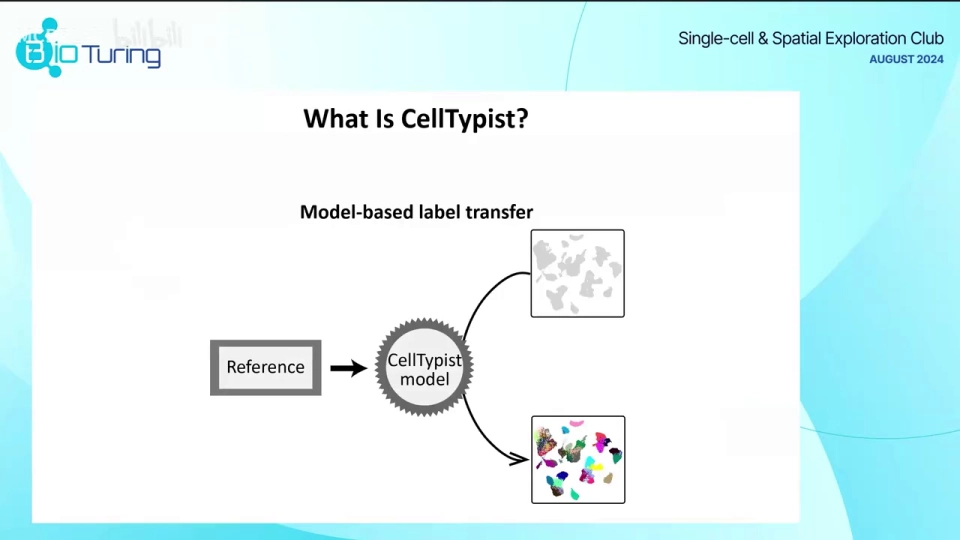

## 一、先看清问题：细胞类型不只是一张清单

### 1.1 细胞图谱要回答的，比「有哪些细胞」多得多

讲者从人类细胞图谱（Human Cell Atlas，2016 年由 Sarah 和 Aviv 发起）讲起 [【跳转到 03:09】](https://www.bilibili.com/video/BV1VZBbY3ETY/?t=189)。他提了一个类比：理解一个器官的第一步是理解它的遗传构成——基因组计划给出了分子层面的基础；相应地，单细胞基因组学给出的是**细胞层面**的基础 [【跳转到 04:06】](https://www.bilibili.com/video/BV1VZBbY3ETY/?t=246)。

但「解构细胞组成」并不只是列一份清单。它还要回答：这些细胞在什么位置、属于什么解剖结构、发育历史如何、有什么功能、彼此怎么相互作用 [【跳转到 04:31】](https://www.bilibili.com/video/BV1VZBbY3ETY/?t=271)。

这正是「标签统一」之所以难的根源：**一个细胞类型的名字背后挂着一整套关系**，只对齐名字而不对齐关系，图谱仍然是散的。

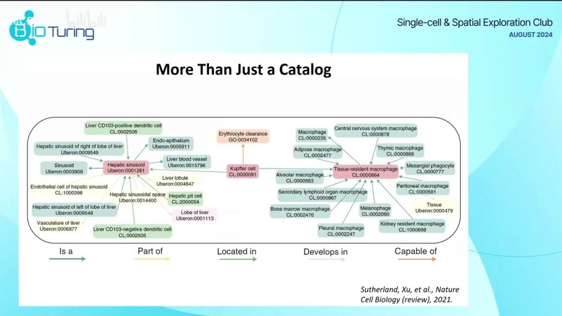

这张幻灯片值得停一下。图里每个方框都带一个 `CL:` 编号（如 `CL:0000091` 是 Kupffer cell），箭头则标着 `Is a`、`Part of`、`Located in`、`Develops in`、`Capable of`。这就是**细胞本体（Cell Ontology, CL）**：一套受控词表，给每个细胞类型一个稳定编号，再用「是一种 / 是某结构的一部分 / 位于 / 发育自 / 具备何种能力」这些关系把类型连成网。

它的作用正是解决本节要谈的混乱：论文里写「T 淋巴细胞」「CD3+ T cell」「T cell」时，人知道是一回事，机器不知道；但如果都映射到同一个 CL 编号，跨数据集的比较就有了共同坐标。讲者没有展开 CL 的细节，而是把它作为「统一标签」这一需求的图示背景——这张图出自 Sutherland、Xu 等人在 *Nature Cell Biology* 的综述。

### 1.2 两个基本问题，一个共同的答案：知识 + 数据

整场报告被组织成两个问题 [【跳转到 04:56】](https://www.bilibili.com/video/BV1VZBbY3ETY/?t=296)：

1. 如何根据单细胞数据**注释**细胞类型？
2. 一个数据集注释好之后，如何把不同实验室、不同数据集的细胞类型**统一**起来？

讲者说，最自然的答案是「知识」——用知识去标注，用知识去统一。但现实是：知识往往不够，而且即使有知识，人工做也极其耗时。所以要**用数据补知识** [【跳转到 05:21】](https://www.bilibili.com/video/BV1VZBbY3ETY/?t=321)。

这里有一张很关键的权衡图：

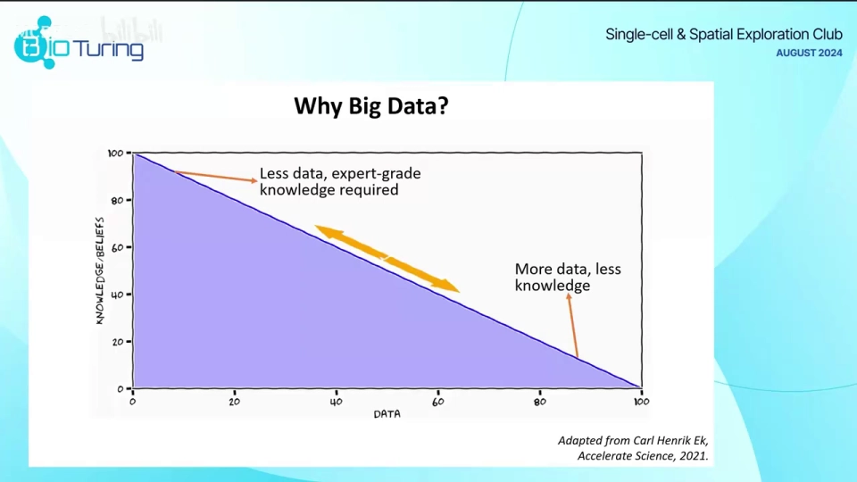

横轴是数据量，纵轴是对知识的依赖。左上角是「少量数据 + 大量专家知识」，右下角是「海量数据 + 很少知识」——极端情况下你只需要一张查找表，连机器学习都不需要。CellTypist 和 CellHint 都落在这条斜线的中段：**用大规模参考数据，把原本需要专家逐群判断的工作，变成一次可复现的计算**。

## 二、CellTypist：把参考图谱压成一个可分享的模型

### 2.1 工作流只有两步

CellTypist 的流程简单到可以一句话说完 [【跳转到 06:54】](https://www.bilibili.com/video/BV1VZBbY3ETY/?t=414)：

1. 把单细胞参考数据训练成「细胞类型模型」；
2. 用这个模型把查询数据集里的细胞注释成细胞类型。

注意它和「把两个矩阵放一起跑标签转移」的工具不同：模型一旦训练好，就可以脱离参考数据单独存在、反复使用、随手分享。讲者在问答里把标签转移工具分成两类 [【跳转到 40:05】](https://www.bilibili.com/video/BV1VZBbY3ETY/?t=2405)：一类每次都要同时加载参考和查询的表达矩阵；另一类先建模型，之后每个数据集只依赖模型。CellTypist 属于后者——所以训练和预测都快，代价是它依赖「更大的数据集」来训练。

### 2.2 为什么是逻辑回归：要可解释，不要黑箱

很多注释工具用深度学习，讲者明确说他们放弃了一部分这类方法，因为「大多数是黑箱」；而单细胞注释首要的是**可解释性** [【跳转到 07:44】](https://www.bilibili.com/video/BV1VZBbY3ETY/?t=464)。

逻辑回归给出的是一个线性超平面——一条决策边界，把查询细胞分到不同类别；并且天然带概率输出：

$$
P(y = k \mid \mathbf{x}) = \frac{1}{1 + e^{-\mathbf{w}_k^\top \mathbf{x}}}
$$

其中 $\mathbf{x}$ 是（经过缩放的）基因表达向量，$\mathbf{w}_k$ 是类别 $k$ 的权重向量。这个形式带来两个直接好处：

- **模型小**：文件里存的不是长长的表达向量，而是「每个细胞类型 × 每个基因」的权重 [【跳转到 09:59】](https://www.bilibili.com/video/BV1VZBbY3ETY/?t=599)。原始参考数据集动辄几百 GB，模型却可以轻松发给同事。
- **权重就是 marker**：把某个类型权重最高的基因取出来，就是它的标记基因——这成了 CellTypist 百科全书的来源 [【跳转到 10:24】](https://www.bilibili.com/video/BV1VZBbY3ETY/?t=624)。

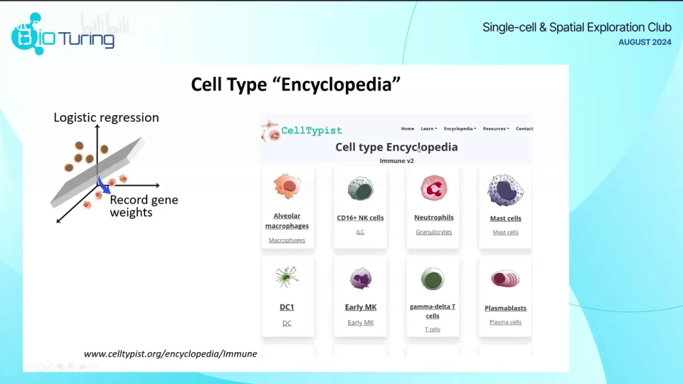

百科全书（Cell Typist Encyclopedia）里，每个细胞类型都有描述、组织来源、数据集来源和权重导出的 marker 基因 [【跳转到 10:49】](https://www.bilibili.com/video/BV1VZBbY3ETY/?t=649)。这一点对「标签统一」很实用：**当你要判断两个数据集里的名字是不是同一类细胞时，可以直接比它们的 marker 列表**，而不是靠名字猜。

### 2.3 数据越多，边界越稳

讲者用免疫细胞举例：他们收集了 20 多个来自不同来源的数据集，专门关注其中的免疫细胞成分 [【跳转到 09:15】](https://www.bilibili.com/video/BV1VZBbY3ETY/?t=555)。

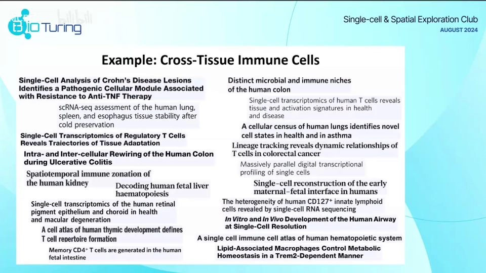

趋势很清楚：某个细胞类型收集到的细胞越多，预测准确率越高、也越稳定。原因在几何上很直观——决策边界要稳，需要特征空间被足够多的数据点覆盖 [【跳转到 08:34】](https://www.bilibili.com/video/BV1VZBbY3ETY/?t=514)。这也是为什么「大规模图谱」和「自动注释」是互相成就的：图谱提供数据，数据让注释器变准。

### 2.4 精度是怎么抠出来的：一条四段式流水线

讲者用一张流程图把训练与预测串起来 [【跳转到 15:24】](https://www.bilibili.com/video/BV1VZBbY3ETY/?t=924)：

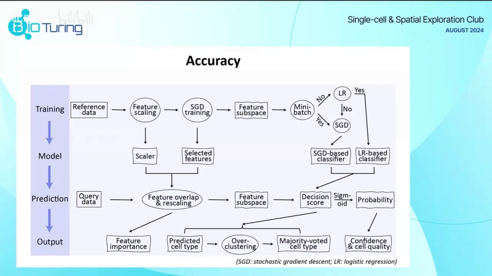

- **训练段**：参考数据 → 特征缩放（feature scaling）→ SGD 训练 → 选出特征子集 → mini-batch 迭代，产出「缩放器 + 选定特征 + 分类器」。
- **预测段**：查询数据 → 与参考取特征交集并重新缩放 → 特征子集 → 决策分数 → sigmoid → 概率。
- **输出段**：基因重要性、预测类型、过度聚类后的多数投票结果、置信度与细胞质量。

其中几个设计值得单独说，因为它们直接决定了「跨数据集能不能用」：

1. **mini-batch + SGD**：每个 epoch 随机训练一批（每批 100 个细胞），避免把整个数据集载入内存；10 个 epoch 后分类器已经见过 6 个数量级的细胞 [【跳转到 13:44】](https://www.bilibili.com/video/BV1VZBbY3ETY/?t=824)。
2. **特征交集**：查询数据往往和参考不是同一套基因，取交集就能得到一个降维后的决策边界——方法很朴素，但正是「模型可反复使用」的前提 [【跳转到 12:29】](https://www.bilibili.com/video/BV1VZBbY3ETY/?t=749)。
3. **沿用参考的缩放参数**：查询数据按参考的缩放器重新缩放，保证两者处在可比的表达尺度上，L2 惩罚项也不会被尺度带偏 [【跳转到 15:49】](https://www.bilibili.com/video/BV1VZBbY3ETY/?t=949)。这一条是「标准化」在注释环节的落点——**不是各自归一化完就算统一，而是要统一到同一套尺度参数上**。
4. **过度聚类 + 多数投票**：先在小亚群内部投票，再决定标签，因为转录组特征相似的细胞倾向于属于同一类型 [【跳转到 16:14】](https://www.bilibili.com/video/BV1VZBbY3ETY/?t=974)。

有了这些，讲者展示了跨技术的验证：用 10x Genomics 数据训练的模型，去注释 Smart-seq 等其他建库技术的数据，预测结果仍能与作者原始注释吻合，说明算法对批次不敏感 [【跳转到 16:39】](https://www.bilibili.com/video/BV1VZBbY3ETY/?t=999)。

### 2.5 能细到什么程度：33 万个免疫细胞、800 多种类型

讲者给了一个实际案例 [【跳转到 17:34】](https://www.bilibili.com/video/BV1VZBbY3ETY/?t=1054)：12 名捐赠者、12 种组织、33 万个免疫细胞（PTPRC+）。用 CellTypist 不仅能区分 αβ T 与 γδ T，还能区分 CD4 与 CD8，以及更细的功能状态 [【跳转到 18:06】](https://www.bilibili.com/video/BV1VZBbY3ETY/?t=1086)。

从最初的免疫细胞数据库起步，CellTypist 及其模型已经扩展到不同组织、器官、发育阶段，覆盖人类和其他物种的 800 多种细胞类型 [【跳转到 19:16】](https://www.bilibili.com/video/BV1VZBbY3ETY/?t=1156)。

但讲者紧接着把话题转向了更难的一半：

> 到这里，我们已经能给一个给定数据集里的细胞打好标签。接下来的问题是：**如何统一不同数据集、不同层次上的细胞类型定义？**

## 三、CellHint：把「标签对标签」变成一个可计算的问题

### 3.1 被忽略的一环：注释信息没有进入整合

讲者指出了一个很现实的浪费 [【跳转到 20:06】](https://www.bilibili.com/video/BV1VZBbY3ETY/?t=1206)：大多数整合方法只关心「去批次效应」，而人们花大量时间做的细胞类型注释，**在整合过程中并没有被自动利用**。

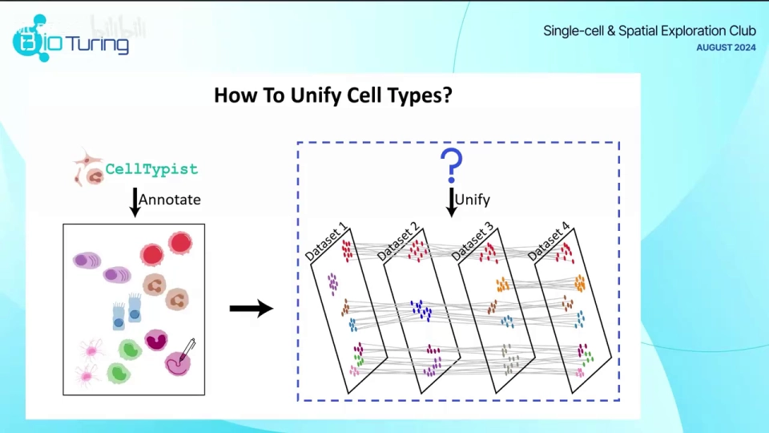

于是 CellHint 有两个功能 [【跳转到 20:31】](https://www.bilibili.com/video/BV1VZBbY3ETY/?t=1231)：

- **细胞类型调和（harmonization）**：在不同数据集之间建立细胞类型的对应关系，弄清它们如何相互关联；
- **监督式数据整合（supervised integration）**：把来自不同数据集的相同细胞类型放进同一个统一表示里。

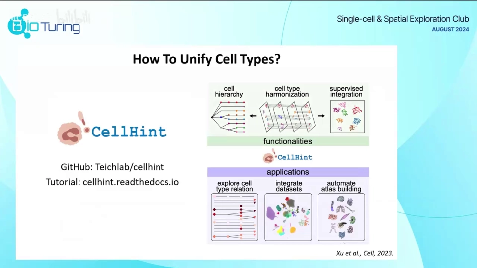

具体到数据上，这两个功能对应两种完全不同的操作：左边是「把四个数据集里的同类细胞用线连起来」，右边是「把连起来的同类细胞放进同一个表示空间」[【跳转到 21:21】](https://www.bilibili.com/video/BV1VZBbY3ETY/?t=1281)。

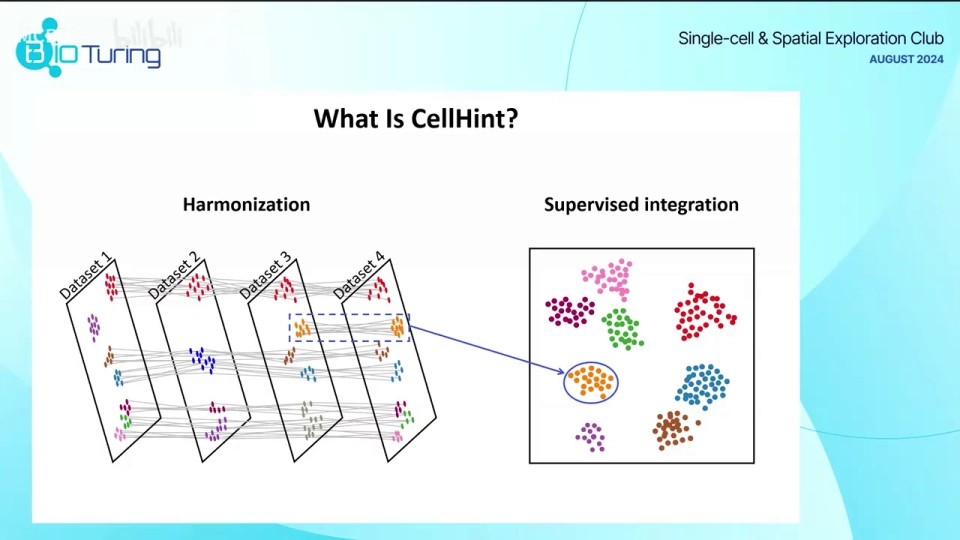

### 3.2 三个挑战

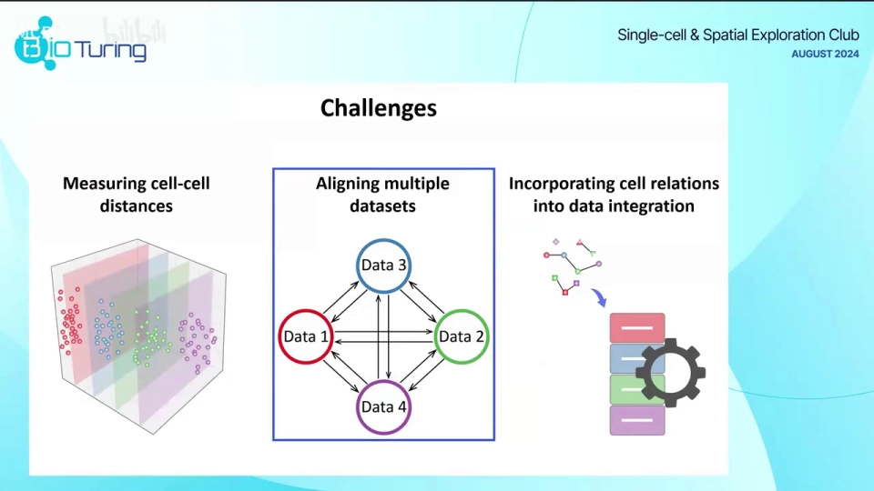

1. **如何在批次效应影响最小的情况下度量细胞之间的距离**；
2. **如何同时对齐多个数据集的细胞类型**，并总结、可视化这些信息；
3. **如何把细胞类型之间的关系融入数据整合**。

第一个挑战的解法是 CellHint 的预测聚类（predictive clustering）：把细胞不断分裂成后代，直到形成同质的群体；分裂点由特征空间中某个基因的截断值决定，而这个截断值按「分裂能力」来选，所以对表达尺度鲁棒 [【跳转到 21:46】](https://www.bilibili.com/video/BV1VZBbY3ETY/?t=1306)。

关键的一步在分组方式：每个叶节点下的细胞**不是按基因表达相似性分组，而是按「同一批次里所有细胞类型的相似性」分组**，从而构造出多目标场景——为每个数据集建一棵参考树，再让其他数据集来「查询自己」 [【跳转到 23:01】](https://www.bilibili.com/video/BV1VZBbY3ETY/?t=1381)。结果是不同数据集的细胞类型被放进同一个共同图里，既压低了批次效应，也把「细胞类型之间的距离」变成了可比较的量。

在五个数据集、129 个细胞类型注释上的结果显示：相同类型倾向于聚在一起，形成各自的区域（T 细胞、B 细胞、髓系细胞等），符合预期 [【跳转到 23:56】](https://www.bilibili.com/video/BV1VZBbY3ETY/?t=1436)。

### 3.3 第二个挑战：四种对齐情况，迭代合并成一棵树

四个数据集就有六对比较、十二个方向的标签迁移，怎么总结、怎么画？讲者说这在 CellHint 里是个「很有挑战、此前没有解决」的问题，他们用两个并行模块解决：成对对齐 + 可视化 [【跳转到 24:26】](https://www.bilibili.com/video/BV1VZBbY3ETY/?t=1466)。

成对对齐会产生四种情况：**一对一、一对多、多对一、以及某个数据集独有的细胞类型** [【跳转到 25:16】](https://www.bilibili.com/video/BV1VZBbY3ETY/?t=1516)。合并规则也很直白：

- 一对一的两种类型合并成一个类型；
- 多对一的情况，把「多」那边拆成亚型，与新类型对齐。

合并之后，两个数据集变成一份「合并数据集 + 六个类型」；第三个数据集进来，再做一次成对对齐，图随之扩展；如此迭代，最终长成一棵树——**CellHint 图** [【跳转到 26:56】](https://www.bilibili.com/video/BV1VZBbY3ETY/?t=1616)。

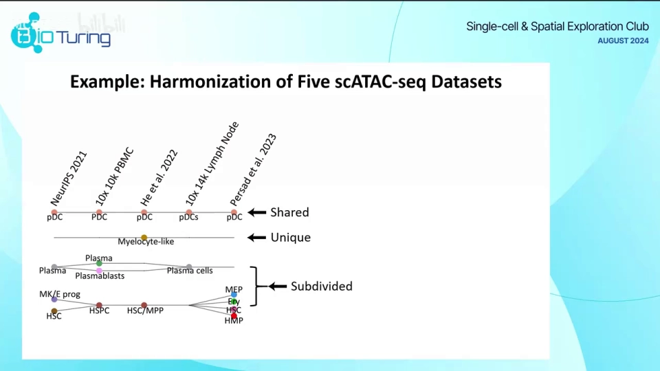

这张图信息量很大，值得逐层读：

- **Shared（共享）**：五个数据集里都有 pDC，虽然各自的叫法略有差别（pDC / pDCs），但被对齐到同一个节点；
- **Unique（独有）**：Myelocyte-like 只出现在部分数据集里——这类「别人没有的类型」正是稀有信号，很容易在粗暴合并中被抹掉；
- **Subdivided（细分）**：Plasma 在有的数据集叫 Plasma、有的叫 Plasmablasts、有的叫 Plasma cells，对齐之后被拆成更细的层次；HSC/HSPC/MPP 一路到 MEP、Mk/E prog、GMP 也是一样。

讲者特意选了 ATAC 数据来做这个演示 [【跳转到 27:21】](https://www.bilibili.com/video/BV1VZBbY3ETY/?t=1641)：因为 ATAC 数据通常比 RNA 噪声更大、更难定义细胞类型，**如果连 ATAC 都能稳健对齐，方法就更可信**。这也顺带说明了一件事：标签统一不只服务于 scRNA-seq，多模态数据同样需要。

把图重新排序（源头类型放左、目标类型放右），就能读出「分辨率从低到高」的层次结构 [【跳转到 28:36】](https://www.bilibili.com/video/BV1VZBbY3ETY/?t=1716)。讲者说，这正是把不同实验室的细胞类型知识汇集到一起的方式。

### 3.4 第三个挑战：用调和图约束整合

有了类型之间的关系，整合就可以「按图索骥」：CellHint 用受限邻域搜索（restricted neighborhood search），三步走 [【跳转到 30:24】](https://www.bilibili.com/video/BV1VZBbY3ETY/?t=1824)：

1. 找到每个细胞的原始注释；
2. 定位这个类型属于哪个分支；
3. 只在该分支内跨数据集找邻居。

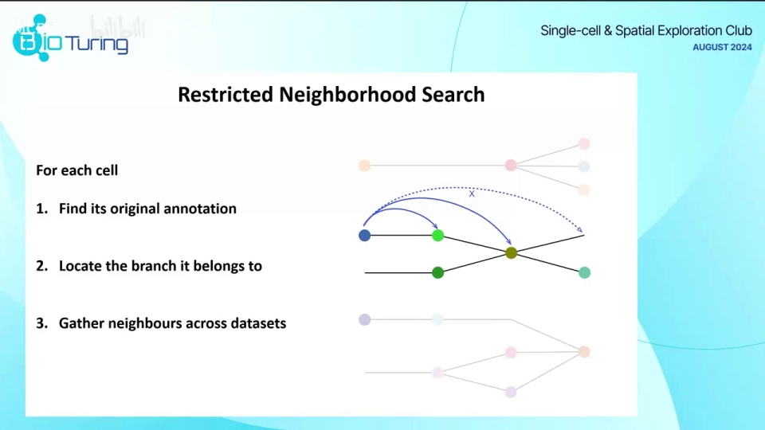

好处有两个：搜索空间大幅缩小，速度更快；相同细胞类型更倾向于聚在一起。换句话说，**标签不只是整合之后的产物，还可以是整合之前的先验**。

## 四、一个完整案例：人类成人海马体的神经发生

讲者用海马体做例子 [【跳转到 31:39】](https://www.bilibili.com/video/BV1VZBbY3ETY/?t=1899)。背景是：齿状回里持续生成新神经元，逐渐成熟为颗粒细胞，这条轨迹在小鼠、猪、猴子中都已被检测到，但在人类中一直有争议——有研究声称找到了这样的群体，可只识别出单个细胞，这些细胞散落在胶质细胞簇里，没有形成坚实的簇 [【跳转到 32:54】](https://www.bilibili.com/video/BV1VZBbY3ETY/?t=1974)。

这正是「信号太弱、被大群吞掉」的典型场景。他们的做法是**用多个数据集把信号叠加起来**：

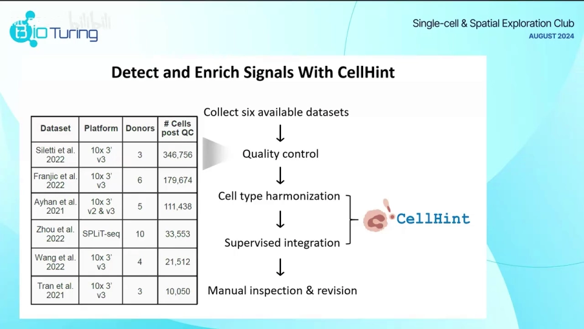

六个数据集来自不同平台（10x 3' v3、10x 3' v2 & v3、SPLiT-seq），捐赠者 3～10 名不等，质控后细胞数从 1 万到 34 万，合计超过 70 万个细胞 [【跳转到 34:34】](https://www.bilibili.com/video/BV1VZBbY3ETY/?t=2074)。流程是：收集 → 质控 → 细胞类型调和 → 监督式整合 → 人工检查与修订。

结果有两个层面：

- **整合层面**：不同捐赠者之间的批次效应显著减轻 [【跳转到 34:40】](https://www.bilibili.com/video/BV1VZBbY3ETY/?t=2080)；

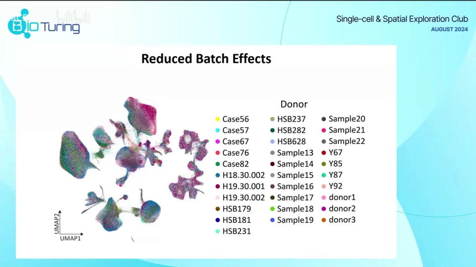
- **生物学层面**：识别出 51 种细胞类型（兴奋性神经元、抑制性神经元、非神经元细胞及其亚型），并且检测到了类似神经母细胞（neuroblast）的群体 [【跳转到 35:10】](https://www.bilibili.com/video/BV1VZBbY3ETY/?t=2110)。

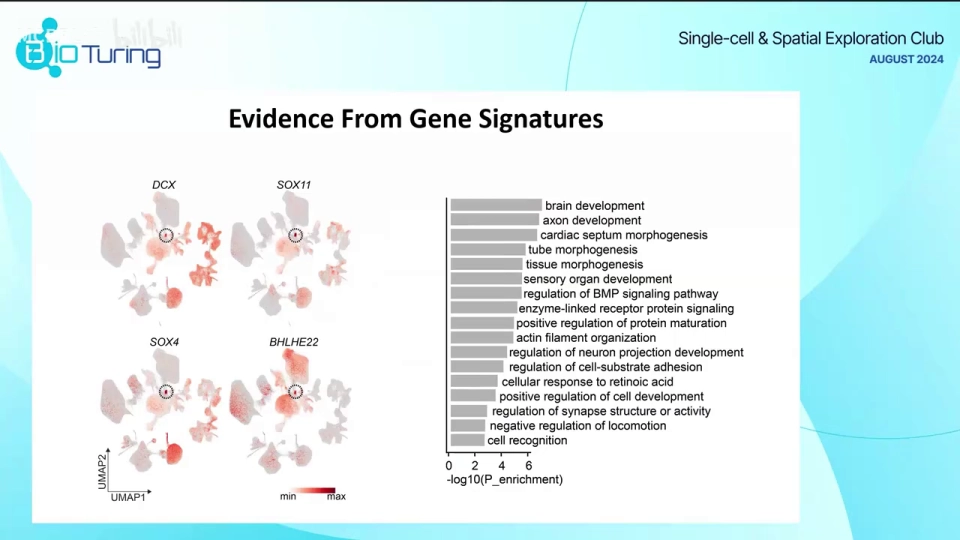

这个群体的证据是双重的：一方面它们独特地表达未成熟神经元相关标记（DCX、SOX4 等），另一方面它们的差异基因在轴突发育、大脑发育、颗粒细胞发育等通路上共同富集 [【跳转到 35:30】](https://www.bilibili.com/video/BV1VZBbY3ETY/?t=2130)。随后他们又整合了五个额外数据集（涵盖人、猴、猪、鼠），发现人、猴、猪的神经元群体对应良好，而猴和猪的群体进一步对应到小鼠的三个亚型 [【跳转到 35:55】](https://www.bilibili.com/video/BV1VZBbY3ETY/?t=2155)。

这个案例说明「统一注释」的价值不只是整齐：**当同一类型在不同数据集里被对齐到同一个坐标，弱信号才能被叠加到可见**。
## 五、问答里暴露的边界条件（这部分最值得记）

报告最后 20 分钟是问答，讲者的回答几乎每一条都在给「自动注释 + 统一标签」划边界。

### 5.1 参考的质量比方法更重要

被问到和其他标签转移工具相比如何时，讲者先给了基准测试的结论：CellTypist 与大多数工具性能相当，有时在批次效应更大的情况下结果反而更好 [【跳转到 40:05】](https://www.bilibili.com/video/BV1VZBbY3ETY/?t=2405)。但他紧接着强调：

> 标签转移里最重要的不是方法，而是参考。当你有一个非常高质量的参考时，方法其实就不那么重要了。[【跳转到 40:30】](https://www.bilibili.com/video/BV1VZBbY3ETY/?t=2430)

这句话对做图谱的人尤其重要：花在「挑参考、对齐参考定义」上的功夫，回报远高于换一个更花哨的算法。

### 5.2 稀有类型：置信度是「我们尽力了」的信号

如果某个细胞类型在参考里代表性不足，那么无论用什么工具，都很难在目标数据里准确预测它 [【跳转到 41:45】](https://www.bilibili.com/video/BV1VZBbY3ETY/?t=2505)。这时置信度分数（confidence score）的作用不是「保证对」，而是告诉你「这已经是能做到的最好结果」。

讲者给的补救办法是**特征选择层面的公平**：不同特征对不同类型的影响不同，即使是稀有类型，也能从中提取到同样数量的特征，于是分类器会平等对待这些基因 [【跳转到 42:10】](https://www.bilibili.com/video/BV1VZBbY3ETY/?t=2530)。还有一个非默认的技巧：把大簇或互相重叠的类型拆成与真实类型数量相近的亚群，让每个类型都变得「稀有」，从而被平等对待 [【跳转到 42:35】](https://www.bilibili.com/video/BV1VZBbY3ETY/?t=2555)。但他也承认，检测稀有类型总体上非常困难，需要大量数据。

### 5.3 层级结构：知识比相似性更重要

有观众问了一个很尖锐的问题：T 细胞的亚型在社区里就没有统一层次——有人叫 effector memory T，有人按 Th1/Th2/Th17 分，怎么放进一棵树？

讲者的回答分两层 [【跳转到 47:15】](https://www.bilibili.com/video/BV1VZBbY3ETY/?t=2835)：

- 常规做法是无监督层次聚类，按转录组相似性建树；
- 但这并不理想——生物学家会认为某两类细胞应该在同一分支，**即使它们的转录组差异很大**，因为那是领域知识。

所以理论上要把「转录组相似性」和「知识」结合起来，构建一个合并的层次结构。CellHint 的做法是自顶向下：不按相似性建树，而按不同层次的知识建树 [【跳转到 48:00】](https://www.bilibili.com/video/BV1VZBbY3ETY/?t=2880)。有的实验室标 CD4/CD8，有的标得更细，把两个层次的知识合起来，T 细胞就能被细分成三四十种 [【跳转到 48:50】](https://www.bilibili.com/video/BV1VZBbY3ETY/?t=2930)。讲者也坦率地说：把知识和数据更好地融合、得到更贴近现实的层次，「还有很长的路要走」。

### 5.4 不要指望一个模型包打天下

被问到是否会做一个覆盖所有组织、所有物种的通用模型时，讲者直接说「不可能，应该限定范围」[【跳转到 49:40】](https://www.bilibili.com/video/BV1VZBbY3ETY/?t=2980)。原因很具体：一个模型要覆盖所有类型，就得纳入很多基因；而标记某个特定类型时，真正起作用的只有一小部分基因，其余基因反而会稀释置信度 [【跳转到 50:05】](https://www.bilibili.com/video/BV1VZBbY3ETY/?t=3005)。

他给出的替代方案是**分层注释**：先用一套模型把细胞标到较宽的类别（比如血液细胞类型），落到某个类别之下后，再用只包含该类别子类型的第二个模型继续细化 [【跳转到 50:55】](https://www.bilibili.com/video/BV1VZBbY3ETY/?t=3055)。单一模型无法同时做到高准确和高精确，需要多个模型接力，而且最终这一步应该包含专家知识 [【跳转到 51:30】](https://www.bilibili.com/video/BV1VZBbY3ETY/?t=3090)。

### 5.5 细胞系与细胞状态：最难对齐的两类标签

有人问怎么处理细胞系和细胞状态。讲者的回答很务实 [【跳转到 52:10】](https://www.bilibili.com/video/BV1VZBbY3ETY/?t=3130)：

- 哪些基因贡献最大？按权重排序，正贡献负贡献都看绝对值；
- 细胞系是单独培养的，可能与正常组织差别很大；细胞状态不同，人们却倾向标成同一个类型——最好还是找到匹配的参考数据；没有的话，只能给出「最接近的猜测」，再用置信度说明这个猜测有多可信 [【跳转到 53:00】](https://www.bilibili.com/video/BV1VZBbY3ETY/?t=3180)。

至于物种，讲者明确说他们主要关注人类，有时做小鼠和猴子；除小鼠和人类之外，注释本身就不完善，基因注释不兼容会直接影响模型构建 [【跳转到 45:55】](https://www.bilibili.com/video/BV1VZBbY3ETY/?t=2755)。规模方面，百万级细胞的数据集目前还处理不了，当前重点是准确性、速度和可解释性 [【跳转到 44:15】](https://www.bilibili.com/video/BV1VZBbY3ETY/?t=2655)。

## 小结

- **注释有两个层次的问题**：给一个数据集打标签（CellTypist），和把多个数据集的标签对齐（CellHint）。后者长期被忽略，因为整合工具只关心去批次。
- **标签要能迁移，模型必须轻**：逻辑回归 + 权重存储，让「细胞类型模型」变成几百 MB 甚至更小的可分享文件，权重本身还能反推出 marker。
- **跨数据集可用的四个技术前提**：特征取交集、沿用参考的缩放参数、L2 正则化避免过拟合、过度聚类后多数投票。
- **统一标签的核心是「四种对齐情况」**：一对一合并、一对多/多对一拆分、独有类型保留；迭代合并后长成一棵 CellHint 图。
- **调和结果可以反过来约束整合**：受限邻域搜索只在同一分支内找邻居，既快又能让同类型聚在一起。
- **判断标准始终是参考**：参考质量比算法选择更重要；稀有类型靠特征选择与置信度兜底；层级结构要靠领域知识而不是纯相似性。
- **别追求万能模型**：分层注释（宽类别 → 细亚型）比一个大模型更现实。

## 关键术语速查

| 术语 | 一句话解释 |
| --- | --- |
| CellTypist | 基于逻辑回归的自动细胞注释工具，把参考数据训练成模型，再把标签转移到查询数据 |
| CellHint | 细胞类型调和工具，把不同数据集的标签互相对齐，并据此做监督式数据整合 |
| 标签转移（label transfer） | 把参考数据集里已知的细胞类型标签，按表达相似性搬到查询数据集的细胞上 |
| 细胞本体（Cell Ontology, CL） | 给每个细胞类型一个稳定编号与关系（is a / part of / develops in 等）的受控词表 |
| 置信度分数（confidence score） | 模型对单个细胞预测的把握程度，用来区分「有把握」和「只是最不坏的猜测」 |
| 过度聚类 + 多数投票 | 先在小亚群内部投票再定标签，减少邻居细胞被判成不同类型的情况 |
| 监督式整合 | 用已有的细胞类型标签去约束数据整合，让同类型细胞在统一表示里靠在一起 |
| 受限邻域搜索 | 只在细胞类型所属分支内跨数据集找邻居，缩小搜索空间、避免跨类型混入 |
| 分层注释 | 先用宽类别模型粗分，再用该类别专属模型细分，代替一个包打天下的大模型 |
