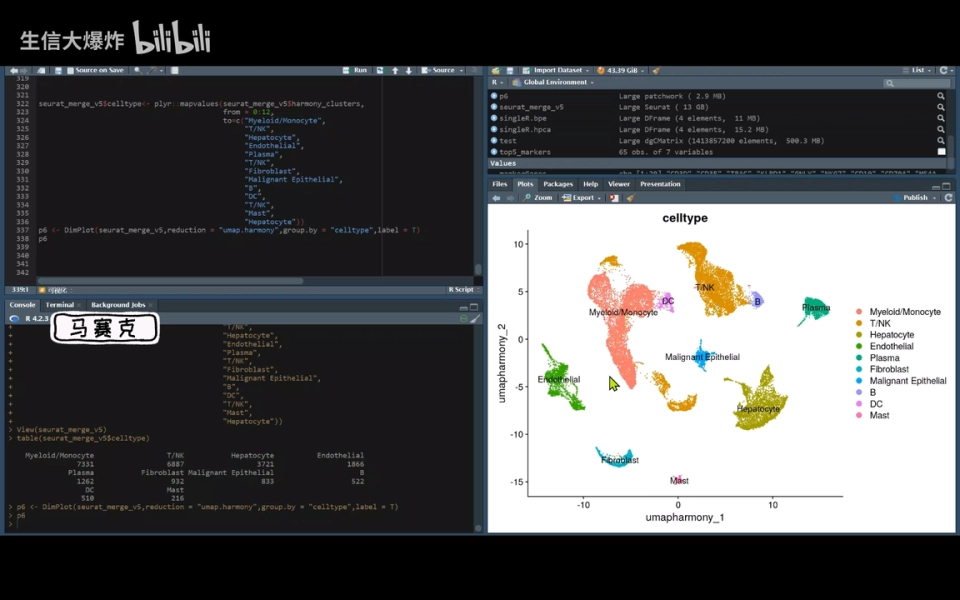
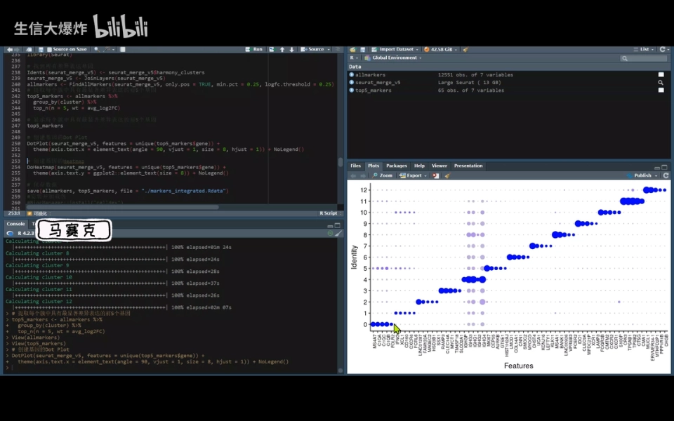
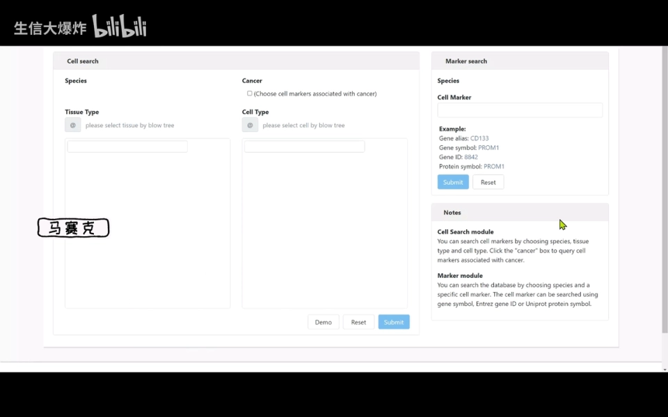
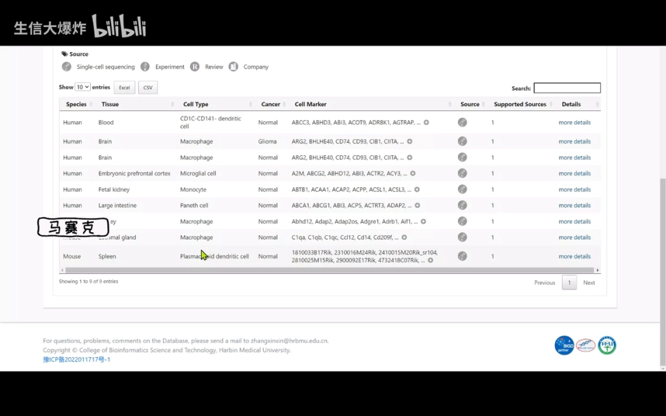
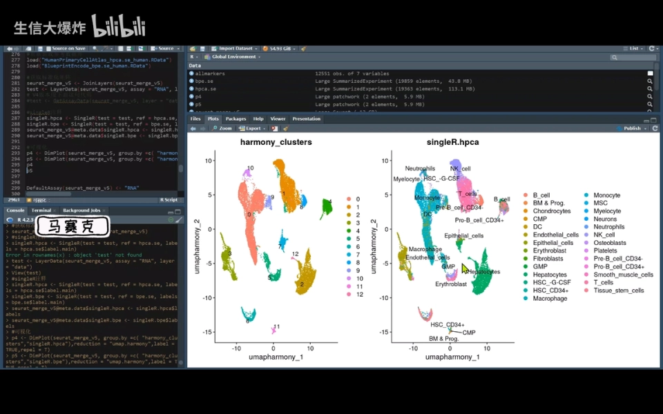
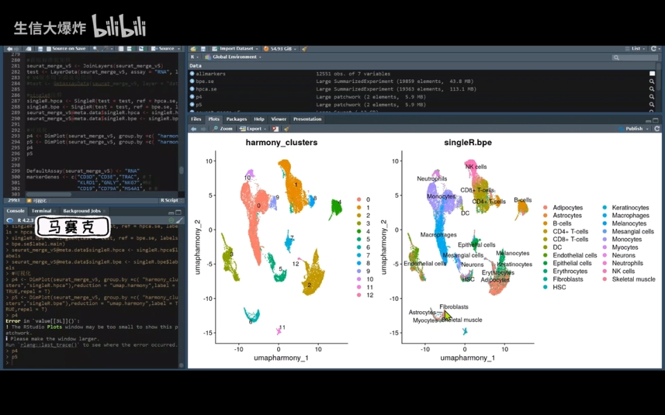
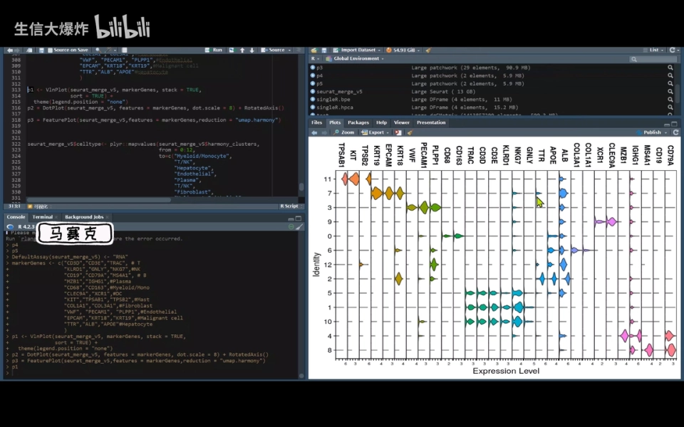
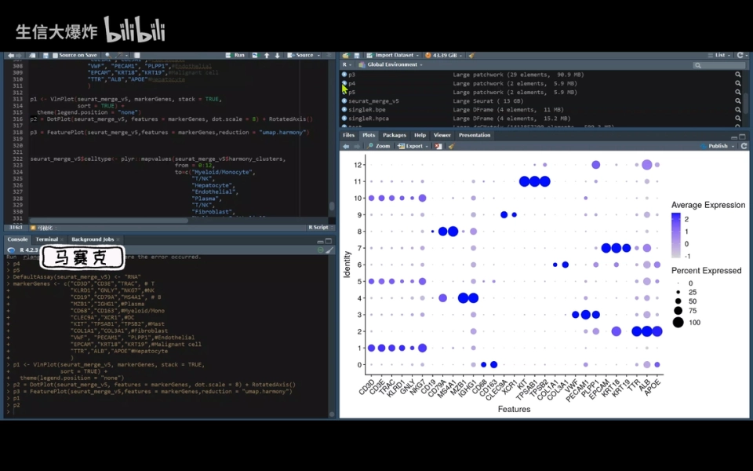
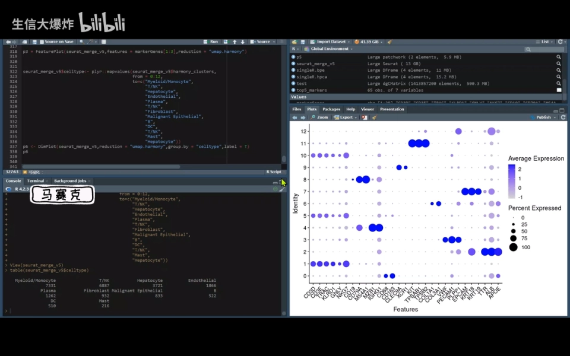

# 一次真实的细胞注释：差异基因、SingleR 与人工 marker 三路对照

> 视频来源：[单细胞专题｜细胞类型注释的十八般武艺](https://www.bilibili.com/video/BV1xx421S7fQ/)（Bilibili · 生信大爆炸）｜时长约 30 分钟
> 导读：这是一次从头到尾的实操录屏，把「注释」拆成三条路——差异基因反查数据库、SingleR 自动注释、人工看 marker——并在同一份数据上依次跑完。它的价值不在代码，而在让你亲眼看到：两个自动注释参考库会给同一群细胞起不同的名字，最后仍要靠 marker 把它们收敛成一套标签。

## 本讲要解决的核心问题（SCQA）

**背景**：单细胞分析走到聚类这一步，每个细胞已经被分进某个 cluster，但这些 cluster 的名字是 0、1、2、3 这样的编号。

**冲突**：编号没有生物学意义，而后面所有分析——细胞通讯、免疫微环境、亚群差异——都要建立在「这是什么细胞」之上。可注释偏偏没有标准答案：它靠你对生物学背景的了解和文献积累，同一个群不同的人可能给出不同的名字 [【跳转到 02:05】](https://www.bilibili.com/video/BV1xx421S7fQ/?t=125)。

**疑问**：既然没有标准答案，那实际做的时候到底按什么流程走？自动注释工具能不能直接用？人工注释又在看什么？

**回答（中心思想）**：视频给出的流程是**三路互相印证**——先用差异基因去数据库里反查「别人把这个基因高表达的群叫什么」，再用 SingleR 这类工具做一次自动注释，最后用一组经典 marker 人工核对，把 cluster 编号改写成有生物学意义的标签 [【跳转到 16:55】](https://www.bilibili.com/video/BV1xx421S7fQ/?t=1015)。三路结果不一致不是bug，而是注释这件事的常态。

## 一、为什么说注释是「最主观」的一步

讲者开场就把话说得很直 [【跳转到 00:00】](https://www.bilibili.com/video/BV1xx421S7fQ/?t=0)：前面降维聚类把细胞分成了许多亚群，算法给每个亚群一个阿拉伯数字的名字，但这些名字没有生物学意义。而后续分析要基于「它是什么细胞类型」才能展开——探索生物学上的内在联系、细胞之间的交流、免疫微环境里的相互作用。所以注释是单细胞分析里**重中之重**的一步，甚至可以说它决定了后续分析的走向 [【跳转到 00:50】](https://www.bilibili.com/video/BV1xx421S7fQ/?t=50)。

接着是一句很关键的判断：

> 相比于前面的分析流程，单细胞注释是一个比较主观的过程，没有标准答案，要靠你对生物学背景的了解，以及你在文献里积累的经验，去判断这个细胞到底该分几类、大概是什么类型。[【跳转到 01:40】](https://www.bilibili.com/video/BV1xx421S7fQ/?t=100)

他给的经验判据是：翻那些高分单细胞文章，注释无一例外都做得非常详尽 [【跳转到 02:30】](https://www.bilibili.com/video/BV1xx421S7fQ/?t=150)。这其实是在说，**标签的粒度本身就是一种选择**——分到「T 细胞」还是分到「CD8 效应记忆 T 细胞」，取决于研究问题和文献惯例，而不是数据本身唯一决定的。

顺带一个工程细节：这次用的对象是上一讲用 Harmony 去批次后得到的 Seurat 对象，文件有 13G，讲者建议有条件就在服务器上跑，别占自己电脑的内存 [【跳转到 01:15】](https://www.bilibili.com/video/BV1xx421S7fQ/?t=75)。这也侧面说明，图谱级数据在「注释」这一步就已经是重资源任务了。

## 二、第一条路：差异基因 + 数据库反查

### 2.1 找差异基因：为什么每个 cluster 会「分开」

讲者的逻辑很朴素 [【跳转到 02:55】](https://www.bilibili.com/video/BV1xx421S7fQ/?t=175)：每个 cluster 之所以能和别的 cluster 分开，是因为它有自己的特点；找差异基因，就是找出每个 cluster 的特征基因——它之所以特别，是因为高表达了哪些基因。

具体做法是用 Seurat 的 `FindAllMarkers`，把对象放进去，设一个阈值（默认即可）。**阈值是个可调的口子** [【跳转到 03:45】](https://www.bilibili.com/video/BV1xx421S7fQ/?t=225)：

- 想尽可能多地纳入差异基因，把阈值调到 0；
- 想让差异基因更显著、差异更大，就把阈值调高。

这里还踩了一个很典型的坑：跑的时候报错提示要先 join layers，这是 Seurat V5 特有的问题，按提示做 `JoinLayers` 再重跑就好 [【跳转到 04:10】](https://www.bilibili.com/video/BV1xx421S7fQ/?t=250)。

### 2.2 读懂差异基因表

跑完得到的 `all.markers` 是一张表，讲者逐列解释了它的含义 [【跳转到 05:00】](https://www.bilibili.com/video/BV1xx421S7fQ/?t=300)：

| 列 | 含义 | 怎么用 |
| --- | --- | --- |
| 行名 | 基因名 | 每个基因在每个 cluster 里的一行记录 |
| p_val_adj | 校正后的 P 值 | 越小越显著 |
| cluster | 属于哪个 cluster | 从 0 号一直到最后一个 |
| avg_log2FC | 差异倍数 | 该 cluster 相对其他所有 cluster 的平均对数倍数变化 |
| pct.1 | 在该 cluster 内的表达比例 | 与 pct.2 相差越大，差异越显著 |
| pct.2 | 在其他 cluster 内的表达比例 | 同上 |

讲者特别强调 pct.1 与 pct.2 的对比：两者相差越多，说明这个基因的「专属程度」越高 [【跳转到 06:15】](https://www.bilibili.com/video/BV1xx421S7fQ/?t=375)。这一点在跨数据集比较时同样重要——**一个 marker 是否可靠，很大程度上看它在目标群里的表达比例是否明显高于其他群**。

接下来按 avg_log2FC 排序，取每个 cluster 的前五位，得到 top5 marker；再用点图（DotPlot）和热图看这些基因的分布 [【跳转到 06:40】](https://www.bilibili.com/video/BV1xx421S7fQ/?t=400)。

点图的读法值得记牢 [【跳转到 07:11】](https://www.bilibili.com/video/BV1xx421S7fQ/?t=431)：纵坐标是每个 cluster，横坐标是基因；**圆点颜色深浅代表表达量高低，圆点大小代表 P 值大小**——点越大，P 值越小，统计学意义越显著。热图传达的信息其实一样，只是换了展示方式；两张图都显示 top5 基因在各个 cluster 里比较特异，每个 cluster 都有自己独特的高表达基因 [【跳转到 07:54】](https://www.bilibili.com/video/BV1xx421S7fQ/?t=474)。

讲者顺手把结果存了下来，因为 `FindAllMarkers` 很费时间，下次用 `load` 直接读回来就行 [【跳转到 08:19】](https://www.bilibili.com/video/BV1xx421S7fQ/?t=499)。

### 2.3 拿基因去数据库里「查别人怎么叫它」

有了高表达基因，就可以去现有的细胞类型注释数据库里查：这个基因高表达的群，既往研究都注释成了什么 [【跳转到 08:46】](https://www.bilibili.com/video/BV1xx421S7fQ/?t=526)。讲者提到两个主流选择：**CellMarker** 和 **PanglaoDB**。

以 0 号 cluster 为例，它表达 MS4A7、C1QA、C1QB、C1QC [【跳转到 09:11】](https://www.bilibili.com/video/BV1xx421S7fQ/?t=551)。把 MS4A7 输进去查：

结果里绝大多数研究把 MS4A7 注释成了巨噬细胞或单核细胞，总之是髓系细胞 [【跳转到 10:10】](https://www.bilibili.com/video/BV1xx421S7fQ/?t=610)。把物种限定为人类、再查一次，结果里出现 DC 细胞（树突状细胞）、巨噬细胞、单核细胞——整体还是髓系里的成员 [【跳转到 11:01】](https://www.bilibili.com/video/BV1xx421S7fQ/?t=661)。

这就是第一条路的产出：**不是直接给答案，而是给一个「心里有数」的先验**——0 号大概是髓系，而且极可能是巨噬细胞。

### 2.4 这条路的局限

讲者很诚实地指出了它的短板 [【跳转到 11:39】](https://www.bilibili.com/video/BV1xx421S7fQ/?t=699)：`FindAllMarkers` 找出来的高表达基因，**有时候并不包含某种细胞类型的经典 marker**——那个 marker 可能确实高表达，但没排到前几位。所以单靠 top5 去查库，会漏掉信息。

## 三、第二条路：SingleR 自动注释

### 3.1 它到底在做什么

自动注释的思路是 [【跳转到 12:04】](https://www.bilibili.com/video/BV1xx421S7fQ/?t=724)：把发表过的、用得比较成熟的 marker 及其对应的细胞类型总结成一个数据库，用我们的数据去和数据库比对，自动给 cluster 打标签。省心，不用自己翻文献。

但讲者立刻给了一句提醒：

> 说实话这个方法的准确率也是不太高的，只能作为一个参考。[【跳转到 12:29】](https://www.bilibili.com/video/BV1xx421S7fQ/?t=749)

这次用的工具是 **SingleR**。它自带七个参考数据库：五个人类的、两个小鼠的 [【跳转到 12:54】](https://www.bilibili.com/video/BV1xx421S7fQ/?t=774)。讲者把其中两个预先存成了 rds 文件，直接 load 进来。

### 3.2 一个容易被忽略的前置条件：取哪一层矩阵

在跑 SingleR 之前，要先从对象里取出**标准化后的表达矩阵**。这里有个 Seurat V5 的差别 [【跳转到 13:19】](https://www.bilibili.com/video/BV1xx421S7fQ/?t=799)：

- V4 直接用 `GetAssayData` 就行；
- V5 要先 `JoinLayers`，再用 `LayerData` 提取，并且要把 layer 指定为 `data`。

为什么必须是 `data`？因为**标准化后的矩阵存在 `data` 层，未标准化的原始 counts 存在 `counts` 层** [【跳转到 14:09】](https://www.bilibili.com/video/BV1xx421S7fQ/?t=849)。

这个细节正好是本节主题的一个注脚：跨数据集比较时，「你用的是哪一层矩阵」必须先说清楚。用 counts 和用 data 去比，等于拿两把不同刻度的尺子量同一件事。

### 3.3 结果：很细、很乱、两个库不一致

跑完把预测结果加进 metadata，再画到 UMAP 上。讲者的第一反应是「有一点点混乱」[【跳转到 15:18】](https://www.bilibili.com/video/BV1xx421S7fQ/?t=918)。

左图是 Harmony 聚出来的 13 个 cluster，右图是 SingleR 用第一个参考库（hpca）给出的标签。标签非常细：Neutrophils、NK cell、Myelocyte、B cell、Pro-B cell CD34+、Macrophage、Endothelial cells、Epithelial cells、Erythroblast、Hepatocytes、GMP、HSC CD34+、Chondrocytes、Fibroblasts、T cells……讲者能大致看出「这一群是 B 细胞、这一群是 T 细胞/NK 细胞、这一大群是髓系」[【跳转到 15:24】](https://www.bilibili.com/video/BV1xx421S7fQ/?t=924)，但细看会发现同一个 cluster 里混着好几个标签。

换第二个参考库（bpe），结果又变了 [【跳转到 16:14】](https://www.bilibili.com/video/BV1xx421S7fQ/?t=974)：

这次出现了 Adipocytes、Astrocytes、Keratinocytes、Melanocytes、Mesangial cells、Myocytes、Neurons、Skeletal muscle 等标签——对一个明显含肝细胞和恶性上皮的样本来说，这些名字显然不太合理。两个库大体框架一致（都有 B 细胞、T 细胞、NK 细胞、单核/巨噬、内皮），但**细标签和错标的地方不一样**。

这就是本节要讲的核心现象：**自动注释的标签空间由参考库决定**。换一个参考，等于换了一套命名体系和一套「什么算同一类」的定义。讲者的处理办法是——到这里只是「心里有数」，接下来用人工注释去佐证 [【跳转到 16:39】](https://www.bilibili.com/video/BV1xx421S7fQ/?t=999)。

## 四、第三条路：人工看 marker

### 4.1 人工注释才是主体

讲者的判断很明确 [【跳转到 16:55】](https://www.bilibili.com/video/BV1xx421S7fQ/?t=1015)：人工注释才是细胞注释最主要的部分，甚至可以说前面两步都可以不需要，它基本上是你一上手就要做的事。之所以放在最后讲，是因为它对文献积累和生物学背景要求最高。

技巧其实不多：大类注释的 marker 现在已经很成熟，去你所做疾病领域的单细胞文献里找一找，都能找到成套的经典 marker，拿来做可视化就能看个八九不离十 [【跳转到 17:20】](https://www.bilibili.com/video/BV1xx421S7fQ/?t=1040)。

### 4.2 一组 marker，三张图

做法是先定义一个 marker 向量，把常见细胞类型的经典 marker 放进去 [【跳转到 19:00】](https://www.bilibili.com/video/BV1xx421S7fQ/?t=1140)：

- T 细胞：CD3D、CD3E
- NK 细胞：KLRD1
- B 细胞：CD79A、MS4A1
- 髓系：CD68、CD163
- 浆细胞：MZB1
- 肝细胞：TTR、ALB、APOE
- 内皮：VWF、PECAM1、PLVAP
- 成纤维：COL1A1、COL1A2
- 恶性上皮：EPCAM、KRT18、KRT19

然后画三张图看同一批 marker：小提琴图、点图、FeaturePlot [【跳转到 19:50】](https://www.bilibili.com/video/BV1xx421S7fQ/?t=1190)。

读图的关键是**特异性**：CD79A、CD19、MS4A1 在 4 号和 8 号类群里表达很高；CD3E、CD3D 在 1、5、0 三个类群里都表达 [【跳转到 20:58】](https://www.bilibili.com/video/BV1xx421S7fQ/?t=1258)。讲者的解读很值得学：

- 8 号应该是 B 细胞，4 号应该是浆细胞——浆细胞和 B 细胞同源，marker 有重合 [【跳转到 21:23】](https://www.bilibili.com/video/BV1xx421S7fQ/?t=1283)；
- 1、5、0 都表达 T 细胞 marker，它们可能是不同的 T 细胞亚群，但只要是 T 细胞就一定表达 T 细胞的 marker。

点图给出的是同一件事的另一种编码 [【跳转到 22:13】](https://www.bilibili.com/video/BV1xx421S7fQ/?t=1333)：颜色深浅是平均表达，点的大小是表达该基因的细胞比例。

FeaturePlot 则是把表达量直接铺回 UMAP [【跳转到 23:41】](https://www.bilibili.com/video/BV1xx421S7fQ/?t=1421)：染 CD3D、CD3E、TRAC 这三个 T 细胞 marker，染色的位置大致一致——这是理所应当的，因为它们标记的是同一群细胞。

### 4.3 两个「土办法」：共表达与邻居关系

人工注释里还有一些经验性的判断技巧 [【跳转到 22:38】](https://www.bilibili.com/video/BV1xx421S7fQ/?t=1358)：

- **共表达**：如果一个群同时高表达 T 细胞和 NK 细胞的 marker，它可能是 T 细胞和 NK 细胞混在一起，也可能有一部分是 NKT 细胞；
- **邻居关系**：在 UMAP 上，T 细胞和 NK 细胞往往挨得比较近，B 细胞和浆细胞往往也离得比较近。位置关系可以作为辅助证据。

讲者同时提醒了反面情况 [【跳转到 19:50】](https://www.bilibili.com/video/BV1xx421S7fQ/?t=1190)：有些 marker 不是那么理想化地只在某一个细胞类型里表达，它可能在好多群里都表达，这时就无法确定，需要结合前面几种方法一起权衡。

## 五、把标签写回对象

确定每个 cluster 是什么之后，要把 0、1、2、3 这些编号替换成有生物学意义的名称。讲者用一行 `mapvalues` 完成 [【跳转到 25:21】](https://www.bilibili.com/video/BV1xx421S7fQ/?t=1521)，注意**名称的顺序要按 0 到 12 排**，一个不落地对应。

13 个 cluster 最终被收敛成 10 个有生物学意义的类型：髓系/单核、T/NK、肝细胞、内皮、浆细胞、成纤维、恶性上皮、B 细胞、DC、肥大细胞。注意其中「T/NK」是一个合并标签——因为这一群同时表达 T 细胞和 NK 细胞的 marker，讲者选择先不细分 [【跳转到 25:46】](https://www.bilibili.com/video/BV1xx421S7fQ/?t=1546)。

然后把结果写进 metadata 新增的一列，讲者起名叫 `cell_type`（也可以叫别的，只要是「细胞类型」的意思）[【跳转到 27:26】](https://www.bilibili.com/video/BV1xx421S7fQ/?t=1646)。之后用 `table` 就能统计每种类型里有多少细胞：

画图时记得把 `group.by` 选成新建的 `cell_type` 列，这样 UMAP 上显示的才是我们定义的类型 [【跳转到 28:07】](https://www.bilibili.com/video/BV1xx421S7fQ/?t=1687)。

最终，13 个 cluster 被收敛成 10 个有生物学意义的细胞类群 [【跳转到 28:57】](https://www.bilibili.com/video/BV1xx421S7fQ/?t=1737)。讲者的总结是：既吸取了自动注释给的提示，又根据经典 marker 做了人工注释，最后综合考虑得出结论——**注释不是选一条路，而是让三条路互相印证**。

## 六、粒度问题：先大类，还是先细分

视频最后讲了一个很实际的选择 [【跳转到 24:06】](https://www.bilibili.com/video/BV1xx421S7fQ/?t=1446)：这次 `resolution` 选得比较小，所以没有聚出很多类，只做了大类注释。如果要细分亚群，有两种策略：

1. **先粗后细**：先笼统注释大类，再把某个类提取出来，重新降维聚类、去批次、重新注释亚群——讲者自己惯用这种 [【跳转到 24:56】](https://www.bilibili.com/video/BV1xx421S7fQ/?t=1496)；
2. **先细后合**：一开始就把 `resolution` 调大，把群聚得很细，最后再把相似的亚群合并成一个。

两种都可以，但要注意它们对「标签统一」的影响：**不同数据集如果用了不同的 resolution，产出的标签粒度天然不同**。这正是把多个数据集放到一起时，「T cell」和「CD4 memory T cell」并存的技术原因之一——不是谁错了，而是聚类的分辨率不同。

## 小结

- **注释没有标准答案**，它依赖文献积累与生物学背景；但流程可以标准化：差异基因 → 数据库反查 → 自动注释 → 人工 marker 核对。
- **差异基因表要会读**：`avg_log2FC` 看差异倍数，`pct.1` 与 `pct.2` 的差距看「专属程度」，两者共同决定一个 marker 可不可信。
- **数据库反查给的是先验，不是答案**：MS4A7、C1QA/B/C 高表达 → 髓系/巨噬细胞；但经典 marker 未必出现在 top5 里。
- **自动注释的标签空间由参考库决定**：同一份数据，hpca 与 bpe 两个参考给出不同的细标签，甚至出现明显不合理的类型。所以它只能作参考。
- **取哪一层矩阵是前置条件**：Seurat V5 里标准化结果在 `data` 层，原始 counts 在 `counts` 层，用错层等于换了一把尺子。
- **人工 marker 是主体**：一组经典 marker + 小提琴图/点图/FeaturePlot 三种视角，再看共表达与邻居关系，最后把 cluster 编号改写成标签。
- **粒度是一种选择**：先大类再细分，或先细分再合并；不同 resolution 会直接导致跨数据集的标签粒度不一致。

## 关键术语速查

| 术语 | 一句话解释 |
| --- | --- |
| cluster | 聚类算法给出的细胞分组，名字是编号，没有生物学含义 |
| marker 基因 | 某个细胞类型高表达、可作为其身份标志的基因 |
| FindAllMarkers | Seurat 里对每个 cluster 与其他所有 cluster 做差异表达的函数 |
| avg_log2FC | 平均对数倍数变化，衡量差异大小 |
| pct.1 / pct.2 | 基因在该 cluster / 其他 cluster 中表达的细胞比例 |
| CellMarker / PanglaoDB | 收录「marker 基因 ↔ 细胞类型」对应关系的公共数据库 |
| SingleR | 基于参考数据集相似度的自动注释工具，内置多个人/鼠参考库 |
| counts 层 / data 层 | Seurat 对象里分别存放原始计数与标准化表达的两层数据 |
| FeaturePlot | 把某个基因的表达量直接画在 UMAP 每个细胞上的图 |
| resolution | 聚类分辨率参数，越大分出的群越多、标签越细 |