# 基础细胞图谱的研究价值：把「正常细胞长什么样」变成可对齐的坐标系

> 视频来源：[人工智能遇见生物学网络研讨会 || Fabian Theis 教授讲解单细胞图谱](https://www.bilibili.com/video/BV1u58wz2Euv/)（Bilibili · MCBRLab）｜时长约 60 分钟
> 导读：Fabian Theis（亥姆霍兹慕尼黑中心、人类细胞图谱 HCA 董事会成员）用一场讲座回答了「花大力气建一张正常细胞图谱到底换来了什么」：一个共享坐标系、一套可迁移的标签、一个扰动实验的基线，以及一堆还没解决的问题。本文按他的讲法展开，末尾附上问答环节里关于局限的讨论。字幕为 B 站 AI 中文轨道，人名与工具名已按上下文订正。

## 本讲要解决的核心问题（SCQA）

**背景**：公共单细胞数据已经堆到上亿个细胞。想研究某个组织，翻出十几个数据集并不难；难的是把它们放在一起看。

**冲突**：每个实验室各跑各的流程，合并之后第一主成分往往不是「这是什么细胞」，而是「这是哪个实验室做的」。于是每个新数据集都要从零注释一遍，每次跨研究比较都要重新对齐一次，而「正常细胞长什么样」这件事，从来没有一个公共答案。

**疑问**：如果把「正常」系统地画成一张图谱，这张图建好之后，到底能拿来干什么？它值不值这么大的成本？

**回答（中心思想）**：基础细胞图谱的价值不在「细胞数」这个数字，而在于它把「正常细胞长什么样」从**每个实验室各自的私有知识**，变成了**一个公共的、可对齐的坐标系**。有了坐标系，注释从「每次从零做」变成「投影到参考上」；跨研究、跨疾病的数据第一次能放进同一个参照系；而扰动实验终于有了它必须有的那个东西——**基线**。代价是：图谱永远不完整、永远在过时，而且「整合到什么程度」是一个没有标准答案的权衡。

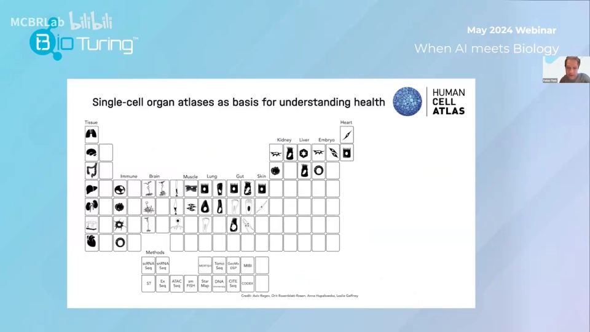

## 一、图谱要解决的不是「数据不够」，而是「没有共同坐标系」

### 1.1 从「构建一张图谱」到「学习一张图谱」

Theis 给这一页幻灯片起的标题很值得玩味：**Building a cell atlas? → learning an atlas**（建一张图谱？不，是学一张图谱）[【跳转到 10:50】](https://www.bilibili.com/video/BV1u58wz2Euv/?t=650)。

他用的比喻是「校园里手绘世界地图」：随便找一群人，请他们凭记忆画出世界地图，有人忘了澳大利亚，有人把北极画歪了；但把所有人的图叠在一起，你会得到一张相当准确的世界地图——这就是「群体的智慧」。单细胞数据集的处境一模一样：**没有任何一个数据集是完整的，但把它们叠加起来，结构就浮现出来了**。

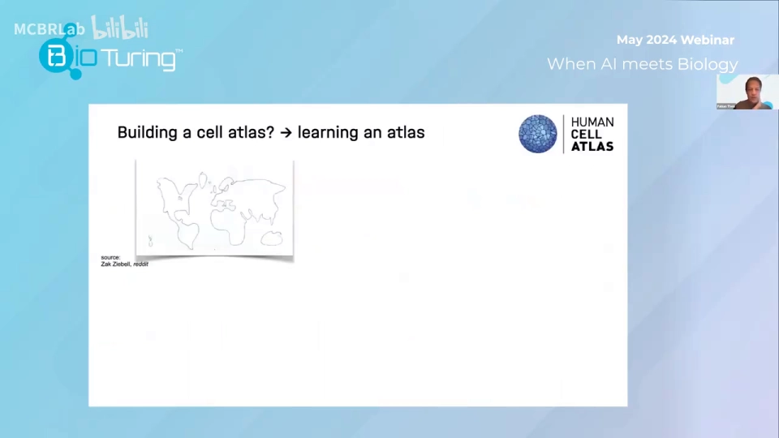

这个比喻点出了图谱的第一层价值：它不是一个「更大的数据集」，而是一次**把许多不完整观测合成一个共同结构**的操作。所以图谱的产物不是「更多细胞」，而是「一个结构」。

### 1.2 为什么必须要有这个结构：第一主成分是实验室

Theis 把痛点讲得很直白 [【跳转到 11:40】](https://www.bilibili.com/video/BV1u58wz2Euv/?t=700)：

- 你在某个实验室的数据里找到一群细胞，给它起了名字叫「某某细胞类型」；
- 换一个实验室的数据一看，同样的细胞位置差很远；
- 通常**第一主成分或主要变异轴就是实验室差异**，而不是生物学差异。

这不是分析水平的问题，而是**技术变异被写进了表达矩阵本身**。后果是双重的：一方面跨研究没法比，另一方面连影像学研究都很难在别的实验室复现、很难找到统一标准。

Theis 的解法是：**用机器学习和数据标注，把这些数据集叠加、整合起来**。一旦有了这个结构，你就可以在数据上「提问」——我的细胞在哪里？我看到的是什么类型的变异？我想去哪一块区域？他把这称为「从手动提取、自己定义一套分类体系和标签，转向在参考映射上操作」[【跳转到 12:05】](https://www.bilibili.com/video/BV1u58wz2Euv/?t=725)。

### 1.3 图谱的产物到底是什么：一个坐标 + 一套分层标签

以人类肺细胞图谱（HLCA）为例，Theis 展示了「建好之后你手里有什么」[【跳转到 19:41】](https://www.bilibili.com/video/BV1u58wz2Euv/?t=1181)：

- **14 个数据集**、**584,944 个细胞**、**107 个个体**、**196 个样本**；
- 统一后的元数据（性别、年龄、吸烟状态等）；
- 一个「解剖位置」维度：常见坐标 + 气道分级框架；
- 一张核心图谱（Core）；
- 以及最重要的：**一套分层级的细胞类型标签**——Level 1 是上皮 / 间质 / 免疫这种粗分类，Level 2 是「气道上皮」「血管内皮」这类中间层，Level 3 才到「基底细胞」「俱乐部细胞」这类细类。

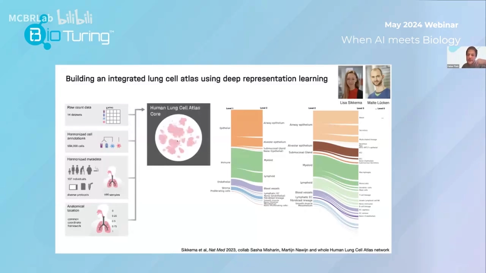

这里有个容易被忽略的点：**分层标签本身就是价值**。不同研究对「细胞类型」的分辨率偏好不同，有人只关心免疫 / 上皮 / 间质，有人要分到亚型。分层标签让同一张图谱能同时服务这两种人——粗粒度看结构，细粒度看亚型，而且**粗层永远可以下钻到细层**。

Theis 强调，这份标签不是某个人拍的，而是**社区协作 + 6 位专家共识重新注释**的结果。协调过程本身很琐碎：大家对「自己偏好的免疫细胞类型」定义差异很大，但对巨噬细胞这种大类基本能达成共识，剩下的亚型需要坐下来一个个明确「在哪个层面使用」[【跳转到 19:36】](https://www.bilibili.com/video/BV1u58wz2Euv/?t=1176)。

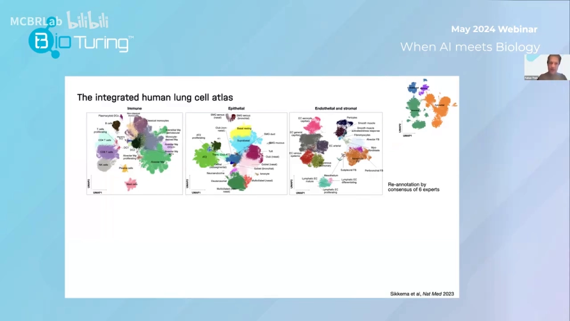

## 二、用途一：注释从「每次从零做」变成「对齐到坐标系」

### 2.1 参考映射：冻结参考，只学一小层新权重

图谱最直接的用法是**注释基准**。Theis 把它类比成谷歌地图 [【跳转到 22:16】](https://www.bilibili.com/video/BV1u58wz2Euv/?t=1336)：你有一张已经标好区县、街道的地图，新来一批数据，你不需要重新画地图，只需要把新数据「定位」到地图上。

技术上这叫**迁移学习 / 参考映射**，做法可以拆成四步：

1. 在一批参考数据集上预训练一个条件自编码器，把基因表达压到低维潜在空间，同时把「研究 / 批次」作为条件输入，让潜在空间里不再有批次效应；
2. 训练完**只存权重，不存数据**；
3. 来一个新数据集时，在编码器和解码器的第一层各加一个「新标签节点」和随机初始化的权重（论文里叫**适配器**），微调时**只训练这一小层，其余全部冻结**；
4. 微调后的模型把新数据投影到参考的坐标系里，标签、区域、邻域关系一并继承过来。

Theis 说，他们能证明**微调的效果几乎等同于全网络重新训练**，而代价小得多 [【跳转到 23:00】](https://www.bilibili.com/video/BV1u58wz2Euv/?t=1380)。

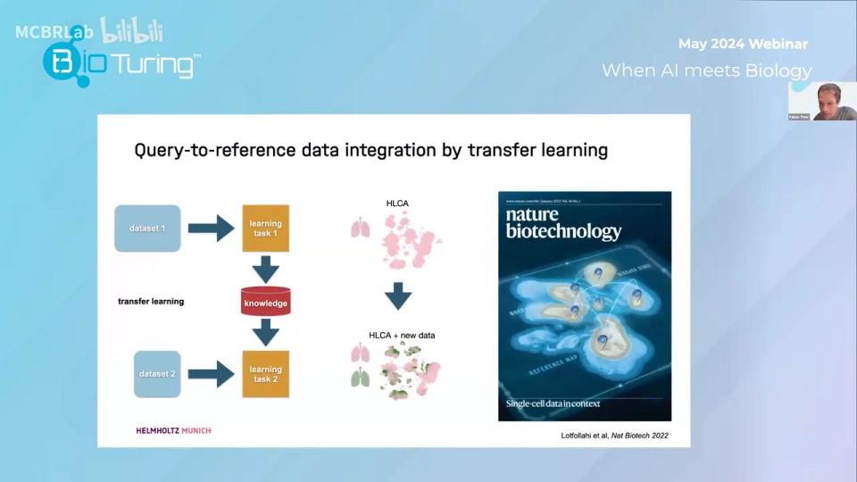

**为什么这一步是「注释范式」的改变**？因为传统注释是「每个数据集独立聚类 → 人工看 marker → 起名」，结果是**每次都在发明一套新词汇**；而参考映射是「把新数据放进一个已有的词汇表里」。前者产出的是「这个数据集里的第 7 群」，后者产出的是「HLCA 坐标系里的基底细胞」——后者可以直接和别人的结果对话。

### 2.2 反向用途：用图谱审计旧注释

更有意思的是反过来的用法。Theis 指出，有了参考图谱，你可以**评估原作者的注释质量**，甚至重新注释 [【跳转到 20:26】](https://www.bilibili.com/video/BV1u58wz2Euv/?t=1226)：

- 在他们整合的 14–15 个数据集里，**有些存在标注错误**；
- 有些区域**大面积注释不足**——因为参考里有这些细胞的模型，就能得到精度高得多的图谱；
- 例如**杯状细胞（goblet cell）存在误标注**，可以被修正。

这件事的意义超出「修 bug」：它说明图谱一旦建立，就变成了一个**公共的标尺**，任何人的注释都可以被这把尺子量一遍。这在没有图谱的时代是做不到的——你没有任何外部参照。

### 2.3 不确定性：图谱能告诉你「哪里不可信」

参考映射不是万能的，Theis 特意展示了**不确定性**这一层 [【跳转到 24:15】](https://www.bilibili.com/video/BV1u58wz2Euv/?t=1455)：把新数据投影到 HLCA 后，可以逐细胞计算「这个标签有多可信」，画出一张不确定性热图；再按细胞类型统计「正确 / 不确定 / 错误」的比例。

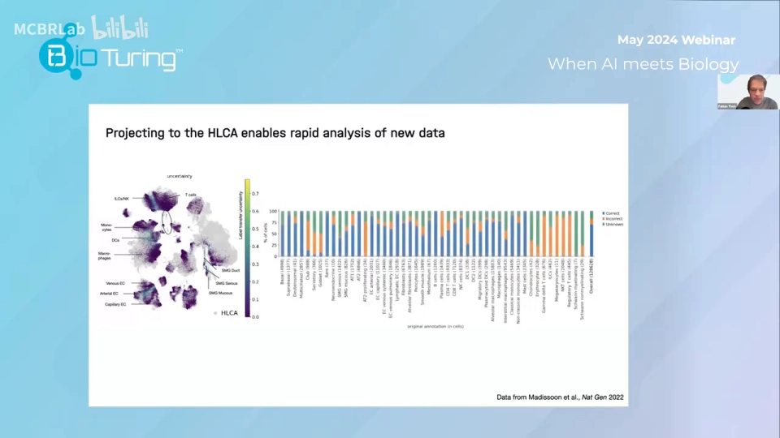

他举了一个非常说明问题的例子 [【跳转到 24:15】](https://www.bilibili.com/video/BV1u58wz2Euv/?t=1455)：有一块区域应该是一群免疫细胞，但标签不确定性很高。原因不是方法不好，而是**原始图谱的 14 个数据集里根本没有免疫细胞的注释**——参考里没有这个模型，映射自然给不出高置信度的答案。

这个例子同时说明了图谱价值与图谱局限的两面：**参考覆盖到哪里，映射就能可靠到哪里；参考没覆盖的地方，映射会诚实地告诉你「我不知道」**。后来他们把免疫细胞补进参考，图谱就被「丰富」了——图谱是可以迭代长大的。

## 三、用途二：把跨研究、跨疾病的数据放进同一参照系

### 3.1 疾病数据投影到健康参考

图谱的第一批战果就来自这里。Theis 回忆，新冠疫情初期他们一直在研究**健康对照样本**：每一列代表一个健康人，然后分析病毒进入相关基因与 SARS-CoV-2 感染的关联——能看到这些入口基因与特定区域相关，还与性别和年龄相关 [【跳转到 09:50】](https://www.bilibili.com/video/BV1u58wz2Euv/?t=590)。后来这些数据长成了包含 **118 万个细胞、282 个样本、164 名供体**的新冠图谱。

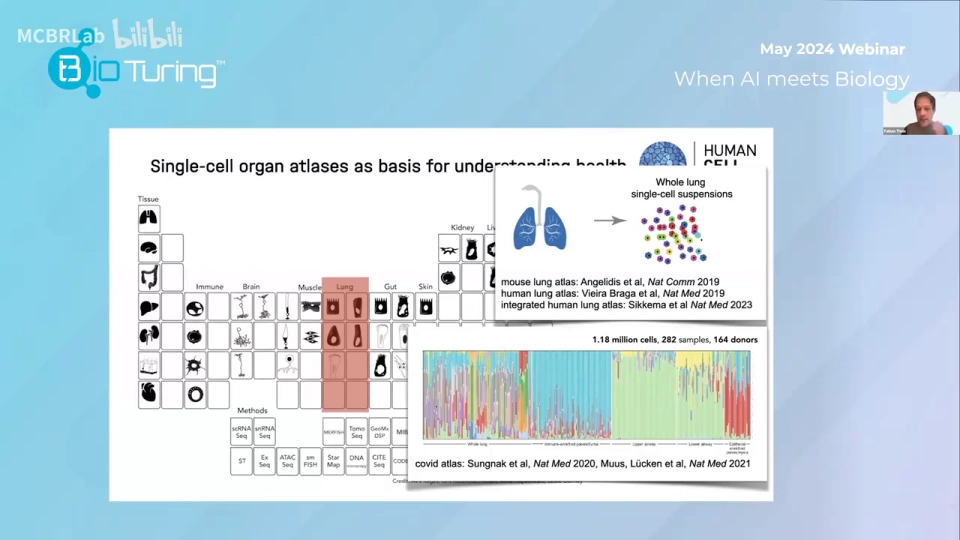

有了 HLCA 之后，Theis 团队把它扩展成「人类肺细胞图谱·扩展版」：**40 多项研究、超过 200 万个细胞、400 名个体** [【跳转到 24:48】](https://www.bilibili.com/video/BV1u58wz2Euv/?t=1488)。扩展的方式正是参考映射：把疾病数据集（慢性纤维化、IPF、COVID-19 等）投影到这个健康参考上。

投影之后能做的事立刻变多了 [【跳转到 25:13】](https://www.bilibili.com/video/BV1u58wz2Euv/?t=1513)：

- **转移疾病信息**：新数据落在哪个区域，就继承那个区域的疾病标签；
- **标签传播**：把参考里的细粒度标签传播到新数据；
- **跨测序技术**：不仅 10x Genomics，Drop-seq 等其他技术的数据也能映射进来；
- **发现有趣状态**：投影 + 标签传播之后，新的细胞状态会自己浮出来。

### 3.2 跨疾病找共性：SPP1 高表达巨噬细胞的例子

这是整场讲座里最能说明「坐标系价值」的具体结果 [【跳转到 25:38】](https://www.bilibili.com/video/BV1u58wz2Euv/?t=1538)：把 COVID-19、ILD（间质性肺病）、肺癌等多种疾病的数据放进同一个坐标系后，可以形成**跨疾病的联合细胞状态**。他们发现一个标记——**SPP1**——在单核细胞来源的巨噬细胞中高表达，而且**不只在新冠里出现**，在非癌组织、在各种不同的疾病里都出现，像是留下了一种「疤痕特征」。

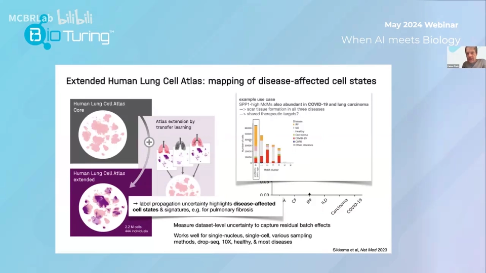

为什么这件事在没有图谱的时代做不到？因为**跨疾病比较的前提是「同一个细胞类型在不同疾病里能被认出来」**。如果每个疾病研究各用一套标签、各跑一套整合，你根本不知道「新冠里的这群巨噬细胞」和「肺癌里的这群巨噬细胞」是不是同一群。图谱提供了那个「同一」的定义。

Theis 由此引到应用层：这样的图谱可以用于**药物筛选**、**更深入了解机制**、**在此基础上做诊断**，以及**寻找跨疾病的共同治疗靶点** [【跳转到 26:37】](https://www.bilibili.com/video/BV1u58wz2Euv/?t=1597)。

### 3.3 稀有细胞不再被当成噪声

图谱还有一个很实际的好处：**恢复稀有细胞的身份**。Theis 的幻灯片标题写得很直白——「整合后的参考图谱使……成为可能」，下面一行小字是 **Recovery of rare cell identities**（恢复稀有细胞身份）[【跳转到 20:56】](https://www.bilibili.com/video/BV1u58wz2Euv/?t=1256)。

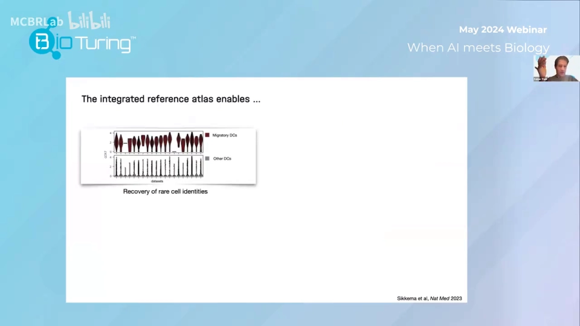

道理不复杂：单个数据集里，只有几十个细胞的稀有类型很容易被当成噪声、被质控过滤掉、或者在聚类时被并进邻近的大群。但当参考图谱里已经**明确存在**这个类型，映射就有地方可落——稀有细胞从「可疑的离群点」变成了「已知类型的一个成员」。

## 四、用途三：给扰动实验提供基线（本系列的主线）

### 4.1 扰动问的是「变化量」，而变化量必须有基线

讲座的后半段转向了扰动。Theis 的框架非常清楚：到目前为止他们用的是**判别式方法**——细胞类型预测（有监督）、聚类（无监督）；而生成模型要做的是**学习条件分布**，而不只是给数据分类 [【跳转到 28:20】](https://www.bilibili.com/video/BV1u58wz2Euv/?t=1700)。

他把这件事讲成了一个「潜在空间算术」的故事：用 Midjourney 生成「穿白绒外套的教皇」，再减去「教皇」，剩下的就是「白绒外套」这个概念；把这个概念加到 Taylor Swift 身上，就得到「穿白绒外套的 Taylor Swift」[【跳转到 29:56】](https://www.bilibili.com/video/BV1u58wz2Euv/?t=1796)。

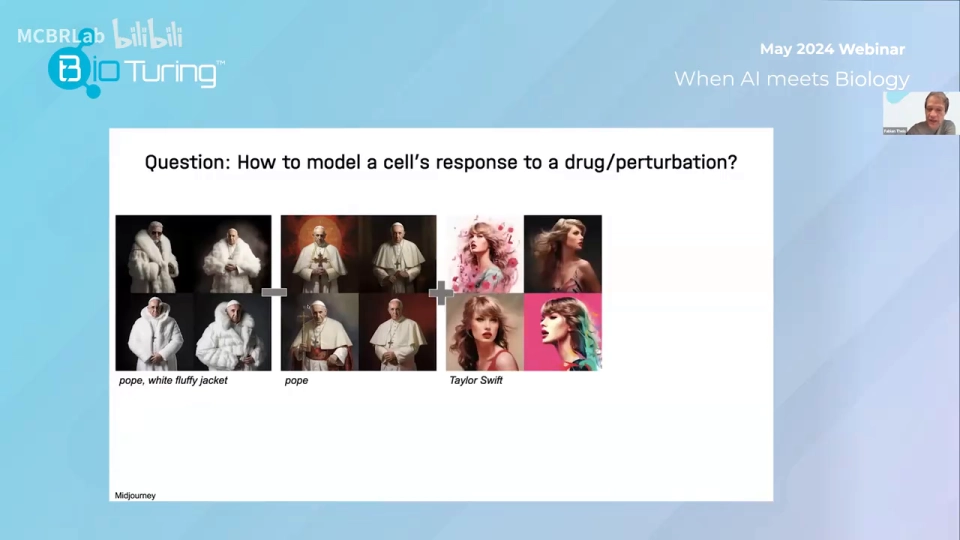

对应到细胞上就是：**取一个经历扰动的细胞，减去基态细胞，得到扰动效应向量；再把这个向量加到别的细胞类型、别的患者、别的细胞上**——从而在没有实际测量过的组合上预测扰动结果 [【跳转到 29:56】](https://www.bilibili.com/video/BV1u58wz2Euv/?t=1796)。写成式子就是：

$$
\mathbf{z}_{\text{pert}} = \mathbf{z}_{\text{ctrl}} + \delta
$$

其中 $\mathbf{z}_{\text{ctrl}}$ 是未扰动细胞在潜在空间里的位置（也就是图谱提供的基线），$\delta$ 是从已测扰动里学到的扰动向量，$\mathbf{z}_{\text{pert}}$ 是预测出来的扰动后状态。

注意这个公式里那个不起眼但绝对不能缺的项：**基态细胞**。没有基态，「减去基态」就无从谈起。这就是基础图谱对扰动实验最本质的贡献——**它提供了那个基态**。

### 4.2 scGen：在潜在空间里学一个线性扰动向量

他们最早的工作叫 **scGen**，用线性潜在空间算术做扰动预测 [【跳转到 30:56】](https://www.bilibili.com/video/BV1u58wz2Euv/?t=1856)。

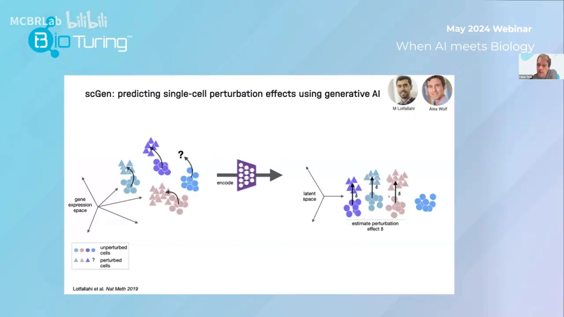

流程是：未扰动细胞和扰动细胞在**基因表达空间**里的轨迹是弯曲的；但编码到**潜在空间**后，两者近似线性。于是你只需要学一个线性约束（那个「算术」向量），把它应用上去、再解码回来，就得到预测的扰动响应。此后他们不断往这个框架里加东西：加扰动因素、加约束条件，逐渐进入**药物空间、设计空间**；与 MIT 合作时，这套东西被叫做 **chemCPA**，实现规模的版本叫 **CPA** [【跳转到 31:01】](https://www.bilibili.com/video/BV1u58wz2Euv/?t=1861)。

### 4.3 参考图谱在扰动预测里的两个角色

Theis 在总结这部分时把话说得很清楚 [【跳转到 31:53】](https://www.bilibili.com/video/BV1u58wz2Euv/?t=1913)：**「使用生成模型，从其他药物的响应谱 + 一张参考图谱出发，外推这个药物的响应谱」**。

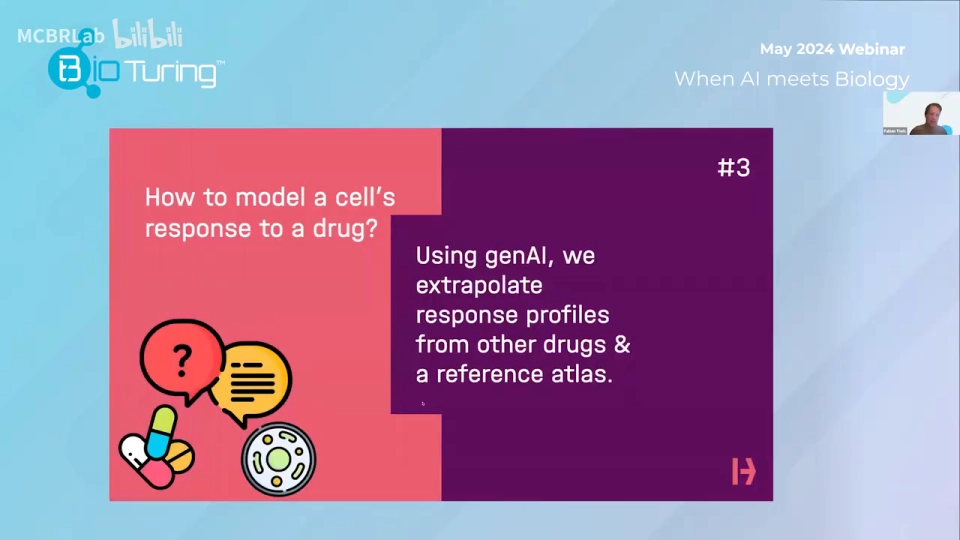

这句话里参考图谱扮演了两个角色，值得分开说：

1. **提供基线与坐标系**：扰动效应必须定义在某个细胞类型的某个状态之上。「敲掉 X 之后细胞变成什么样」这个问题，只有在「没敲之前是什么样」被固定下来之后才有意义。参考图谱把「没敲之前」标准化了——不是某一个实验室的对照样本，而是全社区对齐过的正常状态。
2. **提供「本来就表达」的先验**：如果不知道某个基因在这个细胞类型里**本来就不表达**，你很容易把「敲掉 X 后这个基因的计数变低」误读成「X 调控了这个基因」。参考图谱给出了每个细胞类型的正常表达谱，也就给出了「哪些变化是真变化、哪些只是噪声底」的判断依据。

Theis 还诚实地划了边界 [【跳转到 31:53】](https://www.bilibili.com/video/BV1u58wz2Euv/?t=1913)：目前这类预测**更偏向插值而不是外推**——在见过的扰动谱之间做内插比较可靠，真正外推到完全没见过的化学空间就弱得多；但随着模型看到更多谱型，能力会变强。

### 4.4 图谱本身也是「扰动实验的设计工具」

还有一层不那么显眼的价值：图谱能告诉你**该在哪种细胞上做扰动**。Theis 展示了实验室正在推进的一系列图谱项目 [【跳转到 27:02】](https://www.bilibili.com/video/BV1u58wz2Euv/?t=1622)：人类胰腺、肝脏、视网膜、心脏、肝脏、皮肤、发育图谱；以及小鼠胰岛图谱——整合 9 个异质性数据集、超过 30 万个细胞，覆盖性别、年龄、糖尿病模型、化学应激等条件。

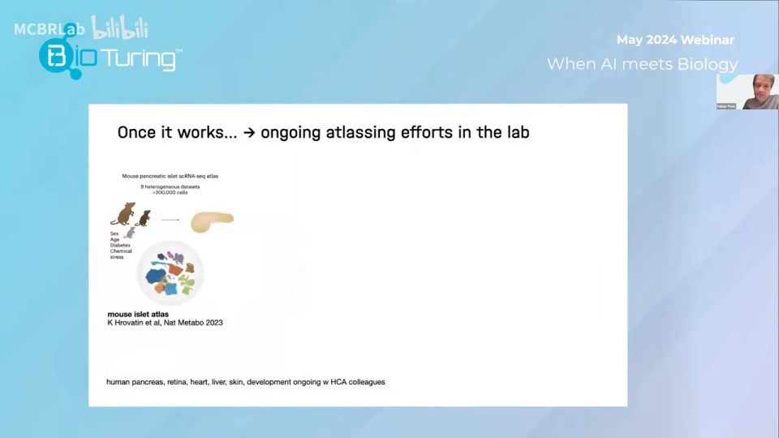

小鼠胰岛图谱这个例子的价值在于：它把**不同糖尿病诱导模型**放在同一坐标系里比较，发现它们有共享结构，也能与对照组、与人类数据对比；还能把**类器官、体外系统**一起放进来，看它们与真实原发发育的差距 [【跳转到 27:22】](https://www.bilibili.com/video/BV1u58wz2Euv/?t=1642)。对扰动实验来说，这直接回答了「我该用哪个模型系统、它在多大程度上代表真实组织」。

## 五、图谱之上：从「共享数据」走向「共享模型」

### 5.1 基础模型的四步走

Theis 把图谱的下一步讲成一条很清晰的路径 [【跳转到 32:39】](https://www.bilibili.com/video/BV1u58wz2Euv/?t=1959)：**大规模收集数据 → 一次性训练一个基础模型 → 评估 → 微调适配大量下游任务**。

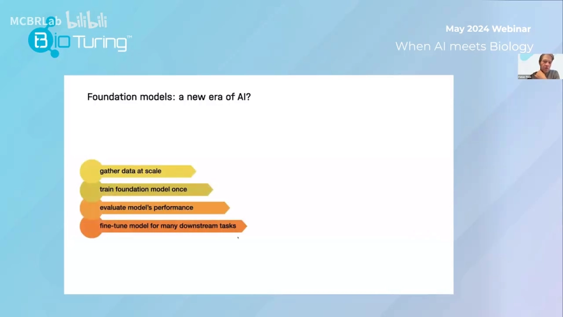

他把这件事和**基因组组装**做了一个很精妙的类比 [【跳转到 34:56】](https://www.bilibili.com/video/BV1u58wz2Euv/?t=2096)：我们从来不会为每个新样本从头组装基因组，而是**直接比对到参考基因组**。单细胞领域正在走同一条路——从「每个数据集从头分析」到「映射到参考图谱」，再到「复用一个预训练模型」。他强调的是**模型复用，而不仅仅是数据复用**。

这条路径的实现形态就是单细胞 Transformer：大规模一次性训练、自监督、不需要额外标签，然后服务于聚类、扰动分析、建模、细胞通信等下游任务 [【跳转到 35:46】](https://www.bilibili.com/video/BV1u58wz2Euv/?t=2146)。

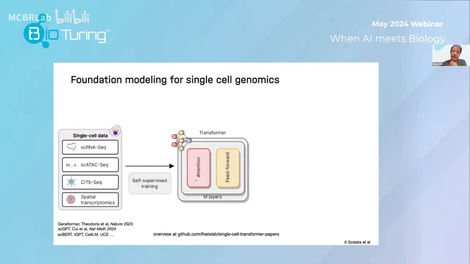

（单细胞基础模型本身的细节属于另一节的内容，这里只需要记住一件事：**基础模型是图谱的下游产物**——没有图谱级别的、对齐过的数据，就没有可训练的基础模型。）

### 5.2 缩放效应在单细胞上还没被看清

Theis 在这里保持了相当克制的态度。他先承认语言模型里那个著名的现象——模型越大、算力越多，突然出现「涌现能力」[【跳转到 37:51】](https://www.bilibili.com/video/BV1u58wz2Euv/?t=2271)，然后立刻说：**在单细胞数据里，我们还没有观察清楚这件事**。

他们为此设计了一个刻意简单的任务：只做细胞类型预测，不用 Transformer，只用一个简单的注意力模型；但把难度提上去——**不是单个器官，而是跨器官预测，是全生物体范围的细胞类型预测** [【跳转到 38:16】](https://www.bilibili.com/video/BV1u58wz2Euv/?t=2296)。结果是：

- 样本量小的时候，**线性模型（逻辑回归）就已经很强**，甚至就是当时的最先进水平；
- 当样本量大幅提升、并且正确做了批次处理后，性能差距才逐渐显现——**线性模型开始触到性能上限，而灵活的学习模型持续变强**。

他称之为「一种缩放效应」，但明确说希望其他模型也能验证这一点，而不是把它当成定论。他还提醒：目前**没有真正的大型基准测试**，需要论证「为什么非要用这么大的模型」，因为训练成本非常高 [【跳转到 37:01】](https://www.bilibili.com/video/BV1u58wz2Euv/?t=2221)。

这段讨论对本章的意义在于：它把「图谱的价值」和「模型的必要性」分开了。图谱的价值是**已经兑现的**（坐标系、标签、基线）；大模型的价值是**尚未证明的**。

## 六、局限与批判：图谱不是免费的午餐

问答环节里，Theis 花了大量时间谈局限。这些讨论比前面的成果展示更有价值，因为它们标出了「用图谱之前必须知道的事」。

### 6.1 技术变异与生物变异的权衡，没有简单解

第一个也是最根本的局限 [【跳转到 50:28】](https://www.bilibili.com/video/BV1u58wz2Euv/?t=3028)：整合的目标是**去掉技术变异、让数据高度重叠，但不能去掉你真正关心的生物变异**。

他举了一个极端例子：如果整合的目标是「把所有数据归成一点」，那么所有整合指标都会很完美——因为**已经没有剩余内容了**。但你想保留的恰恰是那些有趣的变化。这个权衡并不简单，甚至**不清楚该怎么解决**；团队内部也在激烈争论，有同事主张「也许根本不需要整合，只需要在不同数据之间建立映射就够了」[【跳转到 51:15】](https://www.bilibili.com/video/BV1u58wz2Euv/?t=3075)。

Theis 自己的立场是：**拥有一个单一联合坐标非常有用**，你得到一张图、一个共同坐标系。但他并不否认反方的合理性。对使用者来说，这意味着：**看到一篇「整合了 40 个数据集」的论文，第一件事应该是问「它去掉了什么、保留了什么」**。

### 6.2 基因选择：加太多基因会引入大量噪声

第二个具体问题是**用多少基因做整合** [【跳转到 51:59】](https://www.bilibili.com/video/BV1u58wz2Euv/?t=3119)。直觉上基因越多越好，但 Theis 指出：当你在比较两个**非常相似的亚群**时，区分它们可能只需要 4–5 个基因；如果你把几千个基因都塞进去，**大部分基因只是在加噪声**。

他们为此做了一个「注册报告」（先描述要做什么、再执行）式的测试，专门检验基因集合的选择对下游任务的影响。结论是：**大多数情况下，用高变基因并不是坏假设，效果相当不错；但有些情况并非如此** [【跳转到 52:44】](https://www.bilibili.com/video/BV1u58wz2Euv/?t=3164)。

### 6.3 「细胞类型」的定义本身是个病态问题

第三个局限更哲学一些 [【跳转到 53:24】](https://www.bilibili.com/video/BV1u58wz2Euv/?t=3204)：Theis 直接说，**细胞类型定义是一个「病态问题」（ill-posed problem）**。同一个细胞，从功能角度看可能是一个类型，从发育角度看可能是另一个类型；有些细胞甚至会被用两个不同的名字命名。

他提到人类细胞图谱里就存在这种情况，而且这类争议往往集中在某些特定的免疫细胞类型上——「人们确实非常关注这种特定的免疫细胞类型」。社区的一个应对方式是 **CAP（Cell Annotation Platform）**：由 Chloe Villani 组织，为同一份数据建立**多个不同的注释库**，让人们可以就各种状态展开讨论 [【跳转到 54:07】](https://www.bilibili.com/video/BV1u58wz2Euv/?t=3247)。

这一点对使用者的提醒是：**图谱给出的标签是「一个约定」，不是「一个事实」**。当你跨数据集比较时，标签一致不等于细胞一致，标签不一致也不等于细胞不同。

### 6.4 疾病图谱：整合所有数据，还是投影到健康参考？

有听众问到疾病图谱该怎么建 [【跳转到 54:12】](https://www.bilibili.com/video/BV1u58wz2Euv/?t=3252)。Theis 的回答坦白：**社区尚未达成共识**，存在两条路线——

- **完全整合**：把所有数据（健康 + 疾病）一起整合；
- **只保留健康坐标系**：把疾病数据投影到健康参考上。

他倾向于后者，但承认要看疾病类型。癌症是特殊情况：会出现异常细胞类型，**难以准确映射，甚至可能没有足够的空间去映射**，这时可能需要为它增加额外维度 [【跳转到 55:10】](https://www.bilibili.com/video/BV1u58wz2Euv/?t=3310)。而对感染这类「变化更细微」的疾病，把数据整合在同一框架下可能非常重要且有价值。

他自己的研究兴趣是**跨疾病找共性特征**，所以更希望实现跨疾病映射——这也正好呼应了前面 SPP1 那个例子。

### 6.5 批次校正到底是为了什么：可视化，还是分析？

这是最实用的一条批评 [【跳转到 55:55】](https://www.bilibili.com/video/BV1u58wz2Euv/?t=3355)。Theis 说得很直接：**如果批次校正只是为了可视化，那会有点遗憾**。

他的具体建议是：

- **做差异表达分析时，不要进入那个（校正后的）空间**，而是用原始空间，把批次作为协变量放进检验；
- 但如果你要做**聚类、寻找共享的细胞状态、轨迹学习、扰动建模**，把数据放进同一空间就非常有用；
- 所以那个**整合后的潜在空间是一个重要的对象**，而不只是一个画图工具。

他还补充了「在哪个空间看表达量」的问题 [【跳转到 56:51】](https://www.bilibili.com/video/BV1u58wz2Euv/?t=3411)：潜在空间里看不到真实表达数据；用原始数据又无法跨层级比较；折中办法是**看重建结果**——把所有基因表达映射到共享的重建模型上，再比较不同层级。

### 6.6 图谱是快照，会过时，也有覆盖盲区

前面几个具体例子已经暴露了图谱的「时间性」和「覆盖性」问题：

- Theis 在展示 HLCA 时直接说「**有些区域显然已经过时了**」[【跳转到 19:41】](https://www.bilibili.com/video/BV1u58wz2Euv/?t=1181)；
- 核心图谱的 14 个数据集里**没有免疫细胞的注释**，导致免疫细胞区域的映射不确定性很高 [【跳转到 24:15】](https://www.bilibili.com/video/BV1u58wz2Euv/?t=1455)；
- 有**大面积注释不足**的区域、有**杯状细胞误标注**这类错误 [【跳转到 20:26】](https://www.bilibili.com/video/BV1u58wz2Euv/?t=1226)。

把这些放在一起，可以得出一条使用原则：**图谱的可靠性是局部的**。它在被充分采样、被专家共识注释过的区域非常可靠；在被少数数据集覆盖、或注释从未被审计过的区域，它可能比你自己从头做还危险——因为你会信任它。

### 6.7 更根本的一问：预测得准，就算理解了吗？

问答里有一个问题问得很尖锐：大规模用 AI 探究时，是否应该先验证那些基本假设？Theis 承认这「相当根本」，甚至「可能不只有一点危险」[【跳转到 46:21】](https://www.bilibili.com/video/BV1u58wz2Euv/?t=2781)。

他借用了物理学和科学哲学的两句话 [【跳转到 47:27】](https://www.bilibili.com/video/BV1u58wz2Euv/?t=2847)：

- 波普尔式的老派观点：如果我们构建了一个在所有扰动下都能运行、行为如同真实细胞的计算模型，是否意味着我们真正理解了？
- 费曼说：**如果我无法构建它，我就没有真正理解它。**

他的回答是分层的：**作为医生诊断、作为药物筛选，一个预测得准的系统或许可以接受；但他不认为我们应该完全依赖系统**。他还举了 DNA 语言模型的例子——有些同事训练这些模型时并不太在意预测能力，而是**去质询模型学到了什么**。他认为单细胞领域也应该有这种「可质询」的核心模型，但承认「这样做非常困难，我们尚未成功做到」。

这一段对本章特别重要：它把「图谱 + 模型」的定位说清楚了——**它们是工具，不是解释**。图谱能告诉你「这群细胞在坐标系里的哪里」，但「为什么在这里」仍然要靠生物学。

## 小结

- **图谱的产物不是更多细胞，而是一个共享坐标系**：把许多不完整的数据集叠加起来，得到一张比任何单个数据集都准确的结构——就像一群人各自画错的世界地图叠在一起反而准确。
- **注释范式被改变了**：从「每个数据集独立聚类、自己起名」变成「把新数据投影到参考上、继承已有标签」。迁移学习让这一步的代价小到可以日常使用：冻结参考，只微调一层适配器。
- **图谱能反向审计旧数据**：它暴露了标注错误、注释不足的空白区，并用不确定性告诉你「哪里不可信」。
- **它让跨研究、跨疾病比较第一次成为可能**：SPP1 高表达的单核来源巨噬细胞能在 COVID-19 与肺癌里被认成「同一群」，前提正是它们被放进同一个坐标系。
- **稀有细胞从噪声变成成员**：参考里存在的类型，映射就有地方可落，几十个细胞的稀有群不再被质控和聚类吞掉。
- **对扰动实验，图谱提供两样东西**：一个标准化的「没敲之前」基线，以及一份「这个基因在这个细胞类型里本来就表达多少」的先验。scGen / CPA / chemCPA 那一类「潜在空间算术」，减去的正是这个基线。
- **但图谱的可靠性是局部的、有时间性的**：区域会过时，覆盖有盲区，标签是约定而非事实，整合程度是一个没有标准答案的权衡。
- **最后一条边界**：预测得准不等于理解。图谱和模型是工具，不是解释。

## 关键术语速查

| 术语 | 一句话解释 |
| --- | --- |
| 细胞图谱（cell atlas） | 把某个组织或整个生物体里各种细胞类型的表达谱、位置和元数据整合到同一坐标系的数据资源。 |
| 参考图谱（reference atlas） | 被当作「标准答案」的图谱，新数据可以投影到它上面继承标签与坐标。 |
| 参考映射 / 查询到参考整合 | 把新数据集（query）对齐到参考数据集（reference）的坐标系里，而不是重新聚类。 |
| 迁移学习 | 在一个大数据集上预训练，再在小数据集上微调；这里指「冻结参考权重，只训练新加的一小层适配器」。 |
| 适配器（adapter） | 为每个新数据集在编码器、解码器第一层各加的一个标签节点及其权重，微调时只训练它。 |
| 潜在空间（latent space） | 自编码器把上万个基因压缩成的低维向量空间，批次效应在这里被条件变量「抵消」掉。 |
| 条件变分自编码器（cVAE） | 把「批次 / 研究」作为条件输入的自编码器，使潜在空间不再编码批次差异。 |
| 标签传播 | 把参考图谱里已有的细胞类型标签，按映射关系传递给新数据里的细胞。 |
| 映射不确定性 | 每个细胞映射到参考后标签的可信度；参考没覆盖的细胞类型会给出高不确定性。 |
| 分层标签（Level 1/2/3） | 从「免疫 / 上皮 / 间质」这种粗分类，逐层下钻到「基底细胞」这种细亚型。 |
| 病态问题（ill-posed） | 解不唯一的问题；「细胞类型」的定义就是典型例子——功能角度和发育角度会给出不同答案。 |
| 潜在空间算术 | 把扰动效应表示成潜在空间里的一个向量，通过加减来预测没测过的扰动组合。 |
| scGen | Theis 实验室 2019 年的生成模型，用线性潜在空间算术预测单细胞扰动效应。 |
| CPA / chemCPA | 组合扰动自编码器系列方法，把扰动拆成可组合的成分，用于药物响应预测。 |
| 缩放效应（scaling） | 模型与数据规模变大后性能出现非线性提升的现象；在单细胞数据里尚未被清楚证实。 |
| 基础模型（foundation model） | 在广泛数据上一次性训练、可微调适配大量下游任务的模型；对单细胞而言是图谱的下游产物。 |
