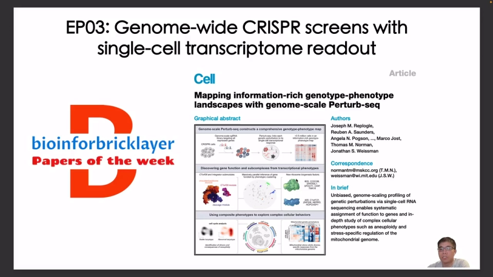
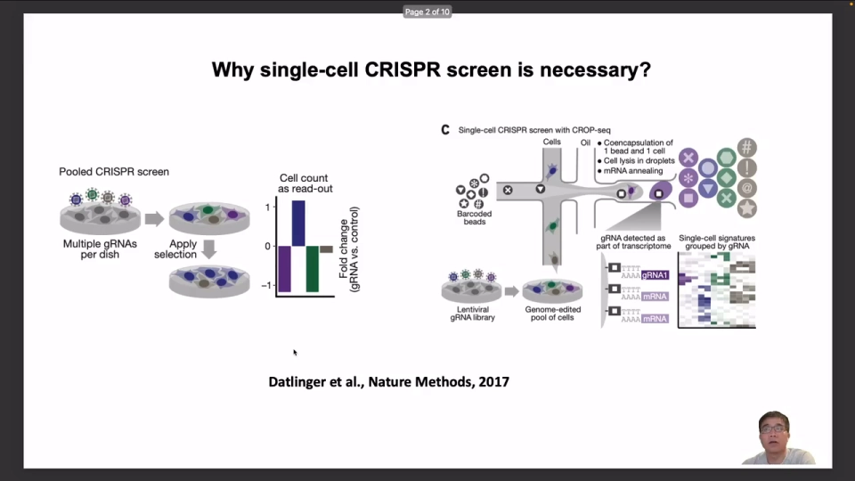
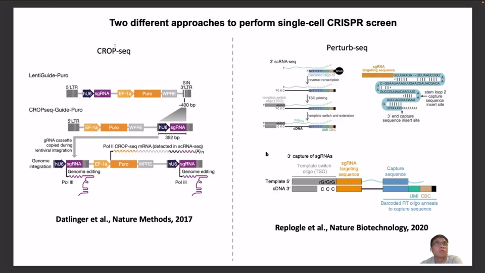
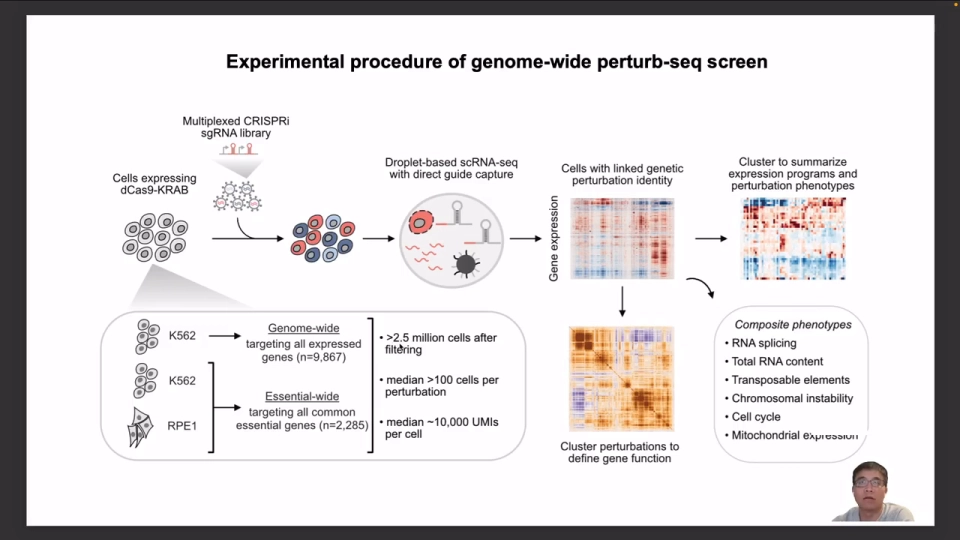
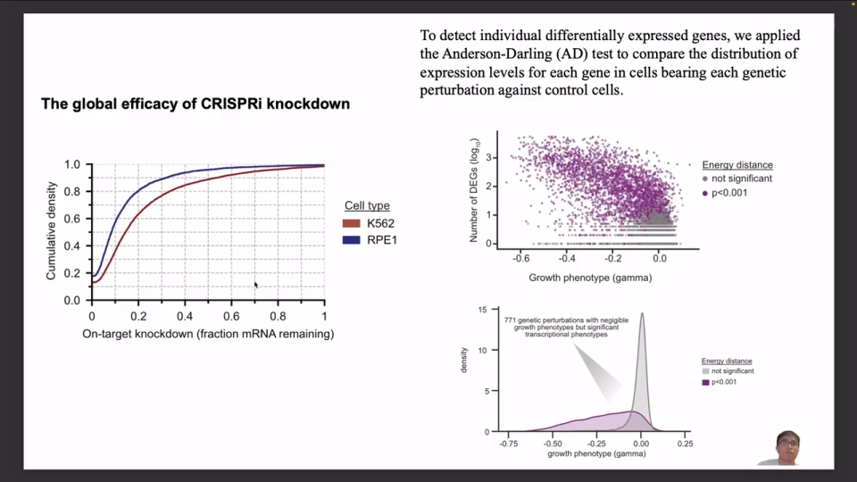
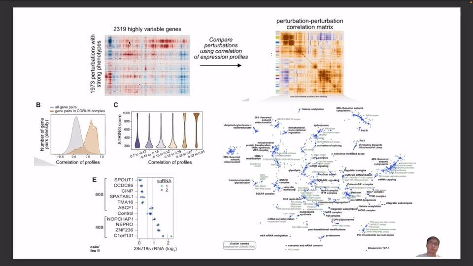
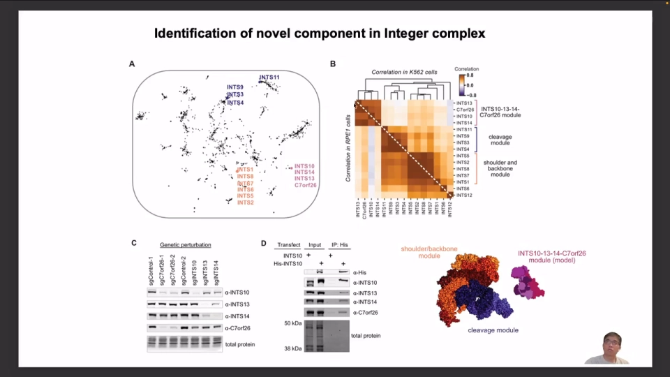
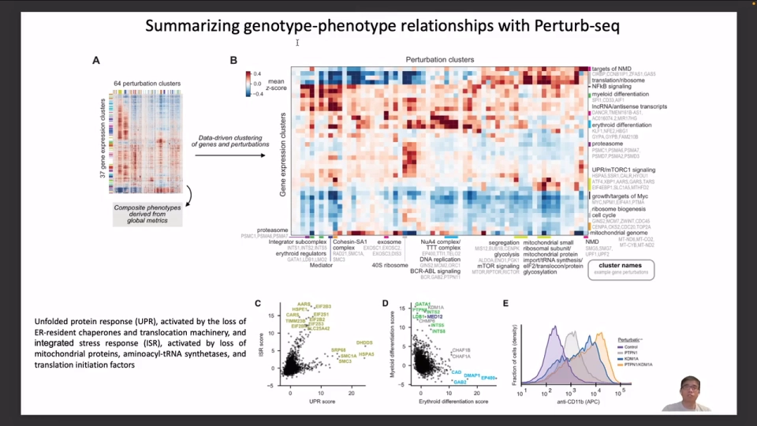
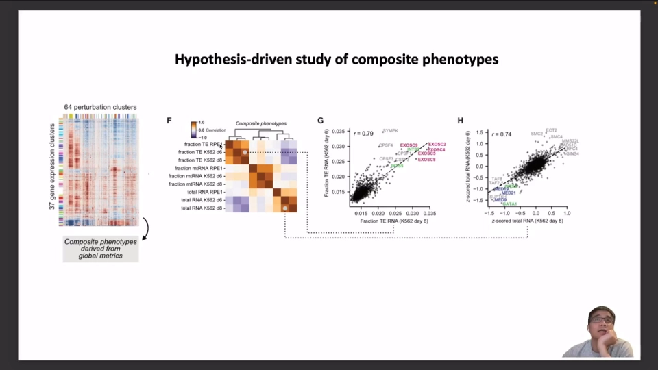
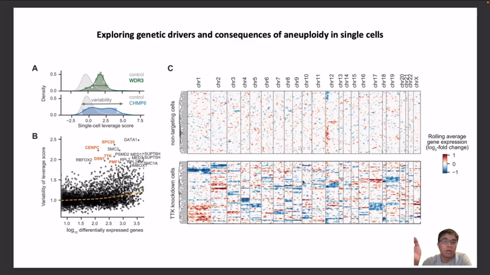

# 全基因组 Perturb-seq：把 250 万个细胞的基因型与表型连成一张图谱

> 视频来源：[【文献精选｜EP03】全基因组单细胞 CRISPR 筛选](https://www.bilibili.com/video/BV1854y1K7D6/)（Bilibili · bioinforbricker）｜时长约 39 分钟
> 导读：这是一集「论文精读」：讲者用 10 张幻灯片读完 Replogle 等 2022 年发表在 *Cell* 上的全基因组 Perturb-seq 工作。前 9 分钟先补上「怎么让 sgRNA 被单细胞测序读到」的两条路线（CROP-seq 与 Perturb-seq），因为正是这两条路线决定了这篇论文能用哪种读出；后 30 分钟逐图讲它的规模、分析方法和六个具体发现。字幕为 B 站 AI 字幕，术语按上下文订正（原文把 CROP-seq 识别成「crowjackcorpsec」、把 Weissman 识别成「jason westman」、把 Integrator 复合物识别成「integer complex」等）；讲者口播里含糊不清的个别基因名，本文按幻灯片上的标注还原，幻灯片也看不清的则不作还原。技术原理（gRNA 怎么被捕获）在 3.3.1 已经讲过，本文只保留理解这篇论文所必需的部分。

## 本讲要解决的核心问题（SCQA）

**背景**：CRISPR 筛选（CRISPR screen）已经能一次敲掉上千个基因。做法是把 sgRNA 文库感染到一群细胞里，让每个细胞随机拿到一条 sgRNA，然后施加选择压力，最后数一数哪条 sgRNA 变多了、哪条变少了。

**冲突**：这种筛选的读出只有一种——**细胞是死是活、长得快还是慢**。可是大量基因被敲掉之后细胞照样活得好好的，只是转录组变了。这类基因在传统筛选里是「隐形」的：它们不影响存活，就不会让 sgRNA 的 count 发生显著变化，于是被当成「没有表型」丢掉。

**疑问**：能不能把「这个细胞被敲掉了哪个基因」和「这个细胞的转录组长什么样」在**同一个细胞**里对上，并且把这件事做到全基因组的规模？

**回答（中心思想）**：**把 sgRNA 的身份写进单细胞转录组的读数里，筛选的读出就能从「细胞死活」变成「整个转录组」；再把它推到全基因组规模，得到的是一张基因型-表型图谱（genotype-phenotype map）。** 这张图谱的价值不在于又测了一遍表达量，而在于它同时干了三件事：给注释不清的基因重新找功能、发现复合物里缺失的组分、把「表型」拆成一批可以打分的复合表型（未折叠蛋白响应、整合应激响应、髓系/红系分化、转座元件表达、非整倍体）。讲者读的这篇论文把规模做到了 9867 个基因、250 万个细胞，是这条技术路线从「几十个基因的原理验证」走到「全基因组」的那一步。

## 一、为什么非要把筛选读到单细胞层面

讲者开场先把两种筛选的读出摆在一起对比 [【跳转到 02:15】](https://www.bilibili.com/video/BV1854y1K7D6/?t=135)。

左边是**混池筛选（pooled screen）**：多种 sgRNA 混在一个培养皿里，感染之后施加选择，读出是每个 sgRNA 的 count 相对于对照的倍数变化（fold change）。这个读出本质上只回答一个问题——**这个基因被敲掉之后，细胞是长得更快还是死得更多**。

右边是**单细胞筛选**：同样是混池感染，但细胞被液滴（droplet）一个个包起来，每个细胞带一个 barcode，于是可以逐细胞地数每个基因的 count；同时 gRNA 序列也作为转录本的一部分被测到，因此每个细胞的转录组都能挂上「它拿了哪条 gRNA」这个标签 [【跳转到 03:10】](https://www.bilibili.com/video/BV1854y1K7D6/?t=190)。

两者的差别可以列成一张表：

| 维度 | 传统 pooled screen | 单细胞 CRISPR 筛选 |
| --- | --- | --- |
| 读出 | 细胞存活、sgRNA 富集/耗竭 | 每个细胞的全转录组 |
| 分辨率 | 一群细胞的平均 | 单个细胞 |
| 能看到什么 | 影响生长的基因 | 影响生长**和**影响表达程序的基因 |
| 代价 | 便宜、通量大 | 细胞量大、测序贵、数据噪声大 |

讲者反复强调的一点是：**很多基因敲掉之后不影响生长，但会造成很大的转录组变动**，这类基因只有单细胞读出才能捞出来 [【跳转到 04:00】](https://www.bilibili.com/video/BV1854y1K7D6/?t=240)。这句话是后面所有分析的前提——如果只看死活，全基因组筛选里大部分信息都会被丢掉。

## 二、两条路线：CROP-seq 与 Perturb-seq

做单细胞 CRISPR 筛选最难的一点，讲者说得很直白：**你怎么把 scRNA-seq 测出来的转录组，和你敲掉的那个基因对应上** [【跳转到 04:47】](https://www.bilibili.com/video/BV1854y1K7D6/?t=287)。你需要同时测到转录组和 sgRNA，而且两者必须落在同一个细胞上。

**路线一：CROP-seq（Datlinger 等，Nature Methods 2017）。** 它用的是常规的 lentiGuide-Puro 载体，改造的办法很巧：把载体里一段约 400 bp 的元件去掉，腾出的空间插进一个 U6 启动子加 sgRNA 的转录盒（约 350 bp）[【跳转到 05:37】](https://www.bilibili.com/video/BV1854y1K7D6/?t=337)。慢病毒整合进细胞基因组之后，这条插入片段两端各有一份拷贝：

- 一份由 **U6 启动子（RNA 聚合酶 III）** 驱动，转录出真正去切割基因组的 sgRNA；
- 另一份由 **EF-1α 启动子（RNA 聚合酶 II）** 驱动，和 puromycin 抗性基因连在同一条转录本上，于是 sgRNA 序列被一起转录下来，成了带 polyA 尾巴的 mRNA 的一部分 [【跳转到 06:27】](https://www.bilibili.com/video/BV1854y1K7D6/?t=387)。

这样一来，常规 3′ 端单细胞测序抓 polyA 尾巴的时候，就顺手把 sgRNA 序列也抓进去了。讲者的评价是「这个方法很聪明」：**同一个插入片段，同时满足了「用来做基因敲除的 sgRNA」和「需要被单细胞测序捕获的 sgRNA」两个需求** [【跳转到 07:17】](https://www.bilibili.com/video/BV1854y1K7D6/?t=437)。

**路线二：Perturb-seq（Weissman 实验室）。** 它有好几个版本。第一个版本给 sgRNA 配了一个 guide barcode（GBC，向导条形码），也就是在同一个载体上再放一个带 polyA 的 barcode 表达盒，靠这个「代理转录本」标记 sgRNA 的身份。讲者指出这个版本的问题：**它对载体的要求比较高，可扩展性不好**，不如直接捕获 sgRNA 那么通用 [【跳转到 08:07】](https://www.bilibili.com/video/BV1854y1K7D6/?t=487)。

改进版（幻灯片上标注为 Replogle 等，Nature Biotechnology 2020）换了个思路：sgRNA 上除了可变的 guide sequence（20 nt 的靶向序列），还有一段不变的**恒定区**，其中包含一个茎环（stem loop）结构。他们在这段恒定区里插了一段 **capture sequence（捕获序列）**，与 3′ 端带 barcode 的逆转录引物互补；逆转录经过这里时就把 sgRNA 序列一起抄下来，于是同一条 read 上同时带着细胞 barcode、UMI 和 sgRNA 序列 [【跳转到 09:22】](https://www.bilibili.com/video/BV1854y1K7D6/?t=562)。

两条路线的取舍，讲者给了一个很实在的观察：他自己实验室用的是 CROP-seq，因为「它是最开始就直接捕获 sgRNA 的方法」；而 Perturb-seq 第一版反应偏差比较大，后期改良之后「现在应该也蛮好的，因为很多文章都在用」 [【跳转到 11:19】](https://www.bilibili.com/video/BV1854y1K7D6/?t=679)。**而今天要读的这篇全基因组论文，用的正是 Perturb-seq 这条直接捕获路线。**

> 这一节只讲到「sgRNA 凭什么能被读到」为止。载体设计、MOI、感染复数这些实验细节属于 3.3 章的内容，这里不展开。

## 三、规模化跃迁：9867 个基因、250 万个细胞

有了能对上号的读出，剩下的问题就是「要多」——每一个基因都要被敲掉、都要被测到转录组，细胞量就必须非常大 [【跳转到 11:44】](https://www.bilibili.com/video/BV1854y1K7D6/?t=704)。

这张流程图值得逐块看，因为它把「规模」拆成了几个可核对的数字：

1. **扰动方式**：细胞先表达 **dCas9-KRAB**，再用多重 CRISPRi sgRNA 文库感染。也就是说这是**敲低（knock-down）而不是敲除（knock-out）**——基因还在，只是被转录抑制。讲者在后面分析时也一直用 knockdown 这个词 [【跳转到 08:29】](https://www.bilibili.com/video/BV1854y1K7D6/?t=509)。
2. **文库覆盖**：全基因组版本靶向 K562 细胞系里**所有表达的基因，共 9867 个**；另外做了一个「必需基因」版本，靶向 2285 个 common essential 基因，分别在 **K562 和 RPE1** 两个细胞系里做 [【跳转到 12:09】](https://www.bilibili.com/video/BV1854y1K7D6/?t=729)。
3. **细胞量**：过滤之后 **超过 250 万个细胞**；讲者补了一句，过滤之前恐怕要有 300 多万 [【跳转到 11:44】](https://www.bilibili.com/video/BV1854y1K7D6/?t=704)。
4. **每扰动的细胞数**：中位数 **超过 100 个细胞**；每个细胞中位数超过 10000 个 UMI。
5. **读出与产物**：液滴单细胞测序直接捕获 guide，得到「基因表达 × 细胞」的大矩阵，再分别对扰动聚类、对表达程序聚类，最后落到一批复合表型上。

**为什么这一步算里程碑。** 讲者在开场就给了对照：最早那批 single-cell CRISPR 只是「比较小范围的、几十个基因的筛选」，而这篇做到了全基因组 [【跳转到 01:00】](https://www.bilibili.com/video/BV1854y1K7D6/?t=60)。中间隔着的不是测序变便宜这么简单，而是三件事同时到位：sgRNA 能被稳定捕获（第二节）、CRISPRi 让敲低不带致死性（下一段）、细胞量足够让每个扰动都有上百个细胞可统计。

**为什么用 CRISPRi 而不是 CRISPR 敲除。** 讲者没有专门论证，但流程图上写得很清楚：这套系统是 dCas9-KRAB 介导的转录抑制。对 Perturb-seq 这种要读「转录组怎么变」的实验来说，这一点很关键——CRISPR 敲除靠的是插入缺失造成移码，很多基因敲掉之后细胞直接死掉，你读不到它的转录组；而 CRISPRi 只是把表达压低，细胞还活着，转录组的变化才测得到。三种模式的机制差别见 3.2.1，这里只点一句。

## 四、先自证：扰动真的生效了吗

在全基因组数据里做任何生物学解释之前，必须先回答一个质控问题：**这些 sgRNA 到底把目标基因敲下去了没有。** 讲者把这一节放在所有发现之前，顺序是对的。

三块内容：

- **敲低效率**：横轴是 on-target knockdown 后剩余的 mRNA 比例，曲线越靠左说明敲得越干净。讲者的读数是「大概有八成以上的细胞有显著的细胞数量降低，说明 sgRNA 的 knock-down 效率还是可以的」，并且两个细胞系都可以，**K562 稍微差一点** [【跳转到 12:44】](https://www.bilibili.com/video/BV1854y1K7D6/?t=764)。
- **怎么找差异表达基因**：把携带某条 sgRNA 的细胞，和 non-targeting control（不靶向任何基因的对照）做比较，用 **Anderson-Darling 检验**去比较两组之间每个基因表达水平的分布；显著的基因就算差异表达 [【跳转到 13:29】](https://www.bilibili.com/video/BV1854y1K7D6/?t=809)。
- **差异表达基因数与生长表型负相关**：造成的差异表达基因越多，说明这个扰动的生长缺陷越强、对细胞的影响越大 [【跳转到 14:04】](https://www.bilibili.com/video/BV1854y1K7D6/?t=844)。这条相关性本身就是数据可信的一个旁证。

最值得注意的是图里右下角那 **771 个扰动**：它们的生长表型几乎为零（细胞照样活），但转录组表型显著 [【跳转到 15:04】](https://www.bilibili.com/video/BV1854y1K7D6/?t=904)。讲者的原话是「它对 growth 没有什么影响，但仍然会造成很大的转录组变动，这些就可能关系到一些非 growth 的表型，也就是你用 growth 筛选没法 measure 的那些」 [【跳转到 15:24】](https://www.bilibili.com/video/BV1854y1K7D6/?t=924)。**这 771 个基因，就是传统 pooled screen 永远看不到的那部分生物学。**

## 五、发现一：扰动效应是模块化的

第一个分析是**对扰动做聚类**：每个扰动对应一套全基因组的表达变化，两个扰动之间算一个相关系数 $\rho_{ij}$；相关高的扰动聚在一起，形成对称的相关矩阵 [【跳转到 17:04】](https://www.bilibili.com/video/BV1854y1K7D6/?t=1024)。

这张图里有四个可以独立核对的结果：

1. **只有一小部分基因有反应**。9000 多个基因里，只有 2000 多个对某一个扰动有显著反应；讲者的说法是「大部分基因其实你敲掉是没啥变化的」 [【跳转到 17:44】](https://www.bilibili.com/video/BV1854y1K7D6/?t=1064)。换句话说，**扰动效应的稀疏性本身就是一个结论**：绝大多数基因的表达对单基因敲低不敏感。
2. **同一复合物的基因，扰动谱高度相似**。如果把已知复合物（CORUM 数据库）里的基因对挑出来，它们的相关系数分布明显右移，显著高于其他所有基因 [【跳转到 18:24】](https://www.bilibili.com/video/BV1854y1K7D6/?t=1104)。
3. **和蛋白相互作用数据库对得上**。相关系数还与 STRING 数据库的相互作用置信度正相关：两个基因的相互作用越可信，敲掉它们之后转录组的相关性越高 [【跳转到 18:24】](https://www.bilibili.com/video/BV1854y1K7D6/?t=1104)。这等于用转录组读出**反向重建**了一遍已知的蛋白互作关系。
4. **聚类出来的簇直接对应通路**。把相关矩阵切成簇之后，每个簇都能落到一个具体的生物学过程上：蛋白酶体、Integrator 复合物、黏连蛋白（cohesin）、外显体（exosome）、NuA4 复合物、剪接体、40S/60S 核糖体、DNA 复制、mRNA 加工、细胞周期、mTOR 信号、糖酵解等 [【跳转到 18:24】](https://www.bilibili.com/video/BV1854y1K7D6/?t=1104)。

讲者用一句很朴素的话总结了这件事的逻辑：**如果两个基因被敲掉之后下游表达变化相似，那它们很可能在同一个复合物里、或者在同一条通路上** [【跳转到 19:04】](https://www.bilibili.com/video/BV1854y1K7D6/?t=1144)。这就是「用扰动相似性推断功能相似性」的基本假设，也是后面两个发现（重新注释、找新组分）的方法论基础。

## 六、发现二：给注释不清的基因重新找功能

全基因组筛选的一个附带好处是：**很多基因以前并没有被很好地注释功能**，而如果某个 poorly annotated 的基因，它的扰动谱和某一类有明确功能的基因集高度相似，那它很可能也有相似的功能 [【跳转到 19:44】](https://www.bilibili.com/video/BV1854y1K7D6/?t=1184)。

讲者举的例子是核糖体生物合成（ribosome biogenesis）：

- 他们找到一批基因，扰动谱和 **60S、40S 核糖体生成**相关的基因高度相似 [【跳转到 20:24】](https://www.bilibili.com/video/BV1854y1K7D6/?t=1224)；
- 这些基因此前**都没有被注释成和核糖体相关**；
- 实验验证：把其中大部分基因敲低后，rRNA（28S/18S）的表达显著下降，只有个别例外 [【跳转到 21:04】](https://www.bilibili.com/video/BV1854y1K7D6/?t=1264)。

幻灯片 E 面板上列出的那批基因（SPOUT1、CCDC86、SPATA5L1、TMA16、ABCF1、NOC4L、NEPRO、ZNF236、C1orf131），每一条 sgRNA 都做了两个重复，横轴是 28S/18S rRNA 的 log2 倍数变化 [【跳转到 21:24】](https://www.bilibili.com/video/BV1854y1K7D6/?t=1284)。讲者把这一步称为「一个 discovery 加验证的例子」 [【跳转到 21:24】](https://www.bilibili.com/video/BV1854y1K7D6/?t=1284)。

**为什么这一步重要**：它说明 Perturb-seq 不只是「验证已知」，它还能**产出新的功能注释**。这恰好是传统 pooled screen 做不到的——那些基因不影响生长，在死活读出里根本没有信号。

## 七、发现三：在已知复合物里找出缺失的组分

第二个应用是找复合物的新组分。逻辑同样是「相似性」：同一个复合物里的基因，扰动谱相似；那么一个扰动谱和某个复合物成员高度相似、但本身不在成员名单里的基因，就可能是缺失的组分 [【跳转到 22:24】](https://www.bilibili.com/video/BV1854y1K7D6/?t=1344)。

讲者讲的这个例子是 **Integrator 复合物**，过程可以拆成三步：

1. **先看内部结构**。即使是一个大复合物，里面不同组分的功能也有差别。做聚类发现 Integrator 实际上可以分成三类，分别对应不同模块：**shoulder/backbone 模块**（INTS1、INTS5、INTS7、INTS8）、**cleavage 模块**（负责切割、和剪接相关，含 INTS3、INTS9、INTS10、INTS11），以及第三个模块 [【跳转到 23:04】](https://www.bilibili.com/video/BV1854y1K7D6/?t=1384)。
2. **发现一个陌生的相似者**。有一个此前没有被注释的基因 **C7orf26**，它的下游转录组和 INTS13、INTS14、INTS10 非常相似，于是被怀疑是同一模块的新成员 [【跳转到 23:44】](https://www.bilibili.com/video/BV1854y1K7D6/?t=1424)。
3. **做实验验证**。把它敲掉之后，INTS10 的表达受到明显影响，提示它们之间需要相互作用来稳定这个结构；再用 pull-down（免疫共沉淀）验证，确实能把它和 INTS10 一起拉下来，说明它们形成一个复合物 [【跳转到 24:04】](https://www.bilibili.com/video/BV1854y1K7D6/?t=1444)。

幻灯片 B 面板把这件事画得很清楚：相关热图在 K562 和 RPE1 两个细胞系里都分出了 **INTS10-13-14-C7orf26 模块**、**cleavage 模块**、**shoulder/backbone 模块**三块；C 面板是敲低后的 Western blot，D 面板是 IP-His 的 pull-down 结果 [【跳转到 23:44】](https://www.bilibili.com/video/BV1854y1K7D6/?t=1424)。

## 八、发现四：把基因型和表型做成一张对照表

上面两个分析都是「对扰动聚类」，看的是**基因与基因**之间的关系。第二个方向是「对表达程序聚类」，看的是**基因与表型**之间的关系：横轴是扰动簇，纵轴是表达程序簇，格子里是这个组合的平均 z-score [【跳转到 25:36】](https://www.bilibili.com/video/BV1854y1K7D6/?t=1536)。

讲者把它称为 **genotype-phenotype map**：64 个扰动簇 × 37 个表达程序簇，每一行、每一列都能读出具体的生物学含义 [【跳转到 25:36】](https://www.bilibili.com/video/BV1854y1K7D6/?t=1536)。举三个他详细讲过的例子：

**例一：未折叠蛋白响应（UPR）与整合应激响应（ISR）。** 打分的办法是：某条通路有一批成员基因，把这些基因的表达变化汇总成一个 score，score 越大说明这个扰动对这条通路的影响越大 [【跳转到 26:16】](https://www.bilibili.com/video/BV1854y1K7D6/?t=1576)。

- **UPR** 被打分激活的，是那些**内质网驻留分子伴侣（ER resident chaperone）和易位子（translocon）**相关基因被敲掉的扰动；
- **ISR** 被打分激活的，是那些**线粒体蛋白、氨酰-tRNA 合成酶、翻译起始因子**被敲掉的扰动 [【跳转到 26:56】](https://www.bilibili.com/video/BV1854y1K7D6/?t=1616)。

这两条通路都是「细胞感受到压力」的通用响应，但**触发它们的上游扰动完全不同**——这正是单细胞读出比死活读出细的地方：两种扰动都不一定杀死细胞，却激活了不同的应激程序。

**例二：髓系与红系分化。** 图里还有两个分化方向的打分：一批基因对应白细胞（髓系）分化，另一批对应红细胞（红系）分化 [【跳转到 27:16】](https://www.bilibili.com/video/BV1854y1K7D6/?t=1636)。讲者用流式结果做了验证：对照细胞没有明显变化，所以他们用 **CD11b** 这个髓系 marker 去看；敲掉某一个基因会有一些影响，而**把两个基因同时敲掉，影响更显著** [【跳转到 27:56】](https://www.bilibili.com/video/BV1854y1K7D6/?t=1676)。他的解释是这两个基因通过两条不同的通路影响同一个分化过程，同时敲掉就出现**协同（synergy）** [【跳转到 28:16】](https://www.bilibili.com/video/BV1854y1K7D6/?t=1696)。

**例三：通路之间的交叉。** 讲者还提到，图上能看到不同的通路参与进来，同一个表型可以被多条上游通路驱动 [【跳转到 28:16】](https://www.bilibili.com/video/BV1854y1K7D6/?t=1696)。这也是这张图谱相对「一个基因一个表型」的清单式结论的进步：它给出的是**多对多的映射关系**。

## 九、发现五：把「表型」拆成可打分的复合表型

除了通路打分，这篇论文还定义了另一类读出：**复合表型（composite phenotype）**——不是某一个基因的表达，而是从单细胞数据里算出来的整体指标 [【跳转到 28:44】](https://www.bilibili.com/video/BV1854y1K7D6/?t=1724)。流程图上列了六项：RNA 剪接、总 RNA 含量、转座元件、染色体不稳定性、细胞周期、线粒体基因组 [【跳转到 12:09】](https://www.bilibili.com/video/BV1854y1K7D6/?t=729)。

讲者重点讲了两项：

- **转座元件（transposable element）**。转座元件在基因组里占了很大比例，它的表达变化也可以从单细胞数据里测出来；把每个扰动的转座元件表达占比算成一个分数，分数越大说明这个扰动影响的转座元件越多 [【跳转到 29:24】](https://www.bilibili.com/video/BV1854y1K7D6/?t=1764)。他提到有一批基因都和这个分数相关。
- **总 RNA 含量（total RNA）**。它反映细胞的转录表达总量，和 **Mediator 复合物**相关——如果扰动打的是 Mediator，影响的是转录/剪接这一层，总 RNA 就会变少 [【跳转到 30:04】](https://www.bilibili.com/video/BV1854y1K7D6/?t=1804)。

这一节最值得记住的是**一致性检验**：同一批扰动在 K562 与 RPE1 两个细胞系、两个时间点上的复合表型打分是高度相关的（幻灯片上标出的相关系数 r 分别为 0.79 和 0.74）[【跳转到 29:44】](https://www.bilibili.com/video/BV1854y1K7D6/?t=1784)。换句话说，**复合表型这个读出本身是可重复的**，不是单次实验的噪声。

## 十、发现六：非整倍体与染色质不稳定性

最后一个方向是把读出推到「整条染色体」这个层面。讲者先解释了一个指标：**单细胞 leverage score**。它的意思是，如果某个细胞在某一个方向上的表达发生了明显变化，那么在很多 peak（特征基因）上它的 leverage 都会明显升高 [【跳转到 31:00】](https://www.bilibili.com/video/BV1854y1K7D6/?t=1860)。

这个 score 高说明什么？讲者的解释是：**这不是某一条通路的变化，而是染色质层面的变化**——整个基因组变得更不稳定，于是全基因组的基因表达都会跟着变 [【跳转到 31:40】](https://www.bilibili.com/video/BV1854y1K7D6/?t=1900)。而且 leverage score 与差异表达基因的数量正相关，这也合理：染色质越不稳定，差异表达基因就越多 [【跳转到 32:20】](https://www.bilibili.com/video/BV1854y1K7D6/?t=1940)。

实验验证是 **TTK**：把 TTK 敲掉之后，可以看到**所有染色体**上都出现显著变化，相当于整个染色体组水平的变化，而不是某一条通路或某一个复合物的变化 [【跳转到 32:40】](https://www.bilibili.com/video/BV1854y1K7D6/?t=1960)。讲者的总结是：这是在「更高、另一个层面」上看扰动的影响，而这些通过 single-cell RNA-seq 都能看到 [【跳转到 33:20】](https://www.bilibili.com/video/BV1854y1K7D6/?t=2000)。

## 十一、这项研究留下了什么，又没解决什么

**留下的东西：**

1. **一张全基因组的扰动-表达对照表**。9867 个基因 × 250 万个细胞，每个扰动都有上百个细胞、上万个 UMI 支撑。这种规模的数据集后来成了扰动响应预测模型的公共基准（怎么用这些数据建模见 5.3）。
2. **一套可复用的分析范式**：扰动间相关 → 功能聚类 → 与 CORUM/STRING 交叉验证 → 找新注释、找新组分 → 扰动簇 × 表达程序簇的对照表 → 复合表型打分。讲者说这套分析「信息量蛮大，你可以从很多方面去寻找你想看的东西」 [【跳转到 28:16】](https://www.bilibili.com/video/BV1854y1K7D6/?t=1696)。
3. **一批具体的生物学结论**：核糖体生物合成相关的新基因、Integrator 的新组分 C7orf26、UPR/ISR 的上游触发条件、髓系分化的协同扰动、TTK 与非整倍体。

**没解决的（讲者自己点到的）：**

- **数据噪声大，必须靠计算方法**。他的原话是「这个数据比较 noisy，需要一些 computational 的方法，这就涉及到生物信息的部分」 [【跳转到 37:38】](https://www.bilibili.com/video/BV1854y1K7D6/?t=2258)。也就是说，从原始矩阵到上面那些结论，中间隔着一整套统计处理。
- **敲低不完全**。CRISPRi 只是把表达压低，不是清零；敲低效率「八成以上」意味着总有一部分细胞里目标基因还在表达，效应量因此被稀释，K562 还比 RPE1 更差一些 [【跳转到 12:44】](https://www.bilibili.com/video/BV1854y1K7D6/?t=764)。
- **效应普遍偏小**。9000 多个基因里只有 2000 多个对某个扰动有显著反应，大部分基因敲低之后转录组几乎不动 [【跳转到 17:44】](https://www.bilibili.com/video/BV1854y1K7D6/?t=1064)。这既是生物学事实，也提醒我们「没检测到」不等于「没功能」。
- **只有细胞系**。全基因组版本只在 K562 里做，必需基因版本加了 RPE1。细胞系是永生化细胞，和原代细胞、体内环境差得远；跨细胞系的泛化能力，讲者用复合表型的一致性（r≈0.74–0.79）给出了一个偏乐观的信号，但那只覆盖了少数指标。

## 小结

- **单细胞筛选解决的是「读出太窄」的问题**：传统 pooled screen 只能看细胞死活，而大量基因敲低后细胞照样活着、只是转录组变了；把 sgRNA 和转录组测进同一个细胞，这些基因才第一次有信号。
- **两条技术路线决定了后面能做什么**：CROP-seq 靠双启动子把 sgRNA 做成带 polyA 的转录本，Perturb-seq 靠 sgRNA 恒定区里的 capture sequence 被引物直接捕获；这篇全基因组论文走的是后者。
- **规模是这篇论文的第一层贡献**：9867 个表达基因、250 万个过滤后细胞、每个扰动上百个细胞，把 single-cell CRISPR 从「几十个基因」推到全基因组。
- **扰动效应是模块化的**：同复合物、同通路的基因，扰动谱高度相似；这种相似性既能复现 CORUM/STRING 的已知关系，也能用来推断未知功能。
- **图谱的两种读法**：对扰动聚类得到「基因-基因」关系（找新注释、找新组分）；对表达程序聚类得到「基因-表型」对照表（UPR/ISR、分化、协同）。
- **复合表型是这套数据的独特产出**：转座元件表达、总 RNA 含量、染色体不稳定性这些指标，只能从单细胞转录组里算出来，而且跨细胞系可重复。
- **代价要记住**：CRISPRi 敲低不完全、效应量普遍偏小、数据噪声大需要专门的计算方法、实验只在细胞系里做。

## 关键术语速查

| 术语 | 一句话解释 |
| --- | --- |
| Perturb-seq | 把一条 sgRNA 的身份和这个细胞的转录组测进同一个细胞的单细胞 CRISPR 筛选方法 |
| CROP-seq | 用双启动子让 sgRNA 本身变成带 polyA 的转录本、从而被 3′ 端单细胞测序读到的方案 |
| capture sequence | 插在 sgRNA 恒定区里的一段序列，与带 barcode 的逆转录引物互补，用来把 sgRNA 抄进 cDNA |
| CRISPRi / dCas9-KRAB | 用失去切割活性的 Cas9 融合抑制子 KRAB，把目标基因的转录压低而不是切断 |
| 扰动相关矩阵 | 两两扰动之间转录组变化谱的相关系数矩阵，用来把功能相似的扰动聚在一起 |
| genotype-phenotype map | 扰动簇与表达程序簇交叉排布的热图，一格对应「敲掉这类基因 → 这类表达程序怎么变」 |
| 复合表型 | 从单细胞数据整体算出的指标，如转座元件表达占比、总 RNA 含量、染色体不稳定性 |
| Anderson-Darling 检验 | 比较两组表达值分布是否相同的统计检验，这里用来判定扰动组与对照组的差异表达 |
| leverage score | 衡量单个细胞在表达空间中偏离程度的指标，score 高提示染色质层面的整体不稳定 |
| CORUM / STRING | 已知蛋白复合物数据库 / 蛋白相互作用数据库，用来交叉验证扰动相关性是否对应真实互作 |