# CRISPRoff 与 CRISPRon：同一套 gRNA，沉默数据干净、激活数据更难做

> 视频来源：[【陈巍学基因】122：自如地开关基因组表达——CRISPRoff on](https://www.bilibili.com/video/BV1Rk4y1Z7YP/)（Bilibili · 陈巍学基因）｜时长约 14 分钟
> 导读：这支视频逐图讲解了 Cell 2021 年那篇 CRISPRoff / CRISPRon 的论文：怎么把基因「关掉」、怎么再「打开」，以及每一步用什么数据来证明。本文按「关得准不准 → 关得久不久 → 开得回来吗」重排，重点放在**这两类扰动产出的数据在性质上有什么不同**——沉默数据可以做得又干净又持久，而重新激活的效率明显低一档。分子机制细节（dCas9、KRAB、DNMT3A）在本系列 3.2.1 已讲过，本文只保留理解数据所必需的部分。

## 本讲要解决的核心问题（SCQA）

**背景**：CRISPRi 和 CRISPRa 都属于「不改 DNA 序列、只改转录量」的扰动。CRISPRi 靠 dCas9 挂抑制域把基因关小，CRISPRa 靠 dCas9 挂激活域把基因开大。本系列 3.2.1 讲过它们的分子机制，第 4 章关心的是另一件事：**用它们做出来的数据，长什么样、能不能信。**

**冲突**：传统的 CRISPRi 有一个绕不开的短板——**它依赖效应蛋白一直在场**。你撤掉 dCas9-KRAB，抑制就解除，基因表达回到原样。这带来两个数据层面的问题：一是扰动只在你观察的那段时间里成立，长期表型（比如分化、衰老）没法追；二是不同细胞里效应蛋白表达量不一样，抑制程度就参差不齐，数据的一致性差。

**疑问**：能不能把「关掉一个基因」变成一件**有记忆**的事——关掉之后即使效应蛋白不在了，细胞和它的后代还保持关闭状态？如果做得到，那这种沉默数据和普通的 CRISPRi 数据在性质上有什么不同？反过来，把已经关掉的基因重新打开，效率又如何？

**回答（中心思想）**：这篇论文给出的答案是**用表观遗传标记代替效应蛋白的持续存在** [【跳转到 00:33】](https://www.bilibili.com/video/BV1Rk4y1Z7YP/?t=33)。CRISPRoff 在 dCas9 上挂 DNA 甲基转移酶（DNMT3A/3L）和 KRAB，把目标基因启动子甲基化掉；甲基化标记随 DNA 复制被继承下去，于是沉默可以持续 15 个月、450 代细胞分裂，而效应蛋白早在第 10 天就不表达了。这使**沉默数据变得异常干净**：全转录组里只有目标基因显著下调，邻近基因和全基因组甲基化几乎不动。反过来，CRISPRon 用 TET1 去甲基化酶加转录激活域把基因重新打开，效率就只有 70% 左右一档，而且强烈依赖你给什么激活域——**「关」比「开」容易得多，这是两类扰动数据最本质的不对称。**

## 一、CRISPRoff：把「关掉一个基因」写成一条可以遗传的标记

### 1.1 设计思路：把甲基化酶搬到启动子上

方法的基本原理很朴素：一个基因在 DNA 水平上的甲基化，尤其是启动子区域的甲基化，会降低它的表达水平；那么改变目标基因的甲基化水平，就能改变它的表达水平 [【跳转到 01:19】](https://www.bilibili.com/video/BV1Rk4y1Z7YP/?t=79)。

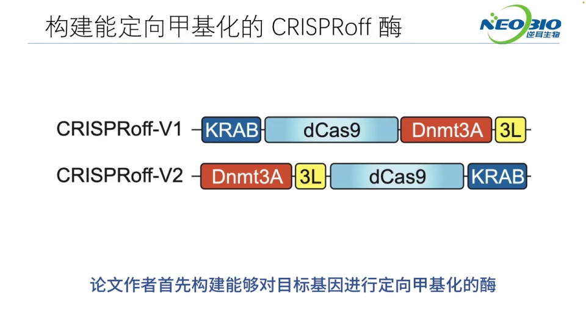

作者构建的重组甲基化酶叫 **CRISPRoff**，两个版本 V1 与 V2，元件相同、排列不同：

- **dCas9**：dead Cas9，切割活性被突变掉，但保留了在 guide RNA 指引下结合靶 DNA 的能力——它只负责「定位」；
- **DNMT3A**：DNA (cytosine-5)-methyltransferase 3A，把 CpG 岛上的 C 碱基甲基化；
- **3L**：DNMT3L，刺激 DNMT3A 做从头甲基化；
- **KRAB**：来自锌指蛋白的抑制域，结合 DNA 并抑制转录。

和普通 CRISPRi 的差别就在前两个元件：**它不只是「压住」转录，而是给这段 DNA 写上一个可以遗传的化学标记** [【跳转到 02:39】](https://www.bilibili.com/video/BV1Rk4y1Z7YP/?t=159)。

### 1.2 第一组数据：沉默效率与「蛋白走了还关着」

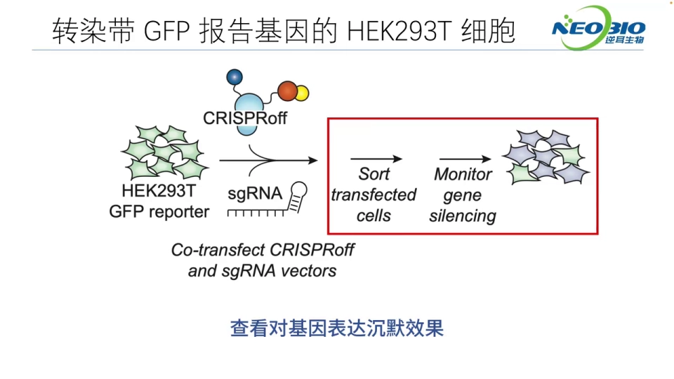

作者用一株稳定表达「对 DNA 甲基化敏感的 GFP 报告蛋白」的 HEK293T 细胞做测试：报告基因正常表达就发荧光，被甲基化就沉默、不发光。把编码 CRISPRoff 的质粒和针对报告基因启动子的 sgRNA 共转进去，分选转染细胞，然后追踪沉默比例。

结果有两条关键信息：

1. **V2 版本的酶在转染后 50 天，仍有 90% 的细胞处于沉默状态**，V1 略低 [【跳转到 03:53】](https://www.bilibili.com/video/BV1Rk4y1Z7YP/?t=233)；
2. 图中两条虚线是重组甲基化酶的蛋白表达量——**到第 10 天细胞就已经不再表达这个酶了**。

第 2 条才是重点：**目标基因的长期沉默并不依赖重组甲基化酶的持续表达。** 这正是它与普通 CRISPRi 数据的分水岭。

为了把这一点钉死，作者又换了一种递送方式：直接用 CRISPRoff 的 **mRNA** 加 sgRNA 转染（针对 CLTA 基因）。mRNA 在细胞里很快降解，不会有长期蛋白表达。

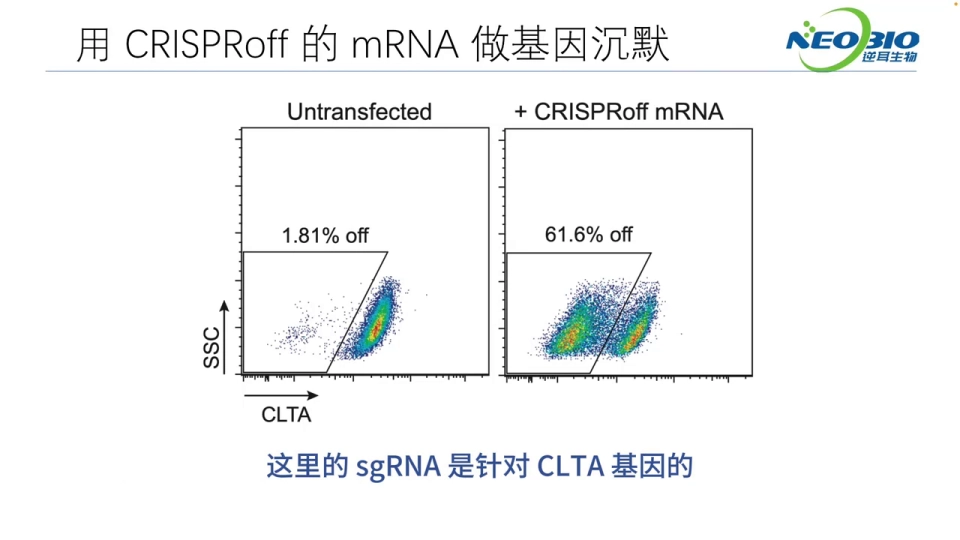

转染后第 6 天做流式：未转染对照 1.81% 沉默，加了 CRISPRoff mRNA 的组 **61.6% 沉默** [【跳转到 04:43】](https://www.bilibili.com/video/BV1Rk4y1Z7YP/?t=283)。蛋白早就没了，沉默还在——这就是「表观遗传记忆」的直接读数。

### 1.3 多个基因同时沉默：单条 sgRNA 参差，混打更稳

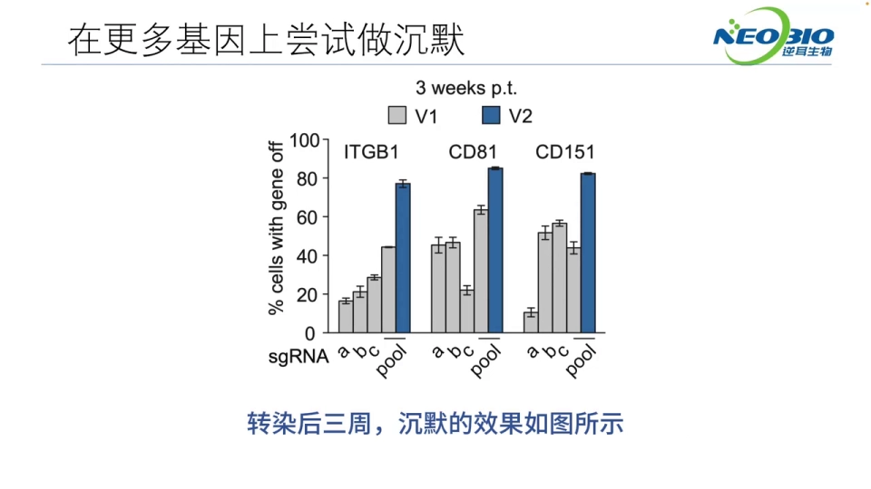

作者挑了三个与细胞生存、增殖无关的细胞表面蛋白基因（ITGB1、CD81、CD151），比较不同做法在转染三周后的沉默比例：

- **单条 sgRNA 之间差异很大**：同是一个基因，sgRNA a、b、c 打出来的沉默比例可以从 10% 出头到 60% 多；
- **三条 sgRNA 混合（pool）明显更稳**：V2 版本对三个基因的沉默都超过了 80%；
- **V2 普遍优于 V1**。

这张图其实是一份「CRISPRi 类数据的一致性说明书」：**同一个基因、不同 gRNA，效应量可以差好几倍。** 所以任何一份 CRISPRi/CRISPRoff 数据，都必须交代每个基因用了几条 gRNA、是单条还是混打——否则你没法判断那个效应量是基因的性质，还是某条 gRNA 的性质。

他们还做了同时沉默 4 个基因（ITGB1、CLTA、CD8、CD151）的实验，每个基因都有一定比例的细胞被沉默，说明多重沉默是可叠加的 [【跳转到 06:23】](https://www.bilibili.com/video/BV1Rk4y1Z7YP/?t=383)。

### 1.4 持久性：15 个月、450 代之后还在关着

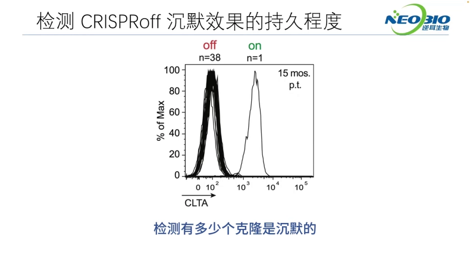

对 CLTA 基因做沉默处理后，作者把细胞培养了 **15 个月**（约 450 代分裂），再分散成单克隆逐个检测：**39 个克隆里 38 个仍然沉默，只有 1 个恢复表达。**

这个数字对数据资源的意义很直接 [【跳转到 06:48】](https://www.bilibili.com/video/BV1Rk4y1Z7YP/?t=408)：**CRISPRoff 产出的是一份「稳定的基因型样状态」**，而不是一个随时间漂移的瞬时扰动。如果你要研究长期表型（分化、衰老、长期增殖），这类数据的可用窗口比普通 CRISPRi 宽得多。

## 二、沉默数据为什么「干净」：特异性可以从三个层次证明

一份扰动数据最怕的不是效应弱，而是**你不知道效应是不是只来自那个基因**。这支视频用三组图把特异性从粗到细证了一遍。

### 2.1 转录组层次：只有目标基因在动

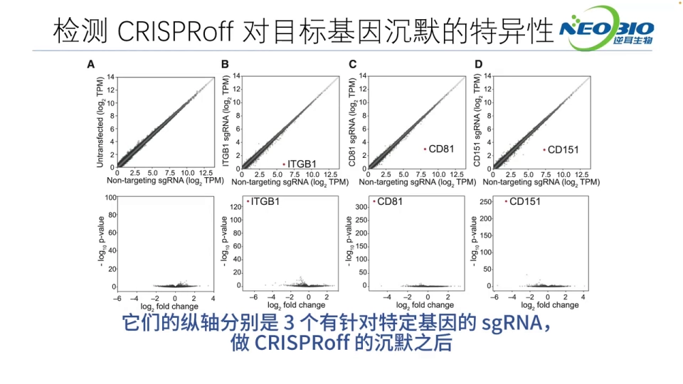

做法很标准：横轴是用非靶向 sgRNA 做对照时每个基因的表达量，纵轴是用靶向 sgRNA 做 CRISPRoff 沉默后同一个基因的表达量，每个点是一个基因。

- A 图（未转染 vs 非靶向对照）几乎完美落在对角线上——说明转染本身没带来系统性变化；
- B、C、D 三张图里，**只有被靶向的那个基因（ITGB1、CD81、CD151）掉到右下角**，其余基因全部贴着对角线；
- 下排火山图显示，这三个基因的下调在统计上都非常显著。

换句话说 [【跳转到 07:38】](https://www.bilibili.com/video/BV1Rk4y1Z7YP/?t=458)：**在这份数据里，「扰动效应」几乎全部集中在目标基因这一行上**，这也是为什么这类数据特别适合当作「干净标签」用于建模。

### 2.2 基因组邻域层次：没有波及邻居

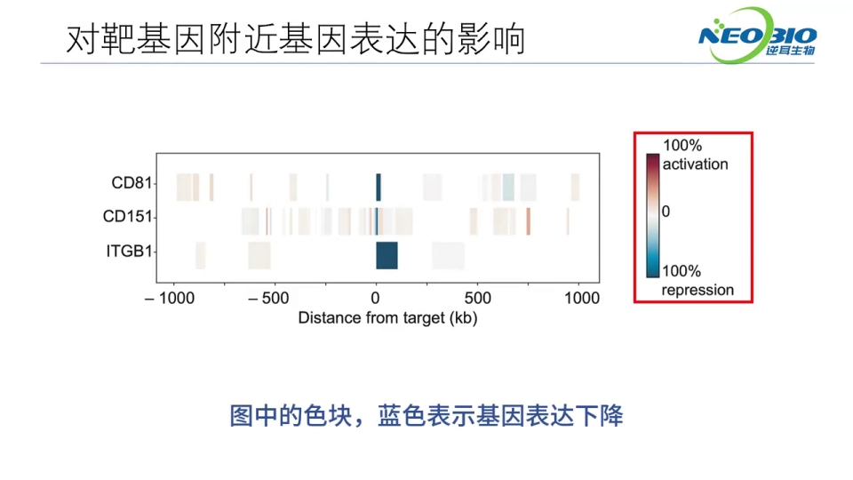

第二个层次是空间上的：CRISPRoff 结合在某个位点，会不会把旁边的基因也一起关掉（类似位置效应）？图里横轴是距靶基因的距离（−1000 kb 到 +1000 kb），每个色块是一个基因的表达变化，蓝色表示下降、红色表示上升。

结果 [【跳转到 08:03】](https://www.bilibili.com/video/BV1Rk4y1Z7YP/?t=483)：**只有 0 位置上的靶基因出现明显的深蓝色块**，两侧 ±1000 kb 范围内的基因基本是浅色。也就是说，沉默没有沿着染色体扩散。

### 2.3 甲基化层次：只有目标启动子被甲基化

第三个层次是机制层面的：甲基化到底写在了哪里。以 1.5 kb 为窗口扫过全部 23 条染色体，红色是针对 CLTA 沉默的样本、蓝色是非靶向对照。结果是 [【跳转到 08:28】](https://www.bilibili.com/video/BV1Rk4y1Z7YP/?t=508)**只有 CLTA 的启动子出现强烈甲基化，基因组其他位置没有**。

三个层次合起来，说明这份沉默数据的「信噪比」非常高：一个基因被关掉，几乎不会在转录组、邻域、甲基化组上留下附带损伤。**这正是 CRISPRi 类数据相对 CRISPRa 的结构性优势——下调的效应天然更局部。**

## 三、CRISPRon：把基因重新打开，效率就掉一档

### 3.1 设计思路：换一个方向写标记

既然「关」是往启动子上写甲基化，那「开」自然就是把它擦掉。作者设计了重组去甲基化酶：dCas9 负责定位，**TET1**（ten-eleven translocation enzyme）负责把甲基化的 C 氧化成 5-羟甲基胞嘧啶——这是去甲基化过程的关键一步；V2、V3、V4 版本还在 dCas9 与 TET1 之间加了 XTEN16 或 XTEN80 连接肽。

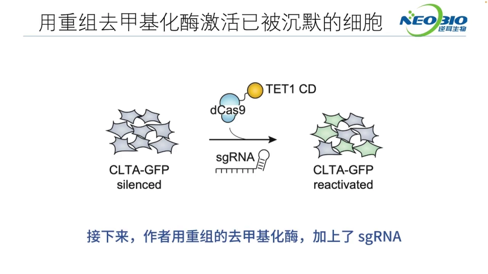

### 3.2 第一组数据：70% 的细胞被重新点亮

用这套去甲基化酶加 sgRNA 转染「CLTA-GFP 已被甲基化沉默」的细胞，观察 GFP 重新发光：**V4 版本可以让超过 70% 的细胞被激活** [【跳转到 10:08】](https://www.bilibili.com/video/BV1Rk4y1Z7YP/?t=608)。

作者又用 **Bisulfite-PCR**（重亚硫酸氢盐处理 DNA 后再 PCR）直接看甲基化本身：

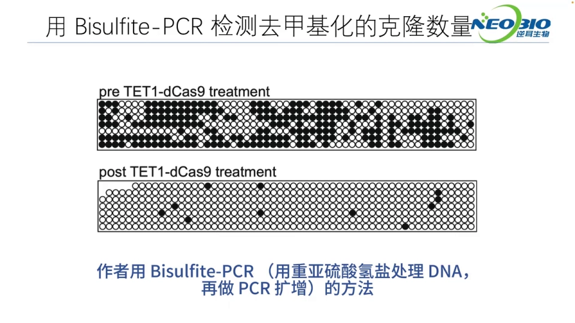

处理前有相当比例的细胞克隆处于甲基化状态，处理后绝大部分克隆被去甲基化 [【跳转到 10:30】](https://www.bilibili.com/video/BV1Rk4y1Z7YP/?t=630)。而且去甲基化之后，目标基因在转染 9 天后仍稳定表达——**说明这不是一次性的「冲一下」，而是真的把标记改回去了。**

### 3.3 模块化：激活效率取决于你给它什么激活域

作者把重新激活做成了模块化体系，命名为 **CRISPRon**：核心仍是 V4 版去甲基化酶，但 sgRNA 上加了 2 个 **MS2 茎环结构**，可以招募 **MCP（MS2 coat protein）**；MCP 再与三种反式激活域（VP64、p65-AD、Rta）组合，可以单独用、两两串、或三个串成三分体。

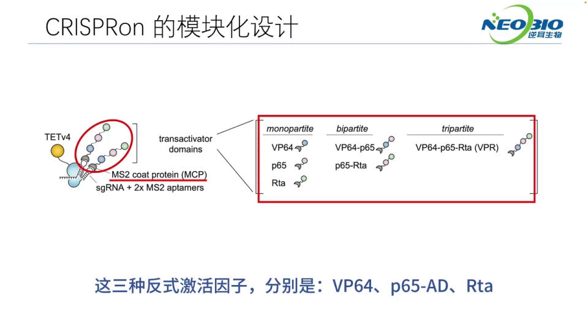

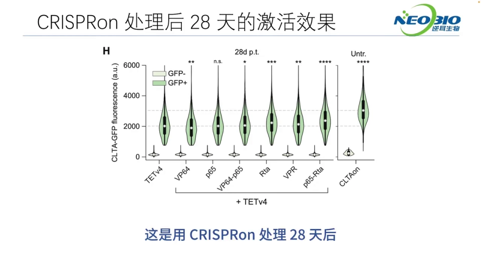

结果是一张典型的「参数扫描」数据：

- 只给 V4 去甲基化酶和 sgRNA、**不加 MCP 激活域**的，激活效果很弱；
- 加上不同的激活域组合，激活比例和荧光强度逐级上升；
- 其中 **p65-Rta** 的效果最明显，处理 28 天后单细胞荧光分布明显右移，接近原本就处于活性状态的对照细胞。

这张图把「激活数据为什么更难做」讲得很清楚 [【跳转到 12:40】](https://www.bilibili.com/video/BV1Rk4y1Z7YP/?t=760)：**同一个基因、同一套定位系统，最终效应量高度依赖你挂了什么激活域、挂了几个。** 也就是说，CRISPRa 类数据的效应量里，有相当大的成分是「工具配置」而不是「基因本身」。

## 四、两类数据的性质差异：一张对照表

把两支视频里反复出现的观察收拢，CRISPRi 侧（CRISPRoff 为代表）与 CRISPRa 侧的差别可以列成这样：

| 维度 | CRISPRi 侧（CRISPRoff 这类沉默） | CRISPRa 侧（激活/过表达） |
| --- | --- | --- |
| 效应方向 | 下调，通常只能压到残余表达的一小部分 | 上调，理论上可以远超生理水平 |
| 效应强度 | 单条 gRNA 之间差异大，混打后可达 80% 以上沉默 | 单条 gRNA 常常接近零，需要多条串联或更强的激活域 |
| 空间范围 | 高度局部：只有靶基因与靶启动子受影响 | 过表达可能把细胞推出正常状态，下游连锁反应更多 |
| 持续性 | 甲基化型沉默可遗传，15 个月/450 代仍稳定 | 依赖效应蛋白在场，撤掉即回落 |
| 数据的一致性 | 同基因不同 gRNA 有差异，但方向一致、可混打提升 | 同基因不同 gRNA 差异更大，还叠加激活域配置的影响 |
| 主要噪声来源 | 抑制不完全、gRNA 效率参差 | 激活效率低、位置效应、激活域强度、超生理表达 |

这里最值得记住的一条是**不对称性**：把基因关掉和把基因打开，不是同一件事的镜像。沉默的效应通常更局部、更可重复、更容易长期维持；激活的效应更强、更容易把细胞推出正常状态，也更依赖工具配置。所以**同一个基因的「敲低数据」和「过表达数据」不能互相替代**，两者给出的信息本来就是互补的——这本身也是这两类数据资源值得分别建设、分别使用的原因。

## 小结

- **CRISPRoff 用表观遗传标记替代了效应蛋白的持续存在**：dCas9 定位 + DNMT3A/3L 甲基化 + KRAB 抑制，把「关掉一个基因」写成可遗传的状态。
- **沉默数据的第一个特征是「蛋白走了还关着」**：转染后第 10 天酶已不表达，第 50 天仍有 90% 细胞沉默；用 mRNA 递送时第 6 天有 61.6% 沉默。
- **沉默数据的第二个特征是「干净」**：全转录组只有目标基因显著下调、邻域 ±1000 kb 无波及、全基因组甲基化只有目标启动子被写。
- **沉默数据的第三个特征是「持久」**：15 个月、约 450 代之后，39 个克隆里 38 个仍然沉默。
- **一致性要靠混打换取**：同一基因不同 sgRNA 的沉默比例可以差好几倍，三条混合后 V2 版本对三个基因的沉默都超过 80%。
- **激活（CRISPRon）效率低一档且高度依赖配置**：V4 去甲基化酶可让超过 70% 细胞重新点亮；不加激活域时效果很弱，p65-Rta 组合最强。
- **两类数据不可互换**：沉默偏局部、可重复、可长期维持；激活更强但更嘈杂、更依赖工具——这正是本节要讲的性质差异。

## 关键术语速查

| 术语 | 一句话解释 |
| --- | --- |
| CRISPRoff | dCas9 融合 DNMT3A/3L 与 KRAB，通过启动子甲基化实现可遗传的基因沉默 |
| CRISPRon | 以 TET1 去甲基化酶为核心、配合 MS2/MCP 招募激活域的重新激活体系 |
| dCas9 | 切割活性被突变掉的 Cas9，保留 gRNA 引导的 DNA 结合能力，用作定位模块 |
| DNMT3A / 3L | DNA 甲基转移酶及其刺激因子，负责在 CpG 位点写入从头甲基化 |
| KRAB | 锌指蛋白来源的转录抑制域 |
| TET1 | 把甲基化 C 氧化为 5-羟甲基胞嘧啶的去甲基化酶 |
| Bisulfite-PCR | 用重亚硫酸氢盐处理 DNA 后测序/PCR，用于直接读出甲基化状态 |
| MS2 / MCP | sgRNA 上的 MS2 茎环与结合它的 MS2 外壳蛋白，用于招募激活域 |
| VP64 / p65 / Rta | 三种转录激活域，可单体、二分体或三分体组合使用 |
| 表观遗传记忆 | 甲基化标记随 DNA 复制被继承，使沉默状态不依赖效应蛋白持续表达 |