# 阵列 CRISPR 文库：CRISPRa 的激活效率，为什么要靠四条 gRNA 一起打

> 视频来源：[20250123-Jiang-An Yin 苏黎世大学-用于全基因组激活、删除和沉默人类蛋白质编码基因的阵列 CRISPR 文库](https://www.bilibili.com/video/BV1PufdYHEN7/)（Bilibili · 科研云-基础科学）｜时长约 49 分钟
> 导读：这是一场学术报告，讲者把「怎么把全基因组 CRISPR 激活库和敲除库做成一块块 384 孔板」的工程细节摊开讲了：单条 gRNA 的激活效率有多不可靠、为什么要把四条 gRNA 串进一个载体、库建好之后怎么用长读长测序做质检。本文按「为什么要阵列库 → 激活数据为什么难做 → 四条 gRNA 怎么救 → 库本身就是一份数据 → 用它产出的数据长什么样」重排。讲者前半段的研究经历与筛选方法论属背景铺垫，本文只保留与「数据从哪来、长什么样」直接相关的部分。

## 本讲要解决的核心问题（SCQA）

**背景**：CRISPR 扰动有三种基本形态——切割 DNA 造成移码的敲除（CRISPR-KO）、用 dCas9 挂抑制域把基因转录调低的 CRISPRi、挂激活域把基因转录调高的 CRISPRa。这三种模式各自的分子机制，本系列 3.2.1 已经讲过；到了第 4 章，问题换成了：**用它们做出来的数据，到底长什么样、能不能用。**

**冲突**：全基因组尺度的扰动数据，过去几乎都是 pooled（混合池）筛选产出的：几千条 gRNA 混在一个管子里感染一群细胞，最后只能读出「这条 gRNA 的细胞多了还是少了」。这种数据只能回答「细胞死没死、某个 marker 亮没亮」，而且一个基因要 1000 个细胞去覆盖一条 gRNA，噪声依然很大。更要命的是**激活**这一类：单条 gRNA 把基因打开的幅度又低又散，有的基因甚至完全打不开——你没法在一个孔里赌一条 gRNA。

**疑问**：如果改成 arrayed（阵列）——一个孔一种扰动、一个孔一个基因——能不能既拿到更高的信噪比、又能观察分泌、生化、细胞间相互作用这些 pooled 做不了的表型？而要做到这一点，必须先回答两个前置问题：**怎么保证每个孔里的 gRNA 真的有效？4 万个载体的库怎么建、怎么质检？**

**回答（中心思想）**：讲者给出的答案是「**四条 gRNA 一起打 + 液相自动化克隆 + 长读长逐孔质检**」。把四条靶向同一基因的 gRNA 串进同一个载体，激活效率从「看运气」变成稳定可重复；用 ALPA 液相组装把 4 万多个载体的构建做成 384 孔板流水线；再用 PacBio 长读长测序逐孔验证四条 gRNA 是否装对（约 90% 完全正确）。这样得到的两个阵列库（激活库 T.gonfio、敲除库 T.spiezzo）本身就是一份可复用的数据资源：每个孔对应一个明确的基因、一份明确的扰动，读出的表型可以是荧光、可以是 FRET、也可以是细胞死活。

## 一、先想清楚：为什么要从 pooled 换到 arrayed

### 1.1 筛选的逻辑：不预设假说，让数据自己说话

讲者先花了不少时间讲方法论，因为「为什么要做库」这件事决定了数据的设计。他把遗传筛选分成两条路：

- **正向遗传学**：用化学诱变或 RNA 干扰制造随机突变，先找到出现表型的个体，再把那个基因找回来；
- **反向遗传学**：反过来，一个一个基因地敲低、敲除或激活，看每种操纵会产生什么表型——CRISPR 库走的就是这条路。

他更看重的理由是**假说驱动研究的偏置**：过去几十年 hypothesis-driven 的研究非常成功，但它只能验证你事先想到的东西；而 hypothesis-free 的筛选，已知的答案一定会被筛出来，同时还有机会捞到你从来没想到过的基因。他举了两个经典例子：大隅良典用酵母筛选自噬相关基因，最后归纳出七条在多细胞生物与哺乳动物中都保守的通路；节律研究可以追溯到 1971 年在果蝇里找 clock 突变体，最终解析出完整的分子机制。

这段铺垫落到数据上就是一个判断：**筛选类数据的价值，取决于它覆盖了多少「没人研究过的基因」。** 讲者引 PubMed 的统计说，人类蛋白编码基因的研究极不均匀，最热的是 P53 这类熟面孔，还有几百个基因从来没人研究过——这片「暗区」正是全基因组扰动库存在的理由。

### 1.2 pooled 与 arrayed：两种数据形态的取舍

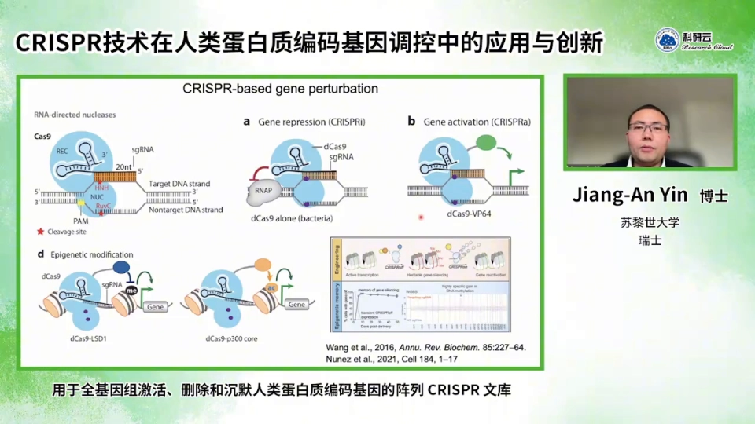

讲者把 CRISPR 在基因水平上的操纵快速过了一遍：Cas9 在 gRNA 引导下切割靶位点，修复时的插入缺失造成移码、蛋白提前终止，这就是敲除；把核酸酶活性突变掉就得到 dCas9，它仍能在 gRNA 引导下结合双链 DNA，接上不同的效应域就分别得到 CRISPRi（下调）、CRISPRa（上调）以及表观遗传修饰（图里还画了 dCas9-LSD1 与 dCas9-p300 core 两种表观修饰版本）[【跳转到 11:04】](https://www.bilibili.com/video/BV1PufdYHEN7/?t=664)。

真正决定数据形态的是**库的组织方式**：

| | Pooled 筛选 | Arrayed 筛选 |
| --- | --- | --- |
| 物理形态 | 一个管子里混几千条 gRNA 载体 | 一块 384 孔板，一个孔一种 gRNA |
| 一个基因的覆盖 | 上千条 gRNA 混在池里，通常要 1000 个细胞/条 gRNA | 一个孔对应一个基因，四条 gRNA 一起打 |
| 读出方式 | 取基因组 DNA、测序 gRNA barcode 的丰度变化 | 每孔独立读出：荧光、FRET、流式、生化反应 |
| 能看的表型 | 细胞存活/增殖、某个 marker 的强弱 | 几乎任何表型：分泌、生化、细胞间相互作用 |
| 噪声与灵敏度 | 噪声大、灵敏度不高 | 灵敏度高，筛到就知道是哪个基因 |

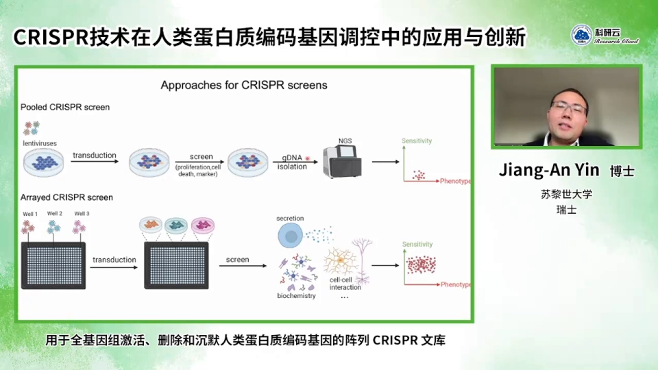

这张对比图就是全场的技术出发点。讲者的原话很直白：pooled 库「能筛选的表型非常有限」，一般就关注敲掉之后细胞还活不活、分裂快不快，或者某个 marker 的量和荧光强度变了没有；如果关心细胞存活，就把基因组 DNA 取出来测 gRNA barcode，gRNA 掉下去说明这个基因是必需的，富集起来说明敲掉它让细胞增殖变多 [【跳转到 11:54】](https://www.bilibili.com/video/BV1PufdYHEN7/?t=714)。但形态学表型、一个细胞分泌影响另一个细胞、酶活这类表型，这套工具做不了。

arrayed 的代价是工作量，收益是**每个孔都是一个独立的、可解释的扰动单元**。讲者的经验是：工作量确实大一些，但「并没有大太多」。

## 二、CRISPRa 数据的第一个性质：单条 gRNA 的激活效率又低又散

### 2.1 一个必须先解决的工程问题

要把全基因组做成阵列库，第一道坎不是克隆，而是 **gRNA 本身的效率**。

讲者说得很清楚：虽然现在有很多算法可以预测 gRNA 效率，但实际上很难预测准，「有时候你不去测，永远不知道它的效率怎么样」。这在 pooled 里问题不大——一条 gRNA 不行，池子里还有别的顶着；但在 arrayed 里是致命的：**一个孔只有一种 gRNA，敲错了这个孔就永远是无效数据** [【跳转到 14:49】](https://www.bilibili.com/video/BV1PufdYHEN7/?t=889)。

第二道坎是**参考基因组的偏置**：常规库的 gRNA 是按 reference genome 设计的，只考虑了参考序列。讲者说他们考虑了约 667 万个人类个体之间的差异、把 DNA 多态性算进去，选最保守的区域来设计 gRNA。

第三道坎是规模：两个库（激活 + 敲除）× 约 2 万个蛋白编码基因 = 4 万个载体，传统分子克隆根本做不起。

### 2.2 单条 gRNA 打不开基因，四条一起打就行

文献里早有暗示：把多条靶向同一基因的 gRNA 同时送进细胞，效率会大幅提高。他们做了尝试，最后定在**四条**，叫 quadruple gRNA（qgRNA）。

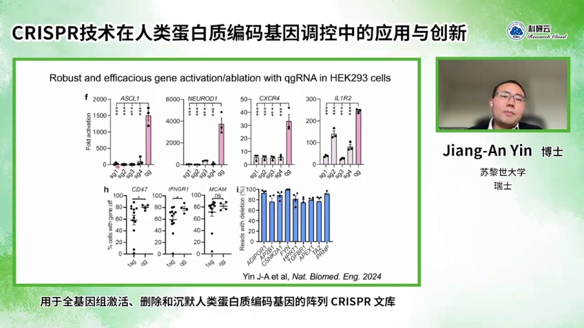

图里的对比非常直观。在 HEK293T 细胞里、带 dCas9-VPR 激活域的条件下：

- 单条 gRNA（sg1、sg2、sg3、sg4）对 ASCL1、NEUROD1、CXCR4、IL1R2 的激活倍数**很低，有些基本是零**；
- 把四条串在一起（qg），四个基因的激活倍数分别达到约 1900 倍、约 3200 倍、约 40 倍、约 250 倍——**提升幅度从几十倍到上千倍不等，但方向一致：原来打不开的现在能打开了。**

讲者对这个结果有一个很实在的补充：如果某个基因本来表达量就很高，你把「四条里表现最好的那条」装进去，效果跟四条一起打差不多——也就是说，**四条 gRNA 的价值在于把最差的情况拉起来**，让一个基因不再因为抽到一条烂 gRNA 而变成无效数据 [【跳转到 17:19】](https://www.bilibili.com/video/BV1PufdYHEN7/?t=1039)。

### 2.3 四条 gRNA 怎么排布：不能堆在一起

gRNA 不是随便凑四条就行。讲者提到两个设计经验：

1. **不能堆在一起**。如果四条 gRNA 都作用在非常相近的位置，累积效果并不明显（他用英文说是 saturating，饱和），跟只放一条差不多；**把四条分散开、互不重叠（non-overlapping），效果就好很多**；
2. **不能让两条 gRNA 太像**，否则在载体里容易重组。

为此他们算了很长时间，考虑了约 7 万条人类基因组序列，花一年时间才把每个基因的最佳四条组合选出来 [【跳转到 25:13】](https://www.bilibili.com/video/BV1PufdYHEN7/?t=1513)。

### 2.4 敲除数据：功能性读出比测序读数更可信

同一套 qgRNA 思路用在敲除上也成立。讲者特别强调，他们选的是**功能性的结果**——挑几个细胞膜蛋白，用活细胞染色加流式看蛋白还在不在——而不是之前常用的 T7E1 酶切或某种测序读数，因为后者「非常不准确」[【跳转到 17:44】](https://www.bilibili.com/video/BV1PufdYHEN7/?t=1064)。

结果：单个 gRNA 敲除效率参差不齐，随机四条装在一起后，膜蛋白被敲掉的细胞比例稳定在 **80%–90%**。他们又用细胞基因组的长片段测序验证：一些此前报道「单条 gRNA 很难敲、效率很低」的基因，把表现很差的 gRNA 四条凑一起，也能实现八九十%的编辑效率。

> 这一条对读数据的人很重要：**同一个基因，用不同读出方式量出来的「敲除效率」可以差很多。** 如果你拿到的是一份基于测序读数的效率表，它可能系统性低估了实际的功能性敲除率。

## 三、库本身也是一份数据：怎么建、怎么质检

### 3.1 载体长什么样：一个孔 = 四条 gRNA + 一套可切换的递送元件

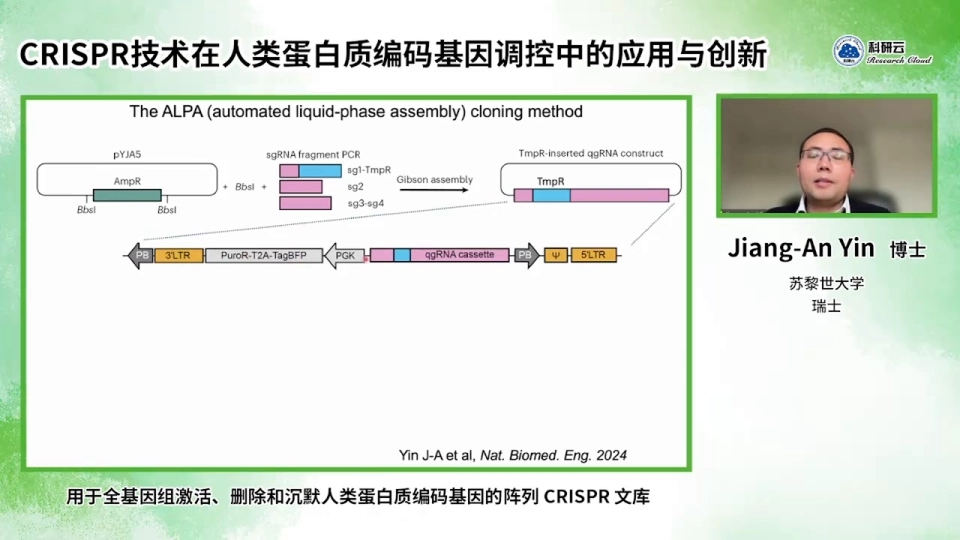

讲者把载体元件逐个数了一遍，因为这些元件决定了这份数据将来能怎么用：

- **piggyBac 转座子元件**：可以不用病毒，直接转座进细胞做稳转；
- **慢病毒 LTR**：也可以包装成慢病毒感染；
- **PuroR-T2A-TagBFP**：嘌呤霉素筛选 + 蓝色荧光，感染过的细胞可以筛也可以看；
- **PGK 启动子驱动的 qgRNA 表达盒**：四条 gRNA，每条一个独立的 promoter，tracrRNA 也各不相同。

为什么四条 gRNA 要用不同的 promoter、不同的 tracrRNA variant？讲者的理由很实用：不同 promoter 在不同细胞类型里的活性不一样，四条各用各的，**至少不会四条全都不 active**；tracrRNA 用不同变体是为了避免序列重复导致载体在细胞里发生重组 [【跳转到 22:18】](https://www.bilibili.com/video/BV1PufdYHEN7/?t=1338)。

### 3.2 4 万个载体怎么克隆：ALPA 液相组装

传统克隆要涂板、挑单克隆、验证，做 4 万个不现实。他们发展了一个叫 **ALPA（automated liquid-phase assembly）** 的方法：在前体载体 pYJAS 上放一个 AmpR 抗性，两侧各一个 BbsI 位点，酶切把这段切掉；四条 gRNA 通过三轮 PCR 挂到三个片段上，片段之间留约 20 bp 重叠，用 Gibson assembly 组装；同时在新片段里换上一个**新的抗性基因 TmpR**（trimethoprim 抗性）。

于是只有组装正确的菌才能在含 trimethoprim 的培养基里长出来，其他背景全被抹掉——「我们希望长出来的就都是对的，其他的全部都不要」。

整个流程都搬进了多孔板：引物合成、PCR、Gibson 组装在 384 孔板里做，细菌培养和质粒抽提在 96 孔深孔板里做。两个熟练技术员一个星期可以构建 **2000 个质粒**。

### 3.3 库的分层：亚库 + 对照

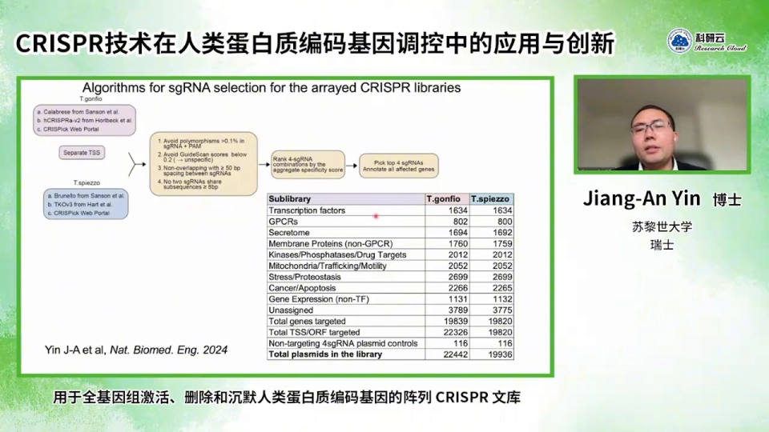

因为库是按板子组织的，他们把它按功能切成了若干**亚库（sub-library）**，这张表就是这份数据资源的「目录」：

| 亚库 | T.gonfio（激活库） | T.spiezzo（敲除库） |
| --- | --- | --- |
| 转录因子 | 1634 | 1634 |
| GPCR | 802 | 800 |
| 分泌蛋白 | 1694 | 1692 |
| 膜蛋白（非 GPCR） | 1760 | 1739 |
| 激酶/磷酸酶/药靶 | 2012 | 2012 |
| 线粒体/运输/运动 | 2622 | 2622 |
| 应激/蛋白稳态 | 2699 | 2699 |
| 癌症/凋亡 | 2266 | 2265 |
| 基因表达（非转录因子） | 1131 | 1132 |
| 未归类 | 3789 | 3775 |
| 靶向基因总数 | 19830 | 19620 |
| 靶向 TSS/ORF 总数 | 22326 | 19820 |
| 非靶向 4gRNA 质粒对照 | 116 | 116 |
| 库内质粒总数 | 22442 | 19936 |

两个库合计 4 万 2000 多个质粒。亚库的意义是**让筛选不必全基因组**：关心细胞分化可能只要生长因子亚库，找一个 peptide 的受体也不需要整个库 [【跳转到 26:03】](https://www.bilibili.com/video/BV1PufdYHEN7/?t=1563)。另外每个库都配了 116 个非靶向对照质粒，这是后面算效应量的基准。

### 3.4 逐孔质检：用长读长测序确认四条 gRNA 装对了

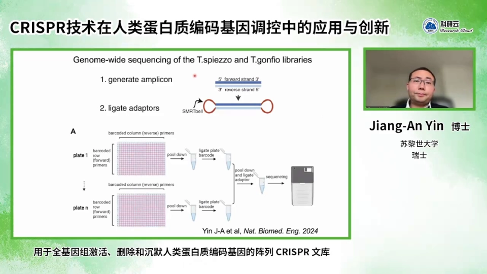

高通量克隆的风险是「板子标错、孔里装错」。他们的质检方案是**每个孔单独测序**：

1. 设计一对引物，把四条 sgRNA 的区域一次扩出来；
2. PCR 时在 forward 与 reverse 引物上各加一个 barcode，两者的组合对每一块板上的每个孔都唯一，测序时就能反推出孔位；
3. 板与板之间再加一层板级 barcode，几十块 384 板混在一起测；
4. 用 **PacBio 长读长测序**（三代测序，可读到 50 kb 以上）读出整段。

结果：约 **90% 的孔里四条 gRNA 完全正确**。这个数字还做了校正——他们拿 74 个已知序列完全正确的质粒做单克隆测序，发现技术误差本身就有 10% 左右，所以测出来的 90% 是**低估**；剩下的错误里，极少数是旁边孔窜过来的污染（占比很低），deletion 占 4%–6%，mutation 占 5% 左右 [【跳转到 28:08】](https://www.bilibili.com/video/BV1PufdYHEN7/?t=1688)。

> 这段对使用者的含义：拿到一份阵列库的数据，**它自带一份质检报告**。文库正确率、错误类型分布、对照孔位置（他们故意把 column 5 和 13 留空放对照）都是判断数据可信度的前置信息。

## 四、用这个库产出的数据长什么样

讲者用三个场景做了快速验证。前两个最能说明问题。

### 4.1 场景一：用激活库找调控 PrPC 的转录因子

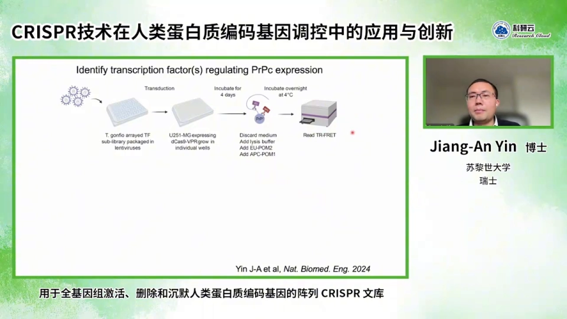

背景是：他们实验室做朊病毒蛋白（PrPC），小鼠敲掉 PrPC 后即使感染朊病毒也不发病，所以 PrPC 的表达水平很关键；但此前用 siRNA 和 miRNA 做的两个全基因组筛选，都没找到调控 PrPC 的转录因子。这次他们用**激活库的转录因子亚库**（约 1644 个基因），一个个包装成慢病毒，感染表达 dCas9-VPR 的 U251-MG 细胞，四天后裂解，每孔用一对抗体做 TR-FRET 读 PrPC 的量。

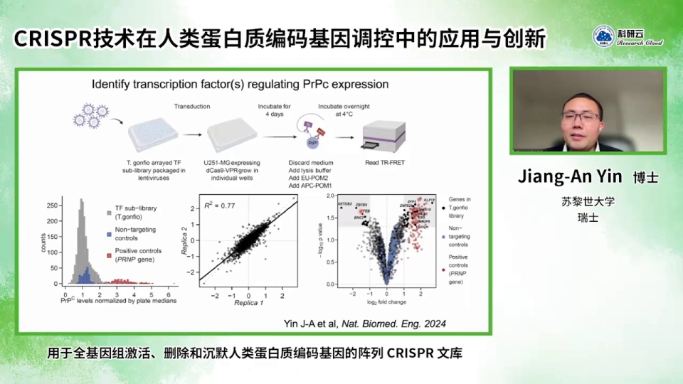

这份数据的质量指标值得单独看：

- **重复性**：两次独立重复的 R² = 0.77，散点紧贴对角线；
- **阳性对照**：PRNP（编码 PrPC 的基因）自己作为阳性对照，落在最右端，说明系统能测到真正的上调；
- **阴性对照**：非靶向对照聚在中间；
- **发现**：火山图上出现了大量此前没人报道过能调控 PrPC 的转录因子。

讲者特别拿这个跟 pooled 对比：**「如果做 pooled screen，你永远看不到这么好的重复性。」** 后续验证也支持这一点：挑头部几十个基因再做一次，几乎全部可重复；换 Western blot 方法验证，上调的那批基本都成立；把筛选扩到全基因组后找到 500 多个可调控 PrPC 的基因，回头重复前 50 个，90% 都能重复出来 [【跳转到 32:43】](https://www.bilibili.com/video/BV1PufdYHEN7/?t=1963)。

### 4.2 场景二：用敲除库跟 Brunello、Cellecta 正面比

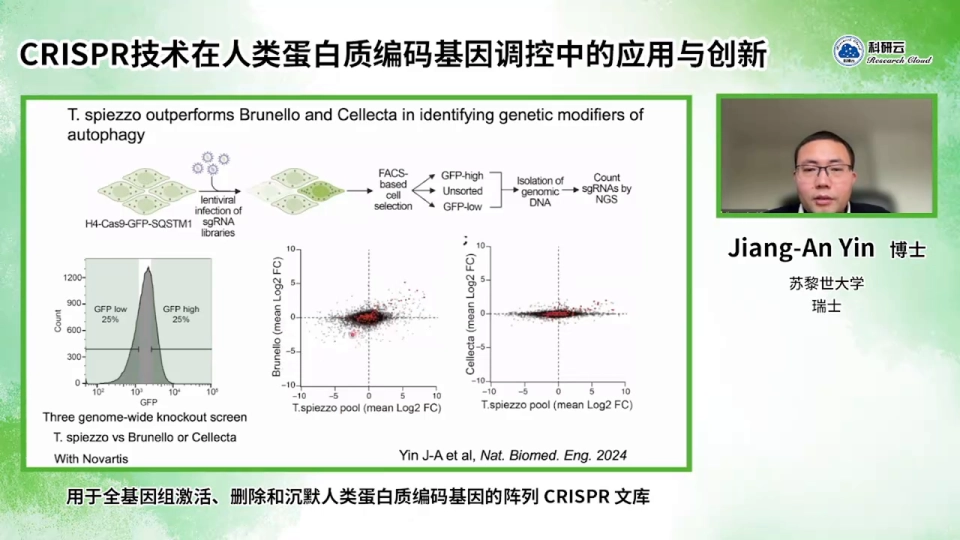

第二个场景是跟瑞士诺华合作，比较不同敲除库在同一个表型上的表现。系统是 H4 神经母细胞瘤细胞表达 Cas9 和 GFP-SQSTM1（p62，自噬的 marker）：某个基因被敲掉后如果影响自噬效率，GFP 信号会变亮或变暗。他们把 GFP 最高和最低的各 25% 分选出来，测 gRNA 丰度，得到每个基因的 log2 fold change。

对照的三个库是：他们自己的 T.spiezzo、MIT 常用的 **Brunello**、商业化的 **Cellecta**。判断标准很巧——自噬是个研究得很透的表型，已有两三百个基因被报道影响自噬，占全基因组 1%–2%，这些「已知答案」就是现成的 ground truth。

结果：在同样的 log2 fold change 阈值下，T.spiezzo 找到的已知自噬基因明显多于 Brunello，Cellecta 几乎没有找到什么（fold change 很低，灵敏度不够）。讲者还给了一张更直观的表：cutoff 取 0.5 时，T.spiezzo 找到 83 个已知自噬基因，Brunello 只有 4 个，Cellecta 只有四分之一。

更有意思的是那些「灰点」——在 T.spiezzo 里被筛到、在 Brunello 里没被筛到的基因。它们是噪声，还是新的自噬调控因子？他们挑了十个做实验：换一个自噬 marker LC3 跑 Western blot，加 chloroquine 阻断自噬流后再看 LC3-II 的累积；又把 LC3 做成 FYMP 报告体系再验一遍。**其中五个基因此前从未被报道与自噬有关，被确认成立**，统计上也显著 [【跳转到 37:51】](https://www.bilibili.com/video/BV1PufdYHEN7/?t=2271)。

> 这段是本节最实在的一课：**不同库产出的同一表型的筛选数据，不能直接混着比。** 库的 gRNA 设计、每条基因的覆盖数、载体骨架都会改变效应量的尺度；判断一份筛选数据好不好，最靠谱的锚是「已知答案的召回率」。

### 4.3 场景三：换效应器，同一个库变成沉默库

第三个场景把 CRISPRi 也接了进来，而且思路很省：**不动 gRNA，只换效应器。**

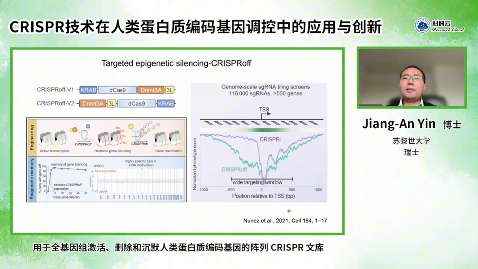

讲者提到 Jonathan Weissman 实验室的 **CRISPRoff**：在 dCas9 上同时挂 DNMT3A、DNMT3L 和 KRAB，把目标基因的启动子甲基化掉。它的特点是**有记忆**——蛋白不需要一直在场，甲基化标记可以随细胞分裂传下去，传 13 个月细胞还是沉默的，等于「给一次剂量，后面就不用再给了」。

关键在于靶窗口：CRISPRa 的 guide 通常要落在转录起始位点（TSS）附近，而 CRISPRi/CRISPRoff 在 TSS 下游有一个**又强又宽的窗口**（图里那张 tiling 筛选曲线，116,000 条 sgRNA、500 多个基因）。讲者看到这张图「挺高兴的」，因为他们激活库的 gRNA 就设计在 TSS 附近——**同一个库，只要换一个效应器（表达 CRISPRa activator 还是表达 CRISPRoff），就能从激活实验变成沉默实验**。

他们做了实测：把激活库里的 gRNA 跟 CRISPRoff 共转，十天后细胞基本都被沉默，效果跟原论文相当甚至更好；再把两个库做一对一比较，用 essential / non-essential 基因的分离度（SSMD）和假阳性率来评——他们的假阳性率从对方的 5.6% 降到 4% 左右。

这条路对数据资源的意义在于：**沉默数据的成本可以比激活数据更低**，因为不必再建一个库。而在 iPSC 这类对 DNA 双链断裂很敏感的细胞里，表观沉默比敲除更合适。

### 4.4 最后一步：把库变成可交付的病毒

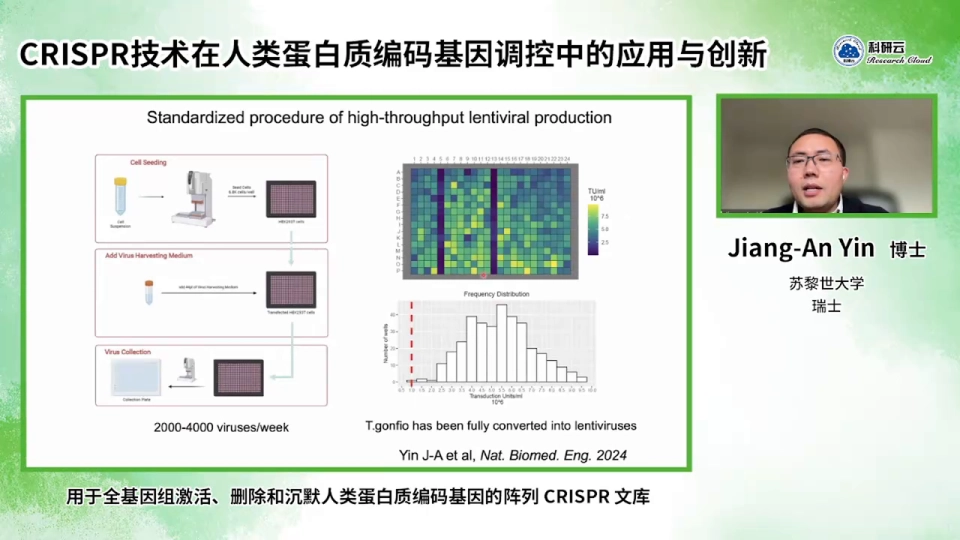

阵列库要能用，还得能一个一个地递送。神经系统来源的细胞很难用质粒转染，必须用慢病毒。他们把这步也做成了流水线：384 孔板逐孔包装，一周 2000–4000 个病毒，直接取上清；滴度分布比较均匀，好坏相差不超过十倍，主要集中在 $5\times10^{5}$ 到 $2\times10^{6}$ 之间。

## 五、讲者对这份数据资源的定位

报告最后，讲者给了几条总结性的判断，可以直接当作「这份数据该怎么用」的说明：

- 他们发展了一套**高通量、较高准确度**的全基因组阵列库构建方法，理论上可以推广到其他大规模库的构建；
- gRNA 算法不算全新，但做了几件新事：把 DNA 多态性算进去、发现 gRNA 不能堆在一起、用新的 off-target 预测筛掉高脱靶的 gRNA；
- 库可以**单独用也可以大规模用**：你只有几百个感兴趣的基因，可以直接拿对应亚库去研究；也可以做全基因组筛选；
- 这是**第一个全基因组的 CRISPRa 阵列库**，并且在 pooled 形式下也比常用的 Brunello 表现更好；
- 第一次证明**同一个库既能做激活也能做沉默**，省资源省成本；
- 目前至少 40 个课题组在用，讲者认为它正在变成领域里的一个新标准。

## 小结

- **阵列库的价值是「一个孔 = 一个可解释的扰动」**：pooled 只能读出存活与 marker 强弱，arrayed 可以读分泌、生化、细胞间相互作用，而且灵敏度更高、筛到就知道是哪个基因。
- **CRISPRa 数据的核心痛点是单条 gRNA 效率低且不可预测**：在 pooled 里可以靠数量掩盖，在 arrayed 里一个孔只有一条 gRNA，敲错就整孔作废。
- **四条 gRNA 串联（qgRNA）是这套方案的支点**：激活倍数从接近零跳到几百上千倍，敲除效率稳定在 80%–90%；四条必须分散、不能堆在一起。
- **库本身就是一份数据**：亚库划分、116 个非靶向对照、逐孔长读长质检（约 90% 四联正确）都是使用这份数据前必须读的元信息。
- **激活数据的重复性可以很好**：PrPC 转录因子筛选两次重复 R² = 0.77，全基因组扩展后前 50 个基因 90% 可重复——这是 pooled 数据难以达到的。
- **跨库比较要看「已知答案召回率」**：同一个自噬表型，T.spiezzo 的已知基因召回明显高于 Brunello 与 Cellecta，并额外确认了 5 个新调控因子。
- **换效应器就能换扰动方向**：CRISPRa 的 gRNA 落在 TSS，CRISPRi/CRISPRoff 在 TSS 下游窗口更宽，同一个库配不同效应器即可做激活或表观沉默，假阳性率也更低。

## 关键术语速查

| 术语 | 一句话解释 |
| --- | --- |
| Pooled screen | 成千上万条 gRNA 混在一个体系里感染细胞，靠测序 gRNA 丰度变化读出结果 |
| Arrayed screen | 一条 gRNA（或一组 gRNA）占一个孔，每孔独立读出表型 |
| qgRNA（quadruple gRNA） | 把四条靶向同一基因的 gRNA 串进同一个载体，一起递送以提高扰动效率 |
| CRISPRa / CRISPRi | dCas9 分别接激活域或抑制域，实现转录上调或下调 |
| CRISPRoff | 在 dCas9 上挂 DNMT3A/3L 与 KRAB，通过启动子甲基化实现可遗传的基因沉默 |
| ALPA | automated liquid-phase assembly，液相自动化组装克隆，用新抗性基因筛掉错误组装 |
| Sub-library | 按基因功能切分的子库（转录因子、GPCR、激酶等），可按需筛选而不必全基因组 |
| SSMD | strictly standardized mean difference，衡量两组分布分离度的统计量，常用于评价筛选质量 |
| TR-FRET | 时间分辨荧光共振能量转移，本报告中用于逐孔定量 PrPC 蛋白水平 |
| Brunello / Cellecta | 两个常用的全基因组 CRISPR 敲除库，常作为筛选表现的对照基准 |