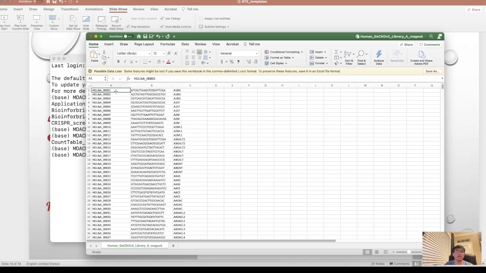
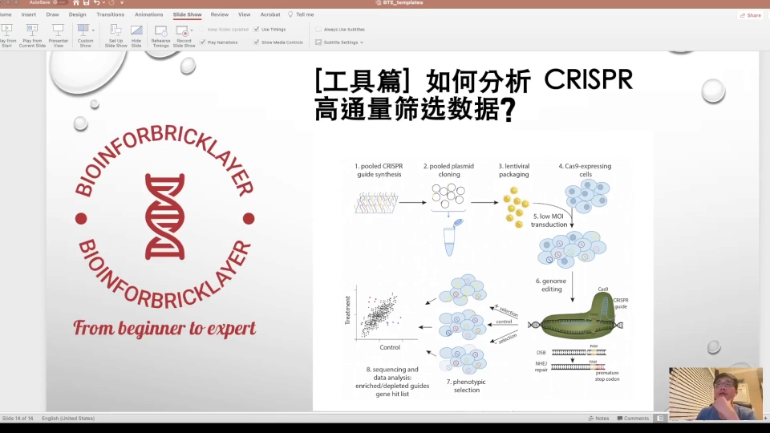
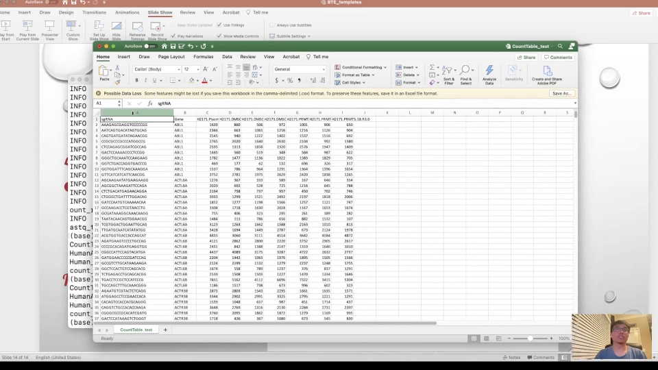
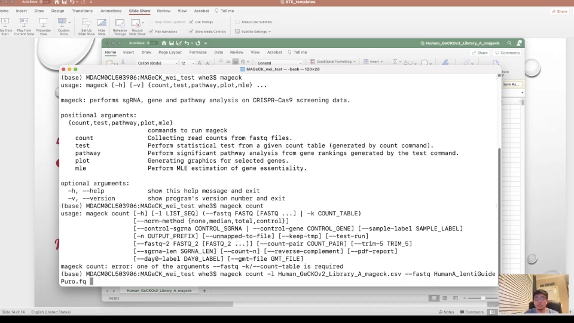
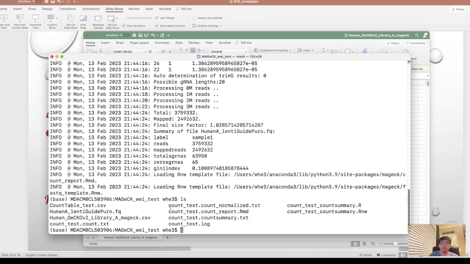
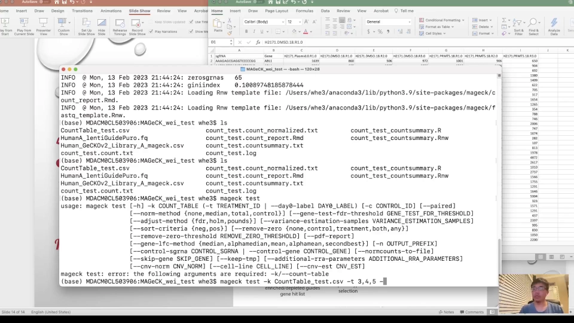
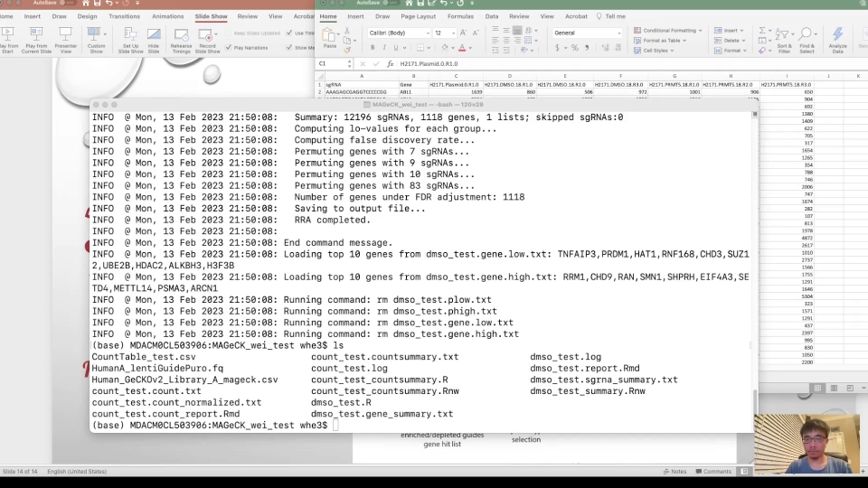
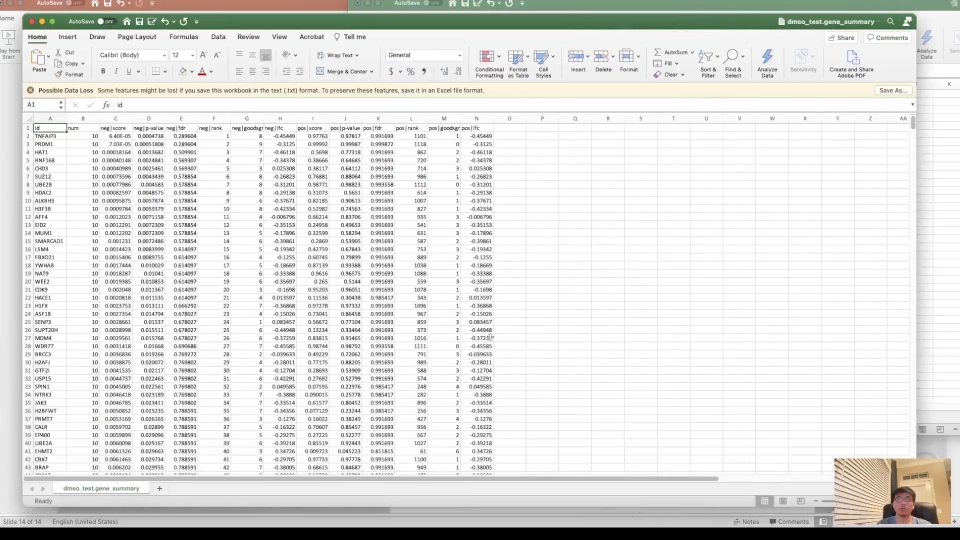

# 扰动实验的数据标准化：从 gRNA 计数到可比较的基因水平效应量

> 视频来源：[【生信进阶之路｜工具篇 04】如何分析 CRISPR 高通量筛选数据（上）](https://www.bilibili.com/video/BV1nG4y1P7a8/)（Bilibili · bioinforbricker）｜时长约 20 分钟
> 简要导读：这支视频是一次 MAGeCK 的完整实操演示，从 FASTQ 一路做到基因水平的 hit 列表。本文按「跨实验可比性」这条线重读了它：把视频里每一个看似只是「填参数」的步骤，还原成一次**标准化决策**——扰动标签怎么对上、对照怎么定义、多条 gRNA 怎么聚合、效应量用哪个字段。字幕为 B 站 AI 字幕，术语按上下文订正（如「magic」= MAGeCK、「final type」= phenotype、「S 加 A」= sgRNA）。

## 本讲要解决的核心问题（SCQA）

**背景**：同一个基因，在两个不同的 CRISPR 筛选（或 Perturb-seq）实验里，往往都能得到一个「效应量」——敲掉它之后细胞长得快还是慢、对某个药更敏感还是更耐受。既然都有数字，把两张表按基因名对上去、直接比较大小，看起来是顺理成章的。

**冲突**：真这么做，经常会发现同一个基因在两次实验里结论相反。原因不在生物学，而在数字是怎么被造出来的：两次实验的文库命名不同、对照不同、一个基因对应的 gRNA 条数不同、归一化方式不同、效应量的定义也不同。这些差异全部被压进了最后那一列数字里，而这一列数字本身并不携带「我是怎么算出来的」这一信息。

**疑问**：那么，两次扰动实验的数据要经过哪些处理，才能放在一起比？

**回答（中心思想）**：跨实验可比的前提，是把两次实验都压到**同一套基因水平效应量**上——同一套扰动标签、同一个对照定义、同一种 gRNA 聚合规则、同一种归一化与检验。任何一环不同，两个数字就不能直接相减。这支视频演示的 MAGeCK 流程，正好把这条链条的每一环都露出来了：它先建立「gRNA → 基因」的映射（标签层），再把读段压成计数表并归一化（数值层），再用对照做统计检验、把多条 gRNA 聚合到基因（效应量层）。看清这三层，才知道两次实验的数字差在哪里、能不能比。

## 一、可比性的第一层：扰动标签必须能对上

**标签（label）指的是「这条 gRNA 打的是哪个基因」这件事的记录方式。** 它听起来是琐事，但它是所有跨实验比较的地基：如果两次实验对同一个基因的记录方式对不上，后面所有计算都白做。

视频里这个映射放在一个叫 library（文库文件）的表里，它只有三列 [【跳转到 05:23】](https://www.bilibili.com/video/BV1nG4y1P7a8/?t=323)：

1. **第一列是 sgRNA 的 ID**：一般是 123456 这样的流水号，简单一点就是 sg1、sg2 一直到最后；
2. **第二列是这条 sgRNA 的序列**：一般是 20 个核苷酸；
3. **第三列是它敲的基因名**：比如这三条 sgRNA 敲的都是同一个基因。

这三列里，**真正跨实验通用的是第三列（基因 symbol）和序列**，而第一列（ID）是每个实验室自己编的。这意味着两件事：

- 两次实验要比较，必须**先按基因 symbol 对齐**，不能按 ID 对齐——ID 是实验内部的编号，换个实验室就完全对不上；
- 序列可以作为「这条 gRNA 是不是同一条」的判据。同一个基因在不同文库里的 gRNA 集合往往不同（视频里这个文库是**每个基因 10 条 sgRNA** [【跳转到 16:15】](https://www.bilibili.com/video/BV1nG4y1P7a8/?t=975)），所以基因层面的可比性不是自动成立的，它取决于两边各自用了哪几条 gRNA。

这一层还牵出一个更隐蔽的问题：**「对照」在标签体系里也是一类特殊条目**。视频没有讨论非靶向（non-targeting）对照 gRNA 在文库表里怎么写（这是本节的补充背景，不是视频内容），但后面 test 命令里出现的 `--control-sgrna` 与 `--control-gene` 参数说明：对照在流程里是可以被显式指定的一类条目，而不是「没有基因名的那几行」这么含糊（见第三节）。

## 二、第二层：把读段压成计数表，并做归一化

标签对上之后，第二步是把测序数据变成一张可比较的数字表。视频把这个分析拆成两个步骤 [【跳转到 04:08】](https://www.bilibili.com/video/BV1nG4y1P7a8/?t=248)：

- **第一步（count）**：把 FASTQ 里的读段比对（map）回每一条 sgRNA，数出每个 condition 下每条 sgRNA 有多少条读段；
- **第二步（test）**：把某个 condition 和 control 比一下，看哪些基因是 positive selection、哪些是 negative selection。

这两步在整个实验流程里的位置，可以从视频开头的流程图看清：从混合文库合成、质粒克隆、慢病毒包装，到低 MOI 感染、基因组编辑、表型筛选，最后才轮到测序与数据分析（图中第 8 步），输出 enriched/depleted guides 的基因 hit 列表 [【跳转到 00:10】](https://www.bilibili.com/video/BV1nG4y1P7a8/?t=10)。也就是说，**数据分析接手时，实验层面的所有选择（文库、MOI、筛选时长、对照）都已经固化在数据里了**，标准化能做的只是把这些差异显式地记下来、尽量对齐。

### 2.1 计数表本身：行是 gRNA，列是样本

**计数表（count table）**是一张「每条 gRNA × 每个样本」的矩阵，格子里是读段数。视频打开它时是这样描述的：第一列是 sgRNA 的 ID，然后是它对应的基因，列名默认是 sample1，可以用 sample label 参数改成有意义的标签 [【跳转到 09:33】](https://www.bilibili.com/video/BV1nG4y1P7a8/?t=573)。

这张表的结构值得单独看一眼，因为它就是「一次扰动实验」的最小可比单元：一行是一条 gRNA，一列是一个样本，而**列与列之间的差别正是实验设计**——哪一列是质粒（plasmid）对照、哪几列是同一处理的重复、哪几列是加药或不同时间点。视频演示的数据里，plasmid 只有一列（R0、R1），DMSO 处理下第 18 天有**三个重复**，另外还有加了抑制剂的三列 [【跳转到 11:45】](https://www.bilibili.com/video/BV1nG4y1P7a8/?t=705)。

### 2.2 归一化：为什么不能直接比读段数

读段数是「测了多少」和「细胞长得怎么样」的混合物。两次实验的测序深度不同，同一个 gRNA 的读段数就没有可比性；同一次实验里不同样本的测序量不同，样本之间也不能直接比。所以 count 这一步必须做归一化。

视频里 MAGeCK 的 count 命令把归一化方式做成了一个显式参数 `--norm-method`，可选 `none`、`median`、`total`、`control` [【跳转到 08:18】](https://www.bilibili.com/video/BV1nG4y1P7a8/?t=498)：

这四个选项对应四种不同的「把样本拉到同一把尺子上」的思路：「总量」是把每个样本缩放到相同的总读段数，「中位数」是用样本读段数的中位数做缩放，「对照」则是用指定的对照 gRNA 集合来定缩放系数。**选哪一个，会改变后面所有效应量的绝对值**——这是跨实验比较时最容易被忽略的一处不兼容：两次实验如果用了不同的 `--norm-method`，它们的 log fold change 就不是同一个尺度上的量。

归一化是否真的执行了，可以从运行日志里核对。视频里的日志给出了一次完整的「体检报告」：总读段数 3759332、成功比对 2492632，以及一个 **final size factor 1.0285714285714287** [【跳转到 09:33】](https://www.bilibili.com/video/BV1nG4y1P7a8/?t=573)。这个 size factor 就是归一化时给这个样本乘上的缩放系数，它接近 1 说明这个样本的测序量本来就接近基准；换一个测序量差很多的样本，它就会明显偏离 1。

### 2.3 比对率：一个跨实验的「体检指标」

同一个日志里还有几个数字，是判断「这次实验的数据能不能用」的硬指标：**总读段 3759332、比对上的 2492632、gRNA 总数 63950、零计数 gRNA 0 条**。

视频特别强调比对率要看：这次是 72%，而「我们之前做 screen 大概有 80%，七八十都算正常；如果太低就不太正常，你要看是哪里不对」[【跳转到 08:43】](https://www.bilibili.com/video/BV1nG4y1P7a8/?t=523)。这句话对跨实验比较的意义是：**比对率是一次实验的「质量水位」**。一个比对率 50% 的实验和一个 80% 的实验，即使最后都输出了 log fold change，前者的数字里混着更多来自测序与克隆的噪声。把两者放在一张图里比较之前，先看这个水位是否相当，比看结论是否一致更靠前。

## 三、第三层：对照的定义，决定了效应量的含义

**效应量（effect size）在这里指「扰动组相对对照组变化了多少」**。注意它的定义里天然包含「相对谁」——所以对照一变，效应量的含义就变。

视频在跑 test 时，把对照明确指了出来：control 用的是 plasmid（质粒），并补充「通常来说，如果你有第 0 天，可以用 T0 这个原理，用 plasmid 也可以」[【跳转到 14:05】](https://www.bilibili.com/video/BV1nG4y1P7a8/?t=845)。这句话点出了对照的选择问题。视频只演示了 plasmid 与 T0 两种；下表把实际分析里常见的第三类（非靶向 gRNA）一并列出，便于对照它们的含义差异——后两行属本节补充的通用背景，不是视频原话：

| 对照 | 它回答的问题 | 效应量里混进了什么 |
| --- | --- | --- |
| 第 0 天（T0） | 敲掉这个基因后，这群细胞相对起始时刻富集还是耗竭 | 文库在起始群体里的分布 |
| 质粒（plasmid）文库 | 敲掉这个基因后，相对「还没进细胞时的文库」富集还是耗竭 | 文库构建与包装带来的偏好 |
| 非靶向对照 gRNA | 敲掉这个基因后，相对「敲了个无关序列」的细胞富集还是耗竭 | 感染与切割本身的毒性 |

三者不是同一个参照系。**如果两次实验一次用 T0、一次用质粒，它们的 log fold change 就不能直接相减**——差的不只是数值大小，而是「相对谁」这件事本身。视频里 MAGeCK 还提供了 `--control-sgrna` 和 `--control-gene` 两个参数，用来显式指定对照 gRNA 集合或对照基因集合（见上一节的命令截图），这也说明「对照怎么定义」在这套流程里是一个必须写下来的选择，而不是默认的细节。

## 四、多条 gRNA 怎么聚合成一个基因分数

这是扰动实验特有、也最影响可比性的一步。**一个基因通常有多条 gRNA**（视频里的文库是每个基因 10 条），而下游要的往往是「这个基因的效应」。从 10 条 gRNA 的分数到一个基因分数，中间必须有一个聚合规则。

视频在 test 命令的帮助里把这个规则也做成了参数 `--gene-lfc-method`，可选 `median`、`alphamedian`、`mean`、`alphamean`、`secondbest` [【跳转到 14:30】](https://www.bilibili.com/video/BV1nG4y1P7a8/?t=870)：

这几个选项对应几种不同的「代表值」哲学：

- **median / mean**：取所有 gRNA 的中位数或均值，相当于假设「多条 gRNA 的平均表现代表这个基因」；
- **alphamedian / alphamean**：一种对 gRNA 效率差异更稳健的加权版本；
- **secondbest**：取第二好的那条 gRNA。这个选项背后的想法很实际——**敲除效率最高的那条 gRNA 常常是脱靶最多的那条**，取「第二好」是在效率与可信度之间折中。

同一张截图里还有两个与可比性直接相关的参数：`--gene-test-fdr-threshold`（基因水平 FDR 阈值）和 `--sort-criteria`（按 neg 还是 pos 排序）。它们不影响效应量本身，但会影响「哪些基因进入 hit 列表」，也就影响两次实验的 hit 列表能不能直接求交集。

聚合之后，MAGeCK 用 RRA（robust rank aggregation，稳健秩聚合）把多条 gRNA 的排名合成一个基因水平的显著性。视频里的运行日志记录了这一步的规模：**12196 条 sgRNA、1118 个基因、1 个 list、跳过的 sgRNA 0 条**，随后计算 lo-value、估计错误发现率，并输出正向与负向各前 10 个基因 [【跳转到 15:20】](https://www.bilibili.com/video/BV1nG4y1P7a8/?t=920)。

## 五、重复与条件：比较的单位是「样本」，不是「细胞」

前面那张计数表还藏着一个关于「怎么比较才算数」的问题：一列是一个样本，一个处理下的多个重复是**多列**。视频在讲解数据组织时说得很直白：这三列相当于三个重复，「我们可以把它们放在一起，和这边做比较——通常来说是对三个重复取均值，再和 R1 比较」[【跳转到 12:10】](https://www.bilibili.com/video/BV1nG4y1P7a8/?t=730)。

这句话里有两个必须记住的点：

1. **比较发生在样本层面**：先把重复聚合成一个代表值（视频里是取均值），再和对照比。如果忽略重复、把每一列都当成独立的观测，就会把技术波动当成生物学差异。
2. **重复数决定了你能做多细的比较**：三个重复可以估一个组内方差；只有一个重复时，任何「显著」都只是两条曲线的差。

这也解释了为什么同一批数据可以做出多个不同的比较：视频里的表同时包含 DMSO 对照、加抑制剂、以及另一个时间点，于是可以「这是另外一个比较」[【跳转到 12:35】](https://www.bilibili.com/video/BV1nG4y1P7a8/?t=755)。**每一次比较都是一个新的效应量**，它们各自相对自己的对照，不能混着用。

## 六、输出字段：哪些是效应量，哪些是显著性

跑完 test，MAGeCK 给出的是一个基因水平的 summary 表。视频逐个字段过了这张表 [【跳转到 16:15】](https://www.bilibili.com/video/BV1nG4y1P7a8/?t=975)：

按用途可以把这些列分成三类，这个分类本身就是跨实验比较的操作指南：

| 类别 | 字段 | 含义 | 跨实验比较时 |
| --- | --- | --- | --- |
| 标签 | 基因名、number | 基因 symbol；这个基因有多少条 gRNA 参与计算 | 必须一致（symbol 命名、gRNA 条数） |
| 效应量 | neg\|lfc、pos\|lfc | 敲掉这个基因后细胞减少/增加的对数倍数变化 | 只能比排序或相对大小，绝对值依赖归一化与对照 |
| 显著性 | neg\|score、neg\|p-value、neg\|fdr、neg\|rank、neg\|goodsgrna | RRA 分数、p 值、FDR、排名、有效 gRNA 条数 | 依赖重复数与检验方法，不能跨实验直接比数值 |

视频里对「该看哪个」给了明确建议：**「通常我们要看 FDR」**，并且提醒排名的方向性——「如果你把 negative 排第一，positive 就排到最后面去了」，所以想看正向的排名要重新排序（sort）一次 [【跳转到 16:40】](https://www.bilibili.com/video/BV1nG4y1P7a8/?t=1000)。这两个细节恰好是跨实验比较时最容易出错的地方：两次实验如果一次按负向排、一次按正向排，直接按 rank 求交集会把方向搞反。

另外，表里的 `goodsgrna` 是一个值得单独注意的字段：它记录这个基因有多少条 gRNA 被认为「有效」。同一次实验内部，一个只有 2 条有效 gRNA 的基因和一个有 10 条有效 gRNA 的基因，即使 lfc 相同，可信度也不同；跨实验比较时，这个字段的差异会被放大——**两次实验若是用了不同大小的文库（每基因 gRNA 条数不同），基因层面的分数本身就处在不同的精度水平上**。

## 七、把这条链倒过来看：跨实验比较的三条实践规则

回到开头的问题：两次扰动实验的数据，怎样才能放在一起比？把上面这条链倒过来读，可以提炼出三条规则。它们不是视频里逐字给出的结论，而是从视频演示的每一个参数选择里读出来的：

1. **先对齐标签，再对齐数字**。按基因 symbol（而不是实验内部 ID）对齐；确认两边的「对照」在标签体系里指的是同一类东西（都是非靶向 gRNA，或都是质粒文库）。视频里 library 的三列结构就是这一步的载体。
2. **确认两边的数值是同一把尺子**。归一化方式（`--norm-method` 的 none/median/total/control）、对照类型（T0 / 质粒 / 非靶向）、聚合规则（`--gene-lfc-method` 的 median/mean/secondbest）三者只要有一项不同，log fold change 就不是同一个量。这时能比的只剩**排序**与**方向**，不能比绝对值。
3. **报告时把「怎么算的」写出来**。视频里每一个影响可比性的选择都以参数形式出现在命令行里——这本身就是最好的提示：跨实验比较的表格旁边，必须写清用了哪种归一化、哪种对照、哪种聚合、几个重复。缺了这些，读者无法判断两个数字能不能相减。

## 小结

- 跨实验可比不是「把表按基因名 join 一下」，而是要把两次实验压到同一套**基因水平效应量**上。
- 扰动标签层：gRNA ID 是实验内部的，**基因 symbol 与序列才是跨实验通用的**；一个基因通常对应多条 gRNA。
- 数值层：读段数必须归一化才能比，MAGeCK 把归一化方式做成显式参数（none/median/total/control），日志里的 **size factor** 就是这次缩放的记录。
- 对照层：T0、质粒文库、非靶向 gRNA 回答的是三个不同的问题，**换了对照，效应量的含义就变了**。
- 聚合层：多条 gRNA 到一个基因分数有多种规则（median / mean / alphamedian / alphamean / secondbest），规则不同，基因分数就不同。
- 输出层：效应量（lfc）与显著性（score / p / fdr / rank）是两类字段，跨实验能比的是排序与方向，不是绝对数值。
- 质量水位：比对率（这次 72%，经验值 70–80% 正常）是判断一次实验数字可信度的前置指标，比较之前先看它。

## 关键术语速查

| 术语 | 一句话解释 |
| --- | --- |
| library（文库文件） | 记录 gRNA ID、20 nt 序列与靶基因的三列表，是所有下游分析的对齐依据 |
| count table（计数表） | 行是 gRNA、列是样本、格子是读段数的矩阵 |
| size factor | 归一化时给某个样本乘上的缩放系数，用来把不同测序量的样本拉到同一尺度 |
| mapping rate（比对率） | 读段能比对回文库 gRNA 的比例，反映测序与克隆质量 |
| plasmid / T0 对照 | 分别以质粒文库、第 0 天细胞为参照的对照，回答的问题不同 |
| RRA | robust rank aggregation，把多条 gRNA 的排名合成基因水平显著性的方法 |
| gene-lfc-method | 多条 gRNA 聚合成基因水平 log fold change 的规则（median/mean/secondbest 等） |
| goodsgrna | 一个基因中被认为有效、参与打分的 gRNA 条数 |
| differential essentiality | 比较两个条件下「必需基因集合」的差异，是跨条件比较的下一步 |
