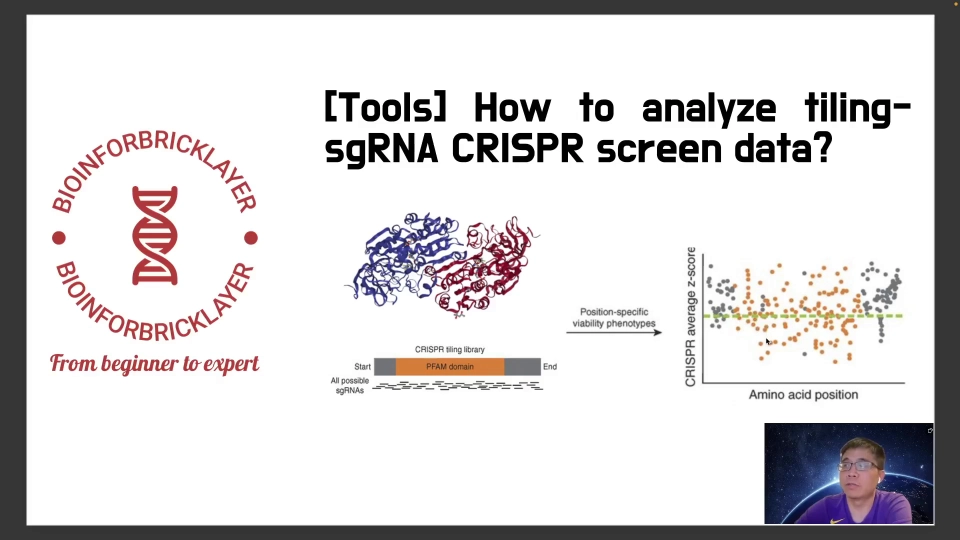
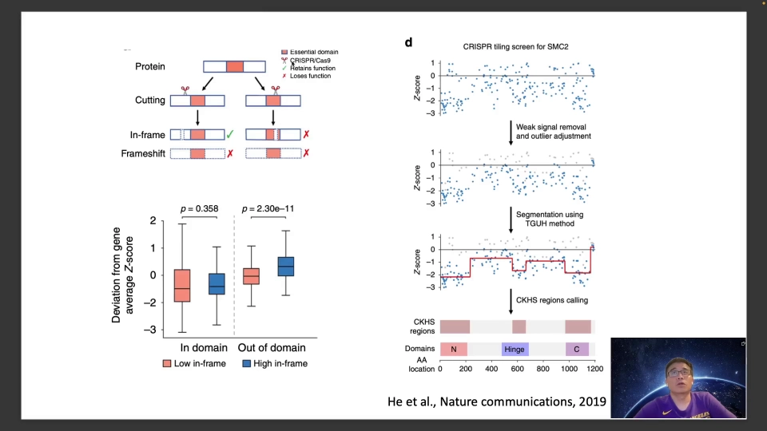
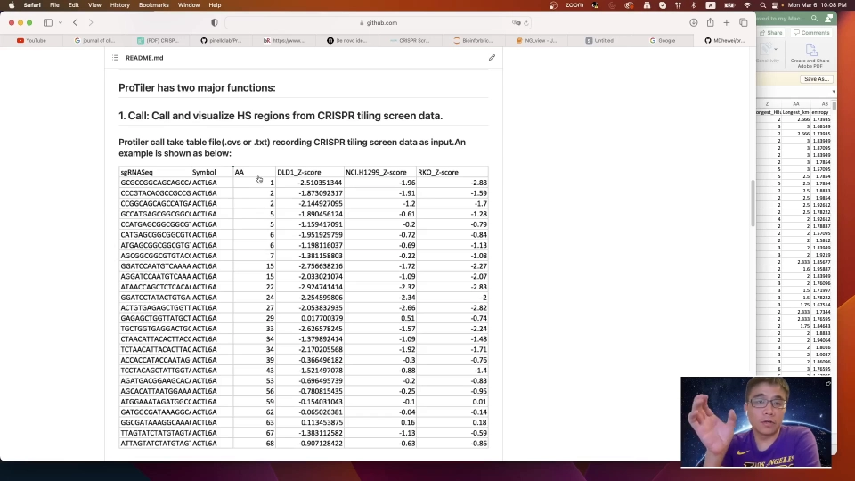
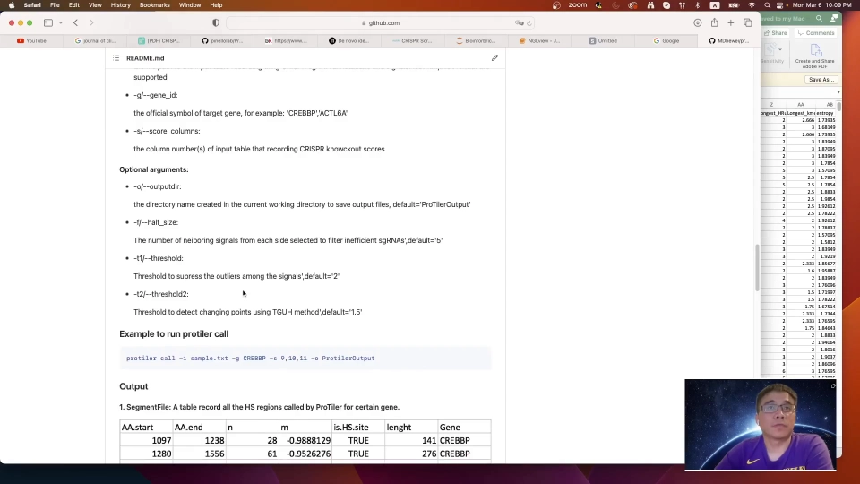
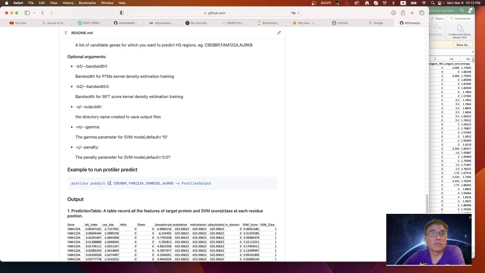
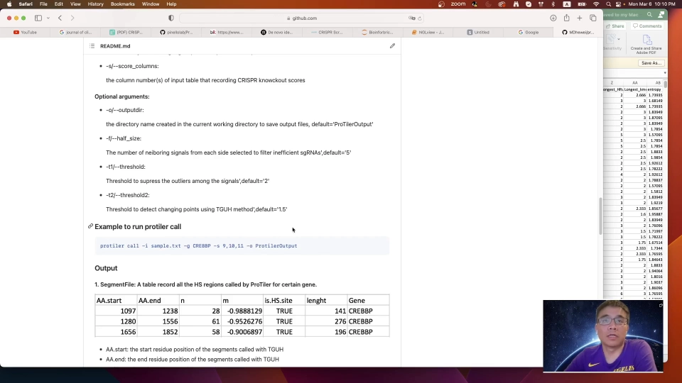

# 平铺式 sgRNA 筛选的数据标准化：位置分辨的扰动效应怎么算

> 视频来源：[【生信进阶之路｜工具篇 06】如何分析基于平铺式 sgRNA 设计的 CRISPR 高通量筛选数据](https://www.bilibili.com/video/BV1xM41147SQ/)（Bilibili · bioinforbricker）｜时长约 20 分钟
> 简要导读：上一节讲的是「一个基因一个效应量」的筛选取数；这一节换成另一种扰动实验——把 gRNA 铺满整个蛋白，得到**位置分辨**的效应曲线。视频作者演示了自己开发的 ProTiler，本文按「这类数据怎么标准化才可比」重读它：标签怎么带位置、分数怎么定、噪声怎么去、形状怎么切。字幕为 B 站 AI 字幕，术语按画面订正（「S 加 A」= sgRNA、「final type」= phenotype、「TGTH」= 画面中的 TGUH 分段方法、「ptilpoor」= ProTiler）。

## 本讲要解决的核心问题（SCQA）

**背景**：常规 CRISPR 筛选的读数是「敲掉这个基因，细胞活得好不好」。它把整个基因当成一个不可分的单位，最后给每个基因一个数字。

**冲突**：但一个蛋白内部的功能并不是均匀分布的——有的区域是功能域，敲掉就要命；有的区域敲掉几乎没事。平铺式（tiling）筛选把 gRNA 铺满整个蛋白序列，就能得到「每个氨基酸位置上的效应量」这样一条曲线。代价是这类数据的噪声很大：不同 gRNA 的敲除效率不一样，还存在脱靶效应和各种混杂因素 [【跳转到 00:35】](https://www.bilibili.com/video/BV1xM41147SQ/?t=35)。更麻烦的是，每个实验的「分数」都是各自定义的，直接拿两条曲线比高低没有意义。

**疑问**：这类位置分辨的扰动数据，要经过哪些处理，才能既压住噪声、又让不同实验之间可以比较？

**回答（中心思想）**：需要三层标准化——**标签层**把「哪条 gRNA、打在哪个氨基酸位置、靶向哪个基因」三件事绑在一起；**分数层**把原始计数换成相对对照的 z 分数或 log fold change，并显式声明用的是哪一种；**形状层**用邻域校正去掉低效 gRNA 与离群点、再用分段算法把噪声轨道切成「区域」。做完这三层，剩下的才是可以跨实验比较的东西——而且能比的是**曲线的形状与区域的位置**，不是分数的绝对值。

## 一、为什么值得做位置分辨的扰动：in-frame 与 frameshift 的差别

要理解这类数据的分数为什么长这样，得先理解它的生物学来源。视频开头的示意图把这类实验的整体设计画了出来：把覆盖整个蛋白的 gRNA 文库平铺上去，得到「位置特异的活力表型」（position-specific viability phenotypes），纵轴是 CRISPR 平均 z 分数、横轴是氨基酸位置 [【跳转到 01:25】](https://www.bilibili.com/video/BV1xM41147SQ/?t=85)。

接下来的示意图讲清了机制 [【跳转到 02:31】](https://www.bilibili.com/video/BV1xM41147SQ/?t=151)：

- CRISPR 切割造成双链断裂（double strand break），细胞修复时可能产生 **in-frame（框内）** 突变：只缺了三个或六个核苷酸，读码框还在，相当于少了一两个氨基酸，蛋白**可能还能工作**；
- 也可能产生 **frameshift（移码）** 突变：读码框被打乱，蛋白基本就废了。

关键在于**打在哪里**：如果打在功能域（domain）外面，in-frame 造成的损伤影响不大，蛋白很大可能还能继续工作；如果打在功能域里面，即使只是少一个氨基酸，也可能破坏整个蛋白的构象，功能随之丢失 [【跳转到 02:31】](https://www.bilibili.com/video/BV1xM41147SQ/?t=151)。

视频还引用了已发表数据来验证这个推理：**在功能域内部，in-frame 与 out-of-frame 的差别并不显著（图中 p = 0.358）；而在功能域之外，in-frame 的效应显著低于 out-of-frame（p = 2.30e-11）** [【跳转到 03:21】](https://www.bilibili.com/video/BV1xM41147SQ/?t=201)。这说明「位置分辨的效应量」不是噪声的产物，它反映的是真实的蛋白结构—功能关系。

**这一步对标准化的意义**：同一批数据里，打在不同位置的 gRNA 本来就应该有不同大小的效应。所以任何「把整个基因的 gRNA 平均成一个数」的做法，都会把这个结构抹平——这正是平铺式筛选需要一套不同标准化流程的原因。

## 二、标签层：一个位置分辨的扰动标签长什么样

常规筛选的文库是三列（gRNA ID、序列、靶基因）。平铺式筛选的标签多了一个维度：**位置**。

视频演示的输入表是这样组织的 [【跳转到 13:19】](https://www.bilibili.com/video/BV1xM41147SQ/?t=799)：

这张表里，每一行是一条 sgRNA，列分成两类：

- **身份与位置**：`sgRNAseq`（20 nt 序列）、`Symbol`（靶基因）、`AA`（这条 gRNA 的切割位点对应的氨基酸位置）。视频说明，位置通常取 PAM 上游三位那个地方对应的氨基酸 [【跳转到 12:29】](https://www.bilibili.com/video/BV1xM41147SQ/?t=749)。
- **分数**：同一批 gRNA 在**不同实验里各自的分数**——图里是 DLD1、NCIH1299、RKO 三个细胞系各一列 z 分数。

这个结构本身就是跨实验可比性的关键设计：**身份与位置是共享的（同一套 gRNA、同一个坐标），分数是分列的（每个实验一列）**。于是两个实验之间的比较变成「同一行不同列的比较」，而不是「两张表按基因名 join」。视频里明确说，程序至少需要三列：symbol、sgRNA 序列、以及至少一个分数列 [【跳转到 13:19】](https://www.bilibili.com/video/BV1xM41147SQ/?t=799)。

对应的三个必需参数是 `-i`（输入表）、`-g`（基因 ID）、`-s`（哪几列是分数列）。注意 `-s` 是**列号**：视频里用的是第 9、10、11 列 [【跳转到 14:34】](https://www.bilibili.com/video/BV1xM41147SQ/?t=874)。这个设计意味着「用哪一列分数」是一个显式的、必须写下来的选择——同一张表里三列分数可以来自三个不同实验，选哪一列，就决定了你在分析哪个实验。

## 三、分数层：z 分数与 log fold change 不是一回事

平铺式筛选最终要的是「每个位置上的效应量」。常见的两种写法，视频都提到了：

- **z 分数**：视频里说，用到的分数是**基于对照做 z 变换（z transform）**得到的 [【跳转到 12:29】](https://www.bilibili.com/video/BV1xM41147SQ/?t=749)。z 分数的含义是「这个 gRNA 的读数偏离对照分布多少个标准差」，它天然把不同实验的尺度拉到可比的量纲上——这也是为什么三个细胞系的分数能并排放在同一张表里。
- **log fold change**：视频说也可以用 log fold change [【跳转到 12:29】](https://www.bilibili.com/video/BV1xM41147SQ/?t=749)。

这两种写法不能混用。z 分数是**相对对照分布**的标准化量，log fold change 是**相对对照水平**的比值量；它们的零点、尺度、对分布形状的敏感性都不同。**如果两次实验一次给 z 分数、一次给 log fold change，两条曲线的纵轴就不是同一个东西**——这时的比较只能停留在「哪个区域是低谷」这种定性层面。

## 四、噪声层：为什么不能直接看原始轨道

拿到分数之后，第一反应往往是「把分数按氨基酸位置画成一条曲线，看哪里低」。视频直接指出这行不通：原始结果很 noise，「你乍一看这边比较低、那边也比较低，但你不知道具体哪个区域是真的低」[【跳转到 04:36】](https://www.bilibili.com/video/BV1xM41147SQ/?t=276)。

噪声有三个来源，视频逐个点名：

1. **gRNA 效率不够**：某条 gRNA 敲不动，它的分数低并不代表那个位置不重要；
2. **脱靶（off-target）**：某条 gRNA 打到了别的地方，它的分数异常低（或高）与目标位置无关；
3. **混杂因素（confounder）**：整个 gRNA 集合里各种因素混在一起 [【跳转到 00:35】](https://www.bilibili.com/video/BV1xM41147SQ/?t=35)。

这三类噪声有一个共同特点：**它们都是「单点异常」，而真实信号是「成片的」**——一个功能域对应的是连续几十上百个氨基酸的一致偏低。这个「单点 vs 成片」的差别，正是后面两步校正的依据。

## 五、邻域校正：把每个点跟它周围比

第一步校正的思路很朴素：**一个蛋白上相邻氨基酸附近的信号应该差不多**。所以判断一个点是不是异常，就看它跟左右邻居比是否显著偏离 [【跳转到 05:01】](https://www.bilibili.com/video/BV1xM41147SQ/?t=301)。

- 如果某条 sgRNA 的分数比周围显著地小，说明这是一个 **outlier（离群点）**，多半是 gRNA 效率不够；
- 如果它明显低于周围，也可能是**脱靶**造成的，于是把它「往上提」，提到跟平均水平差不多。

具体做法是**用一个窗口滑过去**，把这些异常点逐个处理掉 [【跳转到 05:26】](https://www.bilibili.com/video/BV1xM41147SQ/?t=326)。在软件里，这一步对应两个参数：`--half-size`（每侧取多少个邻近信号来判断，默认 5）和 `--t1`（抑制离群点的阈值，默认 2）[【跳转到 14:59】](https://www.bilibili.com/video/BV1xM41147SQ/?t=899)。

视频对阈值的方向性给了很实用的提醒：**`--t1` 越大，筛选越松**，可能有一些低质量的点留在里面；越小就越紧，但可能把真信号也去掉 [【跳转到 14:09】](https://www.bilibili.com/video/BV1xM41147SQ/?t=849)。这句话点出了所有标准化里共通的张力：**去噪的力度本身是一个会改变结论的选择**，跨实验比较时必须知道两边用的是同一档力度。

## 六、分段：把轨道切成「区域」

去噪之后，信号还是「一条上下抖动的曲线」。要回答「哪个区域重要」，需要把曲线切成段——视频用的是 **TGUH 分段算法**（画面中写作 TGUH，字幕识别为「TGTH」），一种类似小波变换的分段方法 [【跳转到 05:51】](https://www.bilibili.com/video/BV1xM41147SQ/?t=351)。

视频解释了为什么需要它：即使做了上一步，噪声还是会有；而分段算法对噪声比较耐受，能把「哪一段整体偏低」找出来 [【跳转到 06:16】](https://www.bilibili.com/video/BV1xM41147SQ/?t=376)。在 SMC2 这个例子里，分段结果恰好对应蛋白的 N 端、C 端和中间的铰链区（hinge），三个区域都对蛋白功能有重要作用 [【跳转到 06:16】](https://www.bilibili.com/video/BV1xM41147SQ/?t=376)。

分段的输出是一张区域表，字段正好是「位置 + 效应 + 判定」 [【跳转到 15:39】](https://www.bilibili.com/video/BV1xM41147SQ/?t=939)：

| 字段 | 含义 | 在跨实验比较里的角色 |
| --- | --- | --- |
| AA-start / AA-end | 这个区域的起止氨基酸位置 | 位置坐标，跨实验共享 |
| n | 这个区域里有多少条 gRNA | 精度指标，随文库密度变化 |
| m | 区域内的平均分数 | 效应量，依赖分数的定义 |
| is.HS.site | 是否被判为 HS（hit segment）区域 | 判定结果，依赖阈值 |
| length | 区域长度（氨基酸数） | 形状描述 |

分段阈值 `--t2` 默认 1.5，视频说自己试下来 1.5 比较好；**这个值越大，给你的区域可能越宽，越小则会切出很多小区域，反而不好看** [【跳转到 14:09】](https://www.bilibili.com/video/BV1xM41147SQ/?t=849)。

这张表是本文最该记住的东西：**跨实验能对齐的是「区域的位置」，不能对齐的是「m 的绝对值」**。两个实验如果都指向同一个氨基酸区间是低谷，这是强证据；如果两个实验的 m 一个是 −0.98、一个是 −0.5，这并不说明前者效应更强——因为它们的分数定义、文库密度、去噪阈值可能都不同。

## 七、预测只是辅助：任何预测都有假阳性

视频最后演示了软件的另一半功能：只给一个基因名或基因列表，就能**用 SVM 基于已有 tiling 数据预测哪些区域可能是重要的** [【跳转到 16:14】](https://www.bilibili.com/video/BV1xM41147SQ/?t=974)。

这一步的参数与前面不同：输入是一个基因列表（`-l`），输出是每个氨基酸残基的特征、SVM 分数与类别判定 [【跳转到 16:14】](https://www.bilibili.com/video/BV1xM41147SQ/?t=974)。

作者对这一功能的态度很克制，值得原样记住：**「这个预测只是辅助性的，你不要觉得预测出来这个区域重要它就一定重要。任何预测都有 false positive 或者 false negative，最终还是要去用实验验证」** [【跳转到 16:39】](https://www.bilibili.com/video/BV1xM41147SQ/?t=999)。

这句话对标准化的启示是：**预测输出和测量输出不能混在同一张比较表里**。预测分数是模型在已有数据上拟合出来的量，它的尺度由训练数据决定；把它和另一个实验实测的 z 分数并列比较，等于把两种完全不同来源的数字当成同一种东西。

## 小结

- 平铺式筛选把扰动效应从「一个基因一个数」细化到「一个位置一个数」，因为蛋白内部的功能分布本来就不均匀：功能域内外的 in-frame 后果差别显著（p = 2.30e-11），域内则不显著（p = 0.358）。
- 标签层要同时绑定三件事：gRNA 序列、靶基因 symbol、氨基酸位置；**位置是跨实验共享的坐标**。
- 分数层要把计数换成相对对照的 z 分数或 log fold change，并显式声明用的是哪一种——两者不可混用。
- 噪声来自 gRNA 效率、脱靶与混杂因素；它们的共同特征是「单点异常」，而真实信号是「成片」的。
- 邻域校正（`--half-size`、`--t1`）去掉单点异常；分段（`--t2`、TGUH 方法）把曲线切成区域。
- 跨实验能比的是**区域位置与曲线的形状**；平均分数 m、区域长度这类量依赖分数定义与阈值，不能直接相减。
- 预测输出是辅助，任何预测都有假阳性/假阴性，最终要靠实验验证。

## 关键术语速查

| 术语 | 一句话解释 |
| --- | --- |
| tiling screen（平铺式筛选） | 把 gRNA 铺满整个基因/蛋白序列，得到位置分辨效应量的筛选设计 |
| in-frame / frameshift | 框内突变（读码框保持，蛋白可能仍有功能）/ 移码突变（读码框打乱，功能基本丧失） |
| z 分数 | 读数相对对照分布偏离多少个标准差，用于把不同实验拉到可比量纲 |
| outlier（离群点） | 与邻近位置相比异常的点，多由 gRNA 效率不足或脱靶造成 |
| 邻域校正 | 用滑动窗口把每个点与周围比较，抑制离群点 |
| TGUH 分段 | 一种小波变换式的分段算法，把噪声轨道切成区域 |
| HS region | hit segment，被判为显著的区域，输出为氨基酸起止位置 |
| false positive / negative | 预测或判定中假阳性/假阴性，任何预测方法都存在 |