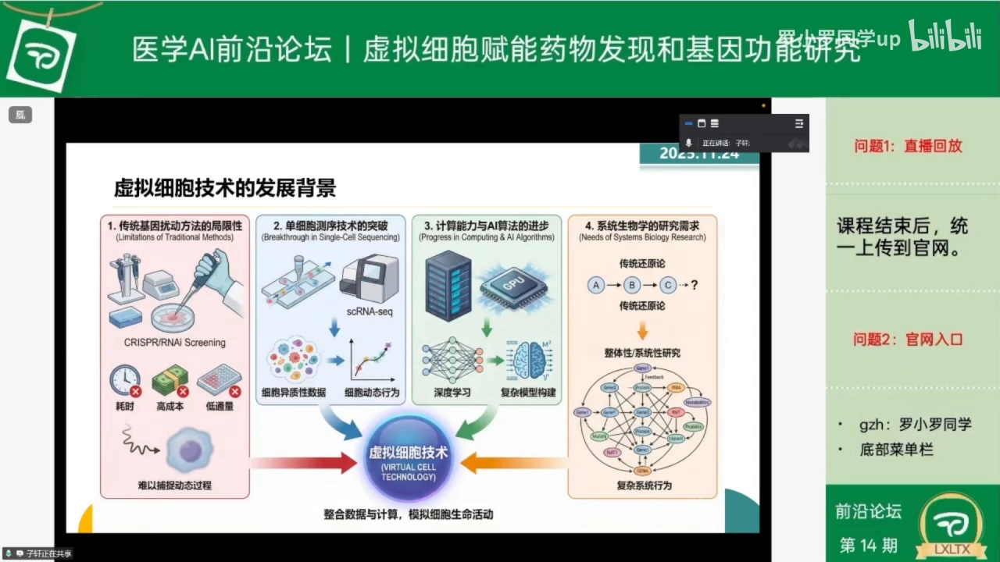
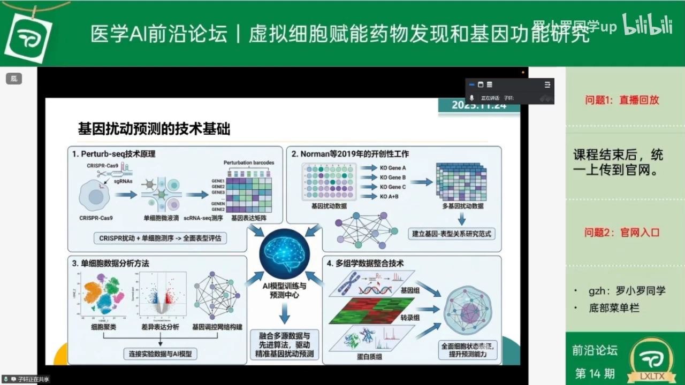
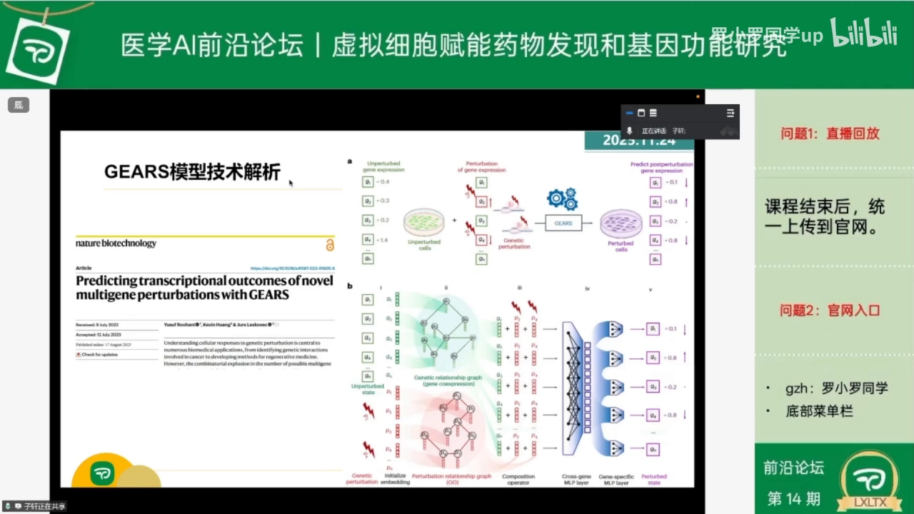
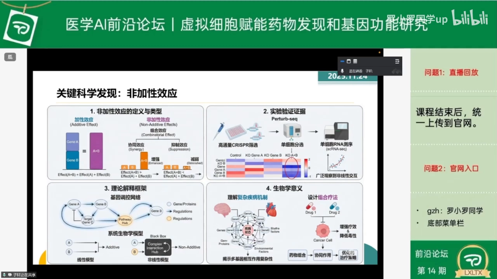
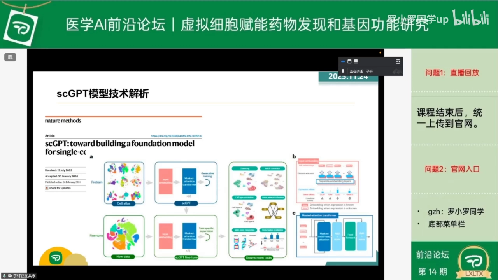
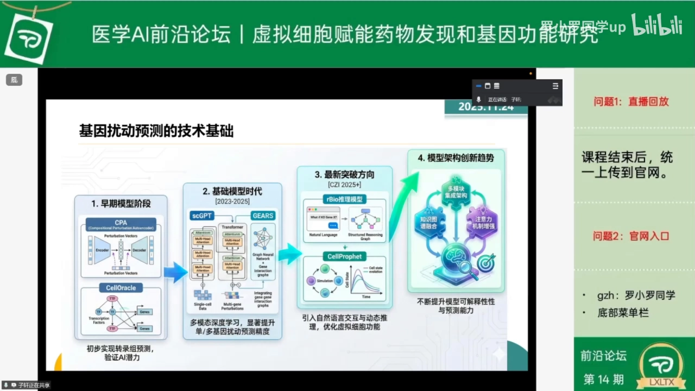
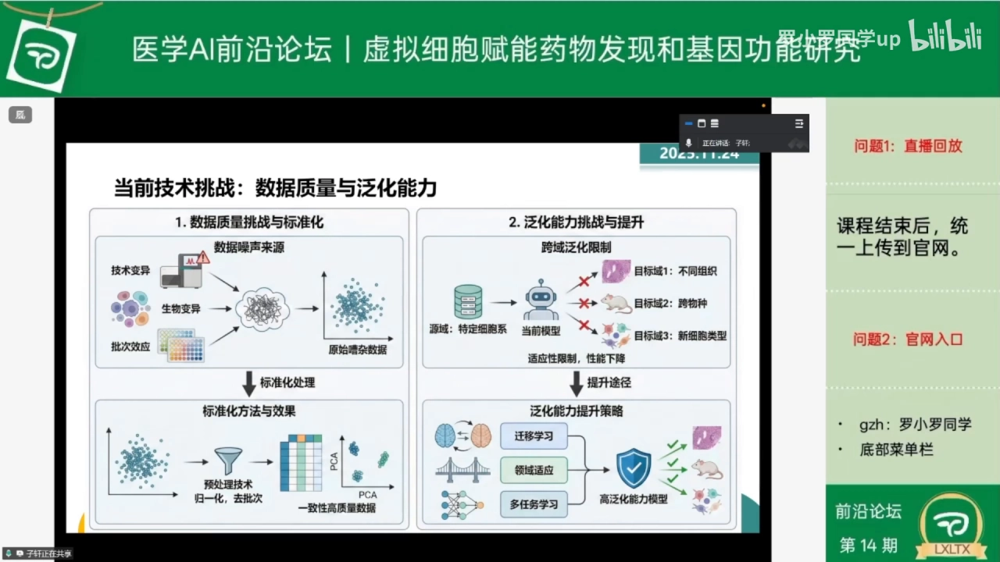
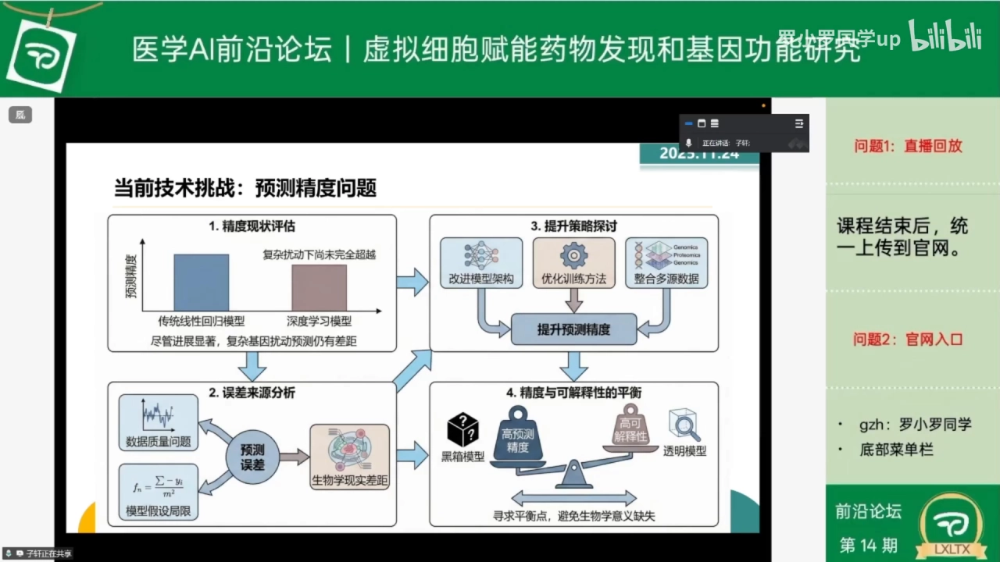
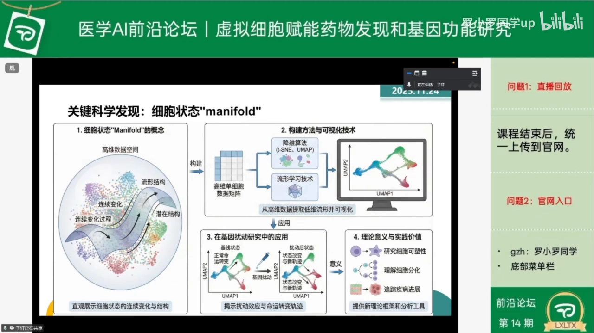
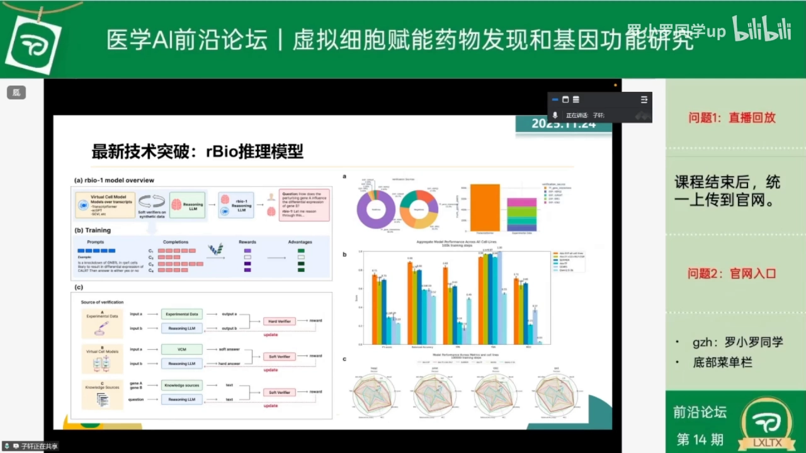

# 扰动标签怎么和表达矩阵绑在一起：从扰动编号到条件 token

> 视频来源：[虚拟细胞论坛-基因扰动的AIVC](https://www.bilibili.com/video/BV1K2BLBDEWH/)（Bilibili · 罗小罗同学up「医学 AI 前沿论坛」第 14 期，讲者杨博）｜时长约 32 分钟
> 简要导读：这场分享的主线是「基因扰动预测」的技术现状——从 Perturb-seq 的数据基础，讲到 GEARS、scGPT、rBio 三个模型。本文只取其中与**数据结构**有关的那条线：一次扰动实验在数据里到底长什么样、扰动标签被放在哪一层、以及标签的写法为什么会直接决定模型能学到什么。模型架构的内部细节（图神经网络怎么搭、transformer 怎么堆）只讲到「标签怎么被吃进去」为止，完整方法学见 5.4 各小节。字幕为 B 站 AI 字幕，术语按上下文订正（原文把 scGPT 识别成「SGBT」、GEARS 识别成「GERS / GEAR」、分箱识别成「封箱」、流形识别成「流行」、稀疏识别成「虚切」等）；讲者口播里含糊的机构名与平台名（「CCI」「willohub」「upboy」）按中性表述处理，不臆造。

## 本讲要解决的核心问题（SCQA）

**背景**：一次单细胞扰动实验的产物是两样东西——一张**表达矩阵**（每一行一个细胞、每一列一个基因，格子里是 counts），和一张**「谁被扰动了」的标签表**（这个细胞被敲了哪个基因、加了什么药）。前者是测量结果，后者是实验设计。

**冲突**：矩阵本身完全不知道哪个细胞被敲了哪个基因。同一个细胞，无论它是对照还是敲了某个基因，在矩阵里都只是一串数字。扰动信息必须**以某种结构挂在矩阵旁边**，而这个结构怎么设计，直接决定了三件事：能不能把多个数据集拼起来、能不能训练模型、以及模型学到的到底是生物学还是批次。

**疑问**：扰动标签应该以什么形式挂在矩阵旁边？一行一个细胞的长表、扰动 × 基因的宽表、还是塞进对象/模型输入的某个槽位？

**回答（中心思想）**：**扰动标签有三种落点，选哪一种取决于你要做的是「筛选」还是「预测」。** 做筛选（比较扰动组与对照组）时，标签最自然的形态是一行一个细胞的**长表**，扰动只是其中一列编号；做预测（训练模型）时，标签必须变成**与表达矩阵同构的输入**——要么是 GEARS 那种「表达向量 + 扰动编号」的配对，要么是 scGPT 那种把扰动状态、批次、模态压进一个 **condition token** 的条件向量。视频里三个模型恰好把这三层依次演了一遍，而它们共同暴露的坑是同一个：**标签里的对照、批次、多重扰动如果没写清，模型学到的就是噪声。**



## 一、一次扰动实验在数据里长什么样：一个矩阵，加一张标签表

讲者把「基因扰动预测的技术基础」压在一张四格图上 [【跳转到 02:16】](https://www.bilibili.com/video/BV1K2BLBDEWH/?t=136)。这张图值得逐格看，因为它把「数据是怎么攒出来的」讲全了。



左上角是 **Perturb-seq 的技术原理**：CRISPR-Cas9 把 sgRNA 送进细胞，细胞被液滴一个个包起来做 scRNA-seq，最后得到两样东西——**Perturbation barcodes**（哪条 sgRNA 进了哪个细胞）和**基因表达矩阵**。讲者在这里说了一句很关键的话：从数据输入端来说，我们需要的是一个能让我们**同时获得扰动和表型两方面信息**的图谱 [【跳转到 02:16】](https://www.bilibili.com/video/BV1K2BLBDEWH/?t=136)。

这句话翻译成数据结构的语言就是：**表达矩阵负责「表型」，barcode 表负责「扰动」，两者靠细胞 barcode 这一列做 join。** 矩阵有多宽（多少基因）、多高（多少细胞），标签表就有多少行——一行不多、一行不少。任何一行标签对不上，那个细胞在下游要么被丢掉，要么被错标成别的扰动。

右上角是 **Norman 等 2019 年的开创性工作**：他们不只做单基因敲除（KO Gene A、KO Gene B、KO Gene C），还做了**双基因同时敲除**（KO A+B），并把单基因扰动数据扩展成多基因扰动数据，从而建立了「基因-表型关系」的研究范式 [【跳转到 02:41】](https://www.bilibili.com/video/BV1K2BLBDEWH/?t=161)。

这就是本小节的核心：**一旦有了「A+B」这种标签，标签表就不再是「一个细胞一个基因名」这么简单的关系型字段了。** 它变成了一个可以拆、可以合、可以组合爆炸的结构，而怎么编码它，是后面所有分析的分水岭。

## 二、第一种落点：一行一个细胞的长表，扰动只是其中一列编号

GEARS 是讲者介绍的第一个模型，也是「标签怎么进模型」讲得最直白的一个 [【跳转到 05:11】](https://www.bilibili.com/video/BV1K2BLBDEWH/?t=311)。



看 a 图：方框里 `g1 = 0.4`、`g2 = 0.3`、`g3 = 0.2`、`g4 = 1.4` 这一列数字，是**未扰动细胞**的基因表达量——也就是表达矩阵里的一行（转置成列）。旁边的闪电符号和红色箭头表示扰动：让 g1 的表达量降低、让 g4 的表达量上升。

而 **P1、P4 是扰动操作的编号** [【跳转到 06:01】](https://www.bilibili.com/video/BV1K2BLBDEWH/?t=361)。讲者的原话是「相当于人为地给某些基因拨了一个开关」。

这一步在数据结构上意味着什么？意味着最朴素的扰动标签长这样：

```
cell_id        gene_1   gene_2   ...   gene_n   perturbation_id
AAACCTGAG...   0        2        ...   0        P1
AAACCTGAG...   1        0        ...   3        P4
```

- **左边是矩阵**：从 gene 1 到 gene n 这些列是表达量；
- **右边是标签**：`perturbation_id` 是一个指向「扰动字典」的外键，字典里 `P1 → 敲除基因 A`、`P4 → 敲除基因 B`。

这就是**长表（long / tidy）**的形态：一行一个细胞，扰动只是这一行里的一列。它的好处是通用——想筛「所有敲了 A 的细胞」就是一次 `WHERE perturbation = 'A'`；想加一个新字段（剂量、时间点、批次）就加一列，不用动矩阵。它的代价是每次分析都要 join 一次，而且当扰动有几十万种组合时，这一列会变得又长又稀。

GEARS 的聪明之处在于，它把「扰动」当成了**与表达向量并列的第二个输入**：表达向量告诉模型「这个细胞本来长什么样」，扰动编号告诉模型「要拨哪个开关」，模型输出的是「拨完之后应该长什么样」 [【跳转到 04:11】](https://www.bilibili.com/video/BV1K2BLBDEWH/?t=251)。换句话说，**长表里的那一列标签，在模型里被提升成了一个独立的输入通道**。

讲者还提到 GEARS 用了两个先验图谱——基因共表达图谱和基因本体论（GO）图谱，讲者说有 111 个先验知识 [【跳转到 02:46】](https://www.bilibili.com/video/BV1K2BLBDEWH/?t=166)。这属于「标签之外的先验」，不在本文范围内，但它说明一件事：**扰动标签只回答「敲了谁」，回答不了「敲了之后会怎样」，后者要靠基因之间的关系结构来补。**
## 三、第二种落点：扰动 × 基因的宽表，标签变成了列名

长表是「一行一个细胞」，宽表则把**扰动提到列上**：行是基因，列是扰动（或者反过来），格子里是「这个扰动下这个基因的平均表达」或「相对于对照的变化倍数」。

讲者讲到非加性效应时，幻灯片上给了一张 Perturb-seq 的热图 [【跳转到 15:07】](https://www.bilibili.com/video/BV1K2BLBDEWH/?t=907)。这张图的列就是宽表的典型形态。



看这张热图的列名：**Control、KO Gene A、KO Gene B、KO A+B**。四列就是四个「实验条件」，每一列本质上是把「所有属于这个条件的细胞」聚合成了一个表达谱。

- 前三列是单标签（对照、敲 A、敲 B）；
- 第四列是**组合标签**（同时敲 A 和 B）。

一旦标签变成列名，很多运算就变成了矩阵运算：把 KO A 这一列减去 Control 列，就得到基因 A 的扰动效应；把 KO A+B 的效应减去「A 的效应 + B 的效应」，剩下的就是**非加性部分**：

$$
\text{non-additive}(A,B) = \text{Effect}(A+B) - \left[\text{Effect}(A) + \text{Effect}(B)\right]
$$

这个差值大于零叫**协同效应**（1+1 > 2），小于零叫**抑制效应**（1+1 < 2）。讲者用这张图说明：生物学不是简单的数字加法，AI 模型现在能捕捉这些非线性交互，这对设计敲基因实验、药物扰动实验、组合疗法都有指导意义 [【跳转到 15:32】](https://www.bilibili.com/video/BV1K2BLBDEWH/?t=932)。

**宽表的取舍**：

| 维度 | 长表（一行一个细胞） | 宽表（扰动 × 基因） |
| --- | --- | --- |
| 标签的位置 | 一列（外键） | 列名 |
| 适合做什么 | 筛选、分组、join | 扰动 × 基因的矩阵运算、算协同/抑制 |
| 多重扰动 | 一行写 `A+B` 即可 | 需要额外一列或额外一层 |
| 稀疏性 | 天然稀疏（大部分细胞只对应一个扰动） | 组合爆炸：N 个基因的两两组合是 $O(N^2)$ 列 |
| 丢失的信息 | 几乎不丢（细胞级） | 聚合后丢掉细胞级异质性 |

这就是「宽表便于算、长表便于查」的具体含义。讲者提到的 Norman 2019 数据集之所以重要，正是因为它同时提供了单基因和双基因两类标签，让宽表能算出**非加性**这一层 [【跳转到 02:41】](https://www.bilibili.com/video/BV1K2BLBDEWH/?t=161)。

## 四、第三种落点：把标签塞进对象与模型输入（condition token）

第三个模型 scGPT 把标签问题推到了另一个层次：**它不再把扰动当成一个外挂的编号，而是当成与表达量并列的一种「输入信息」** [【跳转到 09:50】](https://www.bilibili.com/video/BV1K2BLBDEWH/?t=590)。



讲者说，这篇论文把输入数据**分成了三类信息**，分别通过独立的嵌入层处理，再按元素求和，得到最终的输入嵌入 [【跳转到 10:15】](https://www.bilibili.com/video/BV1K2BLBDEWH/?t=615)。


这三类信息分别是：

1. **基因 token**：把每个基因对应成一个 id。因为基因表达从 0 到很高差距极大，所以做了归一化——也就是**分箱**：把表达分成 1 到 5 个等级，用不同阈值把每个基因的表达放进对应的箱子 [【跳转到 10:40】](https://www.bilibili.com/video/BV1K2BLBDEWH/?t=640)。
2. **条件 token**：包含**模态、批次以及扰动状态**这些元信息，就是图中粉色那块；它还能区分「表达已知」和「表达未知」，为预训练做准备。
3. 第三类是与任务相关的输入（讲者未展开）。

请注意第二类。**「模态 + 批次 + 扰动状态」被塞进了同一个 token。** 这就是本小节要讲的「对象内嵌」在深度学习里的版本：在 AnnData 里，这三样东西是 `obs` 的三列；在模型里，它们被编码成一个向量，作为每个细胞的「条件」。

讲者给了一个很实用的理由：**分箱能消除测序批次带来的尺度差异** [【跳转到 10:40】](https://www.bilibili.com/video/BV1K2BLBDEWH/?t=640)。这句话点出了标签与矩阵的关系里最容易被忽略的一层——**标签和矩阵必须解耦**。如果表达量的绝对尺度随批次漂移，而标签里又没记批次，模型就会把「批次差异」学成「扰动效应」。

到了 Q&A 环节，有听众问 scGPT 和 STATE 的 embedding 是不是类似，讲者的回答把这件事说得更清楚 [【跳转到 27:47】](https://www.bilibili.com/video/BV1K2BLBDEWH/?t=1667)：

- scGPT 做嵌入时把测序数据整合成三类信息，做了一个词表、做了表达量分箱、**又加了元数据表**，把三样整合成一个高维向量；
- 而 STATE 的 SE 模块还用了 ESM 蛋白模型，**没有做分箱处理，也没有加入元数据（比如批次数据）** [【跳转到 27:52】](https://www.bilibili.com/video/BV1K2BLBDEWH/?t=1672)。

两者「完全不太一样」。这段对比的价值在于：**同样是「把标签塞进模型」，塞不塞元数据、怎么塞，是两套不同的设计哲学**，而它们的差别会体现在跨批次、跨数据集的表现上。

## 五、标签表里到底该写哪几列

把视频里散落的信息收拢，一张合格的扰动标签表至少要有下面六类字段。这不是讲者逐条列出的清单，而是把他讲的每个模型对标签的需求反推回来的结果。

| 字段 | 含义 | 视频里的对应证据 | 不写会怎样 |
| --- | --- | --- | --- |
| `target` | 被扰动的目标（基因名 / gRNA / 药物） | GEARS 的 P1、P4 扰动编号 | 无法把细胞分组，矩阵只是一堆数字 |
| `modality` | 扰动方式（CRISPR KO / CRISPRi / CRISPRa / 药物 / 细胞因子） | scGPT 的 condition token 里的「模态」 | 敲除与敲低被混成一类，效应方向搞反 |
| `strength` / `dose` | 扰动强度（药物剂量、gRNA 效率、诱导时长） | 视频未直接讨论，属通用设计建议 | 剂量效应被当成随机噪声 |
| `control_flag` | 对照类型（NTC / vehicle / untreated） | 热图里的 Control 列 | 对照被当成一种扰动，效应全部偏移 |
| `multiplex` | 多重扰动（一个细胞多条 gRNA） | Norman 2019 的 KO A+B | 组合效应被拆散或错记成单基因 |
| `metadata` | 细胞系、时间点、批次、供体、细胞类型 | scGPT 的 Batch / Modality 嵌入 | 批次效应被学成生物学差异 |

其中两条最容易踩坑：

**第一，对照组必须统一命名。** 视频里 Control 是热图的基准列，所有效应都是相对它算的。如果一批数据里对照叫 `control`、另一批叫 `NTC`、第三批叫 `non-targeting`，合并时它们会被当成三种不同的扰动，基准线就歪了。

**第二，细胞类型与扰动是两个维度，不要塞进同一列。** 讲者在讲泛化能力时说得很直白：现在的模型在跨细胞系、跨组织、跨物种上效果都还不理想 [【跳转到 18:27】](https://www.bilibili.com/video/BV1K2BLBDEWH/?t=1107)。如果细胞类型和扰动标签混在一列里（比如写成「A549_KO_基因A」），那么「同一个扰动在不同细胞系里的效应」这个最关键的问题就没法问了。

## 六、组合标签：从「一个细胞一个基因」到「一个细胞一组基因」

讲者把 GEARS 的定位说得很清楚：它算是比较早能够预测**从未见过的多基因组合**的模型 [【跳转到 04:21】](https://www.bilibili.com/video/BV1K2BLBDEWH/?t=261)。这句话背后是一个数据结构问题。

假设文库覆盖 1000 个基因，只做单基因扰动，标签空间是 1000 种；一旦允许两两组合，标签空间就是约 50 万种。**没有任何实验能测完 50 万种组合**，所以组合标签必然是「稀疏标签」：见过的组合很少，没见过的组合极多。模型要做的，是从「见过的单基因 + 少量双基因」推出「没见过的组合」。

这正是 Norman 2019 那个数据集的价值：它同时提供了单基因和双基因两类标签，让「加性 vs 非加性」可以被量化 [【跳转到 02:41】](https://www.bilibili.com/video/BV1K2BLBDEWH/?t=161)。

标签空间的膨胀，也解释了为什么模型会一代代换架构。讲者把这条路线画成了一张演进图 [【跳转到 03:56】](https://www.bilibili.com/video/BV1K2BLBDEWH/?t=236)：早期是 CPA、CellOracle 这类模型，初步实现转录组预测；然后是 scGPT、GEARS 这类基础模型，把单基因与多基因扰动的预测精度提上来；最新方向是 rBio、CellProPhet，引入自然语言交互与动态推理。**每一代的进步，都对应标签从「一个基因名」变成「一组基因 + 上下文」的过程。**



那么在数据结构上，一个细胞拿了多条 gRNA 该怎么记？三种常见写法，各有代价：

| 编码方式 | 形态 | 优点 | 代价 |
| --- | --- | --- | --- |
| 字符串拼接 | `perturbation = "A+B"` | 一行一值，长表结构不变 | 无法直接按单基因聚合，需要拆字符串 |
| 多行展开 | 一个细胞出现两行，各记一个 gRNA | 便于按单基因统计 | 细胞被重复计数，矩阵 join 后行数变多 |
| 主导 gRNA | 只保留占比最高的那条 | 简单，适合 MOI 很低的数据 | 丢掉真实的组合效应，等于人为制造假阴性 |

讲者没有直接比较这三种写法，但他讲的「协同效应 / 抑制效应」只有在**组合标签被正确保留**时才存在 [【跳转到 15:07】](https://www.bilibili.com/video/BV1K2BLBDEWH/?t=907)。如果按第三种写法只留主导 gRNA，KO A+B 这一列就消失了，非加性效应无从计算。

## 七、标签与矩阵的尺度必须解耦

讲者在讲 scGPT 时提到分箱的两个作用：一是把连续的 counts 变成 1–5 档，二是**消除测序批次带来的尺度差异** [【跳转到 10:40】](https://www.bilibili.com/video/BV1K2BLBDEWH/?t=640)。

这条经验对任何扰动数据集都成立。表达矩阵的绝对值同时受三件事影响：真实的生物学差异、测序深度、批次。而**扰动标签只该解释第一件**。如果标签表里没有批次列，或者批次列与扰动列完全共线（比如「批次 1 只做了对照，批次 2 只做了敲除」），那么无论后面用多复杂的模型，扰动效应和批次效应都是不可分辨的。

讲者在讲「数据质量与泛化能力」时把这一点说得更透 [【跳转到 18:02】](https://www.bilibili.com/video/BV1K2BLBDEWH/?t=1082)：



他的原话大意是：虽然前面提到归一化、分箱这些处理手段，但它们**仍然是干扰源**，不能完全消除噪声和批次效应的影响，只能说从模型的角度让模型更好地学到噪声之外真正要关心的东西。

这句话在数据结构层面的含义是：**归一化是「补救」，标签设计才是「预防」。** 把批次、细胞系、时间点写进 `obs`，让分析时可以把它们作为协变量放进模型，比事后归一化更可靠。

还有一个容易被忽略的矩阵特性：**稀疏**。讲者说单细胞测序数据里真正起作用的基因并不多，很多基因表达是零，这种稀疏问题需要专门的处理方法 [【跳转到 11:55】](https://www.bilibili.com/video/BV1K2BLBDEWH/?t=715)。稀疏对标签设计的直接影响是：**每个扰动下的细胞数必须够多**，否则「这个扰动让某基因上调」很可能只是几个细胞的抽样噪声。标签表里应当有 `n_cells_per_perturbation` 这类可核查的统计，而不是让下游自己去数。

## 八、标签的可靠性决定了模型能走多远

讲者把当前的技术挑战归成四点：精度、泛化能力、数据质量、可解释性 [【跳转到 18:27】](https://www.bilibili.com/video/BV1K2BLBDEWH/?t=1107)。这四点里，有三点直接由标签的质量决定。



**第一，精度受误差来源限制。** 幻灯片把误差来源分成「数据质量问题」和「模型假设局限」两半。数据质量问题里，标签错配（细胞被贴上错误的 gRNA）是最致命的一种——它不会让模型报错，只会让模型学到「敲了 A 和没敲 A 差不多」这种错误结论。

**第二，泛化受标签维度限制。** 幻灯片右侧列了三个泛化目标：不同组织、跨物种、新细胞类型。讲者说现在没有一个特别好的模型能把人体每个组织、每个细胞都做得很好，可能只关注某一个部位；跨物种更是目前最大的难点 [【跳转到 18:52】](https://www.bilibili.com/video/BV1K2BLBDEWH/?t=1132)。要研究这三件事，标签表里就必须有组织、物种、细胞类型这三列——**没有这些列，泛化能力连评估都做不到。**

**第三，可解释性受标签粒度限制。** 讲者说 scGPT 的 transformer 架构、STATE 的 SE 模块都是黑箱：得到了结果，但不知道它为什么得到这样的结果 [【跳转到 16:47】](https://www.bilibili.com/video/BV1K2BLBDEWH/?t=1007)。要判断一个预测「在生物学上有没有意义」，最直接的办法是回到标签：**这个基因被敲掉之后，通路里其他基因有没有跟着动？** 如果标签只记了基因名、没记通路归属，这个检查就得靠外部注释表补。

讲者讲「细胞状态流形」时给的另一张图，说明了标签之外的另一层结构 [【跳转到 15:57】](https://www.bilibili.com/video/BV1K2BLBDEWH/?t=957)：高维单细胞数据矩阵经过降维（t-SNE、UMAP）或流形学习，被压成二维可看的轨迹。在数据对象里，这一层既不是矩阵也不是标签，而是**每个细胞的一个向量**——也就是 `obsm` 该放的东西。扰动标签回答「这个细胞属于哪一组」，`obsm` 里的 embedding 回答「这个细胞在这一组里处于什么位置」。



## 九、当标签变成一句自然语言：rBio 的接口设计

讲者介绍的第三个工作是 rBio 推理模型，它的四个特性里有两个直接和标签的组织方式有关 [【跳转到 12:37】](https://www.bilibili.com/video/BV1K2BLBDEWH/?t=757)。


- **自然语言交互界面**：研究人员可以直接问模型「如果我敲除基因 A 会怎么样」，模型通过多个模型的预测、整合之后回复 [【跳转到 14:42】](https://www.bilibili.com/video/BV1K2BLBDEWH/?t=882)。
- **多模态数据融合**：整合文本描述、实验数据、先验知识，构建更全面的细胞状态预测模型。



这个接口设计对数据结构提出了一个新要求：**标签必须是「人类可读」的。** 如果 `perturbation` 列里存的是内部编号 `P1`、`P4`，自然语言接口就没法把它翻译成「基因 A」；只有当标签里同时保留了 gene symbol、基因 id 和别名，模型才能把用户的问题对上数据。这是「长表 + 字典表」结构的一个额外好处：字典表天然就是人可读的映射层。

讲者在 Q&A 里还区分了虚拟细胞与药物重定位 [【跳转到 25:07】](https://www.bilibili.com/video/BV1K2BLBDEWH/?t=1507)：药物重定位依赖已有的药物安全性数据、临床记录、分子靶点，用机器学习去对比药物作用下的基因表达与疾病特征谱；而虚拟细胞是构建一个数字模型或生物网络模型去模拟细胞内部机制，整合多组学数据，是一个预测性的建模工具。用他的类比：**大模型能干很多事情，药物重定位只是其中一个任务，两者是包含关系** [【跳转到 26:00】](https://www.bilibili.com/video/BV1K2BLBDEWH/?t=1560)。这个区分落到数据上，就是「一张通用扰动表」与「一张药物专用表」的差别——后者需要剂量、给药时长、溶剂对照这些字段，前者不需要。

## 十、落地建议：先定表，再谈分析

讲者反复提到「整合多源数据」「多模态数据融合」，但真正落地时，第一步不是选模型，而是**把标签表定下来**。下面这张清单可以直接照做。

**第一步：定一张 cell × 字段 的表。** 最小可用集合是五列：

```
cell_id | perturbation | control_flag | batch | cell_type
```

- `perturbation` 用统一命名（基因用 HGNC symbol，药物用统一通用名，不要混用商品名与代号）；
- `control_flag` 是布尔列，把 NTC / vehicle / untreated 都标成 `True`，这样对照组永远不会被当成一种扰动；
- `batch` 与 `cell_type` 单独成列，绝不与 `perturbation` 拼在一起。

**第二步：把「每个细胞一行」的属性放进 `obs`，把「每个细胞的向量」放进 `obsm`。** 扰动标签、剂量、批次、细胞类型都是「一行一个值」，属于 `obs`；而 embedding、扰动效应打分是「一行一个向量」，属于 `obsm`。讲者讲的 scGPT 条件 token，本质就是把 `obs` 里的几列编码成一个向量——**先有 `obs` 的列，才有 token 的位。**

**第三步：原始字段不要丢。** 统一格式的代价是丢掉原始研究的特有字段。做法是：把统一字段放 `obs`，把原始字段原样保留在 `obs` 的另一个命名空间里（比如 `orig_` 前缀），或者放进 `uns` 作为一张附注表。这样既能让下游脚本按统一列名跑，又不至于把「这个数据集的剂量是 1 μM 还是 10 μM」这种信息抹掉。

**第四步：对外发布时，矩阵和表一起给，并写清字段含义。** 只发 `.h5ad` 不发字段说明，等于让别人猜。讲者说自然语言接口是趋势 [【跳转到 12:37】](https://www.bilibili.com/video/BV1K2BLBDEWH/?t=757)，而自然语言接口能不能用，取决于标签表有没有一份人可读的字典。

**第五步：检查三个一致性。** 发布前至少核对：

1. `perturbation` 的取值集合里**没有** `control`、`NTC`、`vehicle` 这类词（它们应该在 `control_flag` 里）；
2. 每个 `perturbation` 的细胞数足够（稀疏数据里，少于几十个细胞的扰动建议标成 `low_n`，而不是直接参与统计）；
3. `batch` 与 `perturbation` 没有完全共线（每个批次里都既有对照又有扰动）。

## 小结

- **扰动标签有三种落点，对应三种分析目的。** 长表（一行一个细胞、扰动是一列编号）适合筛选与合并；宽表（扰动 × 基因）适合算协同与抑制；对象内嵌或模型输入编码（`obs` 列、condition token）适合训练与预测。
- **表达矩阵只回答「多少 counts」，不回答「谁被敲了」。** 扰动信息必须靠细胞 barcode 这一列 join 进来，标签表与矩阵必须严格等行。
- **组合标签是这套结构里最脆弱的一环。** 单基因扰动的标签空间是线性的，两两组合就变成平方级；字符串拼接、多行展开、只留主导 gRNA 三种写法各有代价，选错就等于提前放弃非加性效应。
- **标签与矩阵的尺度必须解耦。** 分箱、归一化是补救，把批次、细胞系、时间点写进标签表才是预防；批次与扰动共线时，扰动效应不可辨识。
- **标签的粒度决定可解释性的上限。** 只记基因名，就只能回答「敲了谁」；同时记通路、细胞类型、物种，才能回答「为什么」和「能不能迁移」。
- **先定表，再谈分析。** 一张「细胞 × 字段」的表（扰动、对照标记、批次、细胞类型），是所有下游工作的前提。

## 关键术语速查

| 术语 | 一句话解释 |
| --- | --- |
| 表达矩阵 | 行是细胞、列是基因、格子里是 counts 的矩阵；它不知道哪个细胞被扰动过 |
| 扰动标签 | 记录「每个细胞被敲了哪个基因 / 加了什么药」的那张表，靠细胞 barcode 与矩阵对齐 |
| 长表（long / tidy） | 一行一个细胞、扰动是其中一列的表格形态，通用但每次分析都要 join |
| 宽表 / 设计矩阵 | 行是基因、列是扰动（或反过来）的形态，便于做扰动 × 基因的矩阵运算 |
| Perturbation barcode | Perturb-seq 里标记「哪条 sgRNA 进了哪个细胞」的那段序列，是扰动标签的物理来源 |
| condition token | scGPT 里把模态、批次、扰动状态编码成的条件向量，等价于把 `obs` 的几列压进模型输入 |
| 分箱（binning） | 把连续的基因表达切成 1–5 档，既降维也削弱批次间的尺度差异 |
| 非加性效应 | 双扰动效应减去两个单扰动效应之和；大于零为协同，小于零为抑制 |
| 多重扰动（multiplex） | 一个细胞带多条 gRNA 的情形，标签需要能表达「A+B」这类组合 |
| 对照（NTC / vehicle） | 非靶向 gRNA 或溶剂对照，是所有扰动效应的基准，必须与扰动标签分开存 |
| 泛化能力 | 模型在没见过的细胞系、组织、物种上的表现；评估它要求标签里有对应的列 |
