# Tahoe-100M：1 亿细胞图谱如何把药物发现从 20 年压缩成一次查询

> 视频来源：[Tahoe-100M：千兆级单细胞扰动图谱 || Dr. Johnny Yu](https://www.bilibili.com/video/BV1khg5z9EpZ/)（B 站 · MCBRLab 搬运的 BioTuring「AI meets biology」网络研讨会，讲者 Johnny Yu，Tahoe Therapeutics 联合创始人兼首席科学官）｜时长约 63 分钟
> 导读：这是 Tahoe-100M 的「主创视角」报告——不讲怎么在平台里点按钮，而讲**为什么要造这张图谱、它是怎么造出来的、以及能从中挖出什么**。前半段是药物发现百年史与 Mosaic 平台的来历，中间是 Tahoe-100M 的规格与工艺，后半段用三个故事（saquinavir 的心脏毒性、MHC-I 上调剂、药物–遗传扰动配对反卷积）演示这张图谱的用法，最后是 AI agent 与基础模型。字幕为英文 ASR，药名与术语已按幻灯片订正。

## 本讲要解决的核心问题（SCQA）

**背景**：药物发现每十年换一次「引擎」——1930 年代的染料提取物筛选、1980 年代的高通量板式筛选、1990 年代的组合化学、2000 年代的基因组学、2010 年代的新分子模态。每一次技术换代，都把「找到候选分子」的速度推上一个台阶。

**冲突**：但有一个环节始终没跟上——**你很难在人体相关的复杂性里，快速知道一个药到底对谁有效、为什么会失效、有没有意料之外的毒性**。传统做法是把这些问题交给长达十几年的临床试验，用真实病人的安全事件去「反向发现」机制。

**疑问**：能不能在体外、在单细胞分辨率上，一次性把「上千个分子 × 上百个病人模型 × 多个剂量」的响应全测出来，让药物机制、敏感性、毒性信号都变成可查询的数据？

**回答（中心思想）**：Tahoe-100M 就是为这个问题造的：用 **Mosaic 平台**把 50 个癌细胞模型混进同一只小鼠、同一个孔，再铺到 96 孔板上分别给药，24 小时后做单细胞测序，得到 **1 亿细胞、1200 种药物处理、约 6 万个实验**的图谱。它的价值不在「大」，而在**统一工艺带来的低批次效应**——正因为所有数据在同一套流程里产生，你才能做跨模型、跨药物、跨剂量的大规模比较，并用它反推药物的真实机制。

## 一、为什么是单细胞：药物发现的下一个引擎

### 1.1 从煤焦油染料到组合化学：一百年里换过五次引擎

Johnny 开场没有直接讲数据，而是往回退到 1930 年代的德国（[【跳转到 04:29】](https://www.bilibili.com/video/BV1khg5z9EpZ/?t=269)）：

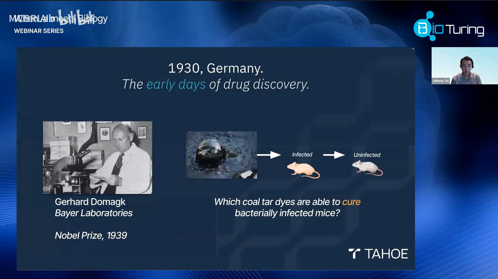

Gerhard Domagk 在拜耳的实验室里，把煤焦油染料的提取物——字面意义上「泡过煤的液体」——打进感染细菌的小鼠体内，看哪一支能救命。这就是最早的抗生素来源之一，他本人也在 1939 年拿到诺贝尔奖。讲者还补了个细节：Domagk 的第一次「临床试验」，试的是自己生病的女儿。

此后每一次技术换代都很清晰（[【跳转到 05:19】](https://www.bilibili.com/video/BV1khg5z9EpZ/?t=319)）：

| 年代 | 新引擎 | 带来的变化 |
| --- | --- | --- |
| 1930s | 体内感染模型筛选 | 第一次有「可重复的药效验证」 |
| 1980s | 板式高通量筛选 | 一次测成千上万个化合物 |
| 1990s | 组合化学 | 合成变容易，化学空间大幅扩张 |
| 2000s | 人类基因组计划 | 能把因果变异追到基因与具体突变 |
| 2010s | 新分子模态（ADC、多肽、降解剂、基因治疗） | 可成药的靶点范围扩大 |

### 1.2 下一个十年：单细胞基因组学

讲者的判断是：**单细胞基因组学已经成熟到可以成为下一个十年的引擎**（[【跳转到 06:27】](https://www.bilibili.com/video/BV1khg5z9EpZ/?t=387)）。他的论证方式很直接——把单细胞这十年的技术时间线摆出来：

2015 年 Macosko 在 Broad 做出第一个油包水法（Drop-seq，发表于 Cell）；2016 年 10x 推出第一套一体式 Chromium 方案；2017 年 CITE-seq 做细胞表面蛋白；2018 年 SPLiT-seq 提供了完全不同的非液滴路线；2019 年样本 hashing 让多样本混合进同一个实验（新冠期间非常关键）；2021 年 Parse 试剂盒上线，加上全基因组 Perturb-seq、Allen 人脑图谱；2024 年出现早期单细胞基础模型（[【跳转到 06:52】](https://www.bilibili.com/video/BV1khg5z9EpZ/?t=412)）。

这条时间线里有个有意思的对照：Drop-seq 当年的愿景是「开源，让任何实验室都能自己搭一套」，十年后真正跑出规模的却是**高度工程化的商业平台**。Tahoe-100M 正是在这个背景下，用 Parse 的组合索引（combinatorial indexing）工艺做出来的。

## 二、Mosaic：把 50~100 个病人模型装进同一只小鼠

### 2.1 核心思路：让「病人之间的差异」和「药物之间的差异」在同一个实验里同时存在

Tahoe 是一家成立三年的公司，四位联合创始人里，Nima Alidoust（CEO）与 Johnny 是运营创始合伙人，Hani Goodarzi 与 Kevan Shokat 是 UCSF 的教授；顾问团覆盖肿瘤、AI 与生物医药三个领域，两轮融资共 4500 万美元（[【跳转到 10:00】](https://www.bilibili.com/video/BV1khg5z9EpZ/?t=600)）。整个技术栈的源头，是 Johnny 在 UCSF 与 Kevan Shokat、Hani Goodarzi 一起做的那套平台工作。

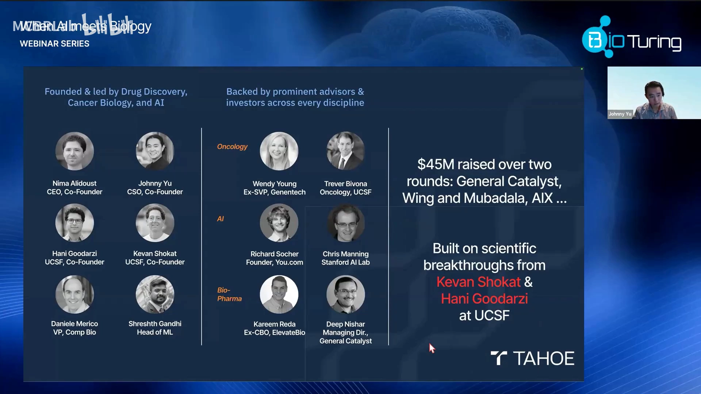

Mosaic 平台的想法一句话能说完：**把许多不同的病人模型混成一个「马赛克肿瘤」，同时给药、同时测序**（[【跳转到 10:25】](https://www.bilibili.com/video/BV1khg5z9EpZ/?t=625)）。在癌症里，这意味着把脑癌、肺癌、胰腺癌、结直肠癌等不同组织、不同遗传背景的肿瘤细胞混在一起，植入小鼠或做成类器官，然后在这一个「混合体」上筛几千个化合物。

给药之后把肿瘤解离成单细胞、做单细胞 RNA 测序，一次就能同时回答三件事：

1. **表型**：哪些病人模型对药敏感——是胰腺癌，还是带某种突变的模型？
2. **转录组变化**：药物把细胞状态改成了什么样；
3. **机制**：结合前两者，推断药物的 on-target 与 off-target 作用。

第三点是讲者反复强调的差异：像 Broad 的 PRISM 这类大规模筛选平台给的是**表型**（细胞死没死），而单细胞转录组给的是**机制**。

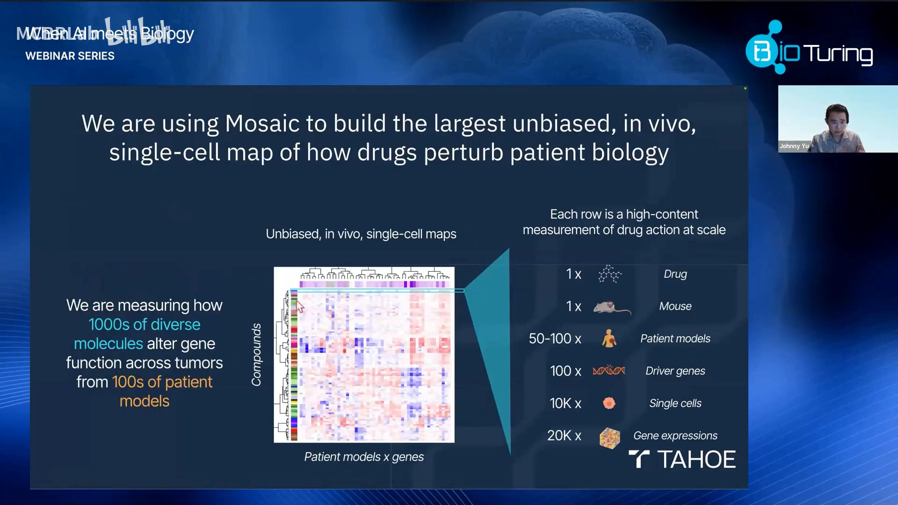

### 2.2 平台能自证：vemurafenib 与 ARS-1620

一个新平台必须先证明「它能重现已知的生物学」。讲者用两个临床常用药做验证（[【跳转到 12:19】](https://www.bilibili.com/video/BV1khg5z9EpZ/?t=739)）：

- **vemurafenib**（靶向 BRAF V600E）；
- **ARS-1620**（靶向 KRAS G12C）。

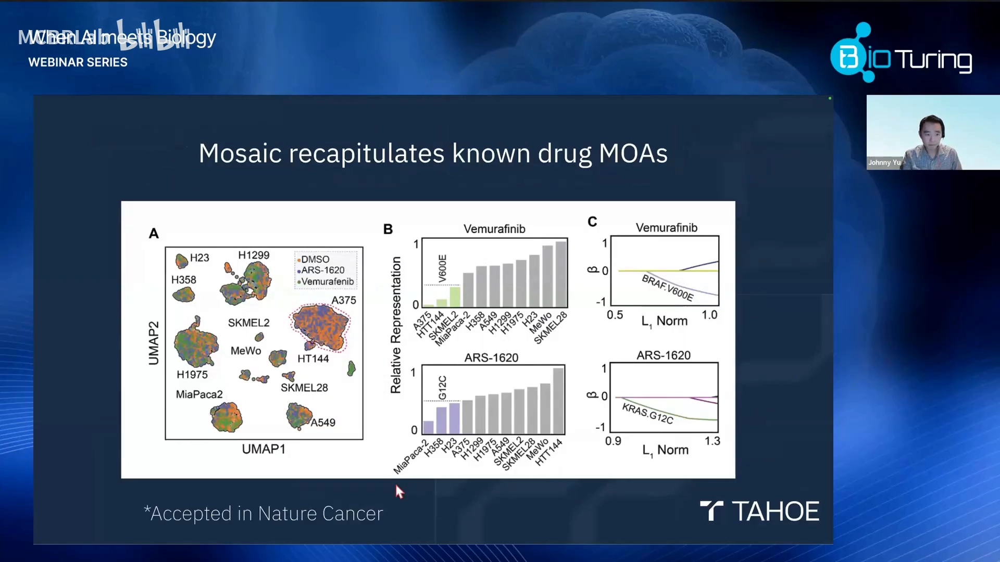

结果非常干净：**最敏感的模型正是携带对应突变的那些模型**。更进一步，用 lasso 回归做无偏的特征筛选，**模型自己挑出来的第一个特征就是那个突变**——也就是说，平台不仅能复现药效，还能从数据里把「因果变异」反推出来。这部分工作已被 Nature Cancer 接收。

### 2.3 从细胞系走到 PDX/PDO

细胞系毕竟离病人远。Mosaic 也被用在**病人来源异种移植（PDX）**和**病人来源类器官（PDO）**上——这些模型「从没见过塑料」，最多只传了四代，保留了微环境的多样性（[【跳转到 13:49】](https://www.bilibili.com/video/BV1khg5z9EpZ/?t=829)）。在四个 PDX/PDO 模型上做同样的马赛克实验，可以看到**随剂量上升（1.6 → 6.3 → 25 微摩尔）转录状态出现清晰的梯度变化**，这是「剂量–响应」在单细胞层面最直接的呈现。

这一段还带出一个反直觉的发现：给药后，**线粒体转录本的比例显著下降**。单细胞领域的人通常把线粒体比例当作「细胞快死了」的指标，看到下降反而不知道该怎么解释。作者用传统实验造出长期用药的耐受模型，发现**耐受模型的线粒体含量确实显著更低**——也就是说，这个信号不是技术噪声，而是真实的耐药相关生物学（[【跳转到 14:46】](https://www.bilibili.com/video/BV1khg5z9EpZ/?t=886)）。

## 三、Tahoe-100M 的规格与工艺

### 3.1 数字：50 × 1200 = 60000

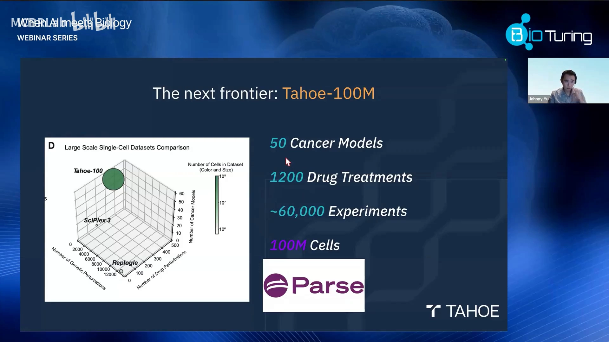

| 维度 | 数值 | 含义 |
| --- | --- | --- |
| 癌症模型 | 50 个 | 不同病人、不同组织来源，覆盖泛癌空间 |
| 药物处理 | 1200 种 | 约 400 个药物 × 3 个剂量 |
| 实验数 | 约 60000 | 50 × 1200，全部带单细胞读出 |
| 细胞数 | 1 亿 | 每个条件平均仍有上千细胞 |

讲者用一张三维图把它和此前最大的两个数据集放在一起比较：**Replogle 的全基因组 Perturb-seq**（遗传扰动最多）与 **sci-Plex 3**（此前最大的药物基因组数据集）。Tahoe-100M 在「模型系统数」「扰动数」「数据总量」三个轴上同时占优（[【跳转到 19:18】](https://www.bilibili.com/video/BV1khg5z9EpZ/?t=1158)）。

覆盖面上还有一个关键数字：**50 个模型的驱动突变合起来，覆盖了约 80% 与癌症相关的基因和驱动突变**。所以如果你关心 p53、KRAS、CDKN2A、ARID1A、PIK3CA 这些靶点，数据里大概率有对应的模型（[【跳转到 20:17】](https://www.bilibili.com/video/BV1khg5z9EpZ/?t=1217)）。

药物这一侧，作者刻意偏向**已获批药物**：因为获批药有大量安全性信息，做机制推断时更容易对照；未获批的也大多进过临床试验。通路覆盖包括 MEK、PI3K、JAK/STAT、mTOR、微管（化疗类）、DNA 合成与修复，以及 hedgehog（sonic）、HDAC 等（[【跳转到 21:13】](https://www.bilibili.com/video/BV1khg5z9EpZ/?t=1273)）。

### 3.2 工艺：一块板、一个孔、一种药

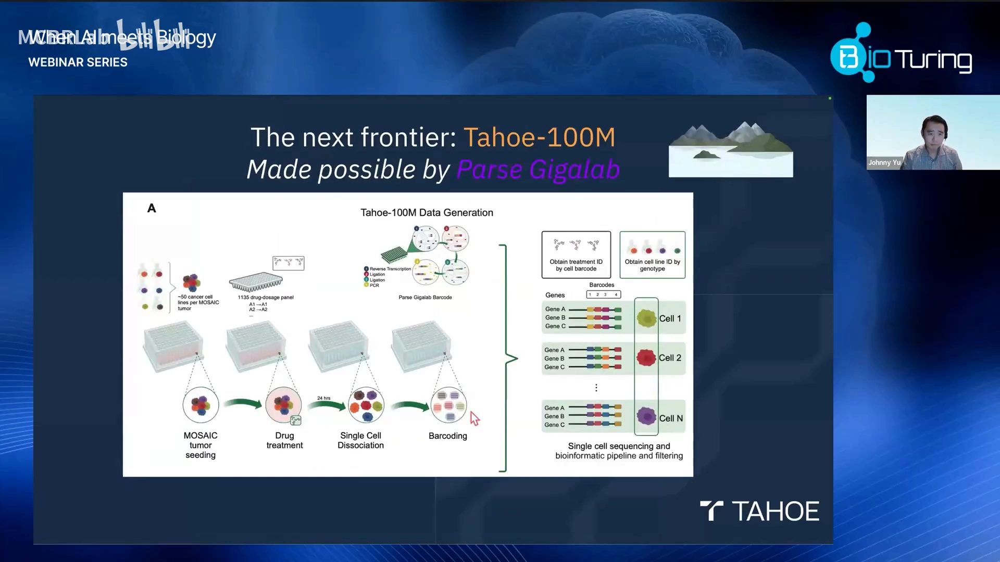

流程拆开看其实很朴素（[【跳转到 22:13】](https://www.bilibili.com/video/BV1khg5z9EpZ/?t=1333)）：

1. 高通量构建 50 个癌症模型，混成马赛克肿瘤；
2. 铺到 96 孔板，**每孔一个马赛克肿瘤，作为一次生物学重复**；
3. 每孔加一种药物、一个浓度；
4. **24 小时后**（作者发现 24 小时对捕捉转录组层面的作用机制最有效）去掉药物、解离成单细胞；
5. 直接进入 **Parse GigaLab**——高通量组合索引法，把样品做成单细胞 RNA 测序文库。

工艺里最巧的一点是**条形码天然承担了「实验设计记录」的功能**：组合索引的第一轮条形码对应孔位，也就是**药物处理**；第二到第四轮用于给细胞做 hashing；最后再用 reads 本身做**单细胞层面的 SNP calling**，判断每个细胞来自哪个亲本细胞系。所以**不需要额外的细胞 hashing、不需要 spike-in 文库**，一次读出就能完成全部解卷积（[【跳转到 24:56】](https://www.bilibili.com/video/BV1khg5z9EpZ/?t=1496)）。

### 3.3 质量控制：四条自证

讲者用四张图证明「这不是一堆噪声」：

**（1）聚类干净**。每个细胞系的簇几乎只包含该病人的细胞，说明基因型解卷积做得很准（[【跳转到 24:56】](https://www.bilibili.com/video/BV1khg5z9EpZ/?t=1496)）。

**（2）没有批次效应**。这是最关键的一张图：

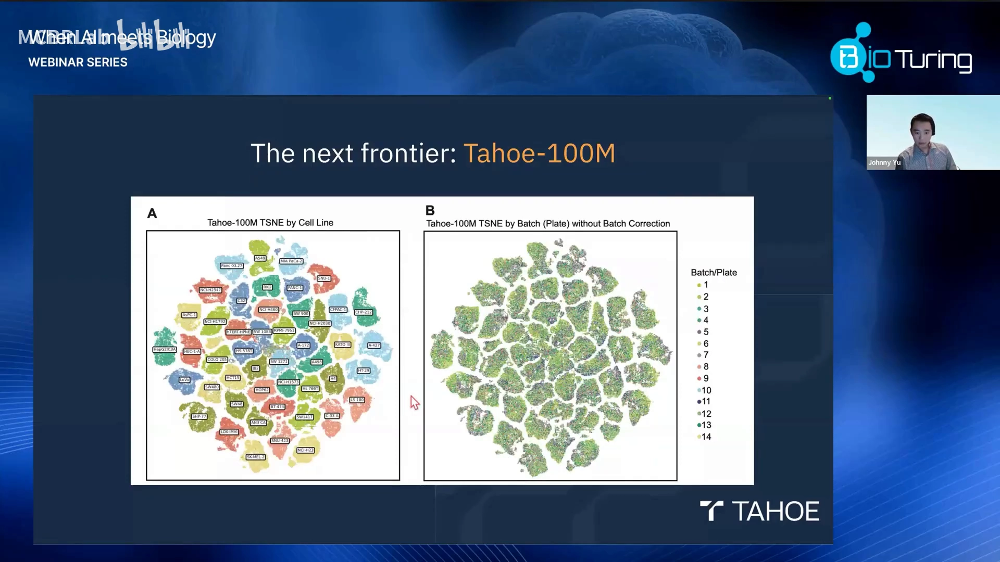

在**完全没有做批次校正**的情况下，14 个批次的颜色在同一簇里均匀混合。讲者的评论是：这是「统一工艺」的价值所在——**如果数据无法统一，那么一千个小数据集加起来也不如一个大数据集有用**（[【跳转到 25:31】](https://www.bilibili.com/video/BV1khg5z9EpZ/?t=1531)）。

**（3）覆盖均匀**。按「癌症模型 × 药物」看细胞丰度，是一个均匀的绿色方块，没有空洞（某些模型缺很多药）也没有异常富集——每个模型拿到的细胞数大致相同。

**（4）信号确实来自药物**。把转录距离分解到「细胞系」「细胞周期」「药物」「药物×浓度」几个来源上，**绝大部分信号来自药物与浓度**（[【跳转到 26:52】](https://www.bilibili.com/video/BV1khg5z9EpZ/?t=1612)）。而且随剂量升高，转录距离也升高；同样的规律在 sci-Plex 3（剂量轴）和 Replogle 的遗传扰动集（非必需基因 → 必需基因）上都能复现——**说明这个度量本身是可信的**。
## 四、三个故事：这张图谱能挖出什么

讲者说这是他最兴奋的部分，因为**同一份数据，换一个问法就是一个新故事**（[【跳转到 28:49】](https://www.bilibili.com/video/BV1khg5z9EpZ/?t=1729)）。

### 4.1 故事一：saquinavir 的心脏毒性，20 年临床试验被一次相似性分析说清

saquinavir（沙奎那韦）是 1995 年罗氏上市的第一个 HIV 蛋白酶抑制剂，作为「鸡尾酒疗法」的核心组分，把 HIV 从死刑变成了可控慢病，死亡率下降 60–80%。但 2016 年，在用了 21 年之后，FDA 发现它有**严重的心脏毒性**（异常心律等），2019 年罗氏将其撤市。

Tahoe-100M 里恰好有这个药。做法是**药物–药物相似性分析**：把 saquinavir 当作「未知药」，去和数据集里那些临床表型已经非常明确的药物比转录组相似度，看它最像谁（[【跳转到 30:02】](https://www.bilibili.com/video/BV1khg5z9EpZ/?t=1802)）。

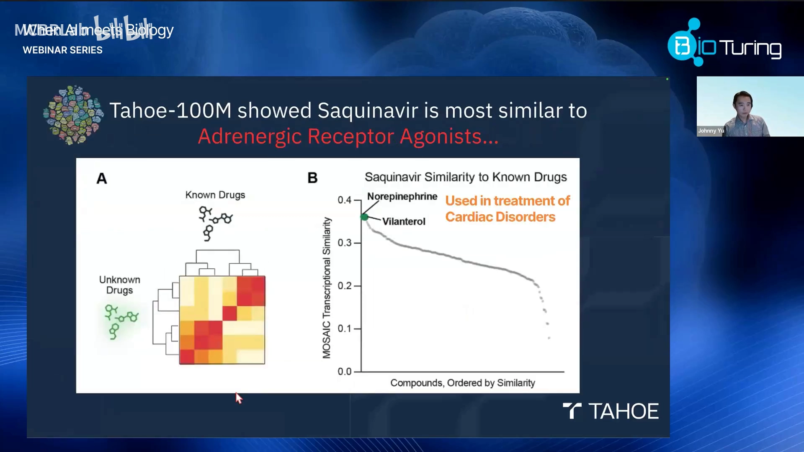

**最相似的两个药都不是 HIV 药**，而是 **norepinephrine**（急诊处理心脏骤停、休克）和 **vilanterol**（长效 β₂ 激动剂，用于气道与心血管相关适应证）。也就是说，一个抗病毒药在转录组层面「看起来像」两个肾上腺素能激动剂——这正好解释了它的心脏副作用。

作者没有停在相关性上，而是做了机制验证：β 肾上腺素能受体激动后的关键下游节点是 **CREB 的磷酸化（pCREB）**。

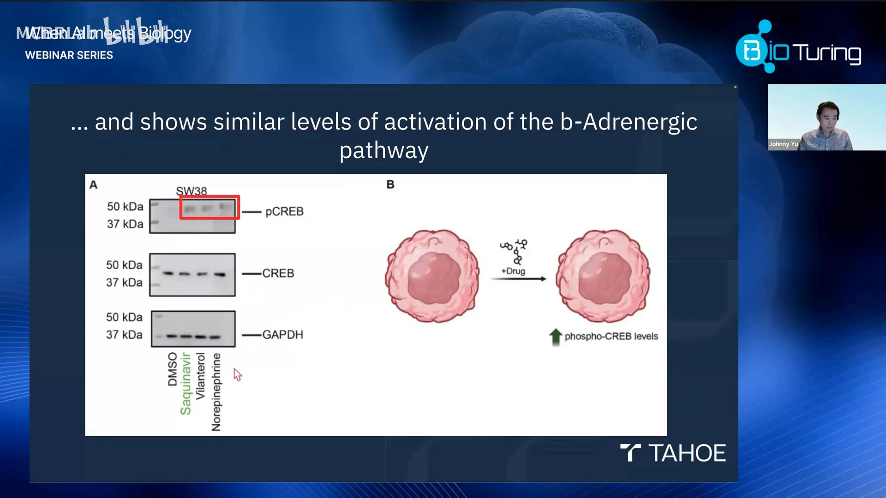

**一个 HIV 药，确实激活了 β 肾上腺素能通路**。讲者的总结很有分量：这件事**整个临床共同体花了 20 年、用真实病人试出来**，而这里用一次数据查询就看到了（[【跳转到 33:35】](https://www.bilibili.com/video/BV1khg5z9EpZ/?t=2015)）。

紧接着他补了一刀，也是这一节最值得记住的观点：

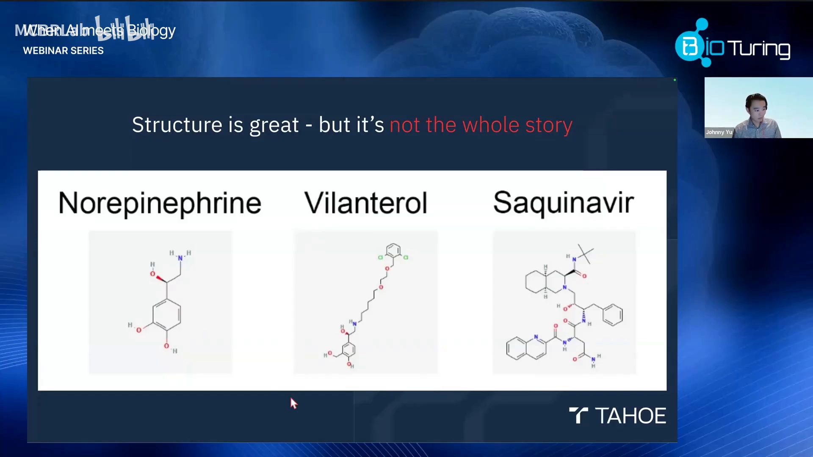

**「结构很重要，但不是全部。」** norepinephrine 与 vilanterol 在结构上还能看出亲缘（酚羟基 + 胺基），而 saquinavir 的结构与它们**毫无相似之处**。所以那些只做「结构–蛋白对接」的 AI 模型，**几乎不可能**凭空发现这条联系（[【跳转到 35:33】](https://www.bilibili.com/video/BV1khg5z9EpZ/?t=2133)）。转录组读出补上的正是「结构看不到的机制」这一层。

### 4.2 故事二：用复合基因集找 MHC-I 上调剂

第二个故事换了问法：**在同一份数据里，找能让肿瘤细胞把 MHC-I 上调的化合物**（[【跳转到 37:02】](https://www.bilibili.com/video/BV1khg5z9EpZ/?t=2222)）。

为什么关心 MHC-I？因为肿瘤免疫逃逸的一个常见手段就是把 MHC-I 从细胞表面「撤下来」——MHC-I 是把胞内肽段呈递到表面、让免疫细胞认出「这是肿瘤」的关键分子。如果能让 MHC-I 重新上膜，免疫细胞识别的频率就会大幅提高。

做法不是看单个基因，而是用**复合转录特征（gene set）**：一边是文献里精心整理的约 50 个 MHC-I 相关基因，一边是干扰素 α 的响应基因集，**要求化合物在两个特征上同时得分高**。结果里既有已被临床研究过的 MEK 抑制剂（binimetinib、trametinib，已知可上调 MHC-I），也有一批**新的骨架**，可以直接拿去建化学系列（[【跳转到 39:00】](https://www.bilibili.com/video/BV1khg5z9EpZ/?t=2340)）。

验证用流式抗体标记细胞表面 MHC-I：**仅仅给药 3 天**，几个新化合物就把表面 MHC-I 信号提到了与临床阳性对照（trametinib）相当的水平。这一节的通用启示是：**只要你能把表型定义成一个转录特征，这张图谱就能帮你排序化合物**——而且可以同时用多个特征做多因子打分。

### 4.3 故事三：把药物扰动和遗传扰动拼起来，做靶点反卷积

第三个故事是讲者说「第一次公开讲」的未发表工作：**把药物扰动数据和遗传扰动数据（Perturb-seq / CROP-seq 类）放在同一个转录空间里对齐**（[【跳转到 42:20】](https://www.bilibili.com/video/BV1khg5z9EpZ/?t=2540)）。

逻辑很直白：如果同一个细胞模型里既做过「加药」，又做过「敲基因」，那么**「加药后的转录状态」和「敲掉某个基因后的转录状态」之间的相似度，就指向这个药的靶点**。反过来，如果你知道想打哪个靶点、要避开哪个靶点，也可以用这个空间去筛化合物。

这里有一个非常关键的实操条件：**药物扰动和遗传扰动必须来自同一个细胞模型**。作者用的是 A549 的药物扰动配 A549 的遗传扰动——因为不同细胞模型之间的差异太大，跨模型做这种「追溯」会失效（[【跳转到 43:20】](https://www.bilibili.com/video/BV1khg5z9EpZ/?t=2600)）。

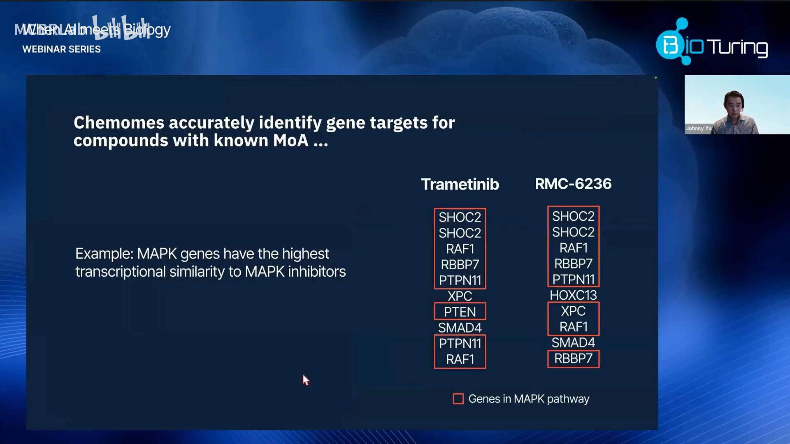

结果：**trametinib 最相似的 10 个基因扰动几乎全在 MAPK 通路里**；RMC-6236（靶向 RAS，位于级联更上游）也一样。也就是说，即使两个药打的是级联的不同节点，**它们在转录空间里都收敛到 MAPK 信号**——这正是「靶点反卷积」可行的原因（[【跳转到 43:48】](https://www.bilibili.com/video/BV1khg5z9EpZ/?t=2628)）。

更出人意料的是一个**被注释为 ATR 抑制剂**（作用于细胞核内的复制与 DNA 损伤修复）的临床化合物：它按定义与 MAPK 无关，但在这套分析里，**最相似的 10 个基因扰动有 9 个在 MAPK 通路**。作者回头做了机制验证——在 DMSO 里 ERK 磷酸化（pERK）处于高水平，用 trametinib、binimetinib 会把它关掉（已知生物学），而用这个 ATR 抑制剂**同样把 pERK 信号干净地清除了**（[【跳转到 45:23】](https://www.bilibili.com/video/BV1khg5z9EpZ/?t=2723)）。

这就是「药物 × 遗传扰动配对」的威力：**它能在已有注释之外，给一个分子找到新的作用机制**。讲者还提到由此衍生出的一个概念——**用遗传表型指导结构优化**：想要 CDK4 的效果、不想要 CDK6 的效果，就把「靠近 CDK4 状态、远离 CDK6 状态」写成目标函数去筛分子（[【跳转到 41:05】](https://www.bilibili.com/video/BV1khg5z9EpZ/?t=2465)）。

## 五、把门槛降下来：AI agent 与基础模型

### 5.1 TahoeDive：用自然语言提问，用代码回答

前面三个故事，每一个都需要生物信息学家 + 实验肿瘤学家 + 湿实验验证的团队配合。讲者坦承「这需要一个高度专业的小团队」，于是他们做了 **TahoeDive**：用自然语言提问，agent 去读文献、理解问题、**生成代码**，再在数据上真实运行代码、出图、给结论（[【跳转到 48:02】](https://www.bilibili.com/video/BV1khg5z9EpZ/?t=2882)）。

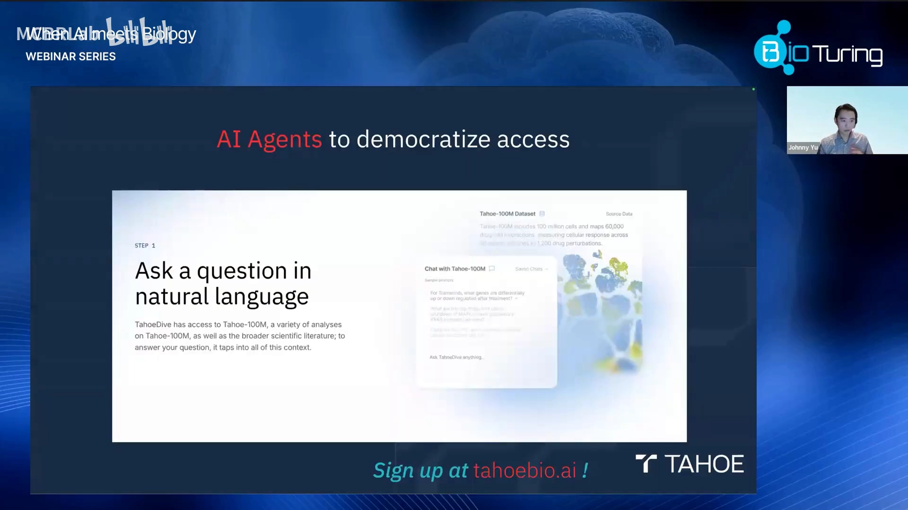

这里有个值得注意的设计取舍：**AI 只负责生成代码，不负责「看数据下结论」**，所以每一步都可追溯、可复现——不是让大模型去「读」数据然后编一个答案。现场演示用的正是 MHC-I 那个问题，agent 最终排出来的药物与人工分析一致。

### 5.2 基础模型：从「50 个模型」走向「无限个模型」

问答环节里最有价值的一段，是关于**基础模型到底能回答什么问题**（[【跳转到 54:14】](https://www.bilibili.com/video/BV1khg5z9EpZ/?t=3254)）：

- **跨模型泛化**：在一个病人身上学到的药物响应，能否预测一个**从未见过**的病人？如果能，Mosaic 能测的 50–100 个模型就不再是上限，PDX、PDO、直接病人样本都能接进来；
- **跨领域外推**：药物对癌细胞的作用，能否外推到正常细胞、神经元、其他疾病？讲者认为模型本身并不「在意」细胞是不是癌，跨物种（如小鼠）可能才是真正的难点；
- **训练数据**：Tahoe 内部已产生约 3–5 万亿 reads，并计划在 2025 年做 100 个全基因组 Perturb-seq，2026 年上空间转录组。

他也提到 Arc Institute 的 **STATE** 基础模型——第一次在这个领域出现「接近 GPT-2 阶段」的模型：能做多种生物学任务，并且具备一定程度的外推能力（[【跳转到 51:44】](https://www.bilibili.com/video/BV1khg5z9EpZ/?t=3104)）。

## 六、这张图谱的边界

讲者的立场是「这是一座金矿」，但把设计摊开之后，边界同样清楚。用这张图谱下结论前，至少要想到五条：

1. **仍然是模型系统**。50 个癌细胞模型（以及演示中的 PDX/PDO）都不是真实病人：没有免疫系统、没有肿瘤微环境的完整构成、没有药物在体内的代谢与分布。故事一的结论之所以成立，是因为**心脏毒性本身能在细胞层面留下转录痕迹**，不是因为这张图谱能替代临床试验。
2. **单一时间点（24 小时）**。24 小时被选为捕捉「作用机制」的最佳窗口，但**慢性适应、耐药演化、迟发毒性**都需要更长时间。故事里提到的耐受模型，是另外用传统实验做了几个月的药才得到的。
3. **剂量只有三档**。1200 种处理来自约 400 个药物 × 3 个剂量，够画粗略的剂量–响应，但不足以拟合精细的曲线参数。
4. **读出只有转录组**。没有蛋白丰度、没有磷酸化蛋白组、没有形态学。所以「通路被激活/抑制」是从 mRNA 推断的，机制验证必须回到 Western blot 这类实验（故事一和故事三都做了这一步）。
5. **跨数据集整合有硬约束**。故事三能成立的前提是「药物扰动与遗传扰动来自同一个细胞模型」，跨模型就失效；而公开的遗传扰动数据往往噪声更大、扰动强度更弱——讲者的建议是**自己在大规模、可复现的条件下重新生成**。

另外还有一条常被忽略的：**图谱里相当一部分药物的靶点并不明确**（数据集里「Unknown」靶点占最大一类），所以「药物 → 靶点」的映射不能当作既成事实，故事三那种反卷积正是为了补这个洞。

## 小结

- **Tahoe-100M 的定位**：不是「一个大实验」，而是**为药物发现专门设计的、工艺统一的查询表**——50 个癌症模型 × 1200 种药物处理 × 约 6 万个实验 × 1 亿细胞。
- **Mosaic 是它的地基**：把几十个病人模型混成一个马赛克肿瘤，同时给药、同时测序，让「病人间差异」和「药物间差异」出现在同一个实验里。
- **统一工艺换来了低批次效应**：14 个批次不做任何校正就混匀，这是能做大范围比较的前提；也是「为什么要造前沿数据集，而不是一千个小数据集」的答案。
- **条形码即实验记录**：第一轮条形码记药物处理，后续轮次给细胞 hashing，再用单细胞 SNP 判定细胞系——一次读出完成全部解卷积。
- **三个用法**：药物相似性分析（saquinavir → 心脏毒性）、复合基因集排序（MHC-I 上调剂）、药物 × 遗传扰动配对（靶点反卷积与新机制）。
- **结构不是全部**：saquinavir 与肾上腺素能激动剂结构毫无相似性，却在转录组和 pCREB 上高度一致——这是「只做结构对接」的模型看不到的一层。
- **边界**：模型系统、24 小时、三档剂量、只有转录组、跨模型整合受限。

## 关键术语速查

| 术语 | 一句话解释 |
| --- | --- |
| Mosaic 平台 | 把几十个病人来源肿瘤模型混成一个「马赛克肿瘤」，共享同一处理与批次的高通量筛选体系 |
| mosaic tumor（马赛克肿瘤） | 多个细胞系或 PDX/PDO 混在一起形成的单一可移植肿瘤单元 |
| PDX / PDO | 病人来源异种移植 / 病人来源类器官，比细胞系更接近病人状态 |
| 组合索引（combinatorial indexing） | 通过多轮条形码拼接给每个细胞打上唯一标签的单细胞建库方式，Parse 的核心工艺 |
| 解卷积（deconvolution） | 用条形码与基因型把混合测序的每个细胞判回它的处理条件与亲本细胞系 |
| 批次效应 | 由板、试剂、测序 run 等技术差异造成的系统性偏差，会掩盖真实生物学差异 |
| 转录距离 | 两个条件下细胞转录组的整体差异度量，用于比较药物效应强弱 |
| 剂量–响应 | 药物效应随浓度变化的规律；饱和后曲线变平 |
| 药物–药物相似性分析 | 用转录组相似度把一个「未知药」映射到临床表型已知的药物上，从而推断机制 |
| chemome（化学基因组空间） | 把药物扰动与遗传扰动投影到同一转录空间，用于靶点反卷积 |
| 靶点反卷积 | 从药物的转录响应反推它作用在哪个基因或通路上 |
| on-target / off-target | 药物作用在预期靶点上 / 作用在预期之外的靶点上（常是副作用来源） |
| pCREB | 磷酸化的 CREB，β 肾上腺素能受体激活后的关键下游标志 |
| MHC-I | 把胞内肽段呈递到细胞表面的分子，肿瘤常通过下调它来逃避免疫识别 |
| 基因集 / 转录特征 | 一组共同代表某个生物学状态的基因，用于给化合物或细胞打分 |
| 基础模型（foundation model） | 在海量数据上预训练、可迁移到多种下游任务的模型，如 Arc Institute 的 STATE |
