# Tahoe-100M：50 个细胞系同孔给药，造出 1 亿细胞的药物扰动图谱

> 视频来源：[探索 Tahoe-100M || 千兆级单细胞扰动图谱 || BioTuring Team](https://www.bilibili.com/video/BV1qpb9zMEjd/)（B 站 · MCBRLab 搬运的 BioTuring「Single-cell & Spatial Exploration Club」网络研讨会，讲者 Hazel 与 Julie Ng）｜时长约 40 分钟
> 导读：这场研讨会先用十几分钟讲清 Tahoe-100M 是怎么造出来的——50 个癌细胞系混在同一个孔里、每孔一种药或一个剂量、24 小时后解离测单细胞；再花二十多分钟在 BioTuring 的 Talk2Data 平台上，把论文里「dabrafenib 只在 BRAF 突变细胞里起效」那张图一步步复现出来。本文按「设计 → 图谱 → 用法 → 局限」重排，字幕里的 ASR 错拼（如把 Tahoe 听成「太湖/塔霍」、把 dabrafenib 听成「Bryeniv」）已按幻灯片订正。

## 本讲要解决的核心问题（SCQA）

**背景**：单细胞扰动实验过去多是「一个基因 × 一种细胞系」的小规模实验，一次几百到几千个细胞，结论很难推广到别的细胞背景。

**冲突**：药物研发真正关心的是「同一种药，在不同遗传背景的肿瘤里效果差多少」，这需要把**药物、剂量、细胞系**三个维度同时铺开，规模一下子涨到上亿细胞——而样本一多，批次效应就会把真实的药物效应淹没。

**疑问**：怎样在一次性测到上亿细胞的同时，保证「细胞之间的差异来自药物，而不是来自批次」？数据造出来之后，普通研究者又该怎么查、怎么验证？

**回答（中心思想）**：Tahoe-100M 用 **Mosaic 平台**解决这个问题——把 50 个癌细胞系混成同一个三维球状体、同一孔给药，让所有细胞系共享完全相同的处理与批次；再用「条形码决定处理、基因型决定细胞系」的解卷积把每个细胞认领回它的孔位与来源。于是这张图谱不只是一堆细胞数，而是一张**可以做剂量–响应、跨细胞系泛化、药物–基因扰动对比的查询表**；代价是它只覆盖癌细胞系、只有一个时间点、只有转录组一种读出。

## 一、它是什么：1 亿细胞、50 个细胞系、1200 种药物的一次性组合

### 1.1 规模：这不是「一个大实验」，而是六万个扰动条件的合集

按视频里的说法，Tahoe-100M 是**迄今为止最大的公开单细胞数据集之一**，包含约 **1 亿个单细胞转录组**，覆盖 **50 种癌细胞系**与 **1200 种药物扰动**（[【跳转到 00:35】](https://www.bilibili.com/video/BV1qpb9zMEjd/?t=35)）。幻灯片上给出的两个关键数字是「50 cancer cell lines, 1100 drug-dose perturbations」，也就是**药物与剂量的组合**有上千个；数据生成流程图里标注的则是「1135 drug-dosage panel」（[【跳转到 03:58】](https://www.bilibili.com/video/BV1qpb9zMEjd/?t=238)）。

这里要分清三个层次，它们经常被混为一谈：

- **细胞数**（1 亿）：测序读出来的细胞总数，决定统计功效；
- **扰动条件数**（约 1135 个药物–剂量组合）：决定这张图谱的「实验维度」有多宽；
- **条件 × 细胞系**：真正的实验单元，每个单元里的细胞数决定了能检出多小的效应。

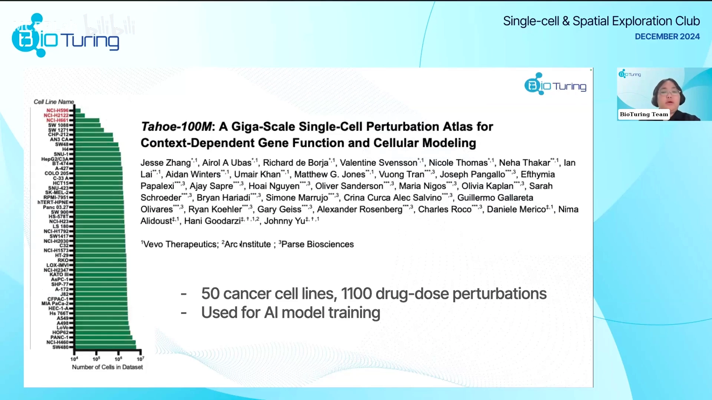

图里左侧那排绿色横条就是每个细胞系的细胞数（对数坐标，从 $10^4$ 到 $10^7$），右侧列出作者单位：Vevo Therapeutics、Arc Institute、Parse Biosciences。**50 个细胞系的细胞数并不均匀**，这一点后文会反复出现——细胞数少的细胞系，弱效应就检不出来。

### 1.2 为什么「规模」本身不是重点

讲者反复强调的一句话是：**「但这不仅仅在于规模」**。规模只是让下面三件事同时成立的前提（[【跳转到 02:47】](https://www.bilibili.com/video/BV1qpb9zMEjd/?t=167)）：

1. **剂量梯度**：同一药物有多个浓度，才能画出剂量–响应曲线，区分「无效剂量」和「饱和剂量」；
2. **细胞系背景**：同一药物在 50 个不同遗传背景的癌细胞里各测一遍，才能问「这个药对谁有效」；
3. **可训练**：有了规模和多样性，才谈得上给系统生物学的 AI 模型当训练集，去预测「药物 + 细胞系 + 剂量 → 表达变化」。

所以这张图谱的定位是双重的：既是**基础研究**里研究基因调控与网络动力学的材料，也是**癌症药物研发**里回答「遗传背景如何影响药效」的证据库（[【跳转到 03:37】](https://www.bilibili.com/video/BV1qpb9zMEjd/?t=217)）。

## 二、数据怎么造出来：Mosaic 平台把批次效应压到最低

### 2.1 关键动作：把 50 个细胞系放进同一个孔

传统做法是「一个细胞系一个孔」：96 孔板里每孔只养一种细胞系，不同细胞系天然落在不同孔、不同批次里，于是**细胞系效应和批次效应纠缠在一起**，分不开。

Tahoe-100M 的作者反过来做：先把 50 种癌细胞系混成一个三维培养的球状体，称为 **MOSAIC tumor**；这种「很多细胞系住在一起」的培养体系被称为 **cell village（细胞村）**。然后把球状体接种到 96 孔板，每孔一个球状体、一种处理（[【跳转到 04:23】](https://www.bilibili.com/video/BV1qpb9zMEjd/?t=263)）。讲者对此的解释很直白：**这样做对最小化批次效应至关重要，能确保数据变化来自实验条件，而不是样本之间的随机差异**。

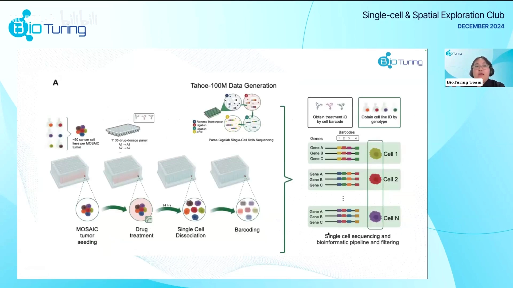

### 2.2 一孔一处理：剂量梯度与 DMSO 对照都在这里

每个孔接受的处理是「一种药物 + 一个剂量」，所以**同一药物的不同剂量分布在不同孔里**，而**同一孔里的 50 个细胞系共享完全相同的药物暴露**（[【跳转到 05:13】](https://www.bilibili.com/video/BV1qpb9zMEjd/?t=313)）。这一点是整个设计的地基：

- 想比较剂量 → 比较同药物不同孔，细胞系构成相同；
- 想比较细胞系 → 比较同一孔内的不同细胞，药物暴露相同；
- 两条对比都不需要跨批次，**混杂被设计消掉了**。

同样重要的是**溶剂对照**：孔里除了药物组，还有 DMSO（vehicle）对照组。DMSO 是药物递送常用的溶剂，对照组的用途是把「药物本身的效果」和「溶剂可能产生的影响」区分开——没有它，你无法判断某个表达变化是药造成的还是溶媒造成的。

处理之后等待 **24 小时**，再把球状体解离成单个细胞（[【跳转到 05:38】](https://www.bilibili.com/video/BV1qpb9zMEjd/?t=338)）。这个 24 小时是全文唯一的时间点，也是后面要讲的一条局限：**慢性效应、耐药适应都看不到**。

### 2.3 两个身份：条形码告诉你「吃了什么药」，基因型告诉你「它是谁」

解离后的细胞进入单细胞建库（Parse Biosciences 的 split-pool 路线：逆转录 → 连接 → PCR）。这里有一个容易被忽略的设计：细胞要同时携带两种身份信息（[【跳转到 06:03】](https://www.bilibili.com/video/BV1qpb9zMEjd/?t=363)）：

| 要回答的问题 | 靠什么识别 | 为什么可行 |
| --- | --- | --- |
| 这个细胞接受了哪种处理 | 孔位特异的**条形码**（treatment ID by cell barcode） | 每个孔的处理是已知的，孔与孔之间条形码不同 |
| 这个细胞来自哪个细胞系 | 该细胞系的**基因型**特征（cell line ID by genotype） | 50 个细胞系的突变谱、拷贝数、表达特征各不相同 |

因为 50 个细胞系混在同一孔里，测序时它们无法靠孔位区分，只能靠**基因型解卷积**：拿每个细胞系已知的遗传信息去比对，把每个细胞判给最可能的来源细胞系。讲者把这条路线总结为「Mosaic 平台 + 细胞村 + 遗传多路复用」，它同时带来两个好处：**批次效应被最小化**，以及**可以在单细胞分辨率下同时分析数千种条件**（[【跳转到 06:28】](https://www.bilibili.com/video/BV1qpb9zMEjd/?t=388)）。

> **一句话记住这个设计**：不是「每个条件单独做一个实验」，而是「所有条件共享同一块板、同一个球状体、同一批试剂」，再用条形码与基因型把每个细胞的身份拆回来。
## 三、图谱的两半：一半是细胞系背景，一半是药物维度

要读懂这张图谱，得先知道「被处理的是谁」和「被什么处理」。视频用两张图分别回答。

### 3.1 被处理的是谁：47 个细胞系、13 种组织、一批反复出现的驱动突变

论文里画的是 **oncoplot**（突变全景图）：每一列是一个细胞系，每一行是一个基因，格子颜色代表突变类型（错义、无义、移码、扩增……），右侧的百分比是「该基因在多少比例的细胞系里发生改变」（[【跳转到 06:58】](https://www.bilibili.com/video/BV1qpb9zMEjd/?t=418)）。

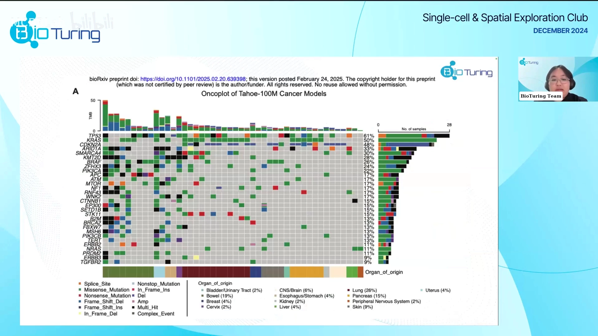

几个要点：

- 数据集名义上有 **50 个细胞系**，但其中 3 个细胞数过少，所以**真正被充分代表的是 47 个**（[【跳转到 07:23】](https://www.bilibili.com/video/BV1qpb9zMEjd/?t=443)）。这正是 1.1 节说的「细胞数不均匀」的直接后果——细胞数太少的细胞系在统计上等于不存在。
- 这些细胞系来自 **13 种不同组织**，以肺（26%）、肠（19%）、胰腺（15%）、皮肤（9%）为主。讲者的理由很实际：**每个组织大致对应一种癌症类型**，肺癌、胰腺癌、皮肤癌都在里面，药物反应才有可比性（[【跳转到 07:48】](https://www.bilibili.com/video/BV1qpb9zMEjd/?t=468)）。
- 驱动突变高度集中：**TP53 约 61%、KRAS 约 50%、CDKN2A 约 48%**，也就是讲者说的「在约半数细胞系中发生改变」；再往下是 ARID1A、SMARCA4、KMT2D、BRAF 等（[【跳转到 08:13】](https://www.bilibili.com/video/BV1qpb9zMEjd/?t=493)）。

为什么这张图值得单独讲？因为它决定了后面所有分析的可能性：**只有当某个突变在多个细胞系里重复出现，你才有机会把「突变」和「药物反应」关联起来**。BRAF 突变出现在约 26% 的细胞系里，这个数字直接支撑了第四节那个 dabrafenib 的例子。

### 3.2 被什么处理：379 种药物、25 类作用机制、69% 已获批

药物这一侧，论文用两张柱状图描述（[【跳转到 10:06】](https://www.bilibili.com/video/BV1qpb9zMEjd/?t=606)）：

- **按通路分**：共 **379 种不同药物**，其中 **180 种可以归入 25 个 MOA（mechanism of action，作用机制）类别**；
- **按临床阶段分**：绿色是已获批药物（Approved），浅棕是进入过临床试验（Tested in Clinical Trials），紫色是**从未进过临床试验**（Never Tested in Clinical Trials）。讲者给出的整体比例是**约 69% 为已获批药物**，这也是他强调「临床相关性」的依据。

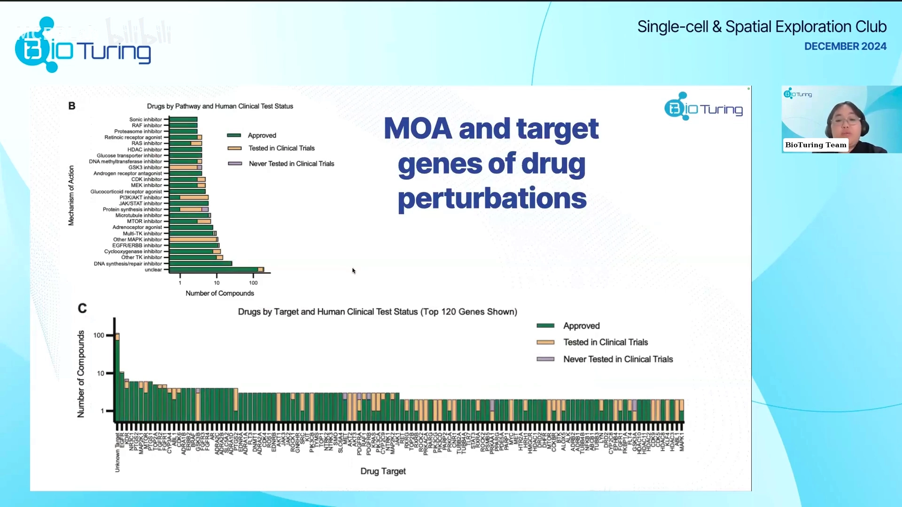

被代表得最多的几类是：**DNA 合成/修复抑制剂、其他 TK 抑制剂、EGFR/ERBB 抑制剂、其他 MAPK 抑制剂、多靶点 TK 抑制剂、MTOR 抑制剂、微管抑制剂、蛋白合成抑制剂、PI3K/AKT 抑制剂、MEK 抑制剂、CDK 抑制剂、HDAC 抑制剂、蛋白酶体抑制剂、RAF 抑制剂**。讲者的解读是：**哪些类别数量多，就说明哪些通路被最频繁地靶向**——换句话说，这张图谱的「覆盖重心」压在增殖、存活、DNA 损伤修复这几条癌症核心通路上。

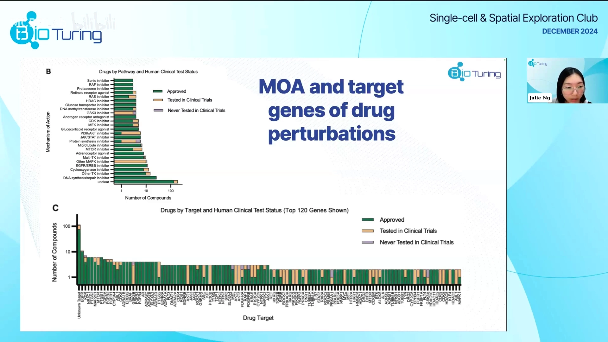

第二张图换了个角度：**按靶点基因**统计。这些药物合计靶向 **325 个基因**，图中展示前 120 个；讲者特别指出，**其中有 120 个基因被多种药物同时靶向**，这意味着**靶点层面的冗余**，也为**组合疗法**留下了空间（[【跳转到 10:56】](https://www.bilibili.com/video/BV1qpb9zMEjd/?t=656)）。注意最左边那根最高的柱子是「Unknown」——**靶点未明的药物占了最大的一类**，这提醒读者：图谱里的「药物 → 靶点」映射并不总是干净的。

## 四、怎么用：dabrafenib 的例子说明「药物效应依赖遗传背景」

讲完背景，视频进入论文的具体结果：图 6A，**dabrafenib（一种 BRAF V600E 抑制剂）对 RAS/RAF 通路的作用**（[【跳转到 12:36】](https://www.bilibili.com/video/BV1qpb9zMEjd/?t=756)）。这是整场研讨会最值得学的一段，因为它演示了「一张扰动图谱该怎么被读」。

### 4.1 先补通路：RAS → RAF → MEK → ERK

要看懂结果，得先知道这条通路长什么样。幻灯片右侧画的是经典的 MAPK 通路：

生长因子（如 TGFα）结合到受体（如 EGFR）→ 通过 Grb2/Sos 激活 **RAS** → **RAF** → **MEK** → **ERK** → 进入细胞核调控转录。这条通路控制细胞生长、增殖与存活，在癌症中经常被异常激活，因此是靶向治疗最常见的靶点之一（[【跳转到 13:51】](https://www.bilibili.com/video/BV1qpb9zMEjd/?t=831)）。

幻灯片上还标了各类突变在人类癌症中的占比，用来解释「为什么这条通路值得做药」：EGFR 过表达在结直肠癌 27–77%、胰腺癌 30–50%、肺癌 40–80%；RAS 突变在胰腺癌约 90%、甲状腺乳头状癌 60%、结肠癌 50%；BRAF 突变在黑色素瘤约 70%、甲状腺乳头状癌 50%、结肠癌 10%。

### 4.2 再分三组：按 RAS / RAF 的突变状态切开细胞系

实验把细胞系按驱动突变状态分成三组（[【跳转到 14:16】](https://www.bilibili.com/video/BV1qpb9zMEjd/?t=856)）：

| 分组 | 含义 | 预期 |
| --- | --- | --- |
| RAF.WT 且 RAS.WT | 两个蛋白都没有突变（野生型） | 药物没有靶点，应无响应 |
| RAF.WT 且 RAS.GOF | RAS 功能获得型突变，通路在 RAF 上游被激活 | 抑制 RAF 未必有效 |
| RAF.GOF 且 RAS.WT | RAF 功能获得型突变（如 BRAF V600E），通路在 RAF 处被激活 | 抑制 RAF 应最有效 |

「功能获得型（gain-of-function）」是这里的关键：突变让蛋白**持续处于活跃状态**，不需要上游信号也一直开着。dabrafenib 抑制的正是这种持续活跃的 BRAF V600E。

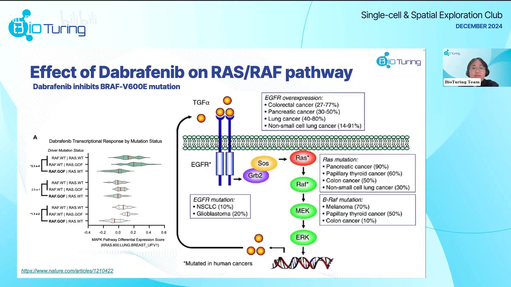

### 4.3 结果：只有 RAF 突变的细胞系被显著抑制

左侧的小提琴图是这张图的读法核心（[【跳转到 15:06】](https://www.bilibili.com/video/BV1qpb9zMEjd/?t=906)）：

- 横轴是 **MAPK 通路差异表达评分**（MAPK Pathway Differential Expression Score），越往左表示通路被压得越低；
- 每一行是一个「突变组合 × 细胞系」；
- 三块分组旁边标注的 `**3.4`、`2.5`、`1.3e2` 之类是组间比较的显著性标记。

结论很清楚：**在 RAF 功能获得型突变的细胞系里，dabrafenib 把 MAPK 通路评分显著拉低**（小提琴整体左移）；而在 RAS 突变的细胞系里，效果有限——因为通路是被 RAS 从上游点着的，堵住下游的 RAF 并不能完全关掉信号（[【跳转到 15:31】](https://www.bilibili.com/video/BV1qpb9zMEjd/?t=931)）。

这就是讲者反复强调的**上下文依赖性（context dependence）**：同一个药、同样的剂量，**在不同的遗传背景里效应强弱完全不同**。它的实践含义是——开发靶向疗法时，必须把癌细胞的遗传背景（尤其是驱动突变）一起考虑，而不能只看药物本身的效价（[【跳转到 16:21】](https://www.bilibili.com/video/BV1qpb9zMEjd/?t=981)）。

> 顺带记一个观察：在这个例子里，**剂量高低对结果影响不大**，低、中、高剂量的曲线形状相近。讲者在后面的复现环节也确认了这一点（见 5.3）。这不代表「剂量不重要」，而是说明该药物在这个浓度区间里已经进入**饱和区**，剂量–响应曲线在这里是平的。

## 五、在 Talk2Data 上把这张图复现一遍

视频后半段是实操：在 BioTuring 的 **Talk2Data**（对话式单细胞数据平台，测试版）里，用 Tahoe-100M 数据把 4.3 节的结论重新做出来。这一段的价值在于——它展示了**「拿到一张扰动图谱之后，第一件事该做什么」**的工作流。

### 5.1 先看数据里有什么字段

打开数据集后，左侧的元数据就是这张图谱的「坐标系」（[【跳转到 18:03】](https://www.bilibili.com/video/BV1qpb9zMEjd/?t=1083)）：

- **细胞层面**：细胞周期阶段、细胞来源的原始组织类型（皮肤、肺……）、癌症类型；
- **药物层面**：药物名称、药物浓度；
- **样本层面**：肿瘤来源是原发部位还是转移部位（这个数据集里主要是淋巴系统）（[【跳转到 18:53】](https://www.bilibili.com/video/BV1qpb9zMEjd/?t=1133)）。

这些字段正好对应第一节讲的三个设计维度：**药物 × 剂量 × 细胞系**，外加一个常被忽略的第四维——**肿瘤来源**。

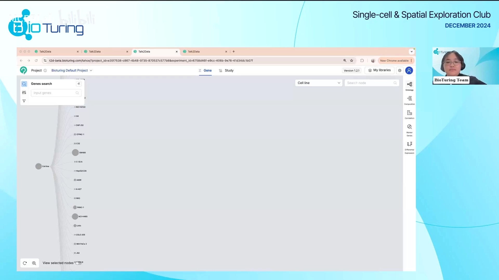

### 5.2 第一步：过滤出三个细胞系 + 一种药

复现的目标是「三种遗传背景、同一种药」的对比，所以先做过滤（[【跳转到 19:47】](https://www.bilibili.com/video/BV1qpb9zMEjd/?t=1187)）：

| 细胞系 | 遗传背景 | 角色 |
| --- | --- | --- |
| SW48 | 结直肠癌，KRAS 突变（功能获得型） | RAS 通路从上游被激活 |
| HT-29 | 结直肠癌，BRAF V600E | RAF 通路被激活，是药物的真靶点 |
| A-172 | 胶质母细胞瘤，野生型 | 无靶点，作为阴性对照 |

药物过滤为 **dabrafenib**。过滤后平台显示 **16,985 个细胞、3 个 study**（[【跳转到 22:17】](https://www.bilibili.com/video/BV1qpb9zMEjd/?t=1337)）。

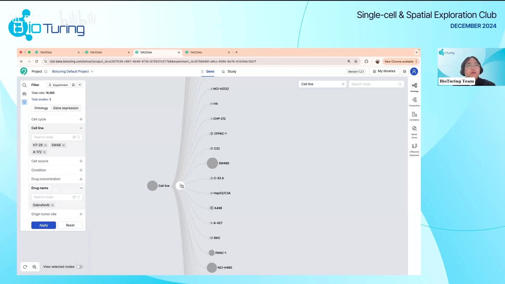

注意右侧那棵「细胞系树」：**节点大小 = 细胞数量**。讲者特别指出 A-172 有约 7000 个细胞被处理过——这个数字决定了后面差异分析的把握。

### 5.3 第二步：单基因着色，看 MAPK1 在三种细胞系里的高低

在平台里搜索基因 **MAPK1**，节点立刻从灰色变成红色，**颜色越深 = 表达越高，节点越大 = 表达该基因的细胞比例越高**（[【跳转到 23:32】](https://www.bilibili.com/video/BV1qpb9zMEjd/?t=1412)）。

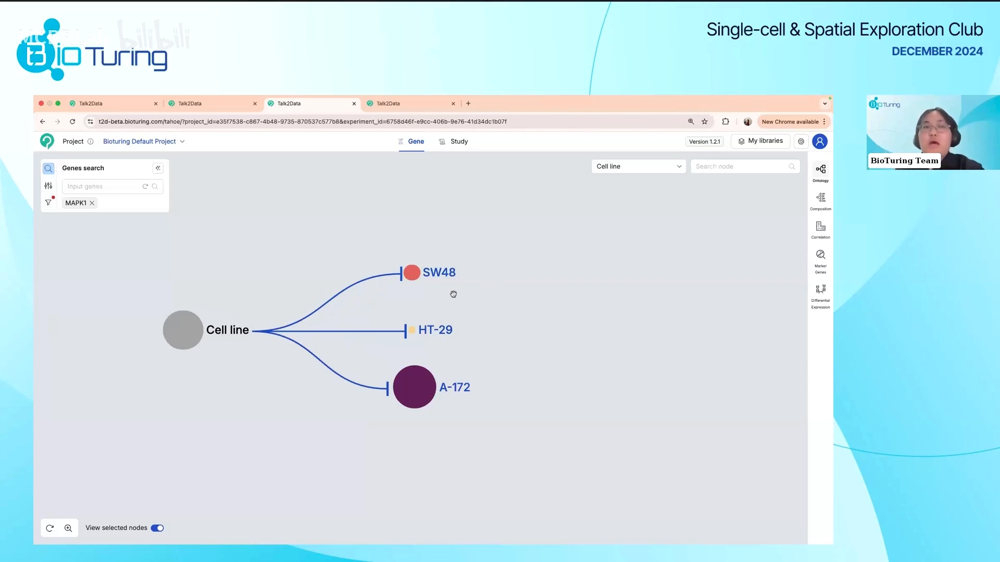

结果与论文一致：**HT-29（BRAF V600E）的 MAPK1 表达最低，A-172（野生型）最高**——药物在带靶点的细胞里把通路压下去了，在没有靶点的细胞里几乎没动。这就是 4.3 节结论在原始数据层面的直接体现。

### 5.4 第三步：从单基因扩到一组基因（组成图）

单个基因只能说明一个点。要同时看多个通路标志基因，就用**组成图（composition chart）**：把「药物 → 药物浓度 → 细胞系」作为分组轴，再把 MAPK1、MAP2K1、MAPK8、MAP3K1 等基因一起放进去比较（[【跳转到 24:19】](https://www.bilibili.com/video/BV1qpb9zMEjd/?t=1459)）。

结论有两条（[【跳转到 28:35】](https://www.bilibili.com/video/BV1qpb9zMEjd/?t=1715)）：

1. **与野生型 A-172 相比，突变细胞系里的 MAPK 家族基因一致下调**，其中 BRAF V600E 的 HT-29 最明显；
2. **剂量在这个例子里影响不大**——高、中、低剂量的差异不显著，这与论文原图一致（[【跳转到 29:25】](https://www.bilibili.com/video/BV1qpb9zMEjd/?t=1765)）。

第 2 条恰好是一个很好的「读图训练」：**看到剂量曲线是平的，不要急着说「剂量无关」，先想是不是已经饱和**。真正的剂量–响应分析需要覆盖更低的浓度区间。

### 5.5 第四步：差异表达分析，把「看起来变了」变成「统计上变了」

组成图能看出变化趋势，但没有统计检验，**无法判断变化是否显著**（[【跳转到 29:50】](https://www.bilibili.com/video/BV1qpb9zMEjd/?t=1790)）。于是做**差异基因表达分析（DGE）**：第一组选 HT-29（BRAF V600E），第二组选 A-172（野生型），两组都经 dabrafenib 处理。

平台实时显示两组的细胞数：突变组约 **6500 个**，野生型组约 **7000 个**（[【跳转到 31:28】](https://www.bilibili.com/video/BV1qpb9zMEjd/?t=1888)）。结果页给出三样东西：差异表达表、火山图、以及选定基因的分布图。

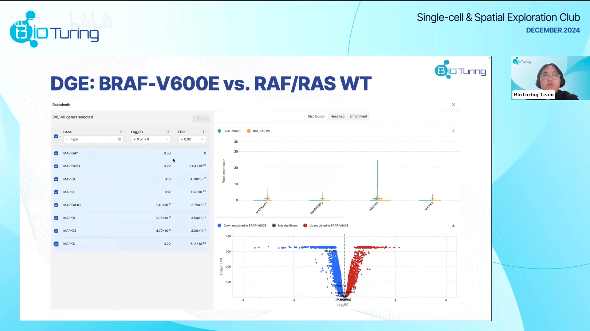

表格里几行值得注意：**MAPKAP1 −0.53、MAPKBIP3 −0.22、MAPK9 −0.13、MAPK1 −0.12**，都是负的 log2FC；而 **MAPK8 +0.040、MAPK14 +0.048、MAPK6 +0.22** 是上调的。也就是说，**药物并不是把整个 MAPK 家族一起压下去**，而是有方向、有选择地改变——这正是为什么要做统计，而不是只看热图的颜色。

火山图的横纵轴可以直接写出来：横轴是

$$
\log_2 \mathrm{FC} = \log_2 \frac{\bar{x}_{\text{BRAF-V600E}}}{\bar{x}_{\text{RAF/RAS WT}}}
$$

纵轴是 $-\log_{10}(\mathrm{FDR})$。点越靠上，统计证据越强；越靠右，效应量越大；越靠左，下调越多。讲者给出的判据是 **FDR（校正 p 值）< 0.05** 视为显著（[【跳转到 32:59】](https://www.bilibili.com/video/BV1qpb9zMEjd/?t=1979)）。

到这里，DGE 提供了统计证据：**dabrafenib 显著抑制了 HT-29 中的 MAPK 通路标志基因**，与图 6A 的观察一致（[【跳转到 33:24】](https://www.bilibili.com/video/BV1qpb9zMEjd/?t=2004)）。再往前走一步就是**通路富集分析**——讲者在问答里说这个功能正在开发，未来几周上线。

### 5.6 平台侧的两个细节

- **数据库版本切换**：在设置按钮里可以选不同的数据库版本，Tahoe-100M 是其中之一，后续还会加入其他数据集（[【跳转到 26:51】](https://www.bilibili.com/video/BV1qpb9zMEjd/?t=1611)）；
- **表达单位可切换**：平台在测试不同的归一化方式（排名、对数归一化等），也就是说**同一张图换一种表达单位，颜色和数值会变**——跨图比较时务必确认单位一致（[【跳转到 27:16】](https://www.bilibili.com/video/BV1qpb9zMEjd/?t=1636)）。

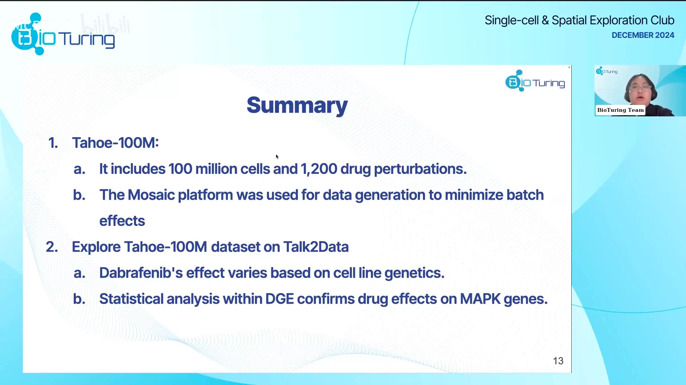

## 六、这张图谱不能回答什么

讲者没有系统讲局限（毕竟是平台方的研讨会），但把设计摊开之后，边界其实很清楚。用这张图谱下结论前，至少要想清楚下面五条：

1. **只有癌细胞系**。50 个细胞系都是体外培养的肿瘤细胞，没有原代细胞、没有免疫细胞、没有体内微环境。**药物在体内的代谢、免疫杀伤、组织渗透，这张图谱一概看不到**，不能直接外推到患者。
2. **只有一个时间点（24 小时）**。慢性效应、适应性耐药、细胞状态转变都发生在更长的时间尺度上；24 小时捕捉到的是**急性转录响应**。
3. **剂量区间有限**。dabrafenib 那个例子里剂量曲线是平的，说明公开的浓度点可能已经落在饱和区；要做真正的剂量–响应，需要更低的浓度点。
4. **读出只有转录组**。没有蛋白丰度、没有磷酸化状态、没有形态学表型。所以「通路被抑制」是从 mRNA 推断的，**不是直接测到的**；药物靶点同样是间接推断（图 2C 里「Unknown」靶点占最大一类就是提醒）。
5. **细胞数决定功效，且细胞系不均衡**。3 个细胞系因细胞数过少被排除，剩下的 47 个细胞数也差着数量级——**在细胞数少的细胞系里，弱效应检不出来**，容易误判为「无响应」。

还有一条工程性的注意：虽然 Mosaic 设计把批次效应压得很低，但**不同板、不同测序 run 之间仍然存在批次**，跨批次合并时依然要做常规的批次校正与检查。

## 小结

- **Tahoe-100M 的核心不是「1 亿」这个数字**，而是「50 个细胞系同孔、每孔一种药或一个剂量、共享同一批次」这套设计——它让药物效应与批次效应在设计层面就分开了。
- **身份靠两把钥匙拆开**：孔位条形码决定「吃了什么药」，基因型解卷积决定「它是哪个细胞系」；这也是 50 个细胞系能混在一孔里测的前提。
- **图谱的两半**：47 个被充分代表的细胞系（13 种组织，TP53/KRAS/CDKN2A 高频突变）× 379 种药物（25 类 MOA，69% 已获批，靶向 325 个基因）。
- **dabrafenib 的例子说明「上下文依赖」**：RAF 突变细胞系被显著抑制，RAS 突变细胞系效果有限，野生型基本无响应——同一个药，遗传背景不同，结论不同。
- **标准工作流**：过滤出目标细胞系与药物 → 单基因着色看方向 → 组成图看一组基因 → DGE 给统计证据（FDR < 0.05）→ 通路富集解释机制。
- **剂量曲线是平的，先怀疑饱和**，不要直接得出「剂量无关」。
- **边界要记住**：癌细胞系、24 小时、转录组单一读出、细胞数不均——这张图谱适合做机制假设与模型训练，不适合直接做临床推断。

## 关键术语速查

| 术语 | 一句话解释 |
| --- | --- |
| Tahoe-100M | 约 1 亿细胞、50 个癌细胞系、上千个药物–剂量组合的公开单细胞扰动图谱 |
| MOSAIC tumor | 把 50 个癌细胞系混在一起形成的三维球状体，让所有细胞系共享同一处理与批次 |
| cell village（细胞村） | 多种细胞系共培养在同一孔中的体系，用来消除细胞系与批次的混杂 |
| 组合条形码 | 建库时给每个细胞打上的孔位特异序列，用于反查它接受了哪种药物处理 |
| 解卷积（deconvolution） | 用各细胞系已知的基因型特征，把混合测序的每个细胞判回它的来源细胞系 |
| vehicle / DMSO 对照 | 只加溶剂的对照组，用来把药物效应与溶剂效应分开 |
| MOA | mechanism of action，药物的作用机制类别，如 MEK 抑制剂、HDAC 抑制剂 |
| 驱动突变 | 直接推动癌症发生发展的基因改变，如 TP53、KRAS、CDKN2A、BRAF |
| 功能获得型突变 | 让蛋白持续处于活跃状态的突变，如 BRAF V600E，不需要上游信号也一直开着 |
| 上下文依赖性 | 同一药物的效应随细胞遗传背景不同而显著不同 |
| MAPK 通路 | RAS → RAF → MEK → ERK 的信号级联，控制增殖与存活，癌症中常被异常激活 |
| 剂量–响应曲线 | 药物效应随浓度变化的曲线；曲线变平通常意味着进入饱和区 |
| DGE | differential gene expression，差异基因表达分析，输出 log2FC 与 FDR |
| FDR | 错误发现率，多重检验校正后的 p 值，常用阈值 0.05 |
| 火山图 | 横轴 log2FC、纵轴 −log10(FDR) 的散点图，一眼看出上调/下调与显著性 |
| 组成图（composition chart） | 按「药物 → 浓度 → 细胞系」分组比较多组基因表达的图表 |
