# CMap 与 L1000：978 个基因如何刻画药物扰动

> 视频来源：[day1-7 connectivity map 分析药物机制](https://www.bilibili.com/video/BV1Lv4y1d7Pd/)（Bilibili · 铅笔也在笑）｜时长约 47 分钟
> 简要导读：这是一堂研究生课程录像，前半段（约 0–27 分钟）系统讲了 Connectivity Map 的原理、L1000 平台「只测 978 个基因」的设计与代价、CLUE 网站的查询流程和结果解读，并用一个 102 个中药单体的实验做示范；后半段转入 HERB 中药数据库，与本节主题无关，本文不涉及。字幕为 B 站 AI 生成，术语与数字已按上下文订正（如「细胞器」→「细胞系」、「l1400g」→「L1000 试剂」）。

## 本讲要解决的核心问题（SCQA）

**背景**：做药物研究时，我们手里常常只有一份转录组数据——疾病组对对照组、或者某个处理组对对照组，得到一串上调、下调的基因。

**冲突**：这串基因本身不会告诉你「什么药能治它」。要判断一个化合物能不能逆转这个状态，你需要一个参照系：一大批已知化合物在细胞上留下的转录组「指纹」，而且这些指纹必须便宜到能测几千上万次。

**疑问**：这样的参照系是怎么建起来的？为什么它能用「只测 978 个基因」的方式建起来？这个取舍又带来了什么限制？

**回答（中心思想）**：LINCS 的 L1000 平台用 978 个 landmark 基因加一套推断算法，以约 80% 的还原度、不到 2 美元一个样本的成本，把「化合物 × 细胞系 × 剂量/时间」的转录组响应做成了可查询的参照库；CMap 则是架在这个库上的匹配算法——你交一份表达签名，它返回一串按 connectivity score 排序的化合物。理解这套设计的关键，是同时记住它的两个前提：**读数只在 978 个基因上直接测**，**每个条件只有细胞群体的平均表达**。

## 一、CMap 要解决的问题：用转录组响应给药物「画像」

### 1.1 一个基本假设：相似的转录谱，相似的功能

CMap（Connectivity Map）是国外一个团队开发的、用于**药物重定位**（老药新用）的平台。它的全部推理都建立在一个假设上：**如果两个药物作用以后能产生相似的转录谱，那么这两个药物可能有相同的功能**。

[【跳转到 00:59】](https://www.bilibili.com/video/BV1Lv4y1d7Pd/?t=59)

这个假设之所以成立，是因为平台本身完全建立在转录组学实验结果之上——它不比结构、不比靶点，只比「细胞被扰动之后，基因表达变成了什么样」。

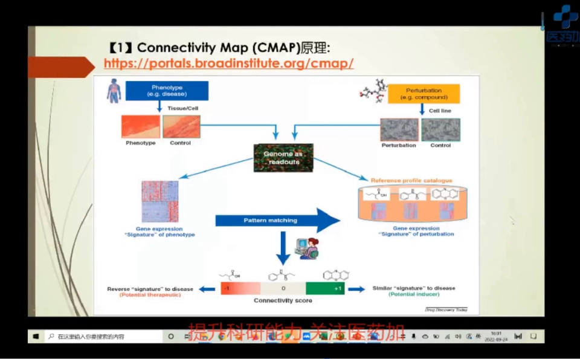

### 1.2 平台后台的数据是怎么攒出来的

建库的逻辑很朴素：找很多已经知道功能的药物和小分子，把它们作用在不同的细胞系上（乳腺癌细胞系、胰腺癌细胞系等），把这些细胞系当作一种模型——

- **作用了药物的**，叫扰动组；
- **没作用药物的**，就是对照组。

然后对它们做转录组学实验，得到各自的转录谱，全部放进平台的后台，这就是它的基础数据。

[【跳转到 02:14】](https://www.bilibili.com/video/BV1Lv4y1d7Pd/?t=134)

用户这一侧则反过来：自己针对某个表型（比如某种疾病）做实验，对照组用健康组织或细胞，做转录组学实验，得到差异表达基因，也就是自己的表达谱，再输入平台。平台的模式匹配算法会把这份转录谱和后台的每一条转录谱逐一比较，算出相似度——这个相似度就叫 **connectivity score（连接分）**。

### 1.3 connectivity score：一个带方向的分数

分值落在 $-1$ 到 $+1$ 之间：越接近 $+1$ 说明相似性越高，越接近 $-1$ 说明相反性越高。

$$
\text{connectivity score} \in [-1,\ +1]
\begin{cases}
\to +1 & \text{与输入签名同向（相似）} \\
\to -1 & \text{与输入签名反向（相反）}
\end{cases}
$$

[【跳转到 03:29】](https://www.bilibili.com/video/BV1Lv4y1d7Pd/?t=209)

真正有用的是**两头**，而且方向的含义取决于你输入的是什么：

| 你输入的签名 | 关注哪一端 | 这一端的化合物意味着什么 |
| --- | --- | --- |
| 疾病 vs 健康 | 接近 $-1$ | 它把疾病里高表达的基因压下去、低表达的基因提上来，是**潜在的治疗药物** |
| 疾病 vs 健康 | 接近 $+1$ | 它和疾病同向，是**潜在的诱导或加重疾病的药物** |
| 某药物处理 vs 对照 | 接近 $+1$ | 与它机制相似的化合物，可用来**推断这个药物的作用机制** |

[【跳转到 04:19】](https://www.bilibili.com/video/BV1Lv4y1d7Pd/?t=259)

一句话记住：**疾病签名找「反的」，药物签名找「像的」**。

### 1.4 换个用法：把中药当黑箱

视频里给了一个很实用的思路：如果把一味中药（或一个成分）看成黑箱，不知道它有什么功能，那就把它作用在组织或细胞上做转录组，再去找和它转录谱相似的小分子，**通过这些已知小分子的功能反推这个中药的功能**。

[【跳转到 05:34】](https://www.bilibili.com/video/BV1Lv4y1d7Pd/?t=334)

## 二、L1000 的关键取舍：只测 978 个基因

### 2.1 从 build 02 到 L1000

CMap 最早那版叫 **build 02**，现在已经打不开了。它当年的好处是任意邮箱都能注册使用；现在的版本叫 **L1000**，只有 edu 邮箱注册才能用。

[【跳转到 10:06】](https://www.bilibili.com/video/BV1Lv4y1d7Pd/?t=606)

L1000 大约是 2017 年发表的。相比 build 02，它多了很多小分子和细胞系——原因不是测得更全，恰恰相反，是**测得更少**。

### 2.2 978 个 landmark 基因 + 推断 11,350 个

L1000 的开发团队先对 GEO 等转录组数据库里的大量表达谱做了大规模分析，发现一件事：**只用其中 978 个基因的表达水平，就可以推断出其余 1 万多个基因的表达水平，近似度达到 80% 以上**。

于是他们开发了只针对这 978 个基因做检测的试剂。视频中展示的官方说明把这件事写得更具体：

- L1000 是一种高通量基因表达检测，直接测量人类细胞中 **978 个 landmark 基因**的 mRNA 丰度；
- 另外还测 **80 条对照转录本**，它们在不同细胞状态下表达恒定，用来做校准；
- 这 978 个基因的测量值再经过**推断算法（inference）**，推断出转录组中另外 **11,350 个基因**的表达；
- 通过模拟评估，这种「缩减版转录组」能还原**约 80%** 的直接测量全部转录本时得到的关系。

[【跳转到 11:21】](https://www.bilibili.com/video/BV1Lv4y1d7Pd/?t=681)

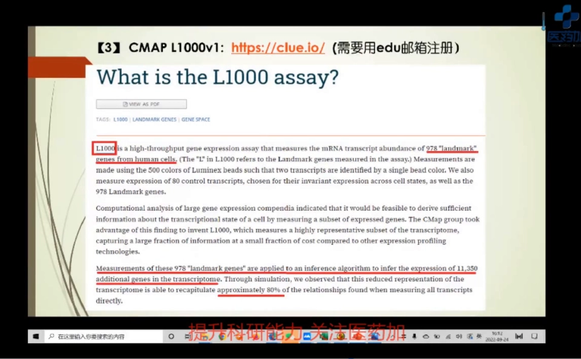

名字也是这么来的：**L 是 landmark 的首字母**（地标基因，用这些就够了），978 近似等于 1000，所以叫 L1000。

[【跳转到 13:01】](https://www.bilibili.com/video/BV1Lv4y1d7Pd/?t=781)

### 2.3 为什么值得这么省：成本与通量

理由很直接：没必要做全基因组的转录组实验了。只测 978 个基因，**一个样本的成本不到 2 美元（约 1.5 几美元）**，成本大大降低，才有可能去做更多的药物、更多的细胞系，形成一个新的平台。

[【跳转到 12:11】](https://www.bilibili.com/video/BV1Lv4y1d7Pd/?t=731)

这就是本节要抓住的核心权衡：**L1000 不是「测得更准」，而是「测得更多」**。它用基因数换通量，把「几千种化合物 × 若干细胞系 × 多个剂量/时间点」这件事变成做得到的实验。

### 2.4 这个取舍的代价，会直接落到你的输入上

代价在查询时是看得见的。因为平台后台的参照谱只覆盖那 978 + 11,350 个基因，你输入的基因必须落在这个范围内才参与比较：

- 你输入的基因**在推断空间里**（1 万多个基因之内），系统标成蓝色打勾，参与分析；
- 基因本身是正确的，但**不在那 1 万多个基因里**，标成蓝色空心——不参与分析；
- 基因 ID 系统里根本没有，标成红色——不参与分析。

[【跳转到 20:33】](https://www.bilibili.com/video/BV1Lv4y1d7Pd/?t=1233)

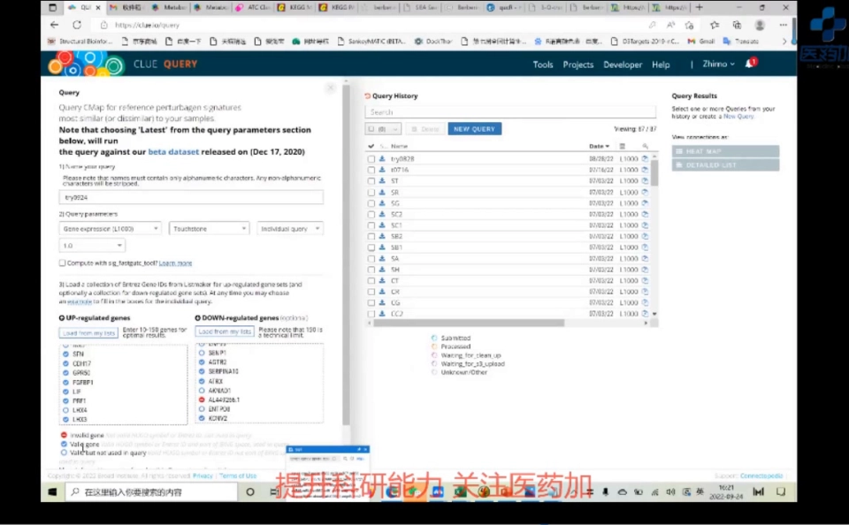

所以「978 个基因够不够」这个问题，在实操层面的含义是：**如果你的差异基因大量落在推断空间之外，你的签名就被削掉了一大块**，剩下的部分未必还代表你原来的生物学问题。视频没有展开讨论推断基因的准确度差异，但它给出的「约 80% 还原度」本身就是一个平均值——平均意味着有的基因准、有的基因不准。

## 三、数据形态：touchstone 与九个细胞系

### 3.1 后台里到底有什么

L1000 的数据是围绕 **perturbagen（扰动剂）** 组织的。视频展示的扰动剂类型表把「扰动的种类」讲得很清楚：

| 扰动剂类型 | 含义 |
| --- | --- |
| Compound | 药物或化合物处理 |
| Peptides and other biological agents（如细胞因子） | 生物制剂处理 |
| shRNA（loss of function） | 基因敲低 |
| 针对同一基因的 shRNA 共识签名 | 基因敲低 |
| CRISPR（loss of function） | 基因敲低 |
| cDNA（野生型过表达） | 基因过表达 |
| cDNA（突变型过表达） | 基因过表达 |
| Controls（溶剂 DMSO、空载体、未处理细胞等） | 对照 |

[【跳转到 13:31】](https://www.bilibili.com/video/BV1Lv4y1d7Pd/?t=811)

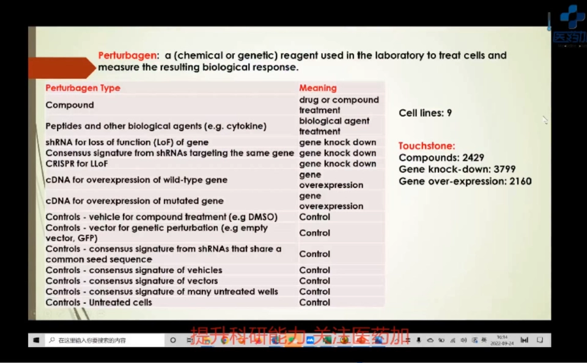

同一页给出了这个平台的规模：**9 个细胞系**，以及 **touchstone** 子集的规模——touchstone 是专门用来做 CMap 分析的一个高质量子集，包含 **2429 个化合物**、**3799 个基因敲低**、**2160 个基因过表达**。

[【跳转到 13:56】](https://www.bilibili.com/video/BV1Lv4y1d7Pd/?t=836)

注意这里的数字关系：**化合物是 2429 个，不是几万个**。后面那篇讲结果表的视频会解释，为什么下载下来的结果动辄几十万行——因为同一个化合物在不同细胞系、不同剂量、不同处理时间下各占一行。

### 3.2 结果表的列长什么样

在 CLUE 的下载页面里，可以按扰动剂类型和细胞系勾选要下载的内容。扰动剂类型的数量在界面上是直接标出来的：Compound 2,837、Gene Knock Down 3,799、Gene Over-Expression 2,160，细胞系列表是 A375、A549、HA1E、HCC515、HEPG2、HT29、MCF7、PC3、VCAP 九个。

[【跳转到 16:21】](https://www.bilibili.com/video/BV1Lv4y1d7Pd/?t=981)

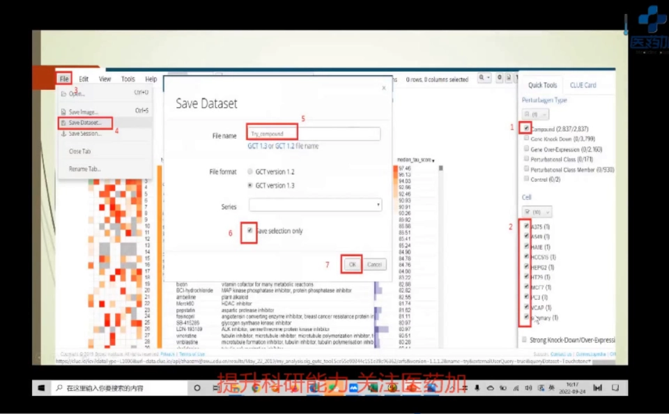

下载得到的表格，每一行是一个「化合物 × 细胞系」的组合：

- `id`：化合物编号；
- `type`：扰动类型（cp 化合物、kd 敲低、oe 过表达、pcl 功能类）；
- `name`、`description`：化合物名字与功能描述；
- `target`：靶标；
- `median_...`：中位数汇总；
- `summary`：把九个细胞系整合起来的汇总分；
- 后面每个细胞系一列：PC3、VCAP、A375、A549、HA1E、HCC515、HT29、MCF7、HEPG2。

[【跳转到 17:11】](https://www.bilibili.com/video/BV1Lv4y1d7Pd/?t=1031)

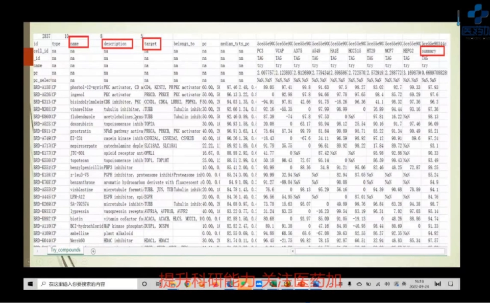

这个「summary + 每系一列」的形态很关键：**平台不替你决定该看哪个细胞系**。你可以只看 summary，也可以只看和你研究组织对得上的那一个细胞系。

## 四、怎么用：CLUE 上的查询流程

### 4.1 注册与参数

1. 用 edu 邮箱注册并登录（不登录看不到 query 入口）；
2. 点 tools → query；
3. 给这次查询取个名字；
4. 选参数：`gene expression` + `L1000` + `touchstone` + `individual query`；
5. 选版本：可以选最新版，也可以选 1.0。视频作者的建议是**选 1.0**，因为新版不如旧版好用。

[【跳转到 14:36】](https://www.bilibili.com/video/BV1Lv4y1d7Pd/?t=876)

### 4.2 输入约束：10~150 个基因

把上调基因粘到左边的框、下调基因粘到右边的框。硬性限制是：

- **上调基因必填，10~150 个**；
- **下调基因可选**，填的话也不能超过 150 个。

[【跳转到 15:31】](https://www.bilibili.com/video/BV1Lv4y1d7Pd/?t=931)

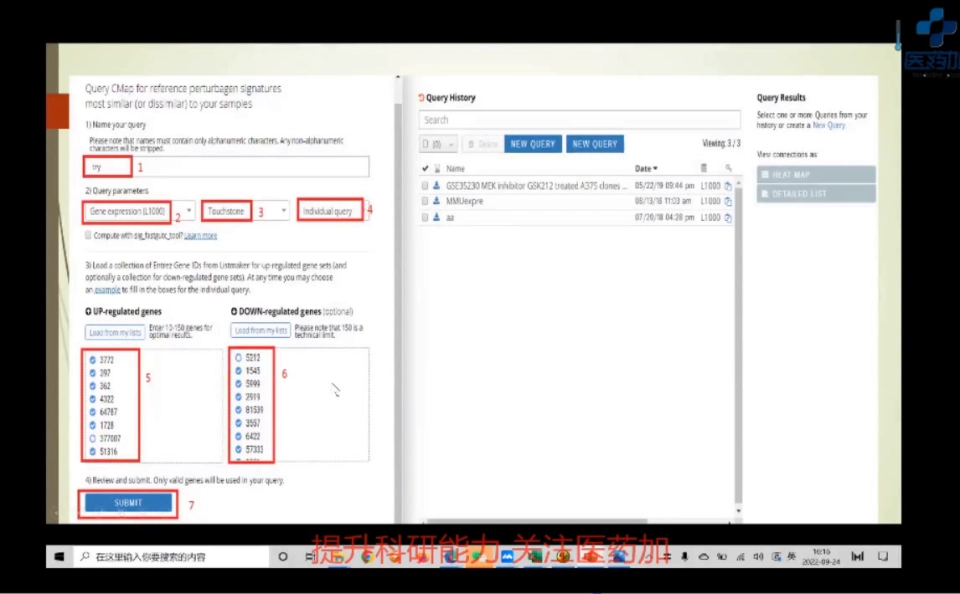

这个上限不是随便定的：**它和 CMap 打分算法的设计绑在一起**，只取最极端的上下调基因做富集式比较，而不是拿全转录组做相关。所以你在准备输入时，应该先把差异基因按变化幅度排序，取最靠前的那一批，而不是随机挑。

### 4.3 提交、等待、下载

提交后要等它跑完（视频里反复强调这个网站很慢），出现下载标识后点 hit map 进入下载页：

- 勾选要下载的扰动剂类型；
- 勾选细胞系——九个细胞系之外还有一个 **summary**，是把九个细胞系结果整合起来的汇总，通常直接下 summary；
- 点 file → save dataset，命名，选 save selection only。

[【跳转到 16:21】](https://www.bilibili.com/video/BV1Lv4y1d7Pd/?t=981)

### 4.4 阈值：90 分

结果表里的分值是 **-100 到 +100**（这一版的口径），越接近 100 相似性越高、越接近 -100 相反性越高。取多少算显著？视频给的惯例是：**90 分以上或 -90 分以下**，也就是通常拿 90 当阈值。

[【跳转到 17:44】](https://www.bilibili.com/video/BV1Lv4y1d7Pd/?t=1064)

## 五、一个真实案例：102 个中药单体的 CMap 分析

视频里用作者课题组自己的工作做了完整示范，这个例子把「怎么从一次实验走到一张结论表」串了起来。

**实验**：102 个中药里常见的单体，作用在 MCF7 细胞上（MCF7 正是 CMap 用的九个细胞系之一），做转录组测序，数据传到 GEO，编号 **GSE85871**（2017 年上传）。每个小分子两个重复，另外有 DMSO 对照，以及一个由四个单体混合而成的 mixture 组。

[【跳转到 07:17】](https://www.bilibili.com/video/BV1Lv4y1d7Pd/?t=437)

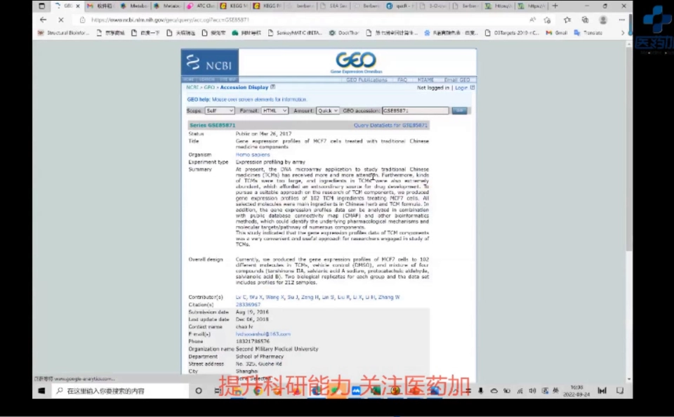

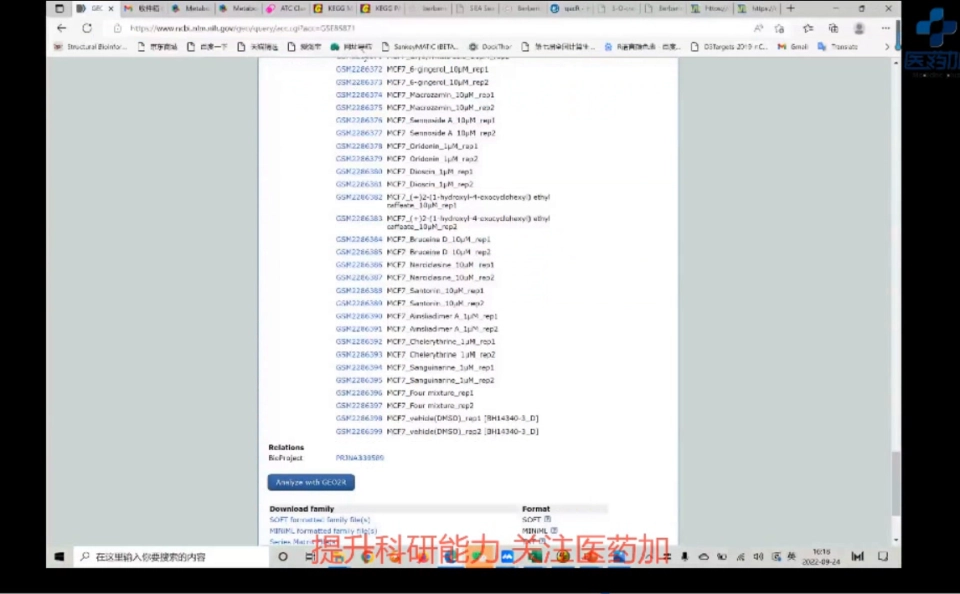

**分析**：把每个单体的转录谱拿去做 CMap 分析，与库里的小分子转录谱比对，挑出相似性分接近 $+1$、并且已知具有心血管保护功能的小分子。

**结果**：单个单体也能找到一些心血管类药物，但相似度不高——低的有 0.6 几，最高的 0.85；而把四个单体混起来之后，出现了很多 0.9 分以上的心血管类用药。作者据此论证：**这四个成分之间存在协同作用，混用产生了更强的心血管保护作用**。

[【跳转到 09:41】](https://www.bilibili.com/video/BV1Lv4y1d7Pd/?t=581)

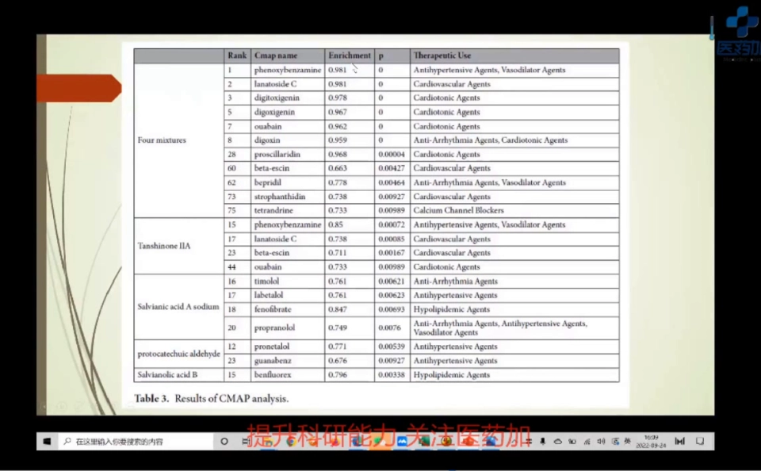

这个案例值得注意的地方不是中药结论，而是**分数的相对性**：0.85 和 0.96 都是「相似」，但在这个问题里，作者把 0.9 当成了「足够强」的分界。阈值不是绝对的，它取决于你要论证什么。

## 六、结果怎么读：type 列是另一半信息

很多人拿到结果只看分值排序，其实 `type` 列同样在传递信息。视频里演示了按 summary 从高到低排序、取 95 分以上作为更严格的阈值之后，结果里混着几类扰动：

- **cp（化合物）**：和你的药有相似转录谱的化合物。它们的功能描述里如果反复出现某一类（比如一堆 tubulin 抑制剂、一堆 PKC 激活剂），那你的药**可能也具有这种功能**；它们的靶标也可能是你的药的靶标——但这只是推断，需要实验验证。
- **kd（基因敲低）**：把这些基因敲掉之后得到的转录谱和你的药相似，说明你的药**可能对这些基因有抑制作用**。
- **oe（基因过表达）**：把基因过表达后转录谱和你的药相似，说明你的药**可能对这些基因有激活作用**。
- **pcl（功能类）**：把上面反复出现的功能类型聚成的类，比如 PKC 激活剂、tubulin 激活剂。

[【跳转到 25:06】](https://www.bilibili.com/video/BV1Lv4y1d7Pd/?t=1506)

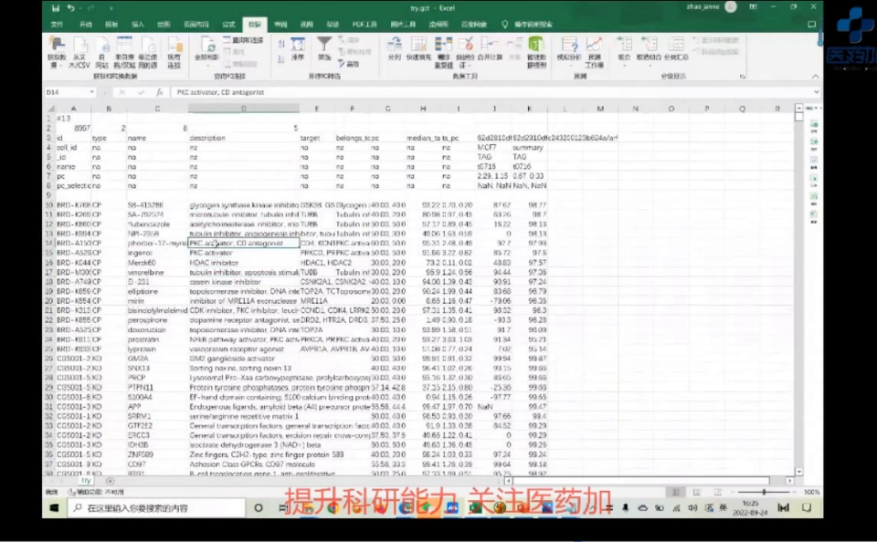

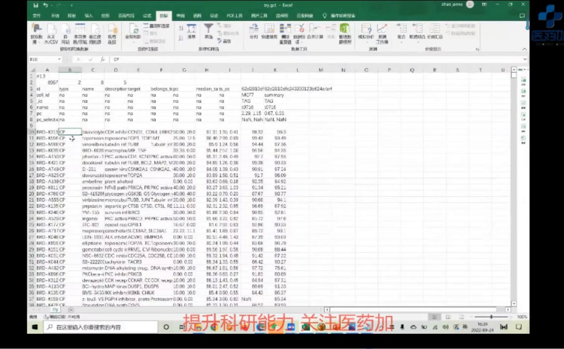

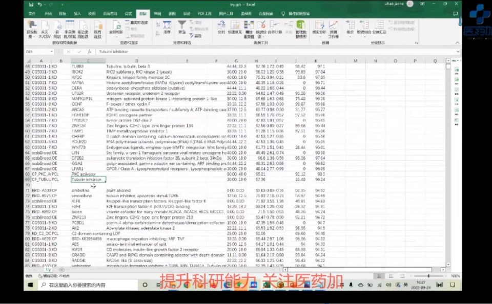

所以一份 CMap 结果的正确读法是：**先看分值筛出候选，再用 type 和 description/target 把候选翻译成机制假设，最后回到实验验证**。

## 小结

- CMap 的全部推理建立在一个假设上：**相似的转录谱意味着相似的功能**；它因此可以把「药物重定位」变成一个可计算的匹配问题。
- connectivity score 是带方向的：**疾病签名找接近 $-1$ 的（逆转），药物签名找接近 $+1$ 的（同机制）**。
- L1000 的核心设计是**只直接测 978 个 landmark 基因**，再用推断算法补出 11,350 个基因，官方口径是能还原约 80% 的关系。
- 这么做的动机是**成本与通量**：一个样本不到 2 美元，才可能覆盖几千个化合物 × 九个细胞系 × 多个剂量/时间点。
- 代价落在两处：**推断基因的准确度是平均值，不是每个基因都准**；**输入基因必须落在推断空间内**，否则会被静默剔除（空心/红色标记）。
- 数据形态是「扰动剂 × 细胞系」的矩阵，结果表里 summary 与九个细胞系各占一列，**平台不替你选细胞系**。
- 查询有硬约束：**上调基因 10~150 个，下调基因可选且不超过 150 个**，这不是随意设的上限，而是打分算法决定的。
- 读结果要连 `type` 一起读：cp 给功能与靶标线索，kd/oe 给抑制/激活线索，pcl 把反复出现的机制聚成类。

## 关键术语速查

| 术语 | 一句话解释 |
| --- | --- |
| CMap（Connectivity Map） | 用「转录谱相似 → 功能相似」的假设，把表达签名匹配到已知扰动上的平台 |
| LINCS | L1000 所属的大型细胞扰动签名计划，CMap 是它的查询入口 |
| connectivity score | CMap 的匹配分数，$-1$ 到 $+1$，负值是逆转、正值是同向 |
| landmark genes | 被直接测量的 978 个基因，用来代表整个转录组 |
| inference（推断） | 用 978 个 landmark 基因的表达去推算另外 11,350 个基因的表达 |
| perturbagen | 扰动剂，泛指化合物、shRNA、CRISPR、cDNA 等施加在细胞上的干预 |
| touchstone | 用来做 CMap 分析的高质量参照子集：2429 个化合物、3799 个敲低、2160 个过表达 |
| summary | 把九个细胞系的分值整合起来的一列汇总结果 |
| cp / kd / oe / pcl | 结果表里的扰动类型：化合物 / 基因敲低 / 基因过表达 / 功能类 |
| build 02 | CMap 的旧版本数据集，现已无法访问 |