# CMap 查询结果怎么读：CLUE 平台的 Detailed List 与得分列

> 视频来源：[新版CMap数据库CLUE的使用——如何查看Detailed List？](https://www.bilibili.com/video/BV1FT411w71G/)（Bilibili · 屾屾不是山山）｜时长约 21 分钟
> 简要导读：这支视频只做一件事——把 CLUE 网站上「查询 → 下载 → 打开结果表」这条链路走通，顺带回答一个被问烂的问题：为什么新版查询看不到 Detailed List 了。它不讲 CMap 的原理与 L1000 的设计（那是 [CMap 与 L1000：978 个基因如何刻画药物扰动](CMap与L1000：978个基因如何刻画药物扰动.md) 的内容），专讲**结果表长什么样、每一列是什么意思、该按哪一列排序**。

## 本讲要解决的核心问题（SCQA）

**背景**：你在 CLUE 上提交了一份差异基因列表，等它跑完，下载下来一个 Excel。表格里有几十万行、二十几列，列名是 `ncs_q75`、`fdr_q_nlog10`、`norm_cs`、`moa`、`tau` 这样的缩写。

**冲突**：这些列没有中文说明，而网上流传的教程大多停在「点这里、点那里」，没说清楚**为什么 2429 个化合物会变成 42 万行**、**该按哪一列排序**、**那些 -666 是什么**。同时，很多人发现新版查询的 Detailed List 打不开了，以为功能被砍掉。

**疑问**：一张 CMap 结果表到底该怎么读？Detailed List 到底还能不能看？

**回答（中心思想）**：CMap 结果表的行数是「化合物 × 细胞系 × 剂量 × 时间」的笛卡尔积，所以 2429 个化合物对应几十万行；排序要按 **normalized connectivity score（越大关联越强）** 和 **FDR 的 $-\log_{10}$ 值（越大越显著）**，而不是按原始 cs；`-666` 是缺失值，`moa` 为空的行直接过滤掉。Detailed List 在新版（3.0）查询里确实被取消了，但**切到 1.0 版本就还能看**——这是版本问题，不是权限问题。

## 一、先明确 CMap 是什么：一个基因表达谱数据库

视频开头用一篇文献里的说法概括了它的用途：**推断药物的主要结构和药理作用、找出新药、找出适合某些细胞系的药物**——一句话，它是一个做小分子药物分析的数据库。

[【跳转到 00:32】](https://www.bilibili.com/video/BV1FT411w71G/?t=32)

它的官网现在叫 **CLUE**（`clue.io`），是新版网站。作者对它的评价很直接：新版比旧版难用，很多功能没有了。新版需要注册才能用查询功能，否则只能浏览；它名义上要求教育机构账号，实际上用个人邮箱注册也能通过。

[【跳转到 01:04】](https://www.bilibili.com/video/BV1FT411w71G/?t=64)

## 二、查询流程：参数怎么选

登录后点 **Tools → Query**，界面左边是查询入口，右边是结果显示区。

[【跳转到 01:54】](https://www.bilibili.com/video/BV1FT411w71G/?t=114)

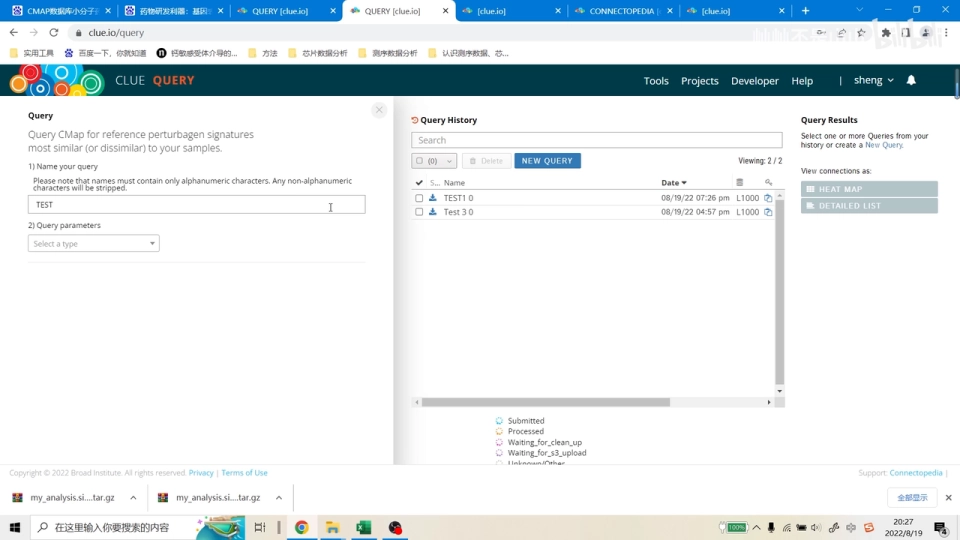

### 2.1 平台与版本

- **平台选 L1000**，这是默认也是最常用的；
- **版本**有两个选择：选「Latest」会用 2020 年发布的 beta 版数据集；选 **1.0** 则是旧版。1.0 下面还有一个勾选项，勾上会把新版的算法放回旧版跑，速度更快，作者实测结果差别不大。

[【跳转到 02:51】](https://www.bilibili.com/video/BV1FT411w71G/?t=171)

### 2.2 个人查询 vs 批量查询

- **个人查询（individual query）**：把基因名直接粘进框里；
- **批量查询**：把几批基因按文件夹形式导入。

### 2.3 输入约束：10~150 个基因

上调基因框**必填，10~150 个**；下调基因框**可选**，填的话同样不能超过 150 个。

[【跳转到 04:06】](https://www.bilibili.com/video/BV1FT411w71G/?t=246)

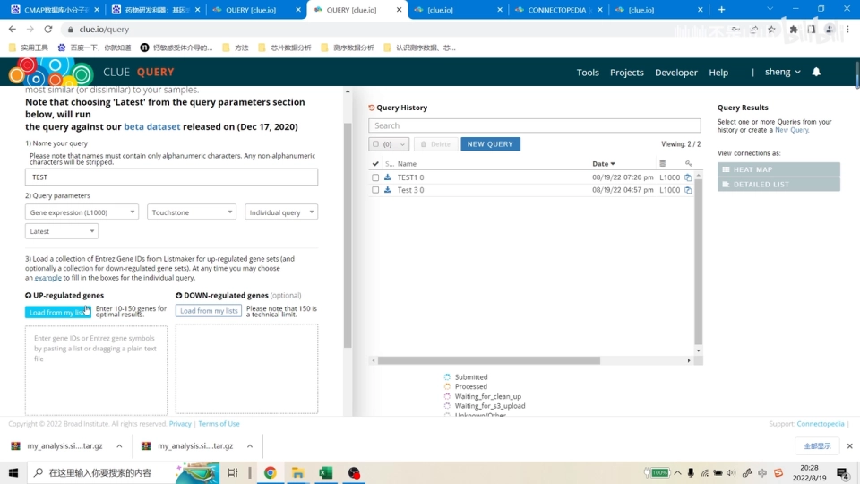

实操上有两个坑：

1. **基因名必须能被识别**。数据库里没有的基因会提示「查询不到」；还有一种情况是基因能查到、但没有记录，也不能用。
2. **别塞太多**。作者的经验是：几十个差异基因可以直接全塞进去；一两百个塞进去，会有很多识别不出来。

### 2.4 基因 ID 的三种状态

粘贴进去的基因会被标成三种状态，这个标记直接对应「它会不会参与计算」：

- **蓝色打勾**：有效基因，参与查询；
- **蓝色空心**：基因本身正确，但不参与查询（不在推断空间内）；
- **红色**：无效 ID，系统里没有。

[【跳转到 05:06】](https://www.bilibili.com/video/BV1FT411w71G/?t=306)

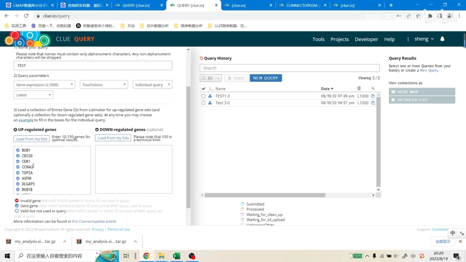

这一点值得单独强调：**你提交的基因列表会被静默裁剪**。如果一大半基因是空心，你的签名其实已经不是你以为了。

## 三、Detailed List 为什么打不开：版本问题，不是权限问题

提交后要等它跑（作者反复强调这个网站特别慢），跑完会出现下载标识。点开最新版（3.0）的结果，右侧 **DETAILED LIST 是灰的**，点进去显示「详细列表不支持」。

[【跳转到 06:21】](https://www.bilibili.com/video/BV1FT411w71G/?t=381)

原因在网站的公告里：**2021 年 10 月 17 日的维护公告明确写了「Detailed list no longer supported in latest Query APP」**——最新版的查询应用不再支持详细列表。同时另一条公告说明，团队从 2022 年 7 月起不再提供一对一的邮件答疑，但网站和 app 的功能不受影响。

[【跳转到 09:21】](https://www.bilibili.com/video/BV1FT411w71G/?t=561)

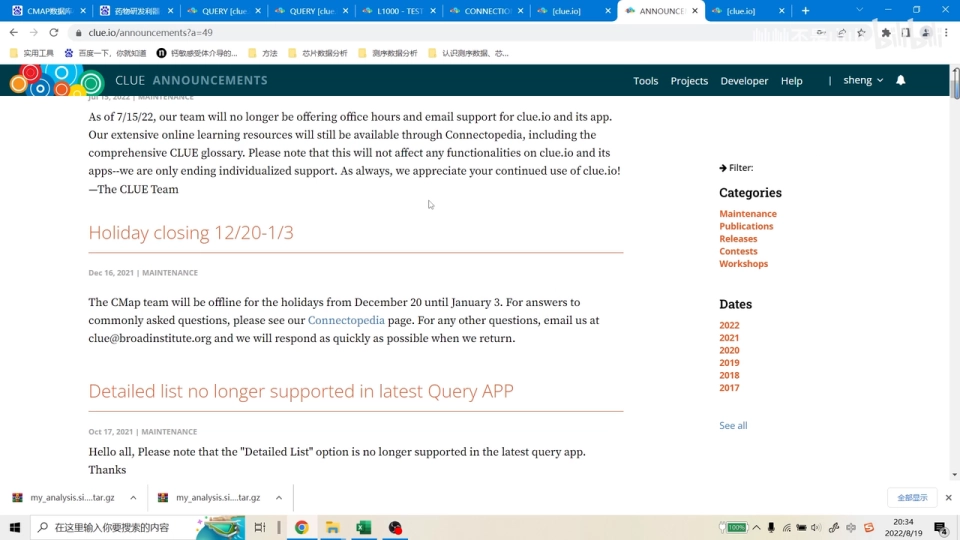

**解决办法：切到 1.0 版本重跑。** 老版本仍然提供 Detailed List，热图和详细列表都能看。这就是视频标题里那个问题的答案。

[【跳转到 08:25】](https://www.bilibili.com/video/BV1FT411w71G/?t=505)

## 四、在线看结果：热图与 Perturbagen 计数

1.0 版本的结果可以在线打开一个交互式视图（ICV）。左边是热图，右边可以按 **Perturbagen Type** 和 **Cell** 过滤，而这两个面板本身就透露了数据的规模：

| Perturbagen Type | 数量 |
| --- | --- |
| Compound | 2,837 |
| Gene Knock Down | 3,799 |
| Gene Over-Expression | 2,160 |
| Perturbational Class | 17 |
| Perturbational Class Member | 930 |
| Control | 2 |

细胞系一共 9 个（A375、A549、HA1E、HCC515、HEPG2、HT29、MCF7、PC3、VCAP）外加一个 **summary**。

[【跳转到 10:27】](https://www.bilibili.com/video/BV1FT411w71G/?t=627)

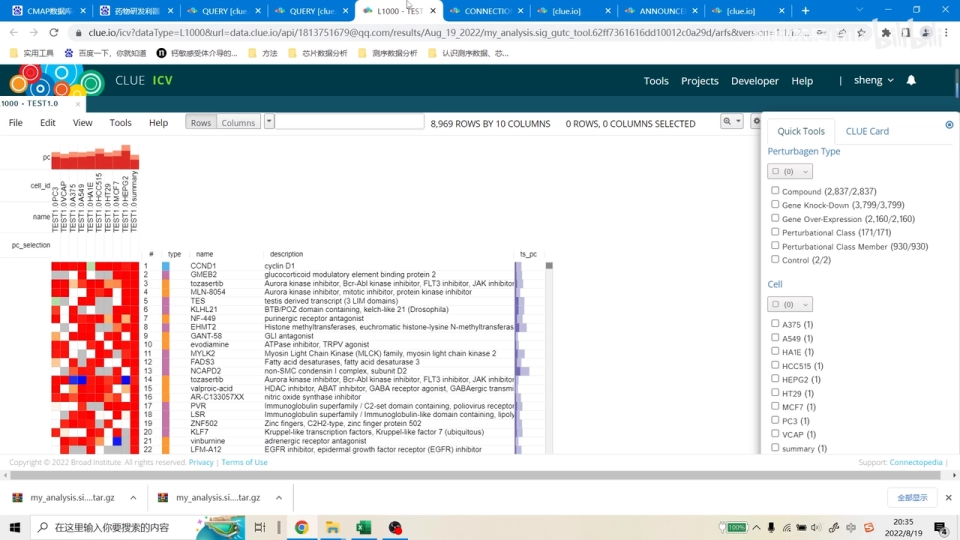

热图每一行是一个化合物，右侧给出名字、出处和打分。点「只查询小分子化合物」，就只剩化合物那一类。

[【跳转到 10:52】](https://www.bilibili.com/video/BV1FT411w71G/?t=652)

## 五、下载下来的表：42 万行是怎么来的

点下载会得到两个文件夹（新版一个、旧版一个），查询结果文件都叫 Query result，体积很大，打开要等很久。

[【跳转到 12:01】](https://www.bilibili.com/video/BV1FT411w71G/?t=721)

### 5.1 2429 个化合物 → 42 万行

新版结果表有 **42 万行**。按 `pert_type` 筛出化合物（CP）之后，还有 **13 万条记录**。为什么 2000 多种化合物会变成十几万条？

因为**同一个化合物在不同细胞系、不同剂量、不同处理时间下各占一行**：有 6 小时的、24 小时的，有 10 微摩尔的、几个微摩尔的。一行 = 一个具体的实验条件。

[【跳转到 14:02】](https://www.bilibili.com/video/BV1FT411w71G/?t=842)

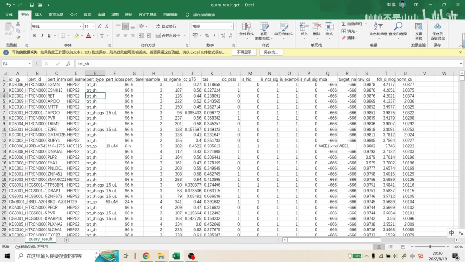

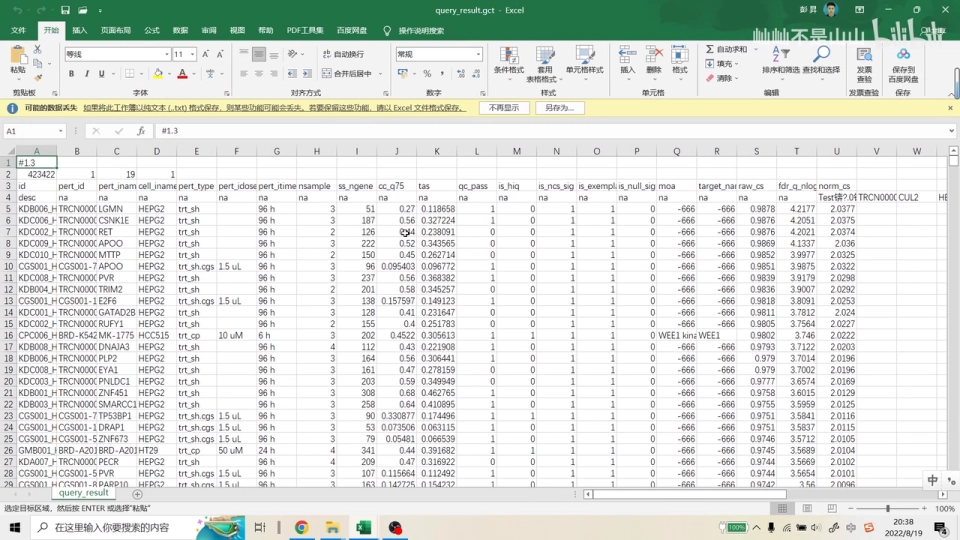

这一点是理解 LINCS 数据形态的关键：**它不是「一个化合物一个数」，而是「一个实验条件一个数」**。所以下游分析第一步永远是决定怎么把同一化合物的多个条件聚合起来——取最大、取中位数、还是只看某一个细胞系。

### 5.2 moa 与 target：-666 是缺失值

`moa`（mechanism of action）列给出化合物的作用机制，`target` 列给出靶标。但很多行里这两列是 **-666**。

-666 的意思就是**没有记载**，相当于 R 里的缺失值 NA。处理方式也一样：直接去掉。因为不知道机制，后续分析用不上；除非你的目的就是探索未知的新药。

[【跳转到 15:42】](https://www.bilibili.com/video/BV1FT411w71G/?t=942)

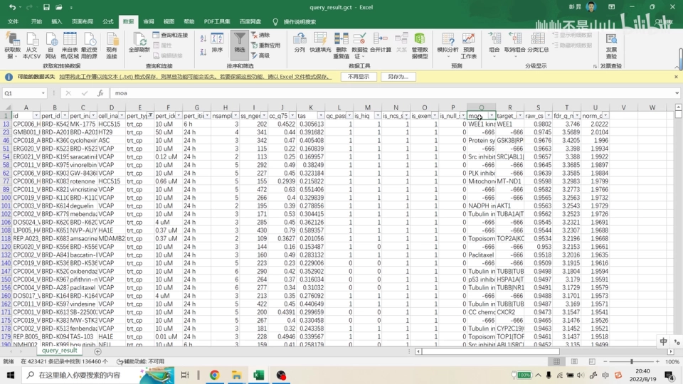

### 5.3 得分列：cs、FDR、normalized cs

这是本节最实用的一段。结果表里有三列关键的打分：

| 列 | 含义 | 怎么用 |
| --- | --- | --- |
| `cs`（connectivity score） | 连接分，这一版口径是 $-1$ 到 $1$ | 方向性指标：越接近 1 与疾病关联越强 |
| `fdr_q_nlog10` | FDR 的 $-\log_{10}$ 值 | **越大越显著**（注意它已经取过负对数，方向反过来了） |
| `norm_cs`（normalized connectivity score） | 归一化后的连接分 | **日常就用这一列排序**，数值越大一致性越好 |

[【跳转到 16:32】](https://www.bilibili.com/video/BV1FT411w71G/?t=992)

作者的原话值得记下来：`norm_cs` 的数值为什么不在 $-1$ 到 $1$ 之间、排序为什么是这样，「我也不清楚，这是一种计算方式吧，这个网站它经常变这些标准」——但**只要数值越大，就说明一致性越好**。这句话是对的用法：不要纠结绝对刻度，看相对排序。

[【跳转到 18:12】](https://www.bilibili.com/video/BV1FT411w71G/?t=1092)

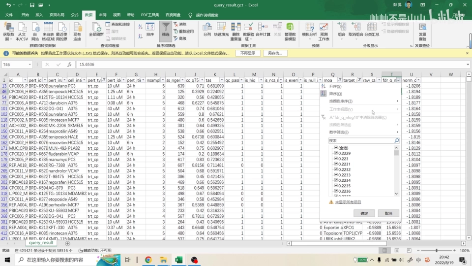

### 5.4 挑出前 N 个候选

排完序之后，取前十个、前五个，就是「与疾病关联度比较高的、可能抑制疾病发生的药物」。作者很实在地说「这药物啊我都不认得」——这很正常，**CMap 的输出是一串待查证的线索，不是结论**，拿到名字之后还要一个个去查它是干什么的。

[【跳转到 18:37】](https://www.bilibili.com/video/BV1FT411w71G/?t=1117)

## 六、旧版结果表：列更少，但多一个 TAG

旧版结果表的结构和新版类似，但更精简：`pert_id`、`pert_iname`（化合物名）、`cell_id`（细胞系）、`pert_time`（处理时间）、`pert_idose`（剂量）、`moa`、`gene_targ_name`（靶基因），以及一列 **TAG**。

[【跳转到 19:11】](https://www.bilibili.com/video/BV1FT411w71G/?t=1151)

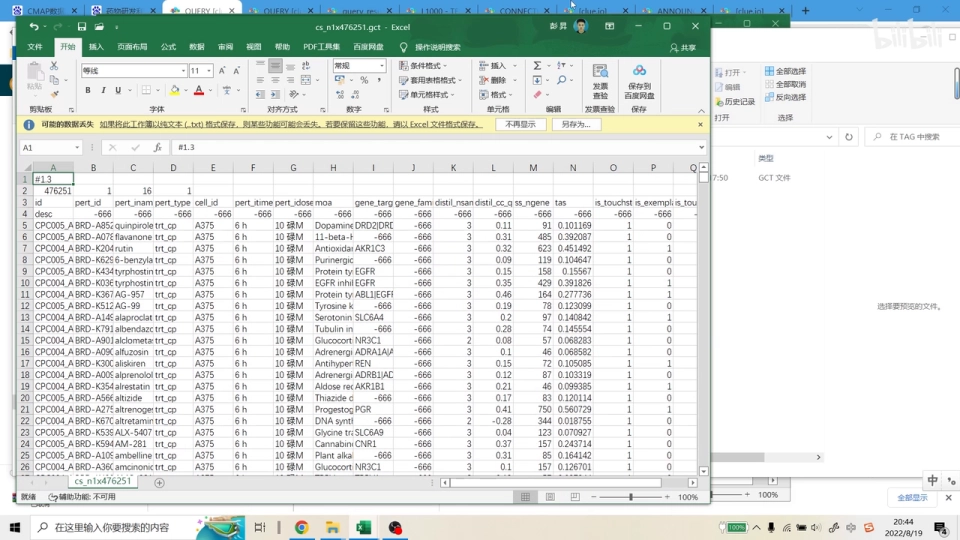

TAG 这一列也是一种经过算法得到的分数，作者说它和旧版里的 mean 一样，落在 $-1$ 到 $1$，1 是最高的。挑候选的方式也一样：按它排序，取前十或前五。

[【跳转到 20:13】](https://www.bilibili.com/video/BV1FT411w71G/?t=1213)

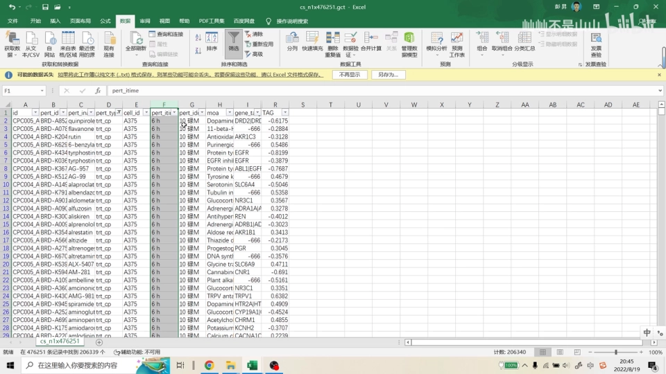

## 七、这套流程的边界在哪

视频本身没有专门讲局限，但从它演示的细节里可以直接读出来几条，值得在使用时记住：

- **每个条件只有群体平均**。一行是一个细胞系在一组条件下的转录组，没有单细胞分辨率，细胞间的异质性被平均掉了。
- **细胞系只有九个**。如果你的研究对象不在 A375、A549、HA1E、HCC515、HEPG2、HT29、MCF7、PC3、VCAP 里，就只能退而求其次看 summary，或者找一个最接近的。
- **剂量与时间点覆盖不均**。同一个化合物在不同条件下各占一行，有的条件多、有的少，直接比较行数会带偏。
- **平台口径会变**。作者明确说「这个网站它经常变这些标准」，得分列的定义和范围在历史上有过变化（旧版 -1~1、某些版本 -100~100、新版 norm_cs 又不在这个区间）。**跨版本比较分数是没有意义的**，只能比较同一版本内的排序。
- **机制信息大量缺失**。`moa` 和 `target` 里 -666 的比例不低，靠机制注释做富集时样本量会明显缩水。
- **Detailed List 只存在于旧版**。这既是一个操作细节，也提醒你：**结果的可复现性依赖你记录了用的是哪个版本**。

## 小结

- CMap 是一个基因表达谱数据库，官网现在叫 CLUE，用途是找药、推断药理作用、找适合某细胞系的药物。
- 查询入口是 Tools → Query，平台选 L1000；版本可选 Latest（beta）或 1.0，**1.0 才能看 Detailed List**。
- 输入约束：**上调基因 10~150 个，下调基因可选且不超过 150 个**；基因会被标成打勾/空心/红色，**空心和红色不参与计算**。
- Detailed List 在新版 3.0 被取消是官方公告（2021-10-17）的决定，不是权限问题，切 1.0 即可。
- 结果表的行数是「化合物 × 细胞系 × 剂量 × 时间」的笛卡尔积：2429 个化合物 → 42 万行，筛出化合物后仍有 13 万条。
- 排序看两列：**`norm_cs`（越大关联越强）** 和 **`fdr_q_nlog10`（越大越显著）**；`cs` 看方向。
- **-666 是缺失值**，`moa`/`target` 为空的行按 NA 过滤。
- 输出是一串待查证的线索，不是结论；**跨版本比分数没有意义，只比同一版本内的排序**。

## 关键术语速查

| 术语 | 一句话解释 |
| --- | --- |
| CLUE | CMap 的现行官网（`clue.io`），提供查询、热图与结果下载 |
| Individual query | 单次提交一份上下调基因列表的查询方式 |
| Detailed List | 逐条列出每个「化合物 × 细胞系 × 剂量 × 时间」结果行的视图，仅旧版提供 |
| ICV | Interactive Connectivity Viewer，在线交互式结果视图，含热图与过滤面板 |
| `pert_iname` | 扰动剂名称（通常是化合物名） |
| `pert_idose` / `pert_time` | 该行的处理剂量与处理时间 |
| `moa` | mechanism of action，作用机制；-666 表示缺失 |
| `target` | 化合物靶标；-666 表示缺失 |
| `cs` | connectivity score，连接分，看方向 |
| `norm_cs` | 归一化连接分，越大关联越强，日常排序用它 |
| `fdr_q_nlog10` | FDR 的 $-\log_{10}$ 值，越大越显著 |
| TAG | 旧版结果表里的一个打分列，范围 $-1$ 到 $1$，1 最高 |
| touchstone | 用于 CMap 查询的高质量参照子集，约 2429 个化合物 |