# Cell Painting：六种染料拍一张照片，把细胞变成上百个指标

> 视频来源：[高内涵的应用](https://www.bilibili.com/video/BV1oe4y1x7iW/)（B 站 · 浅白匠，约 41 分钟）
> 导读：本文按视频讲解顺序梳理 Cell Painting 的完整链路——为什么要用高内涵、六个染色通道分别看什么、一张图怎样变成上百个指标、指标怎样算成 IC50；视频由仪器厂商应用工程师讲解，开头有一段产品宣传片与结尾的公众号推广，本文只取其中的方法部分。

## 本讲要解决的核心问题（SCQA）

**背景**：想研究一个药物或一个基因扰动对细胞做了什么，实验室里最顺手的两条路是流式细胞仪和显微镜。流式细胞仪能自动检测上万个细胞，显微镜能直接看到细胞长什么样。

**冲突**：两条路都缺一块。流式细胞仪把细胞打散成悬液，细胞最初的形态已经消失，我们只能看到当下荧光信号的强弱；显微镜保留了形态，但它是手动观察，要拍一个 96 孔板就很费力，而且拍完还要靠第三方软件才能定量，换一个软件就换一套学习成本。

**疑问**：有没有一种办法，既保留细胞的形态，又能像流式一样自动、批量地测上万个细胞，并且直接把"细胞长什么样"变成可以计算的数字？

**回答（中心思想）**：有，这就是高内涵成像 + Cell Painting。高内涵把流式的自动化和高通量、显微镜的成像能力合在一台仪器上；Cell Painting 用六种染料把细胞里六个不同结构分别染上颜色，一次拍摄同时拿到核、内质网、RNA、高尔基体、线粒体、肌动蛋白骨架的图像；再用软件把图像分割成一个个细胞、提取几十到上百个形态与强度指标，得到每个细胞的"形态学指纹"。指标越多，越能捕捉到扰动带来的细微变化——这正是"只测一个读数"做不到的事。

## 一、高内涵补的是流式和显微镜之间的空缺

### 1.1 流式丢形态，显微镜丢通量

视频开篇用两台"老仪器"作对比。[【跳转到 03:16】](https://www.bilibili.com/video/BV1oe4y1x7iW/?t=196)

**流式细胞仪**：样品准备好以后整个检测过程是自动化的，上了样品就能检测上万个细胞的指标和荧光强弱变化。但它的缺陷非常明显——细胞被处理过以后，"最初的原始形态其实已经消失了"，我们能检测到的只是当下还能看到的荧光信号。所以它缺失了一个非常重要的信息。

**显微镜**：荧光显微镜、共聚焦显微镜都能看到当下细胞的形态，细胞经过某些有机化合物处理以后形态有没有变化，用观察的方式一目了然。但它有两个问题：

- 手动观察。要对一个样本的多个位置做大量观察时，通常得手动移动载物台去找想拍的位置，这里面有主观成分；
- 通量低。即使上孔板，通常也只是挑一两个孔看一下整板的形态变化；拍到的图片要定量分析，还得借助第三方软件，不同软件有不同的学习成本。

### 1.2 高内涵 = 流式的自动化 + 显微镜的成像

高内涵面对的是孔板：六孔板、384 孔板，甚至更高阶的 1536 孔板都能批量拍摄。[【跳转到 05:52】](https://www.bilibili.com/video/BV1oe4y1x7iW/?t=352)

视频给了一个很具体的通量算法：

- 96 孔板、4 倍物镜、每孔拍 4 张图（约覆盖整个孔 50% 的面积），拍 60 个孔就是 240 张图；
- 换成 20 倍镜、拍约 40% 的面积，每孔需要 64 个视野，60 个孔就是 $60 \times 64 = 3840$ 张图。

这样的通量拿显微镜来拍，"工作量是难以想象的"。而且高内涵是自动运行的：程序设好以后它自己拍，人可以去做别的实验准备。

所以视频给出的总结是：高内涵融合了流式的自动化和高通量，加上显微镜的成像能力，能够捕捉细胞形态学的特点，捕捉之后还能做相应的图像分析，做更具体、更海量的数据挖掘。[【跳转到 08:10】](https://www.bilibili.com/video/BV1oe4y1x7iW/?t=490)

视频引用的高内涵定义也值得记住：**在保持细胞结构和功能完整性的前提下，同时检测被筛样品对细胞形态、生长、分化、迁移、凋亡、代谢途径，或者其他信号转导各个环节的影响**。换句话说，只做一块板子，就能在这一个实验里拿到大量相关信息，去判断样品的生物活性或者潜在毒性。

### 1.3 "内涵"到底指什么：图像本身就是高密度数据

视频反复强调一件事：拍照拍得多只是一个方面，**拍到这么多图片不是终极目的**。终极目的是把图片的原始数据做分析、做量化，得到量化的指标；数字化以后，再去做更复杂的分析——分层聚类的可视化、热图、蜘蛛图这类分析，从而在更多数据里挖掘到以前可能没有发现的东西。高内涵的一体化分析软件，做的就是"把图像转化为数据"这件事。

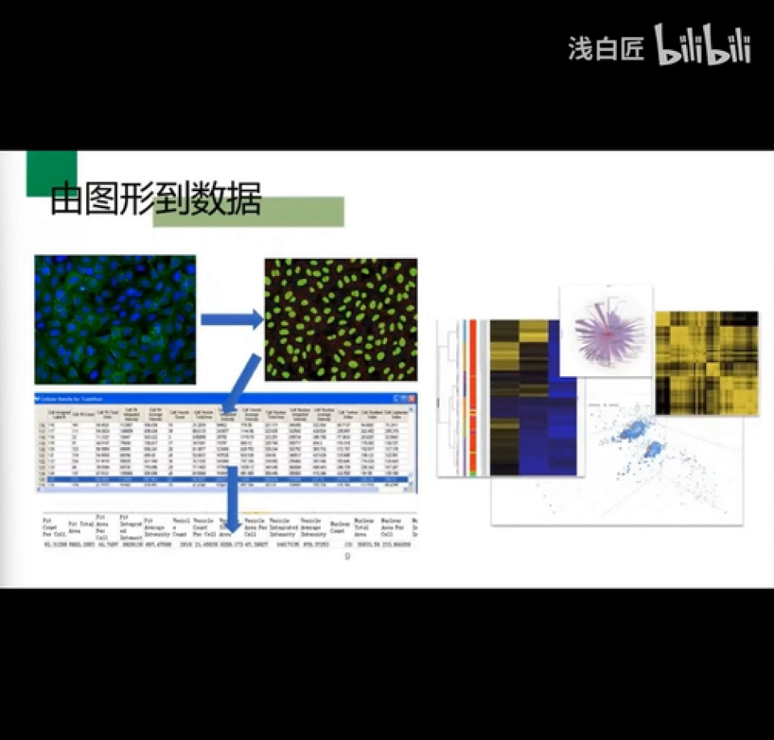

## 二、Cell Painting：一次拍摄，六个通道，一张细胞指纹

### 2.1 这项技术的来历

视频明确交代了出处：2016 年哈佛的博德研究所（Broad Institute）用高内涵建立了一套细胞多重染色分析的方法，就是 Cell Painting，当年发表在 *Nature Protocols* 上。[【跳转到 10:15】](https://www.bilibili.com/video/BV1oe4y1x7iW/?t=615)

### 2.2 六个染色通道分别标记什么

它通过多重染色，用**六个染色途径**分别标记细胞的不同位置，常见的是：细胞核、内质网、RNA、高尔基体、线粒体。[【跳转到 10:34】](https://www.bilibili.com/video/BV1oe4y1x7iW/?t=634)

视频的幻灯片把六个通道和它们对应的结构列得很清楚：

| 通道标记的对象 | 看到的结构 |
| --- | --- |
| 细胞核（DNA 染料） | 核的轮廓、大小、形状 |
| 核仁（RNA 类） | 核仁的数量与形态 |
| 内质网 | 内质网的分布与纹理 |
| 高尔基体 | 高尔基体的位置与形态 |
| 线粒体 | 线粒体的颗粒化程度、分布 |
| 肌动蛋白（actin）骨架 | 骨架的排布、细胞外形 |

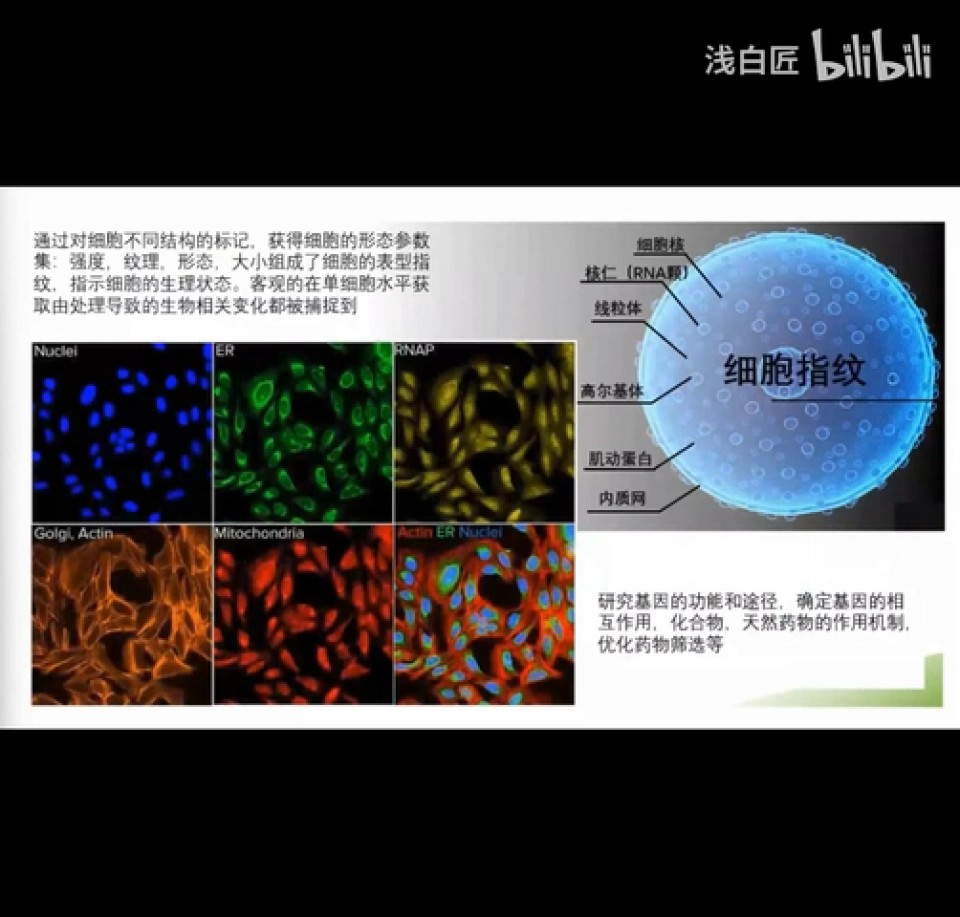

### 2.3 为什么"多染几个通道"值得：加一层染料就多一层判断

视频用了一个很好懂的递进来说明这件事。[【跳转到 10:59】](https://www.bilibili.com/video/BV1oe4y1x7iW/?t=659)

- 如果只用单色的细胞核染料，我只能判断"这是不是细胞"；
- 如果用活细胞试剂去标记，我只能知道"它现在是活的还是死的"；
- 但对它被处理以后的其他变化，我完全没有概念、完全捕捉不到；
- 如果再加上线粒体的染色试剂，我就可以通过线粒体试剂的指征去判断这个细胞的氧化水平；
- 以此类推，加的染料越多，能判断的东西就越多。

这里还可以算一个"简单的乘法"：即使只做一个通道，一个细胞核能识别的指标也非常多——核的大小、面积、圆度、长宽比等等，会有十几到几十个常用指标；做两个通道就是再翻一倍。所以如果真的做到六个通道，**刻画一个细胞特点的指标就会多达上百个**。这时候，细胞经过处理后非常细微的变化也能被捕捉到。

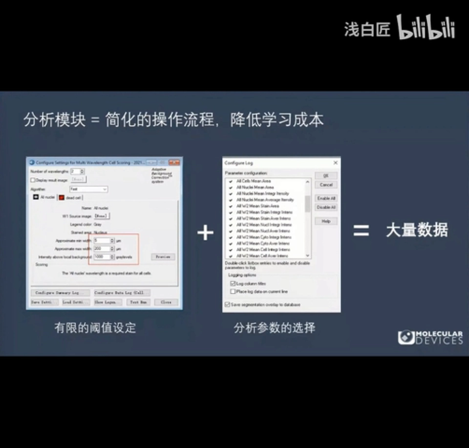

### 2.4 这项技术被用来干什么

视频提到，利用这个方法，现在已经有很多——尤其是国外企业——用它去研究基因的功能通路、确定基因之间的相互作用，或者筛选天然药物化合物、研究它的作用机制、优化整个筛选过程。视频还给了一张统计：从 2000 年以后到 2019 年 7 月（统计截止日期），基于高通量高内涵的文章数量逐年递增，高分文章数量也逐年递增。

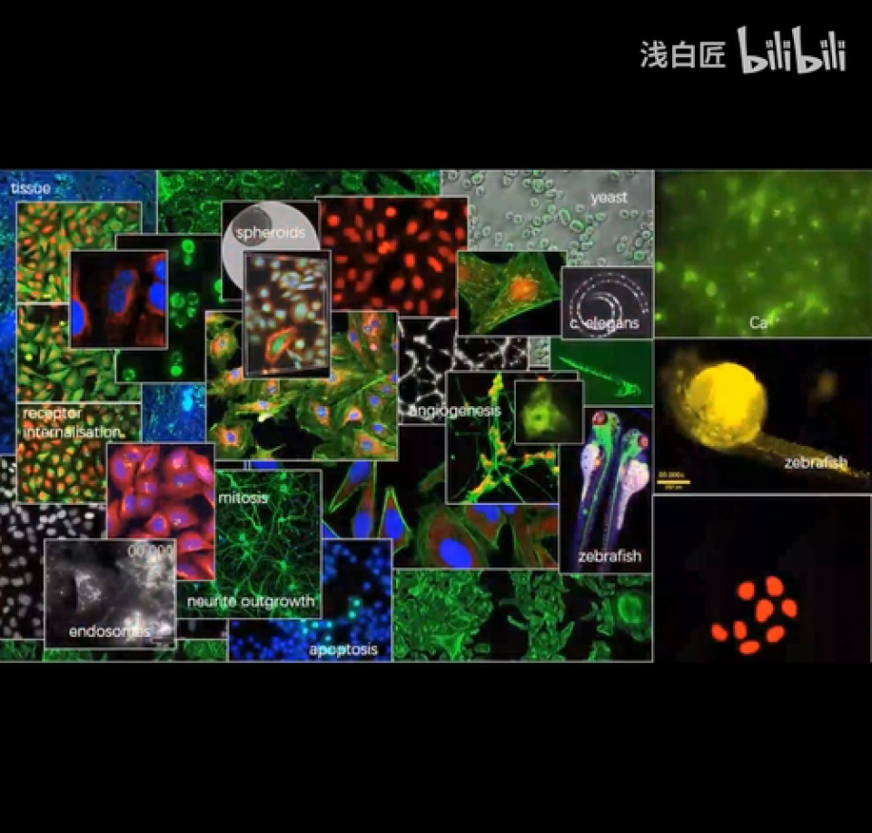

## 三、从图像到数值：一次高内涵实验的完整流程

### 3.1 拍摄与分析的一般流程

视频把流程拆成五步：[【跳转到 14:29】](https://www.bilibili.com/video/BV1oe4y1x7iW/?t=869)

1. **准备样本**：多孔板或者培养皿；
2. **设置拍摄程序**：用几倍镜、拍几个通道、拍终点法还是做活细胞。活细胞涉及在一段时间内连续拍多个时间点，比如两小时拍一次、三小时拍一次，连续拍两天；
3. **自动运行并获取图片**；
4. **用软件分析**：如果觉得某次分析不够准确，还可以重新设置流程再分析一遍；
5. **进一步处理**：数据可以在软件内继续分析，也可以导出到其他线上平台做更高阶的处理，最终得到可以发表的结果。

### 3.2 分割：先找出"一个细胞"在哪里

分析的第一步是把图像里的目标物圈出来。视频展示了成熟分析模块里最简单的做法——**三个参数**：[【跳转到 12:54】](https://www.bilibili.com/video/BV1oe4y1x7iW/?t=774)

- 目标物的**最小宽度**；
- 目标物的**最大宽度**；
- **荧光强度要比背景高多少**。

前两个参数构成一个宽度范围，用来圈定细胞或者细胞核，同时去掉大的杂质、或者细胞裂解以后的小碎片；第三个参数用"比背景高多少"的差值去定位真正想要的目标物。设完这三个参数点预览（preview），如果 90% 的识别都是准的，就可以进入下一步。

### 3.3 选指标：软件已经把参数列好了

既然是细胞核计数或者细胞分类，大家基本上都要分析那几项。为了省掉去第三方平台做二次运算，软件把所有参数都放在一个列表里：细胞的平均面积、核的平均面积、总荧光强度、平均荧光强度，还包括核内、核里的荧光强度，可以做再定位的细致分析。[【跳转到 13:29】](https://www.bilibili.com/video/BV1oe4y1x7iW/?t=809)

要做的只是"选出来到底要哪个参数、把它勾选上"。都勾上得到的更多，当然分析时间也更长。这就是分析模块的特点：简化分析流程，用最简单的学习成本做复杂的图像分析。

### 3.4 遇到个性化需求：自定义模块做"减法"

视频举了两个真实客户的需求，都不属于现成模块：[【跳转到 14:03】](https://www.bilibili.com/video/BV1oe4y1x7iW/?t=843)

- 一个做酵母的客户，处理后酵母里会出现绿色的囊泡荧光点，他想知道**每个囊泡里绿色荧光点的平均数量**；
- 另一个客户，细胞处理后形状改变，长出几个像极点一样的突起，需要统计**每个细胞的平均突起个数**。

这类需求要用自定义分析模块的编辑器。视频特别讲了两个常用技巧：

- **明场反相**。明场里细胞是暗的、背景偏白；荧光里目标物是亮的、背景趋近于黑色。两者正好相反，一个要识别亮的、一个要识别暗的，所以先把明场做反转，让暗的变亮、亮的变暗，才符合识别的规律；
- **做减法得到细胞质**。已经标记了整个细胞的成分，也标记了细胞核的位置，那么"整个细胞扣掉细胞核"剩下的就是细胞质区域，再在这个区域里计算荧光点个数这类参数。

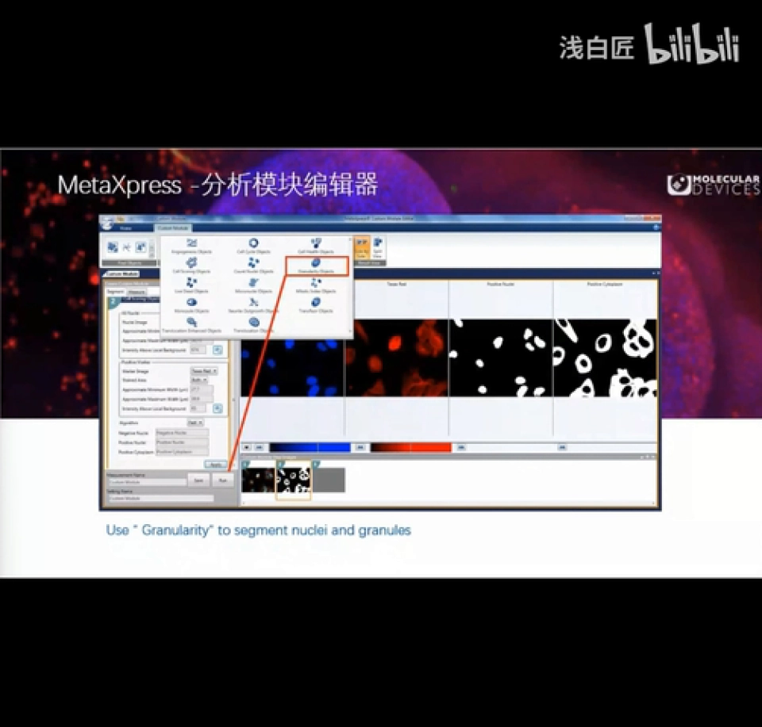

### 3.5 更进一步：把 AI 引进来

视频把 AI 图像分析作为"再进阶一点"的内容介绍。[【跳转到 16:31】](https://www.bilibili.com/video/BV1oe4y1x7iW/?t=991)

前面讲的都是阈值 + 固定参数，参数很少，本意是好的——用最简单的设置完成识别。但参数这么少时，能识别到 90% 的准确性已经算不错了；有一些比较特别的目标，始终无法通过简单的单一参数设定有效识别。

AI 软件的做法是：用绿色的笔标出要分析的 target、蓝色的笔标出要扣除的背景，用更多细胞做训练；训练完以后它在背后分析上百个参数，使用起来很简单，但准确性很准。视频也提醒：没有演示的那么轻松，因为每个细胞形态不同，训练时需要选更多细胞；但它分析的是明场图像——明场本身比较难分析——在这种情况下依然能定位得很精准。

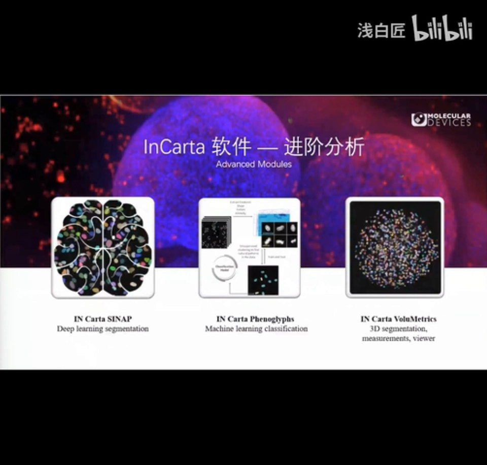

## 四、四个典型读出：形态指标怎样变成生物学结论

视频用四个案例说明"指标算出来以后能回答什么问题"。这四个案例的共同结构是：**染色 → 分割 → 选指标 → 用指标算剂量效应（IC50）或做统计**。

### 4.1 线粒体完整性与膜电位：同一张图，不同指标给出不同 IC50

实验设计：用氧化磷酸化抑制剂 CCCP 与空白对照对比，分别做线粒体染色。图像里核被标记出来（用于准确知道细胞数量），红色是线粒体——放大看，它在每个细胞里都是颗粒状、点状的物质。[【跳转到 17:38】](https://www.bilibili.com/video/BV1oe4y1x7iW/?t=1058)

分析时先识别细胞核（图上绿色部分），再识别线粒体的数量（图上白色的点）。识别有效之后，取四个指标：总的颗粒计数（线粒体总个数）、平均个数、总的线粒体面积、平均荧光强度，分别作为纵坐标计算 IC50。

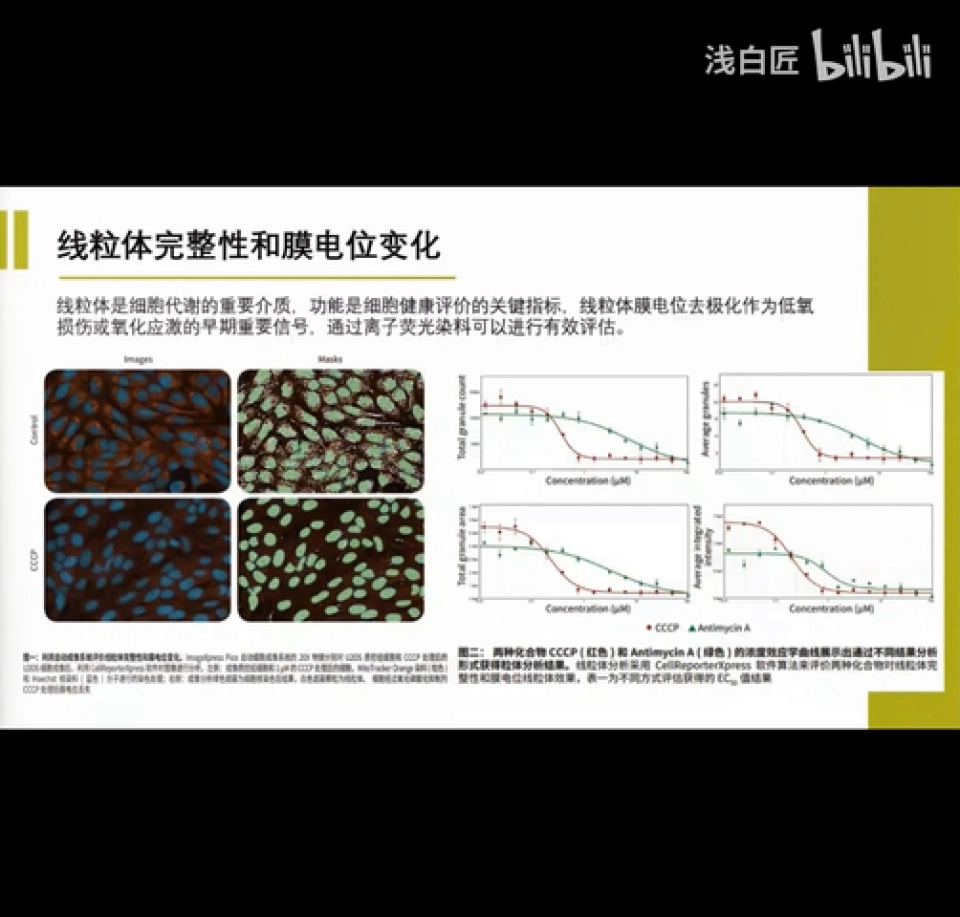

视频在这里点出了本节最重要的一条观察：**用不同的指标去评价同一张图片，得到的药物 IC50 会有变化**。[【跳转到 18:56】](https://www.bilibili.com/video/BV1oe4y1x7iW/?t=1136)

它的启示是：获取的指标越多，越有可能发现以前没发现的东西。如果只分析一个指标，它没效果你就判定它没效果，"其实太片面了"——我们还没有挖掘到更深入的东西。

### 4.2 细胞凋亡：用"凋亡细胞占比"算 IC50

凋亡是程序性死亡过程，面对外界很多压力源，细胞都会做出凋亡响应；凋亡调控过程的破坏与包括癌症在内的很多疾病相关。[【跳转到 19:31】](https://www.bilibili.com/video/BV1oe4y1x7iW/?t=1171)

实验用三种不同的抗肿瘤药物处理细胞，再用三种试剂分别标记：标记核的、标记死细胞的（红色）、专门检测凋亡的（绿色）。软件分别识别之后，计算**发生凋亡的细胞数目占总细胞数目的百分比**，以它作为纵坐标，得到不同抗肿瘤药物的 IC50 曲线。

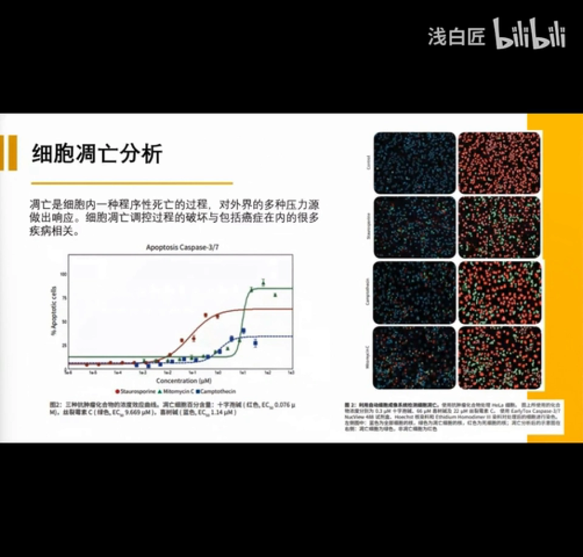

### 4.3 信号转导：YAP 的核转位

第三个案例来自一篇发表在 *Nature* 上的文章，做的是 Hippo 通路——这个通路和肿瘤的无限增殖有密切关系。通路里有一个共转录激活因子 YAP：没有相应刺激时它大多数时候在细胞质里，只有转位到核内以后，才会调控核内相应基因、启动整个通路。[【跳转到 20:26】](https://www.bilibili.com/video/BV1oe4y1x7iW/?t=1226)

图中 NT 是对照组、BM 是处理物。BM 处理以后，YAP 从普遍存在于细胞质的状态逐渐向核内转移，最后基本上百分之百处在核内。定位核的位置靠的同样是核染色（Hoechst）。量化则用专门的蛋白转位分析模块，统计有多少比例的细胞发生了核转位，最后做成柱状图发表。

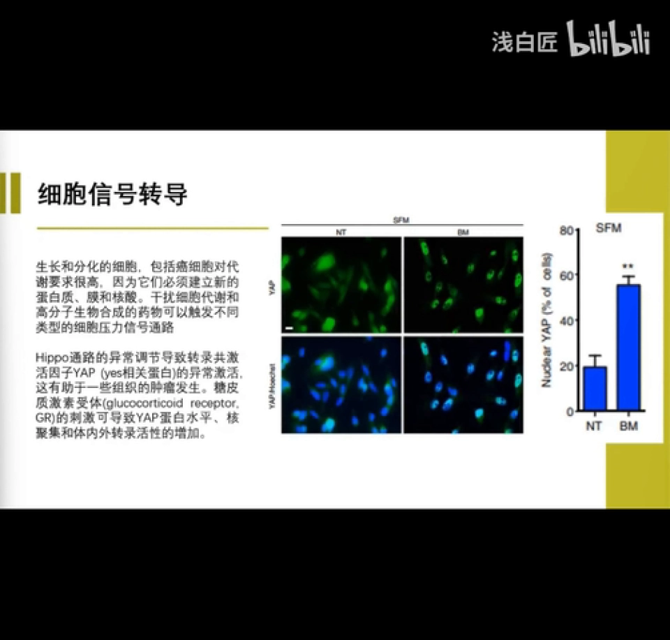

### 4.4 颗粒度分析：蛋白聚集与自噬体

线粒体之所以能用"颗粒"的方式分析，是因为它显示出来的形态特征就是以颗粒形式存在，所以它用的模块也是颗粒度（granularity）分析。视频举的另一个例子是自噬诱导剂/抑制剂的筛选：[【跳转到 21:44】](https://www.bilibili.com/video/BV1oe4y1x7iW/?t=1304)

自噬发生过程中会形成双膜结构的自噬体成分，常见手段是用 GFP 标记 LC3 蛋白来监测细胞内的自噬体。自然情况下自噬体通常弥散在整个细胞质中；用自噬刺激处理以后它开始聚集，体现在荧光上就是出现更多、更密集的绿色荧光点，集中在细胞质当中。所以要判断的就是这些点状蛋白聚集物的个数或者荧光强度的变化。

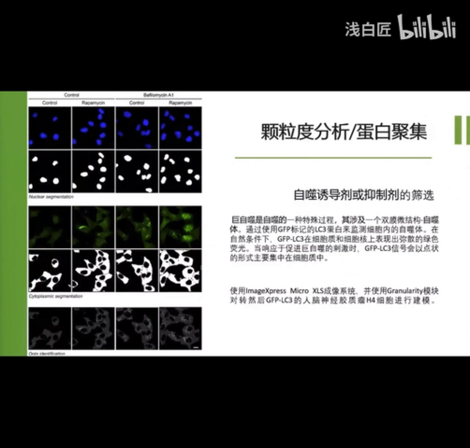

### 4.5 顺带一提：细胞周期也能用颜色读出来

视频最后讲了细胞周期的评价，因为现有缓解肿瘤生长的药物很多和抑制有丝分裂的机制有关。[【跳转到 22:42】](https://www.bilibili.com/video/BV1oe4y1x7iW/?t=1362)

成熟的试剂盒用两个融合蛋白分别标记：这两个蛋白会被 E3 泛素连接酶降解，在不同时期被降解后产生不同颜色——G1 期发红色荧光，S、G2、M 期是绿色荧光，S 和 G2 前期是黄色荧光。通过红绿黄三种颜色的识别判断细胞周期。

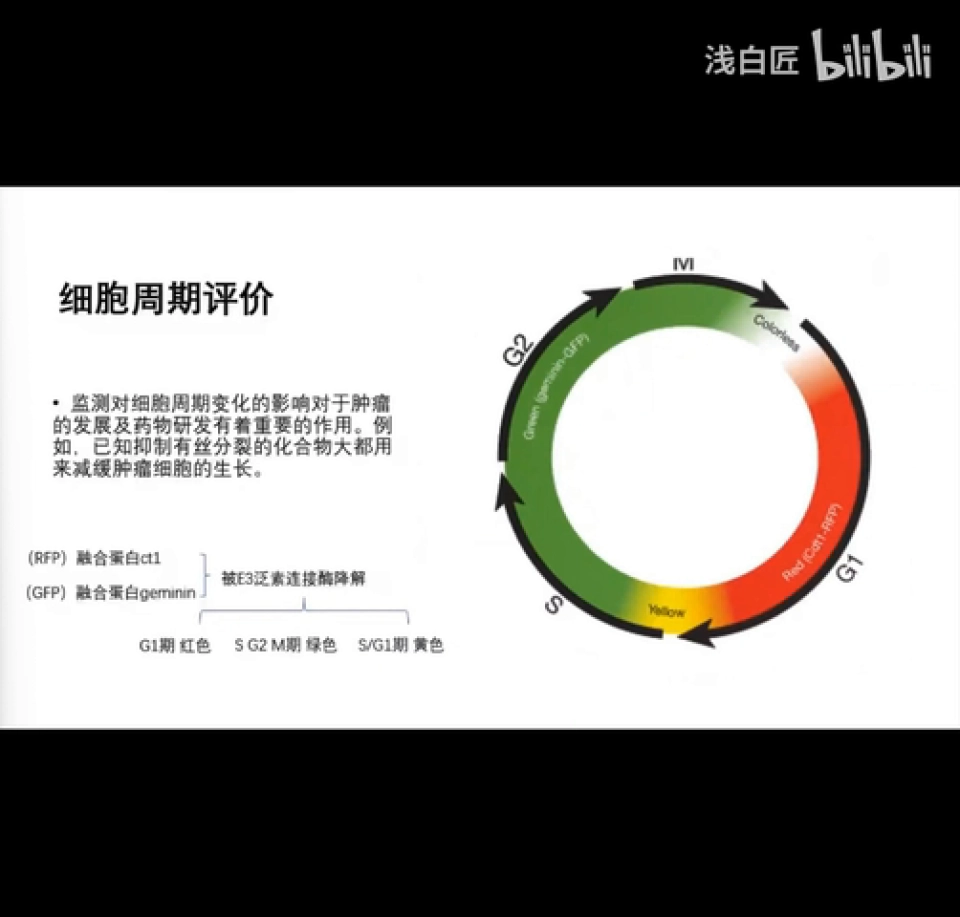

因为细胞周期是过程性实验，这里也用到了活细胞拍摄：把加了细胞周期抑制剂的板子放进高内涵，开启活细胞模块，每隔两到三个小时自动拍一次；连续拍 48 或 72 小时，就能完整观测细胞进行一到两次分裂周期。软件里还有更简单的做法——只做 DNA 染色（Hoechst 或 DAPI），通过 DNA 含量是二倍还是四倍判断细胞周期，但从准确性上讲试剂盒更精准。

## 五、把方法落到自己的实验里：三条可操作的经验

视频没有单列"注意事项"一章，但方法细节里其实藏着三条经验，值得单独拎出来。

**第一，先想清楚要几个通道，再决定染几种。** 指标数是"通道数 × 每通道指标数"这个乘法关系：单通道十几到几十个指标，六通道就是上百个。通道越多，能捕捉的细微变化越多，但染色、拍摄、分析的时间成本也同步上升。

**第二，不要用一个指标下结论。** 线粒体案例里，同一张图换一个指标，IC50 就变了。这既是 Cell Painting 的价值（指标多 → 不容易漏），也是它的使用纪律（只报一个指标的结果不可靠）。

**第三，分割质量决定了后面所有数字。** 三个阈值参数、90% 的识别准确率、明场反相、全细胞减核得到细胞质——这些看起来是"操作细节"，但它们直接决定了后面每一个指标的数值。分析不准确时可以重新设置流程再分析一遍，这一点在高内涵里是常规操作，不是返工。

## 小结

- 高内涵补的是流式和显微镜之间的空缺：流式丢形态，显微镜丢通量，高内涵用自动化孔板拍摄同时保住两者。
- Cell Painting 的核心是**多重染色**：六个染色途径分别标记核、核仁（RNA 类）、内质网、高尔基体、线粒体、肌动蛋白骨架，一次拍摄拿到六类结构的图像。
- 加一层染料就多一层判断；单通道十几到几十个指标，六通道就是**上百个指标**，构成单细胞水平的"形态学指纹"。
- 从图像到数值的链路是：拍摄 → 分割（阈值三参数 / 自定义模块 / AI 分割）→ 选指标 → 算剂量效应或做统计。
- 线粒体案例给出本节最重要的一条经验：**同一张图换一个指标，IC50 会变**；指标越多越不容易漏掉效应，只报一个指标太片面。
- 凋亡、YAP 核转位、LC3 颗粒、细胞周期四个案例说明：只要能用染色标记的结构，都能被转成可统计的数值。
- 这条路线和转录组读出是两种不同的模态：本节讲的是"看形态"，测表达量的那条路线见 4.4.2。

## 关键术语速查

| 术语 | 一句话解释 |
| --- | --- |
| 高内涵成像（High-Content Imaging, HCI） | 用自动化显微镜批量拍摄多孔板，再用软件把图像转成大量定量指标的成像方式 |
| Cell Painting | 2016 年 Broad Institute 提出的多重染色方案，用六个染色通道标记细胞不同结构，得到细胞的形态学指纹 |
| 染色通道（channel） | 一种染料/荧光基团对应的一个成像波段；一个通道对应一类被标记的结构 |
| 图像分割（segmentation） | 在图像里把每个细胞、每个细胞核的边界圈出来，是后续所有定量指标的前提 |
| 形态学指纹（morphological fingerprint） | 一个细胞在多个通道上提取出的上百个指标组成的向量，用来刻画它当前的状态 |
| 颗粒度分析（granularity） | 把细胞内的点状结构（线粒体、自噬体、蛋白聚集体）识别为颗粒，统计个数、面积、强度 |
| 核转位（translocation） | 蛋白从细胞质转移到细胞核内，常用"核内信号 / 全细胞信号"的比例来量化 |
| IC50 | 使某一读出指标变化达到最大效应一半时的药物浓度；换一个读出指标，数值会变 |
| 终点法 / 活细胞成像 | 终点法只在一个时间点固定后拍摄；活细胞成像在培养条件下按时间间隔连续拍摄 |