# 从一张荧光照片到上千个特征：高内涵成像怎样把细胞形态变成可算的数据

> 视频来源：[第十三讲：高内涵成像技术：从一到万——闵明玮](https://www.bilibili.com/video/BV1PdgSzsEHo/)（B 站 · 中国生物物理学会「看见生命力：生物信号标记与显微成像技术」系列课程第 13 讲，约 58 分钟）
> 导读：本文按讲者的技术链路走一遍——一张荧光图为什么是高密度数据、实验设计要控制什么、图像前处理的三项噪声怎么去掉、分割与特征提取怎么做、技术噪声怎么自查，最后用两个案例说明这些特征如何变成生物学结论。讲者开场的主持人介绍与结尾的课外读物推荐本文从略。

## 本讲要解决的核心问题（SCQA）

**背景**：高通量筛选大家都熟悉——多孔板上铺很多细胞，加一个化合物库或 CRISPR 库，用一个读出（通常是 plate reader 读光吸收、荧光强度）判断哪些条件有强变化，这些条件就是 hits。

**冲突**：plate reader 只给一个数。可一个药物或一个基因扰动对细胞做的事情远不止一个数：细胞可能变大了、核变形了、骨架重排了、线粒体碎片化了。这些变化全都在细胞里，但一个读数看不见它们。

**疑问**：能不能把"细胞长什么样"整个变成数据？如果能，一张照片到底能读出多少东西，又怎么保证读出来的数字是可信的？

**回答（中心思想）**：能，而且这正是高内涵成像相对高通量筛选多出来的那部分"内涵"。一张荧光图本质是一个数字矩阵，信息密度极高；经过前处理去噪、图像分割、多尺度特征提取，每个细胞可以提取几百到上千个 feature。但这些特征只有在**先把技术噪声量出来**之后才有意义——讲者用 4i 实验的例子说明：同一抗体在不同轮次染色的皮尔森相关系数在 0.99 以上，才敢把 650 个"没变化"的特征当作细胞状态的定义，进而用它们解释细胞对信号响应的异质性（$R^2 = 0.84$）。

## 一、"内涵"多在哪里：一张图像就是一个高密度矩阵

### 1.1 高内涵与高通量筛选的区别只在"内涵"

讲者先给了一个 AI 画的示意图：一台自动化显微镜、很多多孔板、很多数据——大体抓住了几个关键元件，但整体还是很抽象。[【跳转到 05:09】](https://www.bilibili.com/video/BV1PdgSzsEHo/?t=309)

对生物学背景的学生来说，更熟悉的相关概念是高通量筛选：多孔板 + 一个库（siRNA 库、CRISPR 库或小分子药物库）+ 一个读出仪器（通常是 plate reader）。通过读数做数据分析，得出"大部分干扰条件下细胞没有太大变化，少数干扰条件对读出有非常强的变化"——这些强变化的条件就是 hits。

高内涵跟它的区别，讲者说得很直接：**最大的区别在于所谓的"内涵"**。而高内涵成像的读出实际上就是图像。

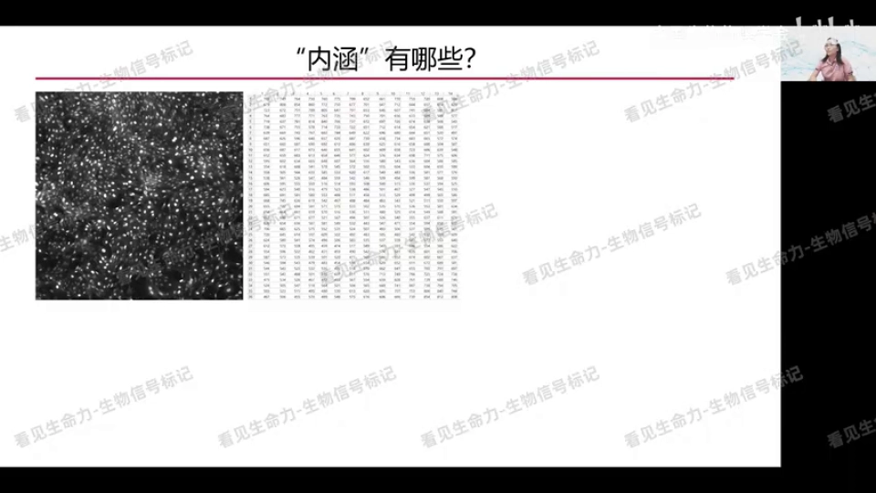

一张图像本质上就是一个矩阵，上面有非常非常多的数字，它实际上是一个**信息密度非常高的信息介质**。

### 1.2 从一张图能读出什么：强度、大小形状、纹理

讲者把可读出的信息拆成几层：[【跳转到 07:25】](https://www.bilibili.com/video/BV1PdgSzsEHo/?t=445)

- **强度（intensity）**：这个通道的荧光有多亮；
- **大小与形状**：细胞或细胞核有多大、什么形状；
- **纹理（texture）**：结构内部亮暗的分布模式；
- 对这些信息都可以做定量统计；
- 对每一个定量参数，自然又会得出它的**平均值**、它**分布的宽度**、**分布的形态**；
- 如果有多个参数，还可以计算它们之间的**相关性**。

而这一切是"对每一个细胞的每个通道"都要做一遍。如果我们对细胞做不同方面的染色，放到不同的荧光通道上——核染色、全细胞染色、线粒体染色、actin 骨架蛋白染色——每个通道都能得到相应的一组信息。这样下来，**每一个细胞可以总结出高达上千个 features**，这就是"高通量之上的高内涵"。

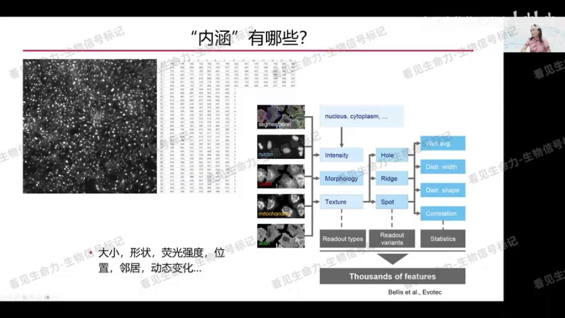

### 1.3 为什么需要它：三个典型场景

讲者给了三个必须用高内涵的场景：[【跳转到 09:07】](https://www.bilibili.com/video/BV1PdgSzsEHo/?t=547)

1. **高通量筛选**。除了用 plate reader 读一个光强，我们可以有上千维度的信息，告诉我们这个药物或干扰条件对细胞产生了什么影响。
2. **研究极少数的细胞亚群**。讲者举了自己实验室的成像结果：最左边 H2B 是一个核标记，标记了视野里所有细胞的核；中间是一个感兴趣细胞状态的 reporter，同一个视野里只有零零星星几个细胞有标记。要研究这种极少数类群，就需要对非常非常大的基数细胞去成像。
3. **需要大量数据才能回答的科学问题**。具体是什么问题，后面用案例回答。

## 二、实验设计：从"1"到"万"，先得把"1"做好

讲者把这个实验称为"从 1 到万"的过程：首先得做好"1"，也就是和其他成像实验一样需要考量的那些事情。[【跳转到 10:36】](https://www.bilibili.com/video/BV1PdgSzsEHo/?t=636)

### 2.1 选择细胞和读出

- **细胞类型**：很大程度上取决于具体的科学问题；
- **细胞数量**：高内涵还要考虑数量的限制。比如用原代细胞，来源数量非常有限，对高通量筛选来说细胞量会是一个瓶颈；
- **培养方式**：平铺的平板培养，还是长在 3D 的 Matrigel 环境里，还是悬浮培养——这是实验设计一开始就要考量的；
- **标记方式**：染色标记、抗体标记，还是遗传编码的荧光蛋白标记；
- **处理过程**：染色标记需要染色过程，抗体标记需要抗体孵育过程。相比普通成像实验，这一点尤其要考量——因为通量特别高时，每一步处理都要花非常多时间，怎样优化整个处理过程就变得非常重要；
- **读出参数**：针对每个科学问题设计读出参数，而读出参数直接决定接下来怎么选成像系统。

### 2.2 一个容易被忽略的细节：培养板平不平

讲者用一组对比图说明这件小事有多致命。[【跳转到 13:20】](https://www.bilibili.com/video/BV1PdgSzsEHo/?t=800)

对普通成像实验，选普通玻璃板就行，视野不大时板子不够平影响也不大。但高内涵通常需要非常大的视野，很多条件下还需要多点视野，于是：

- 用高平整度玻璃板拍出来，整个图像比较 flat，不管哪个位置成像基本都在焦平面上；
- 用常见的塑料板拍，靠图像上部的细胞还比较清楚（in focus），但图像下部、尤其右下角的细胞就"拍糊了"，不在焦平面上。

讲者的结论很硬：**如果这种情况出现在高内涵成像实验里，这个数据是很难被使用的**。

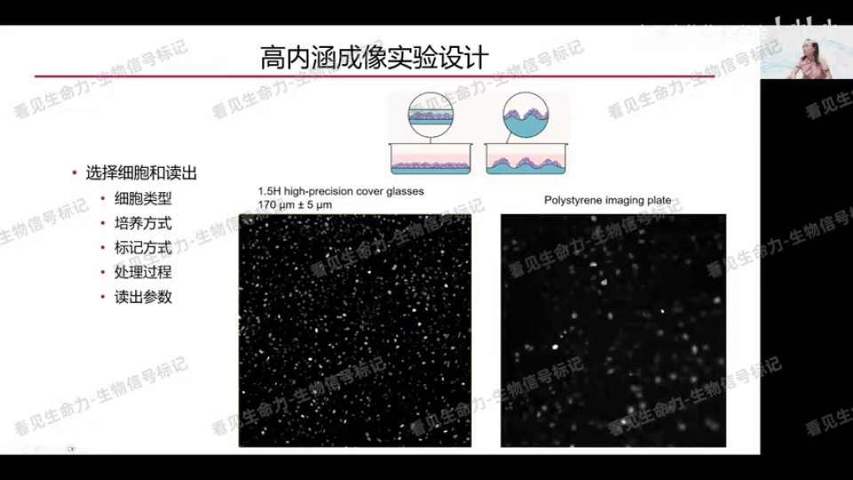

### 2.3 选择成像系统与成像参数

- **宽场荧光显微镜**：高内涵荧光成像里最常用，好处是速度非常快，可以很快扫很多视野；
- **共聚焦显微镜**：要看比较精细的细胞结构、或者 3D 结构时用。高内涵里点扫描共聚焦用得相对少（成像速度限制），大多数是转盘共聚焦；
- **光片显微镜**：优势也在拍摄速度非常快，而且有天然的光切片效果。

成像参数也是重要考量：拍固定细胞时希望信噪比最佳——信号尽量强、背景尽量弱，为此会尽量提高曝光量；但如果设计的是活细胞实验，就要权衡曝光量和细胞的生长等条件。环境控制对活细胞实验也很重要。

讲者给了一个"基本要求"：成像系统必须**可以编程、自动化**，需要有自动化的 stage、可编程的光控，整个系统可以处在自动运行的状态里。

## 三、图像前处理：把三种噪声从原始图像里剥掉

讲者说，选择细胞和选择成像系统这两块跟其他成像实验有很多共通之处；而**图像处理这一块，可能是高内涵成像实验非常有特点的环节**。[【跳转到 17:17】](https://www.bilibili.com/video/BV1PdgSzsEHo/?t=1037)

直接从显微镜下来的原始图像，实际上是一个混杂结果：相机噪声、照明偏差、背景，加上我们真正想看到的成像对象荧光。目标是还原真实图像，而三种噪声的去除方式各不相同。

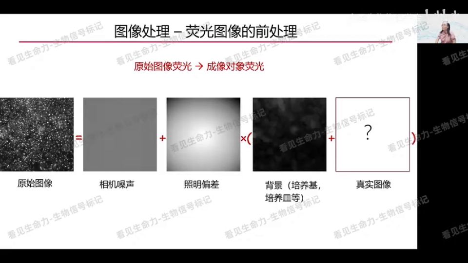

### 3.1 相机噪声：直接减

把显微镜的光全部关掉、把镜头盖起来拍一张图，拿到图像编辑软件里打开，可以看到它每个点其实都有数值——这个数值跟光路完全没关系，完全来自相机。这个噪声是**叠加**在真实图像上的，所以直接减掉就可以。

### 3.2 照明偏差：要用除

拍一个没有细胞的视野、把对比度调得特别强，可能会发现视野中间比旁边、比四个角亮很多——特别是物镜倍数比较低、视野非常大时。这就是照明偏差：视野特别大时很难取得非常均匀的同强度照明。去看数值，视野足够大时中间的荧光强度甚至可以达到角上的两倍甚至更多。

关键在于它的叠加方式：照明偏差是以**增益**的形式叠加在真实图像上的。如果不去矫正，同一个细胞出现在图像中间和出现在边角，它的荧光强度定量就会有非常大的差异。因为它是乘上去的，去除的时候就要用**除**。

### 3.3 背景：培养基和培养皿的荧光

培养基、培养皿等等在光路上，但不是真实成像对象，它们产生的荧光同样以叠加的形式存在，用减法去掉。

三项处理完，才还原出真实的荧光图像。

## 四、分割：从"分水岭"到深度学习

得到真实图像之后，下一步是对关注的物体做图像分割——这里通常关注的单元是一个细胞。[【跳转到 21:02】](https://www.bilibili.com/video/BV1PdgSzsEHo/?t=1262)

讲者把这个领域的历史讲得很清楚：

- **早期经典方法**：分水岭（watershed）、二值化之类。这是一个很有历史的领域，对计算机视觉来说都是非常经典的方法；
- **现在**：慢慢都被基于深度学习的方法取代了，比如 **Cellpose** 和 **StarDist**，这两个是近几年刚出来的基于深度学习的细胞分割方法，对常见的细胞分割能取得非常好的效果；
- **SAM 及其衍生**：近一两年来 Meta（Facebook 那家公司）出了 Segment Anything Model，这个分割方法也被做生物研究的实验室改造成专门分割细胞的方法（如 CellSAM），分割效果也可以达到非常好。

讲者没有展开原理，只给了一个实用结论：这几个方法在他们自己的测试中都能达到比较好的分割效果，一般的分割任务都没有问题。

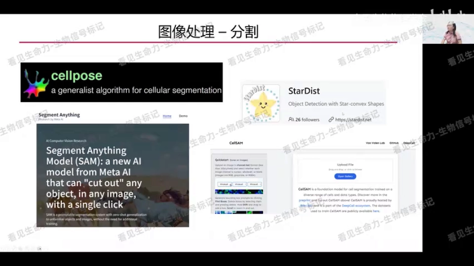

## 五、特征提取：同一个细胞，三个尺度

分割完之后是提取特征。讲者用 4i 实验的例子说明，特征可以按尺度分三层：[【跳转到 26:51】](https://www.bilibili.com/video/BV1PdgSzsEHo/?t=1611)

- **cellular scale（细胞层面）**：每一种染色的 morphology、形状、大小、荧光强度；
- **multicellular scale（多细胞层面）**：它有多少邻居、邻居长什么样、和它直接接触的细胞是怎么样的；
- **subcellular scale（亚细胞层面）**：比如特别关注它的线粒体，那线粒体的模式是什么样的、纹理是什么样的、形状是什么样的。

对每个细胞，可以提取**几百上千个**这样的信息。

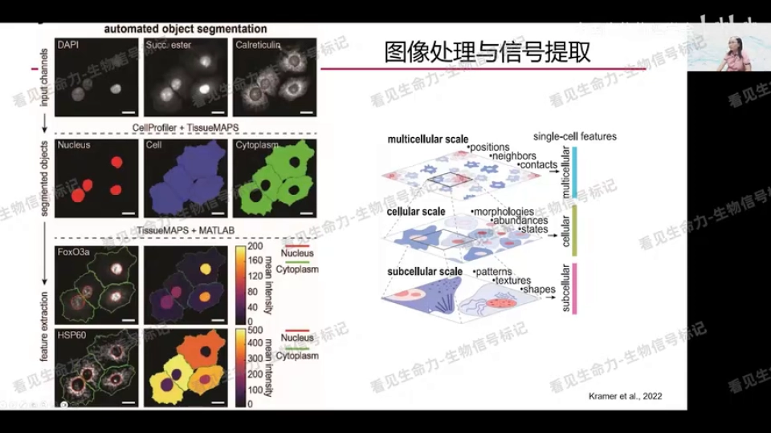

## 六、案例一：4i 空间蛋白组学——先量噪声，再谈细胞状态

### 6.1 科学问题与实验设计

这个研究是两年前发表在 *Cell* 上的一篇工作，来自 Lucas Pelkmans 实验室，想回答一个很基础的问题：**细胞状态怎样影响细胞对信号的响应**。[【跳转到 23:11】](https://www.bilibili.com/video/BV1PdgSzsEHo/?t=1391)

实验系统是对 EGF 响应的生长因子信号：人的乳腺上皮细胞先饥饿 12 小时（去除血清、去除所有生长因子），让细胞处于饥饿的静息状态；然后加 EGF 诱导 5 分钟（加不同浓度），再固定。

### 6.2 用 4i 把 28 个抗体打到同一批细胞上

要同时描述"细胞状态"和"细胞响应"，他们做的其实是一套空间蛋白质组学：对细胞做 28 个抗体的染色，分多轮进行，用的是所谓的 **4i 体系**——每一轮对三个抗体染色，染完之后全部洗脱，洗脱完再进行下一轮；这么多轮的图像可以对齐在一起，对应到每一个细胞，你就有 30 个不同的染色通道。[【跳转到 24:23】](https://www.bilibili.com/video/BV1PdgSzsEHo/?t=1463)

- 第一轮：磷酸化 S6、磷酸化 ERK，以及一个 FOSL 家族的蛋白；
- 下一轮把这三个抗体洗脱，再染另外三个不同抗体；
- 以此类推，一共 20 轮染色加洗脱的循环。

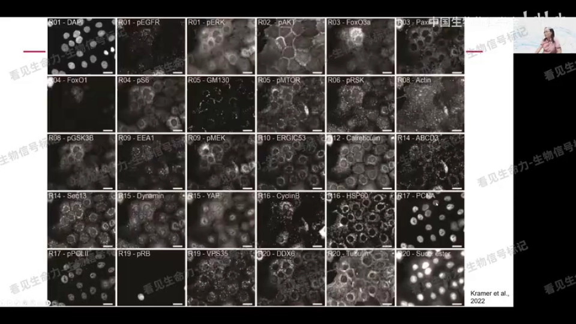

### 6.3 分割：核、细胞、细胞质三块怎么来

对每一个视野：因为有 DNA 染色，可以把细胞核分割出来；又因为有一个全蛋白的荧光染色，可以通过它把整个细胞分割出来；**整个细胞减去细胞核，剩下的就认为是细胞质**。这就是他们对图像的分割过程。[【跳转到 25:47】](https://www.bilibili.com/video/BV1PdgSzsEHo/?t=1547)

有了分割，就可以针对每个抗体染色提取对应区室的信号：比如 FOSL 家族的蛋白主要在核内定位，就提取它在核内的荧光强度；HSP60 主要在细胞质、可能内质网上比较多，就提取它在细胞质里的荧光强度。

### 6.4 质控：先知道技术噪声有多大

讲者强调，对高通量实验首先要非常小心做的一件事就是**自控**：需要理解这个系统里技术噪声有多少，只有知道了技术噪声，才知道什么样的差异是真正的信号。[【跳转到 27:56】](https://www.bilibili.com/video/BV1PdgSzsEHo/?t=1676)

他们做了两件事：

1. **同一抗体在不同轮次染色**。比如第一轮染磷酸化 ERK、第七轮再染磷酸化 ERK、第 13 轮再染一次，三次结果的相关性非常好，**皮尔森相关系数都在 0.99 以上**（幻灯片上三个对比分别是 0.9986、0.9987、0.9991，$n = 119{,}588$ 个细胞）。所以不管在哪一轮染，对染色结果可以说几乎没有影响。
2. **不同生物学重复之间的重叠度**。磷酸化蛋白在不同生物学重复里的重叠度非常高，其他染色对象的重复性也基本在 0.9 左右。

结论是：在他们这个体系里，技术噪声非常低。

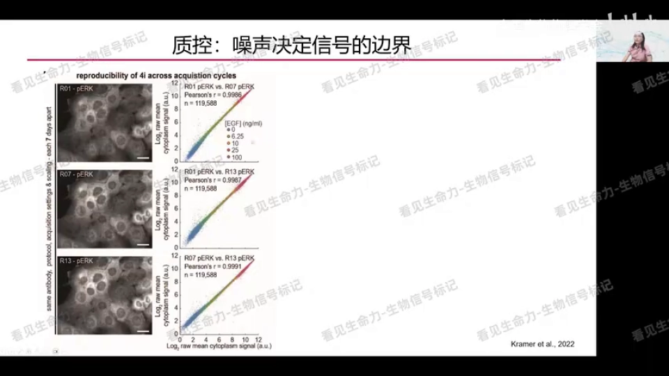

### 6.5 用时间尺度分离，把特征分成"响应节点"和"状态节点"

做完校正和确认，才能回答科学问题。他们发现有一些元件——磷酸化 S6、磷酸化 ERK、FOSL 家族的蛋白——在加 EGF 之后 5 分钟之内就有非常剧烈的变化，这些是**细胞响应的节点**，直接响应 EGF 刺激；而大部分其他的抗体染色，包括 HSP60、Sec13 等，在 5 分钟之内基本没有变化，不管 EGF 刺激多强，这些可以认为**表征了细胞的状态**。[【跳转到 29:38】](https://www.bilibili.com/video/BV1PdgSzsEHo/?t=1778)

讲者把这个做法称为 **time scale separation（时间尺度的分离）**：在同一个抗体染色实验里，用响应快慢把信号响应节点和细胞状态节点区分开。

把每个细胞可以提取的成百上千个 feature 都画成这样的图，看它在 5 分钟之内到底有没有变化，结果是：**650 个特征基本没有变化**；而有变化的那些——磷酸化 ERK、磷酸化 AKT、磷酸化 S6 等等——基本上都是磷酸化位点，是对 EGF 直接响应的已知节点。

### 6.6 650 个特征定义细胞状态，再解释响应的异质性

既然 650 个特征在 5 分钟内不变，就可以用它们去定义细胞状态。把这 650 个特征做降维（UMAP），高维数据降到二维之后可以看到：这些细胞状态有一定的异质性，而且分成了两大块。[【跳转到 31:41】](https://www.bilibili.com/video/BV1PdgSzsEHo/?t=1901)

接着把状态和响应关联起来。对磷酸化 ERK 这个响应节点，响应本身有非常强的异质性：比如 6.25 纳克每毫升这个比较低的 EGF 浓度下，有一些细胞几乎没有变化，而有一些细胞的磷酸化 ERK 变得非常非常高。

那这种异质性是不是跟细胞状态的差异有关？他们做了一个简单的回归分析：能不能把这 650 个 feature 通过线性方式组合起来，去预测磷酸化 ERK 的强度？结果是可以，而且相关性非常强，**$R^2$ 达到 0.84**——也就是说，磷酸化 ERK 强度差异里有 84% 可以通过这 650 个 feature 所代表的细胞状态来解释。

因为是一个线性组合，还可以反过来看哪些特征贡献最大：对磷酸化 ERK，**local cell density（局部细胞密度）**的影响非常大，另一个特征（Sec13）的影响也非常大；这两个特征在 UMAP 上的分布，跟磷酸化 ERK 有非常一致的 pattern。

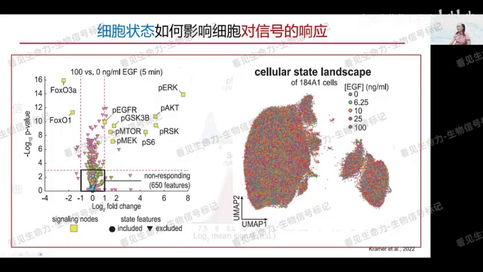

## 七、案例二：活细胞高内涵——多一步追踪，多一个时间维度

### 7.1 从手绘到高通量

讲者插了一段历史：100 多年前科学家 Margaret Lewis 用普通明场显微镜观察细胞，每小时手绘一张细胞的图——这大概是第一个活细胞延时成像的数据。哪怕是这样粗糙的成像（眼睛成像 + 手绘制），也能看出细胞核相对比较 inert、是一个稳定状态，而那些分叉的条条（线粒体）是动态变化的。这显然是一个低通量的成像。[【跳转到 34:58】](https://www.bilibili.com/video/BV1PdgSzsEHo/?t=2098)

现在可以做到高通量的活细胞延时成像。讲者举了自己实验室的数据：气道的基底干细胞处于气液界面培养状态，表达了细胞核标签 H2B（连了近红外荧光蛋白）和 53BP1（表征 DNA 损伤的活细胞 reporter）。这个实验拍了 **107 个小时**（将近四天半），单个视野 **1.8 毫米 × 1.8 毫米**，一次实验可以拍上百个甚至几百个这样的视野。

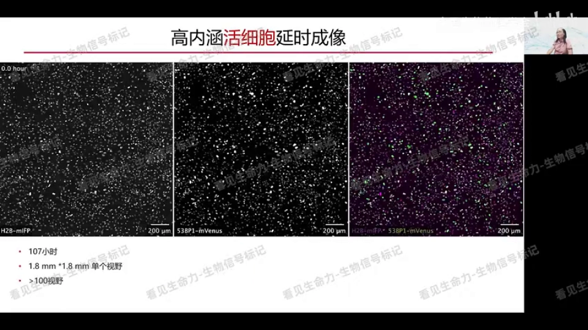

### 7.2 活细胞比固定细胞多出的三件事

- **标记**：活细胞必须有活细胞的标记物，要么是染料，要么更常见的是遗传标记的荧光蛋白连一个 reporter；
- **环境控制**：长时程活细胞成像需要近乎完美的生长环境——严格的温度、湿度、二氧化碳含量控制，跟培养箱基本没有区别；
- **光毒性**：成像的曝光量要远远高于我们平时站在太阳光下的曝光量，荧光成像多多少少会产生光毒性。所以要平衡图像质量和对细胞状态的维持。讲者的经验是：活细胞成像不一定追求最漂亮的图像，而是在"漂亮"和"细胞能健康增殖、移动、活下来"之间找平衡点，而且大部分场景下这是经验性的。

### 7.3 分析多一步：细胞追踪

活细胞成像的分析，除了前处理、分割、信号提取，中间还多了一个非常重要的过程——**细胞追踪（track linking）**。只有通过追踪，才能从高内涵活细胞成像里得到细胞谱系的信息，以及谱系里每一个细胞特定特征的动态变化。[【跳转到 39:21】](https://www.bilibili.com/video/BV1PdgSzsEHo/?t=2361)

讲者对两个问题的成熟度判断很有意思：**细胞分割**这个问题，他觉得大体上已经解决了；而**细胞追踪**还是一个老大难问题。领域里有 Cell Tracking Challenge（有点像蛋白结构预测的那个 challenge），不同实验室不断推出新方法。难点很大程度上在于细胞会分裂——这跟计算机视觉里的物体追踪有一个很大的区别：细胞可以分裂，而这是追踪里比较难完美解决的问题。

## 八、案例三：一次全基因组形态学筛选能做什么

### 8.1 2010 年的经典：20 亿个细胞核的形态分类

讲者举的经典例子是 2010 年 Jan Ellenberg 实验室的工作，他觉得到现在也是领域里比较经典的、利用高内涵成像得到生物学知识的例子。[【跳转到 40:44】](https://www.bilibili.com/video/BV1PdgSzsEHo/?t=2444)

他们做了一次全基因组的 siRNA screen——把全基因组每个基因敲一遍，敲完以后对这些 HeLa 细胞拍了一个 movie，细胞有细胞核标记。通过这些标记，可以把经历了 siRNA 处理的细胞核做**形态学上的分类**：

- 一共统计了将近 **20 亿个细胞核**（幻灯片上写的是 1,918,544,775 个实验细胞核、187,226 个 movie）；
- 分成十几类特征：大部分正常的（interphase control，占 82.2%），以及一些非常奇怪的，比如葡萄状（Grapes，占 16%）、多核（Polylobed）、凋亡（Apoptosis）、有丝分裂各期（Metaphase、Anaphase）等等；
- 对这些不同的形态分类，还可以在时间上做定量统计。

讲者举了其中一个例子：灰色框里这个细胞即将分裂，分裂过程中努力尝试之后还是分裂失败了，最后形成了所谓葡萄状的细胞核——这是他们十几类特征里的一个。

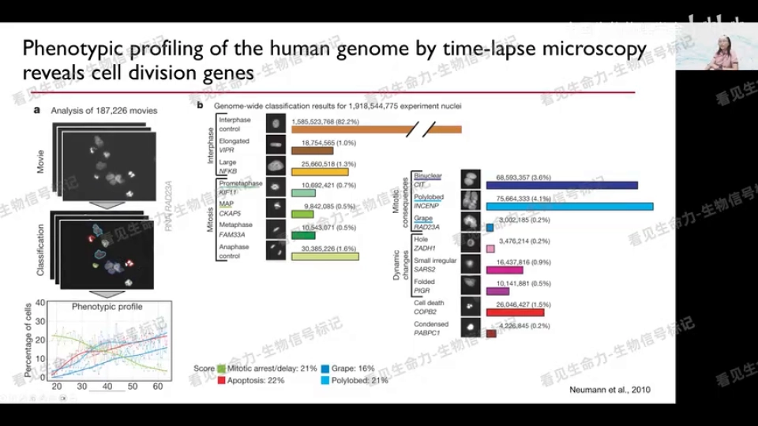

对应地，他们在这个 screen 里发现了 1000 多个可能对细胞分裂有比较大影响的 siRNA 敲除，并对其中的一些 hits 做了二级 screen 验证。

讲者还讲了一段个人感受：这个工作出来的时候他刚开始读博，博士课题也是做细胞分裂，当时最大的感受是"就像现在看到机器人把一个博士生几年的工作在几天里做完一样"——感觉他们一个工作可能把几百个做细胞分裂的实验室的工作一下子全部做完。以现在的标准看这个工作可能比较中规中矩，但当时确实非常震撼：不只是 screen 的规模和尺度，也包括他们背后开发的追踪、分割、分类这些细胞形态的工具。

### 8.2 不是只有"财大气粗"的实验室才能做

看完这个例子很容易产生一个误解：高通量活细胞成像是不是只有能做大规模成像、财大气粗做 screen 的实验室才能做？讲者的回答是"实际上也不是"，并给了自己的工作作为反例。[【跳转到 44:16】](https://www.bilibili.com/video/BV1PdgSzsEHo/?t=2656)

他们问的是一个非常基础的细胞生物学问题：**细胞怎样决定自己要不要增殖**？这是一个长期被关注、也有很多答案的问题——分裂素、营养、有没有空间等等，都起作用。在哺乳动物这样的多细胞生物里，分裂素信号可以说是最重要的信号之一。

以 MAPK 通路为例：EGF 结合到细胞膜上的受体之后激活一系列激酶，这些激酶去磷酸化一些转录因子，激活的转录因子再转录细胞周期相关的蛋白，最后激活 **CDK2**。CDK2 在增殖决定里可以说是一个开关：CDK2 一旦激活，细胞往往就决定要分裂，会走完一整个细胞周期——哪怕在走的过程中分裂素信号已经不存在了。

### 8.3 一个动态的问题：教科书说 G1 期感受信号，真的吗

整个通路研究了几十年，元件大家都很清楚。于是有人会问：这不是已经回答的问题吗？[【跳转到 46:23】](https://www.bilibili.com/video/BV1PdgSzsEHo/?t=2783)

但讲者提出了一个动态的问题：在体内，细胞见到的分裂素信号都是一会儿有一会儿没有的，很多时候并不是持续存在或持续不存在。对这种动态信号，细胞怎样解读它到底要不要增殖？

时间尺度上有一个巨大的落差：信号从细胞膜传到最后一个磷酸化蛋白只需要 **3 分钟**；而细胞要每十多个小时才经历一个细胞周期、才需要做一次决定。短时程的信号传导，怎么影响长时程的细胞命运决定？

翻教科书，它会说分裂素信号通常只在 **G1 期**起作用：细胞只在 G1 期这个很短的时间窗口上感受有没有分裂素信号，有就增殖、没有就不增殖。20 多年前科学家 Dennis Stacey 测试过这个说法：把分裂素信号阻断，发现如果在 G1 期阻断，细胞还是会增殖；只有当在前一个细胞周期的 G2 期之前阻断，它才会进入静息期。由此他得出结论：不是 G1 期在感受信号，细胞实际上是在前一个细胞周期的 G2 期感受信号。

这个结果后来被 Spencer 等人的工作用高通量活细胞成像验证了，现象确实成立。但讲者指出，这个现象背后其实有**两个变量**：一个是 G2 期，另一个是**阻断的时长**——所有增殖的细胞，阻断时长都比较短；没有增殖的细胞，阻断时长都非常长。于是可以提出两个模型：

- **G2 期窗口模型**：细胞在 G2 期这个特定窗口感受分裂素信号是否存在；
- **持续感应模型（continuous sensing）**：细胞持续不停地感受，整合的是分裂素信号存在的时间长度。

### 8.4 用 3 小时抑制把两个模型分开

两个模型给出的预测在质上不同：[【跳转到 49:29】](https://www.bilibili.com/video/BV1PdgSzsEHo/?t=2969)

- 如果 G2 期模型成立：抑制 3 小时，只有在 G2 期抑制时增殖概率才会下降；抑制更长时间同样不影响，只有当抑制时间段涵盖了 G2 期窗口，增殖概率才会下降；
- 如果持续感应模型成立：不管什么时间去抑制，都会有不同程度的下降；抑制时间越长，下降越多。

实验需要一个增殖读出。讲者用的是 **CDK2 活性探针**：CDK2 的一个底物连了荧光蛋白，没被磷酸化时在细胞核里，被磷酸化之后慢慢从细胞核转移到细胞质——S 期一半一半，G2、M 期基本在细胞质。所以只要计算细胞质与细胞核的荧光强度之比，就得到一个连续的 CDK2 活性读数：

$$
\text{CDK2 activity} = \frac{\text{cytoplasmic intensity}}{\text{nuclear intensity}}
$$

每一次细胞周期，这个读数都会出现一次 oscillation。

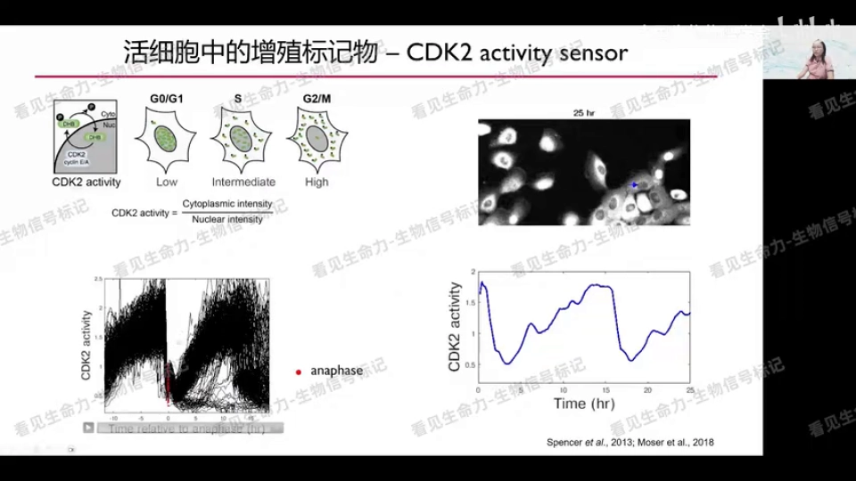

做高通量活细胞成像实验，可以得到很多很多这样的 trace。把它们在计算上对齐到有丝分裂的那一点（染色体分开的 anaphase），会明显分成两个类群：大部分细胞刚分裂完 CDK2 活性就开始上升——这是增殖细胞；少部分细胞分裂完之后保持 CDK2 活性比较低的状态——这是静息期细胞。

### 8.5 结果：上游持续感应，下游是窗口

在不受干扰、没有被同步化的正常生长细胞里加 MEK 抑制剂（MAPK 通路抑制剂），加 3 小时，然后按细胞所处的细胞周期阶段分组统计：[【跳转到 53:02】](https://www.bilibili.com/video/BV1PdgSzsEHo/?t=3182)

- 在 **G1 期**接受到抑制的细胞，**75%** 会进入增殖状态——和 Dennis Stacey 的实验一致，大部分细胞和对照差不多，在 G1 期接受抑制后增殖不受影响；
- 在**前一个细胞周期 G2 期**接受了抑制的细胞，只有 **45%** 会继续增殖；
- 但这两点还不能区分两个模型，因为两个模型都说在 G2 期加抑制剂会影响下一个周期的增殖；
- 而 **S 期和 G1 期**加抑制剂，增殖概率还是下降的。

把每一个时间点都这样挑出来、连成一条线，会发现：在不同的细胞周期加 MEK 抑制剂都会影响增殖概率。一眼看上去和持续感应模型非常相似；而且减少抑制时间影响小一些、增加抑制时间影响大一些——这和 continuous sensing 模型的预测一致。也就是说，**上游这个激酶是被持续感应的**。

那下游是不是也这样？比如 CDK4/6（CDK2 的前一步），讲者说其实不是：CDK4/6 呈现一个窗口的特性，而且通过计算发现，它的窗口并不是 G2 期，而是在前一个细胞周期的 **G1 期**。

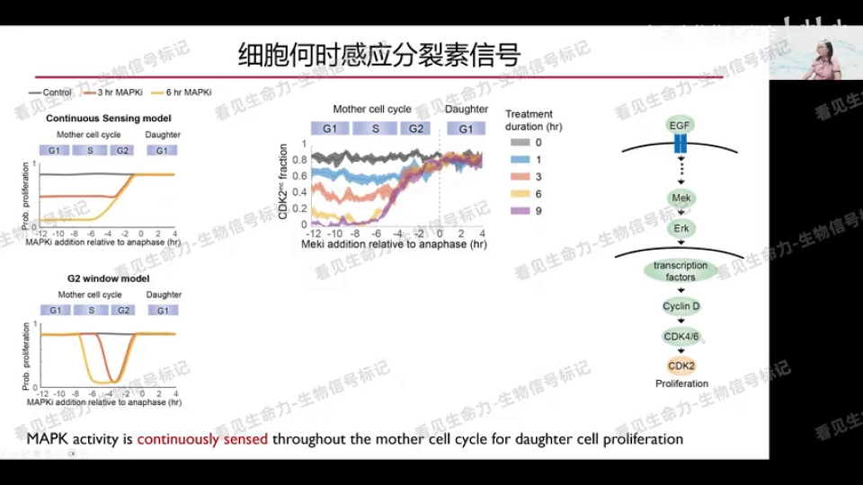

由此得出的结论是：细胞感应分裂素信号的活性，就像**用一个桶接水**——接够一定阈值、接够一定重量，就可以激活 CDK4/6，推动细胞进入细胞周期。

## 九、讲者的总结：从一到万，不只是量变

讲者最后把整场讲座收束成两层意思。[【跳转到 56:44】](https://www.bilibili.com/video/BV1PdgSzsEHo/?t=3404)

**第一层，关于方法的价值。** 这个研究是一个比较典型的例子，说明我们在生物学研究中习惯去找基因、找蛋白、找通路，觉得弄清楚了一个系统的构成，就知道它是怎样工作的；而如果我们不只把生命体看作一个个元件，而是看作一个个过程，那么对一些很基础的过程，我们的理解还是非常有限的。成像其实是帮助我们**从过程的角度**去理解生命体的一个不可替代的手段。

**第二层，关于"从一到万"。** 高通量成像虽然说是"从一到万"，但不只是量变，其实也可以说是质变——它可以回答很多"一"不能解决、只有通过"万"才能解决的问题。同样从实验设计角度，从一到万不只是把"一"重复一万次，里面需要注意的很多是对实验变量的控制，这是非常特殊的。

## 小结

- 高内涵与高通量筛选的区别在"内涵"：读出从"一个光强"变成"一张图像"，而图像本质是一个信息密度极高的数字矩阵。
- 一张图能读出强度、大小形状、纹理，再叠加均值、分布宽度、分布形态、参数间相关性；对每个细胞的每个通道都做一遍，就是几百到上千个 feature。
- 实验设计要先做好"1"：细胞类型与数量、培养方式、标记方式、处理流程、读出参数，以及容易被忽略的培养板平整度——塑料板边缘失焦的数据在高内涵里是不能用的。
- 图像前处理要分别处理三种噪声：相机噪声（减）、照明偏差（除，因为它是增益）、背景如培养基与培养皿（减）。
- 分割从分水岭、二值化走到 Cellpose、StarDist 和 SAM 衍生方法；讲者的判断是分割大体已解决，追踪（尤其细胞分裂）仍是老大难。
- 特征按三个尺度提取：细胞层面（形态、大小、强度）、多细胞层面（邻居数量与接触）、亚细胞层面（线粒体等结构的模式与纹理）。
- 4i 案例的方法论价值最高：先用同一抗体跨轮次染色（$r > 0.99$）与生物学重复（约 0.9）量出技术噪声，再用时间尺度分离把特征分成响应节点与 650 个状态特征，最后用状态特征解释响应的异质性（$R^2 = 0.84$）。
- 活细胞高内涵多出标记、环境控制、光毒性三件难事，分析上多一步细胞追踪。
- 2010 年的全基因组时差成像筛选（19 亿个细胞核、十几类形态）说明形态学特征可以撑起全基因组尺度的表型分型；而讲者自己的工作说明小规模实验同样能回答基础问题。

## 关键术语速查

| 术语 | 一句话解释 |
| --- | --- |
| 高内涵成像（High-Content Imaging） | 自动化显微镜批量拍摄多孔板，再用软件把图像转成大量定量指标的成像方式 |
| 内涵（content） | 相对高通量筛选的"一个读数"，指一张图像里可以挖出的上千维信息 |
| 前处理（preprocessing） | 去除相机噪声、照明偏差、背景，还原真实荧光图像的过程 |
| 照明偏差（illumination bias） | 大视野下中间亮、边角暗的不均匀照明，以增益形式叠加，需用除法校正 |
| 图像分割（segmentation） | 把每个细胞、细胞核的边界圈出来；Cellpose、StarDist、SAM 是当前常用方法 |
| 特征（feature） | 从分割后的对象上算出的一个数值指标，如面积、平均强度、纹理参数 |
| 多尺度特征 | 细胞层面（cellular）、多细胞层面（multicellular）、亚细胞层面（subcellular）三类特征 |
| 4i（iterative indirect immunofluorescence） | 多轮"染色—成像—洗脱"的抗体标记体系，一轮三个抗体，可把几十个蛋白打到同一批细胞上 |
| 时间尺度分离（time scale separation） | 用响应快慢区分"信号响应节点"与"细胞状态节点"的分析策略 |
| 技术噪声（technical noise） | 与生物学差异无关的测量波动；必须先用重复染色/重复实验量出来，才知道多大差异算真信号 |
| 细胞追踪（track linking） | 在延时成像里把同一细胞在连续帧中的身份连起来，难点是细胞分裂 |
| CDK2 活性探针 | 用细胞质/细胞核荧光强度之比读出的活细胞增殖标记，随细胞周期振荡 |