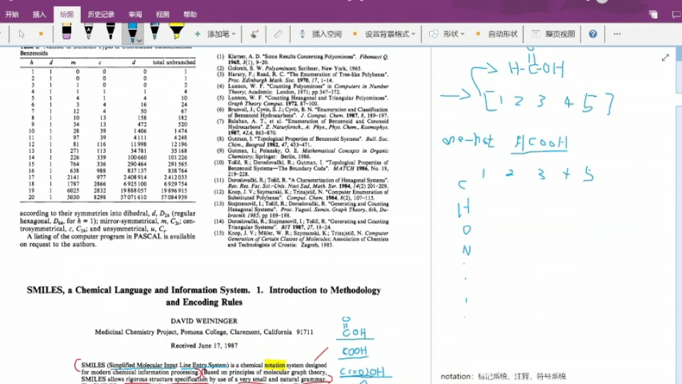
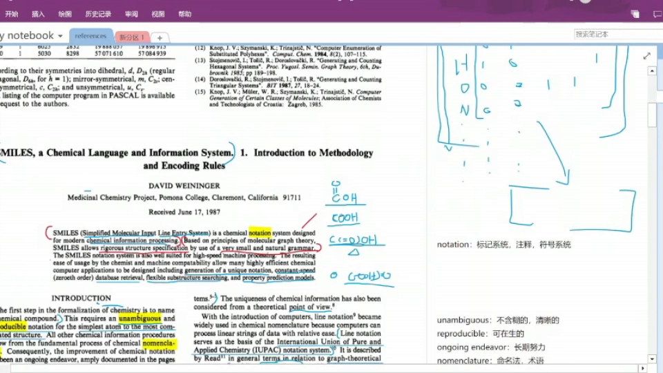
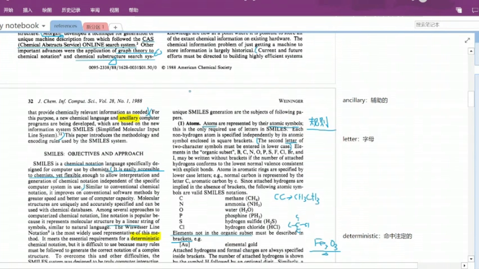
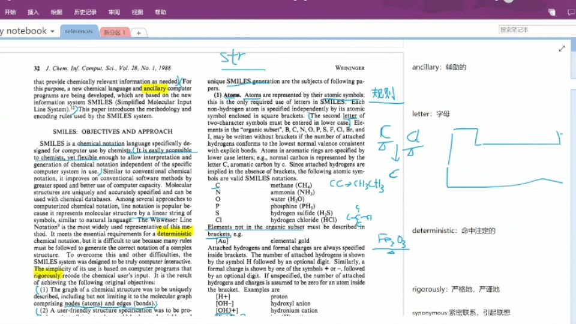
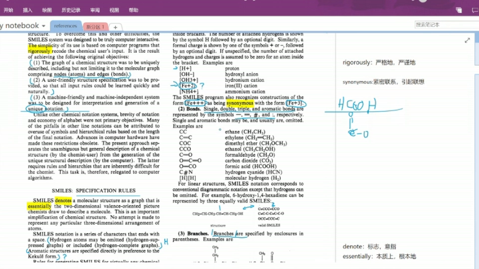
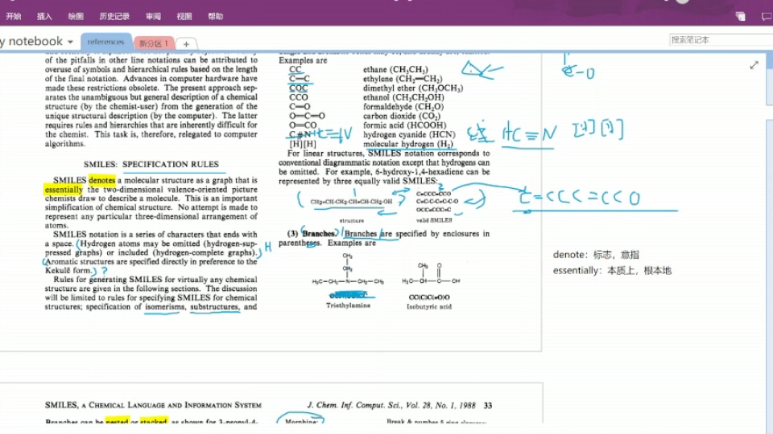
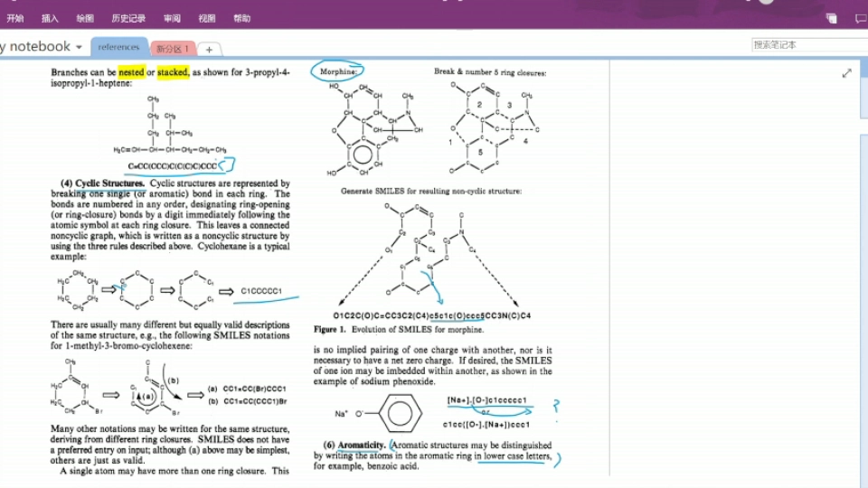
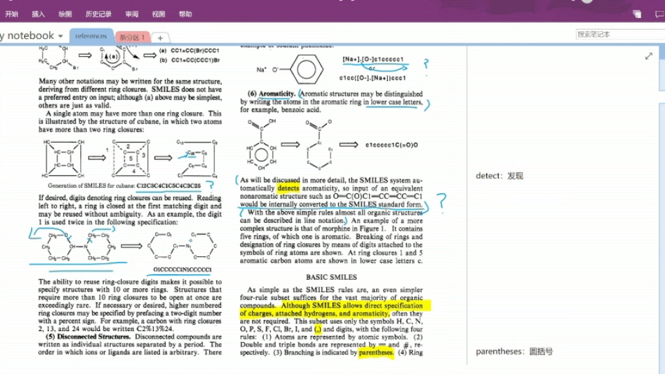

# SMILES：把分子写成一行字符串，以及同一个分子的许多种写法

> 视频来源：[SMILES：玩转化学符号，机器可读的简化化学分子输入规范](https://www.bilibili.com/video/BV1MH4y1g7zb/)（Bilibili · 小明AI版）｜时长约 21 分钟
> 导读：这是一支 AI for Science 系列的文献精读，讲者带着读 1988 年 Weininger 那篇提出 SMILES 的原始论文，边读边在屏幕上手写推导：原子怎么写、键怎么写、支链怎么用括号嵌套、环怎么切开、芳香环为什么用小写。视频前四分钟用 one-hot 编码做入门铺垫，可以直接从 04:42 看起。本文按论文的规则顺序复述，并在最后一节把它接回本节的主题——**为什么药物需要一个字符串身份，而这个身份为什么仍然不够用**。

## 本讲要解决的核心问题（SCQA）

**背景**：药物扰动数据里，药物的名字是元数据的第一列。一个化合物在论文里可能写成商品名，在另一个数据集里写成通用名，在化合物库里又变成一个编号。名字之外，化学家真正想表达的是结构。

**冲突**：结构是二维的图——原子是点、键是边，还有环、支链、电荷、芳香性。而计算机处理的是线性的字符串。**把图压成一行文本，必然要选一种遍历顺序**；只要顺序可选，同一个分子就会有不止一种合法写法。讲者在视频里明确点出了这一点：一个分子可能有十种写法，长的分子可能有几百种、上千种。

**疑问**：那么这行字符串到底是怎么构造出来的？它的规则能不能保证「同一个分子写出来一定一样」？

**回答（中心思想）**：**SMILES 用一套很小的规则把分子图编码成字符串：原子用元素符号、键用 `-`/`=`/`#`、支链用括号嵌套、环用数字标号闭合、芳香原子用小写。** 这套规则足够表达几乎所有有机结构，但它**只保证「一个字符串对应一个结构」，不保证「一个结构只有一个字符串」**——讲者读到的论文原文就给了同一个分子三种同样合法的写法。这正是药物标识问题的技术根源：**SMILES 解决了「机器能不能读」，但没有解决「两台机器读到的是不是同一个东西」**。

## 一、入门：为什么不能直接喂结构

讲者先用四分钟做了一个铺垫。机器读不了复杂的化学结构图，它读的是数字向量，比如 1、2、3、4、5 这样的向量 [【跳转到 01:24】](https://www.bilibili.com/video/BV1MH4y1g7zb/?t=84)。最朴素的转换方式是 **one-hot 独热编码**：把分子平铺成一个原子序列（甲酸就是氢、碳、氧、氧、氢五个位置），横坐标是位置、纵坐标是元素，每个位置在对应元素那一行填 1、其余填 0 [【跳转到 02:14】](https://www.bilibili.com/video/BV1MH4y1g7zb/?t=134)。

讲者自己评价这个方法「最简单」，只是入门 [【跳转到 04:19】](https://www.bilibili.com/video/BV1MH4y1g7zb/?t=259)。它的局限也很明显：**它丢掉了结构信息**——同样是 C、H、O 的组成，不同的连接方式（同分异构体）会得到完全相同的矩阵。要保留结构，就得把「谁和谁相连」也编码进去，这正是 SMILES 要解决的问题。

## 二、SMILES 是什么：一句论文里的定义

讲者读的是 1988 年 Weininger 发表在 *Journal of Chemical Information and Computer Sciences* 上的文章，题目是 *SMILES, a Chemical Language and Information System. 1. Introduction to Methodology and Encoding Rules* [【跳转到 04:47】](https://www.bilibili.com/video/BV1MH4y1g7zb/?t=287)。

论文对 SMILES 的定义是：**一种化学记号语言（chemical notation language），专门为计算机处理化学信息而设计，基于分子图论原理，用一个很小的语法和自然语言式的记号，就能严格地指定一个结构** [【跳转到 06:16】](https://www.bilibili.com/video/BV1MH4y1g7zb/?t=376)。

讲者顺手解释了 SMILES 这个名字：**Simplified Molecular Input Line Entry System**，正好也是英文「微笑」的意思 [【跳转到 06:16】](https://www.bilibili.com/video/BV1MH4y1g7zb/?t=376)。

> 这段话里有两个词值得记住：**notation（记号）** 和 **unambiguous（无歧义）**。讲者在屏幕上给这两个词做了批注。SMILES 的目标是让「结构 → 字符串」这一步无歧义——但请注意方向：**它保证的是从字符串能唯一地还原出结构**，而不是反过来。

## 三、规则一：原子就是元素符号

### 3.1 有机子集：可以省略括号

SMILES 里表示原子只有一种方式：**用元素的原子符号** [【跳转到 07:46】](https://www.bilibili.com/video/BV1MH4y1g7zb/?t=466)。规则有两条细节：

- 元素符号的**第二个字母必须小写**（跟平时写化学式一样，讲者特意强调）；
- 属于「有机子集」（organic subset）的元素——B、C、N、O、P、S、F、Cl、Br、I——**可以不写方括号**。

### 3.2 氢是默认补上的

讲者用一个例子把这个规则讲透了：**只写一个 `C`，它代表的是甲烷** [【跳转到 08:11】](https://www.bilibili.com/video/BV1MH4y1g7zb/?t=491)。原因是碳有四个配位，你没写别的原子，剩下的位置就默认用氢填满；同理，只写一个 `N` 代表氨气（三个配位、三个氢）[【跳转到 09:01】](https://www.bilibili.com/video/BV1MH4y1g7zb/?t=541)。

**这个「默认补氢」的约定，是 SMILES 紧凑的原因，也是它容易出错的原因**：字符串里看不到的氢，必须由解析器按价态规则补出来。写错价态，字符串就是非法的或对应到别的结构。

### 3.3 不在有机子集里的原子要加方括号

离子和金属这类不在有机子集里的原子，必须写在方括号里 [【跳转到 09:26】](https://www.bilibili.com/video/BV1MH4y1g7zb/?t=566)。论文里的例子是 `[H+]` 代表质子、`[OH-]` 代表氢氧根、`[OH2+]` 代表水合氢离子；带电的原子还要在方括号里标明电荷，例如 `[Fe+2]`。讲者还提到一个细节：**方括号里可以紧跟一个数字表示连接的氢数**，比如 `[H]` 表示一个氢原子。

## 四、规则二：键用符号表示

键的表示法很直观 [【跳转到 10:16】](https://www.bilibili.com/video/BV1MH4y1g7zb/?t=616)：

| 写法 | 含义 | 论文里的例子 |
| --- | --- | --- |
| `-` | 单键（通常可省略） | `CC` 乙烷 |
| `=` | 双键 | `C=C` 乙烯 |
| `#` | 三键 | `C#N` 氰化氢 |
| `:` | 芳香键（讲者说自己没遇到过，也没查到） | — |

讲者在这里很诚实地留了一个空白：论文里出现的冒号结构他没查到含义，让知道的观众在弹幕里补充 [【跳转到 10:16】](https://www.bilibili.com/video/BV1MH4y1g7zb/?t=616)。这种「不知道就说不知道」的处理，恰好说明**读规范文档时遇到没见过的记号，最稳妥的做法是去查而不是猜**。

同一张图上还有本节最关键的一段：论文用 **5-羟基-1,4-己二烯** 举例，说明**同一个结构可以写出三种同样合法的 SMILES**，因为它们只是从不同的原子开始遍历 [【跳转到 12:46】](https://www.bilibili.com/video/BV1MH4y1g7zb/?t=766)。

## 五、规则三：支链用括号，括号可以嵌套

遇到分支怎么办？讲者的说法是：**把支链用小括号括起来** [【跳转到 13:36】](https://www.bilibili.com/video/BV1MH4y1g7zb/?t=816)。

他现场手写了一个例子：主链是碳、碳、氮，上面挂一个支链，就把支链写在括号里跟在主链原子后面；如果支链上还有支链，就在括号里面再套括号 [【跳转到 14:26】](https://www.bilibili.com/video/BV1MH4y1g7zb/?t=866)。

**嵌套是 SMILES 能表达任意复杂结构的关键**：只要允许括号无限嵌套，任何树状（无环）结构都能写成一维字符串。讲者的总结是「它的支链是可以嵌套的，这样就可以表达任何复杂结构」[【跳转到 14:51】](https://www.bilibili.com/video/BV1MH4y1g7zb/?t=891)。

## 六、规则四：环靠数字标号「切开再缝合」

### 6.1 切开一个键，两端标同一个数字

环是线性文本最难处理的部分——你不能在字符串里「画回去」。SMILES 的解法很巧妙：**在环上任意选一个键切开，把环拉成一条链，然后在切开的两端标上同一个数字** [【跳转到 15:41】](https://www.bilibili.com/video/BV1MH4y1g7zb/?t=941)。

讲者用环己烷举例：切开之后写成 `C1CCCCC1`，两个 `1` 表示「这一头」和「那一头」本来是连起来的 [【跳转到 16:06】](https://www.bilibili.com/video/BV1MH4y1g7zb/?t=966)。

### 6.2 同一个环，切开的位置不同 → 不同的写法

这就是不唯一性的第二个来源。论文原文写得很清楚：**同一个结构通常有许多不同但同样合法的描述**，例如 1-甲基-3-溴环己烯就有多种写法，因为可以从不同的环键切开；**SMILES 没有偏好哪一种输入，它们都一样合法** [【跳转到 16:56】](https://www.bilibili.com/video/BV1MH4y1g7zb/?t=1016)。

讲者还提到更复杂的情形：**一个原子可以被切多次**（参与多个环），论文里的立方烷就有两个原子各自参与不止两个环闭合；数字标号也可以复用——读到一个数字时，它与前面最近的那个同号数字配对，配对之后就可以复用 [【跳转到 17:21】](https://www.bilibili.com/video/BV1MH4y1g7zb/?t=1041)。

## 七、规则五：芳香性用小写

最后一类结构是芳香环。讲者的表述是：**在芳香结构里面，所有的碳都写成小写**——苯环就是一个典型例子，环上的碳全部小写 [【跳转到 19:26】](https://www.bilibili.com/video/BV1MH4y1g7zb/?t=1166)。

论文里还提到，SMILES 系统会**自动识别芳香性**：如果输入的是一个等价的非芳香写法（比如用交替单双键写的苯），系统会把它转换成标准的 SMILES 形式 [【跳转到 19:51】](https://www.bilibili.com/video/BV1MH4y1g7zb/?t=1191)。

讲者把论文的「BASIC SMILES」小结念了一遍：**对绝大多数有机结构来说，四条规则就够了——原子用原子符号表示、双键和三键分别用 `=` 和 `#`、支链用括号、环闭合用数字** [【跳转到 19:51】](https://www.bilibili.com/video/BV1MH4y1g7zb/?t=1191)。

## 八、把规则接回药物标识：一个字符串能解决什么，不能解决什么

讲者在结尾说，他后面还要再出一期视频，用 Python 把论文里的 SMILES 逐条验证一遍，看输入的字符串画出来的图是不是跟论文的图一致；他还提醒观众「带着辩证的思维去看，因为我不可能总是对的」[【跳转到 18:36】](https://www.bilibili.com/video/BV1MH4y1g7zb/?t=1116)。

这个「逐条验证」的提议，其实正是本节要讨论的方法学态度。把视频里的规则整理成一张对照表，就能看清 SMILES 在药物元数据里能承担什么、不能承担什么：

| 视频里讲的规则 | 它保证了什么 | 它没有保证什么 |
| --- | --- | --- |
| 原子用元素符号、第二个字母小写 | 一个字符串能被唯一解析成一组原子 | 同一个分子不会写成不同字符串 |
| 氢默认补全 | 字符串可以很短 | 读者必须知道价态规则才能读懂 |
| 键用 `-`/`=`/`#` | 连接关系可表达 | 立体化学、构象不在基本规则里 |
| 支链用括号嵌套 | 任意树状结构都能线性化 | 从哪个原子开始写由写作者决定 |
| 环用数字标号 | 任意环系都能线性化 | 切哪个键由写作者决定（多解） |
| 芳香原子用小写 | 芳香性可显式表达 | 芳香性的判定依赖解析器的规则 |

**所以一个 SMILES 字符串是「结构的充分表示」，但不是「分子的唯一标识」。** 同一个化合物在三个数据集里可能写成三个不同的 SMILES，字符串比对全部失败；反过来，一个 SMILES 字符串解析出来的结构是确定的，所以它**可以用来做结构层面的校验**。

这就解释了为什么药物数据库通常同时维护多套标识：

- **名称**：可读性最好，但同物异名、同名异物（商品名、通用名、代号）最常见；
- **SMILES**：结构层面的充分表示，但写法不唯一，需要先做规范化（canonicalization）才能比对；
- **数据库编号**（如 ChEMBL ID、PubChem CID）：**唯一且稳定**，是跨数据集连接的锚点；
- **InChI / InChIKey**：由结构按标准算法生成，天生带规范化，适合做去重与匹配。

对做扰动数据分析的人来说，实践含义只有一条：**不要把药物名字当主键。** 拿到一个数据集，先看它给的药物标识是哪一种；如果只有名字，就要做一次名称到结构/编号的映射并人工核对；如果给了 SMILES，就直接算规范化形式或 InChIKey 再合并。**这一步做错，后面所有「同一药物在不同数据集间的一致性」分析都会失效，而且不会报错。**

## 小结

- **SMILES 的定位**：一种为计算机处理化学信息而设计的记号语言，基于分子图论，用很小的语法严格指定结构。
- **五条基本规则**：原子用元素符号（有机子集可省方括号、第二个字母小写）、氢默认补全、键用 `-`/`=`/`#`、支链用括号嵌套、环用数字标号闭合；芳香原子用小写。
- **括号嵌套 + 环标号**这两条，让任意复杂结构都能压成一行线性文本。
- **不唯一性是设计的结果**：从哪个原子开始写、从哪个键切环，都由写作者决定；论文明确说同一结构有多种同样合法的写法，SMILES 没有偏好。
- **能解析 ≠ 能比对**：SMILES 保证「字符串 → 结构」的方向，不保证「结构 → 字符串」的唯一性。
- **药物标识要多套并用**：名称管可读、SMILES 管结构、数据库编号（ChEMBL/PubChem）与 InChIKey 管唯一性与去重。
- **实践底线**：药物名字不能当主键；跨数据集合并前先做标识映射与规范化。

## 关键术语速查

| 术语 | 一句话解释 |
| --- | --- |
| SMILES | Simplified Molecular Input Line Entry System，把分子结构写成一维字符串的记号系统 |
| 独热编码 | 用「位置 × 元素」的 0/1 矩阵表示原子序列，最简单但丢失连接信息 |
| 有机子集 | B、C、N、O、P、S、F、Cl、Br、I，这些原子在 SMILES 里可以不写方括号 |
| 价态补氢 | SMILES 中未写出的氢按元素价态自动补全，所以单个 `C` 就代表甲烷 |
| 支链嵌套 | 用括号表示分支，括号内可再套括号，从而表达任意树状结构 |
| 环闭合标号 | 把环切开后在两端标同一个数字，表示这两端相连 |
| 芳香性小写 | 芳香环上的原子用小写字母（如苯环的 `c`）表示 |
| 规范化（canonicalization） | 把同一结构的不同 SMILES 写法统一成唯一形式，才能做字符串比对 |
| ChEMBL ID / PubChem CID | 化合物数据库中的稳定编号，可作为跨数据集的连接键 |
| InChIKey | 由结构按标准算法生成的哈希式标识，适合去重与匹配 |