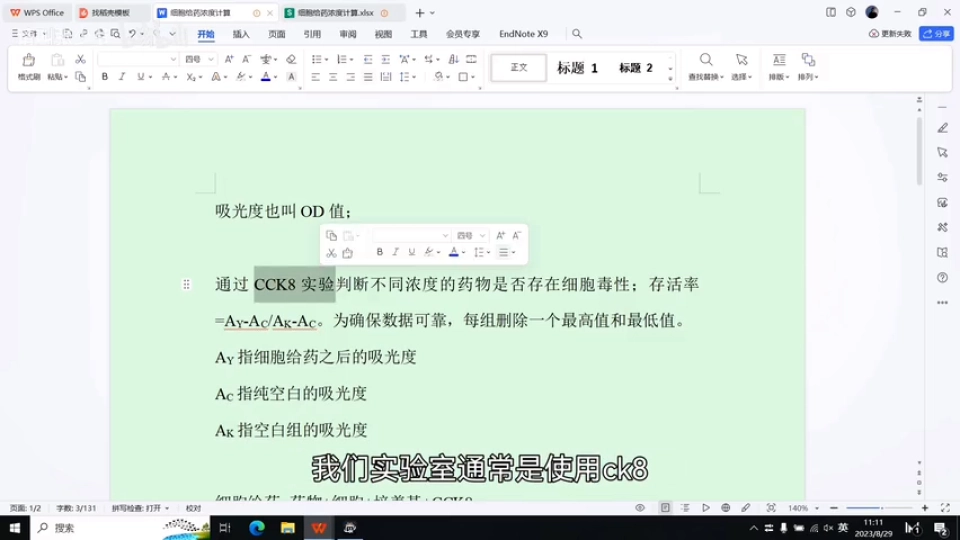
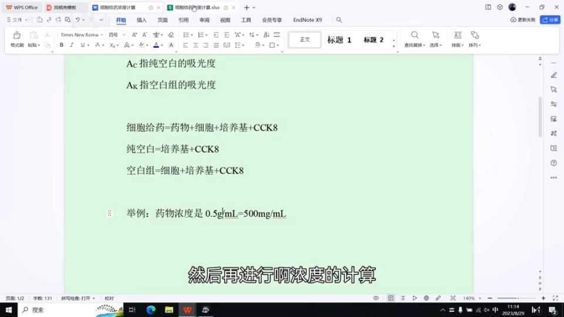
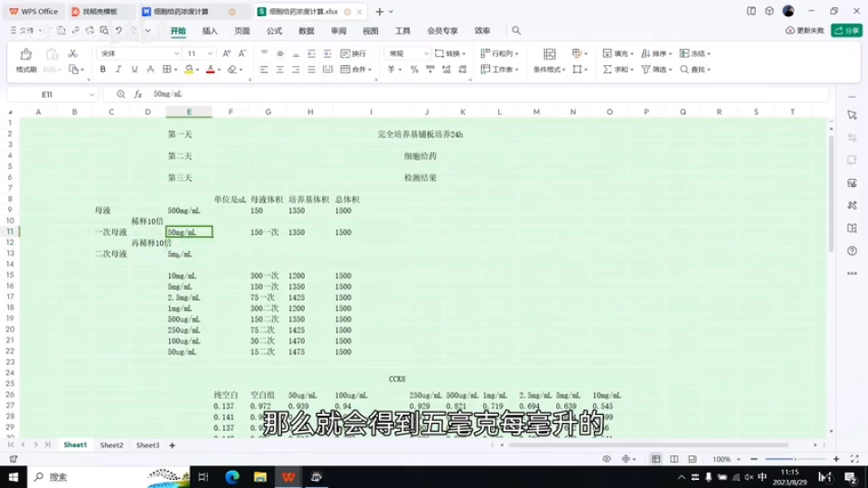
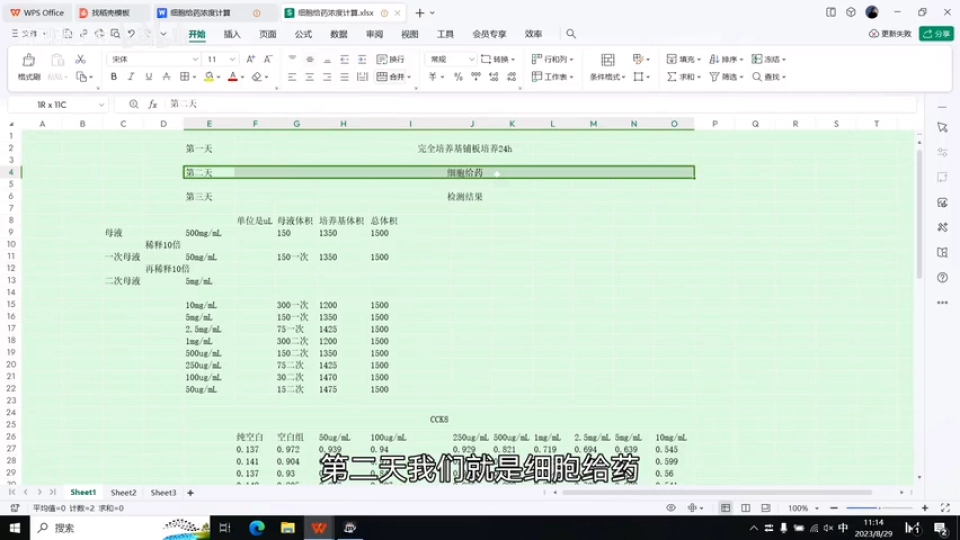
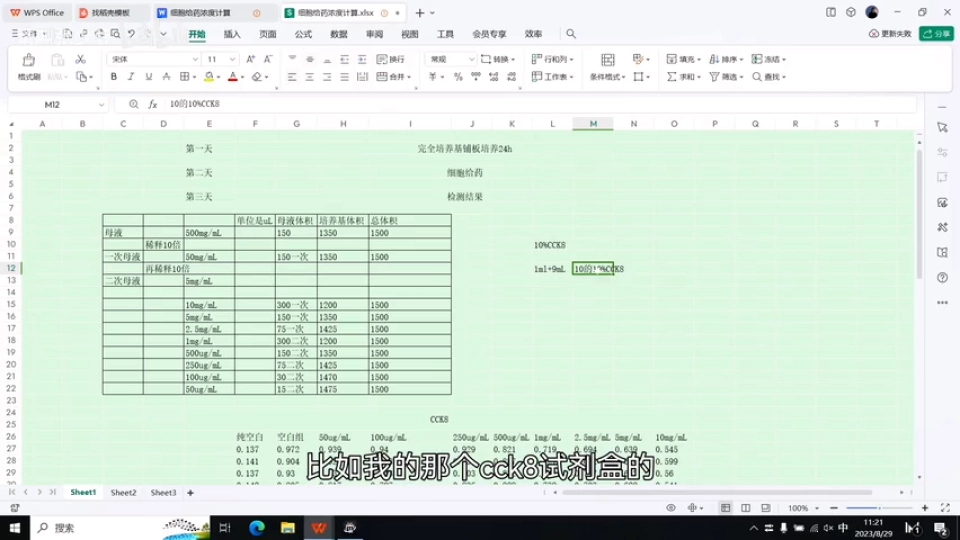
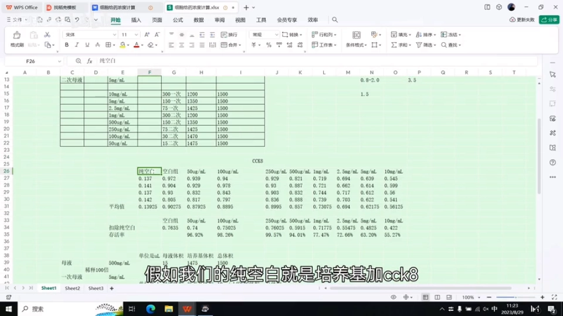
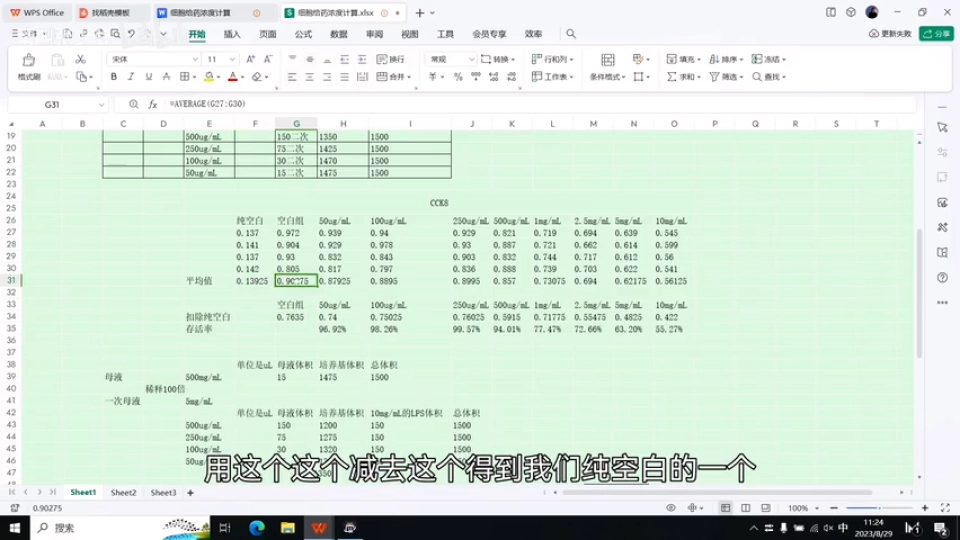
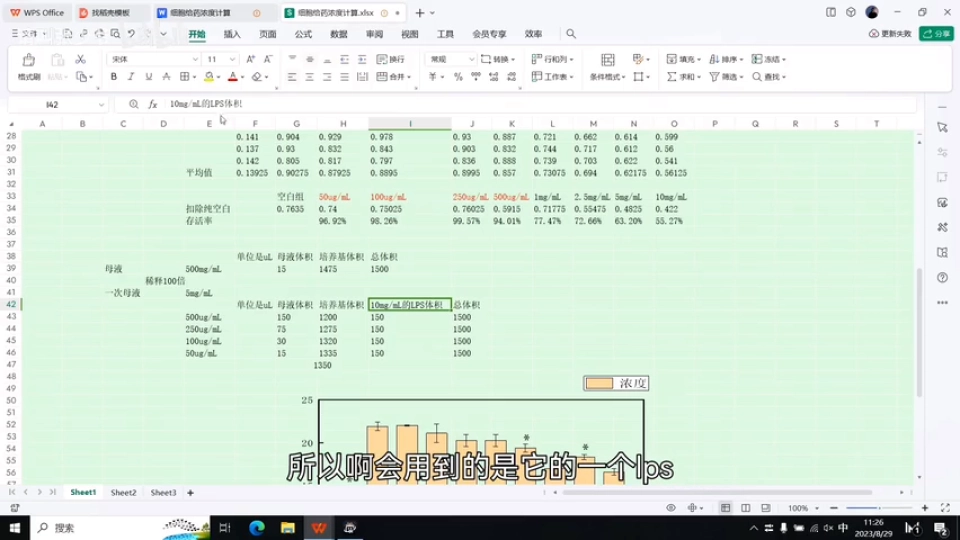
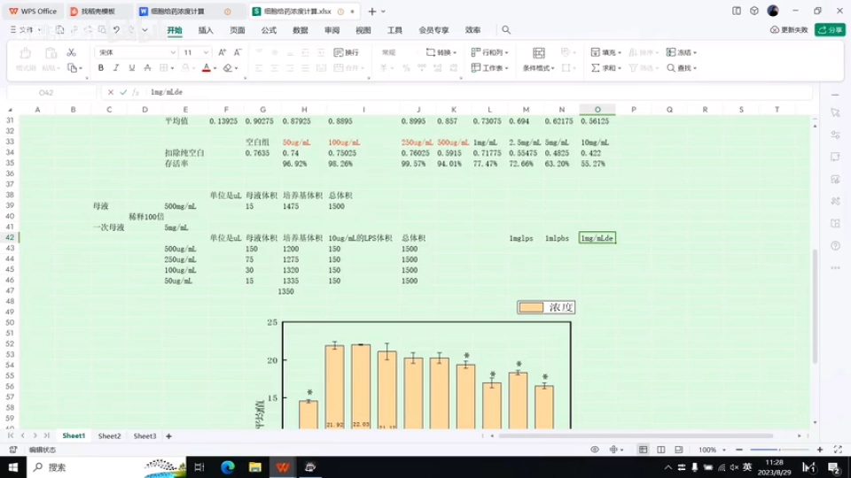

# 剂量不是一个标签：从母液稀释到无毒区间，浓度是怎么算出来的

> 视频来源：[（细胞实验）细胞给药浓度的计算](https://www.bilibili.com/video/BV1Bu4y1e7yi/)（Bilibili · 张少爷在修炼）｜时长约 18 分钟
> 导读：这是一支细胞房的实操教学视频，讲者从 CCK8 的存活率公式一路算到「母液怎么稀释、每个孔加多少微升、无毒区间落在哪一段」，全程在 Excel 里现场推导。它不讲任何组学分析，但正好补上了本节最容易被跳过的一环：**当你在数据表里读到「dose = 10 μg/mL」时，这个数字背后其实是一整条稀释链和一次毒性预实验**。本文按视频顺序复述这套算法，并在最后把它翻译成「读数据集元数据时该追问什么」。

## 本讲要解决的核心问题（SCQA）

**背景**：药物扰动数据集的元数据表里，剂量通常只占一列——一个数字加一个单位，比如 `10 μM`、`500 ng/mL`。看起来它和 `cell_line`、`timepoint` 一样，是个填好就完事的标签。

**冲突**：但讲者这支视频演示的事情说明，那个数字并不是「称出来」的，而是「算出来」的：它取决于母液浓度、稀释了几次、每孔加多少体积、总体积是多少、以及这个浓度是不是落在细胞还能活着的范围内。**任何一环变了，同一个标签对应的实际暴露量就变了。** 更麻烦的是，讲者自己也提到，浓度给高了细胞会死掉一部分，吸光度反而下降——这时候你测到的「响应」里混进了细胞死亡。

**疑问**：那么一个可复现的浓度到底是怎么被确定下来的？从一瓶母液到 96 孔板里的一个孔，中间要经过哪些计算？怎么知道哪个浓度区间是「细胞还活着、但已经被扰动」的？

**回答（中心思想）**：**浓度是一条链，不是标签。** 这条链有四个环节：**先用 CCK8 测出无毒区间**（决定浓度该落在哪个数量级），**再把母液按 10 倍、5 倍逐级稀释**（决定你手上有什么浓度的中间液），**再按总体积反算每个浓度要吸多少微升**（决定孔里最终是多少），**最后把造模剂与药物按固定体积叠加**（决定这一组到底同时受了几个扰动）。四步都算对，那个写进元数据表的数字才是可复现的。

## 一、先测存活率：剂量的下限由毒性决定

### 1.1 CCK8 与吸光度：你测的是「活细胞的数量代理」

讲者一开场就把顺序定死了：做细胞实验，第一步不是加药，而是**判断药物对细胞有没有毒性**，用的实验是 CCK8（也可以用 MTT 替代，只是 CCK8 时间短一些、MTT 时间长一些，讲者所在实验室习惯用 CCK8）[【跳转到 00:09】](https://www.bilibili.com/video/BV1Bu4y1e7yi/?t=9)。

CCK8 读出的量叫**吸光度**，也叫 **OD 值**（optical density，光密度）——溶液颜色越深，OD 越大；颜色深浅来自活细胞里的脱氢酶把试剂还原成的产物，所以 OD 可以当作「活细胞有多少」的代理指标 [【跳转到 00:34】](https://www.bilibili.com/video/BV1Bu4y1e7yi/?t=34)。

存活率的算法是：

$$
\text{存活率} = \frac{A_Y - A_C}{A_K - A_C}
$$

三个符号各自代表什么，讲者逐条解释了 [【跳转到 01:24】](https://www.bilibili.com/video/BV1Bu4y1e7yi/?t=84)：

| 符号 | 含义 | 孔里有什么 |
| --- | --- | --- |
| $A_Y$ | 给药组的吸光度 | 药物 + 细胞 + 培养基 + CCK8 |
| $A_C$ | 纯空白的吸光度 | 只有培养基 + CCK8，没有细胞 |
| $A_K$ | 空白组的吸光度 | 细胞 + 培养基 + CCK8，没有药 |

**为什么要减掉 $A_C$**：培养基和 CCK8 本身就会产生一点颜色，这部分与细胞无关。讲者的说法是「没有细胞会带来的一个吸光度给它全部减掉」，剩下的才是细胞带来的变化 [【跳转到 01:49】](https://www.bilibili.com/video/BV1Bu4y1e7yi/?t=109)。

这里有一个对读数据集很关键的细节：**「对照」不是一个东西，而是两个。** 纯空白（有试剂没细胞）扣的是试剂本底，空白组（有细胞没药）才是药物效应的参照。如果某个数据集的元数据只写「control」，你无法判断它指的是哪一个——而这两个的差别在低信号区间可能很大。

### 1.2 每组六个孔、去掉最高最低：重复与稳健性

讲者交代了操作上的约定：为保证数据可靠，**每一组通常做六个孔，计算时删掉一个最高值和一个最低值，剩下四个数据参与后面的计算** [【跳转到 00:59】](https://www.bilibili.com/video/BV1Bu4y1e7yi/?t=59)。这是湿实验里常见的做法，用极值剔除换一点稳健性——代价是它并不是统计意义上的重复，只是技术重复的修剪。

## 二、母液与稀释链：浓度是「吸多少微升」算出来的

### 2.1 单位先要对齐：质量浓度还是摩尔浓度

讲者举的例子是：**药物的初始浓度是 0.5 g/mL**，也就是 **500 mg/mL** 的母液 [【跳转到 02:14】](https://www.bilibili.com/video/BV1Bu4y1e7yi/?t=134)。他顺带提了一句很重要的分叉：如果用的是**固体药物**，一般要用培养基先配成液体再算浓度；而如果是**单体化合物**，通常会**用摩尔浓度来计算**，这部分他没有展开 [【跳转到 02:39】](https://www.bilibili.com/video/BV1Bu4y1e7yi/?t=159)。

这句话点出了本节第一个「元数据坐标」问题：**同一个化合物，剂量可以写成质量浓度（mg/mL、μg/mL），也可以写成摩尔浓度（M、mM、μM、nM），两者之间差一个分子量。**

$$
c_{\text{摩尔}} = \frac{c_{\text{质量}}}{M_w}
$$

例如 $10\ \mu\text{g/mL}$ 的一个分子量为 500 的化合物，换算过来是 $20\ \mu\text{M}$；分子量 200 的化合物在同样质量浓度下则是 $50\ \mu\text{M}$。**所以「10 μg/mL」和「10 μM」这两个写法在跨数据集比较时不能直接当成同一个量级来用**，必须知道分子量才能换算。这也是为什么高通量药物转录组数据集（如 LINCS 一类的资源）通常统一用摩尔浓度记录剂量——它和靶点结合、受体占据是同一套语言。

### 2.2 母液、一次母液、二次母液：稀释链

讲者的例子是这样展开的：母液 500 mg/mL，先稀释 10 倍得到 50 mg/mL 的**一次母液**，再把一次母液稀释 10 倍得到 5 mg/mL 的**二次母液** [【跳转到 04:19】](https://www.bilibili.com/video/BV1Bu4y1e7yi/?t=259)。之所以要分两级，是因为**目标浓度跨度太大**——从 10 mg/mL 一直到 50 μg/mL，跨了三个数量级，只用母液直接稀释既不准也费料 [【跳转到 03:54】](https://www.bilibili.com/video/BV1Bu4y1e7yi/?t=234)。

稀释的动作本身很朴素：吸 150 μL 的药液，加 1350 μL 培养基，总体积 1500 μL，正好稀释 10 倍 [【跳转到 04:44】](https://www.bilibili.com/video/BV1Bu4y1e7yi/?t=284)。

### 2.3 目标浓度怎么反算加样体积

有了中间液，每个目标浓度就是一次「稀释倍数 → 取体积」的反算。讲者以 10 mg/mL 为例：一次母液是 50 mg/mL，要配 10 mg/mL 就是**稀释 5 倍**；总体积定 1500 μL，于是 $1500 \div 5 = 300$ μL，即吸 300 μL 一次母液加 1200 μL 培养基 [【跳转到 05:59】](https://www.bilibili.com/video/BV1Bu4y1e7yi/?t=359)。

这张表值得逐列看，因为它就是「剂量元数据」的原始形态：

| 目标浓度 | 用哪一级母液 | 药液体积（μL） | 培养基（μL） | 总体积（μL） |
| --- | --- | --- | --- | --- |
| 10 mg/mL | 一次母液 50 mg/mL | 300 | 1200 | 1500 |
| 5 mg/mL | 一次母液 | 150 | 1350 | 1500 |
| 2.5 mg/mL | 一次母液 | 75 | 1425 | 1500 |
| 1 mg/mL | 二次母液 5 mg/mL | 300 | 1200 | 1500 |
| 500 μg/mL | 二次母液 | 150 | 1350 | 1500 |
| 250 μg/mL | 二次母液 | 75 | 1425 | 1500 |
| 100 μg/mL | 二次母液 | 30 | 1470 | 1500 |
| 50 μg/mL | 二次母液 | 15 | 1475 | 1500 |

讲者还解释了一个看似反直觉的选择：2.5 mg/mL 明明离二次母液（5 mg/mL）更近，为什么不用二次母液而用一次母液？答案是**省料**——用二次母液要吸 750 μL，一次就用掉一半，后面还得再配；用一次母液只吸 75 μL，剩下的还能继续用 [【跳转到 07:14】](https://www.bilibili.com/video/BV1Bu4y1e7yi/?t=434)。

> 这一段对写方法学部分有直接启发：**「10 mg/mL」这个数字是干净的，但它是从哪一级母液、按几倍稀释来的，往往没人记录。** 而稀释链一旦记错（比如母液本身配错了、或者分装后反复冻融），后面所有浓度都按同一个比例错下去——数据表里看不出来，因为标签完全正常。

## 三、把梯度落到孔里：总体积、给药体积与叠加的造模剂

### 3.1 每孔 200 μL，配 1500 μL

96 孔板每个孔加 200 μL 培养基，一组六个孔就是 1200 μL；但配 1200 μL 的话最后一个孔可能不够加，所以讲者的做法是**一律按 1500 μL 来配** [【跳转到 08:29】](https://www.bilibili.com/video/BV1Bu4y1e7yi/?t=509)。这也解释了上一节所有表格里总体积为什么都是 1500。

CCK8 工作液按 10% 配：1 mL CCK8 原液加 9 mL 培养基，得到 10 mL 的 10% CCK8 [【跳转到 08:54】](https://www.bilibili.com/video/BV1Bu4y1e7yi/?t=534)。

### 3.2 孵育时间要看预实验，不看说明书

讲者提醒了一个很实操的点：说明书建议孵育 1–4 小时，但**说明书上写的不一定准**；细胞量够多时显色很快，所以要根据自己几次预实验的结果来定孵育时间 [【跳转到 10:09】](https://www.bilibili.com/video/BV1Bu4y1e7yi/?t=609)。判据是 OD 落在合适区间：**0.8–2.0 之间最好，1 点几最理想；一般检测仪器要求小于 3.5，到 3 就可能带来误差** [【跳转到 10:59】](https://www.bilibili.com/video/BV1Bu4y1e7yi/?t=659)。

**这条「读数要落在仪器的线性区间内」的约束，和测序里的「文库饱和度」是同一类问题**：读数超出线性范围，后面的所有比值都失真，而且失真的方向是系统性的（高浓度组被压缩）。

### 3.3 读出来的 OD 表与存活率

讲者给了一份示例数据：纯空白（只有培养基加 CCK8）四个孔的 OD 平均值约 **0.139**，空白组（有细胞没药）约 **0.90**；低浓度给药组的 OD 与空白组接近（0.8–0.9），浓度升高后 OD 开始下降 [【跳转到 12:14】](https://www.bilibili.com/video/BV1Bu4y1e7yi/?t=734) [【跳转到 12:39】](https://www.bilibili.com/video/BV1Bu4y1e7yi/?t=759)。

把公式套进 Excel，得到的一条存活率序列很有代表性（讲者示例数据）：

| 50 μg/mL | 100 μg/mL | 250 μg/mL | 500 μg/mL | 1 mg/mL | 2.5 mg/mL | 5 mg/mL | 10 mg/mL |
| --- | --- | --- | --- | --- | --- | --- | --- |
| 96.92% | 96.26% | 99.37% | 94.01% | 77.47% | 72.66% | 63.20% | 55.27% |

讲者的结论是：**低浓度给药对细胞影响较小，存活率能到 90% 以上；浓度升高后细胞开始死亡，存活率越来越低**；由此可以确定「给药区间大概在哪一段」，也就是**细胞给药没有显著性差异的无毒区间** [【跳转到 13:54】](https://www.bilibili.com/video/BV1Bu4y1e7yi/?t=834) [【跳转到 14:19】](https://www.bilibili.com/video/BV1Bu4y1e7yi/?t=859)。

> 这就是本节「剂量不能只当一个分类变量」的实证版本：**浓度轴上有一段是「细胞活着但被扰动」，再往右就进入「细胞在死」**。如果数据集只给一个高浓度点，你测到的差异表达里就混着凋亡、应激、细胞周期停滞这些与靶点无关的程序——它们同样是一大堆差异基因，同样显著，但解释完全不同。

## 四、叠加第二个扰动：造模剂与药物的固定体积

### 4.1 LPS 造模：从固体称量到工作浓度

讲者接着演示了炎症模型的做法：用 LPS（脂多糖）作为造模刺激，目标工作浓度是 **1 μg/mL** [【跳转到 15:34】](https://www.bilibili.com/video/BV1Bu4y1e7yi/?t=934)。链条是这样的 [【跳转到 16:24】](https://www.bilibili.com/video/BV1Bu4y1e7yi/?t=984)：

1. LPS 买回来是固体，用万分之一天平称 **1 mg**，加 **1 mL** 培养基，得到 **1 mg/mL** 的母液；
2. 分装成 15 μL 一支（1 mL 可以分很多支），**避免反复冻融导致失效**，存 −20 ℃；
3. 取一支 15 μL，加 1475 μL 培养基，稀释 100 倍，得到 **10 μg/mL**；
4. 再稀释 10 倍到 **1 μg/mL** 的工作浓度。

### 4.2 固定体积带来的一个结构性问题

因为总体积固定是 1500 μL，而 LPS 的终浓度要固定为 1 μg/mL，所以**LPS 的加样体积是固定的 150 μL**；于是留给「药物 + 培养基」的体积就是 $1500 - 150 = 1350$ μL [【跳转到 17:39】](https://www.bilibili.com/video/BV1Bu4y1e7yi/?t=1059)。

这条约束产生了一个容易被忽略的后果：**不同浓度组的「培养基占比」不一样**。高浓度组药液体积大、培养基少；低浓度组药液少、培养基多。如果药物溶剂（DMSO 之类）在药液里，那么**溶剂浓度也随剂量一起变化**——这就是为什么规范的数据集要单独记录 vehicle（溶剂对照）并保持溶剂终浓度恒定。

讲者也提到，不同文献的实验顺序不一样：有的先造模 6 小时再加药，有的（他们参考文献后的做法）是**药物和 LPS 一起给** [【跳转到 17:39】](https://www.bilibili.com/video/BV1Bu4y1e7yi/?t=1059)。**「同时给」和「先造模再给药」是两种不同的扰动设计，对应的转录响应也不同**——这属于时间点这个坐标，下一节会专门讲。

### 4.3 结果长什么样

给药之后不再用 CCK8，而是用试剂盒（一氧化氮、IL-6 等炎症因子）检测。讲者描述的预期趋势是：空白组最低（正常水平），模型组（只加 LPS、不加药）最高，各给药组随浓度升高逐渐下降 [【跳转到 17:39】](https://www.bilibili.com/video/BV1Bu4y1e7yi/?t=1059)。

讲者还诚实地报了一个反面情况：**有时候浓度高了，OD 值反而又升高**。他给的建议是**多做几次**，因为一次做的误差可能很大；另外要排查孔间气泡、检测试剂盒本身的问题 [【跳转到 17:39】](https://www.bilibili.com/video/BV1Bu4y1e7yi/?t=1059)。

> 这个「高浓度反而回头」的异常，在组学数据里同样会出现，而且经常被误读成「非单调的剂量效应」。真实的来源可能是：细胞密度差异、边缘孔蒸发、化合物在高浓度下析出、或者检测超出线性范围。**在把它当成生物学发现之前，先排除这些技术原因。**

## 五、把这条链翻译成元数据：读数据集时该追问什么

讲者的流程本身是湿实验教学，但它恰好把「剂量」这个坐标拆成了可以逐项追问的清单。把视频里的每一步反过来读，就是读药物扰动数据集时的检查项：

| 视频里的步骤 | 对应到元数据里的字段 | 缺失时会怎样 |
| --- | --- | --- |
| 母液浓度与稀释链 | 剂量值 + 单位 + 溶剂 | 无法判断 μg/mL 与 μM 是否可比 |
| 无毒区间的确定 | 剂量梯度的范围与点数 | 无法判断高剂量点是否已进入毒性区 |
| 每孔总体积与加样体积 | 给药体积 / 培养基占比 / vehicle 终浓度 | 溶剂效应与药物效应混在一起 |
| 造模剂与药物同时给 | 是否联合扰动、联合的顺序 | 把两个扰动当成一个 |
| 第一天铺板、第二天给药、第三天检测 | 处理时长（timepoint） | 急性响应与继发效应混为一谈 |

讲者自己也在结尾给出了「下一步怎么做」的建议：可以**把浓度摸得更细**，或者**把浓度跨度做得更大**，或者换不同的检测指标 [【跳转到 17:39】](https://www.bilibili.com/video/BV1Bu4y1e7yi/?t=1059)。这三条恰好对应了公共数据集里剂量设计差异的三个来源——**同一种药，在不同数据集里可能只有单点、可能只有三四个梯度、也可能跨三四个数量级**，而元数据表里通常只留一个数字。

## 小结

- **剂量是算出来的，不是抄出来的**：母液浓度、稀释级数、加样体积、总体积四者共同决定孔里的终浓度，任何一环错，标签仍然正确但实际暴露量已经偏了。
- **质量浓度与摩尔浓度是两个语言**：$c_{\text{摩尔}} = c_{\text{质量}} / M_w$，跨数据集比较前必须先换算到同一套单位。
- **剂量的下限由毒性决定**：CCK8 存活率曲线给出「无毒区间」，超出这个区间的浓度点测到的是细胞死亡，不是特异响应。
- **对照有两个**：纯空白扣试剂本底，空白组才是药物效应的参照；元数据里只写 control 是不够的。
- **叠加扰动会改变体积结构**：造模剂体积固定时，药物浓度变化会连带改变培养基占比与溶剂终浓度。
- **读数据集时，剂量字段至少要配三个同伴**：单位与溶剂、梯度范围与点数、处理时长。

## 关键术语速查

| 术语 | 一句话解释 |
| --- | --- |
| OD 值（吸光度） | 溶液对特定波长光的吸收强度，CCK8 里用作活细胞数量的代理指标 |
| CCK8 | 用脱氢酶还原显色试剂来测活细胞数的比色实验，比 MTT 更快 |
| 纯空白 | 只有培养基加 CCK8、没有细胞的孔，用来扣掉试剂本底 |
| 空白组（vehicle 对照） | 有细胞、有培养基、没有药（或只有溶剂）的孔，是药物效应的参照 |
| 母液 / 一次母液 / 二次母液 | 逐级稀释得到的中间液，浓度依次降低一个固定倍数 |
| 稀释倍数 | 终体积与所取母液体积之比，本例中 150 μL 到 1500 μL 即 10 倍 |
| 无毒区间 | 存活率与空白组无显著差异的浓度范围，是后续功能实验的给药区间 |
| 造模剂 | 用来诱导疾病表型的刺激物，本例为 LPS（脂多糖），用于诱导炎症 |
| 反复冻融 | 同一管试剂反复解冻再冻存，会导致活性下降甚至失效 |
| 溶剂对照（vehicle） | 只加溶解药物所用溶剂、不加药物的对照，用于剥离溶剂本身的效应 |