# 细胞系不是一个名字：由来、命名、STR 鉴定与交叉污染

> 视频来源：[细胞系由来及鉴定问题--超详细！](https://www.bilibili.com/video/BV1Zi4y127LY/)（Bilibili · 普诺赛生物）｜时长约 45 分钟
> 导读：这是一场细胞库技术人员做的培训讲座，前半讲细胞系是怎么建起来的、名字怎么定的、背景信息到哪里查（以 Cellosaurus 页面为例逐栏讲解），后半讲鉴定手段：STR 图谱怎么读、匹配度 98.3% 是怎么算出来的、多等位基因为什么意味着污染、种属鉴定与核型分析各自能回答什么。讲者是细胞库从业者，视角偏「怎么把细胞管好」，本文按这个顺序复述，并在末尾把它接回药物扰动数据里的那个 `cell_line` 字段——**它标的不只是一个名字，而是一整套生物学背景**。

## 本讲要解决的核心问题（SCQA）

**背景**：药物扰动数据集的元数据表里，细胞系通常只占一列：`A549`、`K562`、`MCF7`。看起来它是所有字段里最不需要解释的一个——名字就在那里，查一下就知道是什么细胞。

**冲突**：但讲者这场讲座说明，**这个名字承载的信息比想象中多，而且经常是错的或不完整的**。同一个名字背后可能是一段具体的建系历史（谁、哪一年、从哪个病人的哪块组织取的）；名字的构成规则在不同细胞之间完全不同（有的用供体姓名，有的用机构缩写，有的用生长特性）；数据库里会明确标出「这个细胞被错误分类了」；而细胞在培养过程中还会被别的细胞污染，污染之后名字不变、数据照出。

**疑问**：那么一个细胞系的名字到底应该被理解成什么？它背后有哪些必须一起读的信息？怎么确认你手上的细胞真的是你以为的那个细胞？

**回答（中心思想）**：**细胞系名字是一个「索引」，它指向一条可核查的背景记录：组织来源、建系方法、遗传背景（STR 图谱）、突变位点、疾病标签。** 这条记录要么在公共数据库里（可直接引用），要么在你自己的实验记录里（必须自己证明）。讲者给出的判据很具体：**人源细胞用 STR 鉴定做金标准，匹配度一般 80% 以上可认为相关；多等位基因过多意味着混了别的细胞；种属鉴定用来抓 STR 抓不到的其他种属污染。**

## 一、细胞系是怎么来的：一段必须记住的建系史

### 1.1 HeLa：三个必须记住的信息

讲者用第一株细胞系 HeLa 开场。1951 年建系，来自一位宫颈癌患者 Henrietta Lacks，把这株细胞培养成细胞系的人是 George Gey [【跳转到 00:55】](https://www.bilibili.com/video/BV1Zi4y127LY/?t=55)。讲者强调这三个点要记住，因为**后面所有关于「背景信息」的讨论都挂在这三点上**：建系时间、建系人、建系的组织来源 [【跳转到 01:45】](https://www.bilibili.com/video/BV1Zi4y127LY/?t=105)。

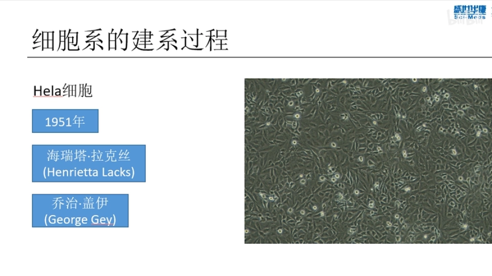

讲者还补了一句容易被忽略的历史：**在 HeLa 之前，研究人员其实也在培养细胞**，只是早期培养的更接近原代细胞，传两代之后细胞就没了 [【跳转到 01:20】](https://www.bilibili.com/video/BV1Zi4y127LY/?t=80)。也就是说，「细胞系」这个概念的核心不是「能养」，而是**能持续传代而不衰老**——这是后面理解「永生化」的伏笔。

### 1.2 入库要交什么：一份背景清单

细胞建系之后要公布、要分发，分发之前必须找专业细胞库保藏。讲者以 ATCC 细胞库入库检测项目为例，列了一份清单 [【跳转到 02:32】](https://www.bilibili.com/video/BV1Zi4y127LY/?t=152)：

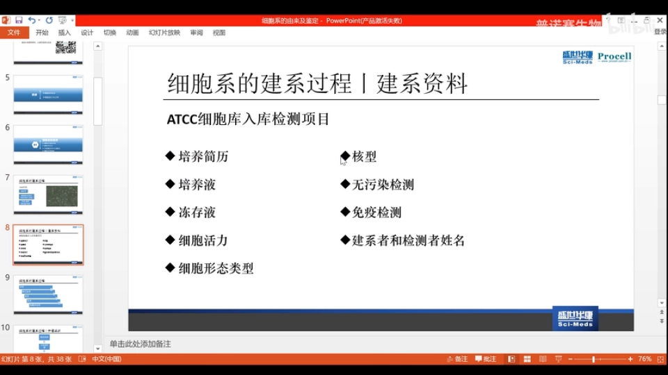

| 项目 | 具体内容 |
| --- | --- |
| 培养简历 | 这个细胞是怎么养起来的，含建系时间、建系人、组织来源 |
| 培养液 | 用了什么培养基（HeLa 最早用某一种，入库扩增时又用另一种） |
| 冻存液与冻存条件 | 冻存时的配方与条件 |
| 细胞活力 | 复苏前后的活率 |
| 细胞形态类型 | 贴壁/悬浮、形态特征 |
| 核型 | 染色体数目与形态 |
| 无污染检测 | 无菌、支原体等 |
| 免疫检测 | 表面标志等免疫学特征 |
| 建系者与检测者姓名 | 责任人信息 |

**这份清单其实就是「细胞系元数据」的完整定义。** 对照它看公共数据集里的 `cell_line` 字段，你会立刻发现缺了什么：通常只有名字，而培养液、代次、核型、检测者全都没有。而这些恰恰是讲者后面反复强调的「差异来源」。

### 1.3 建系的两条路：肿瘤组织与正常组织

讲者把建系方法分成两类 [【跳转到 05:36】](https://www.bilibili.com/video/BV1Zi4y127LY/?t=336)：

**肿瘤组织建系**相对简单：恶性程度强的肿瘤细胞会自发永生化，切块贴壁之后细胞自己爬出来，传两代就慢慢稳定下来，再把细胞单独挑出来做鉴定。这里有一个关键操作——**必须去掉成纤维细胞**：癌旁组织里主要是成纤维细胞，在生长前期它长得猛、营养代谢也强，会抑制肿瘤细胞的生长；去掉的方法有差速贴壁，也可以机械刮除 [【跳转到 06:26】](https://www.bilibili.com/video/BV1Zi4y127LY/?t=386)。

**正常组织建系**要麻烦得多：原代细胞养几代就增殖不动了，必须做**永生化处理**。讲者列了三类方法：病毒基因转染（常用 SV40 病毒、EB 病毒）、端粒酶激活、癌基因激活 [【跳转到 08:31】](https://www.bilibili.com/video/BV1Zi4y127LY/?t=511)。

> 这一段对读数据有一个直接含义：**「细胞系」这个词里已经包含了一次人工改造。** 永生化本身（端粒酶激活、病毒基因导入）就是一次遗传扰动，它改变了细胞对后续扰动的响应基线。所以「同一个基因型、同一个组织来源」的两个细胞系，未必可以互换。

## 二、名字是怎么定的：四套完全不同的命名规则

讲者说得很直接：大家接触到的细胞系一般就是简称，但**每个细胞的建系规则不一样** [【跳转到 09:46】](https://www.bilibili.com/video/BV1Zi4y127LY/?t=586)。他给了四类例子：

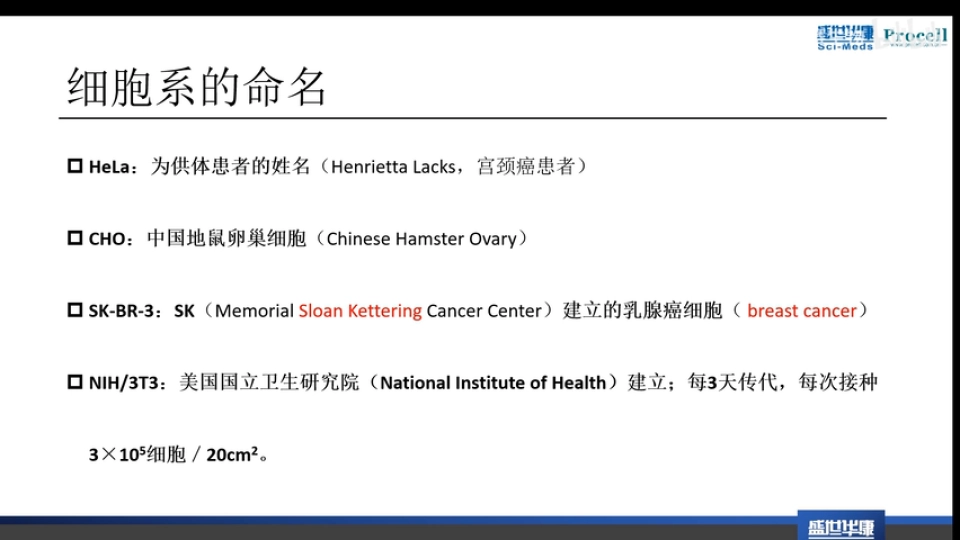

| 命名规则 | 例子 | 拆开看是什么 |
| --- | --- | --- |
| 供体姓名 | HeLa | Henrietta Lacks，宫颈癌患者 |
| 物种 + 组织 | CHO | Chinese Hamster Ovary，中国地鼠卵巢细胞 |
| 机构缩写 + 癌种 | SK-BR-3 | SK = Memorial Sloan Kettering Cancer Center，BR = breast cancer |
| 机构 + 生长特性 | NIH/3T3 | NIH 建立；每 3 天传代，每次接种 $3\times10^{5}$ 细胞 / 20 cm² |

讲者还提到 SW 系列以机构名称开头、后面跟编号，以及 MDA-MB 这种「建系单位 + 癌种 + 编号」的组合 [【跳转到 10:36】](https://www.bilibili.com/video/BV1Zi4y127LY/?t=636)。

**这套规则的不统一，正是「细胞系名字不能当 ID 用」的根源。** 名字里可能编码了供体、机构、物种、组织、癌种、生长特性中的任意一两项，而**没有任何一项是必填的**。两个名字看起来相似，可能一个来自人、一个来自仓鼠；名字里带「乳腺癌」的，未必真的表达乳腺癌的特征——这正是下一节要讲的 HepG2 案例。

## 三、自建还是公认：背景信息在不在，决定了你要做多少工作

### 3.1 HUVEC 的三行对照

讲者用「人脐静脉内皮细胞」做了一个非常清楚的三行对照 [【跳转到 11:58】](https://www.bilibili.com/video/BV1Zi4y127LY/?t=718)：

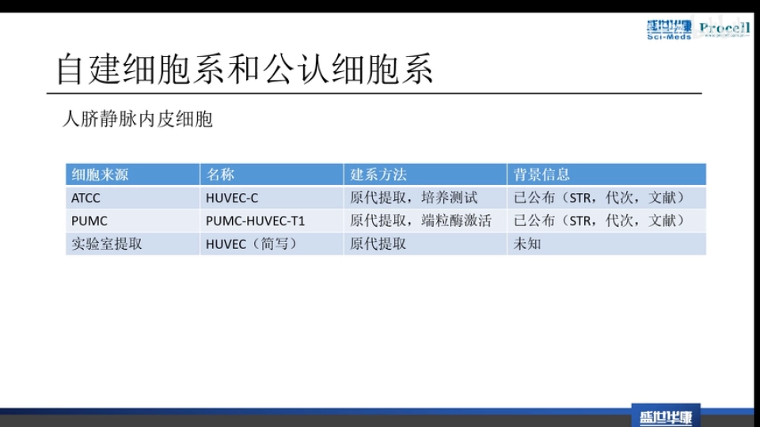

| 细胞来源 | 名称 | 建系方法 | 背景信息 |
| --- | --- | --- | --- |
| ATCC | HUVEC-C | 原代提取，培养测试 | 已公布（STR、代次、文献） |
| PUMC | PUMC-HUVEC-T1 | 原代提取，端粒酶激活 | 已公布（STR、代次、文献） |
| 实验室提取 | HUVEC（简写） | 原代提取 | 未知 |

讲者把差异归成两点 [【跳转到 12:48】](https://www.bilibili.com/video/BV1Zi4y127LY/?t=768)：

1. **代次稳定性**：自己建的细胞，条件有没有优化过会直接影响能传多少代——条件好的实验室能传上十代，条件差的只有十几二十代；
2. **认可度**：用 ATCC 买的 HUVEC-C，文章里只要写清来源并确认鉴定结果，它的相关特性是**默认成立**的；而自建细胞要让大家认可，**必须自己把指标测出来**（比如内皮细胞要测 CD31 之类的内皮指标），把鉴定图提供上去 [【跳转到 13:38】](https://www.bilibili.com/video/BV1Zi4y127LY/?t=818)。

讲者还举了 PUMC 那株的做法：原代提取之后又做了一次端粒酶激活，因为原代细胞传代次数有限、不稳定，实验周期一长就得重新提取，而重新提取的特性跟第一次可能又有差异 [【跳转到 14:28】](https://www.bilibili.com/video/BV1Zi4y127LY/?t=868)。

> 讲者在这里给出的总结值得抄下来：**细胞系与原代细胞最大的区别在于可重复性** [【跳转到 14:53】](https://www.bilibili.com/video/BV1Zi4y127LY/?t=893)。这句话反过来读，就是「一个细胞系名字的价值 = 它背后的可重复性承诺」。数据集里写 `HUVEC` 而不写具体是哪一株，等于放弃了这个承诺。

### 3.2 背景信息到哪里查：三个平台

讲者列了三个查询入口 [【跳转到 16:33】](https://www.bilibili.com/video/BV1Zi4y127LY/?t=993)：

1. **瑞士的生物信息学网站**（讲者演示的是 Cellosaurus）——整合了 ATCC、DSMZ、JCRB 等知名细胞库的信息，一般建议先在这里检索；
2. **ATCC**——内容更细致，有些详细信息要点进 ATCC 页面才看得到；如果某个细胞在整合库里信息不全，就要去 DSMZ、ECACC 这些库单独查；
3. **国家实验资源共享平台**——国内建系的一些信息没有对外公布，只能在国内平台查。

## 四、Cellosaurus 页面怎么读：一个细胞系的完整档案

讲者现场演示了 HepG2 的页面，并逐栏讲解——这一节是整场讲座里对「读元数据」最有用的部分。

### 4.1 红字警告：这个细胞被错误分类了

页面里用红线框出来的一栏写着：**Problematic cell line: Misclassified. Originally thought to be a hepatocellular carcinoma cell line but shown to be from a hepatoblastoma** [【跳转到 18:21】](https://www.bilibili.com/video/BV1Zi4y127LY/?t=1101)。

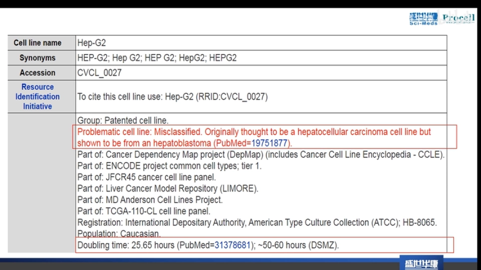

讲者的解释是：HepG2 建系时大家都认为它是肝癌细胞，后面经过各方面验证发现它其实是**肝母细胞瘤**细胞，也就是**它本身在定义上是有错误的**——但这并不影响它后续的使用 [【跳转到 18:46】](https://www.bilibili.com/video/BV1Zi4y127LY/?t=1126)。

他还提到另一类更严重的问题：**有些细胞建系之后被 HeLa 细胞污染了**，页面上会用特别的红字标出来，这类细胞「尽量后面不要用」[【跳转到 18:21】](https://www.bilibili.com/video/BV1Zi4y127LY/?t=1101)。

> 这是本节最锋利的一个例子：**元数据里的 `disease = hepatocellular carcinoma` 可能就是错的**，而错误从建系那天起就写进了所有下游数据集。如果你用疾病标签去筛选「肝癌细胞系的药物响应」，HepG2 会被错误地纳入；如果你用组织来源做分层，它的位置也是错的。这类错误不会在表达矩阵里报错，只能靠查档案发现。

### 4.2 页面上的其他几栏

讲者接着指出页面里其他需要关注的栏目 [【跳转到 19:21】](https://www.bilibili.com/video/BV1Zi4y127LY/?t=1161)：

- **取材位置**：比如来源写「肝脏」，但有的细胞是从腹水里取出来的（存在转移），实际取材位置会单独标出；
- **突变位点**：有文献支持，标明在哪些位点有突变、哪个碱基替换成了哪个碱基；
- **蓝色字体**：都可以点进去看对应的文献。

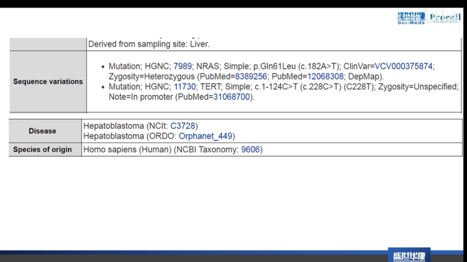

**这一栏是「细胞系」与「表达数据」之间最直接的桥梁。** 同一个药物在不同细胞系里响应不同，一个常见原因就是**信号通路上的突变状态不同**：比如一个细胞本身已经带有通路下游的激活突变，上游受体被抑制时它的响应就会弱得多。所以读数据集时，`cell_line` 应该被展开成一组特征（组织来源、疾病、关键突变），而不是一个哑变量。

## 五、STR 鉴定：把名字变成一段可比的数字

### 5.1 原理：微卫星重复次数的个体差异

讲者说 STR 鉴定的原理之前讲过，这里只简单提：**检测基因组里的一些微卫星序列**——一段很短的重复序列（比如只有 ATCG 四个碱基），重复十次或十五次，**这在每一个个体里都会有差异** [【跳转到 23:31】](https://www.bilibili.com/video/BV1Zi4y127LY/?t=1411)。

因为早期确定的细胞系基本上一个病人只建了一株，所以**只要定位到这个人，就可以定位到细胞系** [【跳转到 23:56】](https://www.bilibili.com/video/BV1Zi4y127LY/?t=1436)。

### 5.2 图谱怎么读：位点名称与重复数

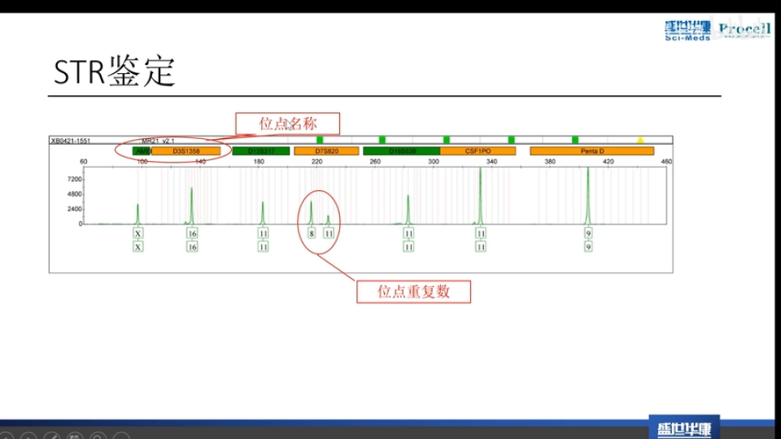

讲者把一张电泳图谱拆成两层 [【跳转到 24:21】](https://www.bilibili.com/video/BV1Zi4y127LY/?t=1461)：

- **最上面是位点名称**，这些位点是固定的；
- **下面是位点的重复数**——比如 D7S820 这个位点重复了多少次；重复数决定扩增出来的片段大小。

他把图谱的读法类比成跑电泳：背景灰色的线相当于 Marker，峰的位置就是片段大小，**峰高就是条带的亮度、信号强度** [【跳转到 26:01】](https://www.bilibili.com/video/BV1Zi4y127LY/?t=1561)。

### 5.3 位点数从 9 个涨到二十几个

讲者交代了方法学的演进：最核心的是 **8+1**，也就是八个核心位点加一个性别位点；DSMZ 和 ATCC 早期因为方法刚确定，只做了这九个；后来位点数量不断增加，中间经历过 17+1（18 个）的阶段，**现在一般做二十几个位点** [【跳转到 24:46】](https://www.bilibili.com/video/BV1Zi4y127LY/?t=1486) [【跳转到 25:11】](https://www.bilibili.com/video/BV1Zi4y127LY/?t=1511)。

> 这意味着一件很实际的事：**不同年代、不同实验室出的 STR 数据，位点集合可能不一样。** 拿一份 9 位点的老数据和一份 21 位点的新数据比对，只能在共同的位点上比——这也是为什么数据库里会并列显示不同位点数量的比对结果。

### 5.4 匹配度 98.3% 是怎么算出来的

讲者给了一个真实例子：送样时**不要直接写细胞名字**，因为别人在做位点匹配时可能会有针对性地匹配；他们写的是编号 PC311，数据出来之后拿到数据库里比对，**匹配度 98.3%** [【跳转到 26:51】](https://www.bilibili.com/video/BV1Zi4y127LY/?t=1611)。

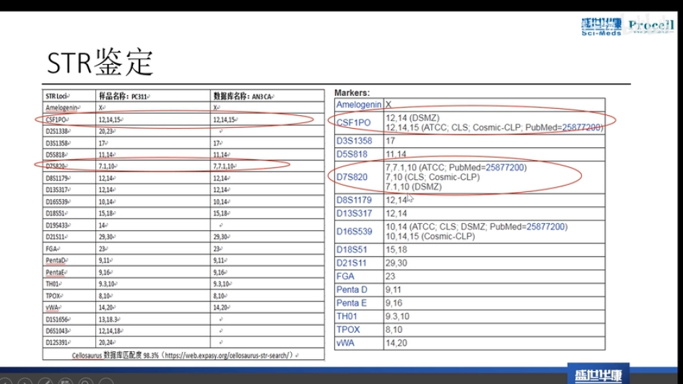

唯一的差异在 **D7S820**：他们检测出来是 7、10，而数据库里写的是 7、7、10 [【跳转到 27:16】](https://www.bilibili.com/video/BV1Zi4y127LY/?t=1636)。讲者解释了为什么这不是「不匹配」——**同一个位点在不同细胞库里登记的值本来就可能不同**：这个细胞在 ATCC 里 D7S820 是 7、7、10，在 DSMZ 里是 7、10，可能少了 7 的那个重复数 [【跳转到 27:41】](https://www.bilibili.com/video/BV1Zi4y127LY/?t=1661)。

这个例子对做跨数据集分析的人很有教育意义：**「同一个细胞系」在不同数据库里的参考值并不完全一致**，所以细胞系身份比对从来不是精确字符串匹配，而是一个阈值判断——讲者给的阈值是**匹配度 80% 以上可以认为与那个细胞系相关** [【跳转到 28:06】](https://www.bilibili.com/video/BV1Zi4y127LY/?t=1686)。

### 5.5 三个重复数意味着什么：多等位基因与污染

STR 还能回答第二个问题：**有没有同种属的细胞交叉污染**。判据是看某个位点出现了几个重复数 [【跳转到 28:31】](https://www.bilibili.com/video/BV1Zi4y127LY/?t=1711)：

- 正常细胞是二倍体，一个位点最多两个等位基因；
- 肿瘤细胞倍体异常，可能有三条甚至更多染色体，于是出现**三个重复数**（比如 10、12、15）；
- 但如果**多等位基因太多**——比如总共 18 个位点里有一半、九个位点都有多等位基因——那「最起码说明有不同种类的细胞混在一起了」[【跳转到 29:21】](https://www.bilibili.com/video/BV1Zi4y127LY/?t=1761)。

讲者还提醒了比对时的操作细节：**要用英文输入法，逗号要用小写**，否则匹配可能出错 [【跳转到 29:46】](https://www.bilibili.com/video/BV1Zi4y127LY/?t=1786)。这个细节听起来琐碎，但它说明**细胞系身份核对是一件需要规范操作的事，不是随手一搜**。

## 六、STR 抓不到的部分：种属鉴定与核型分析

### 6.1 种属鉴定：PCR 与毛细管电泳

STR 主要针对人源细胞。非人源细胞怎么办？讲者的顺序是：**先确定种属对不对，再做其他鉴定** [【跳转到 30:34】](https://www.bilibili.com/video/BV1Zi4y127LY/?t=1834)。

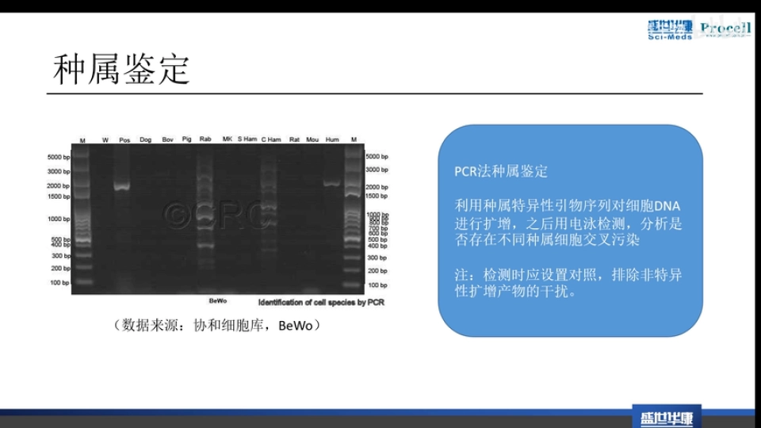

**PCR 法**用种属特异性引物扩增细胞 DNA，再检测条带。讲者强调这个方法的准确性**与引物设计直接相关**：引物特异性好，检测就干净；引物特异性不强（比如本来是检测仓鼠的，在人细胞、大鼠细胞上也能跑出来，只是大小不同），就必须**设置对照**来排除非特异性扩增产物的干扰 [【跳转到 31:24】](https://www.bilibili.com/video/BV1Zi4y127LY/?t=1884)。

更直观的一个方法是用**种属复合扩增 + 毛细管电泳**：设计十个种属的引物混在一起，出峰位置对应种属 [【跳转到 32:39】](https://www.bilibili.com/video/BV1Zi4y127LY/?t=1959)。

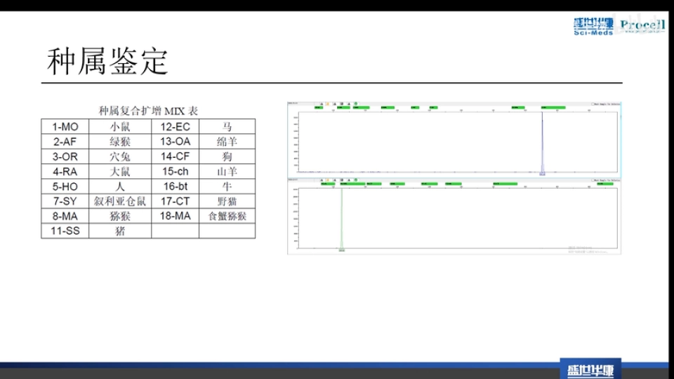

判读规则很清楚 [【跳转到 33:04】](https://www.bilibili.com/video/BV1Zi4y127LY/?t=1984)：

- 某个种属对应的位置**出峰**，说明是这个种属的细胞；
- 下方的 **18S 是内参，必须出峰**，不出说明实验失败；
- 如果**多个种属都出峰**，说明这个细胞是混合的，也就是**交叉污染** [【跳转到 33:29】](https://www.bilibili.com/video/BV1Zi4y127LY/?t=2009)。

### 6.2 核型分析：解释「三个重复数」的来源

讲者把核型分析的作用定位为「也是判断种属」，因为不同种属的核型特点不一样 [【跳转到 34:07】](https://www.bilibili.com/video/BV1Zi4y127LY/?t=2047)。

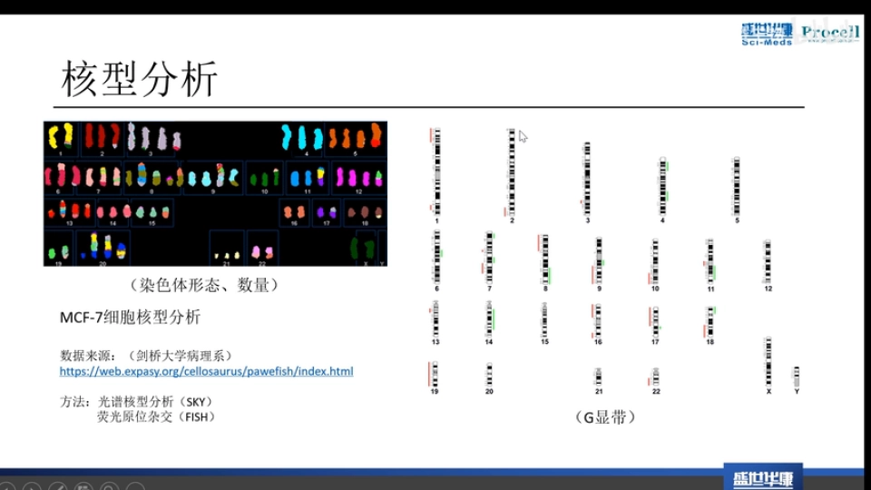

有意思的是，讲者用核型来解释 STR：MCF-7 的 3 号染色体有四条、4 号染色体有三条，**这就解释了为什么 STR 会出现三个等位基因**——它本身就有三条染色体，每条上各有一个重复次数 [【跳转到 34:32】](https://www.bilibili.com/video/BV1Zi4y127LY/?t=2072)。

核型分析一般在建系时用，后续用得不多，因为**做起来麻烦**：要先把核型检测出来，结果还需要专门仪器分析 [【跳转到 34:57】](https://www.bilibili.com/video/BV1Zi4y127LY/?t=2097)。

### 6.3 辅助手段：免疫荧光、流式、特异性染色

讲者把剩下的鉴定手段归为「确定细胞类型」的辅助手段 [【跳转到 36:26】](https://www.bilibili.com/video/BV1Zi4y127LY/?t=2186)：

- **免疫荧光**：测特定标志物（如内皮细胞的 CD31），但内皮细胞有好多个指标，具体做哪个要看实验目的，没有统一标准；
- **流式检测**：同样是用抗体，讲者举了自己做的 RAW264.7 的 F4/80 鉴定（巨噬细胞标志）；
- **特异性染色**：验证功能表型——3T3-L1 诱导成脂肪细胞后用油红 O 染脂滴、苏木素染核；成骨细胞用茜素红染色；MC3T3-E1 本来就是用来做成骨的 [【跳转到 38:27】](https://www.bilibili.com/video/BV1Zi4y127LY/?t=2307)。

## 七、现状与趋势：为什么「交叉污染」是重点方向

讲者用一张对照图收尾 [【跳转到 39:42】](https://www.bilibili.com/video/BV1Zi4y127LY/?t=2382)：

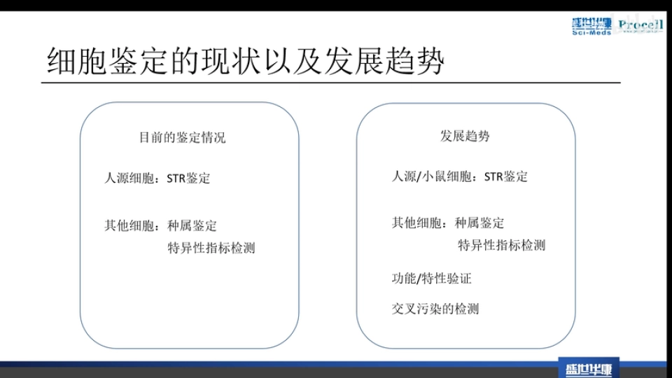

**现状**：人源细胞做 STR 鉴定；其他种属做种属鉴定加特异性指标。讲者说得很实际——**发论文时人源细胞只要 STR 是对的，其他内容只需要针对自己研究方向的那个指标去测** [【跳转到 39:47】](https://www.bilibili.com/video/BV1Zi4y127LY/?t=2387)。

**趋势**有四条：小鼠也纳入 STR（方法基本完善，但**数据库还不完善**，公布的数据不全，所以只能自己保存位点数据做参考）；其他种属仍是种属加特性；增加功能/特性验证；以及**交叉污染检测** [【跳转到 41:02】](https://www.bilibili.com/video/BV1Zi4y127LY/?t=2462)。

讲者讲了 STR 进入细胞培养领域的历史：**最开始就是因为有很多细胞在培养时被 HeLa 细胞污染了**，研究人员发现这个问题后，想到用法医学里的 STR 去判断有没有不同来源的细胞混进来 [【跳转到 42:17】](https://www.bilibili.com/video/BV1Zi4y127LY/?t=2537)。

但 STR 有一个盲区：**如果里面混了一个小鼠细胞，STR 是鉴定不出来的**，所以后来又补充了种属鉴定 [【跳转到 42:42】](https://www.bilibili.com/video/BV1Zi4y127LY/?t=2562)。讲者还提到一篇国内研究：把各地不同来源的细胞拿去做 STR，**匹配率都很高、都没错**；但进一步做种属检测，会发现**很多实验室来源的细胞里其实混了不同种属的细胞** [【跳转到 43:07】](https://www.bilibili.com/video/BV1Zi4y127LY/?t=2587)。

最后他提到 **2021 年专门出了一个关于细胞交叉污染鉴定的国家标准**，并展示了标准里的方法对照表 [【跳转到 43:57】](https://www.bilibili.com/video/BV1Zi4y127LY/?t=2637)：

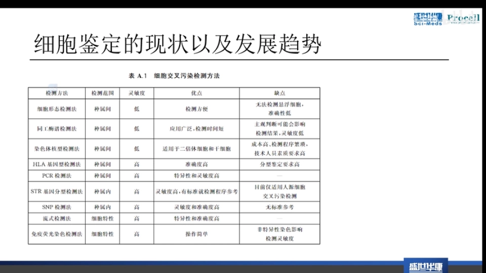

这张表的价值在于它把每种方法的**检测范围**（种属间 / 种属内 / 细胞特性）与**灵敏度**并列：形态检测方便但灵敏度低、无法检测悬浮细胞；同工酶应用广泛但靠主观判断；核型适用于二倍体细胞和干细胞但成本高；PCR 特异性与灵敏度高；STR 灵敏度高、有标准可参考，但**目前只适用人源细胞的交叉污染检测**；SNP 灵敏度与准确度高但没有标准参考。

## 八、把这一整套接回 `cell_line` 字段

讲者的视角是「怎么把细胞管好」，而我们要问的是「怎么把细胞读懂」。把讲座里的每一条结论翻译过来，`cell_line` 这一列至少应该被展开成下面这组问题：

| 讲座里的说法 | 读数据集时该追问的 |
| --- | --- |
| 建系三要素：时间、供体、组织 | 这个细胞系的组织来源与疾病标签是否与论文正文一致 |
| 入库清单里的培养液、代次、核型 | 数据集有没有记录培养基、传代次数、核型 |
| HepG2 被标为 Misclassified | 疾病标签是否被后续研究修正过（查 Cellosaurus 红字） |
| 突变位点有文献支持 | 这个细胞系带哪些通路突变，会不会解释响应差异 |
| 自建细胞背景信息「未知」 | 这个细胞系有没有可引用的 STR 图谱与来源 |
| STR 匹配度 80% 以上算相关 | 数据集是否报告过细胞身份验证 |
| 多等位基因过多意味着混合 | 有没有可能这一列名字底下其实是两种细胞 |
| STR 抓不到其他种属污染 | 有没有做过种属鉴定 |
| 不同库对同一位点登记值不同 | 跨数据集比对细胞系时，用阈值而不是精确匹配 |

**一句话概括**：**细胞系名字是一个指针，不是一个值。** 它指向一条可核查的背景记录；记录在，这个坐标就是可靠的；记录不在（自建细胞、未验证、被污染），这个坐标就是空的——而空的坐标会让「同一药物、同一剂量、不同细胞系」的比较失去意义，因为你不知道差异来自生物学，还是来自你手上的细胞根本不是你以为的那个。

## 小结

- **细胞系 = 一段建系史 + 一份检测清单**：HeLa 的三要素（1951 年、Henrietta Lacks、George Gey）是这份档案的样板。
- **命名规则有四套且不统一**：供体姓名、物种加组织、机构加癌种、机构加生长特性；名字里编码的信息既不完整也不可靠。
- **自建与公认的差别是可重复性**：公认细胞系的背景信息已公布，引用即可；自建细胞必须自己把指标测出来。
- **背景信息有官方入口**：整合库（Cellosaurus）优先，再到 ATCC、DSMZ、ECACC 与国内平台补细节。
- **红字警告要当回事**：HepG2 的疾病标签是错的（肝母细胞瘤而非肝细胞癌），被 HeLa 污染的细胞应避免使用。
- **STR 是身份的金标准**：8+1 起步、现在二十几个位点，匹配度 80% 以上可认为相关；不同库对同一位点的登记值可能不同。
- **多等位基因过多 = 混了别的细胞**；STR 抓不到其他种属污染，要靠种属鉴定；核型能解释多等位基因的来源。
- **2021 年有了交叉污染鉴定的国标**，方法各有检测范围与灵敏度，没有一种方法能覆盖全部情形。

## 关键术语速查

| 术语 | 一句话解释 |
| --- | --- |
| 建系（establishment） | 把原代细胞培养成可长期传代的稳定细胞系的过程 |
| 原代细胞 | 直接从组织分离、未传代或仅传少数几代的细胞 |
| 永生化 | 让细胞绕过衰老、可无限传代的处理，如端粒酶激活、病毒基因导入 |
| 差速贴壁 | 利用不同细胞贴壁速度不同来分离细胞（如去掉成纤维细胞）的方法 |
| STR（短串联重复） | 基因组中短序列重复次数的差异，用于个体与细胞系身份鉴定 |
| 位点重复数 | 某个 STR 位点重复了多少次，决定扩增片段大小，是比对的基本单位 |
| 匹配度 | 待测样品与数据库中某细胞系在位点上的一致比例，一般 80% 以上认为相关 |
| 多等位基因 | 一个位点出现两个以上重复数，可能来自染色体数目异常或细胞混合 |
| 种属鉴定 | 判断细胞来自哪个物种，用于发现 STR 抓不到的其他种属污染 |
| 核型分析 | 观察染色体的数目与形态，可解释多等位基因的来源 |
| 交叉污染 | 一种细胞混入另一种细胞，导致后续实验结果不属于名义上的细胞系 |
| Cellosaurus | 整合多家细胞库信息的细胞系知识库，含问题细胞系标注与 STR 数据 |