# scGLUE：把非配对的多组学数据粘到同一个隐空间

> 视频来源：[单细胞多组学整合工具scglue](https://www.bilibili.com/video/BV1hBMc6yEw6/)（Bilibili · AI4Biology）｜时长约 17 分钟
> 导读：这是一次「原理 5 分钟 + 实操 12 分钟」的工具讲解，讲 scGLUE 怎么用一张先验调控图把 RNA、ATAC、H3K27ac 三种互不对应的数据拉到同一个隐空间，并完整跑了一遍 Jupyter Notebook。它的价值在于把「联合嵌入」这个抽象概念落到了具体的输入文件、参数和踩坑上。字幕为中文 AI 生成，工具名与参数名按幻灯片还原。

## 本讲要解决的核心问题（SCQA）

**背景**：单细胞转录组测序能测出每个细胞特异的表达情况，但它「只能反映单一维度的信息」[【跳转到 00:30】](https://www.bilibili.com/video/BV1hBMc6yEw6/?t=30)。所以需要单细胞多组学——转录组、基因组、表观基因组、蛋白质组、代谢组、空间组一起测。

**冲突**：多模态数据分两种——**配对的**（来自同一个细胞）和**非配对的**（来自不同细胞）。非配对数据既没有共享的细胞，也没有共享的特征，怎么整合？「跨模态整合需要借助算法」[【跳转到 01:20】](https://www.bilibili.com/video/BV1hBMc6yEw6/?t=80)。

**疑问**：算法具体靠什么把两套毫无交集的数据拉到一起？输入要准备什么？跑出来的结果怎么判断对不对？

**回答（中心思想）**：scGLUE 的答案是**用先验生物学知识当「胶水」**——把「基因—ATAC 峰」之间已知或推测的调控关系做成一张引导图（guidance graph），再用图神经网络把这张图编码进特征嵌入空间，于是两个模态在隐空间里就有了共同的语义坐标 [【跳转到 02:05】](https://www.bilibili.com/video/BV1hBMc6yEw6/?t=125)。讲者把它概括成一句：GLUE 利用包含先验特征关系的知识，在整合非配对多模态数据的过程中「弥合不同数据特征空间之间的差距」[【跳转到 01:30】](https://www.bilibili.com/video/BV1hBMc6yEw6/?t=90)。

## 一、先看清问题：为什么非要「多模态」

### 1.1 从 bulk 到单细胞：先解决「平均」的问题

视频开场用两张流程图铺背景。传统 bulk RNA 测序「将组织裂解、提取总 RNA、再捕获 mRNA 测序」，得到的是转录组信息；但这样做是把一整块组织的 RNA 一口气全提出来，组织里不同细胞的差异表达**没有办法检测出来**，得到的是平均信号，从而掩盖了细胞异质性 [【跳转到 00:05】](https://www.bilibili.com/video/BV1hBMc6yEw6/?t=5)。

单细胞转录组测序解决了这个问题：把组织分散为单个细胞，一个液滴包裹一个细胞，再裂解、测序，能检测出每个细胞特异的表达情况 [【跳转到 00:30】](https://www.bilibili.com/video/BV1hBMc6yEw6/?t=30)。

### 1.2 但单细胞 RNA 只是一个维度

「只有单细胞转录组，测序只能反映单一维度的信息」[【跳转到 00:55】](https://www.bilibili.com/video/BV1hBMc6yEw6/?t=55)。所以要往上叠模态：转录组、基因组、表观基因组、蛋白质组、代谢组、空间组。叠上去之后，研究层级也变了——可以看到肿瘤微环境里不同细胞类型的特点，进一步搭建病理环境的空间结构。

### 1.3 通用流程里，多模态整合是「额外那一步」

讲者把单细胞多组学数据处理的一般流程列了一遍：比对到基因组 → 生成每个细胞的特征矩阵 → 质量控制 → 标准化 → 选择高变基因 → 降维 → 构建共享邻居图 → 消除批次差异 → 细胞聚类 → 细胞注释 → 用 UMAP 等方式可视化 [【跳转到 01:05】](https://www.bilibili.com/video/BV1hBMc6yEw6/?t=65)。

然后他补了一句关键的：「单细胞多组学数据处理除了上述步骤外，还需要对多模态数据进行整合」[【跳转到 01:20】](https://www.bilibili.com/video/BV1hBMc6yEw6/?t=80)。

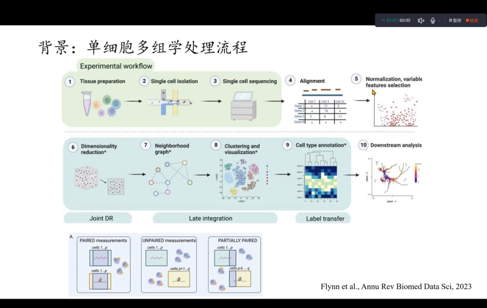

这张图值得停一下。上半部分是标准分析流程的十个步骤，其中第 6~8 步（降维、邻居图、聚类可视化）下面被标注成了 **Joint DR**、**Late integration**、**Label transfer** 三种不同的整合策略——这正好对应本节要讨论的「整合可以在流程的不同位置发生」。下半部分 A/B/C 三块则画了三种测量形态：PAIRED（同一批细胞测两种模态）、UNPAIRED（两批不同细胞各测一种模态）、PARTIALLY PAIRED（部分重叠）。scGLUE 针对的是中间那种 UNPAIRED。

### 1.4 三种形态，三个不同的目标

讲者把多模态数据分成三类 [【跳转到 01:45】](https://www.bilibili.com/video/BV1hBMc6yEw6/?t=105)：

1. **配对**：来自同一个细胞——细胞一一对应已知；
2. **非配对**：来自不同细胞——细胞对应关系未知，要靠算法猜；
3. **部分配对（有重叠）**：一部分细胞重叠、一部分不重叠。

这三类的难度是递增的。配对数据只要学一个共享表示；非配对数据必须先解决「谁对应谁」；部分配对则两件事都要做。scGLUE 的定位是**专门处理非配对**——也就是最难、信息最少的那一类。

## 二、scGLUE 是什么：一张图 + 两个网络

### 2.1 出处与定位

scGLUE 全称 **Graph Linked Unified Embedding**（图连接统一嵌入），由国家生物信息中心的蔡志锦和高歌团队开发，2022 年发表于 *Nature Biotechnology*，GitHub 上有开源软件包 [【跳转到 01:30】](https://www.bilibili.com/video/BV1hBMc6yEw6/?t=90)。

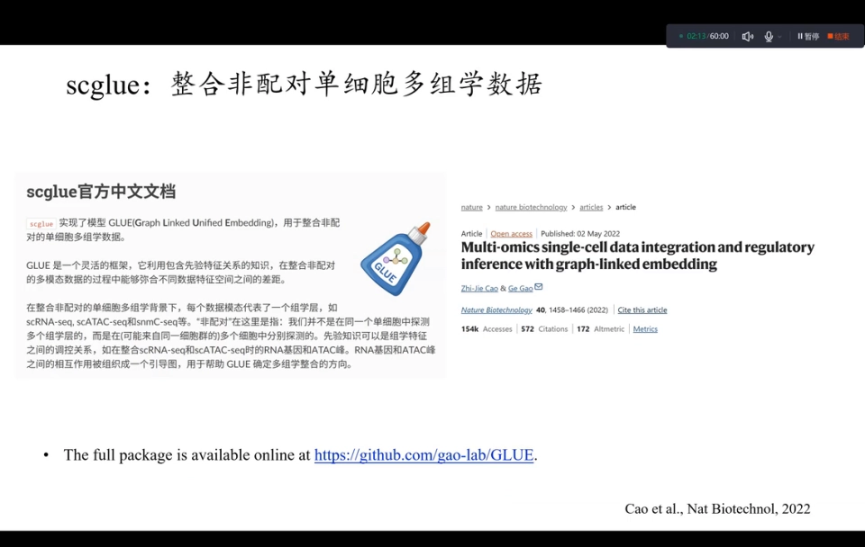

幻灯片上引的官方文档原文值得抄下来：「GLUE 是一个灵活的框架，它利用包含先验特征关系的知识，在整合非配对的多模态数据的过程中能够弥合不同数据特征空间之间的差距。」文档还解释了「非配对」在这里的确切含义：**并不是在同一个细胞中探测多个组学层，而是在（可能来自同一细胞群的）多个细胞中分别探测**，先验知识可以是组学特征之间的调控关系，比如整合 scRNA-seq 和 scATAC-seq 时的 RNA 基因和 ATAC 峰 [【跳转到 01:30】](https://www.bilibili.com/video/BV1hBMc6yEw6/?t=90)。

注意这句话里藏着 scGLUE 的一个隐含前提：**两批非配对数据最好来自同一个细胞群**。如果两批数据来自完全不同的组织，先验图也救不了。

### 2.2 架构：横向是变分自编码器，纵向是图神经网络

讲者用一句话概括了架构：「在这个图里横向这样走就是变分自编码器，纵向这样走就是图神经网络」[【跳转到 02:05】](https://www.bilibili.com/video/BV1hBMc6yEw6/?t=125)。

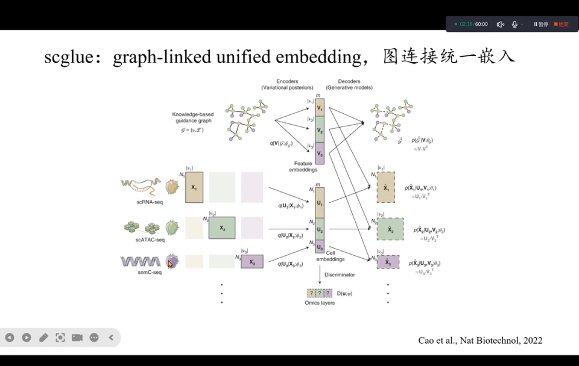

这张图是全文的核心，逐块读：

**横向——变分自编码器（VAE）**。每个数据模态代表一个组学层（图中画了 scRNA-seq、scATAC-seq、snmC-seq 三层，实际用什么模态由你的数据决定）。每一层都有：

- 一个**特征嵌入矩阵** $V_m$（图中标为 Feature embeddings），把该模态的每个特征映射成一个低维向量；
- 一个**编码器** $q$（Variational posteriors，变分后验），把高维的细胞特征向量压成一个低维的**细胞嵌入** $U$（Cell embeddings）；
- 一个**解码器** $p$（Generative models，生成模型），从细胞嵌入重建原来的高维数据。

讲者的类比是「压缩—解压」：编码器把高维单细胞数据压缩成低维细胞嵌入，解码器从这些细胞嵌入里重建原文 [【跳转到 03:00】](https://www.bilibili.com/video/BV1hBMc6yEw6/?t=180)。

**纵向——图神经网络（GNN）**。模型有一个基于先验生物学知识的**引导图** $\mathcal{G} = (\mathcal{V}, \mathcal{E})$：

- 顶点 $\mathcal{V}$ 对应不同组学形成的**全部特征**，比如基因和 ATAC 峰；
- 边 $\mathcal{E}$ 代表**已知或推测的调控关系**；
- 模型通过一个编码器学习图中每个顶点的低维特征嵌入。

讲者强调这一步的作用：「图神经网络将先验知识编码到特征嵌入空间中，赋予了细胞嵌入空间明确的语义」[【跳转到 03:25】](https://www.bilibili.com/video/BV1hBMc6yEw6/?t=205)。

**为什么这一步是关键**：如果没有引导图，VAE 只能各自压缩各自的模态，两个隐空间之间没有任何约束，对齐就无从谈起。引导图把「基因 A 的启动子区域 = ATAC 峰 B」这条生物学事实写进了模型，于是 $V_{\text{RNA}}$ 里基因 A 的嵌入和 $V_{\text{ATAC}}$ 里峰 B 的嵌入被拉近——**两个模态因此在特征层面被「翻译」到了一起**。

这就是本节要讲的**特征层面的整合**：不要求细胞对齐，也不要求隐空间天然对齐，而是先用先验知识建立特征之间的对应，再让细胞嵌入继承这种对应。

### 2.3 用户要给什么：两个输入

用户需要给 scGLUE 提供两样东西 [【跳转到 03:50】](https://www.bilibili.com/video/BV1hBMc6yEw6/?t=230)：

1. **各组学层的细胞特征矩阵**——按标准流程预处理后的数据；
2. **先验引导图**——特征之间的连接关系。

把这两个输入进去训练，各模态的模型共同形成一个**联合嵌入空间**，然后就可以在这个空间上做下游分析。

## 三、整合之后能干什么

讲者列了「经典应用」和「扩展应用」两组 [【跳转到 04:15】](https://www.bilibili.com/video/BV1hBMc6yEw6/?t=255)：

**经典应用**：

- 转录组 + 表观组对齐；
- 无标记基因的细胞注释（用 ATAC 那边的注释迁移到 RNA 那边）；
- 峰—基因、TF—靶基因调控得分；
- 从 scATAC 推断基因表达。

**扩展应用**：CITE-seq 表面蛋白数据、scHi-C 三维基因组数据、跨物种（用同源基因作为引导图中的连接锚点做细胞图谱对齐）。

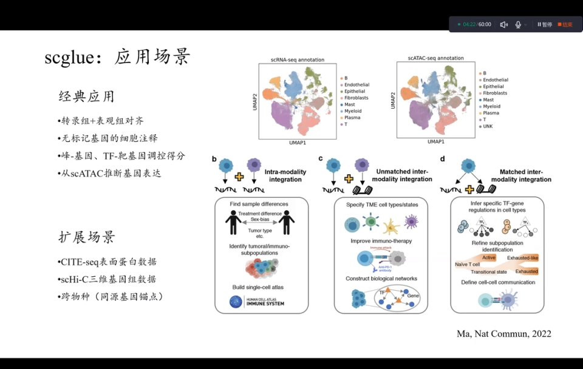

这张图上方是整合的直接产出——左图是 scRNA-seq 的 UMAP 注释，右图是 scATAC-seq 的 UMAP 注释，两边的细胞类型（B、Endothelial、Epithelial、Fibroblasts、Mast、Myeloid、Plasma、T、UNK）一一对应。下方 b/c/d 三块则区分了三种整合能回答的问题：

- **b（模态内整合）**：来自不同细胞的同一测量，可以找样本差异（处理差异、性别差异、肿瘤类型）、鉴定肿瘤/免疫亚群、构建单细胞图谱；
- **c（非配对跨模态整合）**：来自不同细胞的不同组，可以刻画肿瘤微环境的细胞类型与状态、改进免疫治疗、构建生物网络；
- **d（配对跨模态整合）**：来自同一细胞的不同组，可以推断特定细胞类型里的转录因子调控、完善亚群鉴定（图中标出 Active T cell、Naive T cell、Transitional state、Exhausted、Exhausted 等状态）、研究细胞交流。

**这三块的区分很重要**：它说明「整合」不是终点，而是为了回答特定问题。选哪种整合方式，取决于你要回答哪一类问题。

## 四、实操：一次完整的 RNA + ATAC + H3K27ac 整合

讲者用一份肺腺癌数据做了演示：整合同一样本的 scRNA-seq、scATAC-seq 和 H3K27ac（组蛋白乙酰化）数据。因为训练时间较长，他直接讲解 Jupyter Notebook 的代码块和运行结果 [【跳转到 05:30】](https://www.bilibili.com/video/BV1hBMc6yEw6/?t=330)，并且只对已鉴定好的 **T 细胞**这一大群做整合 [【跳转到 05:48】](https://www.bilibili.com/video/BV1hBMc6yEw6/?t=348)。

### 4.1 第一步：统一基因名（最容易漏的一步）

第一个操作是导入 GTF 基因注释文件、过滤基因，**确保各模态数据使用的基因注释信息一致**，把不同来源的基因名注释统一到同一注释空间 [【跳转到 06:06】](https://www.bilibili.com/video/BV1hBMc6yEw6/?t=366)。

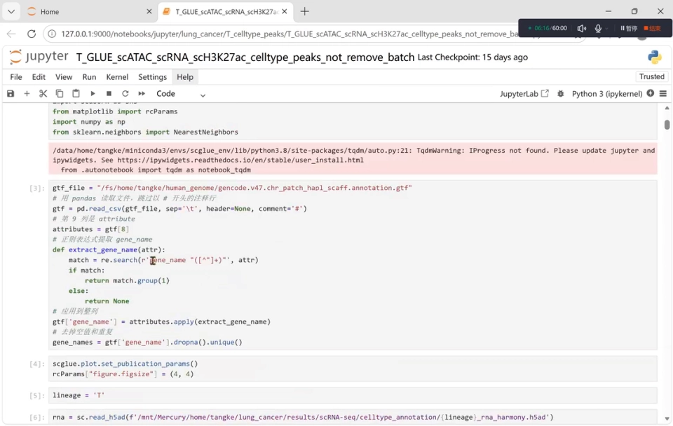

这段代码做的事很朴素：读 GTF（跳过井号开头的注释行），取第 9 列 attribute，用一个正则从里面抽出基因名（匹配 gene_name 后面引号内的内容，见下），去空格去重，得到一个标准的基因名集合。

```python
match = re.search(r'gene_name "([^"]+)"', attr)
```然后「所有的整合都是以 RNA 组为基础的」，所以要把 scRNA-seq 的基因表达矩阵按列过滤，**仅保留那些名称同时出现在标准 GTF 表中的基因** [【跳转到 06:31】](https://www.bilibili.com/video/BV1hBMc6yEw6/?t=391)。

讲者在最后总结时专门把这一步拎出来当坑：「一开始的要把他们的名字统一，这点不一定能想得到；如果不统一的话，那后面操作就可能有很多很多麻烦之处」[【跳转到 16:38】](https://www.bilibili.com/video/BV1hBMc6yEw6/?t=998)。

**为什么这一步不能省**：不同来源的数据可能用 Ensembl ID、可能用基因 symbol、可能带版本号（`ENSG00000141510.17`），也可能用旧命名。scGLUE 的引导图是按特征名连边的，名字对不上，边就断了——**先验知识会静默失效**，而模型不会报错。

### 4.2 第二步：读数据、看批次

数据存在 H5AD 里。讲者顺带解释了 H5AD：「单细胞分析结果的专用格式，全称是 Annotated Data Matrix with HDF5」，里面包含表达矩阵、观测元数据、变量元数据、非结构化数据，还有多维组学数据 [【跳转到 06:53】](https://www.bilibili.com/video/BV1hBMc6yEw6/?t=413)。

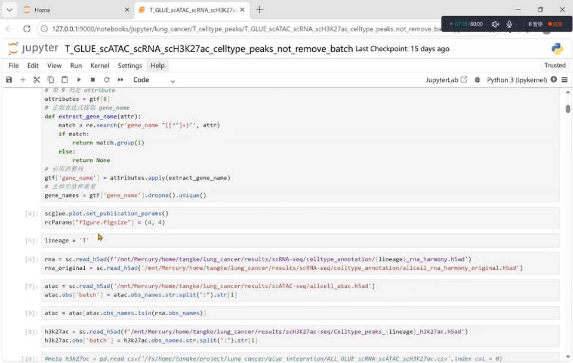

代码里能看到三个模态各自的读入（`rna`、`atac`、`h3k27ac`），以及从 obs_names 里切出样本名当批次：

```python
atac.obs['batch'] = atac.obs_names.str.split(":").str[1]
```
后面分别对三个模态做标准化，然后「看一下来自不同样本的批次效应如何」——讲者的判断是「看差不多，有一点，但觉得可以」[【跳转到 07:52】](https://www.bilibili.com/video/BV1hBMc6yEw6/?t=472)。

### 4.3 第三步：过滤掉细胞数少的小簇

H3K27ac 数据做批次处理后，讲者发现「聚类比较多、越零散」会影响后面的操作，所以要过滤筛选，「把那些细胞数少的类去掉，这样还方便后面进行对齐」[【跳转到 08:11】](https://www.bilibili.com/video/BV1hBMc6yEw6/?t=491)。

这一步的逻辑值得注意：**非配对整合的对齐质量，会被「某个模态里只有几十个细胞的小簇」拖累**。因为对齐是在细胞层面找对应关系，一个只有 20 个细胞的簇在另一个模态里可能根本不存在，强行对齐就会产生错误匹配。先删掉它们，是提高对齐稳健性的实用手段。

### 4.4 第四步：加基因组坐标

给 RNA、ATAC、H3K27ac 都添加基因组坐标，「以便能够解析出染色体起始位点和终止位点的位置信息，以便后续建立空间对应关系」[【跳转到 09:01】](https://www.bilibili.com/video/BV1hBMc6yEw6/?t=541)。

这里的「空间对应关系」不是空间转录组，而是**基因组坐标上的对应**：ATAC 峰和 H3K27ac 峰都是基因组区间，只有拿到坐标，才能判断「这个峰是不是落在某个基因的启动子上」。

### 4.5 第五步：构建调控先验图

「基于基因组临近性构建以 RNA 基因为锚点的调控先验图，为公共模型提供跨模态整合的先验知识引导」[【跳转到 09:23】](https://www.bilibili.com/video/BV1hBMc6yEw6/?t=563)。

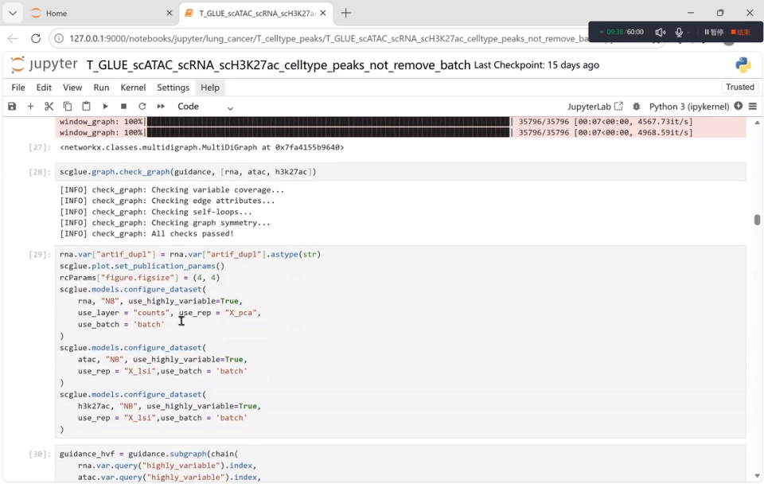

这张截图里有三个关键动作：

1. **建图**：`guidance.subgraph` 把三个模态的高变特征节点和它们之间的边抽出来，得到一个 `guidance_hvf` 子图；
2. **查图**：`scglue.graph.check_graph` 会检查变量覆盖、边属性、自环、对称性，最后打印 `All checks passed!`——**这一步别跳过**，图有问题时模型不会报错，只会悄悄变差；
3. **配置数据集**：`scglue.models.configure_dataset` 对每个模态分别指定分布（图中是 `"NB"`，负二项分布）、是否只用高变特征、用哪个降维结果（`use_rep`）、批次列名（`use_batch`）。

### 4.6 为什么是负二项分布

讲者专门解释了这个选择 [【跳转到 10:02】](https://www.bilibili.com/video/BV1hBMc6yEw6/?t=602)：单细胞转录组数据的特点是**零值膨胀**（有非常多的零，因为很多基因不表达）和**过度离散**（方差远大于均值），所以在很多工具里都会用负二项分布作为它的模拟分布，因此三个模态都指定负二项分布作为标准分布 [【跳转到 10:32】](https://www.bilibili.com/video/BV1hBMc6yEw6/?t=632)。

这是**解码器的似然函数**：你告诉模型「这个模态的数据大致服从什么分布」，模型才能算重建误差。分布选错，重建项就会把噪声当信号学进去。

### 4.7 先验图裁剪：为了省算力

配置里还有一个动作：**先验图裁剪**——「把先验图裁剪得只剩下那些高变特征对应的节点和边，以减少计算的时间和计算要消耗的资源」[【跳转到 10:57】](https://www.bilibili.com/video/BV1hBMc6yEw6/?t=657)。

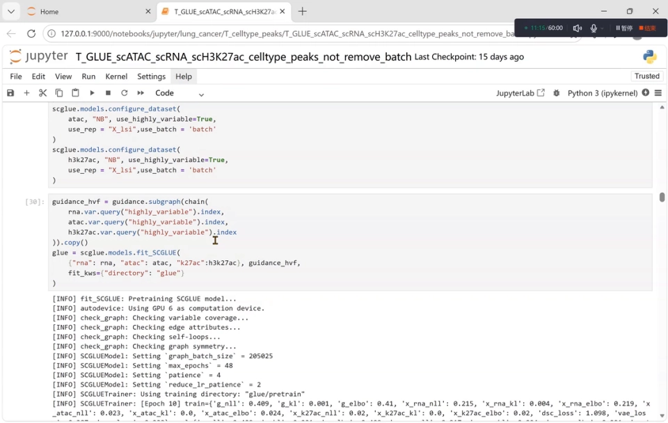

训练调用就是一行 `fit_SCGLUE`，传入三个模态的配置和引导图，指定输出目录。日志里能看到 max_epochs 设为 48、patience 设为 4（早停耐心值），以及每个 epoch 各模态的损失项（`rna_nll`、`atac_nll`、`h3k27ac_nll`、`rna_kl`、`atac_kl`、`h3k27ac_kl`、`dsc_loss`）——**每个模态有自己的重建损失和 KL 项**，这正是「每个模态一套 VAE」在代码层面的体现。讲者说「训练时间还蛮久的」，最后保存成一个目录 [【跳转到 11:22】](https://www.bilibili.com/video/BV1hBMc6yEw6/?t=682)。

## 五、怎么判断整合成功了：两条曲线和一张 UMAP

### 5.1 整合一致性曲线：选隐空间维度

scGLUE 提供了一个自带的评估工具 `scglue.models.integration_consistency`，它「考察不同潜在维度下整合表现」，画出一条**整合一致性曲线** [【跳转到 14:03】](https://www.bilibili.com/video/BV1hBMc6yEw6/?t=843)。

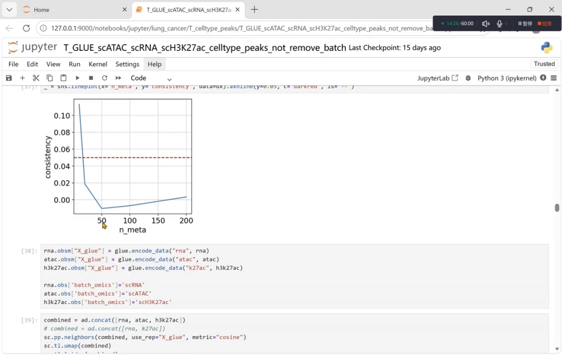

这张图是实操里最有用的一个判据。横轴是隐空间维度（`n_meta`，从 50 到 200），纵轴是一致性指标，红色虚线是参考水平。曲线在 **50 附近取到最小值**，讲者的结论是「在 N 是 50 的时候是比较好的」[【跳转到 14:23】](https://www.bilibili.com/video/BV1hBMc6yEw6/?t=863)。

**怎么理解这条曲线**：它衡量的是「在这个维度下，各模态的细胞嵌入之间的一致性有多差」，所以**越低越好**。维度太低，模型没空间装下生物异质性；维度太高，模型有空间把每个模态的噪声也各自编码进去，一致性反而变差。曲线的最小值就是这两者的平衡点。

### 5.2 三个模态的 UMAP：布局一致就说明对齐了

选好维度后，把三个数据集整合到一起（`ad.concat` 后算邻居图、跑 UMAP），然后分别画三个模态的降维图 [【跳转到 14:46】](https://www.bilibili.com/video/BV1hBMc6yEw6/?t=886)。

讲者的判断标准很直接：「只是 RNA 的、ATAC 的和 H3K27ac 的，会发现他们这个细胞布局大致类似，就说明他们整合的效果——降维到这里他们是基本上一致的」[【跳转到 14:51】](https://www.bilibili.com/video/BV1hBMc6yEw6/?t=891)。

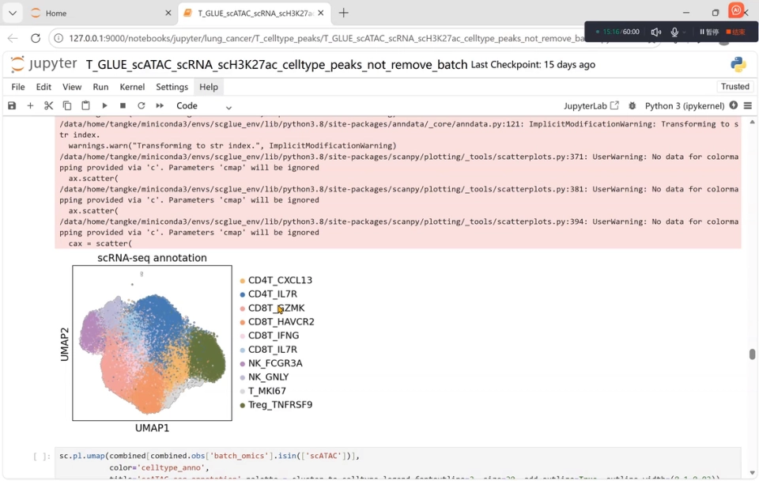

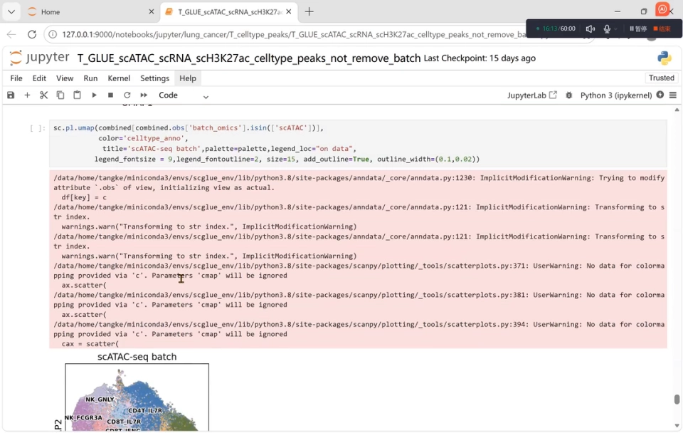

这两张图要对照着看。第一张是 RNA 的 UMAP，带的是**原始注释**（CD4T_CXCL13、CD4T_IL7R、CD8T_GZMK、CD8T_HAVCR2、CD8T_IFNG、CD8T_IL7R、NK_FCGR3A、NK_GNLY、T_MKI67、Treg_TNFRSF9 等 11 个 T 细胞亚型）。第二张是 ATAC 的 UMAP，用的是**同一套标签**——这些标签是从 RNA 那边迁移过来的。

「以此我们也可以来看 RNA、ATAC，ATAC 这个细胞类型也都有，是从 RNA 这里直接对应过来的」[【跳转到 15:30】](https://www.bilibili.com/video/BV1hBMc6yEw6/?t=930)。

### 5.3 注释迁移：从 RNA 到 ATAC 到 H3K27ac

整个整合的最终产出，是一张三模态共标注的降维图：「经过 scGLUE 以后，ATAC 和 H3K27ac 他们也都有了这个细胞亚群」[【跳转到 16:13】](https://www.bilibili.com/video/BV1hBMc6yEw6/?t=973)。

基础是 RNA 那边的注释——「RNA 一开始通过 Harmony 方式已经处理好了，存储在这个 H5AD 里」[【跳转到 15:59】](https://www.bilibili.com/video/BV1hBMc6yEw6/?t=959)。也就是说，**scGLUE 在这里扮演的是「把已有注释迁移到没有注释的模态」的角色**，而不是从头做聚类。

## 六、一个真实的坑：注释缺失值怎么填

实操里讲者卡了一会儿，值得单独说 [【跳转到 12:58】](https://www.bilibili.com/video/BV1hBMc6yEw6/?t=778)。

问题：H3K27ac 数据**没有细胞类型注释**（它的注释文件里没有这个字段）。为了在图上区分「ATAC 细胞」和「H3K27ac 细胞」，讲者先把缺失值统一填充为「H3K27ac」，标记该模态的来源。

但这样操作会带来一个新问题：**同样缺乏注释的 ATAC 细胞也被标记成了 H3K27ac** [【跳转到 13:23】](https://www.bilibili.com/video/BV1hBMc6yEw6/?t=803)。

所以还要再修正一次：根据模态信息，把「模态是 ATAC 但注释是 H3K27ac」的细胞改回 `unknown`，这样才能区分 ATAC 数据里已知和未知细胞的身份 [【跳转到 13:36】](https://www.bilibili.com/video/BV1hBMc6yEw6/?t=816)。

这个坑很典型：**在跨模态数据里，「缺失」和「某一类」用同一个字符串表示时，填充动作会把两类东西混在一起**。多模态整合的元数据对齐，往往就卡在这种细节上。

## 七、讲者的实测评价：能跑，但门槛不低

视频最后，讲者给了自己的评价 [【跳转到 16:13】](https://www.bilibili.com/video/BV1hBMc6yEw6/?t=973)：

**难点**：

- 「需要对代码编程有一定的了解」；
- 「不少流程其实是比较精细的」——比如要检查变量内部重复的名字，「这个地方比较多的话就是要小心」；
- 一开始的基因名统一「这点不一定能想得到」，不统一后面会有很多麻烦；
- 「上手比较难」，「要自己去摸索、探索很多，要找很多参数，最后才能够确定这个模型的效果」。

**效果**：

- 「我自己那个平行评估的话并没有很好，但是我觉得它比 Harmony 整合看起来要好一点」[【跳转到 16:54】](https://www.bilibili.com/video/BV1hBMc6yEw6/?t=1014)。

这里要提醒一句：讲者的对比是**非正式的**——他自己说平行评估做得并不好，而且 Harmony 是单模态去批次工具，跟跨模态整合本来就不是同一类任务。这个对比只能当作「跑通之后看起来不差」的体感，不能当作性能结论。要做严肃比较，得看系统性的基准研究。

## 小结

- **非配对整合的根本困难**：两个模态既没有共享的细胞，也没有共享的特征，所以「对齐」这件事无从下手。
- **scGLUE 的解法是用先验知识造桥**：把「基因—峰」的调控关系做成引导图，用图神经网络把这张图编码进特征嵌入空间，让两个模态在隐空间里共享语义坐标。
- **架构是「横向 VAE + 纵向 GNN」**：每个模态一套编解码器负责压缩与重建，引导图负责把不同模态的特征嵌入拉到一起。
- **用户只需准备两个输入**：各模态预处理后的细胞特征矩阵，以及先验引导图。
- **实操四道关**：基因名统一（否则先验图静默失效）、小簇过滤（否则对齐被拖累）、基因组坐标（否则建不了图）、分布选择（负二项对应单细胞的零膨胀与过度离散）。
- **判断整合成功看两条线**：整合一致性曲线选隐空间维度（越低越好，本讲取 50），三个模态的 UMAP 布局一致说明对齐成功。
- **注释迁移是主要产出**：RNA 的注释通过联合嵌入迁移到 ATAC 与 H3K27ac，让没有注释的模态也有了细胞亚型。
- **门槛在工程细节**：元数据缺失值的填充、变量重名检查、参数摸索，这些不出现在论文里，却决定了能不能跑出结果。

## 关键术语速查

| 术语 | 一句话解释 |
| --- | --- |
| 配对 / 非配对数据 | 配对指同一批细胞测了多个模态；非配对指不同细胞各测一个模态，细胞对应关系未知 |
| Joint embedding（联合嵌入） | 把多个模态的细胞投到同一个低维隐空间，使同一类细胞在不同模态里落到相近位置 |
| Guidance graph（引导图） | 用先验生物学知识构建的图，顶点是特征（基因、ATAC 峰），边是已知或推测的调控关系 |
| VAE（变分自编码器） | 编码器把高维数据压成低维隐变量，解码器再重建；scGLUE 每个模态一套 |
| 负二项分布（NB） | 用于刻画单细胞计数数据的分布，能同时处理零膨胀与过度离散 |
| GTF | 基因注释文件格式，第 9 列的 attribute 字段里带基因名 |
| H5AD | Annotated Data Matrix with HDF5，单细胞分析结果的专用存储格式 |
| Integration consistency | scGLUE 自带的整合质量指标，用来选隐空间维度，数值越低越好 |
| 注释迁移 | 把一个模态已有的细胞类型标签，通过联合嵌入搬到另一个没有注释的模态上 |